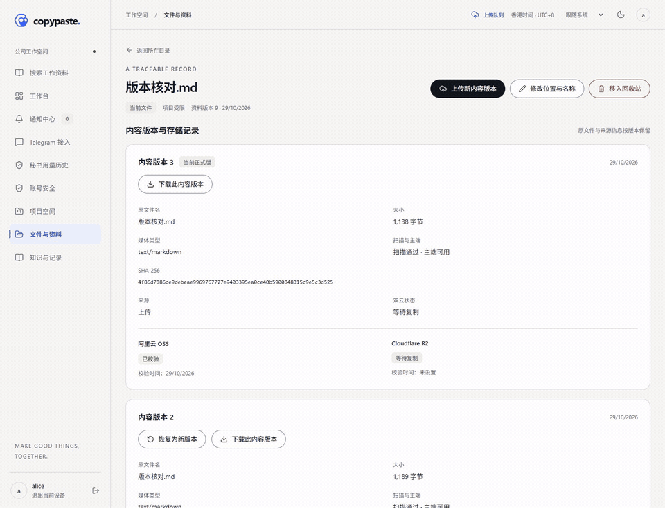
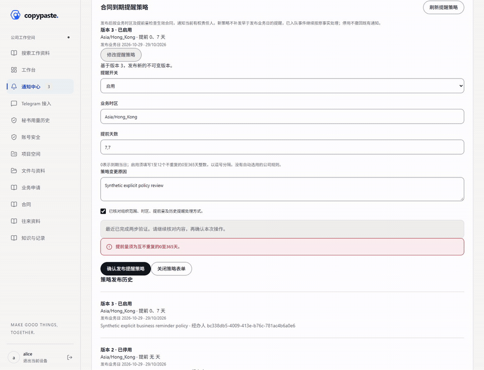
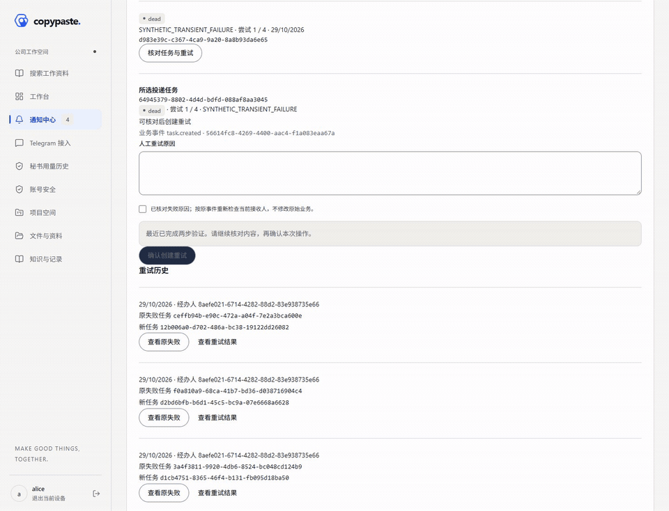
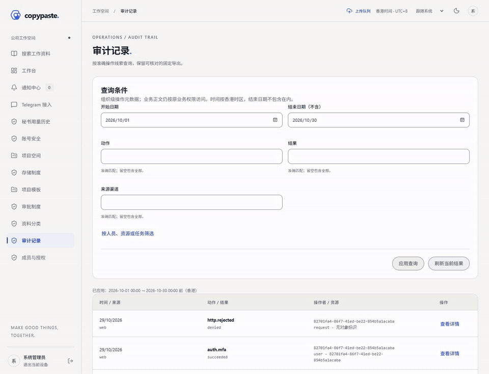
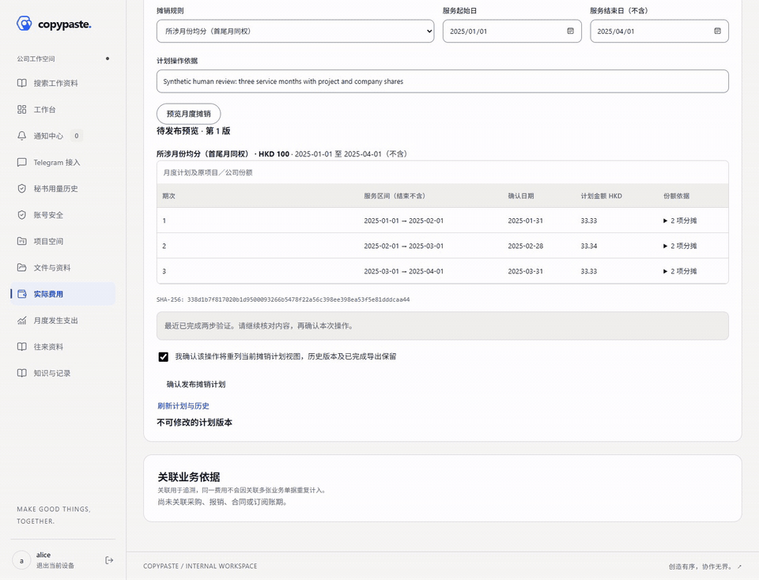
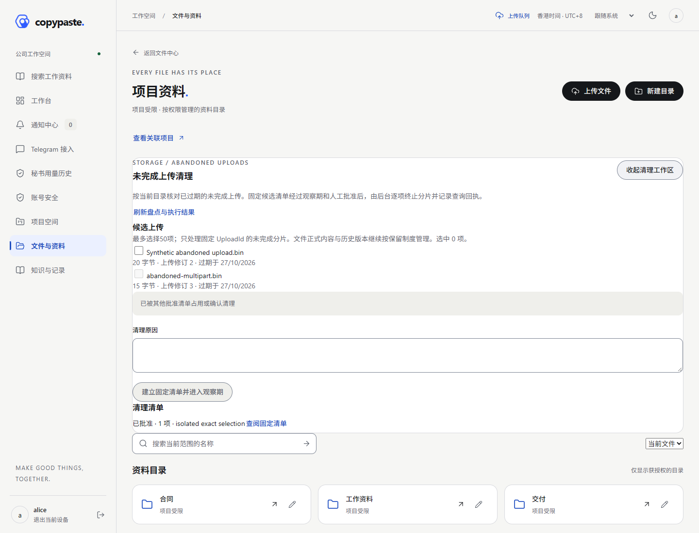
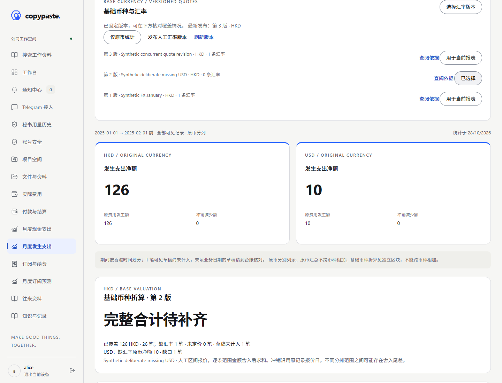
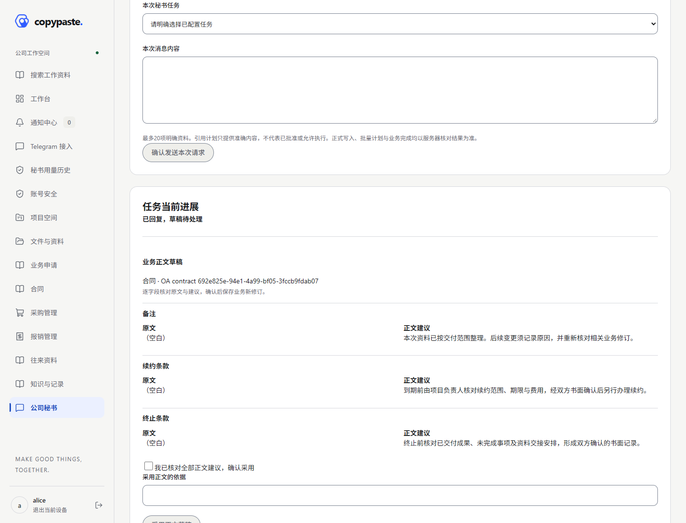
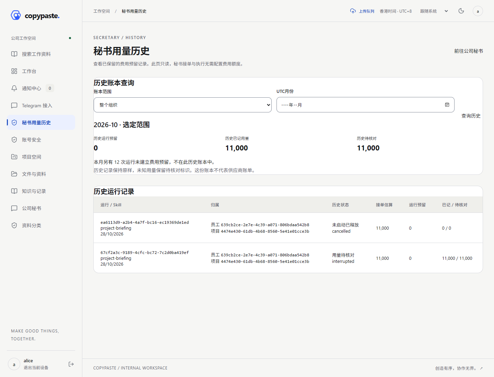
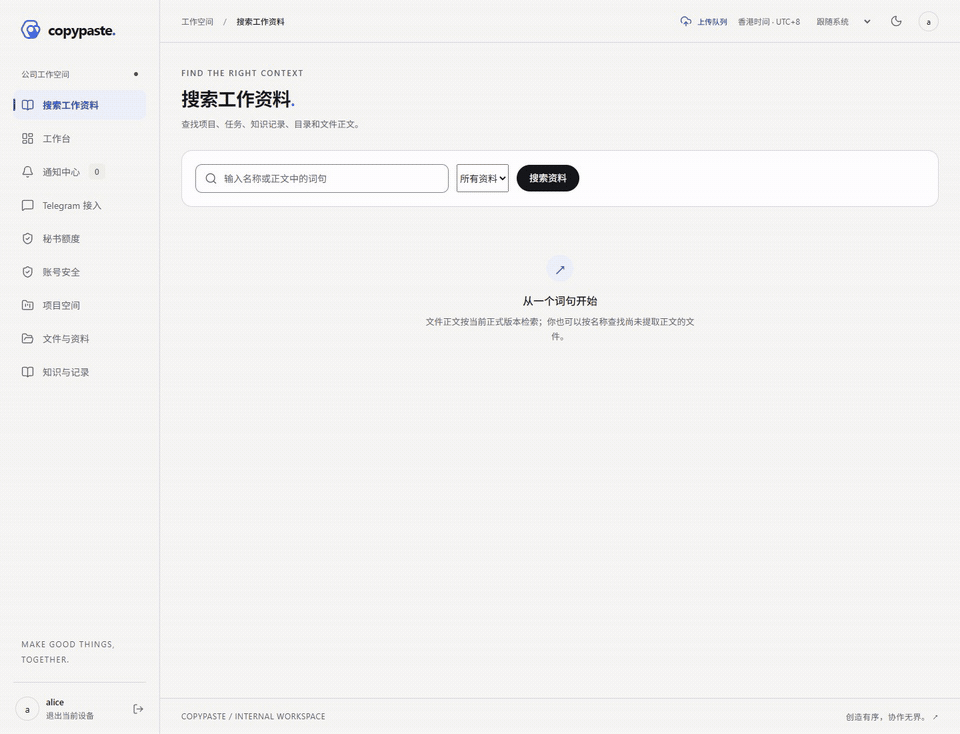

# CopyPaste Case Manager · 企业内部管理平台

增量116已接通四端实际付款双币核销：人工固定费用原币金额、实际汇率方向及凭证来源，以付款币核对现金，以费用原币核对费用和员工垫付。部分释放、退款及全额冲销保留两套金额和对齐项目份额，重新加锁核对当前余额，最后一笔处理准确尾差。原始费用／现金事实、历史报价及完成导出保持不变。

Increment 116 connects actual cross-currency payments to incurred costs across Web, WeChat, Douyin and Android. A human fixes the cost amount, actual payment-units-per-cost-unit rate and evidence source. Cash balances use payment units; costs and employee claims use cost units. Partial releases, refunds and full reversals preserve both axes and aligned project shares, recheck locked current balances, and consume the exact final remainder. Original expense/cash facts, quotation history and completed exports stay fixed.

使用：付款与结算 → 已登记原付款 → 分配费用结算 → 选择准确费用（员工收款先选择批准垫付行）→ 输入付款币本金、费用原币金额、实际汇率及凭证来源 → 核对双币并完成MFA → 确认。释放或退款引用原正向分配，核对当前双币余额和显示的回转金额；未知结果先刷新流水。

Usage: open a recorded outgoing payment, choose 分配费用结算 and an actual confirmed cost (for an employee, first select the approved advance line). Enter payment principal, cost units, actual rate and evidence source, acknowledge both axes and confirm with recent MFA. For releases/refunds, select the original positive allocation and review the current dual balances and inverse amount. Refresh the ledger before retrying an uncertain result.

仍23项工作包（14 P0／9 P1）、5项移出、8项draft Skill。公司财务制度采纳、手续费／汇兑差额、与原付款异币的实收退款及完整GAP-03／18旅程继续开放。实际结算汇率不会自动选用报告估值汇率。仅AI费用控制移出；秘书、TG、授权、审计、隔离及技术限制保留。

All 23 packages (14 P0/9 P1), five exclusions and eight draft Skills remain. Company accounting policy adoption, fees/exchange differences, refunds received in another currency and full GAP-03/18 journeys remain open. Actual settlements never automatically select a reporting FX book. Only AI fee controls are excluded; secretary, TG, authorization, audit, isolation and technical limits remain required.

当前源码：后端238顶层／1477条结果，Web294、共享移动390、运行时55；八项客户端命令、双小程序各20页。Web和Taro H5各6组真实页面／API检查；6 PNG、2静音MP4、2截图导览GIF，286份旧媒体保留原字节。当前开发APK通过18＋3静态检查，26条JVM来自Gradle缓存。另以已发布115的真实现金用例验证schema88→89正常升级，14张原事实表内容不变；开发服务已按准确源码重载，独立耐久PG关闭。两个Linux目标仅交叉构建，不代表真实云／模型／TG、正式平台或生产验收。

Current source: 238 backend top-level tests/1477 result records; Web 294, shared mobile 390, runtime 55. Eight client commands pass and both miniapps retain 20 routes. Web and Taro H5 each pass 6 actual UI/API groups. New media: 6 PNGs, 2 silent MP4s and 2 screenshot-tour GIFs; 286 older media retain their bytes. A current development APK passes 18+3 static checks; 26 JVM results are from Gradle cache. A separate published 115 cash journey verifies the normal 88→89 upgrade with 14 original fact tables unchanged. Development services reload to exact current sources and the owned durable test PG closes. Two Linux targets only cross-build; live cloud/model/TG, formal platform and production acceptance remain open.

[方案与使用 / Design](docs/development/116-cross-currency-settlement.md) · [验证 / Verification](docs/quality/116-cross-currency-settlement-verification.md) · [截图／录屏／GIF / Media](docs/media/README.md) · [全部未完成项 / Remaining](docs/delivery/03-goal-gap-assessment.md)

增量115已接通四端受控人工跨范围文件整理：员工从实际目录选择跨项目／分类目标，先分析完整清单及普通／AI读取策略变化，再以准确计划摘要、原因、明确声明和近期MFA确认执行。目录树逐项重检，正式内容历史保留；正式业务引用、保留锁、在途任务、分类降级或陈旧依据阻止执行。最终决定及审计不可改写，重复提交返回同一回执。

Increment 115 adds human reviewed file and folder-tree transfers across Web, WeChat, Douyin and Android. Select an actual cross-project/classification destination, analyze the complete fixed inventory and changed ordinary/AI read-policy combinations, then confirm the exact plan with a reason, acknowledgement and recent MFA. Execution rechecks every item and preserves immutable content history. Business references, retention holds, in-flight work, classification downgrades and stale facts block execution. Final decisions and audit evidence remain immutable; idempotent retries return one receipt.

使用：文件与资料 → 实际文件或非根目录 →“拟定跨范围移动”→ 选择实际目标 →“分析跨范围移动”→ 核对全部清单及读取权限变化 → 明确声明、原因及MFA → 确认执行。移动端从回执“打开移动后的资料”；未知结果先刷新本人计划历史，不重复创建。

Usage: open a file or non-root folder in Files, choose 拟定跨范围移动, select an actual destination and analyze. Review the full inventory and read-policy changes, provide a reason and acknowledgement, then confirm with current MFA. On mobile, open the new location from the receipt. Refresh owner history before retrying an uncertain result.

仍有23项工作包（14 P0／9 P1）和5项移出。正式业务引用的跨范围协同、大树／批量策略及完整四端旅程继续GAP-18；AI跨范围工具、预授权及TG披露继续GAP-11。本功能不授予AI新工具。仅排除AI费用控制，秘书、8项Skill、TG、隔离、授权、审计和技术限制保留。

All 23 packages (14 P0/9 P1) and 5 exclusions remain. Transfers involving formal business references, larger/bulk policies and complete four-client journeys remain GAP-18. AI scope-changing tools, preauthorization and TG disclosure remain GAP-11. Only AI fee controls are excluded; secretary, eight Skills, TG, isolation, authorization, audit and technical limits remain required.

当前源码：后端236顶层／1449条结果，Web281、共享移动375、运行时55；八项客户端命令通过，双小程序各20页。Web／Taro H5各6组实际页面与API检查；6 PNG、2静音MP4、2截图轮播GIF，276份旧媒体原样保留。Android开发APK通过18＋3静态检查，26条JVM来自Gradle缓存。原生开发schema87→88，旧AI费用／用量资料保留；独立全耐久测试PG关闭且无临时库，两个Linux交叉构建通过。不声明真机、模拟器、真实云／模型／TG或生产验收。

Current source: 236 backend top-level tests / 1449 records; Web 281, shared mobile 375, runtime 55. Eight client commands pass; both miniapps retain 20 routes. Web/Taro H5 each pass 6 actual UI/API groups. New media: 6 PNGs, 2 silent MP4s and 2 screenshot-tour GIFs; 276 older media retain their bytes. A development APK passes 18 + 3 static checks; 26 JVM results came from Gradle cache. Native development schema upgrades87→88 while legacy AI fee/usage records stay fixed. The full-durability test PG closes without temporary databases; 2 Linux targets cross-build. No device, emulator, live cloud/model/TG or production acceptance is claimed.

[设计与使用 / Design](docs/development/115-file-scope-transfers.md) · [验证 / Verification](docs/quality/115-file-scope-transfers-verification.md) · [截图／录屏／GIF / Media](docs/media/README.md) · [全部未完成项 / Remaining work](docs/delivery/03-goal-gap-assessment.md)

增量114已接通四端业务工作台：本人当前有效审批、本人负责的生效合同到期及已生成订阅账期待核对。三个分组共享原生PG事务快照，先授权计数再展示前5条，点击进入原业务详情。合同使用正式生效修订及香港日期；账期待核对不表示欠款或已扣费。刷新失败隐藏旧汇总，撤权后重新读取清除旧数量与标题。

Increment 114 adds a business workbench across Web and the shared WeChat, Douyin and Android home pages: current assigned approvals, owned effective-contract expiry and generated subscription periods requiring review. One native PG snapshot counts authorized matches before selecting five-item samples. Fixed links open ordinary business details. Contracts use the active revision and Hong Kong dates; period review does not imply debt or an actual charge. Failed refreshes hide old results; refreshed authority removes revoked counts and titles.

使用：登录 → 首页业务待办 → 核对数量与日期 → 点击具体请求、合同或账期 → 在原详情核对当前依据再处理。Web使用“刷新业务待办”，移动端使用“刷新工作台”；超过5条提示到对应业务列表继续查阅。

Usage: sign in, review Business work on Home, open an exact request, contract or billing period, then inspect current facts before acting. Refresh the business desk on Web or the home page on mobile. Samples above five items disclose that additional matches exist; the business lists retain their own filters.

仍有23项工作包（14 P0／9 P1）与5项移出；服务／文件异常等更多聚合、实际存储故障、跨渠道回执、公司规则选用与完整业务旅程继续开放。仅移出AI费用控制；秘书、八项Skill、TG、隔离、授权、审计及技术限制保留。

All 23 packages (14 P0/9 P1) and 5 exclusions remain. Wider service/file aggregation, actual storage failures, cross-channel receipts, company policy adoption and complete business journeys stay open. Only AI fee controls are excluded; secretary, eight Skills, TG, isolation, authorization, audit and technical limits remain required.

当前源码核验：后端235个顶层测试／1435条结果，Web257、共享移动351、运行时55；八项客户端命令重新执行，微信／抖音各20页。Web与Taro H5各6组实际页面／API检查；新增6 PNG、2静音MP4、2截图轮播GIF，266份旧媒体保持原字节。Android开发APK通过18＋3项静态检查，26条JVM来自Gradle缓存。schema保持87，无迁移新增或重跑；独立全耐久原生PG及2个Linux交叉构建已核对。不声明真机、模拟器、真实云／模型／TG或生产验收；旧增量记录保留原日期与范围。

Current-source checks: 235 backend top-level tests / 1435 records; Web 257, shared mobile 351, runtime 55. All eight client commands execute; WeChat/Douyin retain 20 pages each. Web and Taro H5 each pass 6 actual page/API groups. New media: 6 PNGs, 2 silent MP4 recordings and 2 screenshot-tour GIFs; 266 prior media keep exact bytes. A development APK passes 18 + 3 static checks; 26 JVM results came from Gradle cache. Schema stays 87 with no new or replayed migration. Full-durability native test PG and 2 Linux cross-builds are checked. No device, emulator, live cloud/model/TG or production acceptance is claimed. Older records retain their original dates and scope.

[设计与使用 / Design](docs/development/114-business-workbench.md) · [验证 / Verification](docs/quality/114-business-workbench-verification.md) · [截图／录屏／GIF / Media](docs/media/README.md) · [全部未完成项 / Remaining work](docs/delivery/03-goal-gap-assessment.md)

增量113已实现四端文件版本正文比较：人工明确选定两个正式版本，完整正文行差异、前后文与全文分页、末尾换行核对、原件／正文摘要分离及固定比较依据。选择不自动读取；文件／权限／扫描依据变化后拒绝旧页并隐藏旧结果。支持文本、Markdown、CSV、JSON及DOCX主文档正文；更多格式、PDF／OCR、排版与复杂DOCX仍在GAP-04，完整四端业务旅程仍在GAP-18。23项（14 P0／9 P1）及5项移出保持不变；仅移出AI费用控制，秘书、八项Skill、TG、隔离、授权、审计及技术限制继续保留。

Increment 113 adds file version text comparison across Web and the shared WeChat, Douyin and Android pages: explicit exact-version selection, complete derived-text line diffs, context or all-text paging, final-newline checks, separate original/text hashes and pinned comparison identity. Selection alone does not read a diff. Changed file, authority or scan evidence rejects old pages and hides stale results. Text, Markdown, CSV, JSON and DOCX main-body text are supported; wider formats, PDF/OCR, layout and complex DOCX remain GAP-04, with full business journeys under GAP-18. All 23 packages (14 P0/9 P1) and 5 exclusions remain. Only AI fee controls are excluded; secretary, eight Skills, TG, isolation, authorization, audit and technical limits remain required.

操作：文件详情 → 比较两个内容版本 → 选择基础／目标准确版本 → 明确比较 → 选择差异前后文或全部正文并重新比较 → 按页核对。提取正文相同不表示原件相同；遇到依据变化，刷新文件并核对现行资料后重新比较。

Usage: open file details, select exact base/target versions, explicitly compare, choose changes/context or all text, and review the pinned pages. Equal derived text does not imply equal original bytes. Refresh current file metadata and review the selection after a changed-basis conflict.

当前源码核验：后端234个顶层测试／1424条结果，Web238、共享移动332、运行时55；八项客户端命令实际执行，双小程序各20页。Web与Taro H5各6组实际页面／API检查；新增7 PNG、2静音MP4、2 GIF，255份旧媒体保留原字节。Android开发APK通过18＋4项静态检查，26条JVM来自Gradle缓存；schema保持87，无新增或重跑迁移；独立全耐久原生PG及2个Linux交叉构建已核对。不声明真机、模拟器、真实云／模型／TG或生产验收。下方旧增量统计保留原日期与适用范围。

Current-source checks: 234 backend top-level tests / 1424 records, Web 238, shared mobile 332 and runtime 55; all eight client commands execute and both miniapps retain 20 pages. Web and Taro H5 each pass 6 actual page/API groups. New media: 7 PNGs, 2 silent MP4s and 2 GIFs; 255 previous media retain original bytes. A development APK passes 18 + 4 static checks; 26 JVM results came from Gradle cache. Schema remains 87 with no new or replayed migration. Full-durability native temporary PG and 2 Linux cross-builds are checked. No device, emulator, live cloud/model/TG or production acceptance is claimed. Older increment statistics below retain their original dates and scope.



[设计与使用 / Design and usage](docs/development/113-file-version-comparison.md) · [验证与来源 / Verification](docs/quality/113-file-version-comparison-verification.md) · [截图／录屏／GIF / Media](docs/media/README.md) · [全部未完成项 / Remaining work](docs/delivery/03-goal-gap-assessment.md)

增量112已实现四端秘书准确草稿恢复：员工选定已结束请求中的准确草稿，核对差异和摘要后明确创建新任务；固定原目标、基础版本和来源，重新上传、校验与扫描，再通过原有授权计划正式提交。支持文件更新与新文件创建；原任务与回执保持历史事实。依赖变化、扫描隔离、会话撤销、取消及冲突会阻断执行。GAP-04／12中的该子流程已实现，更多格式、全文差异、完整OA附件和真实模型／Skill验收仍开放；23项（14 P0／9 P1）及5项移出不变。仅移出AI费用控制，秘书、八项Skill、TG、隔离、授权、审计和技术限制保留。

Increment 112 adds exact saved-draft recovery across Web and the shared WeChat, Douyin and Android secretary pages. A human selects an ended request’s exact draft, reviews its diff and digest, and explicitly creates a new run. Original target, base and provenance are fixed; execution uploads, verifies and scans fresh bytes before the existing authorized formal commit. Updates and new-file drafts are supported. Dependency changes, quarantine, revoked sessions, cancellation and conflicts stop execution. This completes a subfeature of GAP-04/12; wider formats, full-text diffs, complete OA attachments and real model/Skill acceptance remain open. All 23 packages (14 P0/9 P1) and 5 exclusions remain. Only AI fee controls are excluded; secretary, eight Skills, TG, isolation, authorization, audit and technical limits remain required.

操作：本人私密秘书会话 → 选择文件任务 → 选择原请求与准确草稿 → 核对差异／摘要并勾选声明 → 加入请求 → 明确发送 → 核对新任务来源及真实执行状态。接单不等于上传、扫描或正式提交；来源或基础版本变化时，须人工核对现行内容后发起新编辑。

Usage: open your own private secretary conversation, choose the file task, select the original request and exact draft, review and confirm the diff/digest, add the recovery and explicitly send. Inspect new-run provenance and actual execution state. Admission does not mean upload, scanning or formal commit. Changed sources or bases require human review and a new edit request.

本轮源码核验：后端231个顶层测试／1410条结果，Web219、共享移动313、运行时55；八项客户端命令全部执行，双小程序各20页。Web与Taro H5各5组真实页面／API检查；新增7 PNG、2静音MP4、2 GIF，244份旧媒体保留原字节。Android开发APK通过18＋4项静态检查，26条JVM来自Gradle缓存；普通schema86→87升级、全耐久原生临时PG及2个Linux交叉构建已核对。无真机、模拟器、真实云／模型／TG或生产验收声明。下方旧增量的统计保留原执行日期与适用范围。

Current-source checks: 231 backend top-level tests / 1410 records, Web 219, shared mobile 313 and runtime 55; all eight client commands execute and each miniapp retains 20 pages. Web and Taro H5 each pass 5 actual page/API groups. New media: 7 PNGs, 2 silent MP4s and 2 GIFs; 244 previous media retain original bytes. A development APK passes 18 + 4 static checks; 26 JVM results came from Gradle cache. A normal schema 86 to 87 upgrade, fully durable temporary native PG and 2 Linux cross-builds are verified. No device, emulator, live cloud/model/TG or production acceptance is claimed. Older increment statistics below retain their original dates and scope.

[设计与使用 / Design and usage](docs/development/112-secretary-file-recovery.md) · [验证与来源 / Verification](docs/quality/112-secretary-file-recovery-verification.md) · [截图／录屏／GIF / Media](docs/media/README.md) · [全部未完成项 / Remaining work](docs/delivery/03-goal-gap-assessment.md)

增量111已实现四端合同到期提醒策略：独立读／管理授权、近期MFA、准确版本发布、不可变历史和真实Worker调度。组织策略（包括停用）覆盖部署规则；新策略不补发早于发布业务日的历史阈值，已有通知事实保留。规则修改后须重新确认。GAP-08仍待更多聚合、实际复制故障、跨渠道送达及公司规则选用；全部23项（14 P0／9 P1）与5项移出不变。AI仅移出费用控制，秘书、八项Skill、TG、隔离、授权、审计和技术限制保留。

Increment 111 adds contract expiry reminder policies across Web and the shared WeChat, Douyin and Android pages: separate read/manage authority, recent MFA, fixed-version publication, immutable history and real worker scheduling. An organization policy, including disable, overrides deployment fallback. New rules do not backfill thresholds before their publication business date; existing notification facts remain. Editing a rule requires confirmation again. GAP-08 still includes wider aggregation, real storage failures, cross-channel delivery and actual company rule adoption. All 23 packages (14 P0/9 P1) and 5 exclusions remain. Only AI fee control is excluded; secretary, eight Skills, TG, isolation, authorization, audit and technical limits remain required.

[设计与使用 / Design and usage](docs/development/111-contract-reminder-policies.md) · [验证与来源 / Verification](docs/quality/111-contract-reminder-policies-verification.md) · [全部未完成项 / All remaining work](docs/delivery/03-goal-gap-assessment.md)

当前源码核验：后端230个顶层测试／1396条结果，Web205、共享移动299、运行时55；最终八项客户端命令全部重新执行，微信／抖音各20页。Web与Taro H5各5组真实页面／API检查；新增7 PNG、2静音MP4、2 GIF，原233份媒体保留准确字节。Android开发APK通过18＋4项静态检查，26条JVM来自Gradle缓存。另有本地schema85→86升级、全耐久原生临时PG及2个Linux交叉构建；不声明真机、真实云／模型／TG或生产验收。

Current-source verification: 230 backend top-level tests / 1396 records, 205 Web, 299 shared mobile and 55 runtime tests. All eight final client commands reran; each miniapp retains 20 pages. Web and Taro H5 each pass 5 actual page/API groups. New media: 7 PNGs, 2 silent MP4s and 2 GIFs; 233 previous media retain exact bytes. The development APK passes 18 + 4 static checks; 26 JVM results came from Gradle cache. A local schema 85 to 86 upgrade, a fully durable temporary native PG cluster and 2 Linux cross-builds also pass. No device, live cloud/model/TG or production acceptance is claimed.



增量110已接通四端站内通知失败的人工重试：独立组织授权、近期MFA、固定原事件、明确确认、不可变父子任务和可追踪结果。原失败不重置，实际Worker重查当前接收人，等待中详情自动刷新。更多工作台聚合、提醒策略、实际复制故障及跨渠道送达仍属GAP-08；完整23项（14 P0／9 P1）和5项移出保持不变。AI仅移出费用控制，秘书、八项Skill、TG、授权、审计、隔离和技术限制继续保留。

Increment 110 adds controlled human retries for failed in-app notifications across Web and the shared WeChat, Douyin and Android pages. Separate organization authority, recent MFA, a fixed original event, explicit confirmation and immutable parent/child receipts preserve the failure history. The real worker checks current recipients; pending details refresh automatically. Dashboard aggregation, reminder configuration, actual replication failures and cross-channel delivery remain open under GAP-08. All 23 packages (14 P0/9 P1) and 5 exclusions remain. Only AI cost control is excluded; secretary, eight Skills, TG, authorization, audit, isolation and technical limits remain required.

[设计与使用 / Design and usage](docs/development/110-notification-retry.md) · [验证与来源 / Verification](docs/quality/110-notification-retry-verification.md) · [全部待办 / All remaining work](docs/delivery/03-goal-gap-assessment.md)

当前源码检查：后端229个顶层测试／1383条结果，Web195、共享移动289、运行时55；八项客户端命令全部重新执行通过，微信／抖音各20页。Android开发APK通过18＋4项静态检查，26条JVM结果来自Gradle缓存。Web与Taro H5各5组实际浏览器／API／租约Worker操作通过；新增7 PNG、2段静音MP4、2个GIF，原222份媒体字节保留。另有2个Linux交叉构建及本地普通schema84→85升级；不声明真机、真实云／模型／TG或生产验收。

Current-source checks: 229 backend top-level tests / 1383 records, 195 Web, 289 shared mobile and 55 runtime tests. All eight client commands reran and passed; both miniapps retain 20 pages. A development APK passes 18 + 4 static checks; its 26 JVM records came from Gradle cache. Web and Taro H5 each pass 5 actual browser/API/leased-worker check groups. New media: 7 PNGs, 2 silent MP4s and 2 GIFs; all 222 historical media retain exact bytes. Two Linux cross-builds and a local schema84-to85 upgrade also pass. No device, live cloud/model/TG or production acceptance is claimed.



增量109已接通四端组织级审计查询与固定CSV导出：准确筛选、签名游标、元数据详情、本人导出历史、近期MFA和下载摘要校验。原业务正文权限继续生效；导出最多10,000条／8 MiB、有效24小时。抖音端可查询和生成，CSV暂由同账号Web下载。GAP-07的模型／Skill、TG运行及存储管理仍开放；全部23项（14 P0／9 P1）和5项移出不变。AI仅移出费用控制，秘书、八项Skill、TG、授权、审计、执行隔离和技术限制保留。

Increment 109 adds organization audit metadata queries and sealed CSV exports across Web and the shared WeChat, Douyin and Android pages: exact filters, signed cursors, event details, owner history, recent MFA and verified file bytes. Business-content permissions remain enforced. Exports allow up to 10,000 rows / 8 MiB for 24 hours. Douyin supports query/create; use the same account on Web to download its CSV. Model/Skill, TG operations and storage administration remain open under GAP-07. All 23 packages (14 P0/9 P1) and 5 exclusions remain. Only AI cost control is excluded; secretary, eight Skills, TG, authorization, audit, isolation and technical limits are retained.

[设计与操作 / Design and use](docs/development/109-audit-console.md) · [验证与来源 / Verification](docs/quality/109-audit-console-verification.md) · [全部待办 / All remaining work](docs/delivery/03-goal-gap-assessment.md)

当前源码核验：后端228个顶层测试／1368条结果，Web185、共享移动281、运行时55，微信／抖音各20页，Android开发APK及18＋4项静态检查、2个Linux交叉构建。Web与Taro H5各5组实际浏览器／API操作通过；新增7 PNG／2静音MP4／2 GIF，原211份媒体字节保留。26条JVM结果来自Gradle缓存。Web布局修正后3项相关命令重跑，5项未受影响命令保留本轮原始执行；不声明真机、真实云／模型或生产验收。

Current checks: 228 backend top-level tests / 1368 records, 185 Web, 281 shared mobile and 55 runtime tests; 20 pages per miniapp, a development APK with 18 + 4 static checks and 2 Linux cross-builds. Both real Web/Taro H5 journeys pass 5 check groups. New media: 7 PNGs, 2 silent MP4s and 2 GIFs; all 211 historical media retain exact bytes. The 26 JVM records came from Gradle cache. After the Web layout correction, 3 affected commands reran; 5 unaffected commands retain their original same-increment execution. No device, live cloud/model or production acceptance is claimed.



[逐项验收范围 / AC/TC applicability](docs/quality/04-current-acceptance-applicability.md)：保留原30项AC／72项TC编号，逐项列明保留和移出内容。分类检查不等于业务验收通过。 / All original 30 AC and 72 TC IDs retain explicit current boundaries; classification is not business acceptance.

增量108已实现合并库安全补丁、维护版URI同步适配及Babel／esbuild／XML／send／UUID升级，完整npm审计从63项降至0项。自维护补丁公开源码、MIT许可证、原版SHA256和实际复现；不以改名代替修复。正式发布依赖与产物安全验收仍开放，当前23个工作包（14 P0／9 P1）及5项移出不变。AI仅移出费用控制，秘书、八项Skill、TG、权限、审计、执行隔离和技术限制保留。

Increment 108 implements a disclosed MIT merge patch, a maintained URI parser bridge and patched Babel, esbuild, XML, send and UUID versions. The full npm audit changes from 63 findings to 0, with all dependency scopes included. The local fork retains its upstream checksum, license and original reproduction; renaming alone is not a fix. Formal production dependencies and artifacts still require acceptance. All 23 work packages (14 P0/9 P1) remain active, with 5 exclusions. Only AI cost control is excluded; the secretary, eight Skills, TG, authorization, audit, isolation and technical limits remain required.

[实现与命令 / Design and commands](docs/development/108-dependency-integrity.md) · [执行与来源 / Execution and provenance](docs/quality/108-dependency-integrity-verification.md) · [全部待办 / All remaining work](docs/delivery/03-goal-gap-assessment.md)

本轮新执行通过：标准npm ci、56项依赖检查＋2项原生JS检查、8项客户端命令（Web172／移动273／运行时55，微信／抖音各20页）、Android开发包及18项APK检查、H5服务5项及原生Edge3项。原生bundle已确认包含URI适配与维护版解析器；26条JVM结果来自Gradle缓存。31组源码核对通过。211份旧媒体、未改后端224／1355及2个Linux交叉构建保留原执行范围。

Fresh checks pass: standard npm ci, 56 dependency checks plus 2 native JS checks, 8 client commands (172 Web, 273 mobile and 55 runtime tests; 20 pages per miniapp), a development APK with 18 checks, and 5 H5 server plus 3 native Edge checks. The actual Metro bundle includes the URI bridge and maintained parser. The 26 JVM results came from Gradle cache; all 31 source checks pass. The 211 historical media files, unchanged backend results (224 top-level tests / 1355 records) and 2 Linux cross-builds retain their original scope.

增量106：已接通四端人工费用摊销。明确选择月份均分或按日分配、服务期间和依据，预览逐月项目／公司份额，经最近MFA及口径确认后发布不可变版本；支持停用、完整历史、独立报表、固定导出和冲销沿用原月份汇率。修订或停用重列当前计划视图，原费用／现金事实和已完成导出保留。实际公司制度、跨币种核销、手续费／汇差和完整旅程仍开放；23个工作包（14 P0／9 P1）、5项排除不变。

Increment 106 adds human-managed amortization across Web, WeChat, Douyin and Android. Choose monthly-equal or daily-weighted service periods, preview project/company shares, complete recent MFA and acknowledge the report basis before publishing an immutable version. Stopping, history, independent reports, frozen exports and original-month FX reversal are supported. Replacing or stopping restates the current schedule view; original expense/cash facts and completed exports remain fixed. Company policy adoption, cross-currency settlement, exchange fees/differences and full workflows remain open; 23 packages remain active, 5 excluded.

当前源码：后端224个顶层／1355条结果，Web172、共享移动273、运行时55；微信／抖音各20页、Android开发APK及18+4项静态检查、两个Linux交叉编译。26条JVM按实际缓存结果记录。修复移动编译目标对BigInt运算的转换问题后，8项客户端命令重新执行，并新增旧目标编译回归。新增8 PNG／2静音MP4／2 GIF；原199份媒体字节保留。

Checks: backend 224 top-level tests / 1355 results, Web 172, mobile 273, runtime 55; WeChat and Douyin builds with 20 pages each, a development APK with 18 + 4 static checks, and 2 Linux cross-builds. The 26 JVM results retain their actual cached status. All 8 client commands were rerun after fixing BigInt operator lowering; a regression also executes the compiled legacy-target validator. New media: 8 screenshots, 2 silent MP4s and 2 GIFs; 199 earlier media retain exact bytes. No device, live cloud/model or production acceptance is claimed.

[设计与使用 / Design and usage](docs/development/106-cost-amortization.md) · [验证 / Verification](docs/quality/106-cost-amortization-verification.md) · [全部待办 / All remaining work](docs/delivery/03-goal-gap-assessment.md)



增量105：新增仓库内的 Linux 原生 Codex 执行控制器，覆盖单任务 systemd 隔离、实际内核状态取证签名、私有模型／公司工具网关、取消与 cgroup 清理，以及独立运行时发布目录。模型密钥与证明私钥留在 root 控制器中。真实服务器隔离、Codex／模型互通和八项 Skill 正式评测仍待完成；23个工作包（14 P0／9 P1）保持开放，5项移出不变。

Increment 105 adds a Linux native Codex broker with systemd confinement for each run, signed kernel observations, private model/company relays, cancellation with cgroup teardown and a dedicated runtime release. Provider/signing keys stay in the root broker. Actual Linux execution, genuine CLI/model interoperability and eight Skill release evaluations remain open; 23 work packages remain active, 5 excluded.

本轮完整后端219个顶层测试／1338条结果、运行时55项、打包4项边界检查及两个打包入口通过；两项Linux amd64交叉编译通过且未执行。Web159、移动261、四端构建及199份媒体沿用104原始范围，已核对输入与字节，不声明本轮重新录制或设备／云／模型／生产验收。

Fresh checks: 219 backend top-level tests/1338 result records, 55 runtime tests, 4 packaging checks, 2 packaged entry points and 2 Linux amd64 cross-builds. The 159 Web and 261 mobile checks, four-client builds and 199 media files retain their increment 104 provenance, verified against current inputs and original bytes. No new UI capture, device/cloud/model or production acceptance is claimed.

[方案与部署 / Design and deployment](docs/development/105-native-agent-runtime.md) · [验证 / Verification](docs/quality/105-native-agent-runtime-verification.md) · [全部未完成项 / All remaining work](docs/delivery/03-goal-gap-assessment.md)

增量104：补齐未完成上传分片的“目录盘点 → 固定清单 → 观察期 → 人工MFA批准 → 独立Worker执行 → 逐次回执”流程；四端共用同一业务约束。支持撤销剩余工作、明确重试与审计失败后的状态核对。正式历史版本、完成草稿和未知孤儿对象的清理仍待实现，23个工作包（14 P0／9 P1）保持开放。

Increment104 adds folder-scoped abandoned multipart cleanup: fixed selection, mandatory observation, explicit human MFA approval, a separate worker and immutable per-attempt receipts across all four clients. Cancellation stops remaining work; explicit retry preserves earlier results. Formal-version deletion, completed draft-object cleanup and unknown orphan inventory remain open. All 23 complete work packages remain active; five scope exclusions remain in force.

[实现与使用 / Design and usage](docs/development/104-multipart-cleanup.md) · [验证 / Verification](docs/quality/104-multipart-cleanup-verification.md) · [Web MP4](docs/media/videos/multipart-cleanup-web.mp4) · [Taro MP4](docs/media/videos/multipart-cleanup-mobile.mp4) · [GIF](docs/media/gifs/multipart-cleanup-web.gif)



此前增量103 / Previous increment103：修复Taro模板下载、版本查询和Metro图像解析的实际调用链。完整依赖审计从80项降至70项，高风险13→6；剩余70项仍逐项开放。标准npm ci、31项依赖检查、2项原生JS检查及四端本地构建通过。界面源码未改，原107 PNG／41 MP4／41 GIF按原采集来源保留。

Previous increment103 replaces legacy Taro template/update consumers and preserves Metro’s callable API over a maintained image parser. The full audit changes from80 to70 package findings, high13→6; every remaining finding stays open. Standard npm ci,31 dependency checks,2 native JS checks and four-client local builds pass. Original UI media retain their historical capture scope;23 work packages remain active.

[实现与使用 / Design and usage](docs/development/103-dependency-consumer-remediation.md) · [本轮验证 / Verification](docs/quality/103-dependency-remediation-verification.md) · [剩余安全记录 / Remaining findings](docs/quality/evidence/dependency-remediation/remaining-findings.json)

此前增量102 / Previous increment102：新增明确选用的基础币种和不可变人工汇率版本。财务人员在报表页发布来源、报价日及有效区间，员工选择版本后查看发生／现金／预测的独立折算和缺口，再生成固定版本 CSV。缺汇率或预测源不完整时不显示完整合计；原币事实与既有导出保持原值。Web、微信、抖音、Android 共用报表逻辑均已接入。

Publish a manually reviewed base-currency quote book, select its exact version for incurred/cash/forecast reports, review coverage and source evidence, then enqueue a pinned CSV. Missing quotes or incomplete forecast sources prevent a full total. Cross-currency settlement and amortization remain open under GAP-03; 23 complete work packages remain open, with five scope exclusions.

[方案与使用 / Design and usage](docs/development/102-finance-fx-valuation.md) · [本轮验证 / Verification](docs/quality/102-finance-fx-verification.md) · [Web演示 / Web demo](docs/media/videos/finance-fx-web.mp4) · [Taro演示 / Taro demo](docs/media/videos/finance-fx-mobile.mp4) · [GIF](docs/media/gifs/finance-fx-web.gif)



此前增量101 / Previous increment101：新增合同条款／备注、采购及报销用途／备注的“秘书起草 → 原文对照 → 员工确认采用”流程。采用调用现有业务服务，生成新修订、审计和操作回执；金额、交易方、附件及审批仍由正常业务流程管理。Web 和微信／抖音／Android 共用的 Taro 页面均已接入。23个完整工作包仍开放，5项移出。

Draft selected contract, purchase and reimbursement prose, review the original/proposed text and adopt it as a new business revision through normal human permissions. Source changes, permission loss, stale business versions and cancellation stop adoption. Four-client source and builds are included; real Codex/cloud/TG and complete production acceptance remain open.

[方案与使用 / Design and use](docs/development/101-oa-prose-drafting.md) · [本轮验证 / Verification](docs/quality/101-oa-prose-verification.md) · [剩余编号 / Remaining work](docs/delivery/03-goal-gap-assessment.md)



[Web录屏 / Web recording](docs/media/videos/secretary-oa-prose-web.mp4) · [Taro共享界面 / Shared Taro interface](docs/media/videos/secretary-oa-prose-mobile.mp4) · [Web GIF](docs/media/gifs/secretary-oa-prose-web.gif) · [Mobile GIF](docs/media/gifs/secretary-oa-prose-mobile.gif)

**[中文完整说明](docs/README.zh-CN.md) · [Complete English guide](docs/README.en.md) · [文档中心 / Documentation](docs/README.md) · [演示 / Demos](docs/media/README.md) · [更新记录 / Changelog](docs/CHANGELOG.md)**

面向 CopyPaste 的内部工作空间，把项目、文件、知识、合同、采购、报销、费用订阅、公司秘书和服务状态接入同一套身份、权限、业务版本与审计。目标为 Web、微信小程序、抖音小程序和 Android 同批首发，首期服务香港的 3 名员工；Web／Android 承担最大 120 GB 原件，文件使用 OSS 与 Cloudflare R2 双端存储；2 TB存量迁移已移出当前范围。

An internal workspace for CopyPaste that connects projects, files, knowledge, contracts, procurement, expense claims, subscriptions, the company secretary and service status through shared identity, authorization, business revisions and audit history. The intended first release covers Web, WeChat, Douyin and Android for three Hong Kong users, with 120 GB Web/Android uploads and OSS/Cloudflare R2 storage; the former 2 TB historical import is excluded from the current scope.

> **开发预览 / Development preview.** 已有可运行代码、原生数据库集成检查和真实页面流程；完整四端生产验收尚未完成。演示使用隔离合成数据，移动录屏为 Taro H5，共享界面不等同于真机验证。当前仍需业务闭环、真实云／模型／TG、部署和依赖安全验收；真机、网络性能、迁移／容灾和AI费用专项已移出，见[编号差异表](docs/delivery/03-goal-gap-assessment.md)。
>
> Working code and native database/browser checks are included. Full production acceptance remains open. Demos use isolated synthetic data; mobile recordings show the shared Taro H5 interface rather than a device. Business completion, real cloud/model/TG integration, deployment and dependency security remain open. Real-device, network-performance, migration/DR and AI-cost gates are excluded.


此前增量100 / Previous increment100：秘书接单、执行及技术用量落库已解除AI费用额度前置；旧费用接口停写，Web与共享Taro账本只读。真实Codex／云／TG和完整业务验收仍开放。保留23个未完成工作包，5项移出。

Secretary requests, execution and technical usage no longer require an AI fee policy or reservation. Legacy cost writes are retired; Web and shared Taro show a read-only archive. Real Codex/cloud/TG and complete business acceptance remain open.

[实现与使用 / Implementation and use](docs/development/100-secretary-execution-without-cost-quota.md) · [验证 / Verification](docs/quality/100-secretary-execution-verification.md)



[Web录屏 / Web recording](docs/media/videos/secretary-cost-free-web.mp4) · [移动共享界面 / Shared mobile interface](docs/media/videos/secretary-cost-free-mobile.mp4) · [GIF](docs/media/gifs/secretary-cost-free-web.gif)

最新范围修订99 / Current scope revision99: [当前范围与验收](docs/delivery/04-current-scope-and-acceptance.md) · [剩余工作表](docs/delivery/03-goal-gap-assessment.md)。现为**23项待完成（14 P0／9 P1），5项移出本轮**。移出真机验证、网络性能、历史数据迁移与容灾、AI费用控制；秘书、Skill、TG、执行隔离和业务权限保留。增量100已完成费用前置适配，真实Codex接入仍在GAP-09。

The revised scope has23 active work packages and5 excluded IDs. All four clients, the secretary/Skills/TG, isolation and authorization remain. Only AI cost controls are excluded; increment100 removes the mandatory fee policy/reservation prerequisite, while real Codex integration remains GAP-09. [Verification and retained evidence](docs/quality/99-scope-revision-verification.md).

此前增量98 / Previous increment98: [依赖维护与四端兼容 / Dependency maintenance](docs/development/98-dependency-maintenance.md)。移除当前原生构建未使用的 Taro RN runner，修复 Doctor glob 与旧代码生成器匹配器的实际依赖；完整当前扫描91→80项，high20→13，安全放行仍开放。14项依赖／2项原生JS检查及四端受影响构建使用新锁重新执行，见[准确验证](docs/quality/98-dependency-maintenance-verification.md)。

The current dependency update removes an unused native runner and patches the actual Doctor/matcher consumers. Full current-feed findings fall from91 to80, including high20→13. The security gate remains open. Client checks are fresh; unchanged UI media and Go evidence retain their original97 scope.

此前增量96 / Previous increment96: [存量文件原生迁移 / Native file migration](docs/development/96-native-file-import.md)。盘点原件、逐项审阅账号／目录／项目／分类映射，固定计划后通过近期 MFA 批准；顺序分片直传、断点对账和明确重试复用现有扫描及正式提交流程。逐项报告区分主端与 OSS／R2 双端证据，工具不删除源原件。

Inventory source files, review every ownership and target mapping, approve the exact plan with recent MFA, then resume signed multipart uploads through existing scan and commit services. Per-row reports separate primary and dual-provider evidence. Source files remain available for independent restore and cutover acceptance. See the [operator guide](docs/development/96-native-file-import.md) and [exact verification scope](docs/quality/96-native-file-import-verification.md).

增量96为原生工具和后端更新，沿用当时的历史媒体；增量98保留了97及更早原始媒体；增量100在保留这些原字节的同时新增本次演示，逐文件字节核对见[复用范围](docs/quality/evidence/dependency-maintenance/reused-evidence.json)。/ Media retain their original capture scope; current client build evidence is recorded separately.

此前更新 / Previous update: [任务讨论、固定附件与明确提及 / Task discussions and explicit mentions](docs/development/95-task-discussion-and-mentions.md)。从任务详情新增评论，选择准确正式文件版本和有权成员，核对预览后确认；作者修订保留完整历史。提及者从站内通知直接定位当前评论，即使已超出最新20条。

Open a task, write a comment, select exact formal file versions and eligible members, review and confirm. Edits preserve immutable history. An inbox mention opens and scrolls to the exact current discussion, including comments beyond the first page. Textual `@name` alone does not notify anyone.


[Web MP4](docs/media/videos/task-mentions-web-collaboration.mp4) · [移动 MP4 / Mobile MP4](docs/media/videos/task-mentions-mobile-collaboration.mp4) · [移动 GIF / Mobile GIF](docs/media/gifs/task-mentions-mobile-collaboration.gif) · [实际页面 / Screenshots](docs/media/README.md) · [验证 / Verification](docs/quality/95-task-discussion-verification.md)。新增8张真实截图与两套原速录屏；移动为Taro H5，未替代真机验收。Eight actual screenshots and two original-speed recordings; the mobile workflow is H5.

此前更新 / Previous update: [移动文件与目录整理 / Mobile file and folder workspace](docs/development/94-mobile-file-workspace.md)。从真实目录创建、改名及同项目／分类移动，明确确认后回收／恢复文件，分页核对正式版本与准确历史内容。文字草稿、冲突和不确定回执沿用统一处理。

Create and organize real folders, move files within their current scope, explicitly trash/restore and read exact formal versions. Review identity, revision, destination and reason before confirming. Uncertain responses retain text and stop duplicate writes.


[目录MP4 / Directory MP4](docs/media/videos/mobile-files-directory.mp4) · [回收恢复MP4 / Lifecycle MP4](docs/media/videos/mobile-files-lifecycle.mp4) · [文件GIF / File GIF](docs/media/gifs/mobile-files-lifecycle.gif) · [实际页面 / Screenshots](docs/media/README.md) · [准确验证 / Verification](docs/quality/evidence/mobile-files/verification.md)。本轮移动233项测试、双小程序各20页；受测界面为Taro H5，真机验收继续。Fresh233 mobile tests and20 pages per mini-program; browser demos show H5, with device acceptance still open.

此前更新 / Previous update: [秘书正文检索与固定DOCX资料 / Secretary body search and fixed DOCX context](docs/development/93-secretary-indexed-search.md)。在会话内选择准确正式文件版本，核对正文、原件／正文摘要和提取状态，再明确加入请求；原MCP工具可检索共同授权范围内的项目、任务、知识和当前文件正文。

Choose an exact formal file version in a conversation, review its extracted text and both content digests, then explicitly attach it. Existing MCP tools search permitted project/task/knowledge bodies and current formal file text. DOCX reads use immutable indexed text with fresh authority checks; unsupported formats report their actual state.


[Web MP4](docs/media/videos/agent-indexed-search-web.mp4) · [移动 MP4 / Mobile MP4](docs/media/videos/agent-indexed-search-mobile.mp4) · [移动 GIF / Mobile GIF](docs/media/gifs/agent-indexed-search-mobile.gif) · [实际页面 / Screenshots](docs/media/README.md) · [准确验证 / Verification](docs/quality/evidence/agent-indexed-search/verification.md)。录屏展示真实API的预览、续读与附件选择；无隐式发送或真实模型。Clips show actual API-backed preparation, continuation and attachment; the native MCP fixture is controlled and historical results withdraw after authority changes.

先前更新 / Earlier update: [秘书任务前置依赖 / Secretary task prerequisites](docs/development/91-secretary-task-dependencies.md)。Web与Taro可选择两个任务、核对版本，明确新增或解除一条依赖；复用原权限、状态与循环检查，按实际业务回执核对结果。

Select two actual tasks and their versions, choose add/remove, review the exact request and send it through the secretary. The original business command enforces permissions, state and cycle rules; the actual committed relationship and operation establish success.


[Web MP4](docs/media/videos/secretary-task-dependencies-web.mp4) · [移动 MP4 / Mobile MP4](docs/media/videos/secretary-task-dependencies-mobile.mp4) · [移动 GIF / Mobile GIF](docs/media/gifs/secretary-task-dependencies-mobile.gif) · [验证 / Verification](docs/quality/evidence/task-dependencies/verification.md)。发送演示入队后取消；完成视图为真实原业务及受控MCP回执。UI sends are queued then cancelled; committed views are genuine controlled-MCP fixture results.

完整依赖扫描现为80项（critical0、high13、moderate60、low7），更新前同一公告源91项；保留全部依赖范围及开放问题，见[依赖方案](docs/development/98-dependency-maintenance.md)。The complete current audit has80 package findings, including13 high; production security acceptance remains open.

既有功能 / Existing workflow: [移动费用、收付款、退款与员工结算 / Mobile expenses, cash, refunds and employee settlement](docs/development/89-mobile-financial-operations.md).


[费用 MP4 / Expense MP4](docs/media/videos/dependency-hardening-cost-draft.mp4) · [资金 MP4 / Cash MP4](docs/media/videos/dependency-hardening-payment-draft.mp4) · [资金 GIF / Cash GIF](docs/media/gifs/dependency-hardening-payment-draft.gif) · [四张结果截图 / Four result screenshots](docs/media/README.md).

移动工作台现可起草和修订实际费用／资金，核对固定供应方、凭证、原币、香港时间与项目分摊；通过本人MFA确认、关联批准采购／报销／合同、分配和释放费用、登记并补关联退款、核对准确员工报销行，以及按真实日期全额冲销。并发或提交响应丢失会保留输入并阻止重复提交。录屏使用真实本机API和隔离合成数据；Taro H5仍需四端实际验收。

The mobile workspace now creates and edits expense/cash drafts, reviews fixed parties/files, original currencies, Hong Kong times and project shares, then uses fresh MFA for confirmation, approved source links, settlement allocations/releases, refunds and exact employee claim lines. Separately dated full reversals preserve history. Stale or lost responses retain text and stop duplicate submission. Media uses the real native API with synthetic data; Taro H5 does not replace device acceptance.

已有[财务筛选、规范来源与限时导出 / Financial filters, canonical sources and expiring exports](docs/development/88-financial-report-filters-and-exports.md)继续保留，包括24小时本人快照、后台worker、实际CSV完整校验与授权下载。

## 方案与能力 / Architecture and capabilities

| 组成 / Component | 实现与职责 / Implementation and responsibility |
| --- | --- |
| 业务后端 / Business backend | Go + PostgreSQL；统一身份、MFA、范围权限、业务命令、准确版本、幂等、审计与 outbox / Identity, MFA, scoped permissions, versioned commands, idempotency, audit and outbox |
| Web 管理端 / Web admin | React + Vite；项目、OA、文件、财务、秘书、状态和管理入口 / Project, OA, file, finance, secretary, status and administration workflows |
| 移动端 / Mobile clients | Taro 微信／抖音公共页面及 Android 原生宿主；小程序侧重查阅和审批，Android 提供原生文件传输 / Shared WeChat/Douyin pages and an Android native host; mini-program reading/approval and native Android transfer |
| 文件与备份 / Files and replicas | OSS + R2 适配、分片、固定源、摘要、扫描、正式版本、复制及恢复；真实环境另验 / OSS/R2 adapters, multipart transfer, frozen sources, checksums, scanning, formal versions, replication and recovery; external acceptance remains required |
| 公司秘书 / Company secretary | Codex SDK 运行时、8 项草稿 Skill、准确业务授权与真实回执、门户及 TG 调度 / Codex SDK runtime, eight draft Skills, explicit business authorization/receipts, portal and TG orchestration |
| 服务监控 / Service monitoring | 独立 Go Prometheus／Blackbox 桥接、原采样时刻、持久签名投递与完整回执；既有状态／历史／通知 / Native bridge, original sample times, durable signed delivery and bound ACKs; existing status, history and notifications |
| 原生运维 / Native operations | 独立 API／Worker／Runtime、最小权限数据库身份和服务模板；不启动本地 Docker／WSL／虚拟机／模拟器 / Separate native processes and least-privilege identities; no local virtualization |

不包含考勤或人事管理。Neither attendance nor HR management is in scope.

## 实际操作演示 / Actual interaction demos

GIF 为轻量预览，较长片段适度加速；MP4 保留完整屏幕操作。详情、数据来源、录制范围和重建命令见[演示目录](docs/media/README.md)。

GIFs are lightweight previews, with modest acceleration for the longer clip. MP4 recordings retain the complete interaction. See the [media catalog](docs/media/README.md) for scope, provenance and reproduction.

秘书创建任务／子任务：核对负责人、归属、起止时间、优先级与人工验收要求 → 完整授权预览。Secretary task creation: review assignment, parent, dates, priority and human acceptance, then preview the complete authorization.


[Web MP4](docs/media/videos/secretary-task-creation-web.mp4) · [移动MP4 / Mobile MP4](docs/media/videos/secretary-task-creation-mobile.mp4) · [移动GIF / Mobile GIF](docs/media/gifs/secretary-task-creation-mobile.gif) · [完整方案 / Workflow](docs/development/85-secretary-task-creation.md) · [完整预览截图 / Preview screenshot](docs/media/screenshots/secretary-task-creation-mobile-preview.png)

秘书风险与问题：核对完整资料 → 确认风险发生会新增问题 → 准确预览。Secretary concerns: review complete metadata, explicitly confirm the linked-issue effect, then preview the exact instruction.


[Web MP4](docs/media/videos/secretary-concerns-web.mp4) · [移动MP4 / Mobile MP4](docs/media/videos/secretary-concerns-mobile.mp4) · [移动GIF / Mobile GIF](docs/media/gifs/secretary-concerns-mobile.gif) · [完整方案 / Workflow](docs/development/84-secretary-project-concerns.md) · [页面预览 / Screenshot](docs/media/screenshots/secretary-concerns-web-preview.png)

移动 TG 入口：本人数字身份绑定、管理员准确群配置和完整历史。录屏仅展示核对后的配置与历史，不录制私聊能力或 MFA。Mobile TG access adds own-identity binding, exact channel configuration and complete history. The recording excludes private proof capabilities and MFA inputs.

移动知识操作：准确附件 → 草稿修订 → 人工确认发布 → 历史恢复及修订讨论。Mobile knowledge: explicit attachments, draft revisions, confirmed publication, restoration and revision-bound discussion.


[完整 MP4 / Full MP4](docs/media/videos/mobile-knowledge-access.mp4) · [使用、接口与约束 / Workflow, API and constraints](docs/development/83-mobile-knowledge-workflows.md) · [编辑页面 / Editor screenshot](docs/media/screenshots/mobile-knowledge-editor.png)


[TG 操作 MP4 / TG interaction MP4](docs/media/videos/mobile-telegram-access.mp4) · [方案和使用逻辑 / Protocol and workflow](docs/development/82-mobile-telegram-access.md) · [入口截图 / Channel screenshot](docs/media/screenshots/mobile-telegram-channel-config.png) · Taro H5

实际原生状态桥接：失败阈值 → 服务异常 → 恢复阈值 → 原始签名核验。采样由受控 Prometheus 协议端提供；程序、API和页面均实际执行。Native bridge demo: outage threshold → service failure → recovery → original-signature verification, using controlled metric samples and the actual CLI/API/UI.


[状态桥接 MP4 / Status bridge MP4](docs/media/videos/native-service-health-workflow.mp4) · 6.0 s · [部署与协议 / Deployment and protocol](docs/development/81-native-prometheus-status-bridge.md) · [实际状态截图 / Actual status screenshot](docs/media/screenshots/native-status-bridge-down.png)


[Web 项目操作 MP4 / Web project MP4](docs/media/videos/web-project-flow.mp4) · [业务台账浏览 MP4 / Operations tour MP4](docs/media/videos/web-operations-tour.mp4) · [移动风险与问题 MP4 / Mobile risk/issue MP4](docs/media/videos/mobile-risk-issue.mp4)

移动任务操作：任务新建 → 子任务 → 里程碑关联 → 前置依赖及实际回读。Mobile task flow: create a task, create a subtask, select a milestone and reconcile a prerequisite through actual reads.


[移动任务 MP4 / Mobile task MP4](docs/media/videos/mobile-task-workflow.mp4) · [具体操作与约束 / Workflow protocol](docs/development/78-mobile-task-editing-and-dependencies.md) · 6.7 s · Taro H5

移动结项操作：完整清单 → 明确结项 → 复盘／双项核实／MFA → 归档及实际回读 → 受控重开。Closeout flow: complete checklist → closing → retrospective, attestations and MFA → archive with actual proof → controlled reopen.


[移动结项 MP4 / Mobile closeout MP4](docs/media/videos/mobile-project-closeout-workflow.mp4) · [操作与约束 / Workflow protocol](docs/development/79-mobile-project-closeout-and-archive.md) · Taro H5

移动项目变更：明确采用项目／币种预算基线 → 完整提案与固定文件 → 原申请修订及独立审批 → 双项核实／MFA → 明确实施及实际回读。Mobile changes: accept the exact project/currency basis → full proposal and fixed files → original request revision and independent approval → two attestations/MFA → explicit implementation with actual source proof.


[移动变更 MP4 / Mobile change MP4](docs/media/videos/mobile-project-change-workflow.mp4) · [完整操作约束 / Complete workflow](docs/development/80-mobile-project-changes-and-budgets.md) · Taro H5；录制展示初次提案，审批与实施结果见验证记录 / Capture shows initial drafting; approval/implementation are documented in the verification record.

## 使用与开发 / Usage and development

1. 按[中文指南](docs/README.zh-CN.md)或 [English guide](docs/README.en.md)准备原生工具、安装依赖、迁移数据库并初始化开发身份。
2. 在 Web 完成项目与角色配置，按“草稿 → 固定依据 → 明确提交／批准 → 原业务执行 → 历史核对”使用业务流程。Start with projects and roles, then follow draft → fixed evidence → explicit submission/approval → original business execution → history review.
3. 按需要编译两小程序或 Android 开发包；实际平台账号、域名、签名、设备、存储和模型单独配置及验收。Build client packages and independently configure/accept platform accounts, domains, signing, devices, storage and model access.
4. 服务监控按[桥接指南](docs/development/81-native-prometheus-status-bridge.md)在独立监控机配置准确来源修订、公钥、标签及端点；先升级 API，再检查一次采集和受控服务。For monitoring, configure the exact source revision/key/labels/endpoints on a dedicated monitor host; upgrade the API before enabling its bridge.


工具已准备后，在仓库根目录执行以下本地启动步骤。After preparing native prerequisites, run these commands from the repository root:

```powershell
$env:PYTHONUTF8='1'
npm ci --prefix app
python app/scripts/dev_database.py start
python app/scripts/run_backend.py migrate
python app/scripts/seed_development.py
```

分别在两个终端启动 API 和 Web。Start API and Web in separate terminals:

```powershell
python app/scripts/run_backend.py api
```

```powershell
npm run dev --prefix app
```

Web：`http://localhost:5178`。开发账号随机生成并保存在已忽略的 `app/.local/development-accounts.json`，不设通用默认密码。The development accounts are randomly generated in that ignored file; there is no universal default password. [详细前提与启动逻辑 / Prerequisites and startup logic](docs/README.en.md#native-local-development).

## 仓库导航 / Repository map

```text
app/
  backend/         Go API, domain modules, migrations and native workers
  web/             React/Vite admin
  mobile/          Taro clients and Android native host
  agent-runtime/   Codex SDK runtime
  packages/        Generated API contracts and shared design tokens
  skills/          Eight versioned draft Skill packages
  deploy/native/   Native worker service templates
  scripts/         Setup, checks, recording and publication tools
docs/
  README.zh-CN.md  Complete Chinese solution and usage guide
  README.en.md     Complete English solution and usage guide
  requirements/   Business requirements and invariants
  development/    Implementation protocols and OpenAPI
  operations/     Deployment, migration, backup and recovery
  quality/        Traceability and source-bound evidence
  delivery/       Implementation ledger and 28 stable gap IDs
  media/          Screenshots, MP4 recordings and GIF previews
  CHANGELOG.md    Bilingual update notes
```

## 搜索与版本正文 / Search and exact-version text

从导航进入“搜索工作资料”，输入名称或正文词句，可按资源类型筛选。文件正文只检索当前正式版本，结果注明命中位置、提取状态和时间；“查阅此版本正文”固定结果的版本ID，并按Unicode字符分段。回收、隔离或权限变化会在查询时重新核对；不支持的格式保留原件和名称查询。

Open **Search work material**, enter a phrase and choose a resource type. File body search uses the current formal version. Preview pins that result's version and reads bounded Unicode chunks, with fresh permission checks. Unsupported formats remain searchable by name. An independent native worker performs bounded extraction; see the [protocol and limits](docs/development/92-file-text-search.md) and [deployment guide](docs/operations/file-text-search.md).

[Web screenshot](docs/media/screenshots/file-search-web-results.png) · [Mobile screenshot](docs/media/screenshots/file-search-mobile-results.png) · [Web MP4](docs/media/videos/file-search-web.mp4) · [Mobile MP4](docs/media/videos/file-search-mobile.mp4) · [Mobile GIF](docs/media/gifs/file-search-mobile.gif)



## 验证与后续更新 / Verification and maintenance

修订99只调整范围与验收，不修改运行时或重跑增量98检查；旧结果保持原执行／缓存／历史标签。当前验收不要求真机、网络性能、2TB迁移、容灾或AI费用控制。/ Revision99 updates scope and release gates; existing results retain their actual execution/cache provenance.

增量98新执行14项依赖检查、2项原生JS、类型检查、Web135／移动248／运行时51项及受影响构建；Android打包、18项包检查与JVM26项实际任务／缓存状态单独保留。Go源码未变，沿用97后端189顶层／1183结果与Linux交叉编译；原媒体保留原始采集标签。完整记录见[增量98验证](docs/quality/98-dependency-maintenance-verification.md)。

Increment98 freshly executes dependency and client checks and rebuilds Android. JVM execution/cache scope is explicit. Unchanged Go and UI results retain their published97 provenance. This does not establish production readiness.

此前增量97新增微信／抖音小程序本人身份绑定与登录：当前密码、适用近期MFA、两分钟确认、单次平台凭证、解绑后的会话／刷新／待完成验证失效，以及Web／Android本人管理。方案、配置与使用逻辑见[开发说明](docs/development/97-mini-program-identity.md)，准确新执行及实际媒体见[验证记录](docs/quality/97-mini-program-identity-verification.md)。真实平台、真机与四端正式首发仍须验收。

Previous increment97 adds employee-confirmed WeChat/Douyin identity binding and login, password confirmation, applicable recent MFA, one-use platform codes, and revocation of binding-derived sessions, refreshes and pending challenges. Web and Android support self-service binding management. See the [implementation and configuration](docs/development/97-mini-program-identity.md) and [source-bound validation/media](docs/quality/97-mini-program-identity-verification.md). Real platform and device acceptance remain open.

增量97当时最终原生回归通过189个后端顶层测试、1,183条结果（10批）；Web135／移动248／运行时51项测试通过，双小程序各20页构建通过。78项迁移保留原77项，契约298路径／369操作／647模型。Android开发包通过18项检查及26项新执行JVM测试。

At increment97, final native checks passed 189 backend top-level tests / 1,183 result records in 10 batches, plus 135 Web, 248 mobile and 51 runtime tests and both 20-page mini-program builds. Migration 78 preserves all 77 earlier files; OpenAPI has 298 paths / 369 operations / 647 schemas. The Android development APK passes 18 package checks and 26 freshly executed JVM tests.

当前页面演示 / Current page demo: [Web截图](docs/media/screenshots/miniapp-identity-web-bindings-light.png) · [移动截图](docs/media/screenshots/miniapp-identity-mobile-bindings-light.png) · [Web MP4](docs/media/videos/miniapp-identity-web-collaboration.mp4) · [Taro H5 MP4](docs/media/videos/miniapp-identity-mobile-collaboration.mp4) · [GIF与完整媒体来源 / GIFs and provenance](docs/media/README.md)。


此前增量96补齐原生存量迁移：六个CLI命令、完整固定清单与近期MFA、逐文件／分片对账、明确失败重试、新内容绑定原文件／当前基础版本及逐项OSS／R2凭据核验。完整后端181顶层／1,163结果、10批；Web135／运行时51／移动238及当前构建，新迁移77保留原76；契约293路径／363操作／635模型。准确新执行与缓存范围见[验证记录](docs/quality/96-native-file-import-verification.md)。

Previous increment96 adds the native inventory/template/plan/run/report/retry operator, immutable reviewed manifests, recent MFA approval, resumable signed transfers and exact provenance checks through existing services. Current checks cover181 backend top-level tests /1,163 results in10 batches,135 Web/51 runtime/238 mobile tests and current builds. Migration77 preserves76 earlier migrations; the contract has293 paths/363 operations/635 schemas. [Verification scope](docs/quality/96-native-file-import-verification.md) separates fresh native checks, cached tasks, retained media and external acceptance.

此前增量95补齐任务讨论与明确提及：新执行后端171顶层／1,133结果、9批；Web135、运行时51、移动238及类型、双小程序各20页；76项迁移（原75项未改），OpenAPI 286路径／355操作／625模型。真实Web与Taro H5各8组流程通过；通知打开后自动滚动到准确评论，撤权、回执缺失及幂等对账均实际验证。

Increment95 adds task discussions and explicit mentions. Fresh checks cover171 backend top-level tests /1,133 result records in9 batches,135 Web,51 runtime and238 mobile tests, type checking and both20-page mini-program builds. Migration76 preserves the earlier75 files. Eight actual local browser/API flows pass per client. The Android development APK passes18 package checks;26 JVM results are explicitly Gradle UP-TO-DATE reuse. Linux is cross-compiled, not executed or deployed.

当前媒体目录为97 PNG／35 MP4／35 GIF，保留原采集字节及失败／被替代记录。增量98没有界面改动或新浏览器采集；完整当前依赖审计80项（0 critical、13 high、60 moderate、7 low），与旧90审计分开。当前按23项适用工作包推进业务、云／模型／TG、部署和安全；5项移出及局部范围调整见修订99。

The catalog contains97 PNGs,35 MP4s and35 GIFs with their original bytes and capture scope. Increment98 freshly checks the updated dependency graph and clients, while retaining UI/backend evidence explicitly. The full current audit has80 findings, including13 high. See [exact scope](docs/quality/98-dependency-maintenance-verification.md) and the [23 active /5 excluded work packages](docs/delivery/03-goal-gap-assessment.md).

后续完成更新继续同步代码、中英文说明、受影响素材、验证和`docs/CHANGELOG.md`，一并提交并推送至`git@github.com:copypasteltd/case-manager.git`；不强推，不提交凭据、数据库、工具链、缓存或APK。文档统一放在`docs/`，应用实现位于`app/`。

Future completed updates keep code, both language guides, affected media, verification and the changelog together, then commit and push to the authorized repository without force-pushing. Credentials, databases, toolchains, caches and APKs remain ignored.
