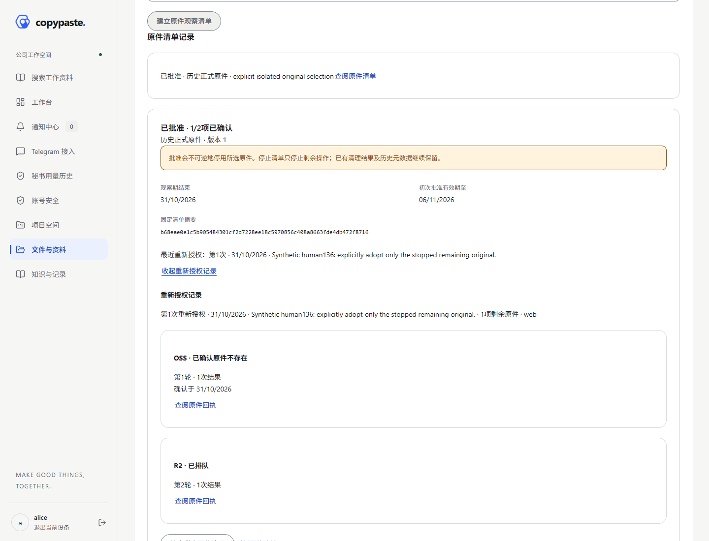
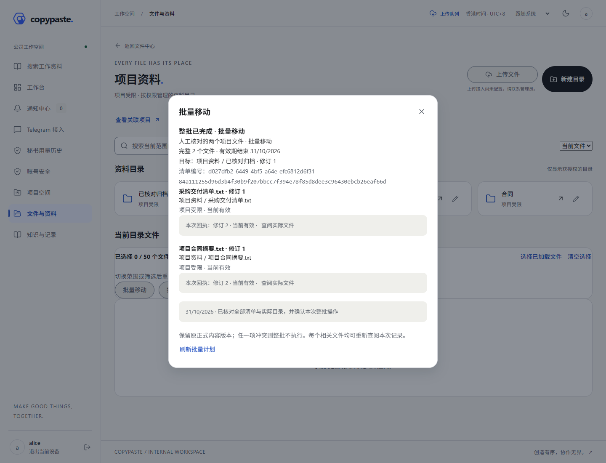
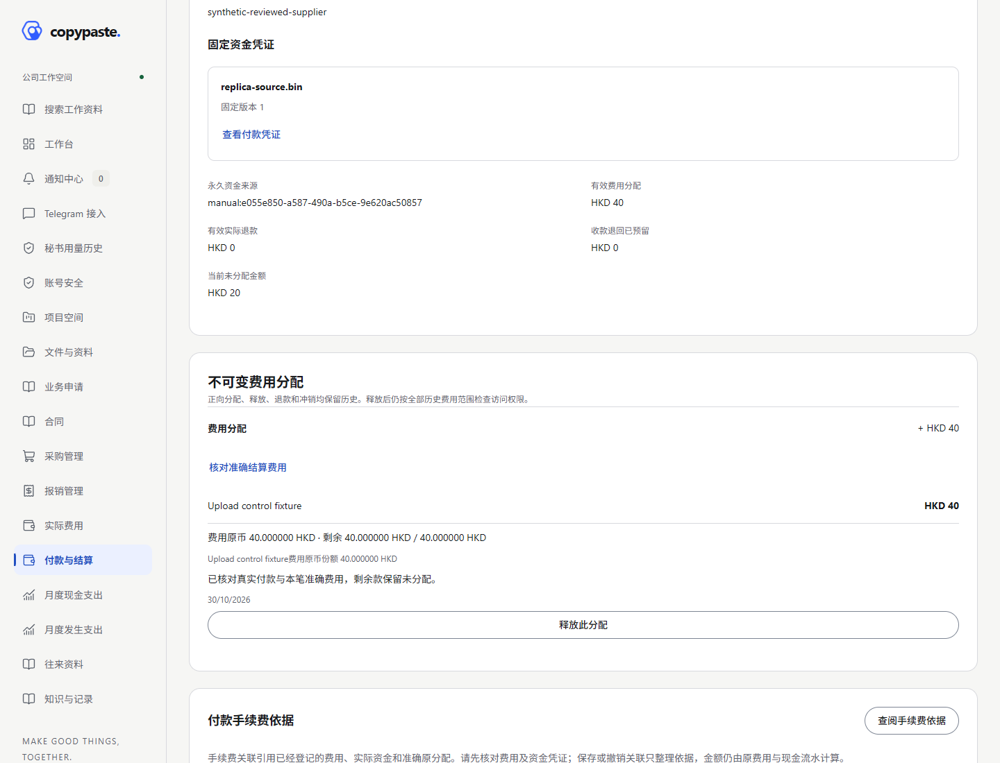

# CopyPaste Case Manager · 企业内部管理平台

## 增量141 · 秘书运行配置 / Secretary runtime operations

进入“秘书运行配置”→按任务／状态筛选→核对准确配置、技术限制及当前活动任务→近期MFA并明确确认停用影响→查看永久回执与历史。活动任务改变时必须重新核对；停用仅阻止后续使用，不声称进程已退出或已经回滚业务。原配置不能重新启用，新的配置仍由专用部署身份核验后安装。

Open **Secretary runtime configuration**, filter installed profiles and review the exact profile plus current task impact. An authorized human with recent MFA can permanently retire the reviewed profile. Concurrent task changes require a fresh review. Retirement does not claim process teardown or business rollback; deployment-only installation and immutable profile identities remain enforced. Private conversations, credentials and operator prose stay outside this organization view.

主线141／结构107；开发PG仍100。四端源码、关键HTTP／PG、类型／Web及两小程序构建和实际Web演示单独留证；完整回归、新移动UI旅程与Android包延期。Frozen rc.2/APK137 retain business136/schema103 and do not include138–141. Both frozen tags,23 open packages, five exclusions and eight draft Skills remain unchanged; real model/Linux/cloud/platform/production acceptance stays open.

[使用与接口 / Usage/API](docs/development/141-secretary-runtime-operations.md) · [关键验证 / Checks](docs/quality/141-secretary-runtime-verification.md) · [本轮及全部23项 / All remaining work](docs/delivery/05-functional-closure-141.md) · [页面 / Screenshot](docs/media/screenshots/agent-runtime-operations-web-receipt.png) · [MP4](docs/media/videos/agent-runtime-operations-web.mp4) · [截图导览GIF](docs/media/gifs/agent-runtime-operations-web.gif)

## 增量140 · 组织TG入站调度 / Organization TG inbound operations

Telegram接入→组织TG入站调度→按状态／任务／群入口筛选→查看请求路由、等待原因与完整分页历史。经办人完成近期MFA，核对准确请求与版本后，可以撤回尚未创建秘书任务的请求；调度器同时处理时按事务顺序完成或返回冲突。请求正文、私人TG身份、绑定证明、秘书结果与自由文本备注不进入组织台账。

主线140／结构106；个人开发PG仍100，使用前正常升级101–106。当前实际HTTP／耐久PG两组选定27个业务场景、四端会话、类型和Web／微信／抖音构建、实际Web撤回及持久读回单独留证。全量回归、完整移动UI和新Android包延期；rc.2／APK137仍业务136／结构103，不包含138–140，两个冻结标签不移动。23工作包、14 P0／9 P1、五项移出、八项draft Skill及真实集成／生产验收边界保持。

Open **Telegram → Organization inbound operations**, filter by request state, task or channel and inspect routing metadata, actual wait reasons and the complete paginated journal. An authorized human can explicitly withdraw an exact unstarted request with recent MFA and optimistic revision checks. Dispatch and withdrawal serialize; a task already created must use its original task workflow. Private request/model prose, Telegram user identities, binding proofs and free-form notes remain outside the organization view.

Main140 uses schema106; the personal development database remains100 and needs normal upgrades before using this backend. Fresh selected native HTTP/PG business checks, four human channels, client types, Web/two miniapp builds and actual authenticated Web withdrawal/readback have their own evidence. Full regression, complete mobile UI journeys and a new Android artifact are deferred. Frozen rc.2/APK137 retain business136/schema103 and do not include138–140. Both frozen tags,23 open work packages, five exclusions and eight draft Skills remain unchanged.

[使用与接口 / Usage/API](docs/development/140-telegram-inbox-operations.md) · [检查与延期 / Checks](docs/quality/140-telegram-inbox-verification.md) · [本轮及全部23项 / Remaining work](docs/delivery/05-functional-closure-140.md) · [实际页面](docs/media/screenshots/telegram-inbox-web-receipt.png) · [MP4](docs/media/videos/telegram-inbox-web.mp4) · [截图导览GIF](docs/media/gifs/telegram-inbox-web.gif)

## 增量139 · 组织TG投递运维 / Organization TG delivery operations

Telegram 接入→组织TG投递运维→按状态／群入口查询→查看固定通知及状态历史。经授权的人工经办人可核对原群、话题与消息编号，确认已发送、确认未发送后允许重试，或放弃重发。重试另需明确接受重复风险；当前绑定、群入口版本、24小时有效期及五次发送上限仍由服务器和独立发送进程核对。

查阅与处理权限分开；请求正文、秘书回复、凭据和自由文本处理备注不进入组织运维查询。四端源码和本地构建已更新；近期MFA、版本冲突、幂等、永久历史及审计回滚保留。本轮主线结构105；开发库仍100，正常升级101–105后使用。rc.2／APK137仍是业务136／结构103，不包含138／139，两个冻结标签不移动。

Open **Telegram → Organization delivery operations**, filter by state or channel, inspect routing metadata and the immutable notification journal, then explicitly reconcile an unknown outcome. Separate read/reconcile authority, a recent human MFA session and original-group review are required for changes. Retrying additionally requires duplicate-risk acknowledgement, current recipient scope, the24-hour window and the existing five-attempt cap. A human confirmation remains distinct from provider confirmation; this console never discloses request/model prose or makes a Bot API call itself.

This is main/schema105 source with fresh focused HTTP/PG, client type/build checks and actual authenticated Web interaction. Full regression, complete mobile journeys and a new Android artifact are deferred. Frozen rc.2/APK137 remain business136/schema103. Real Bot/model/cloud/Linux/platform/production acceptance and all23 work packages remain open; eight Skills remain draft and the five exclusions remain excluded.

[使用与接口 / Usage and API](docs/development/139-telegram-delivery-operations.md) · [关键检查与延期 / Checks and deferrals](docs/quality/139-telegram-operations-verification.md) · [本轮及全部23项 / All remaining work](docs/delivery/05-functional-closure-139.md) · [实际页面](docs/media/screenshots/telegram-operations-web-receipt.png) · [MP4](docs/media/videos/telegram-operations-web.mp4) · [截图导览 GIF](docs/media/gifs/telegram-operations-web.gif)

## 增量138 · 未提交的已完成上传 / Completed uncommitted uploads

进入具体资料目录→展开“已完成上传草稿”→核对新文件／替换上传及全部已知完成对象→填写原因建立固定清单→经过保留期与至少24小时观察→近期MFA人工批准→独立worker执行、查看逐项回执。停止不恢复上传；失败可重试，授权失效后可明确续作，已经确认的对象保留。凭据和存储位置不交给客户端。

本轮main源码／结构104；现有`v0.1.0-rc.1`与`v0.1.0-rc.2`标签和下载保持不变。rc.2及最新开发APK137固定业务136／结构103，**不包含138**；个人开发库仍100，运行新后端前正常升级101–104。当前只做关键验证：原生HTTP／PG5组30条记录、Web选定32项、共享移动23项、Android上传共享规则13项、类型和Web／微信／抖音构建，以及实际Web建单与读回。完整回归、新移动旅程及Android包延期；保留136完整Web452／共享移动537项和121后端／运行器历史出处。

Open a specific folder, expand **Completed upload drafts**, select an eligible new-file or replacement upload and create a fixed plan covering its original and every known completed promotion candidate. Retention and at least24 hours of observation precede explicit human approval with recent MFA. An independent worker records exact per-object outcomes. Cancellation preserves permanent upload fences; stopped remaining items can be explicitly reauthorized without repeating confirmed results.

This is main/schema104 source. Both frozen downloads remain immutable; rc.2/APK137 contain business136/schema103 and do not include this feature. Apply normal upgrades before using the new backend. Selected current checks and actual Web readback are distinguished from retained full tests and Android artifacts. Real cloud/model/Skills/TG/Linux/platform/production acceptance stays open:23 packages,14 P0/9 P1, five exclusions and eight draft Skills.

[使用与接口 / Usage and API](docs/development/138-completed-upload-retirement.md) · [关键检查及延期 / Checks and deferrals](docs/quality/138-completed-upload-retirement-verification.md) · [本轮及全部23项 / All remaining work](docs/delivery/05-functional-closure-138.md) · [既有冻结下载 / Frozen downloads](docs/releases/v0.1.0-rc.2/README.md)

[实际页面](docs/media/screenshots/completed-upload-retirement-web-plan.png) · [静音操作录屏 / Actual silent recording](docs/media/videos/completed-upload-retirement-web.mp4) · [三张实际截图导览 / Screenshot-tour GIF](docs/media/gifs/completed-upload-retirement-web.gif)

## 冻结交付137 · v0.1.0-rc.2

已将增量134–136纳入新的冻结候选：Linux服务器／Web／秘书运行器、微信／抖音小程序和Android开发包统一到业务源码 `40cd118`、结构103。源码包包含该提交全部应用源码、测试、依赖锁与开发文档；正式媒体目录另包提供，历史验证大文件保留在完整Git标签中。首版 `v0.1.0-rc.1` 的标签与下载保持不变。

[下载、SHA-256与使用步骤](docs/releases/v0.1.0-rc.2/README.md) · [本轮交付及全部23项余项](docs/delivery/05-functional-closure-137.md) · [实际构建与延期验证](docs/quality/137-frozen-candidate-verification.md)

本轮重新构建实际产物并检查源码／包内容，复用136的业务检查和真实页面媒体，完整回归及新增页面录制延期。APK为开发签名、移动产物使用本地API；接入服务器须配置真实HTTPS API／平台身份后重建。开发库仍100，运行此后端前正常升级101–103；真实云／模型／TG／Linux／平台／生产接入继续开放。23工作包（14 P0／9 P1）、五项移出及八项draft Skill不变。

## Frozen delivery137 · v0.1.0-rc.2

The new candidate includes increments134–136 at business source `40cd118`, schema103: native Linux server/Web/secretary runtime, WeChat/Douyin builds and a new Android development APK. The source archive includes all application source, tests, lockfiles and development guides. The published media directory has its own archive; large historical evidence remains available in the complete frozen Git tag. The first `v0.1.0-rc.1` tag and downloads remain immutable.

[Downloads, SHA-256 and usage](docs/releases/v0.1.0-rc.2/README.md) · [This delivery and all23 remaining packages](docs/delivery/05-functional-closure-137.md) · [Fresh builds and deferred checks](docs/quality/137-frozen-candidate-verification.md)

Artifacts and source identity are checked freshly; increment136 business checks and actual media are retained, not rerun. Full regression and new browser recordings are deferred. Android is development-signed; mobile builds use the local API profile. Configure the actual HTTPS API and platform identities and rebuild before server use. Development PostgreSQL remains schema100; apply normal upgrades101–103 for this backend. Real integrations and formal production acceptance remain open:23 packages (14 P0/9 P1), five exclusions and eight draft Skills.

**首个冻结候选：[v0.1.0-rc.1](docs/releases/v0.1.0-rc.1/README.md)。** 源码标签、下载摘要、部署步骤与延期验证统一记录。 服务器、两小程序及Android开发包已封存：[下载与SHA-256清单](https://github.com/copypasteltd/case-manager/tree/8ddb3f7a98a24910af49ede2a6c8b8c744d50973/docs/releases/v0.1.0-rc.1)。

## 增量136 · 原件清理重新授权

四端已接通原批准会话失效后的明确恢复：所有剩余任务停止后，有权限的员工核对固定摘要、剩余原件、不可逆影响和操作依据，完成近期MFA，重新授权并排队剩余项。初次批准与观察期、已确认结果和永久停用屏障保留；新的授权历史只追加。后续再次退出／撤权仍会安全停止。

使用：文件详情 → 原件保留与清理 → 查阅原件清单 → **重新授权剩余原件** → **确认重新授权并继续**，再查阅重新授权记录／逐次回执并刷新读回。已停止或全部完成的计划不能续作；来源、制度、文件修订或保护变化会拒绝本次操作。

关键验证见下方记录：Web452项、共享移动537项及类型／Web／两小程序构建；原生HTTP／PG7组42条覆盖重新授权及既有原件清理，并有真实Web提交／读回。整套回归、新移动浏览器旅程及Android包本轮延期；开发库仍100，新后端需正常升级101–103。冻结`v0.1.0-rc.1`保持原下载，不包含136。仍23个工作包（14 P0／9 P1）、五项移出、八项draft Skill，实际云／模型／TG／Linux／平台／生产接入继续开放。

## Increment136 · Original cleanup reauthorization

All four client sources now let a currently authorized human explicitly adopt a fixed stopped remainder after an earlier approval loses its session or authority. A bounded reason, irreversible-impact acknowledgement and recent MFA are required. Only remaining items receive new execution generations. The initial observed approval, confirmed results and permanent barriers remain unchanged; renewed authorization history is append-only. Later logout or revocation still stops execution.

Open file details → original retention and cleanup → the fixed plan → **重新授权剩余原件** → **确认重新授权并继续**. Read authorization history and per-original receipts, then refresh. Cancelled/completed plans cannot resume; changed sources, policies, file revisions or protections are rejected.

Focused evidence covers452 Web and537 shared-mobile rules, types, local Web/WeChat/Douyin builds, seven native HTTP/PG suites with42 passing records and actual Web mutation/readback. Full regression, an additional mobile browser journey and a new Android artifact are deferred. Persistent development services remain schema100; apply normal migrations101–103 before running this backend. The immutable first-freeze packages exclude136. All23 packages (14 P0/9 P1), five exclusions and eight draft Skills remain open; real integration and formal production acceptance are still required.

[实现与使用 / Usage](docs/development/136-retirement-reauthorization.md) · [关键检查 / Checks](docs/quality/136-retirement-reauthorization-verification.md) · [本轮及全部23项 / All remaining](docs/delivery/05-functional-closure-136.md)



[实际Web录制 / Actual Web recording](docs/media/videos/retirement-reauthorization-web.mp4) · [三截图GIF导览 / Screenshot-tour GIF](docs/media/gifs/retirement-reauthorization-web.gif)

## 增量135 · 原发布记录

四端源码已接通合同本金与实际付出分离的归属、现金预留、部分解除尾差、固定人工核对及全额资金冲销。合同详情选择“归属实际退回款”，固定原收入归属与实际向外付款，输入合同本金、本次付出、汇率及凭证来源，明确核对并完成近期MFA，再查阅持久历史。

示例：780 HKD收入，100 USD实际付出；归属390 HKD／50 USD，再归属195 HKD／25 USD，合同净收195 HKD、实际资金占用75 USD、可用25 USD。解除只改变归属，实际资金独立保留；原390 HKD分三次各130 HKD解除，准确释放16.67、16.67、16.66 USD。

本轮精简检查：原生HTTP／PG4组52条，Web444项、共享移动529项，类型及Web／微信／抖音构建、实际Web提交与读回。没有新Android包／移动浏览器完整旅程或完整回归；开发库仍100，运行新后端前正常应用101、102。首个冻结标签和下载仍为`v0.1.0-rc.1`，不包含135。23个工作包（14 P0／9 P1）、五项移出、八项draft Skill继续保留；公司财务制度／汇差、完整旅程和正式集成仍待完成。

## Increment135 · Previously published

All four client sources now separate contract principal from actual outgoing cash, reserve exact cash, release partial attribution with rounding tails, pin human reconciliation evidence and preserve full-reversal history. Open contract finance → “归属实际退回款”, pin the original incoming-cash attribution and actual outgoing payment, enter principal/cash/rate/source, explicitly acknowledge and complete recent MFA, then read committed history.

Example:780 HKD received and100 USD paid out. Attribute390 HKD /50 USD, then195 HKD /25 USD. Contract net is195 HKD, outgoing reservation75 USD and free cash25 USD. Three130 HKD releases of the first attribution release16.67,16.67 and16.66 USD. Attribution does not transfer bank funds or automatically book exchange gains/losses.

Focused checks: four native HTTP/PG suites,52 passing records;444 Web and529 shared-mobile cases, type checking, Web/WeChat/Douyin local builds and actual Web mutation/readback. Full regression, additional mobile browser and a new Android artifact are deferred. Persistent development services stay schema100; apply101 and102 before running this backend. The immutable `v0.1.0-rc.1` packages do not include135. All23 packages (14 P0/9 P1), five exclusions and eight draft Skills remain; company policy, exchange differences and formal integrations stay open.

[实现与使用 / Usage](docs/development/135-receivable-foreign-returns.md) · [关键检查 / Checks](docs/quality/135-receivable-foreign-returns-verification.md) · [本轮及全部23项 / Remaining](docs/delivery/05-functional-closure-135.md)


[实际Web录制 / Actual Web recording](docs/media/videos/receivable-foreign-returns-web.mp4) · [三截图GIF导览 / Screenshot-tour GIF](docs/media/gifs/receivable-foreign-returns-web.gif)

## 增量134 · 原发布记录

已接通登记时原子回转及登记后分次追加，Web、微信、抖音和Android共享功能源码。输入原付款本金，页面分别核对费用原币和实收现金份额；固定原分配、人工声明、近期MFA、准确尾差、项目份额及全额冲销保持可追溯。

示例：原200 EUR费用由780 HKD核销，实际退回100 USD。先回转560 HKD／143.59 EUR／71.79 USD，最后220 HKD／56.41 EUR／28.21 USD；费用、原本金、现金三个余额独立。

使用：从原付款登记真实异币退款时选择原分配，或在退款详情“关联退款分配”；输入**原付款本金**，核对费用与现金预览，完成本人核实后提交，再查阅持久历史。本轮关键检查为原生HTTP／PG5组64条、Web436项、共享移动521项、类型检查及Web／两小程序构建。Android沿用133开发APK，本轮没有新包或移动浏览器完整旅程；现有开发库仍100，运行新后端前应用101。

首个冻结标签和下载仍为`v0.1.0-rc.1`；134是后续main源码。全部23个工作包（14 P0／9 P1）、五项移出、八项draft Skill保持；应收合同异币向外退回、公司汇兑制度、完整旅程和正式集成继续开放。

## Increment134 · Previously published

All four client sources now support atomic attribution at cash recording and later partial attribution. Enter original-payment principal; inspect expense-currency and actual-cash previews, acknowledge the facts and complete recent MFA. Exact source allocations, rounding tails, project cash shares, immutable history and full reversal stay separate from original expense/bank facts.

Example:200 EUR settled by780 HKD receives100 USD. Attribute560 HKD /143.59 EUR /71.79 USD, then220 HKD /56.41 EUR /28.21 USD. Each monetary balance keeps its own units. Use the original payment refund form or the refund detail’s “关联退款分配”, review the principal and expense/cash preview, then inspect the committed journal.

Focused checks: five native HTTP/PG suites,64 passing records;436 Web and521 shared-mobile cases, type checking and Web/WeChat/Douyin local builds. No fresh Android package or mobile browser journey; the retained development APK is increment133. The persistent development database remains schema100; apply101 before running this backend. The frozen candidate tag/artifacts remain `v0.1.0-rc.1`;134 is subsequent main source. All23 packages (14 P0/9 P1), five exclusions and eight draft Skills remain. Receivable foreign outgoing returns, company FX policy and full/external acceptance remain open.

[实现与使用 / Usage](docs/development/134-foreign-expense-refunds.md) · [实际检查与延期 / Checks](docs/quality/134-foreign-expense-refunds-verification.md) · [本轮与全部23项 / Remaining](docs/delivery/05-functional-closure-134.md)


[实际Web录制 / Actual Web recording](docs/media/videos/foreign-expense-refunds-web.mp4) · [三截图GIF导览 / Screenshot-tour GIF](docs/media/gifs/foreign-expense-refunds-web.gif)

## 增量133 · 已发布冻结基线 / Published frozen baseline

本轮实际检查：五组选定原生HTTP／PostgreSQL套件74条通过记录，Web428项、共享移动513项；构建、原生缓存和仅巡检脚本修正的准确输入分别记录，不代表完整生产验收。

增量133补齐四端合同财务闭环：生效合同→真实费用／收付款归属→按原本金归属异币退款→部分解除→固定凭证人工核对→来源变化后重新核对。共享移动端新增完整合同财务中心，Web同步展示整笔实收与合同本金。

使用：Web进入合同详情的“合同财务归属”；微信、抖音和Android选择“合同财务归属与核对”。先固定实际正向收付款，再选择其退款；输入合同币种本金并明确核对币种。需要纠正时追加部分解除；核对节点时选固定版本凭证并确认条件及差额。实际银行现金与费用不因归属而改变。

示例：付款780 HKD、实际退款100 USD、固定退回本金780 HKD；四条195 HKD本金归属合计780 HKD。每条明确展示整笔100 USD实收，不把两个币种相加；原付款和退款两重余额、并发、幂等、当前权限及最近MFA继续生效。退款全额冲销保留旧归属／核对，当前有效退款本金归零。

正常结构升级99→100，历史账本与旧核对不改写。跨币费用退款归属、应收合同的异币向外退回、公司汇兑制度及完整业务验收继续开放。仍23个工作包（14 P0／9 P1）、五项移出、八项draft Skill。

Increment133 completes the four-client contract finance path: effective contract → actual expense/cash attribution → foreign-refund principal attribution → partial release → evidence-bound human reconciliation → renewed review after source changes. Shared mobile now has the full contract finance center; Web distinguishes whole received cash from contract principal.

Usage: on Web open the contract’s “合同财务归属”; on WeChat, Douyin or Android choose “合同财务归属与核对”. Pin the original actual cash first, select its exact refund, enter contract-currency principal and explicitly review the units. Append a partial release to correct attribution. Reconcile with fixed file versions and explicit condition/difference checks. Attribution does not transfer bank cash or create expense.

Example:780 HKD paid,100 USD actually refunded,780 HKD reviewed principal. Four195 HKD attributions exhaust780 HKD; each separately labels the entire100 USD cash fact. Refund/original caps, concurrency, idempotency, current authority and recent MFA remain mandatory. Full cash reversal preserves old records while removing current effective refund principal.

Normal schema99→100 preserves prior journals/reviews. Foreign expense-refund attribution, foreign outgoing returns on receivable contracts, adopted company FX policy and complete acceptance remain open. All23 packages (14 P0/9 P1), five exclusions and eight draft Skills remain explicit.

[实现与使用 / Implementation](docs/development/133-contract-finance-closure.md) · [实际检查 / Checks](docs/quality/133-contract-finance-verification.md) · [本轮及全部23项 / All remaining work](docs/delivery/05-functional-closure-133.md)


[Web实际录制 / Web recording](docs/media/videos/contract-refunds-web.mp4) · [Web三截图导览 / Web screenshot tour](docs/media/gifs/contract-refunds-web.gif) · [移动概览 / Mobile overview](docs/media/screenshots/contract-refunds-mobile-summary.png)

## Increment132 · Previously published / 原发布记录

当前本地检查：十组HTTP／PG69条通过记录，Web419项、共享移动504项及核心182条测试记录通过；构建、原生缓存与真实云／平台／生产验收边界分别记录。

增量132补齐已知历史原件和已提交上传草稿的保留与清理：准确来源盘点 → 固定清单 → 至少24小时观察 → 最近MFA人工批准 → 永久使用屏障 → 独立双云执行 → 不可变逐次回执。历史原件两边全部确认不存在后才释放逻辑容量，失败或未知结果保留并重新核对；停止不恢复已删除原件。

使用：文件详情打开“盘点历史与草稿原件”，核对保留制度、当前版本／引用／法务保留及阻断原因，选择一项、填写原因建立观察清单；到期后核对摘要并批准，在清单查阅逐云回执、显式重试或停止剩余。Web、微信、抖音、Android使用同一业务流程。默认不开启云清理；API只有位置元数据，专用Worker使用独立清理身份。OSS要求准确非null原生版本，R2要求部署者明确保证独占不可变目录，不把If-Match当作已证明的原子删除。

正常结构升级98→99；当前仍23个活跃工作包（14 P0／9 P1）、5项移出、八项draft Skill。已完成但未正式提交的草稿、秘书恢复来源、未知孤儿／派生对象、失效原批准的重新授权及真实云验收继续开放。

Increment132 closes known historical-original and committed-upload-draft retention: exact inventory → immutable plan → at least24-hour observation → recent-MFA human approval → permanent dependency/key barrier → dedicated provider execution → immutable attempt receipts. Logical capacity is released only after both historical originals are confirmed absent. Unknown outcomes reconcile the exact original on retry; cancellation never restores deleted content.

Usage: open file details → “盘点历史与草稿原件”, review retention/current-version/reference/hold blockers, explicitly select one source and enter a reason. After observation, review the digest, refresh MFA and approve; inspect exact provider receipts, retry eligible failures or stop remaining work. All four clients share this workflow. Cloud cleanup is disabled by default; API holds location metadata only, while a dedicated native worker uses independent credentials. OSS requires an exact non-null native version; R2 requires operator-attested exclusive immutable managed storage, without claiming documented conditional-delete CAS.

Normal schema98→99 preserves original facts. All23 packages (14 P0/9 P1), five exclusions and eight draft Skills remain explicit. Completed-but-uncommitted drafts, secretary recovery sources, unknown orphans/derived objects, renewed authorization and actual cloud acceptance stay open.

[实现与使用 / Implementation](docs/development/132-known-object-retirement.md) · [实际核验 / Checks](docs/quality/132-known-object-retirement-verification.md) · [本轮及全部23项 / Remaining work](docs/delivery/05-functional-closure-132.md)


[Web实际录制 / Web recording](docs/media/videos/object-retirement-web.mp4) · [共享H5录制 / Shared H5 recording](docs/media/videos/object-retirement-mobile.mp4) · [三截图导览 / Screenshot tour](docs/media/gifs/object-retirement-mobile.gif)

## Increment131 · Previously published / 原发布记录

增量131接通主机资源的告警处理流程：超阈值、磁盘只读、采集断流 → 当时有权负责人站内通知 → 本人工作台待办 → 真实恢复。重复采样不刷屏；标记已读只记录阅读，不消除故障。恢复产生新的未读投递；停用、归档、转交或撤权重新计算责任，旧排队事件不改收件人。

使用：先在服务详情明确发布资源监控配置；在首页“我负责的主机资源待办”或通知中心“主机资源”分类打开服务；在“资源状态记录”查阅当时负责人、配置、状态及原始签名。历史正常记录不表示当前正常，创建通知事件也不表示实际投递完成。

部署沿用原生API、PostgreSQL和既有通知Worker，正常结构升级97→98。即时业务命令投影状态，Worker每10秒检查最多100个来源并继续分页；首次采样有明确宽限期。工作台直接读取当前配置和原始观测，Worker未完成投递也不会隐藏已经到期的待办。

当前23个活跃工作包（14 P0／9 P1）、5项移出、八项draft Skill。资源站内告警代码已完成；真实目标监控安装和独立外部告警送达仍属GAP-23。真实云、模型、TG、平台、正式Android及生产验收继续按编号处理。

Increment131 connects resource alerts to the actual owner’s inbox and personal workbench, then clears work on real recovery. Threshold breaches, readonly filesystems and expired/missing collection evidence require attention. Repeated same-state samples do not spam recipients. Read acknowledgement changes readership only; recovery creates a new unread delivery. Disablement, archive, reassignment and revocation recalculate current responsibility without redirecting old queued events.

Usage: explicitly publish resource monitoring in service details; open the personal resource-work card or the “主机资源” notification category; use “资源状态记录” to inspect the original owner, configuration, state and signed observation. Historical normal status is not proof of current health, and event creation is distinct from completed delivery.

The existing native API, PostgreSQL and notification worker remain. Normal schema upgrade97→98 preserves original business records. Commands project immediately; the worker scans bounded100-source pages every10 seconds for natural expiry and first-sample deadlines. Workbench reads evaluate original evidence independently of delivery progress.

All23 active packages (14 P0/9 P1), five exclusions and eight draft Skills remain explicit. The resource in-app alert code is implemented; real target installation and independent external alert delivery remain GAP-23. Real cloud/model/TG/platform, formal Android and production acceptance keep their numbered work items.

[实现与使用 / Implementation](docs/development/131-resource-notifications.md) · [实际检查 / Checks](docs/quality/131-resource-notifications-verification.md) · [本轮和全部23项 / All remaining work](docs/delivery/05-functional-closure-131.md)


[Web实际录屏 / Web recording](docs/media/videos/resource-notifications-web.mp4) · [共享移动录屏 / Shared H5 recording](docs/media/videos/resource-notifications-mobile.mp4) · [三截图导览 / Screenshot tour](docs/media/gifs/resource-notifications-mobile.gif)

当前核验：8组选定HTTP／PostgreSQL套件76条、核心94条、Web411项和共享移动496项全部通过；四端构建及当前开发APK19项检查通过。原生Android28项／JVM28项为准确UP-TO-DATE结果；完整业务与生产验收继续按编号处理。

Current validation passes eight selected HTTP/PostgreSQL suites (76 records),94 core test records,411 Web tests,496 shared-mobile tests, all four client builds and19 current development-APK checks. Android28 and JVM28 retain their exact UP-TO-DATE results; complete business and production acceptance remain numbered work items.

## Increment130 · Previously published / 原发布记录

增量130补齐主机资源功能：CPU、内存、全部已配置磁盘与只读状态，经原生Prometheus桥接→独立签名接收→持久记录→四端实时展示。服务详情可人工发布完整监控配置、核对阈值、停用及查阅配置／观测历史；旧观测过期、采集断流、停用或归档均显示待确认，并隐藏当前数值。

使用：进入“服务与事件”→服务详情→“主机资源监控”。有管理权限者选择“配置资源监控”，核对公钥、全部挂载点、警告／严重阈值和过期时间，完成最近MFA后明确发布。配置变化建立新修订，等待该修订的新观测；原签名及历史保留。原生部署在私有目录配置node_exporter、Prometheus和既有status-bridge，参考配置只含占位值。桥接器不接受任意PromQL或目标URL。

本轮正常结构升级96→97。当前资源健康与服务可用性分别评估；页面告警不是已送达的外部通知。真实目标服务器、Prometheus／node_exporter安装及独立告警送达仍属GAP-23。完整源码、运行逻辑、检查边界及全部23项余项见下方链接。当前仍23个工作包（14 P0／9 P1）、5项移出、八项draft Skill。

Increment130 completes the host-resource feature path: CPU, memory, every configured filesystem and readonly state travel through the native Prometheus bridge, independently signed ingestion, persistent observations and four-client resource cards. Service details expose explicit configuration publication, thresholds, disablement, immutable history and original signature verification. Expired, disconnected, disabled or archived sources show unknown and hide current values.

Usage: open Services → service details → Host resources. An authorized manager reviews the public key, complete mount inventory, warning/critical thresholds and freshness limit, then explicitly publishes with recent MFA. A new revision waits for new matching observations; original signatures and history remain. Configure native node_exporter, Prometheus and the existing status-bridge using private deployment files; the checked-in example contains placeholders only. Arbitrary PromQL and target URLs are not accepted.

The normal schema upgrade is 96→97. Host-resource health and endpoint availability remain separate. A visible resource warning does not prove delivery of an external alert. Actual target installation and independent alert delivery remain under GAP-23. All 23 work packages (14 P0/9 P1), five exclusions and eight draft Skills remain explicit.

本轮验证：三组选定HTTP／PostgreSQL套件31条通过记录、Web408项、共享移动493项、四端构建和当前Android开发APK19项内容检查通过。Web／共享H5均实际走通配置停用、状态变化、历史与签名核对；原生测试的真实执行／缓存边界逐项记录，旧全量回归不冒充重新执行。

Current checks pass three selected HTTP/PostgreSQL suites (31 pass records),408 Web tests,493 shared-mobile tests, four-client builds and19 current development-APK inspections. Actual Web/H5 flows cover state transitions, explicit disablement, history and signatures. Native execution/cache outcomes remain explicit; retained full regressions are not relabelled as fresh runs.

[实现与使用 / Implementation](docs/development/130-host-resources.md) · [实际验证 / Checks](docs/quality/130-host-resources-verification.md) · [本轮与全部23项 / All remaining work](docs/delivery/05-functional-closure-130.md)


[Web录制 / Web recording](docs/media/videos/host-resources-web.mp4) · [共享移动录制 / Shared H5 recording](docs/media/videos/host-resources-mobile.mp4) · [截图导览 / Screenshot tour](docs/media/gifs/host-resources-mobile.gif)

## Increment129 · Previously published / 原发布记录

增量129直接补齐文件办公流程：Web／Android新建真实Word、Excel、PPT，并修改当前正式版本的受支持文字／单元格；微信／抖音查阅准确版本。生成独立候选 → 本人核对名称、内容、警告与SHA → 加入原上传队列 → 完整摘要／扫描／提升 → 人工提交新正式版本，旧原件和历史保留。生成本身不发布，也不改变OA或财务事实。

使用：目录内选择“新建 Office 文件”，或文件详情选择“编辑 Office 内容”。Word填写段落和可选表格；Excel从表格粘贴，默认文字，明确选择数字／布尔／安全公式；PPT用单独一行 `---` 分页。核对候选后确认加入队列，再在上传页面处理扫描和正式提交。Android候选保存到本人私有临时来源，继续使用原生上传队列；普通大文件保持SAF分片路径。

原件编辑限8 MiB、候选12 MiB，有界XML／内容与安全公式子集；未改压缩部件保留，保护、宏、嵌入对象、外链内容和不支持结构明确拒绝。Excel修改清除公式结果缓存，需原编辑器重算。当前不提供完整Office版式或所见即所得，复杂文档与真实样本继续属于GAP-04。数据库保持96项迁移，无新增外部编辑器服务或Worker。

源码验证分别记录六组选定HTTP／PG套件46条通过记录、Web396项、共享移动481项、独立OOXML库读取六份真实生成文件、四端构建与当前Android开发包。Web实际编辑／生成三种格式，共享H5实际只读查阅；合成页面录制与接口全流程提交分别说明。旧121全量后端／runtime和旧128证据保留原来源，正式签名、平台、云、模型、TG与生产验收继续开放。

当前23项工作包（14 P0／9 P1）、5项移出、八项draft Skill。已完成的子功能从余项中扣除，整包未完成不会冒充验收通过。

Increment129 implements real DOCX/XLSX/PPTX creation and bounded exact-original content editing on Web/Android, with exact-version reading on WeChat/Douyin. Generate a separate candidate, review its name/text/warnings/hash, explicitly join the existing upload queue, then complete full hashing, scanning, promotion and a human formal commit. Rendering never publishes a version or changes OA/finance facts; old originals and history remain intact.

Usage: choose “新建 Office 文件” in a folder or “编辑 Office 内容” in file details. Word accepts paragraphs and an optional table; Excel accepts pasted TSV, defaulting to literal text with explicit typed cells/safe formulas; PPT separates slides with a standalone `---` line. Review and confirm the candidate, then use the upload page for scan and formal submission. Android stores the small candidate in an owner-bound private temporary source; ordinary large files retain native SAF multipart transfer.

Editing accepts8 MiB originals and12 MiB candidates, bounded ZIP/XML/content and a safe formula subset. Unchanged compressed parts remain intact; unsupported active content/embedded objects/macros/protection are rejected. Excel caches are cleared and require full recalculation. Full layout editing, general Office compatibility and real business samples remain open under GAP-04. Schema stays96; authoring needs no external editor server, Python runtime or new worker.

Source checks separately record six selected HTTP/PG suites (46 pass records),396 Web tests,481 shared-mobile tests, six real output files independently opened by three OOXML libraries, four-client builds and a current Android development APK. Actual Web edit/render and shared-H5 readonly evidence remain separate from the complete HTTP commit workflow. Retained121 full backend/runtime and128 evidence keep their original sources. Formal signing, platform, cloud, model, TG and production acceptance remain open.

All23 work packages (14 P0/9 P1), five exclusions and eight draft Skills remain explicit. Implemented subfeatures are deducted from remaining descriptions; partial checks do not close unfinished packages.

[实现与使用 / Implementation](<docs/development/129-office-authoring.md>) · [实际验证 / Checks](<docs/quality/129-office-authoring-verification.md>) · [本轮及全部23项 / All remaining work](<docs/delivery/05-functional-closure-129.md>)


[Web实际录屏 / Web recording](docs/media/videos/office-authoring-web.mp4) · [共享移动录屏 / Shared mobile recording](docs/media/videos/office-authoring-mobile.mp4) · [三截图导览 / Screenshot tour](docs/media/gifs/office-authoring-mobile.gif)

## Increment128 · Previously published / 原发布记录


增量128接通 PDF、扫描件与PNG／JPEG正文：原件扫描和准确副本校验 → 独立原生Worker逐页提取／OCR → 当前版本搜索 → 固定版本预览／比较 → 秘书资料读取。四端显示完整页数和OCR核对原件说明，不自动形成财务事实，不改变原件。

使用：Web／Android上传原件，在搜索中查找正文词句并点击“查阅此版本正文”；在文件详情选择两个正式版本进行比较；秘书会话明确选择准确版本后复用同一派生正文。微信／抖音保留查询与审批职责。当前提取限8 MiB、PDF20页、正文2 MiB；120GB原件上传目标保持独立。

部署：在只读原生工具目录配置固定Poppler／Tesseract、三语言模型及SHA清单，以绝对路径设置 `CP_DOCUMENT_TEXT_PROFILE`，再运行既有 `worker-file-text`。未配置原生引擎时，PDF／图片明确待处理，普通文本／Office继续可用。应用不下载工具、不继承云／模型凭据到原生子进程。

本轮源码检查：六组选定HTTP／PostgreSQL套件43条通过记录，原生解析／完整性检查零跳过，Web390项、共享移动476项，以及类型和Web／微信／抖音／Android JS构建。真实Web／共享H5验证PDF与图片预览、准确版本比较及秘书资料读取；6张PNG、2条实际视口MP4、2个明确标注三截图导览GIF。正常结构升级95→96保持旧文件、OA、财务及提取证据。旧121完整回归／runtime／开发APK与127原证据保留来源；它们不标为当前128产物。实际执行记录见下方链接。

当前仍23项（14 P0／9 P1），5项移出，八项Skill为draft。Office创建编辑／版式、更多真实PDF／OCR样本、真实云／模型／TG、平台及生产验收继续开放。

[实现与使用](docs/development/128-document-text-ocr.md) · [实际验证](docs/quality/128-document-text-verification.md) · [本轮与全部23项余项](docs/delivery/05-functional-closure-128.md)


[Web实际录屏](docs/media/videos/document-text-web.mp4) · [共享移动实际录屏](docs/media/videos/document-text-mobile.mp4) · [移动三截图导览GIF](docs/media/gifs/document-text-mobile.gif)

Increment128 connects PDF, scanned documents and PNG/JPEG OCR to the shared four-client file workflow: verified original → independent native text worker → current-head search → exact-version preview/comparison → secretary source reads. Every PDF page retains embedded text and separately labelled OCR, including mixed text/image pages. Complete page evidence and verification limits stay visible; OCR does not create financial facts or rewrite originals.

Usage: upload through Web/Android, search a phrase inside the file and open its fixed-version text; explicitly select two formal versions in file details for comparison, or select the exact version as a secretary conversation source. WeChat/Douyin retain lookup and approval responsibilities. Current extraction accepts8 MiB originals,20 PDF pages and2 MiB derived text; the120GB original upload target remains separate.

Setup: install native Poppler/Tesseract and the three fixed language models in a read-only tool tree, generate a SHA-pinned local profile, set the absolute `CP_DOCUMENT_TEXT_PROFILE`, then run the existing `worker-file-text`. Without a configured native engine, PDF/images remain explicitly pending while plain text/Office continue. The application does not download tools or pass cloud/model credentials to child processes.

Current checks cover six selected HTTP/PostgreSQL suites (43 pass records), actual native parser/integrity cases with zero skips,390 Web tests,476 shared-mobile tests, workspace types and Web/WeChat/Douyin/Android JS builds. Actual Web/shared H5 exercise PDF/image preview, exact comparison and secretary source reads, with6 PNGs,2 real viewport MP4s and2 explicit three-screenshot-tour GIFs. Normal schema95→96 preserves old files/OA/finance/derivations. The old121 full regression/runtime/development APK and127 evidence retain their original sources; no old artifact is labelled128. Consult the executed records below for exact boundaries.

All23 packages (14 P0/9 P1), five exclusions and eight draft Skills remain explicit. Office authoring/layout, wider real PDF/OCR samples, real cloud/model/TG, platform and production acceptance remain open.

[Implementation and usage](docs/development/128-document-text-ocr.md) · [Executed checks](docs/quality/128-document-text-verification.md) · [This increment and all23 remaining packages](docs/delivery/05-functional-closure-128.md)

[Actual Web recording](docs/media/videos/document-text-web.mp4) · [Shared mobile recording](docs/media/videos/document-text-mobile.mp4) · [Three-screenshot tour GIF](docs/media/gifs/document-text-mobile.gif)

## Increment127 · Previously published / 原发布记录

增量127完成四端文件批量整理：多选1至50个文件 → 固定清单 → 本人核对与近期MFA → 一次移动／回收／恢复 → 持久逐项回执。任一子操作失败，整批文件和成功证据回滚。原正式内容头与历史版本保留。

使用：文件中心选择文件或“选择已加载文件”，选择批量操作并填写原因。移动另选同项目、同分类的实际目录；分析后核对完整来源／目标／路径／阻塞／有效期，再明确确认。任一相关文件（含回收站）可打开本人的批量记录。名单不从草稿恢复，切换范围后重新选择；结果不明时先核对记录。

正常结构升级94→95新增不可改写的固定计划与完成证据。沿用单文件授权和事务命令，不新增管理员权限。真实Web／共享Taro H5走实际HTTP／PG；微信、抖音与Android保持完整目标，正式平台、云、模型和生产验收继续开放。当前23项（14 P0／9 P1），5项移出。

当前源码检查：五个选定HTTP／PostgreSQL套件51条通过记录、Web379项及共享移动465项测试通过；全项目类型、Web／微信／抖音／Android JS构建通过。实际Web／共享H5各完成三项操作及历史回执查询。6张PNG、2条本人验证后的执行MP4及2个明确标注的三截图导览GIF已更新。旧121完整回归／runtime／开发APK与旧126证据保留原来源，不标为当前127产物；完整23项工作包及正式平台／云／模型／生产验收仍开放。

[设计与使用](docs/development/127-file-batch-plans.md) · [实际验证](docs/quality/127-file-batch-verification.md) · [本轮及全部23项余项](docs/delivery/05-functional-closure-127.md)



[Web实际录屏](docs/media/videos/file-batch-web.mp4) · [共享移动实际录屏](docs/media/videos/file-batch-mobile.mp4) · [移动三场景截图导览GIF](docs/media/gifs/file-batch-mobile.gif)

Increment127 completes shared four-client batch file operations: select 1–50 exact files → persisted inventory → human acknowledgement and recent MFA → atomic move/trash/untrash → durable item receipts. A late child failure rolls back every file and successful child fact. Original formal heads and content history stay fixed.

Usage: select loaded files in the file center, choose an operation and provide a reason; a move additionally selects a writable actual directory in the same project and classification. Review the fixed source/target/path/retention inventory and expiry, explicitly confirm, then reopen the result from any related file, including a trashed one. Selection and verification are not restored from drafts. After an uncertain result, inspect persisted history before trying again.

Normal schema94→95 upgrade adds guarded immutable plans/receipts while preserving original schema and business data. Ordinary file authority and commands remain in force. Real Web and shared Taro H5 use the native HTTP/PostgreSQL fixture; WeChat, Douyin and Android keep their full target scope. Platform, real cloud/model and production acceptance remain open: 23 packages (14 P0/9 P1) and five exclusions.

Current source-bound checks passed: five selected native HTTP/PostgreSQL suites (51 pass records), 379 Web tests, 465 shared-mobile tests, workspace types and Web/WeChat/Douyin/Android JS builds. Actual Web/shared H5 each complete all three actions and reopen durable receipts. Six PNGs, two post-MFA execution MP4s and two explicit three-screenshot-tour GIFs are updated. The old121 full/runtime/development APK and126 evidence retain their original sources; they are not current127 artifacts. All 23 work packages and formal platform/cloud/model/production acceptance remain open.

[Design and usage](docs/development/127-file-batch-plans.md) · [Executed checks](docs/quality/127-file-batch-verification.md) · [This increment and all 23 remaining packages](docs/delivery/05-functional-closure-127.md)

[Actual Web recording](docs/media/videos/file-batch-web.mp4) · [Shared mobile recording](docs/media/videos/file-batch-mobile.mp4) · [Three-scenario screenshot-tour GIF](docs/media/gifs/file-batch-mobile.gif)

## 已发布历史 / Published history

### Increment126 · 原已发布费用付款核销

增量126接通“已确认费用 → 核对实际付款 → 一次登记与核销 → 资金详情／费用余额”。支持供应方部分核销、人工异币和准确批准员工垫付报销。付款总额与本次核销额独立填写，多余款保留未分配；原费用金额保持。一个PG事务组合普通资金创建、登记和分配，最后失败完整撤销业务写入。

使用：费用详情 → “登记付款并核销费用” → 填实际时间／总额／币种／核销额 → 选择同一供应方或已关联批准垫付明细 → 固定付款凭证 → 明确核对并验证本人 → 确认 → 核对资金分配历史与费用待结余额。异币另填费用原币额、实际汇率与来源。页面不预填实际金额、不发起银行转账、不自动完成业务。

Web及共享微信／抖音／Android页面已接入准确费用头、完整组合回执与现有幂等流程。移动只恢复按本人权限和准确费用隔离的白名单文字，付款凭证、收款引用、报销选择、MFA与人工确认重新核对。schema94保持；完整公司制度、正式平台／云／模型／生产验收继续开放。

[设计和使用](docs/development/126-cost-payment-settlement.md) · [实际检查](docs/quality/126-cost-payment-verification.md) · [本轮与全部23项余项](docs/delivery/05-functional-closure-126.md)



[Web实际录屏](docs/media/videos/cost-payment-web.mp4) · [移动实际录屏](docs/media/videos/cost-payment-mobile.mp4) · [移动截图导览GIF](docs/media/gifs/cost-payment-mobile.gif)

当前检查：九个选定HTTP／PG套件140条通过记录，Web352项、共享移动438项、类型检查和Web／双小程序／Android JS构建通过。实际Web／H5各完成三类付款：供应方HKD60核销40、异币USD13核销6.50对应HKD50、员工HKD30核销25，原费用合计仍HKD300。MP4录首个本人验证后场景；GIF明确为三张真实截图导览。旧121完整回归／runtime／开发APK及125原证据保留，不标为当前产物。当前23 active（14 P0／9 P1）、5 excluded，见[范围](docs/delivery/04-current-scope-and-acceptance.md)。

Increment126 connects a confirmed expense to explicitly reviewed actual cash and settlement in one transaction. It supports partial supplier payments, reviewed foreign-currency settlement and an exact linked approved employee advance. Total cash and this expense's allocated cash are separate; extra cash stays unassigned and the original incurred expense is preserved. Existing create/record/allocate commands, limits, history, audit, Outbox and idempotency rules remain active; a late failure rolls back every business write.

Usage: expense details → record actual payment and settle → enter actual Hong Kong time, currency, total cash and allocation → choose the same supplier revision or exact approved employee-advance line → select formal fixed evidence → acknowledge both actual cash and settlement with recent MFA → confirm → inspect ordinary payment history and cost balances. Foreign settlement additionally requires the cost-currency amount, actual conversion rate and source. This records completed facts; it does not transfer bank funds or complete the business automatically.

Web and shared WeChat/Douyin/Android pin the exact cost version/revision/hash and validate the full compound receipt. Mobile drafts restore bounded text only, isolated by current actor authority and exact expense basis; payee/claim/evidence selection, MFA and acknowledgements require fresh review. Schema94 stays unchanged. Company policy, complete business journeys and formal platform/cloud/model/production acceptance remain open.

[Design and usage](docs/development/126-cost-payment-settlement.md) · [Executed checks](docs/quality/126-cost-payment-verification.md) · [Current work and all 23 remaining packages](docs/delivery/05-functional-closure-126.md)

Current source-bound checks passed: nine selected native HTTP/PostgreSQL suites (140 pass records), 352 Web tests, 438 shared-mobile tests, workspace types and Web/WeChat/Douyin/Android JS builds. Real Web/H5 each exercise supplier HKD60/40 allocation, USD13/6.50 cash allocation against HKD50, and employee HKD30/25 allocation; original expenses stay HKD300. MP4 records only the first post-MFA flow; GIF explicitly tours three actual screenshots. The old121 full/runtime/development APK and125 evidence keep their original binding, rather than becoming current artifacts. All23 packages and five exclusions remain explicit under the [current scope](docs/delivery/04-current-scope-and-acceptance.md).

[Actual Web recording](docs/media/videos/cost-payment-web.mp4) · [Shared mobile recording](docs/media/videos/cost-payment-mobile.mp4) · [Screenshot-tour GIF](docs/media/gifs/cost-payment-mobile.gif)


增量125接通“批准合同／采购／报销 → 核对实际发生 → 费用确认与准确来源关联 → 实际报表”。员工在业务详情填写实际金额、日期、固定供应方、凭证和项目／公司分摊，明确核对并验证本人后，一次提交；失败完整回滚。批准金额不会自动生成费用，付款另行登记。

Web、微信、抖音与Android共享业务页面已接入。来源版本、批准修订和摘要固定，费用范围、分类、币种由服务核对；重复提交复用原结果，旧依据、额度争用、撤权和近期MFA不足被拒绝。移动文字草稿按本人授权与准确来源隔离，凭证、本人验证及核对选项不从草稿恢复。

使用：批准业务详情 → “登记实际费用并关联” → 录入实际事实及分摊 → 选择正式凭证 → 明确核对／验证本人 → 确认 → 费用详情／操作历史／报表。本轮更新实际应用代码，继续schema94。

[设计和使用](docs/development/125-business-cost-recording.md) · [实际检查](docs/quality/125-business-cost-verification.md) · [全部23项待完成](docs/delivery/03-goal-gap-assessment.md)


[Web实际录屏](docs/media/videos/business-cost-web.mp4) · [移动页面实际录屏](docs/media/videos/business-cost-mobile.mp4) · [移动截图导览GIF](docs/media/gifs/business-cost-mobile.gif)

Web345项、共享移动436项及七个选定原生HTTP／PG套件、当前客户端类型和编译检查见本轮记录。Web／Taro H5分别实际执行三类来源费用并核对报表75.03＝项目60.00＋公司15.03。MP4录制首个来源在本人验证完成后的操作；GIF为三张真实截图导览。完整业务、正式平台／云／模型／生产验收仍开放，当前23 active（14 P0／9 P1）、5 excluded，详见[当前范围](docs/delivery/04-current-scope-and-acceptance.md)。

Increment125 connects approved contracts, purchases and claims to explicitly reviewed actual expenses, exact source associations and actual reports. A human supplies the actual amount/date, a fixed supplier revision, formal evidence and project/company shares, then acknowledges the facts with recent MFA. One transaction creates, confirms and links the cost; any failure rolls everything back. Approval does not automatically create incurred expense or bank cash.

Web and shared WeChat/Douyin/Android pages pin the source version, approved revision/hash and currency. The server derives scope/classification, checks current authority and the ordinary source ceiling, and preserves idempotency, journals, audit and Outbox facts. Mobile drafts restore permitted text only, isolated by actor authority and exact source basis; evidence, MFA and acknowledgements are not restored.

Usage: approved business details → record actual expense → enter actual facts/shares → choose formal evidence → explicitly review and verify yourself → confirm → inspect ordinary expense history and reports. This changes application code at unchanged schema94.

[Design and usage](docs/development/125-business-cost-recording.md) · [Executed checks](docs/quality/125-business-cost-verification.md) · [All23 remaining packages](docs/delivery/03-goal-gap-assessment.md)

Current checks cover345 Web and436 portable mobile tests, seven selected native HTTP/PostgreSQL suites, workspace types and current Web/WeChat/Douyin/Android JS compilation. Real Web/H5 flows record all three source kinds and verify75.03 actual expense equals60.00 project plus15.03 company shares. MP4 records the first source after MFA; GIF is a labelled three-screenshot tour. Current Android JS is not a signed APK; prior121 full/runtime/APK evidence retains its original scope. All23 packages and five exclusions remain explicit under the [current scope](docs/delivery/04-current-scope-and-acceptance.md).

## 已发布历史 / Published history

增量124：项目内六类业务的固定范围新建、查询与返回，以及共享移动订阅管理和账期操作，详见[设计](docs/development/124-project-business-journeys.md)与[核验](docs/quality/124-project-business-verification.md)。

增量123已接通复杂 Word 的正文链路：表格、引用页眉页脚、脚注尾注、批注、文本框、文字修订和字段缓存进入固定版本的预览、检索、比较与秘书资料读取。插入／删除／移动保留标记，字段不执行、不自动接受修订；新 `docx-v2` 与旧 `text-v1` 结果分别保存。

使用：Web／Android 上传 DOCX → 原件扫描及副本验证 → 独立正文 Worker 提取 → 搜索正文中的条款／批注 → 查阅该版本正文；在文件详情人工选择两个正式版本进行比较，也可在秘书会话中明确选择此版本作为资料。微信与抖音共用查询／比较页面。提取源文件上限8 MiB，提取文本上限2 MiB；上传容量上限和原件能力不因此改变。

本轮更新实际应用源码和正常结构升级0094，保持旧业务及旧提取证据。Web333项、移动端429项、格式解析70项与选定HTTP／PG47项已通过；完整执行边界及页面检查见下方验证记录。保留121完整回归、runtime测试与Android开发APK的原来源，不将旧APK标为123。仍23项待完成（14 P0／9 P1），5项移出；PDF／OCR、Office创建编辑和真实业务样本验收继续开放。

[设计与使用](docs/development/123-docx-text-extraction.md) · [本轮实际检查](docs/quality/123-docx-text-verification.md) · [全部待完成项](docs/delivery/03-goal-gap-assessment.md)


[Web 实际录屏](docs/media/videos/docx-text-web.mp4) · [共享移动页面录屏](docs/media/videos/docx-text-mobile.mp4)

Increment123 connects complex Word text to exact-version previews, current-head search, full text comparison and selected secretary sources. Referenced headers/footers, footnotes/endnotes/comments, table cells, textboxes, inserted/deleted/moved prose and inert field caches are included. The new `docx-v2` identity preserves existing `text-v1` evidence and queued execution semantics.

Usage: upload DOCX on Web/Android → scan and verify an exact replica → run the independent text worker → search a clause or comment → open that formal version's text. Explicitly choose two versions for comparison, or select the exact file version in a secretary conversation. WeChat/Douyin share the read/compare pages. Extraction is bounded to8 MiB source and2 MiB output; it does not change upload limits. Revisions remain unaccepted, fields are not executed, caches can be stale; original layout, inherited styles and pagination require the original.

Current source changes include normal schema upgrade0094.333 Web,429 portable mobile,70 parser and47 selected actual HTTP/PG results passed. See the executed-check record for precise build/browser scope. Increment121 full regression, runtime tests and development APK remain bound to their original sources; that APK is not a123 artifact. All23 packages (14 P0/9 P1) and five exclusions remain. PDF/OCR, Office creation/editing and real business-sample acceptance stay open.

[Design and usage](docs/development/123-docx-text-extraction.md) · [Executed checks](docs/quality/123-docx-text-verification.md) · [All remaining work](docs/delivery/03-goal-gap-assessment.md)

## 已发布历史 / Published history

增量122接通服务事件与文件存储待办：从首页进入原业务详情，解决事件后退出待办；重试已有失败副本后继续显示待验证，完整校验成功再消除。微信、抖音和Android共用的文件页面新增重试、原因确认和准确回执核对。

使用：首页 → 我负责的未结事件／我创建的文件存储待办 → 核对当前资料 → 在详情明确处理 → 返回首页刷新。仅统计本人负责的事件或本人创建、当前有权查阅的文件；受影响服务必须全部可读，目录状态和当前正式版本也重新核对。

本轮采用明确范围的源码验证：Web330项、共享移动端427项，以及选定后端集成、四端类型检查、小程序编译和实际Web／Taro H5流程。增量121完整回归、runtime56项和Android开发APK保留原提交绑定；旧APK不标为122。本轮无结构升级，继续使用schema93。真实云／模型／平台／生产验收继续独立开放。

仍23项待完成（14 P0／9 P1）、5项移出、八项draft Skill。排除范围继续按[当前范围](docs/delivery/04-current-scope-and-acceptance.md)执行，仅移出AI费用控制；秘书、TG、授权、隔离、审计和技术资源限制保留。

[设计与使用](docs/development/122-operations-workbench.md) · [实际检查记录](docs/quality/122-operations-workbench-verification.md) · [全部待完成项](docs/delivery/03-goal-gap-assessment.md)


[Web实际视口录像](docs/media/videos/operations-workbench-web.mp4) · [移动端录像](docs/media/videos/operations-workbench-mobile.mp4)

Increment122 connects assigned incidents and creator-owned file storage work to the business desk. Resolve an incident in its existing editor; retry an existing failed copy in file details. Queued copies remain pending until complete verification succeeds. The shared WeChat, Douyin and Android file page now includes the missing retry form and exact receipt checks.

Usage: home → assigned incidents or files you created → re-read the current details → explicitly resolve or request copying → return home and refresh. Every affected service must be readable. File permissions, the complete active directory chain and the exact current content version are rechecked; another reader does not inherit creator work.

Verification is explicitly scoped:330 Web tests,427 portable mobile tests, selected backend integration suites, four-client shared type checks, mini-program builds and actual Web/Taro H5 journeys. Increment121 full regression,56 runtime tests and the development Android APK retain their original source binding. The old APK is not relabelled122. Schema93 is unchanged. Real cloud/model/platform/production acceptance remains separate.

All23 packages (14 P0/9 P1), five exclusions and eight draft Skills remain. Follow the [current scope](docs/delivery/04-current-scope-and-acceptance.md): only AI fee controls are excluded; secretary/TG authorization, isolation, audit and technical resource limits remain required.

[Design and usage](docs/development/122-operations-workbench.md) · [Executed checks](docs/quality/122-operations-workbench-verification.md) · [All remaining work](docs/delivery/03-goal-gap-assessment.md)


[Actual Web viewport recording](docs/media/videos/operations-workbench-web.mp4) · [Mobile recording](docs/media/videos/operations-workbench-mobile.mp4)

## 已发布历史 / Published history

增量121已接通异币退款的草稿、人工登记、原付款本金扣减、实际币种现金汇总和全额冲销。原付780 HKD、实收100 USD时，现金记录100 USD，原款扣减780 HKD；金额、人工汇率、凭证版本与操作历史分别固定。四端入口使用相同协议。

Increment121 adds actual foreign-currency refund drafts, explicit human confirmation, original-principal limits, received-currency cash reporting and full reversal across all four clients. For 780 HKD originally paid and 100 USD actually refunded, cash records 100 USD while the source principal decreases by 780 HKD. Exact amounts, reviewed rate, evidence versions and history remain pinned.

使用：打开实际付款 → 起草收到退款 → 选择实际实收币种，填写原本金／实际汇率／凭证 → 保存草稿 → 重新核对原付款当前余额并人工确认登记。当前仅使用未分配、未预留原本金；费用／合同异币归属继续待完成，界面与服务端均拒绝越过该边界。冲销保留原实收凭证并恢复原本金；不自动处理汇兑损益或手续费。

Usage: open the original outgoing payment, draft a received refund, enter actual currency and original principal/rate/evidence, then save. Re-read current source availability and explicitly confirm with MFA. Only unallocated, unreserved principal is supported. Foreign expense/contract attribution remains open and is rejected by this protocol. Reversal preserves original evidence and restores principal; no automatic exchange gain/loss or fee posting occurs.

本轮包含完整后端／客户端回归、92→93正常结构升级、实际Web／Taro H5操作和截图／MP4／GIF。Android为开发包检查，JVM缓存状态单独披露；没有真机、模拟器或实网性能测试。327份旧媒体及原证据保留。仍23项待完成（14 P0／9 P1）、5项移出，八项Skill仍draft。仅AI费用控制移出，秘书、TG、授权、隔离、审计与技术资源限制保留。

Checks bind current backend/client sources, a populated 92→93 normal schema upgrade and actual Web/Taro H5 journeys with screenshots, MP4 recordings and GIF tours. Android is a development artifact inspection with JVM cache status disclosed; no physical device, emulator or network benchmark is used. All 327 older media and prior proof bytes are retained. All 23 open packages (14 P0/9 P1), five exclusions and eight draft Skills remain. Only AI fee controls are excluded; secretary/TG authorization, isolation, audit and technical resource limits remain required.

本轮检查 / Checks: Go 244个顶层用例、1535条通过结果；Web 317；共享移动端 414；runtime 56；JVM 26（缓存复用 / cached）。正式Linux／云／模型／平台／生产验收仍独立开放。

[设计与使用 / Design and usage](docs/development/121-actual-foreign-refunds.md) · [验证 / Verification](docs/quality/121-refund-verification.md) · [全部未完成项 / Remaining](docs/delivery/03-goal-gap-assessment.md)


[Web MP4](docs/media/videos/refund-fx-web.mp4) · [移动端 / Mobile MP4](docs/media/videos/refund-fx-mobile.mp4)

增量120已将 XLSX／PPTX 接入四端的固定版本正文预览、当前版本检索、全文比较和秘书资料预览。Excel保留单元格坐标、隐藏标识、公式文字和可能过期的文件缓存；PPT包含幻灯片文字和讲者备注。公式不计算，排版／图像查原件。原件8MiB、派生正文2MiB有界，不改120GB普通文件上传设计上限。

Increment120 adds exact-version XLSX/PPTX text previews, current-head search, complete text comparisons and selected secretary context across all four clients. XLSX retains cell coordinates, hidden-content labels, inert formulas and potentially stale cached values; PPTX includes slide text and speaker notes. Original files remain intact. Text extraction is bounded to8MiB originals/2MiB output; the ordinary120GB upload design is separate.

使用：正常上传并扫描通过 → 等待正文提取 → 搜索工作资料／查阅此版本正文；文件详情明确选择两个版本后比较；秘书资料明确选择准确版本后预览加入。微信、抖音和Android共用Taro页面；不同提取方式分别固定原件／正文摘要，历史提取终态保留。

Usage: upload and pass scanning, wait for indexing, then search and open the exact-version text. Choose two formal versions in file details to compare; select an exact version in a secretary conversation to preview and bind it. WeChat, Douyin and Android share Taro pages. Every derivative retains its original and text digests; prior terminal evidence remains immutable.

本轮重新核对完整后端、客户端和实际Web／H5页面，执行91→92正常结构升级并保留原记录。Android仅开发包／内容检查，JVM缓存状态如实记录；受控对象与资料读取不代替真实云或Codex／Skill验收。旧316份已发布媒体及原证据保留。23项待完成（14 P0／9 P1）、5项移出和八项draft Skill不变；仅AI费用控制移出，秘书、TG、授权、审计、隔离和技术限制保留。

Fresh checks cover current backend/client sources and real Web/Taro H5 pages, plus a populated91→92 normal schema upgrade. Android proof is a development artifact inspection, with JVM cache status disclosed. Controlled objects and source retrieval do not establish live cloud/model/Skill acceptance. All316 prior media retain their published bytes. Increment119 release archives retain their historical source/schema91 binding; deployment of this source requires a new schema92 package. All23 packages (14 P0/9 P1), five exclusions and eight draft Skills remain open. Only AI fee controls are excluded.

本轮验证 / Checks: Go 242个顶层用例、1526条结果；Web 313；共享移动端 / shared mobile 409；运行器 / runtime 56；JVM 26（Gradle缓存复用 / cached results）。Android使用披露的单worker Metro调用，保留完整原生构建／包内检查。 / Android uses a disclosed single-worker Metro invocation with native build and artifact checks intact.

[设计与使用 / Design and usage](docs/development/120-office-text-extraction.md) · [本轮验证 / Verification](docs/quality/120-office-text-verification.md) · [全部未完成项 / Remaining](docs/delivery/03-goal-gap-assessment.md)


[Web MP4](docs/media/videos/office-text-web.mp4) · [移动端演示 / Mobile demo](docs/media/videos/office-text-mobile.mp4)

增量119新增原生服务器发布工程：准确清单与完整性校验、三个Linux程序／Web／独立运行器完整打包、版本化私有配置、维护入口、受管服务停止／结构升级／切换／就绪检查、同结构应用回退及中断处置，并提供手动原生CI工作流。

Increment119 adds native server release engineering: exact inventories and integrity checks, three Linux executables plus Web/runtime packaging, versioned private configuration, maintenance gating, managed service stop/upgrade/switch/readiness, schema-compatible application rollback and interrupted-operation recovery, with a manual native CI workflow.

使用顺序：构建新包 → 从可信回执核对完整摘要 → 离线inspect → 准备服务器身份／HTTPS／独立配置 → stage → status → 以准确当前版本activate；中断后按操作编号明确recover。正式CI要求干净提交，本地带本轮改动的检查包不冒充正式CI产物。

Usage: build a new package, verify its complete digest from a trusted receipt, inspect offline, prepare server identities/HTTPS/private configuration, then stage, status and activate against the exact expected current release. Recover interruptions by exact operation ID. Formal CI requires a clean commit; the local changed-tree inspection package is explicitly identified.

业务源码保持已发布118，复用其完整回归和316份媒体的原证据；本轮不重录页面。新增发布工具测试与实际包检查另行记录。Windows使用明确的指针／进程测试替身，没有执行Linux链接、systemd、HTTPS或生产PG；真实Runner、正式发布产物及服务器验收仍GAP-24／25／26。23项待完成（14 P0／9 P1）、5项移出和八项draft Skill不变；仅AI费用控制移出。

Application sources remain exactly at published118, retaining its original full regression and316 media. New release-tool tests and actual archive checks have separate records. Windows uses explicit pointer/process test doubles; Linux symlinks, systemd, HTTPS and production PG were not executed. Real Runner, formal artifacts and server acceptance stay open under GAP-24/25/26. All23 active packages (14 P0/9 P1), five exclusions and eight draft Skills remain; only AI fee controls are excluded.

[发布设计 / Design](docs/development/119-native-production-release.md) · [操作手册 / Runbook](docs/operations/03-native-release-runbook.md) · [验证 / Verification](docs/quality/119-native-release-verification.md) · [全部未完成项 / Remaining](docs/delivery/03-goal-gap-assessment.md)

增量118已接通四端付款手续费依据：从实际资金列表选择已登记手续费付款和整条费用原分配，核对完整双币依据、准确版本与摘要，明确确认及MFA后保存。误关联通过独立撤销记录纠正；关联、撤销均不新增费用或现金，不改变原报表金额。

Increment 118 connects actual payment fee evidence across four clients. Select recorded fee cash and its original incurred-cost allocation, review both currency axes and exact source versions/hashes, then confirm explicitly with MFA. A separate immutable revocation corrects a mistaken association. Neither action creates expenses/cash or changes original report amounts.

使用：先确认真实手续费费用、登记实际资金并核销 → 原付款详情 → 查阅手续费依据 → 关联手续费依据 → 选择实际资金（或同笔付款）及原分配 → 核对凭证、填写依据、明确确认和MFA → 查看历史；错误关联可明确撤销。原付款、手续费资金及费用须同管理项目、同分类。过期资料先刷新，结果未知先核对历史。

Usage: confirm the actual fee cost, record cash and allocate it first. Open the original payment, expand fee evidence, select actual fee cash (or the same payment) and its root allocation, review the source receipts, enter a reason and confirm with MFA. Correct mistakes through explicit revocation. All three facts must share management project and classification. Refresh changed sources; inspect history before retrying an uncertain result.

当前仍23项工作包（14 P0／9 P1）、5项移出、8项draft Skill。GAP-03／18增加本轮手续费依据整理；公司财务口径、汇兑差额、异币实收退款和完整四端旅程继续开放。仅AI费用控制移出；秘书、TG、授权、审计、隔离及技术资源限制保留。

All 23 packages (14 P0/9 P1), five exclusions and eight draft Skills remain. This adds fee evidence within GAP-03/18; company accounting policy, exchange differences, other-currency refunds and complete client journeys stay open. Only AI fee controls are excluded; secretary, TG, authorization, audit, isolation and technical limits remain required.

本轮当前源码：后端240顶层／1492条结果，Web311、共享移动407、运行器56；八项客户端命令、两小程序各20页，Web／H5各14组实际页面与API检查。新增6 PNG、2静音MP4和2截图导览GIF，保留306份旧媒体。Android开发包18＋3项静态检查，26条JVM来自Gradle缓存；正常90→91升级保留18类原记录，开发服务已按准确源码重载，独立测试PG关闭。两个Linux目标仅交叉构建；没有设备、模拟器、真实云／模型／平台发布或生产验收声明。

Current source: 240 backend top-level tests/1492 result records, Web 311, shared mobile 407, runtime 56; eight client commands, 20 routes per miniapp, and 14 actual UI/API groups per Web/H5. New media: six PNGs, two silent MP4s and two screenshot-tour GIFs; 306 older media remain exact. The development APK passes 18+3 static checks; 26 JVM results are from actual Gradle cache. Normal90→91 upgrade preserves18 original fact groups; attested development services reload and the owned test PG closes. Two Linux artifacts only cross-build. No device, emulator, live cloud/model, platform publication or production acceptance is claimed.

[方案与使用 / Design](docs/development/118-payment-fee-evidence.md) · [核验 / Verification](docs/quality/118-payment-fee-verification.md) · [截图／录屏／GIF / Media](docs/media/README.md) · [全部未完成项 / Remaining](docs/delivery/03-goal-gap-assessment.md)

增量117已接通完整合同正文起草与人工采用：员工选择准确合同原修订及新文件位置，秘书通过现有扫描和提交流程生成完整文本／Markdown文件。任务页面显示全文、准确版本与SHA-256，员工核对后明确采用，系统保存一条正常合同新修订，只替换正文附件，保留原商业条件。

Increment 117 connects complete contract-body drafting to separate human adoption. A human selects an exact contract revision and new-file destination; ordinary staging, scanning and commit tools create the complete text/Markdown file. The task shows its full text, precise version and SHA-256. Explicit human review saves a normal contract revision that changes only its draft-body attachment and preserves commercial facts.

使用：本人私有秘书会话 → 新建或更新文件 → 选择准确新文件目录和名称 → 选择合同正文依据并加入请求 → 发送 → 任务进度阅读全文 → 勾选本人核对、填写依据 → 采用完整合同正文。会话、合同、目录须同项目同分类，正文最多48KiB。取消、撤权、原合同变化或文件哈希不符会阻止采用；结果未知先重新读取。

Usage: open a private secretary conversation, choose the file task and exact new-file destination, bind the original contract, and send. Read the complete body in task progress, explicitly acknowledge review, enter a reason and adopt. Conversation, contract and directory must share project and classification; the complete file is limited to 48 KiB. Cancellation, revoked authority, changed facts or mismatched file hashes block adoption. Re-read an uncertain result before retrying.

仍有23项工作包（14 P0／9 P1）、5项移出、8项draft Skill。GAP-04／12／18仅增加本轮完整文本合同附件流程；更多OA正文与Office／PDF／OCR、真实Codex／Skill质量、云和正式平台／生产验收继续开放。秘书没有合同采用、送审、签署或生效工具。仅AI费用控制移出，授权、审计、隔离及技术资源限制保留。

All 23 packages (14 P0/9 P1), five exclusions and eight draft Skills remain. This closes a bounded text-contract attachment path within GAP-04/12/18; wider OA/Office/PDF/OCR documents, real Codex/Skill quality, cloud and formal platform/production acceptance stay open. The model has no adoption, approval, signing or activation tool. Only AI fee controls are excluded; authorization, audit, isolation and technical limits remain.

当前源码：后端239顶层／1485条结果，Web303、共享移动399、运行器56；八项客户端命令、微信／抖音各20页。Web与Taro H5各25组真实页面／API检查。新6 PNG、2静音MP4、2截图导览GIF，296份旧媒体保持原字节。当前开发APK通过18＋3静态检查，26条JVM来自Gradle缓存；未运行设备或模拟器。另验证已发布116的实际合同旅程正常89→90升级，18张原事实表不变；原生开发服务按准确源码重载，最终耐久测试PG关闭。两个Linux目标仅交叉构建。 两次早期Web尝试的临时录屏帧被覆盖，未保留且不计最终证据；原记录和归档缺失说明保留，最终本轮素材完整。

Current source: 239 backend top-level tests/1485 result records, Web 303, shared mobile 399, runtime 56; eight client commands and 20 routes per miniapp. Web and Taro H5 each pass 25 actual UI/API groups. New media: six PNGs, two silent MP4s and two screenshot-tour GIFs; 296 older media remain byte-exact. The current development APK passes 18+3 static checks; 26 JVM results are from the actual Gradle cache. No device or emulator runs. A published116 contract journey verifies the normal89→90 upgrade with 18 original fact tables unchanged. Attested development services reload and the final durable test PG closes; two Linux targets only cross-build. Temporary recording frames from two earlier Web attempts were overwritten and are unavailable, with no final-evidence credit. Their original records and retention-failure disclosure remain; the final current media are complete.

[方案与使用 / Design](docs/development/117-contract-body-drafting.md) · [核验 / Verification](docs/quality/117-contract-body-verification.md) · [截图／录屏／GIF / Media](docs/media/README.md) · [全部未完成项 / Remaining](docs/delivery/03-goal-gap-assessment.md)

增量116已接通四端实际付款双币核销：人工固定费用原币金额、实际汇率方向及凭证来源，以付款币核对现金，以费用原币核对费用和员工垫付。部分释放、退款及全额冲销保留两套金额和对齐项目份额，重新加锁核对当前余额，最后一笔处理准确尾差。原始费用／现金事实、历史报价及完成导出保持不变。

Increment 116 connects actual cross-currency payments to incurred costs across Web, WeChat, Douyin and Android. A human fixes the cost amount, actual payment-units-per-cost-unit rate and evidence source. Cash balances use payment units; costs and employee claims use cost units. Partial releases, refunds and full reversals preserve both axes and aligned project shares, recheck locked current balances, and consume the exact final remainder. Original expense/cash facts, quotation history and completed exports stay fixed.

使用：付款与结算 → 已登记原付款 → 分配费用结算 → 选择准确费用（员工收款先选择批准垫付行）→ 输入付款币本金、费用原币金额、实际汇率及凭证来源 → 核对双币并完成MFA → 确认。释放或退款引用原正向分配，核对当前双币余额和显示的回转金额；未知结果先刷新流水。

Usage: open a recorded outgoing payment, choose 分配费用结算 and an actual confirmed cost (for an employee, first select the approved advance line). Enter payment principal, cost units, actual rate and evidence source, acknowledge both axes and confirm with recent MFA. For releases/refunds, select the original positive allocation and review the current dual balances and inverse amount. Refresh the ledger before retrying an uncertain result.

仍23项工作包（14 P0／9 P1）、5项移出、8项draft Skill。公司财务制度采纳、手续费／汇兑差额、与原付款异币的实收退款及完整GAP-03／18旅程继续开放。实际结算汇率不会自动选用报告估值汇率。仅AI费用控制移出；秘书、TG、授权、审计、隔离及技术限制保留。

All 23 packages (14 P0/9 P1), five exclusions and eight draft Skills remain. Company accounting policy adoption, fees/exchange differences, refunds received in another currency and full GAP-03/18 journeys remain open. Actual settlements never automatically select a reporting FX book. Only AI fee controls are excluded; secretary, TG, authorization, audit, isolation and technical limits remain required.

当前源码：后端238顶层／1477条结果，Web294、共享移动390、运行时55；八项客户端命令、双小程序各20页。Web和Taro H5各6组真实页面／API检查；6 PNG、2静音MP4、2截图导览GIF，286份旧媒体保留原字节。当前开发APK通过18＋3静态检查，26条JVM来自Gradle缓存。另以已发布115的真实现金用例验证schema88→89正常升级，14张原事实表内容不变；开发服务已按准确源码重载，独立耐久PG关闭。两个Linux目标仅交叉构建，不代表真实云／模型／TG、正式平台或生产验收。

Current source: 238 backend top-level tests/1477 result records; Web 294, shared mobile 390, runtime 55. Eight client commands pass and both miniapps retain 20 routes. Web and Taro H5 each pass 6 actual UI/API groups. New media: 6 PNGs, 2 silent MP4s and 2 screenshot-tour GIFs; 286 older media retain their bytes. A current development APK passes 18+3 static checks; 26 JVM results are from Gradle cache. A separate published 115 cash journey verifies the normal 88→89 upgrade with 14 original fact tables unchanged. Development services reload to exact current sources and the owned durable test PG closes. Two Linux targets only cross-build; live cloud/model/TG, formal platform and production acceptance remain open.

[方案与使用 / Design](docs/development/116-cross-currency-settlement.md) · [验证 / Verification](docs/quality/116-cross-currency-settlement-verification.md) · [截图／录屏／GIF / Media](docs/media/README.md) · [全部未完成项 / Remaining](docs/delivery/03-goal-gap-assessment.md)

增量115已接通四端受控人工跨范围文件整理：员工从实际目录选择跨项目／分类目标，先分析完整清单及普通／AI读取策略变化，再以准确计划摘要、原因、明确声明和近期MFA确认执行。目录树逐项重检，正式内容历史保留；正式业务引用、保留锁、在途任务、分类降级或陈旧依据阻止执行。最终决定及审计不可改写，重复提交返回同一回执。

Increment 115 adds human reviewed file and folder-tree transfers across Web, WeChat, Douyin and Android. Select an actual cross-project/classification destination, analyze the complete fixed inventory and changed ordinary/AI read-policy combinations, then confirm the exact plan with a reason, acknowledgement and recent MFA. Execution rechecks every item and preserves immutable content history. Business references, retention holds, in-flight work, classification downgrades and stale facts block execution. Final decisions and audit evidence remain immutable; idempotent retries return one receipt.

使用：文件与资料 → 实际文件或非根目录 →“拟定跨范围移动”→ 选择实际目标 →“分析跨范围移动”→ 核对全部清单及读取权限变化 → 明确声明、原因及MFA → 确认执行。移动端从回执“打开移动后的资料”；未知结果先刷新本人计划历史，不重复创建。

Usage: open a file or non-root folder in Files, choose 拟定跨范围移动, select an actual destination and analyze. Review the full inventory and read-policy changes, provide a reason and acknowledgement, then confirm with current MFA. On mobile, open the new location from the receipt. Refresh owner history before retrying an uncertain result.

仍有23项工作包（14 P0／9 P1）和5项移出。正式业务引用的跨范围协同、大树／批量策略及完整四端旅程继续GAP-18；AI跨范围工具、预授权及TG披露继续GAP-11。本功能不授予AI新工具。仅排除AI费用控制，秘书、8项Skill、TG、隔离、授权、审计和技术限制保留。

All 23 packages (14 P0/9 P1) and 5 exclusions remain. Transfers involving formal business references, larger/bulk policies and complete four-client journeys remain GAP-18. AI scope-changing tools, preauthorization and TG disclosure remain GAP-11. Only AI fee controls are excluded; secretary, eight Skills, TG, isolation, authorization, audit and technical limits remain required.

当前源码：后端236顶层／1449条结果，Web281、共享移动375、运行时55；八项客户端命令通过，双小程序各20页。Web／Taro H5各6组实际页面与API检查；6 PNG、2静音MP4、2截图轮播GIF，276份旧媒体原样保留。Android开发APK通过18＋3静态检查，26条JVM来自Gradle缓存。原生开发schema87→88，旧AI费用／用量资料保留；独立全耐久测试PG关闭且无临时库，两个Linux交叉构建通过。不声明真机、模拟器、真实云／模型／TG或生产验收。

Current source: 236 backend top-level tests / 1449 records; Web 281, shared mobile 375, runtime 55. Eight client commands pass; both miniapps retain 20 routes. Web/Taro H5 each pass 6 actual UI/API groups. New media: 6 PNGs, 2 silent MP4s and 2 screenshot-tour GIFs; 276 older media retain their bytes. A development APK passes 18 + 3 static checks; 26 JVM results came from Gradle cache. Native development schema upgrades87→88 while legacy AI fee/usage records stay fixed. The full-durability test PG closes without temporary databases; 2 Linux targets cross-build. No device, emulator, live cloud/model/TG or production acceptance is claimed.

[设计与使用 / Design](docs/development/115-file-scope-transfers.md) · [验证 / Verification](docs/quality/115-file-scope-transfers-verification.md) · [截图／录屏／GIF / Media](docs/media/README.md) · [全部未完成项 / Remaining work](docs/delivery/03-goal-gap-assessment.md)

增量114已接通四端业务工作台：本人当前有效审批、本人负责的生效合同到期及已生成订阅账期待核对。三个分组共享原生PG事务快照，先授权计数再展示前5条，点击进入原业务详情。合同使用正式生效修订及香港日期；账期待核对不表示欠款或已扣费。刷新失败隐藏旧汇总，撤权后重新读取清除旧数量与标题。

Increment 114 adds a business workbench across Web and the shared WeChat, Douyin and Android home pages: current assigned approvals, owned effective-contract expiry and generated subscription periods requiring review. One native PG snapshot counts authorized matches before selecting five-item samples. Fixed links open ordinary business details. Contracts use the active revision and Hong Kong dates; period review does not imply debt or an actual charge. Failed refreshes hide old results; refreshed authority removes revoked counts and titles.

使用：登录 → 首页业务待办 → 核对数量与日期 → 点击具体请求、合同或账期 → 在原详情核对当前依据再处理。Web使用“刷新业务待办”，移动端使用“刷新工作台”；超过5条提示到对应业务列表继续查阅。

Usage: sign in, review Business work on Home, open an exact request, contract or billing period, then inspect current facts before acting. Refresh the business desk on Web or the home page on mobile. Samples above five items disclose that additional matches exist; the business lists retain their own filters.

仍有23项工作包（14 P0／9 P1）与5项移出；服务／文件异常等更多聚合、实际存储故障、跨渠道回执、公司规则选用与完整业务旅程继续开放。仅移出AI费用控制；秘书、八项Skill、TG、隔离、授权、审计及技术限制保留。

All 23 packages (14 P0/9 P1) and 5 exclusions remain. Wider service/file aggregation, actual storage failures, cross-channel receipts, company policy adoption and complete business journeys stay open. Only AI fee controls are excluded; secretary, eight Skills, TG, isolation, authorization, audit and technical limits remain required.

当前源码核验：后端235个顶层测试／1435条结果，Web257、共享移动351、运行时55；八项客户端命令重新执行，微信／抖音各20页。Web与Taro H5各6组实际页面／API检查；新增6 PNG、2静音MP4、2截图轮播GIF，266份旧媒体保持原字节。Android开发APK通过18＋3项静态检查，26条JVM来自Gradle缓存。schema保持87，无迁移新增或重跑；独立全耐久原生PG及2个Linux交叉构建已核对。不声明真机、模拟器、真实云／模型／TG或生产验收；旧增量记录保留原日期与范围。

Current-source checks: 235 backend top-level tests / 1435 records; Web 257, shared mobile 351, runtime 55. All eight client commands execute; WeChat/Douyin retain 20 pages each. Web and Taro H5 each pass 6 actual page/API groups. New media: 6 PNGs, 2 silent MP4 recordings and 2 screenshot-tour GIFs; 266 prior media keep exact bytes. A development APK passes 18 + 3 static checks; 26 JVM results came from Gradle cache. Schema stays 87 with no new or replayed migration. Full-durability native test PG and 2 Linux cross-builds are checked. No device, emulator, live cloud/model/TG or production acceptance is claimed. Older records retain their original dates and scope.

[设计与使用 / Design](docs/development/114-business-workbench.md) · [验证 / Verification](docs/quality/114-business-workbench-verification.md) · [截图／录屏／GIF / Media](docs/media/README.md) · [全部未完成项 / Remaining work](docs/delivery/03-goal-gap-assessment.md)

增量113已实现四端文件版本正文比较：人工明确选定两个正式版本，完整正文行差异、前后文与全文分页、末尾换行核对、原件／正文摘要分离及固定比较依据。选择不自动读取；文件／权限／扫描依据变化后拒绝旧页并隐藏旧结果。支持文本、Markdown、CSV、JSON及DOCX主文档正文；更多格式、PDF／OCR、排版与复杂DOCX仍在GAP-04，完整四端业务旅程仍在GAP-18。23项（14 P0／9 P1）及5项移出保持不变；仅移出AI费用控制，秘书、八项Skill、TG、隔离、授权、审计及技术限制继续保留。

Increment 113 adds file version text comparison across Web and the shared WeChat, Douyin and Android pages: explicit exact-version selection, complete derived-text line diffs, context or all-text paging, final-newline checks, separate original/text hashes and pinned comparison identity. Selection alone does not read a diff. Changed file, authority or scan evidence rejects old pages and hides stale results. Text, Markdown, CSV, JSON and DOCX main-body text are supported; wider formats, PDF/OCR, layout and complex DOCX remain GAP-04, with full business journeys under GAP-18. All 23 packages (14 P0/9 P1) and 5 exclusions remain. Only AI fee controls are excluded; secretary, eight Skills, TG, isolation, authorization, audit and technical limits remain required.

操作：文件详情 → 比较两个内容版本 → 选择基础／目标准确版本 → 明确比较 → 选择差异前后文或全部正文并重新比较 → 按页核对。提取正文相同不表示原件相同；遇到依据变化，刷新文件并核对现行资料后重新比较。

Usage: open file details, select exact base/target versions, explicitly compare, choose changes/context or all text, and review the pinned pages. Equal derived text does not imply equal original bytes. Refresh current file metadata and review the selection after a changed-basis conflict.

当前源码核验：后端234个顶层测试／1424条结果，Web238、共享移动332、运行时55；八项客户端命令实际执行，双小程序各20页。Web与Taro H5各6组实际页面／API检查；新增7 PNG、2静音MP4、2 GIF，255份旧媒体保留原字节。Android开发APK通过18＋4项静态检查，26条JVM来自Gradle缓存；schema保持87，无新增或重跑迁移；独立全耐久原生PG及2个Linux交叉构建已核对。不声明真机、模拟器、真实云／模型／TG或生产验收。下方旧增量统计保留原日期与适用范围。

Current-source checks: 234 backend top-level tests / 1424 records, Web 238, shared mobile 332 and runtime 55; all eight client commands execute and both miniapps retain 20 pages. Web and Taro H5 each pass 6 actual page/API groups. New media: 7 PNGs, 2 silent MP4s and 2 GIFs; 255 previous media retain original bytes. A development APK passes 18 + 4 static checks; 26 JVM results came from Gradle cache. Schema remains 87 with no new or replayed migration. Full-durability native temporary PG and 2 Linux cross-builds are checked. No device, emulator, live cloud/model/TG or production acceptance is claimed. Older increment statistics below retain their original dates and scope.


[设计与使用 / Design and usage](docs/development/113-file-version-comparison.md) · [验证与来源 / Verification](docs/quality/113-file-version-comparison-verification.md) · [截图／录屏／GIF / Media](docs/media/README.md) · [全部未完成项 / Remaining work](docs/delivery/03-goal-gap-assessment.md)

增量112已实现四端秘书准确草稿恢复：员工选定已结束请求中的准确草稿，核对差异和摘要后明确创建新任务；固定原目标、基础版本和来源，重新上传、校验与扫描，再通过原有授权计划正式提交。支持文件更新与新文件创建；原任务与回执保持历史事实。依赖变化、扫描隔离、会话撤销、取消及冲突会阻断执行。GAP-04／12中的该子流程已实现，更多格式、全文差异、完整OA附件和真实模型／Skill验收仍开放；23项（14 P0／9 P1）及5项移出不变。仅移出AI费用控制，秘书、八项Skill、TG、隔离、授权、审计和技术限制保留。

Increment 112 adds exact saved-draft recovery across Web and the shared WeChat, Douyin and Android secretary pages. A human selects an ended request’s exact draft, reviews its diff and digest, and explicitly creates a new run. Original target, base and provenance are fixed; execution uploads, verifies and scans fresh bytes before the existing authorized formal commit. Updates and new-file drafts are supported. Dependency changes, quarantine, revoked sessions, cancellation and conflicts stop execution. This completes a subfeature of GAP-04/12; wider formats, full-text diffs, complete OA attachments and real model/Skill acceptance remain open. All 23 packages (14 P0/9 P1) and 5 exclusions remain. Only AI fee controls are excluded; secretary, eight Skills, TG, isolation, authorization, audit and technical limits remain required.

操作：本人私密秘书会话 → 选择文件任务 → 选择原请求与准确草稿 → 核对差异／摘要并勾选声明 → 加入请求 → 明确发送 → 核对新任务来源及真实执行状态。接单不等于上传、扫描或正式提交；来源或基础版本变化时，须人工核对现行内容后发起新编辑。

Usage: open your own private secretary conversation, choose the file task, select the original request and exact draft, review and confirm the diff/digest, add the recovery and explicitly send. Inspect new-run provenance and actual execution state. Admission does not mean upload, scanning or formal commit. Changed sources or bases require human review and a new edit request.

本轮源码核验：后端231个顶层测试／1410条结果，Web219、共享移动313、运行时55；八项客户端命令全部执行，双小程序各20页。Web与Taro H5各5组真实页面／API检查；新增7 PNG、2静音MP4、2 GIF，244份旧媒体保留原字节。Android开发APK通过18＋4项静态检查，26条JVM来自Gradle缓存；普通schema86→87升级、全耐久原生临时PG及2个Linux交叉构建已核对。无真机、模拟器、真实云／模型／TG或生产验收声明。下方旧增量的统计保留原执行日期与适用范围。

Current-source checks: 231 backend top-level tests / 1410 records, Web 219, shared mobile 313 and runtime 55; all eight client commands execute and each miniapp retains 20 pages. Web and Taro H5 each pass 5 actual page/API groups. New media: 7 PNGs, 2 silent MP4s and 2 GIFs; 244 previous media retain original bytes. A development APK passes 18 + 4 static checks; 26 JVM results came from Gradle cache. A normal schema 86 to 87 upgrade, fully durable temporary native PG and 2 Linux cross-builds are verified. No device, emulator, live cloud/model/TG or production acceptance is claimed. Older increment statistics below retain their original dates and scope.

[设计与使用 / Design and usage](docs/development/112-secretary-file-recovery.md) · [验证与来源 / Verification](docs/quality/112-secretary-file-recovery-verification.md) · [截图／录屏／GIF / Media](docs/media/README.md) · [全部未完成项 / Remaining work](docs/delivery/03-goal-gap-assessment.md)

增量111已实现四端合同到期提醒策略：独立读／管理授权、近期MFA、准确版本发布、不可变历史和真实Worker调度。组织策略（包括停用）覆盖部署规则；新策略不补发早于发布业务日的历史阈值，已有通知事实保留。规则修改后须重新确认。GAP-08仍待更多聚合、实际复制故障、跨渠道送达及公司规则选用；全部23项（14 P0／9 P1）与5项移出不变。AI仅移出费用控制，秘书、八项Skill、TG、隔离、授权、审计和技术限制保留。

Increment 111 adds contract expiry reminder policies across Web and the shared WeChat, Douyin and Android pages: separate read/manage authority, recent MFA, fixed-version publication, immutable history and real worker scheduling. An organization policy, including disable, overrides deployment fallback. New rules do not backfill thresholds before their publication business date; existing notification facts remain. Editing a rule requires confirmation again. GAP-08 still includes wider aggregation, real storage failures, cross-channel delivery and actual company rule adoption. All 23 packages (14 P0/9 P1) and 5 exclusions remain. Only AI fee control is excluded; secretary, eight Skills, TG, isolation, authorization, audit and technical limits remain required.

[设计与使用 / Design and usage](docs/development/111-contract-reminder-policies.md) · [验证与来源 / Verification](docs/quality/111-contract-reminder-policies-verification.md) · [全部未完成项 / All remaining work](docs/delivery/03-goal-gap-assessment.md)

当前源码核验：后端230个顶层测试／1396条结果，Web205、共享移动299、运行时55；最终八项客户端命令全部重新执行，微信／抖音各20页。Web与Taro H5各5组真实页面／API检查；新增7 PNG、2静音MP4、2 GIF，原233份媒体保留准确字节。Android开发APK通过18＋4项静态检查，26条JVM来自Gradle缓存。另有本地schema85→86升级、全耐久原生临时PG及2个Linux交叉构建；不声明真机、真实云／模型／TG或生产验收。

Current-source verification: 230 backend top-level tests / 1396 records, 205 Web, 299 shared mobile and 55 runtime tests. All eight final client commands reran; each miniapp retains 20 pages. Web and Taro H5 each pass 5 actual page/API groups. New media: 7 PNGs, 2 silent MP4s and 2 GIFs; 233 previous media retain exact bytes. The development APK passes 18 + 4 static checks; 26 JVM results came from Gradle cache. A local schema 85 to 86 upgrade, a fully durable temporary native PG cluster and 2 Linux cross-builds also pass. No device, live cloud/model/TG or production acceptance is claimed.


增量110已接通四端站内通知失败的人工重试：独立组织授权、近期MFA、固定原事件、明确确认、不可变父子任务和可追踪结果。原失败不重置，实际Worker重查当前接收人，等待中详情自动刷新。更多工作台聚合、提醒策略、实际复制故障及跨渠道送达仍属GAP-08；完整23项（14 P0／9 P1）和5项移出保持不变。AI仅移出费用控制，秘书、八项Skill、TG、授权、审计、隔离和技术限制继续保留。

Increment 110 adds controlled human retries for failed in-app notifications across Web and the shared WeChat, Douyin and Android pages. Separate organization authority, recent MFA, a fixed original event, explicit confirmation and immutable parent/child receipts preserve the failure history. The real worker checks current recipients; pending details refresh automatically. Dashboard aggregation, reminder configuration, actual replication failures and cross-channel delivery remain open under GAP-08. All 23 packages (14 P0/9 P1) and 5 exclusions remain. Only AI cost control is excluded; secretary, eight Skills, TG, authorization, audit, isolation and technical limits remain required.

[设计与使用 / Design and usage](docs/development/110-notification-retry.md) · [验证与来源 / Verification](docs/quality/110-notification-retry-verification.md) · [全部待办 / All remaining work](docs/delivery/03-goal-gap-assessment.md)

当前源码检查：后端229个顶层测试／1383条结果，Web195、共享移动289、运行时55；八项客户端命令全部重新执行通过，微信／抖音各20页。Android开发APK通过18＋4项静态检查，26条JVM结果来自Gradle缓存。Web与Taro H5各5组实际浏览器／API／租约Worker操作通过；新增7 PNG、2段静音MP4、2个GIF，原222份媒体字节保留。另有2个Linux交叉构建及本地普通schema84→85升级；不声明真机、真实云／模型／TG或生产验收。

Current-source checks: 229 backend top-level tests / 1383 records, 195 Web, 289 shared mobile and 55 runtime tests. All eight client commands reran and passed; both miniapps retain 20 pages. A development APK passes 18 + 4 static checks; its 26 JVM records came from Gradle cache. Web and Taro H5 each pass 5 actual browser/API/leased-worker check groups. New media: 7 PNGs, 2 silent MP4s and 2 GIFs; all 222 historical media retain exact bytes. Two Linux cross-builds and a local schema84-to85 upgrade also pass. No device, live cloud/model/TG or production acceptance is claimed.


增量109已接通四端组织级审计查询与固定CSV导出：准确筛选、签名游标、元数据详情、本人导出历史、近期MFA和下载摘要校验。原业务正文权限继续生效；导出最多10,000条／8 MiB、有效24小时。抖音端可查询和生成，CSV暂由同账号Web下载。GAP-07的模型／Skill、TG运行及存储管理仍开放；全部23项（14 P0／9 P1）和5项移出不变。AI仅移出费用控制，秘书、八项Skill、TG、授权、审计、执行隔离和技术限制保留。

Increment 109 adds organization audit metadata queries and sealed CSV exports across Web and the shared WeChat, Douyin and Android pages: exact filters, signed cursors, event details, owner history, recent MFA and verified file bytes. Business-content permissions remain enforced. Exports allow up to 10,000 rows / 8 MiB for 24 hours. Douyin supports query/create; use the same account on Web to download its CSV. Model/Skill, TG operations and storage administration remain open under GAP-07. All 23 packages (14 P0/9 P1) and 5 exclusions remain. Only AI cost control is excluded; secretary, eight Skills, TG, authorization, audit, isolation and technical limits are retained.

[设计与操作 / Design and use](docs/development/109-audit-console.md) · [验证与来源 / Verification](docs/quality/109-audit-console-verification.md) · [全部待办 / All remaining work](docs/delivery/03-goal-gap-assessment.md)

当前源码核验：后端228个顶层测试／1368条结果，Web185、共享移动281、运行时55，微信／抖音各20页，Android开发APK及18＋4项静态检查、2个Linux交叉构建。Web与Taro H5各5组实际浏览器／API操作通过；新增7 PNG／2静音MP4／2 GIF，原211份媒体字节保留。26条JVM结果来自Gradle缓存。Web布局修正后3项相关命令重跑，5项未受影响命令保留本轮原始执行；不声明真机、真实云／模型或生产验收。

Current checks: 228 backend top-level tests / 1368 records, 185 Web, 281 shared mobile and 55 runtime tests; 20 pages per miniapp, a development APK with 18 + 4 static checks and 2 Linux cross-builds. Both real Web/Taro H5 journeys pass 5 check groups. New media: 7 PNGs, 2 silent MP4s and 2 GIFs; all 211 historical media retain exact bytes. The 26 JVM records came from Gradle cache. After the Web layout correction, 3 affected commands reran; 5 unaffected commands retain their original same-increment execution. No device, live cloud/model or production acceptance is claimed.


[逐项验收范围 / AC/TC applicability](docs/quality/04-current-acceptance-applicability.md)：保留原30项AC／72项TC编号，逐项列明保留和移出内容。分类检查不等于业务验收通过。 / All original 30 AC and 72 TC IDs retain explicit current boundaries; classification is not business acceptance.

增量108已实现合并库安全补丁、维护版URI同步适配及Babel／esbuild／XML／send／UUID升级，完整npm审计从63项降至0项。自维护补丁公开源码、MIT许可证、原版SHA256和实际复现；不以改名代替修复。正式发布依赖与产物安全验收仍开放，当前23个工作包（14 P0／9 P1）及5项移出不变。AI仅移出费用控制，秘书、八项Skill、TG、权限、审计、执行隔离和技术限制保留。

Increment 108 implements a disclosed MIT merge patch, a maintained URI parser bridge and patched Babel, esbuild, XML, send and UUID versions. The full npm audit changes from 63 findings to 0, with all dependency scopes included. The local fork retains its upstream checksum, license and original reproduction; renaming alone is not a fix. Formal production dependencies and artifacts still require acceptance. All 23 work packages (14 P0/9 P1) remain active, with 5 exclusions. Only AI cost control is excluded; the secretary, eight Skills, TG, authorization, audit, isolation and technical limits remain required.

[实现与命令 / Design and commands](docs/development/108-dependency-integrity.md) · [执行与来源 / Execution and provenance](docs/quality/108-dependency-integrity-verification.md) · [全部待办 / All remaining work](docs/delivery/03-goal-gap-assessment.md)

本轮新执行通过：标准npm ci、56项依赖检查＋2项原生JS检查、8项客户端命令（Web172／移动273／运行时55，微信／抖音各20页）、Android开发包及18项APK检查、H5服务5项及原生Edge3项。原生bundle已确认包含URI适配与维护版解析器；26条JVM结果来自Gradle缓存。31组源码核对通过。211份旧媒体、未改后端224／1355及2个Linux交叉构建保留原执行范围。

Fresh checks pass: standard npm ci, 56 dependency checks plus 2 native JS checks, 8 client commands (172 Web, 273 mobile and 55 runtime tests; 20 pages per miniapp), a development APK with 18 checks, and 5 H5 server plus 3 native Edge checks. The actual Metro bundle includes the URI bridge and maintained parser. The 26 JVM results came from Gradle cache; all 31 source checks pass. The 211 historical media files, unchanged backend results (224 top-level tests / 1355 records) and 2 Linux cross-builds retain their original scope.

增量106：已接通四端人工费用摊销。明确选择月份均分或按日分配、服务期间和依据，预览逐月项目／公司份额，经最近MFA及口径确认后发布不可变版本；支持停用、完整历史、独立报表、固定导出和冲销沿用原月份汇率。修订或停用重列当前计划视图，原费用／现金事实和已完成导出保留。实际公司制度、跨币种核销、手续费／汇差和完整旅程仍开放；23个工作包（14 P0／9 P1）、5项排除不变。

Increment 106 adds human-managed amortization across Web, WeChat, Douyin and Android. Choose monthly-equal or daily-weighted service periods, preview project/company shares, complete recent MFA and acknowledge the report basis before publishing an immutable version. Stopping, history, independent reports, frozen exports and original-month FX reversal are supported. Replacing or stopping restates the current schedule view; original expense/cash facts and completed exports remain fixed. Company policy adoption, cross-currency settlement, exchange fees/differences and full workflows remain open; 23 packages remain active, 5 excluded.

当前源码：后端224个顶层／1355条结果，Web172、共享移动273、运行时55；微信／抖音各20页、Android开发APK及18+4项静态检查、两个Linux交叉编译。26条JVM按实际缓存结果记录。修复移动编译目标对BigInt运算的转换问题后，8项客户端命令重新执行，并新增旧目标编译回归。新增8 PNG／2静音MP4／2 GIF；原199份媒体字节保留。

Checks: backend 224 top-level tests / 1355 results, Web 172, mobile 273, runtime 55; WeChat and Douyin builds with 20 pages each, a development APK with 18 + 4 static checks, and 2 Linux cross-builds. The 26 JVM results retain their actual cached status. All 8 client commands were rerun after fixing BigInt operator lowering; a regression also executes the compiled legacy-target validator. New media: 8 screenshots, 2 silent MP4s and 2 GIFs; 199 earlier media retain exact bytes. No device, live cloud/model or production acceptance is claimed.

[设计与使用 / Design and usage](docs/development/106-cost-amortization.md) · [验证 / Verification](docs/quality/106-cost-amortization-verification.md) · [全部待办 / All remaining work](docs/delivery/03-goal-gap-assessment.md)


增量105：新增仓库内的 Linux 原生 Codex 执行控制器，覆盖单任务 systemd 隔离、实际内核状态取证签名、私有模型／公司工具网关、取消与 cgroup 清理，以及独立运行时发布目录。模型密钥与证明私钥留在 root 控制器中。真实服务器隔离、Codex／模型互通和八项 Skill 正式评测仍待完成；23个工作包（14 P0／9 P1）保持开放，5项移出不变。

Increment 105 adds a Linux native Codex broker with systemd confinement for each run, signed kernel observations, private model/company relays, cancellation with cgroup teardown and a dedicated runtime release. Provider/signing keys stay in the root broker. Actual Linux execution, genuine CLI/model interoperability and eight Skill release evaluations remain open; 23 work packages remain active, 5 excluded.

本轮完整后端219个顶层测试／1338条结果、运行时55项、打包4项边界检查及两个打包入口通过；两项Linux amd64交叉编译通过且未执行。Web159、移动261、四端构建及199份媒体沿用104原始范围，已核对输入与字节，不声明本轮重新录制或设备／云／模型／生产验收。

Fresh checks: 219 backend top-level tests/1338 result records, 55 runtime tests, 4 packaging checks, 2 packaged entry points and 2 Linux amd64 cross-builds. The 159 Web and 261 mobile checks, four-client builds and 199 media files retain their increment 104 provenance, verified against current inputs and original bytes. No new UI capture, device/cloud/model or production acceptance is claimed.

[方案与部署 / Design and deployment](docs/development/105-native-agent-runtime.md) · [验证 / Verification](docs/quality/105-native-agent-runtime-verification.md) · [全部未完成项 / All remaining work](docs/delivery/03-goal-gap-assessment.md)

增量104：补齐未完成上传分片的“目录盘点 → 固定清单 → 观察期 → 人工MFA批准 → 独立Worker执行 → 逐次回执”流程；四端共用同一业务约束。支持撤销剩余工作、明确重试与审计失败后的状态核对。正式历史版本、完成草稿和未知孤儿对象的清理仍待实现，23个工作包（14 P0／9 P1）保持开放。

Increment104 adds folder-scoped abandoned multipart cleanup: fixed selection, mandatory observation, explicit human MFA approval, a separate worker and immutable per-attempt receipts across all four clients. Cancellation stops remaining work; explicit retry preserves earlier results. Formal-version deletion, completed draft-object cleanup and unknown orphan inventory remain open. All 23 complete work packages remain active; five scope exclusions remain in force.

[实现与使用 / Design and usage](docs/development/104-multipart-cleanup.md) · [验证 / Verification](docs/quality/104-multipart-cleanup-verification.md) · [Web MP4](docs/media/videos/multipart-cleanup-web.mp4) · [Taro MP4](docs/media/videos/multipart-cleanup-mobile.mp4) · [GIF](docs/media/gifs/multipart-cleanup-web.gif)


此前增量103 / Previous increment103：修复Taro模板下载、版本查询和Metro图像解析的实际调用链。完整依赖审计从80项降至70项，高风险13→6；剩余70项仍逐项开放。标准npm ci、31项依赖检查、2项原生JS检查及四端本地构建通过。界面源码未改，原107 PNG／41 MP4／41 GIF按原采集来源保留。

Previous increment103 replaces legacy Taro template/update consumers and preserves Metro’s callable API over a maintained image parser. The full audit changes from80 to70 package findings, high13→6; every remaining finding stays open. Standard npm ci,31 dependency checks,2 native JS checks and four-client local builds pass. Original UI media retain their historical capture scope;23 work packages remain active.

[实现与使用 / Design and usage](docs/development/103-dependency-consumer-remediation.md) · [本轮验证 / Verification](docs/quality/103-dependency-remediation-verification.md) · [剩余安全记录 / Remaining findings](docs/quality/evidence/dependency-remediation/remaining-findings.json)

此前增量102 / Previous increment102：新增明确选用的基础币种和不可变人工汇率版本。财务人员在报表页发布来源、报价日及有效区间，员工选择版本后查看发生／现金／预测的独立折算和缺口，再生成固定版本 CSV。缺汇率或预测源不完整时不显示完整合计；原币事实与既有导出保持原值。Web、微信、抖音、Android 共用报表逻辑均已接入。

Publish a manually reviewed base-currency quote book, select its exact version for incurred/cash/forecast reports, review coverage and source evidence, then enqueue a pinned CSV. Missing quotes or incomplete forecast sources prevent a full total. Cross-currency settlement and amortization remain open under GAP-03; 23 complete work packages remain open, with five scope exclusions.

[方案与使用 / Design and usage](docs/development/102-finance-fx-valuation.md) · [本轮验证 / Verification](docs/quality/102-finance-fx-verification.md) · [Web演示 / Web demo](docs/media/videos/finance-fx-web.mp4) · [Taro演示 / Taro demo](docs/media/videos/finance-fx-mobile.mp4) · [GIF](docs/media/gifs/finance-fx-web.gif)


此前增量101 / Previous increment101：新增合同条款／备注、采购及报销用途／备注的“秘书起草 → 原文对照 → 员工确认采用”流程。采用调用现有业务服务，生成新修订、审计和操作回执；金额、交易方、附件及审批仍由正常业务流程管理。Web 和微信／抖音／Android 共用的 Taro 页面均已接入。23个完整工作包仍开放，5项移出。

Draft selected contract, purchase and reimbursement prose, review the original/proposed text and adopt it as a new business revision through normal human permissions. Source changes, permission loss, stale business versions and cancellation stop adoption. Four-client source and builds are included; real Codex/cloud/TG and complete production acceptance remain open.

[方案与使用 / Design and use](docs/development/101-oa-prose-drafting.md) · [本轮验证 / Verification](docs/quality/101-oa-prose-verification.md) · [剩余编号 / Remaining work](docs/delivery/03-goal-gap-assessment.md)


[Web录屏 / Web recording](docs/media/videos/secretary-oa-prose-web.mp4) · [Taro共享界面 / Shared Taro interface](docs/media/videos/secretary-oa-prose-mobile.mp4) · [Web GIF](docs/media/gifs/secretary-oa-prose-web.gif) · [Mobile GIF](docs/media/gifs/secretary-oa-prose-mobile.gif)

**[中文完整说明](docs/README.zh-CN.md) · [Complete English guide](docs/README.en.md) · [文档中心 / Documentation](docs/README.md) · [演示 / Demos](docs/media/README.md) · [更新记录 / Changelog](docs/CHANGELOG.md)**

面向 CopyPaste 的内部工作空间，把项目、文件、知识、合同、采购、报销、费用订阅、公司秘书和服务状态接入同一套身份、权限、业务版本与审计。目标为 Web、微信小程序、抖音小程序和 Android 同批首发，首期服务香港的 3 名员工；Web／Android 承担最大 120 GB 原件，文件使用 OSS 与 Cloudflare R2 双端存储；2 TB存量迁移已移出当前范围。

An internal workspace for CopyPaste that connects projects, files, knowledge, contracts, procurement, expense claims, subscriptions, the company secretary and service status through shared identity, authorization, business revisions and audit history. The intended first release covers Web, WeChat, Douyin and Android for three Hong Kong users, with 120 GB Web/Android uploads and OSS/Cloudflare R2 storage; the former 2 TB historical import is excluded from the current scope.

> **开发预览 / Development preview.** 已有可运行代码、原生数据库集成检查和真实页面流程；完整四端生产验收尚未完成。演示使用隔离合成数据，移动录屏为 Taro H5，共享界面不等同于真机验证。当前仍需业务闭环、真实云／模型／TG、部署和依赖安全验收；真机、网络性能、迁移／容灾和AI费用专项已移出，见[编号差异表](docs/delivery/03-goal-gap-assessment.md)。
>
> Working code and native database/browser checks are included. Full production acceptance remains open. Demos use isolated synthetic data; mobile recordings show the shared Taro H5 interface rather than a device. Business completion, real cloud/model/TG integration, deployment and dependency security remain open. Real-device, network-performance, migration/DR and AI-cost gates are excluded.


此前增量100 / Previous increment100：秘书接单、执行及技术用量落库已解除AI费用额度前置；旧费用接口停写，Web与共享Taro账本只读。真实Codex／云／TG和完整业务验收仍开放。保留23个未完成工作包，5项移出。

Secretary requests, execution and technical usage no longer require an AI fee policy or reservation. Legacy cost writes are retired; Web and shared Taro show a read-only archive. Real Codex/cloud/TG and complete business acceptance remain open.

[实现与使用 / Implementation and use](docs/development/100-secretary-execution-without-cost-quota.md) · [验证 / Verification](docs/quality/100-secretary-execution-verification.md)


[Web录屏 / Web recording](docs/media/videos/secretary-cost-free-web.mp4) · [移动共享界面 / Shared mobile interface](docs/media/videos/secretary-cost-free-mobile.mp4) · [GIF](docs/media/gifs/secretary-cost-free-web.gif)

最新范围修订99 / Current scope revision99: [当前范围与验收](docs/delivery/04-current-scope-and-acceptance.md) · [剩余工作表](docs/delivery/03-goal-gap-assessment.md)。现为**23项待完成（14 P0／9 P1），5项移出本轮**。移出真机验证、网络性能、历史数据迁移与容灾、AI费用控制；秘书、Skill、TG、执行隔离和业务权限保留。增量100已完成费用前置适配，真实Codex接入仍在GAP-09。

The revised scope has23 active work packages and5 excluded IDs. All four clients, the secretary/Skills/TG, isolation and authorization remain. Only AI cost controls are excluded; increment100 removes the mandatory fee policy/reservation prerequisite, while real Codex integration remains GAP-09. [Verification and retained evidence](docs/quality/99-scope-revision-verification.md).

此前增量98 / Previous increment98: [依赖维护与四端兼容 / Dependency maintenance](docs/development/98-dependency-maintenance.md)。移除当前原生构建未使用的 Taro RN runner，修复 Doctor glob 与旧代码生成器匹配器的实际依赖；完整当前扫描91→80项，high20→13，安全放行仍开放。14项依赖／2项原生JS检查及四端受影响构建使用新锁重新执行，见[准确验证](docs/quality/98-dependency-maintenance-verification.md)。

The current dependency update removes an unused native runner and patches the actual Doctor/matcher consumers. Full current-feed findings fall from91 to80, including high20→13. The security gate remains open. Client checks are fresh; unchanged UI media and Go evidence retain their original97 scope.

此前增量96 / Previous increment96: [存量文件原生迁移 / Native file migration](docs/development/96-native-file-import.md)。盘点原件、逐项审阅账号／目录／项目／分类映射，固定计划后通过近期 MFA 批准；顺序分片直传、断点对账和明确重试复用现有扫描及正式提交流程。逐项报告区分主端与 OSS／R2 双端证据，工具不删除源原件。

Inventory source files, review every ownership and target mapping, approve the exact plan with recent MFA, then resume signed multipart uploads through existing scan and commit services. Per-row reports separate primary and dual-provider evidence. Source files remain available for independent restore and cutover acceptance. See the [operator guide](docs/development/96-native-file-import.md) and [exact verification scope](docs/quality/96-native-file-import-verification.md).

增量96为原生工具和后端更新，沿用当时的历史媒体；增量98保留了97及更早原始媒体；增量100在保留这些原字节的同时新增本次演示，逐文件字节核对见[复用范围](docs/quality/evidence/dependency-maintenance/reused-evidence.json)。/ Media retain their original capture scope; current client build evidence is recorded separately.

此前更新 / Previous update: [任务讨论、固定附件与明确提及 / Task discussions and explicit mentions](docs/development/95-task-discussion-and-mentions.md)。从任务详情新增评论，选择准确正式文件版本和有权成员，核对预览后确认；作者修订保留完整历史。提及者从站内通知直接定位当前评论，即使已超出最新20条。

Open a task, write a comment, select exact formal file versions and eligible members, review and confirm. Edits preserve immutable history. An inbox mention opens and scrolls to the exact current discussion, including comments beyond the first page. Textual `@name` alone does not notify anyone.


[Web MP4](docs/media/videos/task-mentions-web-collaboration.mp4) · [移动 MP4 / Mobile MP4](docs/media/videos/task-mentions-mobile-collaboration.mp4) · [移动 GIF / Mobile GIF](docs/media/gifs/task-mentions-mobile-collaboration.gif) · [实际页面 / Screenshots](docs/media/README.md) · [验证 / Verification](docs/quality/95-task-discussion-verification.md)。新增8张真实截图与两套原速录屏；移动为Taro H5，未替代真机验收。Eight actual screenshots and two original-speed recordings; the mobile workflow is H5.

此前更新 / Previous update: [移动文件与目录整理 / Mobile file and folder workspace](docs/development/94-mobile-file-workspace.md)。从真实目录创建、改名及同项目／分类移动，明确确认后回收／恢复文件，分页核对正式版本与准确历史内容。文字草稿、冲突和不确定回执沿用统一处理。

Create and organize real folders, move files within their current scope, explicitly trash/restore and read exact formal versions. Review identity, revision, destination and reason before confirming. Uncertain responses retain text and stop duplicate writes.


[目录MP4 / Directory MP4](docs/media/videos/mobile-files-directory.mp4) · [回收恢复MP4 / Lifecycle MP4](docs/media/videos/mobile-files-lifecycle.mp4) · [文件GIF / File GIF](docs/media/gifs/mobile-files-lifecycle.gif) · [实际页面 / Screenshots](docs/media/README.md) · [准确验证 / Verification](docs/quality/evidence/mobile-files/verification.md)。本轮移动233项测试、双小程序各20页；受测界面为Taro H5，真机验收继续。Fresh233 mobile tests and20 pages per mini-program; browser demos show H5, with device acceptance still open.

此前更新 / Previous update: [秘书正文检索与固定DOCX资料 / Secretary body search and fixed DOCX context](docs/development/93-secretary-indexed-search.md)。在会话内选择准确正式文件版本，核对正文、原件／正文摘要和提取状态，再明确加入请求；原MCP工具可检索共同授权范围内的项目、任务、知识和当前文件正文。

Choose an exact formal file version in a conversation, review its extracted text and both content digests, then explicitly attach it. Existing MCP tools search permitted project/task/knowledge bodies and current formal file text. DOCX reads use immutable indexed text with fresh authority checks; unsupported formats report their actual state.


[Web MP4](docs/media/videos/agent-indexed-search-web.mp4) · [移动 MP4 / Mobile MP4](docs/media/videos/agent-indexed-search-mobile.mp4) · [移动 GIF / Mobile GIF](docs/media/gifs/agent-indexed-search-mobile.gif) · [实际页面 / Screenshots](docs/media/README.md) · [准确验证 / Verification](docs/quality/evidence/agent-indexed-search/verification.md)。录屏展示真实API的预览、续读与附件选择；无隐式发送或真实模型。Clips show actual API-backed preparation, continuation and attachment; the native MCP fixture is controlled and historical results withdraw after authority changes.

先前更新 / Earlier update: [秘书任务前置依赖 / Secretary task prerequisites](docs/development/91-secretary-task-dependencies.md)。Web与Taro可选择两个任务、核对版本，明确新增或解除一条依赖；复用原权限、状态与循环检查，按实际业务回执核对结果。

Select two actual tasks and their versions, choose add/remove, review the exact request and send it through the secretary. The original business command enforces permissions, state and cycle rules; the actual committed relationship and operation establish success.


[Web MP4](docs/media/videos/secretary-task-dependencies-web.mp4) · [移动 MP4 / Mobile MP4](docs/media/videos/secretary-task-dependencies-mobile.mp4) · [移动 GIF / Mobile GIF](docs/media/gifs/secretary-task-dependencies-mobile.gif) · [验证 / Verification](docs/quality/evidence/task-dependencies/verification.md)。发送演示入队后取消；完成视图为真实原业务及受控MCP回执。UI sends are queued then cancelled; committed views are genuine controlled-MCP fixture results.

完整依赖扫描现为80项（critical0、high13、moderate60、low7），更新前同一公告源91项；保留全部依赖范围及开放问题，见[依赖方案](docs/development/98-dependency-maintenance.md)。The complete current audit has80 package findings, including13 high; production security acceptance remains open.

既有功能 / Existing workflow: [移动费用、收付款、退款与员工结算 / Mobile expenses, cash, refunds and employee settlement](docs/development/89-mobile-financial-operations.md).


[费用 MP4 / Expense MP4](docs/media/videos/dependency-hardening-cost-draft.mp4) · [资金 MP4 / Cash MP4](docs/media/videos/dependency-hardening-payment-draft.mp4) · [资金 GIF / Cash GIF](docs/media/gifs/dependency-hardening-payment-draft.gif) · [四张结果截图 / Four result screenshots](docs/media/README.md).

移动工作台现可起草和修订实际费用／资金，核对固定供应方、凭证、原币、香港时间与项目分摊；通过本人MFA确认、关联批准采购／报销／合同、分配和释放费用、登记并补关联退款、核对准确员工报销行，以及按真实日期全额冲销。并发或提交响应丢失会保留输入并阻止重复提交。录屏使用真实本机API和隔离合成数据；Taro H5仍需四端实际验收。

The mobile workspace now creates and edits expense/cash drafts, reviews fixed parties/files, original currencies, Hong Kong times and project shares, then uses fresh MFA for confirmation, approved source links, settlement allocations/releases, refunds and exact employee claim lines. Separately dated full reversals preserve history. Stale or lost responses retain text and stop duplicate submission. Media uses the real native API with synthetic data; Taro H5 does not replace device acceptance.

已有[财务筛选、规范来源与限时导出 / Financial filters, canonical sources and expiring exports](docs/development/88-financial-report-filters-and-exports.md)继续保留，包括24小时本人快照、后台worker、实际CSV完整校验与授权下载。

## 方案与能力 / Architecture and capabilities

| 组成 / Component | 实现与职责 / Implementation and responsibility |
| --- | --- |
| 业务后端 / Business backend | Go + PostgreSQL；统一身份、MFA、范围权限、业务命令、准确版本、幂等、审计与 outbox / Identity, MFA, scoped permissions, versioned commands, idempotency, audit and outbox |
| Web 管理端 / Web admin | React + Vite；项目、OA、文件、财务、秘书、状态和管理入口 / Project, OA, file, finance, secretary, status and administration workflows |
| 移动端 / Mobile clients | Taro 微信／抖音公共页面及 Android 原生宿主；小程序侧重查阅和审批，Android 提供原生文件传输 / Shared WeChat/Douyin pages and an Android native host; mini-program reading/approval and native Android transfer |
| 文件与备份 / Files and replicas | OSS + R2 适配、分片、固定源、摘要、扫描、正式版本、复制及恢复；真实环境另验 / OSS/R2 adapters, multipart transfer, frozen sources, checksums, scanning, formal versions, replication and recovery; external acceptance remains required |
| 公司秘书 / Company secretary | Codex SDK 运行时、8 项草稿 Skill、准确业务授权与真实回执、门户及 TG 调度 / Codex SDK runtime, eight draft Skills, explicit business authorization/receipts, portal and TG orchestration |
| 服务监控 / Service monitoring | 独立 Go Prometheus／Blackbox 桥接、原采样时刻、持久签名投递与完整回执；既有状态／历史／通知 / Native bridge, original sample times, durable signed delivery and bound ACKs; existing status, history and notifications |
| 原生运维 / Native operations | 独立 API／Worker／Runtime、最小权限数据库身份和服务模板；不启动本地 Docker／WSL／虚拟机／模拟器 / Separate native processes and least-privilege identities; no local virtualization |

不包含考勤或人事管理。Neither attendance nor HR management is in scope.

## 实际操作演示 / Actual interaction demos

GIF 为轻量预览，较长片段适度加速；MP4 保留完整屏幕操作。详情、数据来源、录制范围和重建命令见[演示目录](docs/media/README.md)。

GIFs are lightweight previews, with modest acceleration for the longer clip. MP4 recordings retain the complete interaction. See the [media catalog](docs/media/README.md) for scope, provenance and reproduction.

秘书创建任务／子任务：核对负责人、归属、起止时间、优先级与人工验收要求 → 完整授权预览。Secretary task creation: review assignment, parent, dates, priority and human acceptance, then preview the complete authorization.


[Web MP4](docs/media/videos/secretary-task-creation-web.mp4) · [移动MP4 / Mobile MP4](docs/media/videos/secretary-task-creation-mobile.mp4) · [移动GIF / Mobile GIF](docs/media/gifs/secretary-task-creation-mobile.gif) · [完整方案 / Workflow](docs/development/85-secretary-task-creation.md) · [完整预览截图 / Preview screenshot](docs/media/screenshots/secretary-task-creation-mobile-preview.png)

秘书风险与问题：核对完整资料 → 确认风险发生会新增问题 → 准确预览。Secretary concerns: review complete metadata, explicitly confirm the linked-issue effect, then preview the exact instruction.


[Web MP4](docs/media/videos/secretary-concerns-web.mp4) · [移动MP4 / Mobile MP4](docs/media/videos/secretary-concerns-mobile.mp4) · [移动GIF / Mobile GIF](docs/media/gifs/secretary-concerns-mobile.gif) · [完整方案 / Workflow](docs/development/84-secretary-project-concerns.md) · [页面预览 / Screenshot](docs/media/screenshots/secretary-concerns-web-preview.png)

移动 TG 入口：本人数字身份绑定、管理员准确群配置和完整历史。录屏仅展示核对后的配置与历史，不录制私聊能力或 MFA。Mobile TG access adds own-identity binding, exact channel configuration and complete history. The recording excludes private proof capabilities and MFA inputs.

移动知识操作：准确附件 → 草稿修订 → 人工确认发布 → 历史恢复及修订讨论。Mobile knowledge: explicit attachments, draft revisions, confirmed publication, restoration and revision-bound discussion.


[完整 MP4 / Full MP4](docs/media/videos/mobile-knowledge-access.mp4) · [使用、接口与约束 / Workflow, API and constraints](docs/development/83-mobile-knowledge-workflows.md) · [编辑页面 / Editor screenshot](docs/media/screenshots/mobile-knowledge-editor.png)


[TG 操作 MP4 / TG interaction MP4](docs/media/videos/mobile-telegram-access.mp4) · [方案和使用逻辑 / Protocol and workflow](docs/development/82-mobile-telegram-access.md) · [入口截图 / Channel screenshot](docs/media/screenshots/mobile-telegram-channel-config.png) · Taro H5

实际原生状态桥接：失败阈值 → 服务异常 → 恢复阈值 → 原始签名核验。采样由受控 Prometheus 协议端提供；程序、API和页面均实际执行。Native bridge demo: outage threshold → service failure → recovery → original-signature verification, using controlled metric samples and the actual CLI/API/UI.


[状态桥接 MP4 / Status bridge MP4](docs/media/videos/native-service-health-workflow.mp4) · 6.0 s · [部署与协议 / Deployment and protocol](docs/development/81-native-prometheus-status-bridge.md) · [实际状态截图 / Actual status screenshot](docs/media/screenshots/native-status-bridge-down.png)


[Web 项目操作 MP4 / Web project MP4](docs/media/videos/web-project-flow.mp4) · [业务台账浏览 MP4 / Operations tour MP4](docs/media/videos/web-operations-tour.mp4) · [移动风险与问题 MP4 / Mobile risk/issue MP4](docs/media/videos/mobile-risk-issue.mp4)

移动任务操作：任务新建 → 子任务 → 里程碑关联 → 前置依赖及实际回读。Mobile task flow: create a task, create a subtask, select a milestone and reconcile a prerequisite through actual reads.


[移动任务 MP4 / Mobile task MP4](docs/media/videos/mobile-task-workflow.mp4) · [具体操作与约束 / Workflow protocol](docs/development/78-mobile-task-editing-and-dependencies.md) · 6.7 s · Taro H5

移动结项操作：完整清单 → 明确结项 → 复盘／双项核实／MFA → 归档及实际回读 → 受控重开。Closeout flow: complete checklist → closing → retrospective, attestations and MFA → archive with actual proof → controlled reopen.


[移动结项 MP4 / Mobile closeout MP4](docs/media/videos/mobile-project-closeout-workflow.mp4) · [操作与约束 / Workflow protocol](docs/development/79-mobile-project-closeout-and-archive.md) · Taro H5

移动项目变更：明确采用项目／币种预算基线 → 完整提案与固定文件 → 原申请修订及独立审批 → 双项核实／MFA → 明确实施及实际回读。Mobile changes: accept the exact project/currency basis → full proposal and fixed files → original request revision and independent approval → two attestations/MFA → explicit implementation with actual source proof.


[移动变更 MP4 / Mobile change MP4](docs/media/videos/mobile-project-change-workflow.mp4) · [完整操作约束 / Complete workflow](docs/development/80-mobile-project-changes-and-budgets.md) · Taro H5；录制展示初次提案，审批与实施结果见验证记录 / Capture shows initial drafting; approval/implementation are documented in the verification record.

## 使用与开发 / Usage and development

1. 按[中文指南](docs/README.zh-CN.md)或 [English guide](docs/README.en.md)准备原生工具、安装依赖、迁移数据库并初始化开发身份。
2. 在 Web 完成项目与角色配置，按“草稿 → 固定依据 → 明确提交／批准 → 原业务执行 → 历史核对”使用业务流程。Start with projects and roles, then follow draft → fixed evidence → explicit submission/approval → original business execution → history review.
3. 按需要编译两小程序或 Android 开发包；实际平台账号、域名、签名、设备、存储和模型单独配置及验收。Build client packages and independently configure/accept platform accounts, domains, signing, devices, storage and model access.
4. 服务监控按[桥接指南](docs/development/81-native-prometheus-status-bridge.md)在独立监控机配置准确来源修订、公钥、标签及端点；先升级 API，再检查一次采集和受控服务。For monitoring, configure the exact source revision/key/labels/endpoints on a dedicated monitor host; upgrade the API before enabling its bridge.


工具已准备后，在仓库根目录执行以下本地启动步骤。After preparing native prerequisites, run these commands from the repository root:

```powershell
$env:PYTHONUTF8='1'
npm ci --prefix app
python app/scripts/dev_database.py start
python app/scripts/run_backend.py migrate
python app/scripts/seed_development.py
```

分别在两个终端启动 API 和 Web。Start API and Web in separate terminals:

```powershell
python app/scripts/run_backend.py api
```

```powershell
npm run dev --prefix app
```

Web：`http://localhost:5178`。开发账号随机生成并保存在已忽略的 `app/.local/development-accounts.json`，不设通用默认密码。The development accounts are randomly generated in that ignored file; there is no universal default password. [详细前提与启动逻辑 / Prerequisites and startup logic](docs/README.en.md#native-local-development).

## 仓库导航 / Repository map

```text
app/
  backend/         Go API, domain modules, migrations and native workers
  web/             React/Vite admin
  mobile/          Taro clients and Android native host
  agent-runtime/   Codex SDK runtime
  packages/        Generated API contracts and shared design tokens
  skills/          Eight versioned draft Skill packages
  deploy/native/   Native worker service templates
  scripts/         Setup, checks, recording and publication tools
docs/
  README.zh-CN.md  Complete Chinese solution and usage guide
  README.en.md     Complete English solution and usage guide
  requirements/   Business requirements and invariants
  development/    Implementation protocols and OpenAPI
  operations/     Deployment, migration, backup and recovery
  quality/        Traceability and source-bound evidence
  delivery/       Implementation ledger and 28 stable gap IDs
  media/          Screenshots, MP4 recordings and GIF previews
  CHANGELOG.md    Bilingual update notes
```

## 搜索与版本正文 / Search and exact-version text

从导航进入“搜索工作资料”，输入名称或正文词句，可按资源类型筛选。文件正文只检索当前正式版本，结果注明命中位置、提取状态和时间；“查阅此版本正文”固定结果的版本ID，并按Unicode字符分段。回收、隔离或权限变化会在查询时重新核对；不支持的格式保留原件和名称查询。

Open **Search work material**, enter a phrase and choose a resource type. File body search uses the current formal version. Preview pins that result's version and reads bounded Unicode chunks, with fresh permission checks. Unsupported formats remain searchable by name. An independent native worker performs bounded extraction; see the [protocol and limits](docs/development/92-file-text-search.md) and [deployment guide](docs/operations/file-text-search.md).

[Web screenshot](docs/media/screenshots/file-search-web-results.png) · [Mobile screenshot](docs/media/screenshots/file-search-mobile-results.png) · [Web MP4](docs/media/videos/file-search-web.mp4) · [Mobile MP4](docs/media/videos/file-search-mobile.mp4) · [Mobile GIF](docs/media/gifs/file-search-mobile.gif)


## 验证与后续更新 / Verification and maintenance

修订99只调整范围与验收，不修改运行时或重跑增量98检查；旧结果保持原执行／缓存／历史标签。当前验收不要求真机、网络性能、2TB迁移、容灾或AI费用控制。/ Revision99 updates scope and release gates; existing results retain their actual execution/cache provenance.

增量98新执行14项依赖检查、2项原生JS、类型检查、Web135／移动248／运行时51项及受影响构建；Android打包、18项包检查与JVM26项实际任务／缓存状态单独保留。Go源码未变，沿用97后端189顶层／1183结果与Linux交叉编译；原媒体保留原始采集标签。完整记录见[增量98验证](docs/quality/98-dependency-maintenance-verification.md)。

Increment98 freshly executes dependency and client checks and rebuilds Android. JVM execution/cache scope is explicit. Unchanged Go and UI results retain their published97 provenance. This does not establish production readiness.

此前增量97新增微信／抖音小程序本人身份绑定与登录：当前密码、适用近期MFA、两分钟确认、单次平台凭证、解绑后的会话／刷新／待完成验证失效，以及Web／Android本人管理。方案、配置与使用逻辑见[开发说明](docs/development/97-mini-program-identity.md)，准确新执行及实际媒体见[验证记录](docs/quality/97-mini-program-identity-verification.md)。真实平台、真机与四端正式首发仍须验收。

Previous increment97 adds employee-confirmed WeChat/Douyin identity binding and login, password confirmation, applicable recent MFA, one-use platform codes, and revocation of binding-derived sessions, refreshes and pending challenges. Web and Android support self-service binding management. See the [implementation and configuration](docs/development/97-mini-program-identity.md) and [source-bound validation/media](docs/quality/97-mini-program-identity-verification.md). Real platform and device acceptance remain open.

增量97当时最终原生回归通过189个后端顶层测试、1,183条结果（10批）；Web135／移动248／运行时51项测试通过，双小程序各20页构建通过。78项迁移保留原77项，契约298路径／369操作／647模型。Android开发包通过18项检查及26项新执行JVM测试。

At increment97, final native checks passed 189 backend top-level tests / 1,183 result records in 10 batches, plus 135 Web, 248 mobile and 51 runtime tests and both 20-page mini-program builds. Migration 78 preserves all 77 earlier files; OpenAPI has 298 paths / 369 operations / 647 schemas. The Android development APK passes 18 package checks and 26 freshly executed JVM tests.

当前页面演示 / Current page demo: [Web截图](docs/media/screenshots/miniapp-identity-web-bindings-light.png) · [移动截图](docs/media/screenshots/miniapp-identity-mobile-bindings-light.png) · [Web MP4](docs/media/videos/miniapp-identity-web-collaboration.mp4) · [Taro H5 MP4](docs/media/videos/miniapp-identity-mobile-collaboration.mp4) · [GIF与完整媒体来源 / GIFs and provenance](docs/media/README.md)。


此前增量96补齐原生存量迁移：六个CLI命令、完整固定清单与近期MFA、逐文件／分片对账、明确失败重试、新内容绑定原文件／当前基础版本及逐项OSS／R2凭据核验。完整后端181顶层／1,163结果、10批；Web135／运行时51／移动238及当前构建，新迁移77保留原76；契约293路径／363操作／635模型。准确新执行与缓存范围见[验证记录](docs/quality/96-native-file-import-verification.md)。

Previous increment96 adds the native inventory/template/plan/run/report/retry operator, immutable reviewed manifests, recent MFA approval, resumable signed transfers and exact provenance checks through existing services. Current checks cover181 backend top-level tests /1,163 results in10 batches,135 Web/51 runtime/238 mobile tests and current builds. Migration77 preserves76 earlier migrations; the contract has293 paths/363 operations/635 schemas. [Verification scope](docs/quality/96-native-file-import-verification.md) separates fresh native checks, cached tasks, retained media and external acceptance.

此前增量95补齐任务讨论与明确提及：新执行后端171顶层／1,133结果、9批；Web135、运行时51、移动238及类型、双小程序各20页；76项迁移（原75项未改），OpenAPI 286路径／355操作／625模型。真实Web与Taro H5各8组流程通过；通知打开后自动滚动到准确评论，撤权、回执缺失及幂等对账均实际验证。

Increment95 adds task discussions and explicit mentions. Fresh checks cover171 backend top-level tests /1,133 result records in9 batches,135 Web,51 runtime and238 mobile tests, type checking and both20-page mini-program builds. Migration76 preserves the earlier75 files. Eight actual local browser/API flows pass per client. The Android development APK passes18 package checks;26 JVM results are explicitly Gradle UP-TO-DATE reuse. Linux is cross-compiled, not executed or deployed.

当前媒体目录为97 PNG／35 MP4／35 GIF，保留原采集字节及失败／被替代记录。增量98没有界面改动或新浏览器采集；完整当前依赖审计80项（0 critical、13 high、60 moderate、7 low），与旧90审计分开。当前按23项适用工作包推进业务、云／模型／TG、部署和安全；5项移出及局部范围调整见修订99。

The catalog contains97 PNGs,35 MP4s and35 GIFs with their original bytes and capture scope. Increment98 freshly checks the updated dependency graph and clients, while retaining UI/backend evidence explicitly. The full current audit has80 findings, including13 high. See [exact scope](docs/quality/98-dependency-maintenance-verification.md) and the [23 active /5 excluded work packages](docs/delivery/03-goal-gap-assessment.md).

后续完成更新继续同步代码、中英文说明、受影响素材、验证和`docs/CHANGELOG.md`，一并提交并推送至`git@github.com:copypasteltd/case-manager.git`；不强推，不提交凭据、数据库、工具链、缓存或APK。文档统一放在`docs/`，应用实现位于`app/`。

Future completed updates keep code, both language guides, affected media, verification and the changelog together, then commit and push to the authorized repository without force-pushing. Credentials, databases, toolchains, caches and APKs remain ignored.
