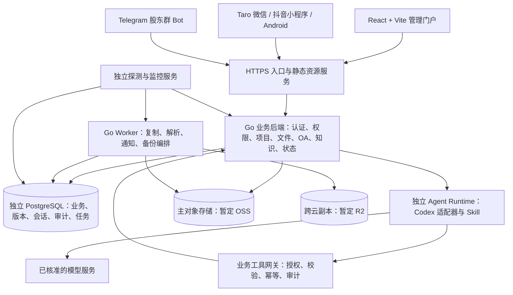

# 总体架构、权限与数据设计

日期：2026-10-22。版本：v0.2。基线为 3 名香港员工、境内服务器、2 TB 原件和 120 GB 单文件；以下为推荐设计，尚未实施。

## 1. 架构原则

Go 业务后端是权限判断和业务写入的统一入口。Web、小程序、App、Telegram 和 AI 使用同一组业务能力。PostgreSQL 保存结构化事实与文件索引；对象存储保存文件字节与版本。任何 AI 结果都要经过业务校验后才能成为项目、文件或审批的正式状态。

初期采用模块化单体，按业务模块划分代码和数据库职责，API 与后台 Worker 可作为同一程序的不同运行模式发布。AI Runtime 单独运行，便于控制依赖、并发、模型成本和故障影响。无需引入微服务集群、分布式消息平台或本地虚拟化环境。

## 2. 逻辑架构



图中的所有外部写操作都由业务后端或授权 Worker 执行。移动端可以使用后端签发的短时上传凭证直传对象存储，正式入库仍需经过上传完成校验。实际主存储选择由真实网络和账单测试决定。

## 3. 模块与职责

| 模块 | 核心职责 | 关键边界 |
| --- | --- | --- |
| Identity | 用户、组织、角色、SSO/登录、会话回收 | 不让客户端指定有效角色 |
| Authorization | 资源范围、项目成员、分类与动作授权 | 人工操作、AI 工具、检索、下载共同调用 |
| Project | 项目、客户/合作方引用、成员、任务、里程碑 | 项目状态变更有校验与版本 |
| File | 逻辑目录、上传会话、文件版本、预览、回收站 | 对象 Key 不作为用户可任意写入的路径 |
| Knowledge | 项目日志、会议记录、SOP、文章版本 | 正文在数据库；附件在对象存储 |
| Workflow | 合同、报销、采购审批与处理步骤 | 各业务状态机、内容版本和流程快照 |
| FinanceOps | 月开支、订阅、预算/实际支出、项目费用归集 | 原币、汇率快照、单一实际费用来源，避免重复统计 |
| Agent | 会话、任务、授权范围、操作计划、成本 | 不把模型文本直接当作命令执行 |
| Notification | 站内通知、TG 回执、可选邮件 | 站外投递校验接收对象与披露范围 |
| Status | 服务目录、探测汇总、事件与维护窗口 | 指标过期时不继续显示正常 |
| Audit | 操作人、执行者、对象、版本、结果、关联请求 | 脱敏、追加记录、独立导出 |
| Jobs/Outbox | 后台任务、重试、租约、定时任务实例 | 至少一次投递 + 幂等，避免声称天然恰好一次 |
| Storage | OSS/R2 适配、复制清单、校验、生命周期 | 不假设两个供应商 API 完全一致 |

## 4. 数据分类与权威来源

| 数据 | 权威来源 | 是否能重建 |
| --- | --- | --- |
| 用户、项目、任务、权限、OA | PostgreSQL | 不能依靠文件重新完整还原 |
| 文件逻辑路径、版本、复制状态 | PostgreSQL + 备份清单 | 仅扫描对象存储不足以还原全部权限与关系 |
| 文件原件、历史版本 | 主对象存储；已验证跨云副本可恢复 | 原始内容不可丢失 |
| 文章/项目博客正文与版本 | PostgreSQL | 必须随数据库备份 |
| 对话、业务任务、工具操作与审批结果 | PostgreSQL | 对原子任务恢复至关重要 |
| Codex 原生运行状态 | 经筛选的加密状态归档，或业务会话重建 | 丢失后可能只能重建业务上下文，不能保证原生线程原样续接 |
| 预览图、提取文本、搜索索引 | 对象存储/数据库中的派生数据 | 可从对应版本重新生成 |
| 上传缓冲、工作区、缓存 | 应用节点临时目录 | 可丢弃；仍需配额与清理 |
| 密钥、令牌、数据库连接凭据 | 密钥服务/受限配置与独立恢复保管 | 不进入模型上下文、业务文件或普通备份清单 |

“全文件放在对象存储”适用于文件字节；系统仍需要数据库保存业务信息。

## 5. PostgreSQL 核心实体

下表是逻辑模型，不是最终建表脚本。所有受组织管理的实体带 `organization_id`；业务资源带创建/更新时间、作者和并发版本。单公司设计可保留组织字段，但这并不等于已经实现商用多租户。

| 数据组 | 建议实体 | 重要约束 |
| --- | --- | --- |
| 身份 | users、organizations、departments、roles、role_bindings、login_sessions | 外部身份唯一绑定；停用后立即停止新操作 |
| 权限 | resource_grants、project_members、classification_policies | 默认拒绝；受限分类不能被目录继承意外放宽 |
| 项目 | clients、projects、tasks、milestones、project_links | 项目编号组织内唯一；归档策略明确 |
| 文件 | folders、files、file_versions、upload_sessions、file_replicas | 一个文件一个当前版本；版本号单调；版本内容不可原位覆盖 |
| 内容 | posts、post_versions、post_file_links、tags | 每篇文章可追溯版本；附件绑定稳定文件或明确版本 |
| OA | workflow_definitions、requests、request_revisions、approval_steps、approval_actions | 已提交申请保存流程快照；同一步骤的终态更新只能成功一次 |
| 合同 | counterparties、contracts、contract_versions、contract_milestones | 编号唯一；签署件固定版本；变更与补充协议可追溯 |
| 采购/报销 | purchases、purchase_items、acceptance_records、expense_claims、expense_items、receipts | 验收、审批、支付处理分离；票据去重提示与原件保留 |
| 订阅/月开支 | subscriptions、subscription_price_versions、billing_periods、expected_costs、actual_cost_entries、payment_records | 账期唯一；预计和实际分离；重复关联不重复计费 |
| 项目闭环 | task_dependencies、project_budgets、risks、issues、change_requests、deliverables、acceptance_decisions | 依赖不能成环；变更有版本；交付与验收结果分离 |
| 会话 | conversations、conversation_members、messages、agent_runs、run_events | 会话按人员/项目/渠道隔离；事件有序号 |
| AI 操作 | action_plans、action_items、approval_grants、tool_executions、usage_records | 计划版本、操作摘要哈希、幂等 Key、实际用量 |
| TG | external_identities、channel_bindings、inbound_updates、outbound_deliveries | 数字 user_id 绑定；update_id 去重；群迁移需更新绑定 |
| 状态 | hosts、services、probe_results、incidents、maintenance_windows | 时间戳、有效期、来源和关联项目 |
| 可靠性 | audit_events、outbox_events、jobs、backup_catalogs、storage_epochs | 业务提交与 outbox 同事务；唯一键保障重复投递安全 |

### 文件版本建议字段

`file_versions` 至少包含：文件 ID、版本 ID、基础版本 ID、版本序号、对象 Key、大小、内容摘要、媒体类型、创建人、执行者、生成来源、扫描状态、可用状态和创建时间。

`file_replicas` 按“版本 ID + 存储提供商 + Bucket”唯一，记录对象 Key、复制状态、实际校验时间、摘要、失败次数与错误类别。不能只在文件表放一个笼统的 `backed_up=true`。

### 工作流建议状态

申请：`draft → submitted → in_review → approved/rejected`，允许按规则撤回；实际业务处理另记 `pending/processed`，避免把审批通过混同于已付款、已采购等后续事实。每次转移由后端检查操作者、当前版本、审批步骤与业务规则。

## 6. 权限模型

采用“角色决定可执行动作，资源范围决定可操作对象，敏感级别与渠道决定能否读取/披露”的组合。

```text
可执行 = 账号有效
       ∩ 角色允许该动作
       ∩ 组织/项目/资源范围允许
       ∩ 资源敏感级别允许
       ∩ 当前渠道允许
       ∩ 当前任务授权允许
```

建议动作：`project.read/create/update/archive`、`file.read/upload/update/move/trash/restore/purge`、`post.read/write/publish`、`request.submit/approve`、`service.read/manage`、`agent.run/approve`、`audit.read`、`permission.manage`。文件永久清除、权限修改、站外披露单独授权。

敏感级别可从“公司内部、项目受限、严格受限”三个等级起步；另设 `ai_processing_allowed`、`external_channel_allowed` 等策略。等级含义与股东资料、合同和费用资料的实际规则由业务确认。

### 关键实现要求

1. 所有列表、数量、搜索、预览、引用和对象下载均检查权限，避免通过标题和搜索片段泄露资料。
2. 项目成员移除、员工离职、会话转移后，立即停止新工具调用，失效授权缓存，重新生成会话上下文。
3. 细粒度授权由 Go 业务层统一实现。PostgreSQL RLS 可作为补充防线，不能只打开开关而不测试连接池中的请求身份传递。
4. 如果启用 RLS，业务账号不使用数据库超级用户、表所有者或 `BYPASSRLS`；每个事务设置并清理身份，避免连接复用串权。[PostgreSQL RLS](https://www.postgresql.org/docs/current/ddl-rowsecurity.html)
5. 撤权后原生 AI 线程可能仍含旧内容，不能继续把该线程当作已清洁的上下文；应终止当前读取/写入并基于现有权限重建线程。
6. 短时签名下载 URL 在有效期内可能继续可用；严格受限文件走可实时鉴权的下载代理。下载到员工设备的数据不能靠服务器撤权强行收回。

## 7. API 与事件约定

REST 负责业务对象；OpenAPI 作为契约源，生成前端类型与客户端。Web 对话进度优先用 SSE；微信/抖音小程序与 Android 通过统一事件模型使用 WebSocket 或轮询。上传数据面直达对象存储，Go 只处理上传会话、分片授权与完成校验，避免让 120 GB 文件穿过普通业务 HTTP 请求。

| 接口示意 | 用途 |
| --- | --- |
| `POST /api/v1/projects` | 按模板建立项目 |
| `POST /api/v1/files/uploads` | 创建限定对象、大小和有效期的上传会话 |
| `GET /api/v1/files/uploads/{id}/parts` | 获取持久化及存储端确认的分片进度 |
| `POST /api/v1/files/uploads/{id}/part-tickets` | 按需刷新限定分片的短时凭证 |
| `POST /api/v1/files/uploads/{id}/complete` | 校验上传完成并生成文件版本 |
| `POST /api/v1/files/{id}/versions` | 带基础版本提交新版本 |
| `POST /api/v1/files/{id}/download-ticket` | 鉴权后生成短时下载凭证 |
| `GET /api/v1/search` | 带资源权限过滤的搜索 |
| `POST /api/v1/requests/{id}/actions` | 提交、审批、退回等受控动作 |
| `POST /api/v1/contracts` | 建立合同及签署件/版本关联 |
| `POST /api/v1/subscriptions/{id}/billing-periods` | 幂等建立账期与预计费用 |
| `POST /api/v1/actual-cost-entries` | 登记实际费用并关联采购/报销/订阅来源 |
| `POST /api/v1/conversations/{id}/messages` | 保存消息并返回任务 ID |
| `GET /api/v1/agent-runs/{id}/events?after=...` | 补发调用者有权读取的可见事件 |
| `POST /api/v1/action-plans/{id}/commit` | 验证授权后执行固定版本计划 |
| `POST /api/v1/agent-runs/{id}/cancel` | 请求取消未提交工作 |
| `POST /api/v1/integrations/telegram/webhook` | 接收并去重 TG 更新 |
| `GET /api/v1/services/status` | 查看状态、来源和新鲜度 |

写接口使用 `Idempotency-Key`；同一个 Key 绑定同一用户、接口与请求体摘要，不允许复用为另一组参数。更新使用 `If-Match` 或 `expected_version`，冲突返回可辨识错误。文件和审批历史保持稳定 ID。

事件示意：`message.accepted`、`run.queued`、`run.started`、`run.progress`、`action.proposed`、`action.awaiting_approval`、`action.committed`、`run.completed/failed/cancelled`。每条事件带任务 ID、序号、时间和可见范围。业务事实由数据库确认，不能以收到最后一段模型文本判断写入成功。

## 8. 后台任务与一致性

业务更新与 outbox 事件同事务提交。Worker 从 PostgreSQL 领取任务，通过租约、心跳、超时与幂等处理运行。初期不强制引入 Redis；若队列压力、实时分发或缓存需求达到实际瓶颈，再增加专用组件。

不能在长时间调用模型、解析文件或跨云上传时持有数据库事务。应采用“提交任务 → 外部执行 → 校验 → 短事务提交结果”的流程。文件操作跨数据库与对象存储，使用状态机和补偿清理，不声称拥有跨云原子事务。

定时任务使用唯一的“计划 ID + 计划时间”创建任务实例，防止多实例重复调度。重试区分限流、暂时网络错误和永久授权失败；后者暂停并通知负责人。

## 9. 前端与移动端

React + Vite 管理门户构建为静态文件，通过 Nginx 或同类原生 Web 服务托管。Vite 开发服务器只用于开发。页面显示业务对象状态、文件版本、复制状态和 AI 任务结果，权限控制由后端再次执行。

Taro 单独维护移动应用工程，复用 API 客户端、类型、校验规则和适合共享的业务逻辑。桌面表格、富文本编辑器、文件拖拽与原生文件选择无需强行共用 UI 代码。

Taro 的原生 App 路线基于 React Native，需要原生依赖、Android 构建、签名和发布流程。Android 大文件原生模块的兼容性必须在选定 Taro/RN 组合下验证，不能只验证普通页面能启动。[Taro RN](https://docs.taro.zone/docs/react-native)

首发必须覆盖 Web、微信小程序、抖音小程序和 Android，不包含 iOS。Taro 官方列出微信、抖音与 RN 路线，但不能据此假设平台 API、原生依赖和审核规则完全一致。[Taro 平台介绍](https://docs.taro.zone/)

微信/抖音小程序覆盖登录、项目与任务查阅、合同/报销/采购查询与审批、月开支查询、文档访问、普通附件、秘书会话和状态概况。Android 加上完整大文件上传任务与续传；Web 提供完整管理配置、复杂编辑和批量操作。小程序的大文件条目显示元数据与业务关联，只对平台支持的文件类型和大小提供直接预览。

Android 的 120 GB 上传需原生文件流、持久化上传任务、网络变化和前后台恢复能力；纯 JavaScript 一次读入文件不可接受。原生模块与系统后台限制单独验收，App 重启后应能继续任务，而不承诺进程被系统终止时持续传输。

微信和抖音分别准备开发者主体、AppID、域名、隐私说明、员工身份绑定和发布材料；线上环境必须通过各自的域名、HTTPS 和平台审核要求。不能用开发工具中的跳过域名校验代表线上可用。[抖音上传 API](https://partner.open-douyin.com/docs/resource/zh-CN/mini-app/develop/api/network/http/tt-upload-file)

Web 登录优先使用安全 HttpOnly Cookie 并防 CSRF；跨端访问令牌短时有效，刷新令牌轮换并保存在平台安全存储中。小程序登录凭据只用来换取服务器验证后的身份，不直接等同于公司员工权限。

## 10. 状态与监控

状态需要同时覆盖主机资源、进程健康、外部可达性、应用错误率与延迟、数据库、复制任务和备份。主机心跳正常不能证明客户服务可用。

初期建议复用原生采集器、HTTP/TCP 探测与托管指标/日志服务。Prometheus 能承担指标采集与规则，告警可交给 Alertmanager；具体自建/托管在预算确认后选择。[Prometheus 概览](https://prometheus.io/docs/introduction/overview/)

状态值为 `operational/degraded/down/maintenance/unknown`，保存 `checked_at` 和 `expires_at`。例如每 60 秒探测、连续 3 次失败后告警；超过 180 秒没有新样本显示 unknown。维护窗口抑制重复告警但保留样本。

探测器应位于应用节点之外；节点宕机后仍能告警。私网探测通过受控采集节点或既有私网连接执行。用户不能提交任意 URL/IP 让服务器无限探测，防止误探测内部管理和云元数据地址。指标接口不公开暴露数据库连接、令牌和内部配置。

## 11. 部署基线

推荐初始资源仅为待压测起点：

| 组件 | 初始配置建议 | 持久化 |
| --- | --- | --- |
| 应用节点 | 现有境内服务器待评估；初始目标 4 vCPU / 8 GB RAM / 100 GB 临时盘 | 仅缓存、工作区和短时日志缓冲；不要求容纳 120 GB 整文件 |
| PostgreSQL | 独立托管实例，2 vCPU / 4–8 GB 起，PITR | 业务事实与任务状态 |
| AI Runtime | 初期同节点独立账号与进程，并发 1、可配置到 2 | 业务状态外置；原生状态按设计筛选归档 |
| 跨云复制 Worker | 原生进程，初期限制 1 个大文件、2 个分片并发；带宽待测 | 分片进度写 PostgreSQL，缓冲有固定上限 |
| 文档解析 | 限制内存/CPU/执行时间的子进程 | 输出入对象存储/数据库；输入只临时下载 |
| 监控与外部探测 | 节点外托管或独立原生主机 | 指标/告警按独立保留策略 |
| 大规模 OCR/重型处理 | 达到实际负载后单独配置计算节点 | 不依赖应用临时盘保存唯一结果 |

生产应用用 systemd 等原生进程管理，最小权限 OS 账号，端口默认仅回环/私网监听，公网只开放必要 HTTPS 入口。使用原生权限、文件系统访问限制、进程资源限额和网络访问控制，不依赖本地 Docker/WSL/模拟器。Android 用真实设备验证。

3 人负载下通常不需要大规模计算集群，120 GB 文件和 2 TB 首次迁移主要受跨境带宽、存储 API、分片恢复和校验影响。香港员工到境内入口/OSS、境内 Worker 到 R2、境内服务到 Telegram/模型服务分别测试。可访问性、性能和供应商使用资格是不同问题。

发布采用版本化程序目录与可回退配置；数据库迁移先做兼容扩展，再切换应用。备份、健康探测和回退步骤必须在生产前演练。单节点故障可恢复，但不是应用高可用；真正高可用需要第二应用节点、入口切换和对应运行预算。

## 12. 费用模型与跨模块一致性

月开支需要统一的实际费用台账。一笔订阅扣款可关联采购申请、合同和报销单，但在实际费用表中只有一个权威条目；按来源业务 ID、账期或付款流水建立适当唯一约束，避免多入口重复登记。

金额使用定点数值及独立币种，禁止浮点金额。原币金额、记账币种、折算汇率、汇率日期、实际支付日期和记账期分别保存。历史账期保留当时价格和汇率快照；更改当前订阅价格不能改变已确认月报。

报表至少区分预算、预计费用、实际发生与已处理金额。汇总多币种前先固定口径；年费支付与按月摊销可并列展示，但不能相加到同一个费用总计。首发是运营费用管理与台账，不自动等同于完整会计总账。

合同到期、订阅续费、项目逾期等提醒采用持久化计划任务。变更日期时使旧提醒失效并创建新版本；重复调度和失败重试不重复生成费用或提醒。AI 只填写/解释业务记录，关键金额和状态由同一套业务校验约束。
