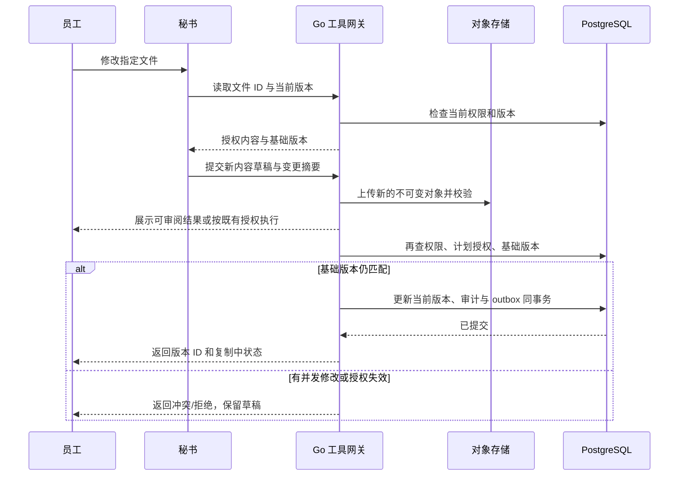

# AI 秘书、Skill 与 Telegram 设计

2026-10-25 当前实现：已完成门户绑定、准确群入口和去重入站，并接通项目简报请求到独立TG会话、真实运行与现有队列。TG只读执行约束及Web／Taro结果查阅已受控验证；当前开发环境仍无正式发布或真实模型。群披露、Bot外发及真实环境验收继续开放，见[增量61](development/61-telegram-agent-dispatch.md)。

日期：2026-10-22。版本：v0.2。本文为运行机制与接口设计，尚未部署 Agent 或发布 Skill。基线为境内服务器、3 名香港员工、Web/微信/抖音/Android 同批首发。

## 1. 秘书的定位

秘书是公司统一的工作入口和业务执行助手。它能查资料、理解项目上下文、起草合同/报销/采购资料、整理订阅开支、建立项目、更新文件、整理信息和汇总运行状态。系统使用同一秘书名称和工作规范，同时为不同员工、项目和群话题隔离上下文。

“实时在线”指服务入口全天可接收消息，任务能排队、返回进度并在断线后查询；模型推理按任务调用，不需要一个模型进程持续思考。文件/目录的全量调度能力，通过授权业务工具覆盖公司纳管资料实现。

自有服务器运行的是编排、Skill 和工具；使用云模型时，所选上下文仍需发送给模型服务商。开源 Codex harness 不等于开源模型权重或完全本地推理。[官方平台说明](https://developers.openai.com/blog/codex-as-a-platform)

资源需标记是否允许 AI 处理；仅发送当前任务必需的授权片段，并记录数据流向。模型供应商的数据保留、日志和区域设置以具体账号/端点能力为准，不能把“API 数据默认不用于训练”理解为零保留或本地处理。[OpenAI 数据控制](https://developers.openai.com/api/docs/guides/your-data)

## 2. Codex 接入选型与前提

### 2.1 资格先于技术接入

正式接入前，验证公司账号、实际使用人和服务提供地区是否符合选定 OpenAI 产品要求。当前 API 支持列表未列香港、中国大陆；该事实使直接面向相关地区员工的官方接入成为前置决策，不能凭网络能访问就判定可上线。[官方支持地区](https://developers.openai.com/api/docs/supported-countries)

生产认证建议使用经公司核准、权限和费用可管理的 API 项目/服务身份；不将某位员工的桌面登录缓存当作全员共用的长期认证。若采用官方另行提供的企业自动化凭据或用户授权登录方案，应按其适用范围单独验证，不能假设订阅涵盖所有后台调用。[Codex 认证](https://learn.chatgpt.com/docs/auth)

### 2.2 路线对比

| 路线 | 适用场景 | 本项目建议 |
| --- | --- | --- |
| Codex SDK | 程序化启动、继续、恢复本地任务 | PoC 首选候选；Node/TypeScript Runtime 与 Go 平台协作 |
| `codex exec` | 有界后台任务、结构化输出与事件 | 简单 Skill 的备选验证路线 |
| Codex app-server | 自建客户端、会话生命周期、流式事件、交互请求 | 能力匹配，但官方当前标记实验性质；隔离为候选适配器 |
| Responses API / Agents SDK | 自行控制业务工具和状态 | 经资格核准后的备用架构；不能称其就是 Codex SDK |
| OpenAI 托管 Codex harness | 云端编排，应用提供工具/环境 | 与“秘书运行在自有服务器”要求不同，暂不作为主方案 |
| 其他地区可用的模型与运行时 | 原路线资格或运行指标不满足时 | 单独评估工具正确率与数据政策，属于方案变更 |

官方 SDK 为服务端 TypeScript 库。app-server 的进程、协议和 WebSocket 有实验性限制，本项目不公开暴露其监听端口，生产是否采用需经过版本冻结与恢复验收。[SDK](https://learn.chatgpt.com/docs/codex-sdk)、[非交互任务](https://learn.chatgpt.com/docs/non-interactive-mode)、[app-server](https://learn.chatgpt.com/docs/app-server)

不把任何一个运行时当作公司业务权限、OA 引擎或可靠队列的替代品。

### 2.3 推荐集成形态

```text
管理门户 / Taro / Telegram
        ↓
Go：用户身份、会话、任务、预算和授权范围
        ↓
Agent Runtime 适配器：启动 / 输入 / 事件 / 取消 / 恢复
        ↓
Codex SDK（候选）+ 版本化 Skill + 业务工具客户端
        ↓
Go 工具网关：重新鉴权、参数检查、版本、事务和审计
        ↓
项目 / 文件 / OA / 知识 / 状态
```

SDK 和 app-server 的具体事件字段由 PoC 按锁定版本映射到公司事件契约。界面只消费公司定义的事件，避免协议升级直接影响 Web 和移动端。

## 3. 运行时与权限隔离

每次任务创建服务器签发的执行上下文，包含调用人、组织、项目范围、渠道、敏感级别、允许工具、资源上限、有效期、授权版本和任务 ID。

有效权限为“调用人权限 ∩ 项目/资源范围 ∩ 渠道披露范围 ∩ 当前任务授权 ∩ 工具能力”。定时任务由明确的服务身份执行，授权对象、接收人和频率固定记录；不能沿用某个管理员聊天产生的无限期权限。

身份字段从已认证连接与服务器会话中获取，模型只提交业务参数。即使模型填入另一人的 `user_id` 或声称“我是管理员”，工具网关也不据此改变身份。

### 运行安全要求

1. Go 后端与 Agent 使用不同 OS 账号，Agent 不拥有数据库管理凭据、OSS/R2 管理密钥、部署密钥或宿主机管理权限。
2. 业务工具使用短时、限定任务的凭证；数据权限每次执行时重查。撤权、员工停用和超时立即阻止新调用。
3. 首期不提供通用 SSH、数据库 SQL、任意 URL 抓取、系统配置修改和永久删除工具。
4. 对选定 Codex 版本验证非必要 shell、文件系统与网络工具的限制能力；同时使用原生 OS 权限、进程资源限额和网络规则阻止旁路。
5. 运行时需使用的模型凭据与模型可执行的子进程环境分离，子进程环境严格白名单。若无法证明隔离有效，不开放通用命令执行。
6. 文档里的指令、恶意提示、附件宏、项目目录名和工具返回文本均视作不可信数据，不能改变系统授权或工具集合。
7. 对公网工具目标、重定向、私网地址和云元数据地址实施访问控制；文件下载只通过文件 ID 与已验证版本。
8. 文件解析进程有大小、时间、内存和输出限制；不自动运行文档宏和未知脚本。

权限边界以工具网关和 OS 控制为准，不能只写在 Skill 或系统提示词中。如果 PoC 证明候选运行时无法在原生进程部署条件下满足边界，该路线不进入生产。

## 4. 文件系统视图

公司目录是逻辑目录，权威结构存 PostgreSQL，文件内容在对象存储。秘书可以调用 `list_directory`、`read_file`、`create_file`、`write_new_version`、`move_file` 等业务工具；工具将逻辑文件映射到稳定 ID 和不可变对象版本。

当确需本地编辑时，只把本任务已授权的文件下载到独立临时工作区。例如展示路径 `/projects/PRJ-2026-001/docs/方案.md`，实际临时文件名由服务器生成，与对象 Key 解耦。校验目录穿越、绝对路径、符号链接、压缩包内路径、超大解压和跨平台同名冲突。

修改后先生成新对象版本，再通过业务提交更新索引。不能把 OSS/R2 通过挂载当成正常共享磁盘，让 Agent 绕过业务层任意写入。项目与文件的授权变化也不能靠本地目录权限自动推导。

## 5. 业务工具清单

| 工具组 | 能力示意 | 返回与限制 |
| --- | --- | --- |
| 查找 | search_resources、list_projects、list_directory | 已过滤 ACL；分页、总量与片段也受限 |
| 阅读 | read_file_version、read_project、read_post、read_service_status | 返回资源 ID、版本、时间、必要内容与来源 |
| 项目 | propose_project、create_project、update_project | 必填校验、编号唯一、模板版本、事务与幂等 |
| 文件 | create_file_draft、propose_file_update、commit_file_update | 基础版本、内容摘要、差异和扫描状态 |
| 整理 | propose_classification、propose_moves、commit_organization_plan | 逐项权限检查；移动不扩大可见范围 |
| 知识 | draft_post、update_post、link_sources | 文章版本；引用资源仍按读取者鉴权 |
| OA | draft_request、submit_request、read_approval_status | 申请人与审批人明确；审批需要正式身份授权 |
| 状态 | read_incidents、read_metrics_summary、draft_incident_note | 首期只读运行环境，不直接重启生产服务 |
| 通知 | propose_notification、send_authorized_notification | 校验接收人、渠道和正文敏感级别 |
| 治理 | read_task_result、cancel_pending_run、inspect_usage | 只查看有权访问的任务与费用范围 |

上述名称为设计契约示意，不代表当前已有这些 API 或已验证对应 SDK 的直接支持。

## 6. Skill 设计

Skill 定义何时使用、需要哪些输入、应调用哪些工具、如何处理失败和输出什么证据。工具和工作流负责确定性校验。每个 Skill 有 ID、版本、负责人、允许工具、适用渠道、资源范围、费用上限、失败恢复方式和验收用例。

### 首批 Skill

| Skill | 输入 | 工作流程 | 完成证据 |
| --- | --- | --- | --- |
| `project-create` | 项目名称、业务类型、负责人、成员、模板 | 补齐字段 → 检查重名与权限 → 展示计划 → 建项目/目录 → 生成模板任务 | 项目 ID、成员清单、目录清单、待补齐项 |
| `project-update` | 项目 ID、要更新的任务/里程碑 | 读取现状 → 区分事实与建议 → 校验状态转移 → 提交版本 | 变更项、原/新状态、提交时间 |
| `file-update` | 文件 ID、改动要求、基础版本 | 授权阅读 → 生成草稿 → 差异/格式校验 → 冲突检查 → 新版本提交 | 文件 ID、版本 ID、差异、复制状态 |
| `information-organize` | 限定项目/目录、分类规则、数量上限 | 盘点 → 分类建议 → 重复候选 → 预演目录变化 → 执行允许项 | 逐项结果、未处理原因、撤回依据 |
| `project-briefing` | 项目范围、时间窗口、接收渠道 | 聚合任务/日志 → 处理缺失 → 带引用摘要 → 校验披露范围 | 来源版本、时间、接收范围 |
| `incident-summary` | 事件 ID、服务范围、时间窗口 | 读取指标/事件 → 归纳现象与待确认项 → 生成记录/待办 | 指标时间、已知事实、待办 ID |
| `oa-assist` | 合同/报销/采购类型、业务事实、附件 | 整理草稿 → 金额/字段校验 → 申请人提交 → 查询结果 | 草稿/申请 ID、实际审批状态 |
| `subscription-review` | 账期、订阅范围、项目 | 汇总预计/实际 → 标记差异/重复候选 → 生成续费与费用草稿 | 账期、费用条目 ID、待核实项目 |

首发至少包含建项目/项目更新、文件更新、资料整理、合同/报销/采购辅助、订阅开支汇总；简报和状态汇总在同轮集成中完成基础能力。每个 Skill 复用统一业务流程，不各自实现一套鉴权或存储逻辑；复杂自动修复和未经验证的文件格式操作后续扩展。

### 发布规则

Skill 的状态为草稿、测试、试点、已发布、停用；已发布版本不可直接覆盖。每次任务记录 Skill 版本与运行时版本。普通文档写权限不能修改已发布 Skill；运行时不自动把上传文档识别成可执行技能。

批量更新、自动归档和渠道通知需有专门测试集。发布后可独立回滚 Skill 版本，暂停其写工具，而不必停掉整个业务系统。

## 7. 文件更新的标准流程



任何用于批准的计划都绑定操作列表、文件版本与内容摘要；计划变化后原批准失效。新对象已上传而数据库提交失败时，该对象属于未引用候选，由任务回收；不能让“草稿上传成功”变成“正式文件更新成功”。

重复工具调用由幂等记录返回同一次结果。超时后先查既有执行结果，再决定重试；网络断开不代表数据库未提交。

## 8. 预授权与高影响操作

目标是让日常可恢复操作顺畅执行，同时对影响范围较大的动作保留明确控制。无需对每次读取或每次普通写入都弹窗。

| 级别 | 示例 | 处理方式 |
| --- | --- | --- |
| L0 | 在当前授权范围查阅资料、汇总状态 | 直接执行，记录来源 |
| L1 | 明确指令下新建草稿、建立有权创建的项目、更新少量可恢复文件版本 | 按公司配置的既有授权执行；展示结果与可追溯版本 |
| L2 | 批量移动、批量归档、改变资料分类、群发通知 | 先预演和固定计划；已明确预授权的自动化可直接提交，否则由有权人员确认 |
| L3 | 修改权限、永久清除、直接资金动作、生产系统变更 | 首期不开放秘书直接执行；后续需专项权限、身份校验与运行手册 |

批量阈值初值可设为 20 个对象或超过单项目范围即进入 L2，最终由业务确认。自动化授权必须明确范围、允许动作、接收人、频率、有效期和撤销方式。

恢复操作属于新的审计操作。恢复旧版时复制其内容为新版本，保留后续历史；跨对象批处理若部分成功，应报告逐项结果并给出补偿方案，不能声称全部原子回滚。

## 9. 会话、记忆与任务恢复

对话主体是业务会话，至少区分私人会话、项目共享会话和 TG 群话题。共享项目会话的成员变化必须触发授权复核；私人内容不得自动拼入群对话。

长期知识以项目、文档和记录为权威，秘书摘要是派生物，保存来源 ID、版本和敏感级别。检索前过滤授权，引用前再次校验；不能把全部公司文件塞入一个所有员工共用的上下文或向量库返回结果中。

任务状态建议为：

```text
queued → running → awaiting_approval → committing → succeeded
                ↘ failed / cancelled / interrupted
```

并非所有任务都需要审批。任务重启后，先查询各工具是否已经提交，再继续未完成步骤。取消只阻止尚未提交的工作；已提交写入需另发恢复操作。对外通知也必须去重并保存投递结果。

业务消息、可见进度、工具输入输出的必要摘要、引用、授权与执行结果存 PostgreSQL。记录可见业务事件，不以记录模型内部推理作为恢复机制；敏感工具输出按分级脱敏和限期保存。

Codex 原生线程状态若依赖本地文件，存在两种方案：筛选必要状态后加密归档并验证原样恢复，或只保留业务会话并在新进程中重建上下文。不能把整个用户配置目录直接上传，因为可能混有认证缓存和无关数据。失去原生线程不应丢失正式业务记录。

## 10. Telegram 接入

### 10.1 消息路径

`Telegram → HTTPS Webhook → 校验和去重 → 群/身份绑定检查 → 保存输入 → 业务会话任务 → 脱敏结果 → TG 投递队列`。

Webhook 验证 Bot 配置的 `secret_token` 请求头，限制请求大小，只接收需要的更新类型。更新持久化后尽快响应，由后台处理耗时任务。以 `update_id` 去重，支持群 ID 迁移和话题 ID；匿名管理员的 `sender_chat` 不能直接映射为有权员工。[Bot API](https://core.telegram.org/bots/api)

### 10.2 身份与群范围

员工先在管理门户发起一次性绑定，再由 Bot 获取真实数字 `user_id` 完成验证。不能用可修改的用户名、昵称或截图作为权限依据。绑定可撤销，员工停用后所有 TG 新操作自动失效。

维护指定群 `chat_id`、话题 `message_thread_id`、允许 Skill、允许项目和群可公开的数据级别。股东群按公司确认的共同披露范围提供摘要，不因某个股东具有更高个人权限就把其全部资料发到群中。

不依赖 Bot 能穷举所有群成员来证明每个人都有阅读权限。严格受限内容始终返回需登录的门户入口；成员变更或群绑定异常时暂停敏感自动播报并复核范围。

### 10.3 触发与回复

首期保留隐私模式，使用明确提及、命令或回复 Bot 触发，减少不相关群聊进入上下文。若要求主动读取所有群聊，需要另行确认访问范围与保留策略。[Telegram Bot FAQ](https://core.telegram.org/bots/faq)

Bot 先返回任务受理状态，较长任务按阶段更新，最后给出摘要与门户链接；不要逐 token 向群发送。消息投递按 Telegram 返回的限流信息退避，合并重复通知。大文件走管理门户与对象存储，不依赖 TG 作为文件仓库。

群内操作按钮只携带短时操作标识。后台重新验证点击者、角色、授权范围、计划版本与过期时间，不能让“群内任何人点击同意”代表发起股东批准。高影响动作转到管理门户完成身份核验。

本规划没有创建 Bot、加入群或发送消息；这些属于后续接入实施。

## 11. 文件理解、搜索与正确率

首发重点支持文本/Markdown、文本型 PDF 与 Office 内容提取；票据 OCR 用于辅助录入，范围由真实样本冻结。结构化 Office 编辑和扫描件的复杂理解逐类验证。每个适配器独立说明是否支持读取、语义编辑、格式保留和预览。PDF 中读出文字不等于能无损改写原排版。

最大 120 GB 文件纳管不代表整体送入模型。秘书优先读取元数据、版本、业务关联和已生成的受限索引；按格式与任务选择可处理片段。大文件上传、移动、复制和替换走对象存储操作，不下载到秘书工作区进行整文件重写。具体文件类型尚待盘点。

初期结合标题、标签、目录、项目和正文搜索；中文分词、英文术语、文件名缩写与版本匹配通过真实资料集验证。语义检索可后续引入，但向量、摘要、缓存和索引同样属于有敏感性的公司数据。

任务输出区分“已核实事实、根据资料推导、缺失待确认”。所有正式状态变更必须有工具提交证据。模型不可用、限流或预算达到阈值时，基础 OA 和文件功能继续工作，用户仍可人工完成流程。

## 12. PoC 必测项

1. 两个不同权限员工同时运行任务，不能读到对方受限文件、缓存或会话。
2. 被恶意提示污染的文件不能导致权限扩大、外部发送或系统命令越界。
3. 文件并发更新时检测基础版本冲突；重复调用与断网重试不产生多次正式版本。
4. 进程被终止后，业务任务状态、已提交结果和会话仍可查；验证原生线程恢复或清楚标记为重建。
5. TG 群内查询不泄露私人会话、个人专属资料或长期对象下载 URL。
6. 实测 SDK/exec/app-server 的事件、取消、运行时限制与版本兼容性；实验能力不能未经验证进入生产。
7. 采集典型任务成功率、修正率、费用和耗时，确定正式开放的 Skill 白名单。


增量62已提供服务事件摘要实际只读工具、持久快照与门户回看，TG `/incident` 可接入实际队列。摘要明确读取时间、记录时间窗和截断范围，跨服务事件受共同权限约束；真实模型、群披露及 Bot 投递仍需单独验收。详见[服务事件摘要设计与实现](development/62-agent-service-summary.md)。

## 当前实现补充：增量63

秘书月度财务读取已接通真实订阅预测、发生支出及现金投影、共同权限、不可改写财务来源和 Web／Taro 回看。汇总保留原币种、原时间和覆盖说明，完成回执须引用准确财务快照；源码保持 draft，TG 财务执行仍关闭。见[实现约束](development/63-agent-finance-summary.md)；真实模型与全平台验收继续推进。


增量64 已补齐门户链接形式的群受理、进度和结果通知，以及 Web／Taro 本人投递回执与人工对账。默认不开启真实发送，群内不外发业务正文，未知投递不自动重发；真实 Bot、模型、出站网络及生产群验收继续开放。见[实现与限制](development/64-telegram-delivery.md)。
