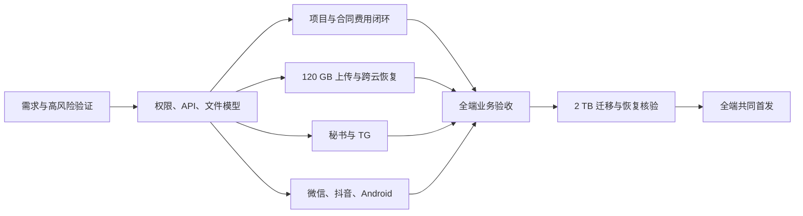

# 实施阶段、工作量与成本

日期：2026-10-22。版本：v0.2。预算与日期尚未确认；以下是可用于立项比较的估算模型，非报价。

## 1. 交付基线

用户已确认：3 人使用，境内已有云服务器，香港员工访问，2 TB 文件、最大 120 GB；业务覆盖合同、报销、采购、月开支/订阅与完整项目管理；首发同时包含 Web、微信小程序、抖音小程序和 Android；大文件上传由 Web/Android 完成，不做考勤与人事。

内部可以按模块集成和试用，但**首发完成的定义是全部指定端与业务闭环共同验收通过**。不能把小程序或 Android 推迟到首发之后来压缩当前估算。iOS 未纳入范围。

## 2. 开工前与 PoC

P0 验证优先解决高不确定性，避免完成主要业务后才发现模型资格或大文件链路不适用。

| 验证 | 具体任务 | 产出与放行条件 |
| --- | --- | --- |
| G0 服务资格与网络 | 核查 Codex/OpenAI 的账户和实际地区适用性；测试经核准服务与 TG 的合法可用连接 | 有明确采用路线；网络可达不能代替资格确认 |
| G1 服务器盘点 | OS、CPU/RAM、磁盘、区域、云厂商、出口计费、域名/证书、DB 与已有监控 | 部署与成本清单；不假定“有服务器”即有足够传输条件 |
| G2 大文件数据面 | Web/Android 对真实 120 GB 样本上传、暂停/续传、重启、过期续签、摘要校验 | 全文件完成与一致性证据；不要求本地缓存完整文件 |
| G3 跨云复制 | OSS/R2 120 GB Multipart、断点恢复、重启、回读校验、带宽限额 | 明确实际吞吐、校验路径、账单与预计复制时间 |
| G4 AI 权限与恢复 | 两个不同权限身份，恶意附件，重复工具，版本冲突，进程中断 | 无越权；可查已提交结果；可恢复或明确重建业务任务 |
| G5 多端发布路径 | 微信/抖音主体、类目、域名、员工登录；Android 真机、原生上传能力与分发方式 | 明确可发布渠道及阻塞；不以开发版通过等同正式可发布 |
| G6 恢复演练 | 小规模数据库与对象清单备份，恢复到独立原生/托管测试环境 | 能恢复权限、业务记录和文件引用；报告实际缺口 |

P0 不是把 2 TB 全量正式迁移。先用有代表性的普通文件和一个真实大文件验证，再批准存量迁移。原件来源与文件类型待提供。

## 3. 分阶段工作量

人日指工程实施工作量，采用约定范围估计；“3 人使用”不代表必须配置 3 名开发人员。下表日历窗口按约 3 名工程师、兼职产品/QA/运维支持安排，允许相关任务并行。

| 阶段 | 相对周次 | 工作范围 | 工程人日 |
| --- | --- | --- | --- |
| P0 需求冻结与 PoC | 第 1–2 周 | 审批规则、项目闭环、资格、原生运行、大文件、双云、多端发布验证 | 15–22 |
| P1 统一底座 | 第 3–5 周 | 登录/权限、项目基础、文件版本、API 契约、审计、任务队列、部署链路 | 20–30 |
| P2 完整业务模块 | 第 6–11 周 | 项目闭环、合同、报销、采购、订阅/月报、博客、状态目录与提醒 | 30–44 |
| P3 大文件与秘书 | 第 8–14 周 | Web/Android 上传协议、复制/校验、核心 Skill、会话恢复、TG、成本治理 | 30–44 |
| P4 微信/抖音/Android | 第 6–16 周 | Taro 多端业务界面、平台适配、Android 原生续传、普通附件、发布材料 | 40–60 |
| P5 联调、迁移与首发 | 第 17–20 周 | 全端验收、权限/故障用例、2 TB 分批迁移、恢复演练、使用培训 | 20–30 |
| 合计 | 约 18–24 周含缓冲 | 外部资格、审核与未知链路造成的等待另记 | **155–230** |

建议另预留约 20% 工程风险量，即总计约 **186–276 人日** 的容量。日历时间受关键路径和人员专长影响，不能简单用总人日除以人数作为承诺日期。

如果只有 1 名工程师串行完成，155–230 人日本身约为 31–46 个净工作周，加上验证与返工后可按 9–14 个月做初步容量预留。AI 辅助可以改善产出速度，但不能在尚未验证时把全端首发压缩为几周承诺。

## 4. 关键依赖与首发路线



存量迁移可提前分批执行，正式切换必须等待权限映射、增量追平与双云核验。平台审核材料应在 P0 准备，不能到开发结束才确认主体和类别是否适用。

若 G0 无法满足且用户坚持官方 Codex 为首发硬条件，完整首发存在外部阻塞；可继续基础模块研发，但必须明确 AI 路线尚未放行。备用模型/运行时需要单独确认后才可纳入最终方案，不能静默替换。

## 5. 建议人员分工

| 职责 | 主要任务 |
| --- | --- |
| 产品负责人，由公司指定 | 确认合同/费用口径、审批权限、项目闭环、验收与范围变更 |
| Go/数据工程师 | 业务模型、权限、财务台账、存储/复制、工具网关、数据库恢复 |
| Web/业务前端工程师 | 管理门户、复杂表单、版本差异、Web 大文件上传、全端 API 契约协作 |
| 移动/集成工程师 | Taro 微信/抖音、Android 原生上传、发布与真机测试；AI Runtime 集成与后端协作 |
| 兼职 QA/运维 | 真机矩阵、异常重试、数据迁移、指标、发布与恢复演练 |

团队需明确 AI 集成和 Android 原生模块的实际经验，不能把这些工作默认分配给“会 React”的开发者而不留学习与验证时间。

## 6. 一次性开发预算模型

可使用：

```text
开发基价 = 工程人日 × 双方认可的人日成本
工程容量预算 = 开发基价 × 1.20（示例风险系数）
另列 = 一次性迁移流量 + 平台账号/认证 + 专用服务许可 + 专项安全/审查
```

以下仅为数学敏感性分析，人日单价是示例参数，不是市场行情或供应商报价：

| 示例单价 | 155 人日 | 230 人日 |
| --- | --- | --- |
| RMB 1,500 / 人日 | RMB 232,500 | RMB 345,000 |
| RMB 2,500 / 人日 | RMB 387,500 | RMB 575,000 |

加入 20% 容量后，上述四格分别为 RMB 279,000、414,000、465,000、690,000。已有团队、自行开发、外包合同和 AI 工具的成本结构不同，应替换单价重新计算；目前没有用户确认的开发预算。

P0 可单独按 15–22 人日批准，产出实际样本结果、业务模型与更新估算，再冻结全量合同和里程碑，降低一次性投入的不确定性。

## 7. 存储成本与增长

以十进制 2 TB = 2,000 GB 原件计算：应用版本和派生文件系数暂定 1.5，每个云端约 3,000 GB，两份共约 6,000 GB。数据库备份、未完成 Multipart、迁移暂存和额外原生版本另计。

截至核实日，R2 Standard 公布价格为 USD 0.015/GB-month，标准层免费存储额度为 10 GB-month。因此单个 R2 副本仅存原件约为 `(2,000 - 10) × 0.015 = USD 29.85/月`；按 1.5 系数则约 **USD 44.85/月**。请求操作等另计。R2 免费出流量不代表 OSS、服务器出口或跨境加速免费。[R2 价格](https://developers.cloudflare.com/r2/pricing/)

月新增原件暂按 100 GB 做示例：每个副本按 1.5 系数增加约 150 GB，R2 纯存储月账单约再增加 USD 2.25，未考虑生命周期回收。每保存一个额外完整 120 GB 历史版本，R2 纯存储约增加 USD 1.80/月，主云也增加相应存储。

真实版本系数取决于文件类型和修改频率。如果大量 120 GB 二进制文件反复替换，1.5 倍可能偏低，需按实际版本数量而不是原件总量估算。

## 8. 月运行费用占位预算

除引用的 R2 公开单价外，下表为容量规划占位区间，**不是核实后的云厂商报价**。云区域、套餐、已有资源抵扣、网络路径与服务资格确认后重新询价；金额均为 USD/月，未换算人民币或港币。

| 成本项 | 初步占位范围 | 主要变量 |
| --- | --- | --- |
| 现有应用服务器增量 | 0–80 | 已购规格、是否升级、解析负载 |
| 独立托管 PostgreSQL | 40–150 | 规格、自动备份/PITR、存储与可用性配置 |
| OSS 存储占位 | 40–110 | 约 3 TB、区域/存储类型、包年资源包 |
| R2 存储和操作占位 | 45–65 | 约 3 TB、Class A/B、临时分片；以实际账单为准 |
| 上传后跨云/下载网络 | 50–500 | 香港下载量、源 OSS 出流量、中转服务器出口、全量校验 |
| 测试环境与外部探测 | 20–80 | 是否复用已有资源、独立探测节点 |
| 日志/指标/告警 | 10–60 | 留存期、已有监控服务、日志体积 |
| AI 使用占位 | 20–200 | 资格确认后的模型与任务实际用量，非模型报价 |
| 合计占位 | **225–1,245** | 高下载量、频繁大文件版本、长上下文任务可显著超出 |

三人规模下，值得优先优化的是文件出口和重复传输，而不是数据库查询吞吐。现有服务器的已付固定成本需单独列账，不能因“增量为零”认为运行没有成本。

### 网络成本拆分

```text
月网络成本 = 香港员工实际下载 GB × 对应下载路径单价
           + 新增/版本/补复制 GB × 源端公网出流量单价
           + 中转 Worker 出口 GB × 对应云出口单价
           + 全量校验流量 × 对应路径单价
           + 加速、网关或其他实际启用服务费用
```

同云内网读取和公网读取计费不同；实际路径只计实际发生项，不能把所有理论项都相加，也不能默认跨云 Copy 是一次免费存储操作。首次 2 TB 迁移与回读校验按相同路径另行计算。

## 9. AI 用量与预算

按假设每月 660 次员工交互任务，自动整理和简报另计。一个任务可能包含多轮推理和多次工具调用，不能按“一次聊天请求”简单估价。

用量至少记录每个任务、用户、Skill、项目的输入/输出用量、调用次数、实际费用或估算费用、耗时与结果。正式月预算应采用 PoC 的真实分位数成本，包含失败重试、摘要与索引构建。

成本公式为 `Σ(各模型计费输入 × 输入单价 + 输出 × 输出单价 + 其他工具费用)`；单价以核准账号的当前官方报价为准。本规划未指定具体模型，也不使用未经核实的模型价格。

初期运行并发 1，可配置到 2；设置每日/每任务预算、任务超时、工具调用上限和排队限额。预算触顶暂停新 AI 工作，基础业务可继续使用。供应商后台提醒不应被当作已经实现应用侧硬性限额。

## 10. 开发、测试与上线方式

开发和本地测试使用原生 Go、Node、可用的原生/托管 PostgreSQL，Android 真机与平台开发工具；不启动本地 Docker、WSL、虚拟机或设备模拟器。浏览器验证完成后关闭不用的标签页，保留用户明确需要的页面。

测试数据使用脱敏样本，120 GB PoC 使用有权使用的实际文件或受控测试文件，不将其默认送入模型。每次正式迁移有版本化清单、权限映射、复制核验和回退路径。

发布产物包括后端二进制、Web 静态文件、Taro 微信包、Taro 抖音包、签名 Android 安装包、Skill 发布包、数据库迁移、运维配置和恢复手册。原始签名/平台密钥进入安全保管，不写入文档或代码仓库。

首发后建议预留 2–4 周稳定观察，用于用户反馈、平台行为、费用对账和真实恢复指标确认。新功能按变更清单进入后续版本，不混入首发缺陷修复。
