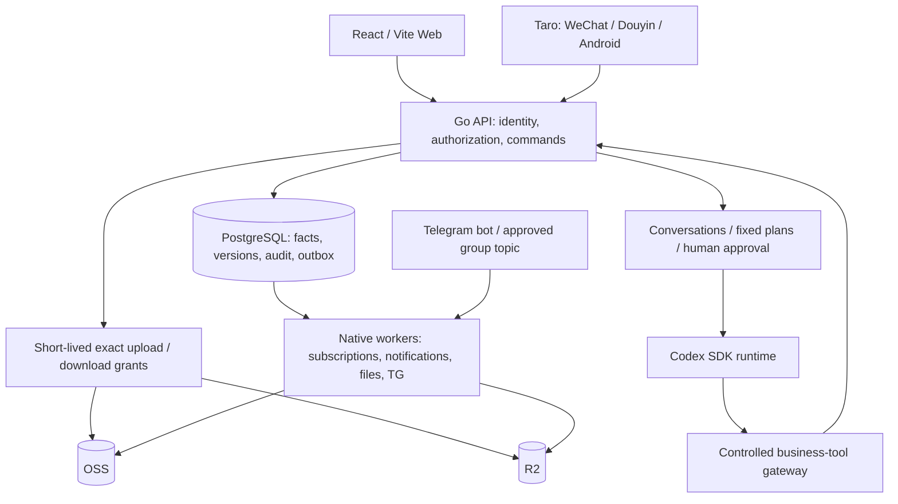

# CopyPaste Case Manager · Solution and usage guide

[中文](README.zh-CN.md) · [Repository home](../README.md) · [Documentation index](README.md) · [Screenshots, recordings and GIFs](media/README.md) · [Changelog](CHANGELOG.md)

CopyPaste Case Manager connects projects, office workflows, files, knowledge, recurring costs, a company secretary and service status through shared authorization and audit history. This repository includes working implementations, detailed protocols and source-bound evidence. It is a development preview; full production delivery continues against the [28 numbered gaps](delivery/03-goal-gap-assessment.md).

## 1. Goal and scope

| Confirmed input | Design consequence |
| --- | --- |
| Three employees, three concurrent users, based in Hong Kong | Individual identities, audit history and Hong Kong time; a small team still needs permissions and recovery |
| An existing mainland China server; specifications/access to follow | Start with a modular monolith API and separate native workers; validate the actual Hong Kong network path |
| Approximately 2 TB of originals, up to 120 GB per file | Direct object-storage uploads and resumability on Web/Android; mini-programs focus on reading, requests and approvals |
| Web, WeChat, Douyin and Android must launch together | Shared facts with separate client acceptance; compilation and H5 recordings do not establish device readiness |
| Contracts, procurement, claims, monthly costs and subscriptions | Reconcile incurred cost, cash movement and forecasts separately; attendance, HR and payroll are outside scope |
| OSS + Cloudflare R2; application servers retain temporary data | Formal objects use independent cloud copies; production PostgreSQL needs separate persistent storage and backups |
| Codex secretary and a shareholders' Telegram group | Use business tools and explicit authorization; the model receives no unrestricted host, database or cloud-key access |

The approach fits the initial team while keeping business records out of an unstructured server directory. PostgreSQL holds business facts, permissions, indexes and history; object storage holds formal bytes; workers perform recoverable background work. Actual capacity, scanning, network, storage and recovery costs depend on provider configurations and traffic. This repository does not promise a fixed monthly operating cost.

## 2. Architecture and data flow



| Directory | Responsibility and boundary |
| --- | --- |
| [app/backend](../app/backend) | Go API, domain commands, 69 current migrations, database constraints, jobs and native workers; PostgreSQL is authoritative |
| [app/web](../app/web) | React/Vite lists, forms, fixed evidence, approvals, history and operation receipts |
| [app/mobile](../app/mobile) | Shared Taro business pages and Android host; native private files, authenticated requests and upload service |
| [app/agent-runtime](../app/agent-runtime) | Codex SDK adapter, controlled context, cancellation and tool receipts; real-model acceptance remains open |
| [app/packages](../app/packages) | Generated OpenAPI types and shared design resources |
| [app/skills](../app/skills) | Eight versioned draft packages with schemas and explicit tool manifests |
| [app/deploy/native](../app/deploy/native) | Native worker systemd templates; production API/TLS/runtime isolation still require configuration |
| [docs](.) | Requirements, protocols, design, operations, traceability, evidence and media |

Routine API processes do not receive migration credentials. Each worker receives only the database/object-storage privileges its job needs. A transaction records the business change, audit and outbox event together; leased workers handle external effects. Unknown network outcomes require reconciliation before retrying a business operation, cost entry or outgoing message.

## 3. Implemented capabilities and delivery boundaries

| Module | Implemented | Remaining implementation or independent acceptance |
| --- | --- | --- |
| Identity and authorization | Users, roles/actions, project membership, classification/ACL, MFA, session revocation, password recovery, audit | Actual organization policy, security review and production identity operations |
| Projects | Template revisions, creation, members, tasks/dependencies, board/timeline, milestones, risks/issues, deliverables, full changes/budgets, closeout/archive | Complete journeys across OA/finance and full client coverage verification |
| Office workflows | Parties, contract revisions, purchase/claim drafts, fixed submissions, sequential approvals, execution, signature and fulfillment history | Remaining client editors/attachments and actual company approval policies |
| Finance and subscriptions | Canonical actual costs, allocations, payments, refunds/reversals, cash/incurred reports, billing periods and forecasts | Real reconciliation samples, further mobile operations and business acceptance |
| Files and knowledge | Namespaces/ACL/fixed versions, multipart protocol, verification/scanning, promotion, replication/recovery, knowledge drafts/publication/history | Real OSS/R2 identities and policies, 120 GB tests, 2 TB migration, recovery drills and more formats |
| Company secretary | Conversations, exact plans/approval, controlled project/file/directory/OA/knowledge/subscription/status tools, actual receipts | Real Codex calls, production isolation/attestation, publication and evaluation of all eight Skills |
| Telegram | Identity binding, exact group/topic ingress, durable dispatch, restricted reads, delivery preparation/receipts/unknown-outcome reconciliation | Actual bot/group, mainland connectivity, model operation and approved disclosure policy |
| Status and notifications | Services/incidents, signed observations, freshness, maintenance, in-app notifications and delivery history | Real host/backup observations, external channels and scale testing |

The gap register is authoritative for unfinished work. Publishing a repository, completing a demo or producing an APK does not establish full production readiness.

## 4. Employee and administrator workflows

### Identity and getting started

Administrators configure real users, business roles, classifications and project scopes. Employees log in with individual identities and complete MFA when an operation requires it. A system administrator is not automatically entitled to every contract, payment or secretary conversation. Project membership alone does not grant every business action.

Use the dashboard for visible projects, outstanding work and notifications. Opening a notification rechecks current authorization; marking it read does not approve or complete the business record. Account security supports individual device-session revocation. Password recovery uses a single-use credential rather than a public default password.

### From project creation to archive

1. Create a project and verify scope, owner, dates and members. Selecting a template binds its published revision; later template edits do not silently rewrite existing projects.
2. Maintain actual member roles. Ownership transfer is a separate action. Create tasks with assignees, acceptance criteria, dates and dependencies; list, board and timeline views read the same records.
3. Register milestones, risks and issues. A milestone needs real linked completion evidence. Realizing a risk creates an actual linked issue; follow that issue and record a resolution before resolving/closing it.
4. Submit a deliverable against fixed file versions for independent authorized review. Resubmission creates a new revision and retains previous history.
5. Freeze a scope/budget change, obtain independent approval, then explicitly apply it. Approval alone does not alter the baseline.
6. Run thirteen categories of business/finance closeout checks, record the retrospective and satisfy the authentication requirement before archiving. Controlled reopening preserves history.

The project overview aggregates sixteen business domains with original-currency decimal precision, links to original records and current read permissions. Pagination and query scope remain visible; a partial page cannot be represented as a complete dataset.

On mobile, open Project → Tasks → New task. Enter the title, acceptance text, an actual project member, priority, review requirement and Hong Kong schedule; choose a parent/milestone from the current paginated project records, verify and save. Task details support editing, child creation and separately confirmed prerequisite addition/removal. Emptying an existing date or association explicitly clears it. State transitions use the original commands, which reject incomplete prerequisites, cycles and read-only projects. On conflicts, incomplete receipts or lost responses, preserve the input and read the actual task/edges before deciding the next action; do not repeatedly create it. See the [task protocol](development/78-mobile-task-editing-and-dependencies.md) and [actual demonstration](media/README.md#4-移动任务子任务与前置依赖--mobile-task-subtask-and-prerequisite).

On mobile, open Project → Closeout and archive. Inspect all thirteen categories and dispose original blockers, explicitly enter closing, then record outcomes, lessons, follow-up and the reason. Select zero to twenty formal file versions if needed, attest business and financial closure separately, complete current MFA and confirm archive. Success also reconciles the actual project and new history. Conflicts and unknown results retain text and block replay; explicit reread refreshes authority/source facts and resets attestations/MFA. History loads ten reviews at a time; restricted reads expose no counts. Controlled reopening preserves the old review and marks its basis changed. See the [closeout protocol](development/79-mobile-project-closeout-and-archive.md) and [actual demonstration](media/README.md).

On mobile, open Project → Changes → New complete proposal, or propose an adjustment from Budget revisions. Enter an explicitly configured currency, read and accept the complete current project/budget basis, and enter full scope, dates, impact explanations and exact formal file versions. Choose keep (null), full replacement (an array) or clearing (an empty array). Saving a proposal prepares no approval automatically: prepare the original request, explicitly revise it after proposal edits, inspect its original workflow and submit for an independent decision. Approval still changes neither project nor budget. Implementation requires the exact approved request and current basis, separate scope/date and budget attestations, a reason and fresh interactive MFA; actual project, implementation and current/predecessor budget reads must corroborate success. Proposal history loads ten revisions and budgets twenty at a time, with independent currency/state filters. See the [complete change/budget protocol](development/80-mobile-project-changes-and-budgets.md) and [actual media](media/README.md).

### Contracts, procurement and claims

Register the party, text, amount and fixed supporting files in an editable draft. Preview the exact revision and explicitly submit it. Approval reads frozen submission evidence and follows the configured sequence; applicant/reviewer independence still applies.

Contract approval is followed by actual signing, activation, payment schedules, fulfillment and completion/termination reconciliation. Approved purchases proceed through the original order, partial acceptance, rejection, returns and settlement. Variances require exact approval before application. Claim approval does not transfer money: costs and payments remain separately recorded facts. Changing submitted evidence requires a new revision, withdrawal or resubmission rather than overwriting history.

### Monthly costs and subscriptions

An actual cost has one authoritative record and can allocate shares to several projects. Payments have separate cash facts, allocations and refund/reversal records. Reports distinguish:

| Basis | Meaning | Avoid |
| --- | --- | --- |
| Incurred expense | Confirmed actual cost and project shares | Counting approval limits or contract totals again as incurred costs |
| Cash outflow | Actual payments/refunds and related movements | Treating unpaid costs or forecasts as cash |
| Future forecast | Subscription calendar, effective price revisions and valid periods | Adding forecasts to actual periods twice or repricing historical periods |

Amounts retain their original currency and decimal text; no implied HKD conversion is invented. Subscription periods, price changes, cancellation and reconciliation remain explicit. Secretary review can cite individual records but does not create payments or replace financial confirmation.

### Files, project blogs and knowledge

Choose an exact folder/project. The API issues short-lived grants restricted to the intended multipart object, and the client uploads directly to the selected object store. Recovery reconciles existing cloud parts first. Upload completion only establishes candidate bytes: source freezing, full checksums, scanning and formal version commit still follow, then replication and verification in the other cloud.

Downloads and references bind current authorization and fixed versions. Revocation, expiry or ambiguous sources prevent reading. Temporary local copies do not become formal originals. Knowledge/project-blog content uses drafts, published revisions, comments and exact attachments; restoring history produces a traceable revision instead of deleting the audit trail.

Mobile users can now create and edit project logs, meeting notes, SOPs and internal articles; explicitly publish/archive/return to draft; restore history into new revisions; and discuss the displayed body. Knowledge attachments explicitly follow the current version or pin an immutable version. Text-only comment edits preserve original server-side attachments. Context conflicts and uncertain receipts retain input and stop repeats. See the [mobile knowledge workflow](development/83-mobile-knowledge-workflows.md) for usage, limits and APIs.

### Company secretary and Telegram

An employee states a goal in an authorized conversation. The secretary reads permitted content and prepares a bounded plan. Project creation, file changes, directory organization, OA submission or knowledge publication require checking exact objects, revisions, differences, scope and the user's required approval before invoking original business commands. The UI reports actual committed receipts; a casual chat reply does not replace formal approval or recent MFA.

The eight draft Skills are `project-create`, `project-update`, `file-update`, `information-organize`, `oa-assist`, `subscription-review`, `project-briefing` and `incident-summary`. Changing a manifest from draft to published is not a deployment procedure. Telegram additionally requires identity binding, an exact group/topic and channel restrictions. Group membership does not grant access to all company information. Current TG tools remain restricted to permitted reads; real delivery requires separate acceptance.

Employees can open **Telegram access** from the mobile workspace: choose a specific Bot → pass recent MFA → prove ownership in its private chat → return to the original login → inspect and explicitly confirm the numeric identity. They can also cancel a challenge or revoke a binding. Capabilities remain in page memory; an explicit copy has a separate OS-clipboard lifetime.

Administrators configure the exact chat/topic, company or visible-project scope, complete allowed/default tasks and stage-link notifications on the same page. New channels start paused and locations are immutable. Every save corroborates the complete receipt and immutable history; conflicts or uncertain receipts preserve input and block retries. See the [mobile TG protocol and usage guide](development/82-mobile-telegram-access.md).

The secretary can now create/update complete project risks and issues, explicitly set/clear nullable date/probability fields, and use the original state machines. Realizing a risk atomically creates a linked issue and requires both business permissions and explicit confirmation. Creation binds the parent version; updates bind the child version. A preview does not execute; sending fixes authority, and only a genuine receipt establishes completion. See [secretary concern workflows](development/84-secretary-project-concerns.md).

### Service status

Service pages show observation time, validity, maintenance and incidents. Missing or stale observations remain unknown/stale; maintenance does not erase incident history. Real host probes and backup-failure events must have genuine sources before production status can be asserted.

Service operators publish an exact source revision and Ed25519 public key in Web. On a separately administered monitor host, deploy Prometheus/Blackbox and the [native status bridge](development/81-native-prometheus-status-bridge.md), fill the private [configuration](../app/deploy/native/status-bridge.example.json) with approved endpoint/IP pairs, full labels and that revision, and protect its key and durable journal. Run `status-bridge --config <private-file> --once` to inspect safe result codes, then install its supervised native service. Deploy the current platform API before enabling the bridge: it requires the new source/revision/sequence/payload-bound acknowledgement and refuses an older incomplete ACK.

The bridge reads original scrape timestamps through six bounded queries, persists each exact signed body before delivery and retries uncertain outcomes with the same bytes. Repeated scrapes do not extend freshness or advance failure/recovery counts; a failed scrape produces no healthy/failed fact, so old evidence expires to unknown. The existing Web and Taro pages show threshold-based outages, recovery and immutable signed evidence. The included browser recording uses a controlled Prometheus protocol endpoint and a real native bridge/API; actual monitor installation, host metrics and independent external alerts still require deployment acceptance.

For exact task/subtask creation, select **Create task or subtask** in a project conversation, review all nine fields plus reason, and explicitly choose the human-review requirement. Parent/milestone candidates are paged; mobile navigation preserves inputs. Preview performs no write. After sending, wait for a genuine commit; use the task page for dependencies and human acceptance. See the [complete workflow](development/85-secretary-task-creation.md), [actual demos](media/README.md) and [verification](quality/evidence/token-budgets/verification.md).

For secretary allowances, open **Secretary budget** in the Web sidebar or **My workspace → Secretary tokens** on mobile. A manager with fresh MFA publishes all four ceilings. Each admission reserves the profile’s input-plus-output ceiling. Review your own or authorized scoped accounts and reconcile unknown terminal usage using explicit counts and a reference. Production starts without an allowance; no currency is inferred. See the [rules and upgrade order](development/86-secretary-token-budgets.md).

## 5. Native local development

The supplied helpers target the current native Windows development environment. Do not launch Docker, WSL, VMs or Android emulators. A persistent local development PostgreSQL cluster is a development tool; production application hosts still retain only temporary file data.

| Tool | Repository requirement / verified baseline |
| --- | --- |
| Git + SSH | Repository access with your own authorized identity |
| Node.js / npm | `>=22.14.0 <23`; verified 22.14.0 / 10.9.2; use the lockfile |
| Python | Python 3.11+ and UTF-8; media tooling additionally uses Pillow and FFmpeg |
| Go | go.mod 1.27.0, toolchain 1.27.3; bootstrap verifies a pinned archive digest |
| PostgreSQL | Verified native 18.6; extract a complete distribution into `app/.tools/pgsql/`, including `bin/initdb.exe`, `pg_ctl.exe` and `psql.exe` |
| Browser checks | Native Edge/Chromium and Playwright; close owned pages and contexts afterward |
| Android development | Native JDK 17, Android SDK platform 34/build-tools 34.0.0; current target SDK 34 still needs production compatibility work |

From the repository root:

```powershell
$env:PYTHONUTF8='1'
python app/scripts/bootstrap_go.py
npm ci --prefix app
python app/scripts/dev_database.py start
python app/scripts/run_backend.py migrate
python app/scripts/seed_development.py
```

The database helper creates/reuses its own native cluster, tries port 55432 by default and records the actual selected port in the ignored environment file. Do not assume the default port was selected. Toolchains, caches, temporary databases and generated credentials stay outside Git. Seed accounts are for an empty local development database; randomized credentials are saved to `app/.local/development-accounts.json`. Initial MFA and recovery material also remain private.

Start two separate foreground terminals:

```powershell
$env:PYTHONUTF8='1'
python app/scripts/run_backend.py api
```

```powershell
npm run dev --prefix app
```

The helper configuration uses API `127.0.0.1:18080` and Web `http://localhost:5178`; Vite proxies `/v1` and health routes. Generated local configuration is authoritative. [.env.example](../app/.env.example) is a manual configuration template whose 8080/5173 values are examples; do not overwrite generated settings with it. Cloud storage, scanning, models and TG are disabled by default. Disabled scanning never implies a clean file.

Stop your foreground processes normally. When your owned database is no longer needed:

```powershell
python app/scripts/dev_database.py status
python app/scripts/dev_database.py stop
```

Do not kill unrelated services by port, delete unknown databases or restart a healthy owned process because an observation timed out. See the [local development protocol](development/08-local-development.md).

## 6. Build the four clients and run checks

From `app/`:

```powershell
$env:PYTHONUTF8='1'
npm run contract
npm run typecheck
npm run build:web
npm run build:runtime
npm run test --workspace @copypaste/web
npm run test --workspace @copypaste/agent-runtime
npm run check:skills --workspace @copypaste/agent-runtime
npm run test --workspace @copypaste/mobile
```

Local mini-program builds:

```powershell
$env:CP_MOBILE_BUILD_PROFILE='local'
$env:CP_MOBILE_API_ORIGIN='http://127.0.0.1:18080'
npm run build:weapp
npm run build:tt
```

Outputs are `app/mobile/dist/weapp` and `app/mobile/dist/tt`. These are local build settings. Real mini-programs require platform accounts, allowed HTTPS domains and a reachable API; `127.0.0.1` on a phone does not refer to the development computer. H5 checks exercise the shared interface and do not replace Android with a fifth launch client.

Native Android builds, also from `app/`:

```powershell
python scripts/setup_android_native.py
python scripts/build_android.py --google-mirror --evidence-group my-change
python scripts/inspect_android_apk.py --evidence-group my-change
```

The mirror option explicitly selects a dependency download route; prepared tools can use the scripts' offline preparation support. Outputs are development APKs under ignored `.local` storage. Do not commit signing keys, formal APK releases or private SDK settings. Separate platform/device acceptance, native dependencies, target SDK compatibility and release signing remain required.

Full backend and mobile checks:

```powershell
python scripts/verify_backend_batches.py --evidence-group my-change
python scripts/verify_mobile.py my-change
```

Backend checks require the prepared native PostgreSQL test environment and clean up their isolated test databases. Select checks that match the change. Reuse unchanged evidence only with complete matching source digests; do not describe cached results as new executions. Regenerate contracts after OpenAPI changes and run `npm run tokens` for design-token changes. The [increment81 verification record](quality/evidence/status-bridge/verification.md) identifies executions, reuse and failed attempts.

## 7. Production deployment and storage plan

Production is not deployed. Server specifications must establish CPU/memory, OS, egress, Hong Kong access, backup locations, domains and HTTPS. Run API, workers and the constrained runtime as native managed services; persist PostgreSQL separately and migrate with a separate identity. In `app/backend/`, `go build -o ../.local/bin/platform ./cmd/platform` illustrates a Linux build after creating the output directory. Building alone does not deploy a service.

Separate process configuration: the API gets only required upload-signing/inspection and download privileges; upload, verification, scanning, promotion, replication and recovery workers receive narrow source-reader/target-writer roles. The secretary runtime gets no business database or object-storage master keys. Production also needs actual native process isolation, resource/network/directory restrictions and trusted attestation issuance. SDK settings do not implement those controls by themselves.

File storage uses an explicit primary source plus an independent other-cloud copy with full checksums and version evidence. Clients do not upload both formal copies on every transfer. A 2 TB migration starts with an inventory, classification/permission mapping, batch import, deduplication/verification, rollback and human sampling. A 120 GB acceptance run must exercise the actual network, interruption, credential expiry, device restart, revocation, memory/disk usage and both-cloud digests. Exceeding scanner limits cannot be treated as passing a scan.

Dual-cloud originals do not replace PostgreSQL backups, PITR, key recovery, retention/version policy or deletion protection. Drill metadata, object, authorization and full-service recovery; confirm RPO/RTO against actual requirements. See [deployment and operations](operations/01-deployment-and-operations.md), [backup/migration/recovery](operations/02-backup-migration-and-recovery.md) and the [configuration catalog](governance/03-configuration-catalog.md).

## 8. Evidence and release gates

| Layer | Current functional baseline | Scope |
| --- | --- | --- |
| Go / PostgreSQL | 158 top-level /1,029 results /934 leaves;8 batches;72 migrations | 14 native budget scenarios; additive migration and original task workflows retained |
| Runtime / Web | 47 /98 tests and builds | Meter before reply rejection; all eight Skills remain draft |
| Taro | 187 tests; types;17 pages in both mini-program builds | Six Web/Taro flows and three layouts per client; actual H5, no device claim |
| Android | Current development APK and17 package checks | Actual build hash and cached25 JVM result scope in current evidence; no device claim |
| Media catalog | 44 PNG /15 MP4 /15 GIF | Four new budget screenshots and two actual recording/GIF pairs; increment85 capture provenance retained |

The retained lockfile audit reports **114 dependency findings, including 11 critical and 32 high**; the production security gate remains open. This increment does not upgrade dependencies; the historical audit is not a current live-system security assessment. See the [retained audit](quality/evidence/android-native/dependency-audit.json).

Continue with business/client gaps, real model/isolation/Skill and cloud integration, actual TG/platform/Android devices, 120 GB/2 TB capacity and security acceptance, then backup recovery and production cutover. Items needing missing server/account input remain explicit while independent implementation continues. Completion claims must link to exact sources, commands, receipts and remaining work.

## 9. Documentation and synchronization

Keep implementation in `app/` and documentation/media/update notes in `docs/`. Follow the [contribution and synchronization rules](contributing.md): update both language guides, affected protocols, gap IDs, evidence and real demonstrations, then commit and push the corresponding changes together to `git@github.com:copypasteltd/case-manager.git`. Do not force push or commit credentials, raw capture frames, toolchains, databases or local caches.

Use the [documentation index](README.md) for requirements and protocols, the [implementation ledger](delivery/02-implementation-ledger.md) for actual progress, the [media catalog](media/README.md) for demonstrations and the [changelog](CHANGELOG.md) for publication scope.
