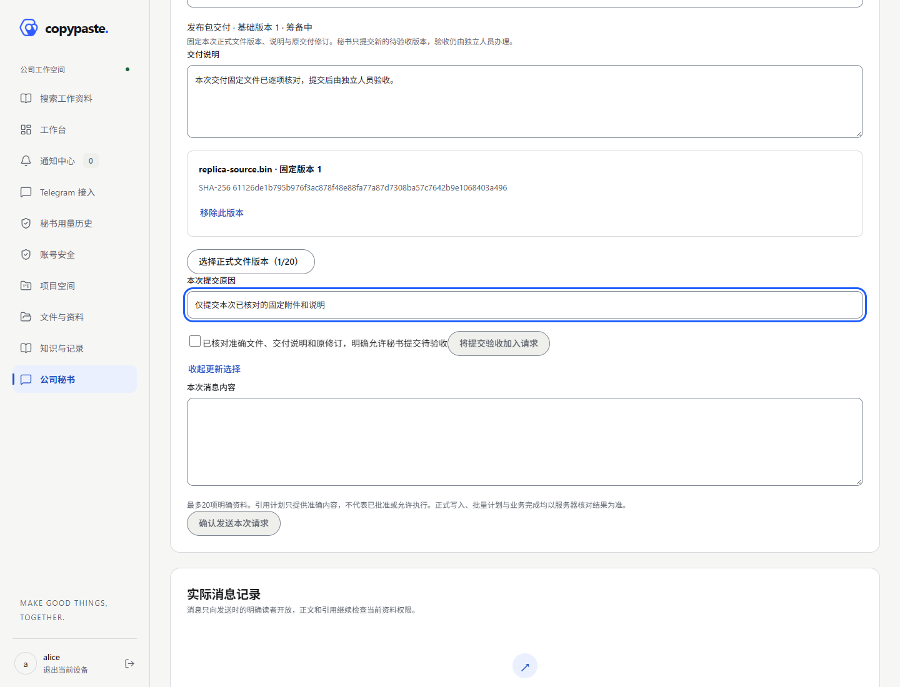
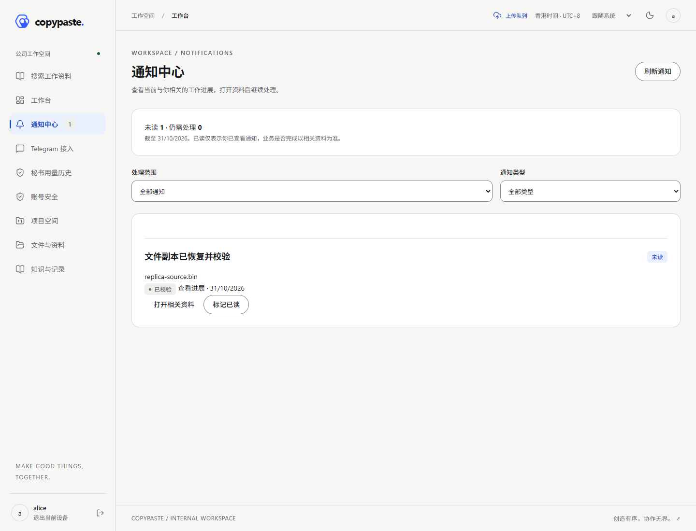
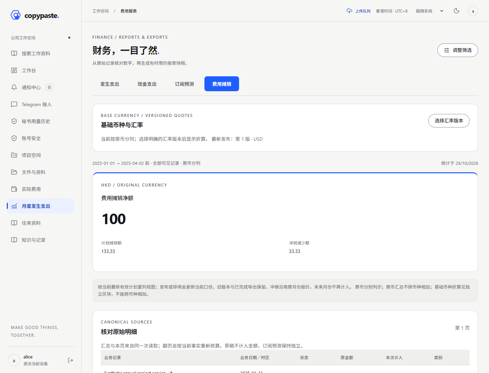
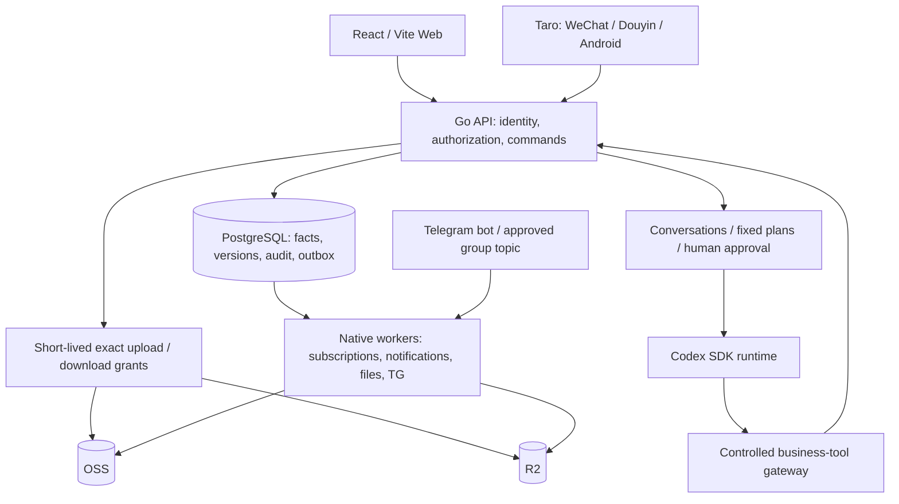

# CopyPaste Case Manager · Solution and usage guide

**增量154 · 同版冻结交付 / Matching frozen delivery · v0.1.0-rc.8**

业务153／结构113已固定，服务器、Web、秘书运行器、微信、抖音和Android开发包使用同一源码；包含本人TG提醒与既有主要业务。五项下载另含完整应用源码／文档及全部演示媒体。七个旧冻结版本、原PG100与API、既有证据和媒体保持不动。

Matching server/Web/runtime, WeChat, Douyin and development Android artifacts now bind business153/schema113, including personal TG notices. Complete application source/docs and all public media are separately downloadable. This internal candidate preserves seven earlier freezes; formal signing, real providers and production acceptance remain open.

[固定下载与使用 / Downloads and use](releases/v0.1.0-rc.8/README.md) · [方案与操作 / Delivery design](development/154-frozen-release-delivery.md) · [核验边界 / Verification](quality/154-frozen-release-verification.md) · [全部23项未完成 / All remaining work](delivery/05-functional-closure-154.md)

先核对SHA256与固定清单，再按原生Linux／持久PG／HTTPS手册正常升级到113。移动包为本地API构建，连接实际服务器前配置真实身份／域名并重建；APK为开发包。真实服务器、云、Codex、TG及平台资料按用户答复后续提供。GitHub Releases网页原API403，当前通过授权SSH源码标签／产物分支交付。

Verify checksums before use. Upgrade normally to113 and rebuild clients with the actual HTTPS API/platform identities. Android signing and actual deployment remain separate. Selected153 business proof and media are retained exactly; fresh154 builds/archive checks do not imply full regression. [Actual Web video](media/videos/notification-telegram-web.mp4) · [Demo GIF](media/gifs/notification-telegram-web.gif).

以下增量段落保留历史来源；其“当前／最新”仅指各自当时版本。当前交付以rc.8固定清单为准。 Earlier sections retain historical provenance; their current/latest wording is scoped to that increment. rc.8 is the current delivery manifest.


**增量153 · 本人 TG 业务提醒 / Personal Telegram notices**

已接通员工主动订阅、十类站内业务通知的私聊提示、不可变回执、未知结果人工核对／重试及明确停用。四端源码同步，站外只显示登录提示；实际服务器和云／模型／TG／平台资料按用户答复后续提供。本轮按加速要求只运行集中检查，记录失败并补齐受影响的实际页面媒体。

Employees explicitly enable personal TG prompts in Notifications after two-way binding and recent MFA. New in-app notices use current recipient/business authorization, fixed external text, bounded attempts and immutable receipts. Unknown outcomes require human review. Turning this supplement off preserves in-app notifications and history. Real server/provider material will be supplied later.

当前main源码结构113，新增内容见[方案与双语使用](development/153-personal-telegram-notifications.md)、[集中核验及延期](quality/153-personal-telegram-notifications.md)、[全部23项剩余工作](delivery/05-functional-closure-153.md)。[冻结rc.7下载](releases/v0.1.0-rc.7/README.md)仍固定业务151／结构112／APK152；该冻结包不包含153，使用153须从当前源码构建并正常升级至113。七个冻结引用及既有素材保持原字节。

Current source/schema113 includes this post-freeze feature. Frozen rc.7 still binds151/schema112 and development APK152; build the current source for153. No new APK, full regression, actual TG delivery or production readiness is claimed. [Current demo GIF](media/gifs/notification-telegram-web.gif) · [Actual viewport video](media/videos/notification-telegram-web.mp4).

[提醒设置截图 / Settings](media/screenshots/notification-telegram-web-settings.png) · [人工核对截图 / Review](media/screenshots/notification-telegram-web-review.png) · [停用与回执 / Disabled and reconciled](media/screenshots/notification-telegram-web-closed.png)

以下保留152及更早的冻结交付记录 / Retained frozen delivery history follows.


**增量152 · 冻结交付 / Frozen delivery · v0.1.0-rc.7**

本轮停止业务扩展，将完整业务151／结构112封为同版服务器、Web、秘书运行器、微信、抖音和Android开发包，另交付完整应用源码／文档、媒体与SHA256。包含准确授权的固定交付修订提交，保留独立人工验收和既有全部业务。六个旧冻结版本保持不动。

All application changes through151 are frozen in matching server, Web, runtime, miniapp and development Android artifacts. Five downloads include complete application source/docs, media and checksums. Selected151 business/runtime/UI proof is retained; fresh152 build/archive inspection is separate. Formal signing, actual external-service integration and production acceptance remain open.

[固定下载与使用 / Downloads and use](releases/v0.1.0-rc.7/README.md) · [全部23项未完成 / All remaining work](delivery/05-functional-closure-152.md) · [核验与延期 / Validation](quality/152-frozen-release-verification.md)

先核对摘要和包内清单，再按原生Linux／持久PG／HTTPS手册配置；旧开发库100保持不动，正常升级目标112。移动包当前指向本地API，正式连接前配置真实身份／域名并重建。GitHub Releases网页此前API403，当前通过已授权SSH标签／产物分支交付，不声称生产已部署。

以下增量段落是历史来源；最新包／源码关系以rc.7固定清单为准。 Earlier increment sections below retain historical provenance; rc.7 is the latest delivery manifest.


**增量151 · 交付修订提交 / Exact deliverable submission**

四端源码新增“选择固定正式文件版本 → 人工逐项授权秘书 → 生成待验收修订”。仅允许固定交付版本、原修订、1–20个附件版本、说明和原因；保留完整旧修订及独立人工验收。无模型执行演示不计真实Codex验收。

Current source adds reviewed, exact deliverable submission across Web and shared mobile. The backend commits one immutable pending revision with audit and idempotent receipts; independent human acceptance remains required. Skill project-update1.9.0 remains draft.

[实现与使用 / Implementation and use](development/151-agent-deliverable-submission.md) · [本轮核验 / Selected checks](quality/151-agent-deliverable-submission.md) · [全部23项待办 / All remaining work](delivery/05-functional-closure-151.md)

当前151／结构112；现有冻结rc.6／开发APK150仍固定149／结构111。下一冻结包在本次收口后生成；本段不声称现有包已包含新功能。



[实际无声操作 / Silent recording](media/videos/deliverable-submission-web.mp4) · [三张实际截图导览 / Screenshot tour GIF](media/gifs/deliverable-submission-web.gif)


**增量150 · 功能冻结交付 / Frozen functional delivery**

最新冻结[`v0.1.0-rc.6`](releases/v0.1.0-rc.6/README.md)固定业务149／结构111，包含复制失败→人工重试→实际校验恢复通知与准确版本入口。Linux/Web/秘书运行器、微信、抖音、Android开发包已重新构建；完整源码、媒体和校验摘要共五包固定下载。150不再新增业务；原五冻保留。

The latest freeze includes all business149 changes in matching server, Web, miniapps and development APK artifacts. Complete source/docs, media and SHA256 checks are delivered together. Packaging150 retains exact149 business/browser/media proof without replay; formal production integration and signing remain open. No GitHub Releases webpage or production deployment is claimed.

登录后按角色使用项目／OA／财务／文件／秘书／服务状态。复制通知打开准确版本，已读及排队不代表恢复。按[交付／部署](releases/v0.1.0-rc.6/README.md)核对包和内层清单，准备原生Linux／PG／HTTPS；小程序和APK当前是本地API，正式连接前配置真实身份／域名并重建。开发PG100保留，新版结构111须正常升级。

[全部23项待办](delivery/05-functional-closure-150.md) · [准确核验与延期](quality/150-frozen-release-verification.md) · [复制通知使用](development/149-replica-failure-recovery.md)



[149实际无声操作MP4 · Actual silent recording](media/videos/replica-notifications-web.mp4) · [149截图导览GIF · Screenshot tour](media/gifs/replica-notifications-web.gif)（150原字节复用，未重新录制）。


## 增量149 · 文件复制失败／恢复闭环 / Replica failure and recovery

当前源码补齐实际工作器失败→人工重试→字节校验恢复的站内通知。已读和重试排队继续保留处理义务，实际校验成功后才在原线程形成新的未读恢复通知；初次正常复制不产生恢复噪音，延迟事件与撤权继续抑制。Web／微信／抖音／Android共享源码入口可定位准确版本与副本，并按原权限安排人工重试。

Current149 source adds verified recovery deliveries to the existing failure thread and exact-version/replica navigation across Web and shared mobile. Acknowledgement or queue acceptance never proves recovery. Fresh selected checks cover actual HTTP/durablePG/worker execution,5 Web and5 mobile logic cases, current Web/WeChat/Douyin builds and3 actual Web checks with updated screenshots/video/GIF. Full regression, additional mobile UI and a fresh APK are deferred.

最新冻结rc.5／APK148仍固定业务147／结构111，不包含149新通知入口；五冻和原证明保持原字节。原开发PG100／API未动，当前源码结构仍111。真实服务接入、正式签名／平台发布、公司完整验收和八draft Skill保持开放；范围遵循[当前口径](delivery/04-current-scope-and-acceptance.md)，全部23工作包继续编号跟踪。

[使用／开发 · Usage](development/149-replica-failure-recovery.md) · [准确核验 · Evidence](quality/149-replica-notifications-verification.md) · [全部23项 · Remaining](delivery/05-functional-closure-149.md) · [当前冻结下载 · Frozen downloads](releases/v0.1.0-rc.5/README.md)


[实际无声操作MP4 · Actual silent recording](media/videos/replica-notifications-web.mp4) · [三截图导览GIF · Screenshot tour](media/gifs/replica-notifications-web.gif)


## 增量148 · 最新冻结 v0.1.0-rc.5 / Latest frozen delivery

当前功能冻结固定业务147 `4155ce9c19304b8c65f5636e09707a5eba1e21cd`／数据库结构111。四端包已重新构建并包含复制运维台账、详情与人工重试；提供Linux／Web／秘书运行器、两小程序、Android开发安装包、完整应用源码／文档和全部原始截图／MP4／GIF五包及SHA-256。旧四次冻结保持不变，下方旧版本段落为历史记录。

The latest frozen candidate fixes all business source through147/schema111, including the reviewed replica operations console. All current client artifacts are rebuilt. Complete application source and documentation, original demo media and fixed checksummed downloads are delivered together. Packaging148 tools/guides live on main; the source tag/ZIP fix147, and all historical evidence remains in the full Git tag.

使用顺序：核对下载摘要及内层清单，按原生手册准备Linux／持久PG／HTTPS／私有配置，正常应用结构1–111（开发PG100需101–111），激活并核对就绪。Web登录／MFA后按角色处理项目、OA、费用／现金、文件及状态；复制重试须准确依据和明确人工授权。移动端当前为本地API，真实服务使用前配置HTTPS及平台身份并重建；APK为开发签名。原开发PG／API本轮未升级或重启。

Fresh148 packaging includes793 server files,151 miniapp outputs and10 APK checks with185 selected source-map modules. Prior147 business checks/media are retained without replay;28 JVM XML outcomes are cached. Real Linux/PG/OSS＋R2/Codex/TG/platform integration, formal Android release and complete company-rule acceptance remain open in23 work packages; all eight Skills remain draft. Devices, network performance/live120GB specials, historical migration/DR and AI fee controls remain excluded under the [current scope](delivery/04-current-scope-and-acceptance.md).

GitHub Releases网页仍受此前API403限制，本轮未重试；源码标签及五包通过授权SSH交付，以下为固定产物下载，不声称生产部署。

[固定下载／摘要 · Downloads](releases/v0.1.0-rc.5/README.md) · [方案／使用 · Usage](development/148-frozen-release-delivery.md) · [本轮核验／复用 · Checks](quality/148-frozen-release-verification.md) · [全部23项 · Remaining work](delivery/05-functional-closure-148.md)


## Increment146 · Frozen delivery v0.1.0-rc.4

The current functional release fixes business145 (`294bf0509a7c87f63d9c829d5317fe33fb76a6f3`), schema110, including exact purchase/claim line prose and explicit human adoption. Five downloads contain a rebuilt Linux/server/Web/secretary runtime, WeChat/Douyin miniapps, current Android developmentAPK, complete application source/docs, and original screenshots/MP4/GIF media. Each asset has SHA-256. All three earlier freezes remain immutable; no business module is added this round.

Usage: verify asset and inner-manifest hashes, provision native Linux/persistent PostgreSQL/HTTPS/private identities, apply ordinary migrations1–110 (101–110 from the retained development PG100), activate and check readiness. Employees sign in/MFA, then use role-bound projects/tasks/deliverables, OA approvals, actual expenses/cash/refunds/subscriptions, files/blogs and status/workbench. Approval never manufactures cash; AI suggestions require explicit human adoption. Mobile artifacts use an explicit local API profile: configure the real HTTPS API/platform identities and rebuild before server use. TheAPK is development-signed.

Three selected native HTTP/PG suites pass45 subcases plus3 summaries; artifact/source/hash/private-material checks are current. Full regression and extra UI recordings are deferred. Selected145 checks/media,136 full client tests and121 full backend/runtime tests retain original provenance; cached Gradle XML is not new execution. Real Linux/cloud/Codex/TG/platform/production integration, formal Android signing and complete company-rule/UI acceptance remain open in23 work packages. All eight Skills remain draft. No production deployment is claimed.

The earlier GitHub Releases API request returned403 because the credential account is suspended. It is not retried; no Releases webpage is created. Authorized SSH delivery publishes the exact source tag and an independent artifact branch with fixed download links. The full Git tag retains historical evidence; packaging146 tools/notes live on main, while the source archive fixes145.

[Five downloads and hashes](releases/v0.1.0-rc.4/README.md) · [Design, usage and deployment](development/146-frozen-release-delivery.md) · [Checks and deferrals](quality/146-frozen-release-verification.md) · [This round and all23 remaining packages](delivery/05-functional-closure-146.md)

Earlier entries below retain their historical source/artifact identities; use the delivery above for the latest freeze.


## 增量145 · 逐明细业务正文 / Selected line prose

当前主线补齐采购／报销逐条明细说明起草：选择准确业务及已有明细→保存不可变建议→本人核对原文并采用→普通业务新修订。金额、数量、供应商、凭证、顺序及未选明细保留原值；送审、下单、记账和付款仍单独执行。

Main145 adds exact purchase/claim line-description selection, original/proposed comparison and explicit human adoption through ordinary business permissions. Every unselected and commercial fact is preserved; the model never adopts or approves. Limits remain100 existing lines/102 fields,1000 code points per description and64KiB per whole tool call.

主线结构110、oa-assist1.4.0仍draft。本轮定向HTTP／PG、Web／移动逻辑、运行器、类型／Web／两小程序构建及真实Web页面单独留证；全量回归、额外移动UI与新APK延期。三个冻结候选不动：最新固定交付仍rc.3／业务143／结构109／APK144，不包含145；开发PG仍100。All23 work packages remain active; the source changes do not establish real model, cloud, platform or production acceptance.

[使用与实现](development/145-oa-line-prose.md) · [验证与保留证据](quality/145-oa-line-prose-verification.md) · [本轮及全部23项](delivery/05-functional-closure-145.md) · [逐明细选择](media/screenshots/oa-line-prose-web-selection.png) · [MP4](media/videos/oa-line-prose-web.mp4) · [截图导览GIF](media/gifs/oa-line-prose-web.gif) · [最新冻结下载](releases/v0.1.0-rc.3/README.md)


## 增量144 · 冻结发布 v0.1.0-rc.3 / Frozen delivery

源码标签与五个固定下载包已通过SSH推送并核对。创建GitHub Releases页面的API请求返回403（现有凭据对应账号被停用）；页面未创建，全部下载仍可从下方交付入口取得。The source tag and all five immutable downloads are published; the API account rejection prevented a GitHub Releases page, not the SSH delivery.

本次冻结当前主线143／结构109，包含138–143的上传草稿清理、TG组织运维、秘书运行配置、项目规划目录和完整订阅审阅。服务器／Web／秘书运行器、两小程序和Android开发APK重新构建；提供完整应用源码、开发文档和独立演示媒体包，全部附SHA-256。原rc.1／rc.2保持不可变。

This candidate fixes business source `e1c7a671cc4c7f52888a1e6ed72d7ce1a9c042d3`. Native server, miniapps and a current development APK are newly packaged. Eight selected primary HTTP/PG suites and artifact integrity checks are current; full regression and additional browser journeys are deferred. Existing business tests/media retain their original provenance. Packaging tools and delivery records belong to main144; the frozen tag and convenience source archive remain the exact143 snapshot.

主流程：项目／任务／交付→合同／采购／报销及审批→实际费用→实际收付款／核销→退款与核对→结项；文件、博客、服务状态和工作台共用权限。移动包为本地API配置，部署前设置真实HTTPS API并重建；Android为开发签名。开发PG仍100，新后端正常升级101–109。实际Linux／云／模型／TG／平台／生产验收和23工作包保持开放，八项Skill仍draft；用户移出项不重新作为门槛。

[下载及使用 / Downloads](releases/v0.1.0-rc.3/README.md) · [方案与部署顺序 / Delivery guide](development/144-frozen-candidate-delivery.md) · [检查及延期 / Verification](quality/144-frozen-candidate-verification.md) · [本轮及全部23项 / Complete remaining table](delivery/05-functional-closure-144.md)

下方各增量说明保留当时的源码、测试和安装包身份。Earlier increment entries below retain their historical source/test/artifact identities.

## 增量143 · 跨订阅完整审阅 / Complete subscription portfolio review

秘书会话→选择开始日／不含结束日→读取准确范围内全部可读订阅→核对逐个已存／缺失账期、去重费用／付款和完整逐笔依据。人工预览不改变财务事实；秘书实际调用完整审阅工具后才保存不可变来源快照。集合完整与日程覆盖分别说明，不跨币种求和，也不把共享关联判作重复收费。

Open a secretary conversation, select explicit local dates and read every eligible subscription in the exact conversation scope. Review schedule gaps, unique linked costs/payments and complete evidence pages. Human preview is ephemeral; the actual tool stores a receipted immutable snapshot. Every participant must read every dependency, and bounds reject the whole review rather than returning a completed prefix.

主线143／结构109，开发PG仍100。当前定向HTTP／原生PG、运行时56项、类型与Web／两小程序本地构建、实际Web查阅单独留证；全量回归、完整移动UI和新APK延期。Both freezes remain immutable; rc.2/APK137 retain business136/schema103 and exclude138–143. All23 work packages and eight draft Skills remain open; real model/cloud/Linux/platform/production acceptance stays separate.

[使用与接口 / Usage/API](development/143-subscription-portfolio.md) · [检查与延期 / Checks](quality/143-subscription-portfolio-verification.md) · [本轮及全部23项 / Remaining work](delivery/05-functional-closure-143.md) · [页面 / Screenshot](media/screenshots/subscription-portfolio-web-coverage.png) · [MP4](media/videos/subscription-portfolio-web.mp4) · [截图导览GIF](media/gifs/subscription-portfolio-web.gif)

## 增量147 · 文件复制运维 / File replication operations

主线补齐组织异常副本查询、准确版本核对、明确人工重试及固定历史。Web从“文件复制运维”进入，微信／抖音／Android共用“我的工作空间”入口；操作人还须拥有原文件更新权限和近期两步验证。排队回执与当前复制核验状态分开显示。

Main147 adds organization replica/job metadata filters, exact reviewed retries through the ordinary file executor and immutable receipts. Both organization authority and current file permission are required. Selected native HTTP/PG, shared Web/mobile logic, type/build checks and a real synthetic Web journey are current; full regression, extra mobile UI and a new APK are deferred.

主线结构111；固定下载仍为rc.4／业务145／结构110／APK146，未含147。All four existing freezes retain their exact bytes. Real cloud/model/TG/platform/production acceptance and all23 work packages remain open; all eight Skills remain draft.

[使用／设计](development/147-storage-operations.md) · [本轮检查](quality/147-storage-operations-verification.md) · [本轮完成与全部23项](delivery/05-functional-closure-147.md) · [截图](media/screenshots/storage-operations-web-queued.png) · [MP4](media/videos/storage-operations-web.mp4) · [截图导览GIF](media/gifs/storage-operations-web.gif) · [冻结下载](releases/v0.1.0-rc.4/README.md)

以下旧条目按当时源码／产物／证据身份保留。Earlier entries below retain their original provenance.


## 增量142 · 项目规划目录 / Project planning catalog

公司私人会话→拟定项目计划→选择有效负责人／成员与已发布模板→填写类型及日期→核对固定计划→本人近期MFA批准→单独创建项目。模板目录、任务和里程碑随实际项目事务生成，成功后可打开项目并刷新核对持久业务回执。

In an owned company private conversation, select the active owner, additional members and published template, then fill the type and dates. Save and review the fixed proposal, explicitly approve it with recent MFA, and separately create the actual project. The ordinary project transaction initializes the template; a durable receipt links to the created project. Catalog access follows current organization planning authority and AI disclosure policy, without exposing account/security metadata.

主线142／结构108；开发PG仍100。四端源码、选定HTTP／原生PG、运行时56项、类型、Web及两小程序本地构建与实际Web建项单独留证。完整回归、新移动UI旅程和新APK延期。Both frozen candidates remain fixed; rc.2/APK137 retain business136/schema103 and exclude138–142. All eight Skill packages remain draft; the shared reference schema changes every package digest and requires dedicated installation reverification.23 open work packages, five exclusions and external production acceptance remain explicit.

[使用与接口 / Usage/API](development/142-project-planning-catalog.md) · [关键验证与延期 / Checks](quality/142-project-catalog-verification.md) · [本轮及全部23项 / All remaining work](delivery/05-functional-closure-142.md) · [页面 / Screenshot](media/screenshots/project-catalog-web-receipt.png) · [MP4](media/videos/project-catalog-web.mp4) · [截图导览GIF](media/gifs/project-catalog-web.gif)

## 增量141 · 秘书运行配置 / Secretary runtime operations

进入“秘书运行配置”→按任务／状态筛选→核对准确配置、技术限制及当前活动任务→近期MFA并明确确认停用影响→查看永久回执与历史。活动任务改变时必须重新核对；停用仅阻止后续使用，不声称进程已退出或已经回滚业务。原配置不能重新启用，新的配置仍由专用部署身份核验后安装。

Open **Secretary runtime configuration**, filter installed profiles and review the exact profile plus current task impact. An authorized human with recent MFA can permanently retire the reviewed profile. Concurrent task changes require a fresh review. Retirement does not claim process teardown or business rollback; deployment-only installation and immutable profile identities remain enforced. Private conversations, credentials and operator prose stay outside this organization view.

主线141／结构107；开发PG仍100。四端源码、关键HTTP／PG、类型／Web及两小程序构建和实际Web演示单独留证；完整回归、新移动UI旅程与Android包延期。Frozen rc.2/APK137 retain business136/schema103 and do not include138–141. Both frozen tags,23 open packages, five exclusions and eight draft Skills remain unchanged; real model/Linux/cloud/platform/production acceptance stays open.

[使用与接口 / Usage/API](development/141-secretary-runtime-operations.md) · [关键验证 / Checks](quality/141-secretary-runtime-verification.md) · [本轮及全部23项 / All remaining work](delivery/05-functional-closure-141.md) · [页面 / Screenshot](media/screenshots/agent-runtime-operations-web-receipt.png) · [MP4](media/videos/agent-runtime-operations-web.mp4) · [截图导览GIF](media/gifs/agent-runtime-operations-web.gif)

## 增量140 · 组织TG入站调度 / Organization TG inbound operations

Open **Telegram → Organization inbound operations**, filter by request state, task or channel and inspect routing metadata, actual wait reasons and the complete paginated journal. An authorized human can explicitly withdraw an exact unstarted request with recent MFA and optimistic revision checks. Dispatch and withdrawal serialize; a task already created must use its original task workflow. Private request/model prose, Telegram user identities, binding proofs and free-form notes remain outside the organization view.

Main140 uses schema106; the personal development database remains100 and needs normal upgrades before using this backend. Fresh selected native HTTP/PG business checks, four human channels, client types, Web/two miniapp builds and actual authenticated Web withdrawal/readback have their own evidence. Full regression, complete mobile UI journeys and a new Android artifact are deferred. Frozen rc.2/APK137 retain business136/schema103 and do not include138–140. Both frozen tags,23 open work packages, five exclusions and eight draft Skills remain unchanged.

Telegram接入→组织TG入站调度→按状态／任务／群入口筛选→查看请求路由、等待原因与完整分页历史。经办人完成近期MFA，核对准确请求与版本后，可以撤回尚未创建秘书任务的请求；调度器同时处理时按事务顺序完成或返回冲突。请求正文、私人TG身份、绑定证明、秘书结果与自由文本备注不进入组织台账。

主线140／结构106；个人开发PG仍100，使用前正常升级101–106。当前实际HTTP／耐久PG两组选定27个业务场景、四端会话、类型和Web／微信／抖音构建、实际Web撤回及持久读回单独留证。全量回归、完整移动UI和新Android包延期；rc.2／APK137仍业务136／结构103，不包含138–140，两个冻结标签不移动。23工作包、14 P0／9 P1、五项移出、八项draft Skill及真实集成／生产验收边界保持。

[使用与接口 / Usage/API](development/140-telegram-inbox-operations.md) · [检查与延期 / Checks](quality/140-telegram-inbox-verification.md) · [本轮及全部23项 / Remaining work](delivery/05-functional-closure-140.md) · [实际页面](media/screenshots/telegram-inbox-web-receipt.png) · [MP4](media/videos/telegram-inbox-web.mp4) · [截图导览GIF](media/gifs/telegram-inbox-web.gif)

## 增量139 · 组织TG投递运维 / Organization TG delivery operations

Telegram 接入→组织TG投递运维→按状态／群入口查询→查看固定通知及状态历史。经授权的人工经办人可核对原群、话题与消息编号，确认已发送、确认未发送后允许重试，或放弃重发。重试另需明确接受重复风险；当前绑定、群入口版本、24小时有效期及五次发送上限仍由服务器和独立发送进程核对。

查阅与处理权限分开；请求正文、秘书回复、凭据和自由文本处理备注不进入组织运维查询。四端源码和本地构建已更新；近期MFA、版本冲突、幂等、永久历史及审计回滚保留。本轮主线结构105；开发库仍100，正常升级101–105后使用。rc.2／APK137仍是业务136／结构103，不包含138／139，两个冻结标签不移动。

Open **Telegram → Organization delivery operations**, filter by state or channel, inspect routing metadata and the immutable notification journal, then explicitly reconcile an unknown outcome. Separate read/reconcile authority, a recent human MFA session and original-group review are required for changes. Retrying additionally requires duplicate-risk acknowledgement, current recipient scope, the24-hour window and the existing five-attempt cap. A human confirmation remains distinct from provider confirmation; this console never discloses request/model prose or makes a Bot API call itself.

This is main/schema105 source with fresh focused HTTP/PG, client type/build checks and actual authenticated Web interaction. Full regression, complete mobile journeys and a new Android artifact are deferred. Frozen rc.2/APK137 remain business136/schema103. Real Bot/model/cloud/Linux/platform/production acceptance and all23 work packages remain open; eight Skills remain draft and the five exclusions remain excluded.

[使用与接口 / Usage and API](development/139-telegram-delivery-operations.md) · [关键检查与延期 / Checks and deferrals](quality/139-telegram-operations-verification.md) · [本轮及全部23项 / All remaining work](delivery/05-functional-closure-139.md) · [实际页面](media/screenshots/telegram-operations-web-receipt.png) · [MP4](media/videos/telegram-operations-web.mp4) · [截图导览 GIF](media/gifs/telegram-operations-web.gif)

## 增量138 · 未提交的已完成上传 / Completed uncommitted uploads

进入具体资料目录→展开“已完成上传草稿”→核对新文件／替换上传及全部已知完成对象→填写原因建立固定清单→经过保留期与至少24小时观察→近期MFA人工批准→独立worker执行、查看逐项回执。停止不恢复上传；失败可重试，授权失效后可明确续作，已经确认的对象保留。凭据和存储位置不交给客户端。

本轮main源码／结构104；现有`v0.1.0-rc.1`与`v0.1.0-rc.2`标签和下载保持不变。rc.2及最新开发APK137固定业务136／结构103，**不包含138**；个人开发库仍100，运行新后端前正常升级101–104。当前只做关键验证：原生HTTP／PG5组30条记录、Web选定32项、共享移动23项、Android上传共享规则13项、类型和Web／微信／抖音构建，以及实际Web建单与读回。完整回归、新移动旅程及Android包延期；保留136完整Web452／共享移动537项和121后端／运行器历史出处。

Open a specific folder, expand **Completed upload drafts**, select an eligible new-file or replacement upload and create a fixed plan covering its original and every known completed promotion candidate. Retention and at least24 hours of observation precede explicit human approval with recent MFA. An independent worker records exact per-object outcomes. Cancellation preserves permanent upload fences; stopped remaining items can be explicitly reauthorized without repeating confirmed results.

This is main/schema104 source. Both frozen downloads remain immutable; rc.2/APK137 contain business136/schema103 and do not include this feature. Apply normal upgrades before using the new backend. Selected current checks and actual Web readback are distinguished from retained full tests and Android artifacts. Real cloud/model/Skills/TG/Linux/platform/production acceptance stays open:23 packages,14 P0/9 P1, five exclusions and eight draft Skills.

[使用与接口 / Usage and API](development/138-completed-upload-retirement.md) · [关键检查及延期 / Checks and deferrals](quality/138-completed-upload-retirement-verification.md) · [本轮及全部23项 / All remaining work](delivery/05-functional-closure-138.md) · [既有冻结下载 / Frozen downloads](releases/v0.1.0-rc.2/README.md)

[实际页面](media/screenshots/completed-upload-retirement-web-plan.png) · [静音操作录屏 / Actual silent recording](media/videos/completed-upload-retirement-web.mp4) · [三张实际截图导览 / Screenshot-tour GIF](media/gifs/completed-upload-retirement-web.gif)

## Frozen delivery137 · v0.1.0-rc.2

The new candidate includes increments134–136 at business source `40cd118`, schema103: native Linux server/Web/secretary runtime, WeChat/Douyin builds and a new Android development APK. The source archive includes all application source, tests, lockfiles and development guides. The published media directory has its own archive; large historical evidence remains available in the complete frozen Git tag. The first `v0.1.0-rc.1` tag and downloads remain immutable.

[Downloads, SHA-256 and usage](releases/v0.1.0-rc.2/README.md) · [This delivery and all23 remaining packages](delivery/05-functional-closure-137.md) · [Fresh builds and deferred checks](quality/137-frozen-candidate-verification.md)

Artifacts and source identity are checked freshly; increment136 business checks and actual media are retained, not rerun. Full regression and new browser recordings are deferred. Android is development-signed; mobile builds use the local API profile. Configure the actual HTTPS API and platform identities and rebuild before server use. Development PostgreSQL remains schema100; apply normal upgrades101–103 for this backend. Real integrations and formal production acceptance remain open:23 packages (14 P0/9 P1), five exclusions and eight draft Skills.

**First frozen candidate: [v0.1.0-rc.1](releases/v0.1.0-rc.1/README.md).** Exact source tag, download hashes, deployment steps and deferred checks are recorded together. Linux server, two miniapps and Android development artifacts are sealed: [downloads and SHA-256](https://github.com/copypasteltd/case-manager/tree/8ddb3f7a98a24910af49ede2a6c8b8c744d50973/docs/releases/v0.1.0-rc.1).

## Increment136 · Original cleanup reauthorization

All four client sources now let a currently authorized human explicitly adopt a fixed stopped remainder after an earlier approval loses its session or authority. A bounded reason, irreversible-impact acknowledgement and recent MFA are required. Only remaining items receive new execution generations. The initial observed approval, confirmed results and permanent barriers remain unchanged; renewed authorization history is append-only. Later logout or revocation still stops execution.

Open file details → original retention and cleanup → the fixed plan → **重新授权剩余原件** → **确认重新授权并继续**. Read authorization history and per-original receipts, then refresh. Cancelled/completed plans cannot resume; changed sources, policies, file revisions or protections are rejected.

Focused evidence covers452 Web and537 shared-mobile rules, types, local Web/WeChat/Douyin builds, seven native HTTP/PG suites with42 passing records and actual Web mutation/readback. Full regression, an additional mobile browser journey and a new Android artifact are deferred. Persistent development services remain schema100; apply normal migrations101–103 before running this backend. The immutable first-freeze packages exclude136. All23 packages (14 P0/9 P1), five exclusions and eight draft Skills remain open; real integration and formal production acceptance are still required.

[实现与使用 / Usage](development/136-retirement-reauthorization.md) · [关键检查 / Checks](quality/136-retirement-reauthorization-verification.md) · [本轮及全部23项 / All remaining](delivery/05-functional-closure-136.md)


[实际Web录制 / Actual Web recording](media/videos/retirement-reauthorization-web.mp4) · [三截图GIF导览 / Screenshot-tour GIF](media/gifs/retirement-reauthorization-web.gif)

## Increment135 · Previously published

All four client sources now separate contract principal from actual outgoing cash, reserve exact cash, release partial attribution with rounding tails, pin human reconciliation evidence and preserve full-reversal history. Open contract finance → “归属实际退回款”, pin the original incoming-cash attribution and actual outgoing payment, enter principal/cash/rate/source, explicitly acknowledge and complete recent MFA, then read committed history.

Example:780 HKD received and100 USD paid out. Attribute390 HKD /50 USD, then195 HKD /25 USD. Contract net is195 HKD, outgoing reservation75 USD and free cash25 USD. Three130 HKD releases of the first attribution release16.67,16.67 and16.66 USD. Attribution does not transfer bank funds or automatically book exchange gains/losses.

Focused checks: four native HTTP/PG suites,52 passing records;444 Web and529 shared-mobile cases, type checking, Web/WeChat/Douyin local builds and actual Web mutation/readback. Full regression, additional mobile browser and a new Android artifact are deferred. Persistent development services stay schema100; apply101 and102 before running this backend. The immutable `v0.1.0-rc.1` packages do not include135. All23 packages (14 P0/9 P1), five exclusions and eight draft Skills remain; company policy, exchange differences and formal integrations stay open.

[实现与使用 / Usage](development/135-receivable-foreign-returns.md) · [关键检查 / Checks](quality/135-receivable-foreign-returns-verification.md) · [本轮及全部23项 / Remaining](delivery/05-functional-closure-135.md)


[实际Web录制 / Actual Web recording](media/videos/receivable-foreign-returns-web.mp4) · [三截图GIF导览 / Screenshot-tour GIF](media/gifs/receivable-foreign-returns-web.gif)

## Increment134 · Previously published

All four client sources now support atomic attribution at cash recording and later partial attribution. Enter original-payment principal; inspect expense-currency and actual-cash previews, acknowledge the facts and complete recent MFA. Exact source allocations, rounding tails, project cash shares, immutable history and full reversal stay separate from original expense/bank facts.

Example:200 EUR settled by780 HKD receives100 USD. Attribute560 HKD /143.59 EUR /71.79 USD, then220 HKD /56.41 EUR /28.21 USD. Each monetary balance keeps its own units. Use the original payment refund form or the refund detail’s “关联退款分配”, review the principal and expense/cash preview, then inspect the committed journal.

Focused checks: five native HTTP/PG suites,64 passing records;436 Web and521 shared-mobile cases, type checking and Web/WeChat/Douyin local builds. No fresh Android package or mobile browser journey; the retained development APK is increment133. The persistent development database remains schema100; apply101 before running this backend. The frozen candidate tag/artifacts remain `v0.1.0-rc.1`;134 is subsequent main source. All23 packages (14 P0/9 P1), five exclusions and eight draft Skills remain. Receivable foreign outgoing returns, company FX policy and full/external acceptance remain open.

[实现与使用 / Usage](development/134-foreign-expense-refunds.md) · [实际检查与延期 / Checks](quality/134-foreign-expense-refunds-verification.md) · [本轮与全部23项 / Remaining](delivery/05-functional-closure-134.md)


[实际Web录制 / Actual Web recording](media/videos/foreign-expense-refunds-web.mp4) · [三截图GIF导览 / Screenshot-tour GIF](media/gifs/foreign-expense-refunds-web.gif)

## 增量133 · 已发布冻结基线 / Published frozen baseline

Executed checks: five selected native HTTP/PostgreSQL suites,74 passing records;428 Web and513 shared-mobile tests. Build/native cache and inspection-only provenance are recorded separately; this is not full production acceptance.

Increment133 completes the four-client contract finance path: effective contract → actual expense/cash attribution → foreign-refund principal attribution → partial release → evidence-bound human reconciliation → renewed review after source changes. Shared mobile now has the full contract finance center; Web distinguishes whole received cash from contract principal.

Usage: on Web open the contract’s “合同财务归属”; on WeChat, Douyin or Android choose “合同财务归属与核对”. Pin the original actual cash first, select its exact refund, enter contract-currency principal and explicitly review the units. Append a partial release to correct attribution. Reconcile with fixed file versions and explicit condition/difference checks. Attribution does not transfer bank cash or create expense.

Example:780 HKD paid,100 USD actually refunded,780 HKD reviewed principal. Four195 HKD attributions exhaust780 HKD; each separately labels the entire100 USD cash fact. Refund/original caps, concurrency, idempotency, current authority and recent MFA remain mandatory. Full cash reversal preserves old records while removing current effective refund principal.

Normal schema99→100 preserves prior journals/reviews. Foreign expense-refund attribution, foreign outgoing returns on receivable contracts, adopted company FX policy and complete acceptance remain open. All23 packages (14 P0/9 P1), five exclusions and eight draft Skills remain explicit.

[实现与使用 / Implementation](development/133-contract-finance-closure.md) · [实际检查 / Checks](quality/133-contract-finance-verification.md) · [本轮及全部23项 / All remaining work](delivery/05-functional-closure-133.md)


[Web实际录制 / Web recording](media/videos/contract-refunds-web.mp4) · [Web三截图导览 / Web screenshot tour](media/gifs/contract-refunds-web.gif) · [移动概览 / Mobile overview](media/screenshots/contract-refunds-mobile-summary.png)

## Increment132 · Previously published

Current local checks: ten HTTP/PG suites (69 passing records),419 Web cases,504 shared-mobile cases and182 core test records pass. Build, cached-native and actual cloud/platform/production acceptance boundaries are recorded separately.

Increment132 closes known historical-original and committed-upload-draft retention: exact inventory → immutable plan → at least24-hour observation → recent-MFA human approval → permanent dependency/key barrier → dedicated provider execution → immutable attempt receipts. Logical capacity is released only after both historical originals are confirmed absent. Unknown outcomes reconcile the exact original on retry; cancellation never restores deleted content.

Usage: open file details → “盘点历史与草稿原件”, review retention/current-version/reference/hold blockers, explicitly select one source and enter a reason. After observation, review the digest, refresh MFA and approve; inspect exact provider receipts, retry eligible failures or stop remaining work. All four clients share this workflow. Cloud cleanup is disabled by default; API holds location metadata only, while a dedicated native worker uses independent credentials. OSS requires an exact non-null native version; R2 requires operator-attested exclusive immutable managed storage, without claiming documented conditional-delete CAS.

Normal schema98→99 preserves original facts. All23 packages (14 P0/9 P1), five exclusions and eight draft Skills remain explicit. Completed-but-uncommitted drafts, secretary recovery sources, unknown orphans/derived objects, renewed authorization and actual cloud acceptance stay open.

[实现与使用 / Implementation](development/132-known-object-retirement.md) · [实际核验 / Checks](quality/132-known-object-retirement-verification.md) · [本轮及全部23项 / Remaining work](delivery/05-functional-closure-132.md)


[Web实际录制 / Web recording](media/videos/object-retirement-web.mp4) · [共享H5录制 / Shared H5 recording](media/videos/object-retirement-mobile.mp4) · [三截图导览 / Screenshot tour](media/gifs/object-retirement-mobile.gif)

## Increment131 · Previously published / 原发布记录

Increment131 connects resource alerts to the actual owner’s inbox and personal workbench, then clears work on real recovery. Threshold breaches, readonly filesystems and expired/missing collection evidence require attention. Repeated same-state samples do not spam recipients. Read acknowledgement changes readership only; recovery creates a new unread delivery. Disablement, archive, reassignment and revocation recalculate current responsibility without redirecting old queued events.

Usage: explicitly publish resource monitoring in service details; open the personal resource-work card or the “主机资源” notification category; use “资源状态记录” to inspect the original owner, configuration, state and signed observation. Historical normal status is not proof of current health, and event creation is distinct from completed delivery.

The existing native API, PostgreSQL and notification worker remain. Normal schema upgrade97→98 preserves original business records. Commands project immediately; the worker scans bounded100-source pages every10 seconds for natural expiry and first-sample deadlines. Workbench reads evaluate original evidence independently of delivery progress.

All23 active packages (14 P0/9 P1), five exclusions and eight draft Skills remain explicit. The resource in-app alert code is implemented; real target installation and independent external alert delivery remain GAP-23. Real cloud/model/TG/platform, formal Android and production acceptance keep their numbered work items.

[实现与使用 / Implementation](development/131-resource-notifications.md) · [实际检查 / Checks](quality/131-resource-notifications-verification.md) · [本轮和全部23项 / All remaining work](delivery/05-functional-closure-131.md)


[Web实际录屏 / Web recording](media/videos/resource-notifications-web.mp4) · [共享移动录屏 / Shared H5 recording](media/videos/resource-notifications-mobile.mp4) · [三截图导览 / Screenshot tour](media/gifs/resource-notifications-mobile.gif)

Current validation passes eight selected HTTP/PostgreSQL suites (76 records),94 core test records,411 Web tests,496 shared-mobile tests, all four client builds and19 current development-APK checks. Android28 and JVM28 retain their exact UP-TO-DATE results; complete business and production acceptance remain numbered work items.

## Increment130 · Previously published

Increment130 completes the host-resource feature path: CPU, memory, every configured filesystem and readonly state travel through the native Prometheus bridge, independently signed ingestion, persistent observations and four-client resource cards. Service details expose explicit configuration publication, thresholds, disablement, immutable history and original signature verification. Expired, disconnected, disabled or archived sources show unknown and hide current values.

Usage: open Services → service details → Host resources. An authorized manager reviews the public key, complete mount inventory, warning/critical thresholds and freshness limit, then explicitly publishes with recent MFA. A new revision waits for new matching observations; original signatures and history remain. Configure native node_exporter, Prometheus and the existing status-bridge using private deployment files; the checked-in example contains placeholders only. Arbitrary PromQL and target URLs are not accepted.

The normal schema upgrade is 96→97. Host-resource health and endpoint availability remain separate. A visible resource warning does not prove delivery of an external alert. Actual target installation and independent alert delivery remain under GAP-23. All 23 work packages (14 P0/9 P1), five exclusions and eight draft Skills remain explicit.

Current checks pass three selected HTTP/PostgreSQL suites (31 pass records),408 Web tests,493 shared-mobile tests, four-client builds and19 current development-APK inspections. Actual Web/H5 flows cover state transitions, explicit disablement, history and signatures. Native execution/cache outcomes remain explicit; retained full regressions are not relabelled as fresh runs.

[实现与使用 / Implementation](development/130-host-resources.md) · [实际验证 / Checks](quality/130-host-resources-verification.md) · [本轮与全部23项 / All remaining work](delivery/05-functional-closure-130.md)


[Web录制 / Web recording](media/videos/host-resources-web.mp4) · [共享移动录制 / Shared H5 recording](media/videos/host-resources-mobile.mp4) · [截图导览 / Screenshot tour](media/gifs/host-resources-mobile.gif)

## Increment129 · Previously published / 原发布记录

Increment129 implements real DOCX/XLSX/PPTX creation and bounded exact-original content editing on Web/Android, with exact-version reading on WeChat/Douyin. Generate a separate candidate, review its name/text/warnings/hash, explicitly join the existing upload queue, then complete full hashing, scanning, promotion and a human formal commit. Rendering never publishes a version or changes OA/finance facts; old originals and history remain intact.

Usage: choose “新建 Office 文件” in a folder or “编辑 Office 内容” in file details. Word accepts paragraphs and an optional table; Excel accepts pasted TSV, defaulting to literal text with explicit typed cells/safe formulas; PPT separates slides with a standalone `---` line. Review and confirm the candidate, then use the upload page for scan and formal submission. Android stores the small candidate in an owner-bound private temporary source; ordinary large files retain native SAF multipart transfer.

Editing accepts8 MiB originals and12 MiB candidates, bounded ZIP/XML/content and a safe formula subset. Unchanged compressed parts remain intact; unsupported active content/embedded objects/macros/protection are rejected. Excel caches are cleared and require full recalculation. Full layout editing, general Office compatibility and real business samples remain open under GAP-04. Schema stays96; authoring needs no external editor server, Python runtime or new worker.

Source checks separately record six selected HTTP/PG suites (46 pass records),396 Web tests,481 shared-mobile tests, six real output files independently opened by three OOXML libraries, four-client builds and a current Android development APK. Actual Web edit/render and shared-H5 readonly evidence remain separate from the complete HTTP commit workflow. Retained121 full backend/runtime and128 evidence keep their original sources. Formal signing, platform, cloud, model, TG and production acceptance remain open.

All23 work packages (14 P0/9 P1), five exclusions and eight draft Skills remain explicit. Implemented subfeatures are deducted from remaining descriptions; partial checks do not close unfinished packages.

[实现与使用 / Implementation](<development/129-office-authoring.md>) · [实际验证 / Checks](<quality/129-office-authoring-verification.md>) · [本轮及全部23项 / All remaining work](<delivery/05-functional-closure-129.md>)


[Web实际录屏 / Web recording](media/videos/office-authoring-web.mp4) · [共享移动录屏 / Shared mobile recording](media/videos/office-authoring-mobile.mp4) · [三截图导览 / Screenshot tour](media/gifs/office-authoring-mobile.gif)

## Increment128 · Previously published / 原发布记录


Increment128 connects PDF, scanned documents and PNG/JPEG OCR to the shared four-client file workflow: verified original → independent native text worker → current-head search → exact-version preview/comparison → secretary source reads. Every PDF page retains embedded text and separately labelled OCR, including mixed text/image pages. Complete page evidence and verification limits stay visible; OCR does not create financial facts or rewrite originals.

Usage: upload through Web/Android, search a phrase inside the file and open its fixed-version text; explicitly select two formal versions in file details for comparison, or select the exact version as a secretary conversation source. WeChat/Douyin retain lookup and approval responsibilities. Current extraction accepts8 MiB originals,20 PDF pages and2 MiB derived text; the120GB original upload target remains separate.

Setup: install native Poppler/Tesseract and the three fixed language models in a read-only tool tree, generate a SHA-pinned local profile, set the absolute `CP_DOCUMENT_TEXT_PROFILE`, then run the existing `worker-file-text`. Without a configured native engine, PDF/images remain explicitly pending while plain text/Office continue. The application does not download tools or pass cloud/model credentials to child processes.

Current checks cover six selected HTTP/PostgreSQL suites (43 pass records), actual native parser/integrity cases with zero skips,390 Web tests,476 shared-mobile tests, workspace types and Web/WeChat/Douyin/Android JS builds. Actual Web/shared H5 exercise PDF/image preview, exact comparison and secretary source reads, with6 PNGs,2 real viewport MP4s and2 explicit three-screenshot-tour GIFs. Normal schema95→96 preserves old files/OA/finance/derivations. The old121 full regression/runtime/development APK and127 evidence retain their original sources; no old artifact is labelled128. Consult the executed records below for exact boundaries.

All23 packages (14 P0/9 P1), five exclusions and eight draft Skills remain explicit. Office authoring/layout, wider real PDF/OCR samples, real cloud/model/TG, platform and production acceptance remain open.

[Implementation and usage](development/128-document-text-ocr.md) · [Executed checks](quality/128-document-text-verification.md) · [This increment and all23 remaining packages](delivery/05-functional-closure-128.md)

[Actual Web recording](media/videos/document-text-web.mp4) · [Shared mobile recording](media/videos/document-text-mobile.mp4) · [Three-screenshot tour GIF](media/gifs/document-text-mobile.gif)

## Increment127 · Previously published

Increment127 completes shared four-client batch file operations: select 1–50 exact files → persisted inventory → human acknowledgement and recent MFA → atomic move/trash/untrash → durable item receipts. A late child failure rolls back every file and successful child fact. Original formal heads and content history stay fixed.

Usage: select loaded files in the file center, choose an operation and provide a reason; a move additionally selects a writable actual directory in the same project and classification. Review the fixed source/target/path/retention inventory and expiry, explicitly confirm, then reopen the result from any related file, including a trashed one. Selection and verification are not restored from drafts. After an uncertain result, inspect persisted history before trying again.

Normal schema94→95 upgrade adds guarded immutable plans/receipts while preserving original schema and business data. Ordinary file authority and commands remain in force. Real Web and shared Taro H5 use the native HTTP/PostgreSQL fixture; WeChat, Douyin and Android keep their full target scope. Platform, real cloud/model and production acceptance remain open: 23 packages (14 P0/9 P1) and five exclusions.

Current source-bound checks passed: five selected native HTTP/PostgreSQL suites (51 pass records), 379 Web tests, 465 shared-mobile tests, workspace types and Web/WeChat/Douyin/Android JS builds. Actual Web/shared H5 each complete all three actions and reopen durable receipts. Six PNGs, two post-MFA execution MP4s and two explicit three-screenshot-tour GIFs are updated. The old121 full/runtime/development APK and126 evidence retain their original sources; they are not current127 artifacts. All 23 work packages and formal platform/cloud/model/production acceptance remain open.

[Design and usage](development/127-file-batch-plans.md) · [Executed checks](quality/127-file-batch-verification.md) · [This increment and all 23 remaining packages](delivery/05-functional-closure-127.md)

[Actual Web recording](media/videos/file-batch-web.mp4) · [Shared mobile recording](media/videos/file-batch-mobile.mp4) · [Three-scenario screenshot-tour GIF](media/gifs/file-batch-mobile.gif)

## Increment126 · Previously published / 原发布记录

Increment126 connects a confirmed expense to explicitly reviewed actual cash and settlement in one transaction. It supports partial supplier payments, reviewed foreign-currency settlement and an exact linked approved employee advance. Total cash and this expense's allocated cash are separate; extra cash stays unassigned and the original incurred expense is preserved. Existing create/record/allocate commands, limits, history, audit, Outbox and idempotency rules remain active; a late failure rolls back every business write.

Usage: expense details → record actual payment and settle → enter actual Hong Kong time, currency, total cash and allocation → choose the same supplier revision or exact approved employee-advance line → select formal fixed evidence → acknowledge both actual cash and settlement with recent MFA → confirm → inspect ordinary payment history and cost balances. Foreign settlement additionally requires the cost-currency amount, actual conversion rate and source. This records completed facts; it does not transfer bank funds or complete the business automatically.

Web and shared WeChat/Douyin/Android pin the exact cost version/revision/hash and validate the full compound receipt. Mobile drafts restore bounded text only, isolated by current actor authority and exact expense basis; payee/claim/evidence selection, MFA and acknowledgements require fresh review. Schema94 stays unchanged. Company policy, complete business journeys and formal platform/cloud/model/production acceptance remain open.

[Design and usage](development/126-cost-payment-settlement.md) · [Executed checks](quality/126-cost-payment-verification.md) · [Current work and all 23 remaining packages](delivery/05-functional-closure-126.md)

Current source-bound checks passed: nine selected native HTTP/PostgreSQL suites (140 pass records), 352 Web tests, 438 shared-mobile tests, workspace types and Web/WeChat/Douyin/Android JS builds. Real Web/H5 each exercise supplier HKD60/40 allocation, USD13/6.50 cash allocation against HKD50, and employee HKD30/25 allocation; original expenses stay HKD300. MP4 records only the first post-MFA flow; GIF explicitly tours three actual screenshots. The old121 full/runtime/development APK and125 evidence keep their original binding, rather than becoming current artifacts. All23 packages and five exclusions remain explicit under the [current scope](delivery/04-current-scope-and-acceptance.md).

[Actual Web recording](media/videos/cost-payment-web.mp4) · [Shared mobile recording](media/videos/cost-payment-mobile.mp4) · [Screenshot-tour GIF](media/gifs/cost-payment-mobile.gif)

## 已发布历史 / Published history

Increment125 connects approved contracts, purchases and claims to explicitly reviewed actual expenses, exact source associations and actual reports. A human supplies the actual amount/date, a fixed supplier revision, formal evidence and project/company shares, then acknowledges the facts with recent MFA. One transaction creates, confirms and links the cost; any failure rolls everything back. Approval does not automatically create incurred expense or bank cash.

Web and shared WeChat/Douyin/Android pages pin the source version, approved revision/hash and currency. The server derives scope/classification, checks current authority and the ordinary source ceiling, and preserves idempotency, journals, audit and Outbox facts. Mobile drafts restore permitted text only, isolated by actor authority and exact source basis; evidence, MFA and acknowledgements are not restored.

Usage: approved business details → record actual expense → enter actual facts/shares → choose formal evidence → explicitly review and verify yourself → confirm → inspect ordinary expense history and reports. This changes application code at unchanged schema94.

[Design and usage](development/125-business-cost-recording.md) · [Executed checks](quality/125-business-cost-verification.md) · [All23 remaining packages](delivery/03-goal-gap-assessment.md)

Current checks cover345 Web and436 portable mobile tests, seven selected native HTTP/PostgreSQL suites, workspace types and current Web/WeChat/Douyin/Android JS compilation. Real Web/H5 flows record all three source kinds and verify75.03 actual expense equals60.00 project plus15.03 company shares. MP4 records the first source after MFA; GIF is a labelled three-screenshot tour. Current Android JS is not a signed APK; prior121 full/runtime/APK evidence retains its original scope. All23 packages and five exclusions remain explicit under the [current scope](delivery/04-current-scope-and-acceptance.md).

## 已发布历史 / Published history

Increment124 connects six scoped project draft journeys and shared mobile subscription/period management; see [design](development/124-project-business-journeys.md) and [verification](quality/124-project-business-verification.md).

Increment123 connects complex Word text to exact-version previews, current-head search, full text comparison and selected secretary sources. Referenced headers/footers, footnotes/endnotes/comments, table cells, textboxes, inserted/deleted/moved prose and inert field caches are included. The new `docx-v2` identity preserves existing `text-v1` evidence and queued execution semantics.

Usage: upload DOCX on Web/Android → scan and verify an exact replica → run the independent text worker → search a clause or comment → open that formal version's text. Explicitly choose two versions for comparison, or select the exact file version in a secretary conversation. WeChat/Douyin share the read/compare pages. Extraction is bounded to8 MiB source and2 MiB output; it does not change upload limits. Revisions remain unaccepted, fields are not executed, caches can be stale; original layout, inherited styles and pagination require the original.

Current source changes include normal schema upgrade0094.333 Web,429 portable mobile,70 parser and47 selected actual HTTP/PG results passed. See the executed-check record for precise build/browser scope. Increment121 full regression, runtime tests and development APK remain bound to their original sources; that APK is not a123 artifact. All23 packages (14 P0/9 P1) and five exclusions remain. PDF/OCR, Office creation/editing and real business-sample acceptance stay open.

[Design and usage](development/123-docx-text-extraction.md) · [Executed checks](quality/123-docx-text-verification.md) · [All remaining work](delivery/03-goal-gap-assessment.md)


[Actual Web recording](media/videos/docx-text-web.mp4) · [Shared mobile recording](media/videos/docx-text-mobile.mp4)

## 已发布历史 / Published history

Increment122 connects assigned incidents and creator-owned file storage work to the business desk. Resolve an incident in its existing editor; retry an existing failed copy in file details. Queued copies remain pending until complete verification succeeds. The shared WeChat, Douyin and Android file page now includes the missing retry form and exact receipt checks.

Usage: home → assigned incidents or files you created → re-read the current details → explicitly resolve or request copying → return home and refresh. Every affected service must be readable. File permissions, the complete active directory chain and the exact current content version are rechecked; another reader does not inherit creator work.

Verification is explicitly scoped:330 Web tests,427 portable mobile tests, selected backend integration suites, four-client shared type checks, mini-program builds and actual Web/Taro H5 journeys. Increment121 full regression,56 runtime tests and the development Android APK retain their original source binding. The old APK is not relabelled122. Schema93 is unchanged. Real cloud/model/platform/production acceptance remains separate.

All23 packages (14 P0/9 P1), five exclusions and eight draft Skills remain. Follow the [current scope](delivery/04-current-scope-and-acceptance.md): only AI fee controls are excluded; secretary/TG authorization, isolation, audit and technical resource limits remain required.

[Design and usage](development/122-operations-workbench.md) · [Executed checks](quality/122-operations-workbench-verification.md) · [All remaining work](delivery/03-goal-gap-assessment.md)


[Actual Web viewport recording](media/videos/operations-workbench-web.mp4) · [Mobile recording](media/videos/operations-workbench-mobile.mp4)

## 已发布历史 / Published history

增量121已接通异币退款的草稿、人工登记、原付款本金扣减、实际币种现金汇总和全额冲销。原付780 HKD、实收100 USD时，现金记录100 USD，原款扣减780 HKD；金额、人工汇率、凭证版本与操作历史分别固定。四端入口使用相同协议。

Increment121 adds actual foreign-currency refund drafts, explicit human confirmation, original-principal limits, received-currency cash reporting and full reversal across all four clients. For 780 HKD originally paid and 100 USD actually refunded, cash records 100 USD while the source principal decreases by 780 HKD. Exact amounts, reviewed rate, evidence versions and history remain pinned.

使用：打开实际付款 → 起草收到退款 → 选择实际实收币种，填写原本金／实际汇率／凭证 → 保存草稿 → 重新核对原付款当前余额并人工确认登记。当前仅使用未分配、未预留原本金；费用／合同异币归属继续待完成，界面与服务端均拒绝越过该边界。冲销保留原实收凭证并恢复原本金；不自动处理汇兑损益或手续费。

Usage: open the original outgoing payment, draft a received refund, enter actual currency and original principal/rate/evidence, then save. Re-read current source availability and explicitly confirm with MFA. Only unallocated, unreserved principal is supported. Foreign expense/contract attribution remains open and is rejected by this protocol. Reversal preserves original evidence and restores principal; no automatic exchange gain/loss or fee posting occurs.

本轮包含完整后端／客户端回归、92→93正常结构升级、实际Web／Taro H5操作和截图／MP4／GIF。Android为开发包检查，JVM缓存状态单独披露；没有真机、模拟器或实网性能测试。327份旧媒体及原证据保留。仍23项待完成（14 P0／9 P1）、5项移出，八项Skill仍draft。仅AI费用控制移出，秘书、TG、授权、隔离、审计与技术资源限制保留。

Checks bind current backend/client sources, a populated 92→93 normal schema upgrade and actual Web/Taro H5 journeys with screenshots, MP4 recordings and GIF tours. Android is a development artifact inspection with JVM cache status disclosed; no physical device, emulator or network benchmark is used. All 327 older media and prior proof bytes are retained. All 23 open packages (14 P0/9 P1), five exclusions and eight draft Skills remain. Only AI fee controls are excluded; secretary/TG authorization, isolation, audit and technical resource limits remain required.

本轮检查 / Checks: Go 244个顶层用例、1535条通过结果；Web 317；共享移动端 414；runtime 56；JVM 26（缓存复用 / cached）。正式Linux／云／模型／平台／生产验收仍独立开放。

[设计与使用 / Design and usage](development/121-actual-foreign-refunds.md) · [验证 / Verification](quality/121-refund-verification.md) · [全部未完成项 / Remaining](delivery/03-goal-gap-assessment.md)


[Web MP4](media/videos/refund-fx-web.mp4) · [移动端 / Mobile MP4](media/videos/refund-fx-mobile.mp4)

增量120已将 XLSX／PPTX 接入四端的固定版本正文预览、当前版本检索、全文比较和秘书资料预览。Excel保留单元格坐标、隐藏标识、公式文字和可能过期的文件缓存；PPT包含幻灯片文字和讲者备注。公式不计算，排版／图像查原件。原件8MiB、派生正文2MiB有界，不改120GB普通文件上传设计上限。

Increment120 adds exact-version XLSX/PPTX text previews, current-head search, complete text comparisons and selected secretary context across all four clients. XLSX retains cell coordinates, hidden-content labels, inert formulas and potentially stale cached values; PPTX includes slide text and speaker notes. Original files remain intact. Text extraction is bounded to8MiB originals/2MiB output; the ordinary120GB upload design is separate.

使用：正常上传并扫描通过 → 等待正文提取 → 搜索工作资料／查阅此版本正文；文件详情明确选择两个版本后比较；秘书资料明确选择准确版本后预览加入。微信、抖音和Android共用Taro页面；不同提取方式分别固定原件／正文摘要，历史提取终态保留。

Usage: upload and pass scanning, wait for indexing, then search and open the exact-version text. Choose two formal versions in file details to compare; select an exact version in a secretary conversation to preview and bind it. WeChat, Douyin and Android share Taro pages. Every derivative retains its original and text digests; prior terminal evidence remains immutable.

本轮重新核对完整后端、客户端和实际Web／H5页面，执行91→92正常结构升级并保留原记录。Android仅开发包／内容检查，JVM缓存状态如实记录；受控对象与资料读取不代替真实云或Codex／Skill验收。旧316份已发布媒体及原证据保留。23项待完成（14 P0／9 P1）、5项移出和八项draft Skill不变；仅AI费用控制移出，秘书、TG、授权、审计、隔离和技术限制保留。

Fresh checks cover current backend/client sources and real Web/Taro H5 pages, plus a populated91→92 normal schema upgrade. Android proof is a development artifact inspection, with JVM cache status disclosed. Controlled objects and source retrieval do not establish live cloud/model/Skill acceptance. All316 prior media retain their published bytes. Increment119 release archives retain their historical source/schema91 binding; deployment of this source requires a new schema92 package. All23 packages (14 P0/9 P1), five exclusions and eight draft Skills remain open. Only AI fee controls are excluded.

本轮验证 / Checks: Go 242个顶层用例、1526条结果；Web 313；共享移动端 / shared mobile 409；运行器 / runtime 56；JVM 26（Gradle缓存复用 / cached results）。Android使用披露的单worker Metro调用，保留完整原生构建／包内检查。 / Android uses a disclosed single-worker Metro invocation with native build and artifact checks intact.

[设计与使用 / Design and usage](development/120-office-text-extraction.md) · [本轮验证 / Verification](quality/120-office-text-verification.md) · [全部未完成项 / Remaining](delivery/03-goal-gap-assessment.md)


[Web MP4](media/videos/office-text-web.mp4) · [移动端演示 / Mobile demo](media/videos/office-text-mobile.mp4)

Increment119 adds native server release engineering: exact inventories and integrity checks, three Linux executables plus Web/runtime packaging, versioned private configuration, maintenance gating, managed service stop/upgrade/switch/readiness, schema-compatible application rollback and interrupted-operation recovery, with a manual native CI workflow.

Usage: build a new package, verify its complete digest from a trusted receipt, inspect offline, prepare server identities/HTTPS/private configuration, then stage, status and activate against the exact expected current release. Recover interruptions by exact operation ID. Formal CI requires a clean commit; the local changed-tree inspection package is explicitly identified.

Application sources remain exactly at published118, retaining its original full regression and316 media. New release-tool tests and actual archive checks have separate records. Windows uses explicit pointer/process test doubles; Linux symlinks, systemd, HTTPS and production PG were not executed. Real Runner, formal artifacts and server acceptance stay open under GAP-24/25/26. All23 active packages (14 P0/9 P1), five exclusions and eight draft Skills remain; only AI fee controls are excluded.

[Design](development/119-native-production-release.md) · [Runbook](operations/03-native-release-runbook.md) · [Verification](quality/119-native-release-verification.md) · [All remaining packages](delivery/03-goal-gap-assessment.md)

Increment 118 connects actual payment fee evidence across four clients. Select recorded fee cash and its original incurred-cost allocation, review both currency axes and exact source versions/hashes, then confirm explicitly with MFA. A separate immutable revocation corrects a mistaken association. Neither action creates expenses/cash or changes original report amounts.

Usage: confirm the actual fee cost, record cash and allocate it first. Open the original payment, expand fee evidence, select actual fee cash (or the same payment) and its root allocation, review the source receipts, enter a reason and confirm with MFA. Correct mistakes through explicit revocation. All three facts must share management project and classification. Refresh changed sources; inspect history before retrying an uncertain result.

All 23 packages (14 P0/9 P1), five exclusions and eight draft Skills remain. This adds fee evidence within GAP-03/18; company accounting policy, exchange differences, other-currency refunds and complete client journeys stay open. Only AI fee controls are excluded; secretary, TG, authorization, audit, isolation and technical limits remain required.

Current source: 240 backend top-level tests/1492 result records, Web 311, shared mobile 407, runtime 56; eight client commands, 20 routes per miniapp, and 14 actual UI/API groups per Web/H5. New media: six PNGs, two silent MP4s and two screenshot-tour GIFs; 306 older media remain exact. The development APK passes 18+3 static checks; 26 JVM results are from actual Gradle cache. Normal90→91 upgrade preserves18 original fact groups; attested development services reload and the owned test PG closes. Two Linux artifacts only cross-build. No device, emulator, live cloud/model, platform publication or production acceptance is claimed.

[方案与使用 / Design](development/118-payment-fee-evidence.md) · [核验 / Verification](quality/118-payment-fee-verification.md) · [截图／录屏／GIF / Media](media/README.md) · [全部未完成项 / Remaining](delivery/03-goal-gap-assessment.md)

Increment 117 connects complete contract-body drafting to separate human adoption. A human selects an exact contract revision and new-file destination; ordinary staging, scanning and commit tools create the complete text/Markdown file. The task shows its full text, precise version and SHA-256. Explicit human review saves a normal contract revision that changes only its draft-body attachment and preserves commercial facts.

Usage: open a private secretary conversation, choose the file task and exact new-file destination, bind the original contract, and send. Read the complete body in task progress, explicitly acknowledge review, enter a reason and adopt. Conversation, contract and directory must share project and classification; the complete file is limited to 48 KiB. Cancellation, revoked authority, changed facts or mismatched file hashes block adoption. Re-read an uncertain result before retrying.

All 23 packages (14 P0/9 P1), five exclusions and eight draft Skills remain. This closes a bounded text-contract attachment path within GAP-04/12/18; wider OA/Office/PDF/OCR documents, real Codex/Skill quality, cloud and formal platform/production acceptance stay open. The model has no adoption, approval, signing or activation tool. Only AI fee controls are excluded; authorization, audit, isolation and technical limits remain.

Current source: 239 backend top-level tests/1485 result records, Web 303, shared mobile 399, runtime 56; eight client commands and 20 routes per miniapp. Web and Taro H5 each pass 25 actual UI/API groups. New media: six PNGs, two silent MP4s and two screenshot-tour GIFs; 296 older media remain byte-exact. The current development APK passes 18+3 static checks; 26 JVM results are from the actual Gradle cache. No device or emulator runs. A published116 contract journey verifies the normal89→90 upgrade with 18 original fact tables unchanged. Attested development services reload and the final durable test PG closes; two Linux targets only cross-build. Temporary recording frames from two earlier Web attempts were overwritten and are unavailable, with no final-evidence credit. Their original records and retention-failure disclosure remain; the final current media are complete.

[方案与使用 / Design](development/117-contract-body-drafting.md) · [核验 / Verification](quality/117-contract-body-verification.md) · [截图／录屏／GIF / Media](media/README.md) · [全部未完成项 / Remaining](delivery/03-goal-gap-assessment.md)

Increment 116 connects actual cross-currency payments to incurred costs across Web, WeChat, Douyin and Android. A human fixes the cost amount, actual payment-units-per-cost-unit rate and evidence source. Cash balances use payment units; costs and employee claims use cost units. Partial releases, refunds and full reversals preserve both axes and aligned project shares, recheck locked current balances, and consume the exact final remainder. Original expense/cash facts, quotation history and completed exports stay fixed.

Usage: open a recorded outgoing payment, choose 分配费用结算 and an actual confirmed cost (for an employee, first select the approved advance line). Enter payment principal, cost units, actual rate and evidence source, acknowledge both axes and confirm with recent MFA. For releases/refunds, select the original positive allocation and review the current dual balances and inverse amount. Refresh the ledger before retrying an uncertain result.

All 23 packages (14 P0/9 P1), five exclusions and eight draft Skills remain. Company accounting policy adoption, fees/exchange differences, refunds received in another currency and full GAP-03/18 journeys remain open. Actual settlements never automatically select a reporting FX book. Only AI fee controls are excluded; secretary, TG, authorization, audit, isolation and technical limits remain required.

Current source: 238 backend top-level tests/1477 result records; Web 294, shared mobile 390, runtime 55. Eight client commands pass and both miniapps retain 20 routes. Web and Taro H5 each pass 6 actual UI/API groups. New media: 6 PNGs, 2 silent MP4s and 2 screenshot-tour GIFs; 286 older media retain their bytes. A current development APK passes 18+3 static checks; 26 JVM results are from Gradle cache. A separate published 115 cash journey verifies the normal 88→89 upgrade with 14 original fact tables unchanged. Development services reload to exact current sources and the owned durable test PG closes. Two Linux targets only cross-build; live cloud/model/TG, formal platform and production acceptance remain open.

[方案与使用 / Design](development/116-cross-currency-settlement.md) · [验证 / Verification](quality/116-cross-currency-settlement-verification.md) · [截图／录屏／GIF / Media](media/README.md) · [全部未完成项 / Remaining](delivery/03-goal-gap-assessment.md)

Increment 115 adds human reviewed file and folder-tree transfers across Web, WeChat, Douyin and Android. Select an actual cross-project/classification destination, analyze the complete fixed inventory and changed ordinary/AI read-policy combinations, then confirm the exact plan with a reason, acknowledgement and recent MFA. Execution rechecks every item and preserves immutable content history. Business references, retention holds, in-flight work, classification downgrades and stale facts block execution. Final decisions and audit evidence remain immutable; idempotent retries return one receipt.

Usage: open a file or non-root folder in Files, choose 拟定跨范围移动, select an actual destination and analyze. Review the full inventory and read-policy changes, provide a reason and acknowledgement, then confirm with current MFA. On mobile, open the new location from the receipt. Refresh owner history before retrying an uncertain result.

All 23 packages (14 P0/9 P1) and 5 exclusions remain. Transfers involving formal business references, larger/bulk policies and complete four-client journeys remain GAP-18. AI scope-changing tools, preauthorization and TG disclosure remain GAP-11. Only AI fee controls are excluded; secretary, eight Skills, TG, isolation, authorization, audit and technical limits remain required.

Current source: 236 backend top-level tests / 1449 records; Web 281, shared mobile 375, runtime 55. Eight client commands pass; both miniapps retain 20 routes. Web/Taro H5 each pass 6 actual UI/API groups. New media: 6 PNGs, 2 silent MP4s and 2 screenshot-tour GIFs; 276 older media retain their bytes. A development APK passes 18 + 3 static checks; 26 JVM results came from Gradle cache. Native development schema upgrades87→88 while legacy AI fee/usage records stay fixed. The full-durability test PG closes without temporary databases; 2 Linux targets cross-build. No device, emulator, live cloud/model/TG or production acceptance is claimed.

[设计与使用 / Design](development/115-file-scope-transfers.md) · [验证 / Verification](quality/115-file-scope-transfers-verification.md) · [截图／录屏／GIF / Media](media/README.md) · [全部未完成项 / Remaining work](delivery/03-goal-gap-assessment.md)

Increment 114 adds a business workbench across Web and the shared WeChat, Douyin and Android home pages: current assigned approvals, owned effective-contract expiry and generated subscription periods requiring review. One native PG snapshot counts authorized matches before selecting five-item samples. Fixed links open ordinary business details. Contracts use the active revision and Hong Kong dates; period review does not imply debt or an actual charge. Failed refreshes hide old results; refreshed authority removes revoked counts and titles.

Usage: sign in, review Business work on Home, open an exact request, contract or billing period, then inspect current facts before acting. Refresh the business desk on Web or the home page on mobile. Samples above five items disclose that additional matches exist; the business lists retain their own filters.

All 23 packages (14 P0/9 P1) and 5 exclusions remain. Wider service/file aggregation, actual storage failures, cross-channel receipts, company policy adoption and complete business journeys stay open. Only AI fee controls are excluded; secretary, eight Skills, TG, isolation, authorization, audit and technical limits remain required.

Current-source checks: 235 backend top-level tests / 1435 records; Web 257, shared mobile 351, runtime 55. All eight client commands execute; WeChat/Douyin retain 20 pages each. Web and Taro H5 each pass 6 actual page/API groups. New media: 6 PNGs, 2 silent MP4 recordings and 2 screenshot-tour GIFs; 266 prior media keep exact bytes. A development APK passes 18 + 3 static checks; 26 JVM results came from Gradle cache. Schema stays 87 with no new or replayed migration. Full-durability native test PG and 2 Linux cross-builds are checked. No device, emulator, live cloud/model/TG or production acceptance is claimed. Older records retain their original dates and scope.

[设计与使用 / Design](development/114-business-workbench.md) · [验证 / Verification](quality/114-business-workbench-verification.md) · [截图／录屏／GIF / Media](media/README.md) · [全部未完成项 / Remaining work](delivery/03-goal-gap-assessment.md)

Increment 113 adds file version text comparison across Web and the shared WeChat, Douyin and Android pages: explicit exact-version selection, complete derived-text line diffs, context or all-text paging, final-newline checks, separate original/text hashes and pinned comparison identity. Selection alone does not read a diff. Changed file, authority or scan evidence rejects old pages and hides stale results. Text, Markdown, CSV, JSON and DOCX main-body text are supported; wider formats, PDF/OCR, layout and complex DOCX remain GAP-04, with full business journeys under GAP-18. All 23 packages (14 P0/9 P1) and 5 exclusions remain. Only AI fee controls are excluded; secretary, eight Skills, TG, isolation, authorization, audit and technical limits remain required.

Usage: open file details, select exact base/target versions, explicitly compare, choose changes/context or all text, and review the pinned pages. Equal derived text does not imply equal original bytes. Refresh current file metadata and review the selection after a changed-basis conflict.

Current-source checks: 234 backend top-level tests / 1424 records, Web 238, shared mobile 332 and runtime 55; all eight client commands execute and both miniapps retain 20 pages. Web and Taro H5 each pass 6 actual page/API groups. New media: 7 PNGs, 2 silent MP4s and 2 GIFs; 255 previous media retain original bytes. A development APK passes 18 + 4 static checks; 26 JVM results came from Gradle cache. Schema remains 87 with no new or replayed migration. Full-durability native temporary PG and 2 Linux cross-builds are checked. No device, emulator, live cloud/model/TG or production acceptance is claimed. Older increment statistics below retain their original dates and scope.

[设计与使用 / Design and usage](development/113-file-version-comparison.md) · [验证与来源 / Verification](quality/113-file-version-comparison-verification.md) · [截图／录屏／GIF / Media](media/README.md) · [全部未完成项 / Remaining work](delivery/03-goal-gap-assessment.md)

Increment 112 adds exact saved-draft recovery across Web and the shared WeChat, Douyin and Android secretary pages. A human selects an ended request’s exact draft, reviews its diff and digest, and explicitly creates a new run. Original target, base and provenance are fixed; execution uploads, verifies and scans fresh bytes before the existing authorized formal commit. Updates and new-file drafts are supported. Dependency changes, quarantine, revoked sessions, cancellation and conflicts stop execution. This completes a subfeature of GAP-04/12; wider formats, full-text diffs, complete OA attachments and real model/Skill acceptance remain open. All 23 packages (14 P0/9 P1) and 5 exclusions remain. Only AI fee controls are excluded; secretary, eight Skills, TG, isolation, authorization, audit and technical limits remain required.

Usage: open your own private secretary conversation, choose the file task, select the original request and exact draft, review and confirm the diff/digest, add the recovery and explicitly send. Inspect new-run provenance and actual execution state. Admission does not mean upload, scanning or formal commit. Changed sources or bases require human review and a new edit request.

Current-source checks: 231 backend top-level tests / 1410 records, Web 219, shared mobile 313 and runtime 55; all eight client commands execute and each miniapp retains 20 pages. Web and Taro H5 each pass 5 actual page/API groups. New media: 7 PNGs, 2 silent MP4s and 2 GIFs; 244 previous media retain original bytes. A development APK passes 18 + 4 static checks; 26 JVM results came from Gradle cache. A normal schema 86 to 87 upgrade, fully durable temporary native PG and 2 Linux cross-builds are verified. No device, emulator, live cloud/model/TG or production acceptance is claimed. Older increment statistics below retain their original dates and scope.

[设计与使用 / Design and usage](development/112-secretary-file-recovery.md) · [验证与来源 / Verification](quality/112-secretary-file-recovery-verification.md) · [截图／录屏／GIF / Media](media/README.md) · [全部未完成项 / Remaining work](delivery/03-goal-gap-assessment.md)

Increment 111 adds contract expiry reminder policies across Web and the shared WeChat, Douyin and Android pages: separate read/manage authority, recent MFA, fixed-version publication, immutable history and real worker scheduling. An organization policy, including disable, overrides deployment fallback. New rules do not backfill thresholds before their publication business date; existing notification facts remain. Editing a rule requires confirmation again. GAP-08 still includes wider aggregation, real storage failures, cross-channel delivery and actual company rule adoption. All 23 packages (14 P0/9 P1) and 5 exclusions remain. Only AI fee control is excluded; secretary, eight Skills, TG, isolation, authorization, audit and technical limits remain required.

Usage: explicitly grant an organization policy role, open Notifications, review the rule, choose enable/disable, timezone and lead days, enter a reason, confirm the final inputs and complete MFA, then publish and inspect persisted current/history records. An unpublished organization may still use an explicitly configured deployment fallback; the page discloses that boundary.

Current-source verification: 230 backend top-level tests / 1396 records, 205 Web, 299 shared mobile and 55 runtime tests. All eight final client commands reran; each miniapp retains 20 pages. Web and Taro H5 each pass 5 actual page/API groups. New media: 7 PNGs, 2 silent MP4s and 2 GIFs; 233 previous media retain exact bytes. The development APK passes 18 + 4 static checks; 26 JVM results came from Gradle cache. A local schema 85 to 86 upgrade, a fully durable temporary native PG cluster and 2 Linux cross-builds also pass. No device, live cloud/model/TG or production acceptance is claimed.

[策略设计与使用 / Policy design and usage](development/111-contract-reminder-policies.md) · [验证 / Verification](quality/111-contract-reminder-policies-verification.md)

Increment 110 adds controlled human retries for failed in-app notifications across Web and the shared WeChat, Douyin and Android pages. Separate organization authority, recent MFA, a fixed original event, explicit confirmation and immutable parent/child receipts preserve the failure history. The real worker checks current recipients; pending details refresh automatically. Dashboard aggregation, reminder configuration, actual replication failures and cross-channel delivery remain open under GAP-08. All 23 packages (14 P0/9 P1) and 5 exclusions remain. Only AI cost control is excluded; secretary, eight Skills, TG, authorization, audit, isolation and technical limits remain required.

Current-source checks: 229 backend top-level tests / 1383 records, 195 Web, 289 shared mobile and 55 runtime tests. All eight client commands reran and passed; both miniapps retain 20 pages. A development APK passes 18 + 4 static checks; its 26 JVM records came from Gradle cache. Web and Taro H5 each pass 5 actual browser/API/leased-worker check groups. New media: 7 PNGs, 2 silent MP4s and 2 GIFs; all 222 historical media retain exact bytes. Two Linux cross-builds and a local schema84-to85 upgrade also pass. No device, live cloud/model/TG or production acceptance is claimed.

[设计与使用 / Design and usage](development/110-notification-retry.md) · [验证与来源 / Verification](quality/110-notification-retry-verification.md) · [全部待办 / All remaining work](delivery/03-goal-gap-assessment.md)

Increment 109 adds organization audit metadata queries and sealed CSV exports across Web and the shared WeChat, Douyin and Android pages: exact filters, signed cursors, event details, owner history, recent MFA and verified file bytes. Business-content permissions remain enforced. Exports allow up to 10,000 rows / 8 MiB for 24 hours. Douyin supports query/create; use the same account on Web to download its CSV. Model/Skill, TG operations and storage administration remain open under GAP-07. All 23 packages (14 P0/9 P1) and 5 exclusions remain. Only AI cost control is excluded; secretary, eight Skills, TG, authorization, audit, isolation and technical limits are retained.

Current checks: 228 backend top-level tests / 1368 records, 185 Web, 281 shared mobile and 55 runtime tests; 20 pages per miniapp, a development APK with 18 + 4 static checks and 2 Linux cross-builds. Both real Web/Taro H5 journeys pass 5 check groups. New media: 7 PNGs, 2 silent MP4s and 2 GIFs; all 211 historical media retain exact bytes. The 26 JVM records came from Gradle cache. After the Web layout correction, 3 affected commands reran; 5 unaffected commands retain their original same-increment execution. No device, live cloud/model or production acceptance is claimed.

[设计与操作 / Design and use](development/109-audit-console.md) · [验证与来源 / Verification](quality/109-audit-console-verification.md) · [全部待办 / All remaining work](delivery/03-goal-gap-assessment.md)

[Current acceptance applicability](quality/04-current-acceptance-applicability.md) classifies all original 30 AC and 72 TC IDs. Every retained, partial or excluded boundary is explicit. This consistency check passes no business case.

Increment 108 implements a disclosed MIT merge patch, a maintained URI parser bridge and patched Babel, esbuild, XML, send and UUID versions. The full npm audit changes from 63 findings to 0, with all dependency scopes included. The local fork retains its upstream checksum, license and original reproduction; renaming alone is not a fix. Formal production dependencies and artifacts still require acceptance. All 23 work packages (14 P0/9 P1) remain active, with 5 exclusions. Only AI cost control is excluded; the secretary, eight Skills, TG, authorization, audit, isolation and technical limits remain required.

[Design and commands](development/108-dependency-integrity.md) · [Execution and provenance](quality/108-dependency-integrity-verification.md) · [All remaining work](delivery/03-goal-gap-assessment.md)

Fresh checks pass: standard npm ci, 56 dependency checks plus 2 native JS checks, 8 client commands (172 Web, 273 mobile and 55 runtime tests; 20 pages per miniapp), a development APK with 18 checks, and 5 H5 server plus 3 native Edge checks. The actual Metro bundle includes the URI bridge and maintained parser. The 26 JVM results came from Gradle cache; all 31 source checks pass. The 211 historical media files, unchanged backend results (224 top-level tests / 1355 records) and 2 Linux cross-builds retain their original scope.

Increment 106 adds human-managed amortization across Web, WeChat, Douyin and Android. Choose monthly-equal or daily-weighted service periods, preview project/company shares, complete recent MFA and acknowledge the report basis before publishing an immutable version. Stopping, history, independent reports, frozen exports and original-month FX reversal are supported. Replacing or stopping restates the current schedule view; original expense/cash facts and completed exports remain fixed. Company policy adoption, cross-currency settlement, exchange fees/differences and full workflows remain open; 23 packages remain active, 5 excluded.

Checks: backend 224 top-level tests / 1355 results, Web 172, mobile 273, runtime 55; WeChat and Douyin builds with 20 pages each, a development APK with 18 + 4 static checks, and 2 Linux cross-builds. The 26 JVM results retain their actual cached status. All 8 client commands were rerun after fixing BigInt operator lowering; a regression also executes the compiled legacy-target validator. New media: 8 screenshots, 2 silent MP4s and 2 GIFs; 199 earlier media retain exact bytes. No device, live cloud/model or production acceptance is claimed.

[Design and human workflow](development/106-cost-amortization.md) · [Verification](quality/106-cost-amortization-verification.md) · [Web MP4](media/videos/cost-amortization-web.mp4) · [Taro MP4](media/videos/cost-amortization-mobile.mp4)



Increment 105 adds a Linux native Codex broker with systemd confinement for each run, signed kernel observations, private model/company relays, cancellation with cgroup teardown and a dedicated runtime release. Provider/signing keys stay in the root broker. Actual Linux execution, genuine CLI/model interoperability and eight Skill release evaluations remain open; 23 work packages remain active, 5 excluded.

Fresh checks: 219 backend top-level tests/1338 result records, 55 runtime tests, 4 packaging checks, 2 packaged entry points and 2 Linux amd64 cross-builds. The 159 Web and 261 mobile checks, four-client builds and 199 media files retain their increment 104 provenance, verified against current inputs and original bytes. No new UI capture, device/cloud/model or production acceptance is claimed.

[Installation and execution design](development/105-native-agent-runtime.md) · [Current verification](quality/105-native-agent-runtime-verification.md) · [Remaining work](delivery/03-goal-gap-assessment.md)

Historical increment104 checks: Web159, shared mobile261 and runtime52. Original capture/build scope is preserved; current runtime checks are reported above for105.

Increment104 adds folder-scoped abandoned multipart cleanup: fixed selection, mandatory observation, explicit human MFA approval, a separate worker and immutable per-attempt receipts across all four clients. Cancellation stops remaining work; explicit retry preserves earlier results. Formal-version deletion, completed draft-object cleanup and unknown orphan inventory remain open. All 23 complete work packages remain active; five scope exclusions remain in force.

Open a specific file folder and choose **盘点与清理**. Select 1–50 eligible uploads and provide a reason. After observation, review the digest, complete fresh MFA and approve explicitly. Refresh per-item receipts; queued work is not completed cleanup. Configure a dedicated worker identity separately from API metadata.

[实现与使用 / Design and usage](development/104-multipart-cleanup.md) · [验证 / Verification](quality/104-multipart-cleanup-verification.md) · [Web MP4](media/videos/multipart-cleanup-web.mp4) · [Taro MP4](media/videos/multipart-cleanup-mobile.mp4) · [GIF](media/gifs/multipart-cleanup-web.gif)

Previous increment103 replaces legacy Taro template/update consumers and preserves Metro’s callable API over a maintained image parser. The full audit changes from80 to70 package findings, high13→6; every remaining finding stays open. Standard npm ci,31 dependency checks,2 native JS checks and four-client local builds pass. Original UI media retain their historical capture scope;23 work packages remain active.

[Implementation](development/103-dependency-consumer-remediation.md) · [Verification and open findings](quality/103-dependency-remediation-verification.md)

Previous increment102 adds explicit base-currency valuation with immutable manually reviewed quote books. In Financial Reports, an FX manager authorized for the organization with an MFA session publishes a title, base currency, six-column tab-separated quotes and a reason. Staff select a specific version, inspect separate incurred/cash/forecast totals and source evidence, then enqueue a pinned CSV. Missing quotes, prices or incomplete forecast source coverage leave the full total null.

Migration81, version history, exact decimal rounding, original-date reversals and CSV evidence are implemented across Web and the shared WeChat/Douyin/Android report page. Web151/mobile255/runtime52 tests pass; see the [verification record](quality/102-finance-fx-verification.md) for backend/build/browser results, JVM cache scope and media provenance. Cross-currency settlement, fees/exchange differences, amortization and complete finance acceptance remain open. All 23 complete work packages remain open; five items remain excluded.

[Design and usage](development/102-finance-fx-valuation.md) · [Web demo](media/videos/finance-fx-web.mp4) · [Shared Taro demo](media/videos/finance-fx-mobile.mp4) · [GIF](media/gifs/finance-fx-web.gif) · [Remaining work](delivery/03-goal-gap-assessment.md)

Increment101 adds selected contract clauses/notes and purchase/reimbursement purpose/notes. Choose the exact saved business revision and fields, let the secretary save an immutable suggestion, compare the original/proposed text and adopt it through normal human permissions. Adoption creates a real business revision and audit/operation receipts. Prepare and submit approval separately. Changed sources, stale versions, lost permissions and cancelled/failed runs block adoption. All eight Skills remain draft;23 full work packages remain open and5 are excluded.

[Design, field matrix and usage](development/101-oa-prose-drafting.md) · [Verification and precise scope](quality/101-oa-prose-verification.md) · [Web recording](media/videos/secretary-oa-prose-web.mp4) · [Shared Taro recording](media/videos/secretary-oa-prose-mobile.mp4) · [GIF](media/gifs/secretary-oa-prose-web.gif)

Increment101's client checks covered Web142/mobile255/runtime52 cases. Its verification record identifies that increment's backend, four-client build and browser results, Android JVM cache scope and exact source hashes. Counts in older sections retain their original execution scope.

Previous increment100: secretary admission, execution and technical usage persistence no longer require an AI fee policy or reservation. Legacy fee writes are retired and the archive is read-only. Identity, authorization, confinement, cancellation, timeouts, concurrency and technical context/output/tool limits remain. Real Codex, TG, cloud and production acceptance are still open:23 active packages and 5 exclusions.

[Implementation and use](development/100-secretary-execution-without-cost-quota.md) · [Verification scope and evidence](quality/100-secretary-execution-verification.md) · [Web recording](media/videos/secretary-cost-free-web.mp4) · [Shared Taro H5 recording](media/videos/secretary-cost-free-mobile.mp4)

[中文](README.zh-CN.md) · [Repository home](../README.md) · [Documentation index](README.md) · [Screenshots, recordings and GIFs](media/README.md) · [Changelog](CHANGELOG.md)

CopyPaste Case Manager connects projects, office workflows, files, knowledge, recurring costs, a company secretary and service status through shared authorization and audit history. This repository includes working implementations, detailed protocols and source-bound evidence. It is a development preview; full production delivery continues against the [23 active /5 excluded packages](delivery/03-goal-gap-assessment.md).

## Current scope and remaining work (revision99)

The user excludes real-device verification, network performance tests, historical migration/disaster recovery and **AI cost control only**. There are23 active packages (14 P0/9 P1),5 excluded IDs and0 newly completed packages. Web, WeChat, Douyin, Android, the secretary/eight Skills/TG, isolation, authorization and audit remain, alongside company finance/project budgets, persistent PostgreSQL and OSS/R2 storage.

The120 GB design limit and multipart/resume/integrity behavior remain, with functional samples and boundary checks. Live120 GB network acceptance and the2 TB historical import are excluded. Normal database schema upgrades and ordinary file/version recovery remain. Increment100 removes mandatory monthly-token policies and fee reservations from admission and execution. The archive is read-only; real Codex integration remains GAP-09.

[Scope and boundaries](delivery/04-current-scope-and-acceptance.md) · [23 remaining packages](delivery/03-goal-gap-assessment.md) · [Revision verification](quality/99-scope-revision-verification.md). This scope overrides conflicting gates in historical sections below.

## Dependency maintenance and four-client compatibility (increment98)

Removes the Taro RN runner unused by the supported native host, patches Doctor glob10 to10.5.0 and makes the legacy native codemod load micromatch4.0.8. Taro4.3.1, React18.2.0, the native React Native0.73.11 host, all four client targets and existing bundle boundaries remain. Fourteen dependency checks and two native JS checks pass, including actual CLI argument handling and codemod exclusions.

A fresh comparison against the same advisory feed falls from91 to80 package findings, including high20→13. The remaining13 high,60 moderate and7 low findings keep the production security gate open. The historical86-finding audit is not a current scan. Type checking,135 Web/248 mobile/51 runtime tests and affected four-client builds are fresh; unchanged Go and97 PNG/35 MP4/35 GIF evidence retain their original provenance.

[Install, real consumers, remaining risks and maintenance](development/98-dependency-maintenance.md) · [Exact verification scope](quality/98-dependency-maintenance-verification.md). No UI, migration or API change. Eight Skills remain draft; real platform/device/cloud/model/TG and complete four-client acceptance remain open.

## Mini-program identity binding and login (increment97)

First sign in to the company WeChat or Douyin mini-program with an existing internal account. Open My workspace → My mini-program bindings, confirm the current password, and complete a recent MFA step if an authenticator is enrolled. The client checks its actual runtime and AppID before acquiring a one-use platform code: WeChat uses its account API, while Douyin uses `tt.getEnvInfoSync().microapp.appId` (base library2.21.0+). Android has a separate adapter that refuses platform identity acquisition. A two-minute proof becomes a binding only after explicit employee confirmation. Later platform logins identify that same employee and continue the required MFA and business authorization checks.

All four clients can list their own active and revoked bindings. Unbinding immediately invalidates every binding-derived access/refresh session and pending MFA challenge; independent password sessions remain separate. Rebinding creates a new historical record. Web reconciles a lost committed response using the original idempotency key; Taro blocks duplicate submission until an explicit list refresh confirms the stored result. There is no automatic registration, anonymous employee account, or nickname/phone/UnionID merge.

Operators configure the API privately with `CP_WECHAT_APP_ID`/`CP_WECHAT_APP_SECRET`, `CP_DOUYIN_APP_ID`/`CP_DOUYIN_APP_SECRET`, and `CP_MINIAPP_IDENTITY_KEY` (32 random bytes, Base64). Both providers are disabled by default; partial configuration fails startup. Keep the identity digest key stable across AppSecret rotation and keep it in the controlled production configuration. Never ship secrets to mini-programs, APKs, logs or Git. [Protocol, configuration and recovery](development/97-mini-program-identity.md) · [Actual validation and media provenance](quality/97-mini-program-identity-verification.md). Native synthetic HTTP tests and Taro H5 recordings do not establish real WeChat/Douyin, Hong Kong device or production acceptance.

[Current screenshots, MP4s and GIFs](media/README.md) show self-service bindings and lost-response reconciliation with isolated synthetic data.

Fresh client checks pass 135 Web, 248 mobile and 51 runtime tests, plus both 20-page mini-program builds. Seven new actual page screenshots, two MP4 recordings and two GIFs use isolated synthetic records; they do not establish platform or device acceptance.

Increment97 originally passed 189 backend top-level tests / 1,183 result records in 10 batches, plus 135 Web, 248 mobile and 51 runtime tests and both 20-page mini-program builds. Migration 78 preserves all 77 earlier files; OpenAPI has 298 paths / 369 operations / 647 schemas. The Android development APK passes 18 package checks and 26 freshly executed JVM tests.

## 1. Goal and scope

| Confirmed input | Design consequence |
| --- | --- |
| Three employees, three concurrent users, based in Hong Kong | Individual identities, audit history and Hong Kong time; a small team still needs permissions and recovery |
| An existing mainland China server; specifications/access to follow | Start with a modular monolith API and separate native workers; validate the actual Hong Kong network path |
| Approximately 2 TB of originals, up to 120 GB per file | Direct object-storage uploads and resumability on Web/Android; mini-programs focus on reading, requests and approvals |
| Web, WeChat, Douyin and Android must launch together | Shared facts with separate client acceptance; compilation and H5 recordings do not establish device readiness |
| Contracts, procurement, claims, monthly costs and subscriptions | Reconcile incurred cost, cash movement and forecasts separately; attendance, HR and payroll are outside scope |
| OSS + Cloudflare R2; application servers retain temporary data | Formal objects use independent cloud copies; production PostgreSQL needs separate persistent storage and backups |
| Codex secretary and a shareholders' Telegram group | Use business tools and explicit authorization; the model receives no unrestricted host, database or cloud-key access |

The approach fits the initial team while keeping business records out of an unstructured server directory. PostgreSQL holds business facts, permissions, indexes and history; object storage holds formal bytes; workers perform recoverable background work. Actual capacity, scanning, network, storage and recovery costs depend on provider configurations and traffic. This repository does not promise a fixed monthly operating cost.

## 2. Architecture and data flow



| Directory | Responsibility and boundary |
| --- | --- |
| [app/backend](../app/backend) | Go API, domain commands, 69 current migrations, database constraints, jobs and native workers; PostgreSQL is authoritative |
| [app/web](../app/web) | React/Vite lists, forms, fixed evidence, approvals, history and operation receipts |
| [app/mobile](../app/mobile) | Shared Taro business pages and Android host; native private files, authenticated requests and upload service |
| [app/agent-runtime](../app/agent-runtime) | Codex SDK adapter, controlled context, cancellation and tool receipts; real-model acceptance remains open |
| [app/packages](../app/packages) | Generated OpenAPI types and shared design resources |
| [app/skills](../app/skills) | Eight versioned draft packages with schemas and explicit tool manifests |
| [app/deploy/native](../app/deploy/native) | Native worker systemd templates; production API/TLS/runtime isolation still require configuration |
| [docs](.) | Requirements, protocols, design, operations, traceability, evidence and media |

Routine API processes do not receive migration credentials. Each worker receives only the database/object-storage privileges its job needs. A transaction records the business change, audit and outbox event together; leased workers handle external effects. Unknown network outcomes require reconciliation before retrying a business operation, cost entry or outgoing message.

## 3. Implemented capabilities and delivery boundaries

| Module | Implemented | Remaining implementation or independent acceptance |
| --- | --- | --- |
| Identity and authorization | Users, roles/actions, project membership, classification/ACL, MFA, session revocation, password recovery, audit | Actual organization policy, security review and production identity operations |
| Projects | Template revisions, creation, members, tasks/dependencies, board/timeline, milestones, risks/issues, deliverables, full changes/budgets, closeout/archive | Complete journeys across OA/finance and full client coverage verification |
| Office workflows | Parties, contract revisions, purchase/claim drafts, fixed submissions, sequential approvals, execution, signature and fulfillment history | Remaining client editors/attachments and actual company approval policies |
| Finance and subscriptions | Canonical actual costs, allocations, payments, refunds/reversals, cash/incurred reports, billing periods and forecasts | Real reconciliation samples, further mobile operations and business acceptance |
| Files and knowledge | Namespaces/ACL/fixed versions, multipart protocol, verification/scanning, promotion, replication/recovery, knowledge drafts/publication/history | Real OSS/R2 identities and policies, 120 GB tests, 2 TB migration, recovery drills and more formats |
| Company secretary | Conversations, exact plans/approval, controlled project/file/directory/OA/knowledge/subscription/status tools, actual receipts | Real Codex calls, production isolation/attestation, publication and evaluation of all eight Skills |
| Telegram | Identity binding, exact group/topic ingress, durable dispatch, restricted reads, delivery preparation/receipts/unknown-outcome reconciliation | Actual bot/group, mainland connectivity, model operation and approved disclosure policy |
| Status and notifications | Services/incidents, signed observations, freshness, maintenance, in-app notifications and delivery history | Real host/backup observations, external channels and scale testing |

The gap register is authoritative for unfinished work. Publishing a repository, completing a demo or producing an APK does not establish full production readiness.

### Importing and verifying existing originals

The [native import operator](development/96-native-file-import.md) implements a read-only inventory, explicit ownership/folder/project/classification mappings, an immutable reviewed plan, recent MFA approval, normal upload/scan/commit services and per-row dual-provider verification. It reads source files with bounded memory and uses an ordinary employee session plus signed upload URLs, without database or cloud credentials. Rerun the exact saved plan to reconcile existing sessions. Changed source content requires the original logical file and its current base version. Keep all inventory/plan/report files outside Git, and retain source originals.

The six commands are `inventory`, `template`, `plan`, `run`, `report` and the separate reviewed `retry`. The operator guide includes native build commands, authentication and cleanup, JSONL fields, recovery steps and explicit upload origins. A report only counts complete per-row observations with matching mappings and verified OSS/R2 content evidence. It does not establish source ACL equivalence, an atomic restore point, real 2 TB/120 GB performance or permission to cut over. [Verification scope](quality/96-native-file-import-verification.md) separates fresh checks from the retained increment95 page media.

## 4. Employee and administrator workflows

### Identity and getting started

Administrators configure real users, business roles, classifications and project scopes. Employees log in with individual identities and complete MFA when an operation requires it. A system administrator is not automatically entitled to every contract, payment or secretary conversation. Project membership alone does not grant every business action.

Use the dashboard for visible projects, outstanding work and notifications. Opening a notification rechecks current authorization; marking it read does not approve or complete the business record. Account security supports individual device-session revocation. Password recovery uses a single-use credential rather than a public default password.

### From project creation to archive

1. Create a project and verify scope, owner, dates and members. Selecting a template binds its published revision; later template edits do not silently rewrite existing projects.
2. Maintain actual member roles. Ownership transfer is a separate action. Create tasks with assignees, acceptance criteria, dates and dependencies; list, board and timeline views read the same records.
3. Register milestones, risks and issues. A milestone needs real linked completion evidence. Realizing a risk creates an actual linked issue; follow that issue and record a resolution before resolving/closing it.
4. Submit a deliverable against fixed file versions for independent authorized review. Resubmission creates a new revision and retains previous history.
5. Freeze a scope/budget change, obtain independent approval, then explicitly apply it. Approval alone does not alter the baseline.
6. Run thirteen categories of business/finance closeout checks, record the retrospective and satisfy the authentication requirement before archiving. Controlled reopening preserves history.

The project overview aggregates sixteen business domains with original-currency decimal precision, links to original records and current read permissions. Pagination and query scope remain visible; a partial page cannot be represented as a complete dataset.

On mobile, open Project → Tasks → New task. Enter the title, acceptance text, an actual project member, priority, review requirement and Hong Kong schedule; choose a parent/milestone from the current paginated project records, verify and save. Task details support editing, child creation and separately confirmed prerequisite addition/removal. Emptying an existing date or association explicitly clears it. State transitions use the original commands, which reject incomplete prerequisites, cycles and read-only projects. On conflicts, incomplete receipts or lost responses, preserve the input and read the actual task/edges before deciding the next action; do not repeatedly create it. See the [task protocol](development/78-mobile-task-editing-and-dependencies.md) and [actual demonstration](media/README.md#4-移动任务子任务与前置依赖--mobile-task-subtask-and-prerequisite).

On mobile, open Project → Closeout and archive. Inspect all thirteen categories and dispose original blockers, explicitly enter closing, then record outcomes, lessons, follow-up and the reason. Select zero to twenty formal file versions if needed, attest business and financial closure separately, complete current MFA and confirm archive. Success also reconciles the actual project and new history. Conflicts and unknown results retain text and block replay; explicit reread refreshes authority/source facts and resets attestations/MFA. History loads ten reviews at a time; restricted reads expose no counts. Controlled reopening preserves the old review and marks its basis changed. See the [closeout protocol](development/79-mobile-project-closeout-and-archive.md) and [actual demonstration](media/README.md).

On mobile, open Project → Changes → New complete proposal, or propose an adjustment from Budget revisions. Enter an explicitly configured currency, read and accept the complete current project/budget basis, and enter full scope, dates, impact explanations and exact formal file versions. Choose keep (null), full replacement (an array) or clearing (an empty array). Saving a proposal prepares no approval automatically: prepare the original request, explicitly revise it after proposal edits, inspect its original workflow and submit for an independent decision. Approval still changes neither project nor budget. Implementation requires the exact approved request and current basis, separate scope/date and budget attestations, a reason and fresh interactive MFA; actual project, implementation and current/predecessor budget reads must corroborate success. Proposal history loads ten revisions and budgets twenty at a time, with independent currency/state filters. See the [complete change/budget protocol](development/80-mobile-project-changes-and-budgets.md) and [actual media](media/README.md).

### Project budget versus actual expenditure

On Web or mobile, open **Project → Budget → Budget versus actual expenditure**, enter an explicitly configured three-letter currency, and load the current implemented plan. Verify project version, budget revision and read time, then compare each original category and inclusive date interval against this project's actual allocation shares. All100 possible plan lines remain available. A shared expense contributes only this project's share and is never duplicated through other links. Confirmed expenses add to expenditure; reversals subtract on their own occurrence dates. Drafts contribute no incurred amount.

Open sources for a line or **Outside the plan**, filter incurred/draft records, page through them and open the canonical expense. Incomplete drafts may lack a date or category; the UI invents neither. The worked example has a1300 budget,1385 matched net expenditure and-85 variance; outside net activity is-945 and lifetime net expenditure440. Every result covers authorized records only, so it does not establish the whole project's balance, available funds or closeout acceptance. An absent plan differs from an explicitly approved cleared zero plan. Reload when the project/plan basis changes. Query currencies separately without implied conversion. See [calculation, authority and API rules](development/87-project-budget-comparison.md), [actual screenshots/short recordings](media/README.md) and [source-bound verification](quality/evidence/budget-comparison/verification.md).

### Contracts, procurement and claims

Register the party, text, amount and fixed supporting files in an editable draft. Preview the exact revision and explicitly submit it. Approval reads frozen submission evidence and follows the configured sequence; applicant/reviewer independence still applies.

Contract approval is followed by actual signing, activation, payment schedules, fulfillment and completion/termination reconciliation. Approved purchases proceed through the original order, partial acceptance, rejection, returns and settlement. Variances require exact approval before application. Claim approval does not transfer money: costs and payments remain separately recorded facts. Changing submitted evidence requires a new revision, withdrawal or resubmission rather than overwriting history.

### Monthly costs and subscriptions

An actual cost has one authoritative record and can allocate shares to several projects. Payments have separate cash facts, allocations and refund/reversal records. Reports distinguish:

| Basis | Meaning | Avoid |
| --- | --- | --- |
| Incurred expense | Confirmed actual cost and project shares | Counting approval limits or contract totals again as incurred costs |
| Cash outflow | Actual payments/refunds and related movements | Treating unpaid costs or forecasts as cash |
| Future forecast | Subscription calendar, effective price revisions and valid periods | Adding forecasts to actual periods twice or repricing historical periods |

Amounts retain their original currency and decimal text; no implied HKD conversion is invented. Subscription periods, price changes, cancellation and reconciliation remain explicit. Secretary review can cite individual records but does not create payments or replace financial confirmation.

### Financial filters, canonical sources and expiring exports

Open any Web financial report or **Finance reconciliation → Financial reports** on the mobile home page. Apply an explicit interval (exclusive end), project/company scope, original currency, category, supplier, recorder/owner and keyword. Incurred expenses, cash and subscription forecasts remain separate. Drafts are excluded, and missing forecast periods/prices and unconfigured FX remain explicit. Filter choices derive from readable business facts; source pages open the canonical records.

An independently granted `report.export` action allows entering a purpose and enqueuing a task. A202 receipt only means accepted; the worker fixes the snapshot when it executes. Your tasks expose actual status, cancellation and expiry. Limits are50,000 rows/16 MiB and24 hours; changed authority requires a new export. Web saves verified CSV, Android opens it with a local app, and capable WeChat clients share a temporary CSV. Douyin and unsupported WeChat clients direct retrieval to Web. Import monetary columns as text to preserve exact decimals; no original currency is silently converted.

Run the native DB-only worker separately: `python app/scripts/run_backend.py worker-report-export`. The Linux unit is `app/deploy/native/copypaste-report-export-worker.service`, with only environment and database settings. Without it, jobs stay queued. Originals remain in OSS/R2; CSV is regenerated on download rather than stored permanently on the server. See the [complete workflow and design](development/88-financial-report-filters-and-exports.md) and [actual captures](media/README.md).

### Mobile expenses, cash, refunds and employee settlement

Open **Actual expenses / Cash payments** from the workspace. Create or edit original-currency drafts with fixed party revisions, formal file versions and project/company shares. Expenses use the actual incurred date; cash uses Hong Kong local time with exact UTC conversion. Drafts may be incomplete. Before confirmation or registration, review the facts and evidence, make the explicit human declaration and complete fresh MFA. Registering cash records a fact and never initiates a bank transfer.

Link a confirmed expense to a same-scope, same-currency approved purchase/claim or effective payable contract. Allocate a recorded outgoing payment to an exact expense and release an explicit partial amount. Employee settlement fixes the original claim applicant, approved revision, advance line and supplier. Start refunds from the original payment, preserving its currency and payee; map original allocations during registration or afterward. A refund remains separate from an expense reversal.

A full reversal requires its real effective date/time and creates a distinct reverse fact with history retained. Correct/release effective cash links before reversing a settled expense; reversing an employee payment also corrects its claim settlement. Read fixed revisions and immutable operations in pages. Stale authority, concurrency or lost responses retain text and stop resubmission until actual records are checked; never invent a new request key to repeat the same intent. Bounded memory drafts exclude selected evidence, MFA and declarations.

See the [fields, permissions, receipts and workflows](development/89-mobile-financial-operations.md), [actual verification](quality/evidence/mobile-finance-operations/verification.md) and [screenshots/MP4/GIFs](media/README.md). Each device/platform still needs acceptance. This increment adds no FX, cross-currency or amortization policy.

### Files, project blogs and knowledge

Choose an exact folder/project. The API issues short-lived grants restricted to the intended multipart object, and the client uploads directly to the selected object store. Recovery reconciles existing cloud parts first. Upload completion only establishes candidate bytes: source freezing, full checksums, scanning and formal version commit still follow, then replication and verification in the other cloud.

Downloads and references bind current authorization and fixed versions. Revocation, expiry or ambiguous sources prevent reading. Temporary local copies do not become formal originals. Knowledge/project-blog content uses drafts, published revisions, comments and exact attachments; restoring history produces a traceable revision instead of deleting the audit trail.

Mobile users can now create and edit project logs, meeting notes, SOPs and internal articles; explicitly publish/archive/return to draft; restore history into new revisions; and discuss the displayed body. Knowledge attachments explicitly follow the current version or pin an immutable version. Text-only comment edits preserve original server-side attachments. Context conflicts and uncertain receipts retain input and stop repeats. See the [mobile knowledge workflow](development/83-mobile-knowledge-workflows.md) for usage, limits and APIs.

### Company secretary and Telegram

An employee states a goal in an authorized conversation. The secretary reads permitted content and prepares a bounded plan. Project creation, file changes, directory organization, OA submission or knowledge publication require checking exact objects, revisions, differences, scope and the user's required approval before invoking original business commands. The UI reports actual committed receipts; a casual chat reply does not replace formal approval or recent MFA.

The eight draft Skills are `project-create`, `project-update`, `file-update`, `information-organize`, `oa-assist`, `subscription-review`, `project-briefing` and `incident-summary`. Changing a manifest from draft to published is not a deployment procedure. Telegram additionally requires identity binding, an exact group/topic and channel restrictions. Group membership does not grant access to all company information. Current TG tools remain restricted to permitted reads; real delivery requires separate acceptance.

Employees can open **Telegram access** from the mobile workspace: choose a specific Bot → pass recent MFA → prove ownership in its private chat → return to the original login → inspect and explicitly confirm the numeric identity. They can also cancel a challenge or revoke a binding. Capabilities remain in page memory; an explicit copy has a separate OS-clipboard lifetime.

Administrators configure the exact chat/topic, company or visible-project scope, complete allowed/default tasks and stage-link notifications on the same page. New channels start paused and locations are immutable. Every save corroborates the complete receipt and immutable history; conflicts or uncertain receipts preserve input and block retries. See the [mobile TG protocol and usage guide](development/82-mobile-telegram-access.md).

The secretary can now create/update complete project risks and issues, explicitly set/clear nullable date/probability fields, and use the original state machines. Realizing a risk atomically creates a linked issue and requires both business permissions and explicit confirmation. Creation binds the parent version; updates bind the child version. A preview does not execute; sending fixes authority, and only a genuine receipt establishes completion. See [secretary concern workflows](development/84-secretary-project-concerns.md).

### Service status

Service pages show observation time, validity, maintenance and incidents. Missing or stale observations remain unknown/stale; maintenance does not erase incident history. Real host probes and backup-failure events must have genuine sources before production status can be asserted.

Service operators publish an exact source revision and Ed25519 public key in Web. On a separately administered monitor host, deploy Prometheus/Blackbox and the [native status bridge](development/81-native-prometheus-status-bridge.md), fill the private [configuration](../app/deploy/native/status-bridge.example.json) with approved endpoint/IP pairs, full labels and that revision, and protect its key and durable journal. Run `status-bridge --config <private-file> --once` to inspect safe result codes, then install its supervised native service. Deploy the current platform API before enabling the bridge: it requires the new source/revision/sequence/payload-bound acknowledgement and refuses an older incomplete ACK.

The bridge reads original scrape timestamps through six bounded queries, persists each exact signed body before delivery and retries uncertain outcomes with the same bytes. Repeated scrapes do not extend freshness or advance failure/recovery counts; a failed scrape produces no healthy/failed fact, so old evidence expires to unknown. The existing Web and Taro pages show threshold-based outages, recovery and immutable signed evidence. The included browser recording uses a controlled Prometheus protocol endpoint and a real native bridge/API; actual monitor installation, host metrics and independent external alerts still require deployment acceptance.

For exact task/subtask creation, select **Create task or subtask** in a project conversation, review all nine fields plus reason, and explicitly choose the human-review requirement. Parent/milestone candidates are paged; mobile navigation preserves inputs. Preview performs no write. After sending, wait for a genuine commit; use the task page for dependencies and human acceptance. See the [complete workflow](development/85-secretary-task-creation.md), [actual demos](media/README.md) and [verification](quality/evidence/task-creation/verification.md).

For secretary allowances, open **Secretary budget** in the Web sidebar or **My workspace → Secretary tokens** on mobile. A manager with fresh MFA publishes all four ceilings. Each admission reserves the profile’s input-plus-output ceiling. Review your own or authorized scoped accounts and reconcile unknown terminal usage using explicit counts and a reference. Production starts without an allowance; no currency is inferred. See the [rules and upgrade order](development/86-secretary-token-budgets.md).

## 5. Native local development

The supplied helpers target the current native Windows development environment. Do not launch Docker, WSL, VMs or Android emulators. A persistent local development PostgreSQL cluster is a development tool; production application hosts still retain only temporary file data.

| Tool | Repository requirement / verified baseline |
| --- | --- |
| Git + SSH | Repository access with your own authorized identity |
| Node.js / npm | `>=22.15.0 <23`; verified 22.23.4 / 10.9.9; use the lockfile |
| Python | Python 3.11+ and UTF-8; media tooling additionally uses Pillow and FFmpeg |
| Go | go.mod 1.27.0, toolchain 1.27.3; bootstrap verifies a pinned archive digest |
| PostgreSQL | Verified native 18.6; extract a complete distribution into `app/.tools/pgsql/`, including `bin/initdb.exe`, `pg_ctl.exe` and `psql.exe` |
| Browser checks | Native Edge/Chromium and Playwright; close owned pages and contexts afterward |
| Android development | Native JDK 17, Android SDK platform 34/build-tools 34.0.0; current target SDK 34 still needs production compatibility work |

From the repository root:

```powershell
$env:PYTHONUTF8='1'
python app/scripts/bootstrap_go.py
npm ci --prefix app
python app/scripts/dev_database.py start
python app/scripts/run_backend.py migrate
python app/scripts/seed_development.py
```

The database helper creates/reuses its own native cluster, tries port 55432 by default and records the actual selected port in the ignored environment file. Do not assume the default port was selected. Toolchains, caches, temporary databases and generated credentials stay outside Git. Seed accounts are for an empty local development database; randomized credentials are saved to `app/.local/development-accounts.json`. Initial MFA and recovery material also remain private.

Start two separate foreground terminals:

```powershell
$env:PYTHONUTF8='1'
python app/scripts/run_backend.py api
```

```powershell
npm run dev --prefix app
```

The helper configuration uses API `127.0.0.1:18080` and Web `http://localhost:5178`; Vite proxies `/v1` and health routes. Generated local configuration is authoritative. [.env.example](../app/.env.example) is a manual configuration template whose 8080/5173 values are examples; do not overwrite generated settings with it. Cloud storage, scanning, models and TG are disabled by default. Disabled scanning never implies a clean file.

Stop your foreground processes normally. When your owned database is no longer needed:

```powershell
python app/scripts/dev_database.py status
python app/scripts/dev_database.py stop
```

Do not kill unrelated services by port, delete unknown databases or restart a healthy owned process because an observation timed out. See the [local development protocol](development/08-local-development.md).

## 6. Build the four clients and run checks

From `app/`:

```powershell
$env:PYTHONUTF8='1'
npm run contract
npm run typecheck
npm run build:web
npm run build:runtime
npm run test --workspace @copypaste/web
npm run test --workspace @copypaste/agent-runtime
npm run check:skills --workspace @copypaste/agent-runtime
npm run test --workspace @copypaste/mobile
```

Local mini-program builds:

```powershell
$env:CP_MOBILE_BUILD_PROFILE='local'
$env:CP_MOBILE_API_ORIGIN='http://127.0.0.1:18080'
npm run build:weapp
npm run build:tt
```

Outputs are `app/mobile/dist/weapp` and `app/mobile/dist/tt`. These are local build settings. Real mini-programs require platform accounts, allowed HTTPS domains and a reachable API; `127.0.0.1` on a phone does not refer to the development computer. H5 checks exercise the shared interface and do not replace Android with a fifth launch client.

Native Android builds, also from `app/`:

```powershell
python scripts/setup_android_native.py
python scripts/build_android.py --google-mirror --evidence-group my-change
python scripts/inspect_android_apk.py --evidence-group my-change
```

The mirror option explicitly selects a dependency download route; prepared tools can use the scripts' offline preparation support. Outputs are development APKs under ignored `.local` storage. Do not commit signing keys, formal APK releases or private SDK settings. Separate platform/device acceptance, native dependencies, target SDK compatibility and release signing remain required.

Full backend and mobile checks:

```powershell
python scripts/verify_backend_batches.py --evidence-group my-change
python scripts/verify_mobile.py my-change
```

Backend checks require the prepared native PostgreSQL test environment and clean up their isolated test databases. Select checks that match the change. Reuse unchanged evidence only with complete matching source digests; do not describe cached results as new executions. Regenerate contracts after OpenAPI changes and run `npm run tokens` for design-token changes. The [increment90 verification record](quality/evidence/dependency-hardening/verification.md) distinguishes fresh execution, original evidence reuse, native cache scope and limitations of retained failed attempts.

## 7. Production deployment and storage plan

Production is not deployed. Server specifications must establish CPU/memory, OS, egress, Hong Kong access, backup locations, domains and HTTPS. Run API, workers and the constrained runtime as native managed services; persist PostgreSQL separately and migrate with a separate identity. In `app/backend/`, `go build -o ../.local/bin/platform ./cmd/platform` illustrates a Linux build after creating the output directory. Building alone does not deploy a service.

Separate process configuration: the API gets only required upload-signing/inspection and download privileges; upload, verification, scanning, promotion, replication and recovery workers receive narrow source-reader/target-writer roles. The secretary runtime gets no business database or object-storage master keys. Production also needs actual native process isolation, resource/network/directory restrictions and trusted attestation issuance. SDK settings do not implement those controls by themselves.

File storage uses an explicit primary source plus an independent other-cloud copy with full checksums and version evidence. Clients do not upload both formal copies on every transfer. A 2 TB migration starts with an inventory, classification/permission mapping, batch import, deduplication/verification, rollback and human sampling. A 120 GB acceptance run must exercise the actual network, interruption, credential expiry, device restart, revocation, memory/disk usage and both-cloud digests. Exceeding scanner limits cannot be treated as passing a scan.

Dual-cloud originals do not replace PostgreSQL backups, PITR, key recovery, retention/version policy or deletion protection. Drill metadata, object, authorization and full-service recovery; confirm RPO/RTO against actual requirements. See [deployment and operations](operations/01-deployment-and-operations.md), [backup/migration/recovery](operations/02-backup-migration-and-recovery.md) and the [configuration catalog](governance/03-configuration-catalog.md).

## Secretary task prerequisites (increment91)

In a project secretary conversation choose **Update project → Select exact business update → Adjust task prerequisite**. Select the successor and a different actual predecessor in the same project. Review both versions and the current relationship, explicitly choose add/remove, enter the reason, preview, then send. Selection and preview perform no write. A queued run is distinct from a committed update; verify the factual relationship and real business operation receipt.

Only one edge is authorized. Changed task versions, relationship or shared AI permissions stop the old decision; read the new state and send a new decision without silently changing versions. Self-links, cross-project links, cycles, duplicate additions and absent removals are refused. Completed/cancelled tasks need reopening; an in-progress task cannot gain an unfinished prerequisite. The tool does not complete predecessors or accept work. Exact retries retain one run and one operation without another version increment.

The source package `project-update`1.7.0 has17 allowed tools, including15 exact write tools. All eight Skills remain draft. Additive migration74 preserves the previous73 migration bytes. The original Dependency command commits the real edge, successor version, idempotency, audit, outbox and runtime evidence atomically. Web and Taro share the complete six-field authority and receipt checks. Remaining tools, real models/TG, cloud/devices and the full four-client release continue against all28 gaps.

[Design and failure handling](development/91-secretary-task-dependencies.md) · [Actual verification](quality/evidence/task-dependencies/verification.md) · [Web MP4](media/videos/secretary-task-dependencies-web.mp4) · [Mobile MP4](media/videos/secretary-task-dependencies-mobile.mp4)

## Search work material and fixed-version text (increment92)

Open **Search work material** from Web navigation or the mobile dashboard, enter1–200 characters and optionally select projects, tasks, knowledge, files or folders. Queries are literal case-insensitive substrings, including Chinese, English and emoji. Results identify name/body/tag matches and file processing state/time.

File body search uses the current formal version. **Read this version's text** pins that result's version and pages through4000 Unicode characters at a time; original details remain available separately. Knowledge readers search the published revision, while authors/editors search their current revision. Each read rechecks live permissions, folder lifecycle and version availability/scan state.

A separate native worker validates the exact object metadata and complete hash. It supports UTF-8 TXT/Markdown/CSV/JSON up to1MiB and DOCX main-document/table content up to8MiB, with a2MiB output bound. PDF, OCR, spreadsheets, DOCX headers/footers and huge-file prefix extraction are unsupported. PostgreSQL stores derived text/evidence; OSS/R2 retain originals, without durable extraction copies on the application host.

[Protocol and limits](development/92-file-text-search.md) · [Read-only credentials, deployment and diagnosis](operations/file-text-search.md) · [Screenshots and demonstrations](media/README.md) · [Exact verification](quality/evidence/file-search/verification.md)

## Secretary body discovery and fixed DOCX context (increment93)

1. Open an authorized company/project conversation. Choose exact file text, then explicitly select the formal file and version; historical selection never follows the latest head.
2. Preview extracted DOCX main-document text and review the original version/SHA-256, extractor, index time, text SHA-256 and character count. Continuation uses Unicode offsets and requires the same derivation.
3. Explicitly attach the context; both versions of one file can be attached. Selection and preview do not send a request or grant a mutation. Choose an installed task, enter the request and deliberately send; production profiles still require actual installation and evaluation.
4. Existing MCP `search_resources` matches permitted titles and bodies under the conversation's shared authority; file body discovery uses the current formal version. `read_resource` can read an explicitly chosen historical version. A snippet does not prove a full read or authorize a write.
5. Pending, failed, oversized and unsupported sources expose their real state. Trash, quarantine and revoked access block cached disclosure; dependent old replies can be withheld. Original UTF-8 files retain the independently credentialed, digest-checked reader; DOCX uses immutable indexed text.

Limits: UTF-8/Markdown/CSV/JSON originals up to1MiB; DOCX originals up to8MiB, extracted text up to2MiB and10000 Unicode characters per read. PDF, OCR, other Office bodies and DOCX writes are not implemented. Check originals for layout, images and embedded objects. Index time is not a fresh real-cloud access time.


[Web recording](media/videos/agent-indexed-search-web.mp4) · [Mobile H5 recording](media/videos/agent-indexed-search-mobile.mp4) · [Mobile GIF](media/gifs/agent-indexed-search-mobile.gif) · [Full protocol](development/93-secretary-indexed-search.md) · [Independent reader configuration](operations/file-text-search.md)

Clips use the actual native API with isolated synthetic records: preview, continuation and attachment without a model request. Body discovery and completion receipts are covered by the controlled native MCP fixture, separately from real models or Telegram. Short clips retain fast automated timing; slow playback for detail.

## Mobile files and folders (increment94)

Open File workspace from Home or a project. Create subfolders, rename, choose an actual same-project/classification destination, move a file to trash or restore it to its original directory. Review the exact identity/revision, name, location, reason and impact before confirming. Formal content is retained. File details paginate formal versions with checksums, scan/replica state and exact historical read links.

Memory-only text drafts bind identity, authority, object and revision; destinations and confirmations are never restored. Name/revision conflicts, lost responses and incomplete receipts preserve text and stop repeats until authoritative records are reread. Android retains native upload; mini-programs focus on reading and approval. Cross-scope moves and retention cleanup remain separate work.


[Directory MP4](media/videos/mobile-files-directory.mp4) · [Trash/restore MP4](media/videos/mobile-files-lifecycle.mp4) · [File GIF](media/gifs/mobile-files-lifecycle.gif) · [Workflow and API](development/94-mobile-file-workspace.md) · [Exact verification](quality/evidence/mobile-files/verification.md)

## Task discussions and explicit mentions (increment95)

1. Open a project task and choose **New task comment**. Write the body. A textual `@name` is ordinary text; explicitly choose up to20 currently eligible project members to notify, excluding yourself.
2. Optionally select up to20 exact formal file versions. Attachments remain pinned to those versions, even after a newer file is published. Reading independently checks current access.
3. Review the task, predecessor revision, complete body, attachments and members, then explicitly confirm. Success requires the committed record and immutable history to match the request.
4. Authors edit their own exact revision. Omitted attachment/mention lists preserve all original associations. Only explicit complete replacement uses the current selection; an empty list clears it. Replacement is blocked when original associations cannot be fully checked.
5. A recipient opens the exact current comment from the inbox, even beyond the first20 rows; the page automatically scrolls to the discussion. Text-only edits do not repeat delivery. Removing then re-adding a mention creates a new notification without reviving the older one. Read status never completes the task.
6. Conflicts and uncertain responses preserve memory-only text and block repeats. Reread the list first. Reopening restores text only; explicitly select associations, review and reconfirm the identical intent to reconcile using its original idempotency key. There is no automatic resend. Revocation invalidates the open workflow through existing authority rules.


[Web MP4](media/videos/task-mentions-web-collaboration.mp4) · [Mobile MP4](media/videos/task-mentions-mobile-collaboration.mp4) · [Mobile GIF](media/gifs/task-mentions-mobile-collaboration.gif) · [Workflow, API and constraints](development/95-task-discussion-and-mentions.md) · [Exact verification](quality/95-task-discussion-verification.md)

These are each employee's in-app notifications. No additional Telegram, email or device-push sender is enabled. Taro remains20 registered pages, with all four release clients and external acceptance unchanged.

## 8. Evidence and release gates

Current functional evidence is increment100; [scope revision99](delivery/04-current-scope-and-acceptance.md) still defines acceptance. Fresh execution, cached results and retained evidence are separated in the [verification record](quality/100-secretary-execution-verification.md).

| Layer | Current result | Boundary |
| --- | --- | --- |
| Dependencies | Increment98 complete audit:80 findings,0 critical/13 high/60 moderate/7 low | Same lock digest; retained audit, security gate open |
| Go/PG |189 top-level/1,181 results;10 original batches and2 failed cleanup cases retried serially;79 migrations | Current-source cases pass, original failures retained,0 temporary databases |
| Web/runtime/Taro |135/51/248 tests, types/builds;20 pages each for WeChat/Douyin | Fresh current-input commands, no platform/device/performance acceptance |
| Android | Fresh Metro payload and development APK;18 structural and3 feature-content checks;26 cached JVM results | JVM tests were not newly executed; production signing/release remains |
| Media |2 new PNGs/2 MP4s/2 GIFs; all original97 PNGs/35 MP4s/35 GIFs retained |99 PNGs/37 MP4s/37 GIFs total; mobile is shared Taro H5 |
| Integration | Cloud/model/TG/production acceptance incomplete;8 Skills draft |23 whole packages open;5 exclusions are not completions |

Increment100 implements admission and execution without mandatory AI fee policies or reservations. Isolation, identity/authorization, audit and technical resource limits remain. See the [current checklist](delivery/03-goal-gap-assessment.md).

## 9. Documentation and synchronization

Keep implementation in `app/` and documentation/media/update notes in `docs/`. Follow the [contribution and synchronization rules](contributing.md): update both language guides, affected protocols, gap IDs, evidence and real demonstrations, then commit and push the corresponding changes together to `git@github.com:copypasteltd/case-manager.git`. Do not force push or commit credentials, raw capture frames, toolchains, databases or local caches.

Use the [documentation index](README.md) for requirements and protocols, the [implementation ledger](delivery/02-implementation-ledger.md) for actual progress, the [media catalog](media/README.md) for demonstrations and the [changelog](CHANGELOG.md) for publication scope.
