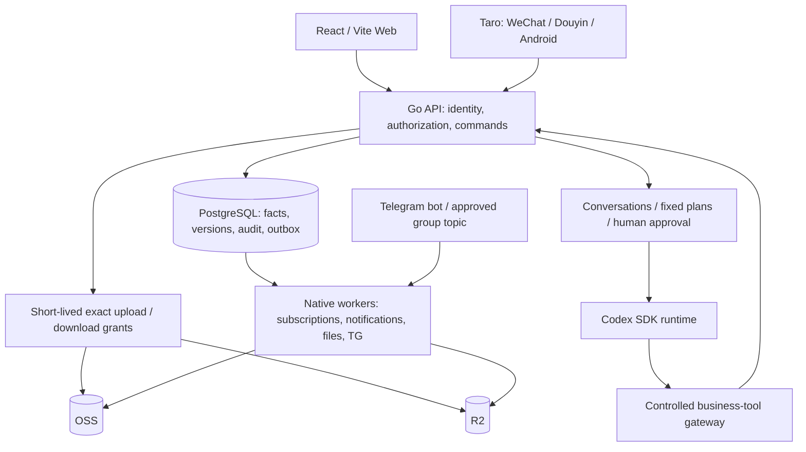

# CopyPaste Case Manager · Solution and usage guide

Latest increment102 adds explicit base-currency valuation with immutable manually reviewed quote books. In Financial Reports, an FX manager authorized for the organization with an MFA session publishes a title, base currency, six-column tab-separated quotes and a reason. Staff select a specific version, inspect separate incurred/cash/forecast totals and source evidence, then enqueue a pinned CSV. Missing quotes, prices or incomplete forecast source coverage leave the full total null.

Migration81, version history, exact decimal rounding, original-date reversals and CSV evidence are implemented across Web and the shared WeChat/Douyin/Android report page. Web151/mobile255/runtime52 tests pass; see the [verification record](quality/102-finance-fx-verification.md) for backend/build/browser results, JVM cache scope and media provenance. Cross-currency settlement, fees/exchange differences, amortization and complete finance acceptance remain open. All23 complete work packages remain open; five items remain excluded.

[Design and usage](development/102-finance-fx-valuation.md) · [Web demo](media/videos/finance-fx-web.mp4) · [Shared Taro demo](media/videos/finance-fx-mobile.mp4) · [GIF](media/gifs/finance-fx-web.gif) · [Remaining work](delivery/03-goal-gap-assessment.md)

Increment101 adds selected contract clauses/notes and purchase/reimbursement purpose/notes. Choose the exact saved business revision and fields, let the secretary save an immutable suggestion, compare the original/proposed text and adopt it through normal human permissions. Adoption creates a real business revision and audit/operation receipts. Prepare and submit approval separately. Changed sources, stale versions, lost permissions and cancelled/failed runs block adoption. All eight Skills remain draft;23 full work packages remain open and5 are excluded.

[Design, field matrix and usage](development/101-oa-prose-drafting.md) · [Verification and precise scope](quality/101-oa-prose-verification.md) · [Web recording](media/videos/secretary-oa-prose-web.mp4) · [Shared Taro recording](media/videos/secretary-oa-prose-mobile.mp4) · [GIF](media/gifs/secretary-oa-prose-web.gif)

Increment101's client checks covered Web142/mobile255/runtime52 cases. Its verification record identifies that increment's backend, four-client build and browser results, Android JVM cache scope and exact source hashes. Counts in older sections retain their original execution scope.

Previous increment100: secretary admission, execution and technical usage persistence no longer require an AI fee policy or reservation. Legacy fee writes are retired and the archive is read-only. Identity, authorization, confinement, cancellation, timeouts, concurrency and technical context/output/tool limits remain. Real Codex, TG, cloud and production acceptance are still open:23 active packages and5 exclusions.

[Implementation and use](development/100-secretary-execution-without-cost-quota.md) · [Verification scope and evidence](quality/100-secretary-execution-verification.md) · [Web recording](media/videos/secretary-cost-free-web.mp4) · [Shared Taro H5 recording](media/videos/secretary-cost-free-mobile.mp4)

[中文](README.zh-CN.md) · [Repository home](../README.md) · [Documentation index](README.md) · [Screenshots, recordings and GIFs](media/README.md) · [Changelog](CHANGELOG.md)

CopyPaste Case Manager connects projects, office workflows, files, knowledge, recurring costs, a company secretary and service status through shared authorization and audit history. This repository includes working implementations, detailed protocols and source-bound evidence. It is a development preview; full production delivery continues against the [23 active /5 excluded packages](delivery/03-goal-gap-assessment.md).

## Current scope and remaining work (revision99)

The user excludes real-device verification, network performance tests, historical migration/disaster recovery and **AI cost control only**. There are23 active packages (14 P0/9 P1),5 excluded IDs and0 newly completed packages. Web, WeChat, Douyin, Android, the secretary/eight Skills/TG, isolation, authorization and audit remain, alongside company finance/project budgets, persistent PostgreSQL and OSS/R2 storage.

The120 GB design limit and multipart/resume/integrity behavior remain, with functional samples and boundary checks. Live120 GB network acceptance and the2 TB historical import are excluded. Normal database schema upgrades and ordinary file/version recovery remain. Increment100 removes mandatory monthly-token policies and fee reservations from admission and execution. The archive is read-only; real Codex integration remains GAP-09.

[Scope and boundaries](delivery/04-current-scope-and-acceptance.md) · [23 remaining packages](delivery/03-goal-gap-assessment.md) · [Revision verification](quality/99-scope-revision-verification.md). This scope overrides conflicting gates in historical sections below.

## Dependency maintenance and four-client compatibility (increment98)

Removes the Taro RN runner unused by the supported native host, patches Doctor glob10 to10.5.0 and makes the legacy native codemod load micromatch4.0.8. Taro4.3.1, React18.2.0, the native React Native0.73.11 host, all four client targets and existing bundle boundaries remain. Fourteen dependency checks and two native JS checks pass, including actual CLI argument handling and codemod exclusions.

A fresh comparison against the same advisory feed falls from91 to80 package findings, including high20→13. The remaining13 high,60 moderate and7 low findings keep the production security gate open. The historical86-finding audit is not a current scan. Type checking,135 Web/248 mobile/51 runtime tests and affected four-client builds are fresh; unchanged Go and97 PNG/35 MP4/35 GIF evidence retain their original provenance.

[Install, real consumers, remaining risks and maintenance](development/98-dependency-maintenance.md) · [Exact verification scope](quality/98-dependency-maintenance-verification.md). No UI, migration or API change. Eight Skills remain draft; real platform/device/cloud/model/TG and complete four-client acceptance remain open.

## Mini-program identity binding and login (increment97)

First sign in to the company WeChat or Douyin mini-program with an existing internal account. Open My workspace → My mini-program bindings, confirm the current password, and complete a recent MFA step if an authenticator is enrolled. The client checks its actual runtime and AppID before acquiring a one-use platform code: WeChat uses its account API, while Douyin uses `tt.getEnvInfoSync().microapp.appId` (base library2.21.0+). Android has a separate adapter that refuses platform identity acquisition. A two-minute proof becomes a binding only after explicit employee confirmation. Later platform logins identify that same employee and continue the required MFA and business authorization checks.

All four clients can list their own active and revoked bindings. Unbinding immediately invalidates every binding-derived access/refresh session and pending MFA challenge; independent password sessions remain separate. Rebinding creates a new historical record. Web reconciles a lost committed response using the original idempotency key; Taro blocks duplicate submission until an explicit list refresh confirms the stored result. There is no automatic registration, anonymous employee account, or nickname/phone/UnionID merge.

Operators configure the API privately with `CP_WECHAT_APP_ID`/`CP_WECHAT_APP_SECRET`, `CP_DOUYIN_APP_ID`/`CP_DOUYIN_APP_SECRET`, and `CP_MINIAPP_IDENTITY_KEY` (32 random bytes, Base64). Both providers are disabled by default; partial configuration fails startup. Keep the identity digest key stable across AppSecret rotation and keep it in the controlled production configuration. Never ship secrets to mini-programs, APKs, logs or Git. [Protocol, configuration and recovery](development/97-mini-program-identity.md) · [Actual validation and media provenance](quality/97-mini-program-identity-verification.md). Native synthetic HTTP tests and Taro H5 recordings do not establish real WeChat/Douyin, Hong Kong device or production acceptance.

[Current screenshots, MP4s and GIFs](media/README.md) show self-service bindings and lost-response reconciliation with isolated synthetic data.

Fresh client checks pass 135 Web, 248 mobile and 51 runtime tests, plus both 20-page mini-program builds. Seven new actual page screenshots, two MP4 recordings and two GIFs use isolated synthetic records; they do not establish platform or device acceptance.

Increment97 originally passed 189 backend top-level tests / 1,183 result records in 10 batches, plus 135 Web, 248 mobile and 51 runtime tests and both 20-page mini-program builds. Migration 78 preserves all 77 earlier files; OpenAPI has 298 paths / 369 operations / 647 schemas. The Android development APK passes 18 package checks and 26 freshly executed JVM tests.

## 1. Goal and scope

| Confirmed input | Design consequence |
| --- | --- |
| Three employees, three concurrent users, based in Hong Kong | Individual identities, audit history and Hong Kong time; a small team still needs permissions and recovery |
| An existing mainland China server; specifications/access to follow | Start with a modular monolith API and separate native workers; validate the actual Hong Kong network path |
| Approximately 2 TB of originals, up to 120 GB per file | Direct object-storage uploads and resumability on Web/Android; mini-programs focus on reading, requests and approvals |
| Web, WeChat, Douyin and Android must launch together | Shared facts with separate client acceptance; compilation and H5 recordings do not establish device readiness |
| Contracts, procurement, claims, monthly costs and subscriptions | Reconcile incurred cost, cash movement and forecasts separately; attendance, HR and payroll are outside scope |
| OSS + Cloudflare R2; application servers retain temporary data | Formal objects use independent cloud copies; production PostgreSQL needs separate persistent storage and backups |
| Codex secretary and a shareholders' Telegram group | Use business tools and explicit authorization; the model receives no unrestricted host, database or cloud-key access |

The approach fits the initial team while keeping business records out of an unstructured server directory. PostgreSQL holds business facts, permissions, indexes and history; object storage holds formal bytes; workers perform recoverable background work. Actual capacity, scanning, network, storage and recovery costs depend on provider configurations and traffic. This repository does not promise a fixed monthly operating cost.

## 2. Architecture and data flow



| Directory | Responsibility and boundary |
| --- | --- |
| [app/backend](../app/backend) | Go API, domain commands, 69 current migrations, database constraints, jobs and native workers; PostgreSQL is authoritative |
| [app/web](../app/web) | React/Vite lists, forms, fixed evidence, approvals, history and operation receipts |
| [app/mobile](../app/mobile) | Shared Taro business pages and Android host; native private files, authenticated requests and upload service |
| [app/agent-runtime](../app/agent-runtime) | Codex SDK adapter, controlled context, cancellation and tool receipts; real-model acceptance remains open |
| [app/packages](../app/packages) | Generated OpenAPI types and shared design resources |
| [app/skills](../app/skills) | Eight versioned draft packages with schemas and explicit tool manifests |
| [app/deploy/native](../app/deploy/native) | Native worker systemd templates; production API/TLS/runtime isolation still require configuration |
| [docs](.) | Requirements, protocols, design, operations, traceability, evidence and media |

Routine API processes do not receive migration credentials. Each worker receives only the database/object-storage privileges its job needs. A transaction records the business change, audit and outbox event together; leased workers handle external effects. Unknown network outcomes require reconciliation before retrying a business operation, cost entry or outgoing message.

## 3. Implemented capabilities and delivery boundaries

| Module | Implemented | Remaining implementation or independent acceptance |
| --- | --- | --- |
| Identity and authorization | Users, roles/actions, project membership, classification/ACL, MFA, session revocation, password recovery, audit | Actual organization policy, security review and production identity operations |
| Projects | Template revisions, creation, members, tasks/dependencies, board/timeline, milestones, risks/issues, deliverables, full changes/budgets, closeout/archive | Complete journeys across OA/finance and full client coverage verification |
| Office workflows | Parties, contract revisions, purchase/claim drafts, fixed submissions, sequential approvals, execution, signature and fulfillment history | Remaining client editors/attachments and actual company approval policies |
| Finance and subscriptions | Canonical actual costs, allocations, payments, refunds/reversals, cash/incurred reports, billing periods and forecasts | Real reconciliation samples, further mobile operations and business acceptance |
| Files and knowledge | Namespaces/ACL/fixed versions, multipart protocol, verification/scanning, promotion, replication/recovery, knowledge drafts/publication/history | Real OSS/R2 identities and policies, 120 GB tests, 2 TB migration, recovery drills and more formats |
| Company secretary | Conversations, exact plans/approval, controlled project/file/directory/OA/knowledge/subscription/status tools, actual receipts | Real Codex calls, production isolation/attestation, publication and evaluation of all eight Skills |
| Telegram | Identity binding, exact group/topic ingress, durable dispatch, restricted reads, delivery preparation/receipts/unknown-outcome reconciliation | Actual bot/group, mainland connectivity, model operation and approved disclosure policy |
| Status and notifications | Services/incidents, signed observations, freshness, maintenance, in-app notifications and delivery history | Real host/backup observations, external channels and scale testing |

The gap register is authoritative for unfinished work. Publishing a repository, completing a demo or producing an APK does not establish full production readiness.

### Importing and verifying existing originals

The [native import operator](development/96-native-file-import.md) implements a read-only inventory, explicit ownership/folder/project/classification mappings, an immutable reviewed plan, recent MFA approval, normal upload/scan/commit services and per-row dual-provider verification. It reads source files with bounded memory and uses an ordinary employee session plus signed upload URLs, without database or cloud credentials. Rerun the exact saved plan to reconcile existing sessions. Changed source content requires the original logical file and its current base version. Keep all inventory/plan/report files outside Git, and retain source originals.

The six commands are `inventory`, `template`, `plan`, `run`, `report` and the separate reviewed `retry`. The operator guide includes native build commands, authentication and cleanup, JSONL fields, recovery steps and explicit upload origins. A report only counts complete per-row observations with matching mappings and verified OSS/R2 content evidence. It does not establish source ACL equivalence, an atomic restore point, real 2 TB/120 GB performance or permission to cut over. [Verification scope](quality/96-native-file-import-verification.md) separates fresh checks from the retained increment95 page media.

## 4. Employee and administrator workflows

### Identity and getting started

Administrators configure real users, business roles, classifications and project scopes. Employees log in with individual identities and complete MFA when an operation requires it. A system administrator is not automatically entitled to every contract, payment or secretary conversation. Project membership alone does not grant every business action.

Use the dashboard for visible projects, outstanding work and notifications. Opening a notification rechecks current authorization; marking it read does not approve or complete the business record. Account security supports individual device-session revocation. Password recovery uses a single-use credential rather than a public default password.

### From project creation to archive

1. Create a project and verify scope, owner, dates and members. Selecting a template binds its published revision; later template edits do not silently rewrite existing projects.
2. Maintain actual member roles. Ownership transfer is a separate action. Create tasks with assignees, acceptance criteria, dates and dependencies; list, board and timeline views read the same records.
3. Register milestones, risks and issues. A milestone needs real linked completion evidence. Realizing a risk creates an actual linked issue; follow that issue and record a resolution before resolving/closing it.
4. Submit a deliverable against fixed file versions for independent authorized review. Resubmission creates a new revision and retains previous history.
5. Freeze a scope/budget change, obtain independent approval, then explicitly apply it. Approval alone does not alter the baseline.
6. Run thirteen categories of business/finance closeout checks, record the retrospective and satisfy the authentication requirement before archiving. Controlled reopening preserves history.

The project overview aggregates sixteen business domains with original-currency decimal precision, links to original records and current read permissions. Pagination and query scope remain visible; a partial page cannot be represented as a complete dataset.

On mobile, open Project → Tasks → New task. Enter the title, acceptance text, an actual project member, priority, review requirement and Hong Kong schedule; choose a parent/milestone from the current paginated project records, verify and save. Task details support editing, child creation and separately confirmed prerequisite addition/removal. Emptying an existing date or association explicitly clears it. State transitions use the original commands, which reject incomplete prerequisites, cycles and read-only projects. On conflicts, incomplete receipts or lost responses, preserve the input and read the actual task/edges before deciding the next action; do not repeatedly create it. See the [task protocol](development/78-mobile-task-editing-and-dependencies.md) and [actual demonstration](media/README.md#4-移动任务子任务与前置依赖--mobile-task-subtask-and-prerequisite).

On mobile, open Project → Closeout and archive. Inspect all thirteen categories and dispose original blockers, explicitly enter closing, then record outcomes, lessons, follow-up and the reason. Select zero to twenty formal file versions if needed, attest business and financial closure separately, complete current MFA and confirm archive. Success also reconciles the actual project and new history. Conflicts and unknown results retain text and block replay; explicit reread refreshes authority/source facts and resets attestations/MFA. History loads ten reviews at a time; restricted reads expose no counts. Controlled reopening preserves the old review and marks its basis changed. See the [closeout protocol](development/79-mobile-project-closeout-and-archive.md) and [actual demonstration](media/README.md).

On mobile, open Project → Changes → New complete proposal, or propose an adjustment from Budget revisions. Enter an explicitly configured currency, read and accept the complete current project/budget basis, and enter full scope, dates, impact explanations and exact formal file versions. Choose keep (null), full replacement (an array) or clearing (an empty array). Saving a proposal prepares no approval automatically: prepare the original request, explicitly revise it after proposal edits, inspect its original workflow and submit for an independent decision. Approval still changes neither project nor budget. Implementation requires the exact approved request and current basis, separate scope/date and budget attestations, a reason and fresh interactive MFA; actual project, implementation and current/predecessor budget reads must corroborate success. Proposal history loads ten revisions and budgets twenty at a time, with independent currency/state filters. See the [complete change/budget protocol](development/80-mobile-project-changes-and-budgets.md) and [actual media](media/README.md).

### Project budget versus actual expenditure

On Web or mobile, open **Project → Budget → Budget versus actual expenditure**, enter an explicitly configured three-letter currency, and load the current implemented plan. Verify project version, budget revision and read time, then compare each original category and inclusive date interval against this project's actual allocation shares. All100 possible plan lines remain available. A shared expense contributes only this project's share and is never duplicated through other links. Confirmed expenses add to expenditure; reversals subtract on their own occurrence dates. Drafts contribute no incurred amount.

Open sources for a line or **Outside the plan**, filter incurred/draft records, page through them and open the canonical expense. Incomplete drafts may lack a date or category; the UI invents neither. The worked example has a1300 budget,1385 matched net expenditure and-85 variance; outside net activity is-945 and lifetime net expenditure440. Every result covers authorized records only, so it does not establish the whole project's balance, available funds or closeout acceptance. An absent plan differs from an explicitly approved cleared zero plan. Reload when the project/plan basis changes. Query currencies separately without implied conversion. See [calculation, authority and API rules](development/87-project-budget-comparison.md), [actual screenshots/short recordings](media/README.md) and [source-bound verification](quality/evidence/budget-comparison/verification.md).

### Contracts, procurement and claims

Register the party, text, amount and fixed supporting files in an editable draft. Preview the exact revision and explicitly submit it. Approval reads frozen submission evidence and follows the configured sequence; applicant/reviewer independence still applies.

Contract approval is followed by actual signing, activation, payment schedules, fulfillment and completion/termination reconciliation. Approved purchases proceed through the original order, partial acceptance, rejection, returns and settlement. Variances require exact approval before application. Claim approval does not transfer money: costs and payments remain separately recorded facts. Changing submitted evidence requires a new revision, withdrawal or resubmission rather than overwriting history.

### Monthly costs and subscriptions

An actual cost has one authoritative record and can allocate shares to several projects. Payments have separate cash facts, allocations and refund/reversal records. Reports distinguish:

| Basis | Meaning | Avoid |
| --- | --- | --- |
| Incurred expense | Confirmed actual cost and project shares | Counting approval limits or contract totals again as incurred costs |
| Cash outflow | Actual payments/refunds and related movements | Treating unpaid costs or forecasts as cash |
| Future forecast | Subscription calendar, effective price revisions and valid periods | Adding forecasts to actual periods twice or repricing historical periods |

Amounts retain their original currency and decimal text; no implied HKD conversion is invented. Subscription periods, price changes, cancellation and reconciliation remain explicit. Secretary review can cite individual records but does not create payments or replace financial confirmation.

### Financial filters, canonical sources and expiring exports

Open any Web financial report or **Finance reconciliation → Financial reports** on the mobile home page. Apply an explicit interval (exclusive end), project/company scope, original currency, category, supplier, recorder/owner and keyword. Incurred expenses, cash and subscription forecasts remain separate. Drafts are excluded, and missing forecast periods/prices and unconfigured FX remain explicit. Filter choices derive from readable business facts; source pages open the canonical records.

An independently granted `report.export` action allows entering a purpose and enqueuing a task. A202 receipt only means accepted; the worker fixes the snapshot when it executes. Your tasks expose actual status, cancellation and expiry. Limits are50,000 rows/16 MiB and24 hours; changed authority requires a new export. Web saves verified CSV, Android opens it with a local app, and capable WeChat clients share a temporary CSV. Douyin and unsupported WeChat clients direct retrieval to Web. Import monetary columns as text to preserve exact decimals; no original currency is silently converted.

Run the native DB-only worker separately: `python app/scripts/run_backend.py worker-report-export`. The Linux unit is `app/deploy/native/copypaste-report-export-worker.service`, with only environment and database settings. Without it, jobs stay queued. Originals remain in OSS/R2; CSV is regenerated on download rather than stored permanently on the server. See the [complete workflow and design](development/88-financial-report-filters-and-exports.md) and [actual captures](media/README.md).

### Mobile expenses, cash, refunds and employee settlement

Open **Actual expenses / Cash payments** from the workspace. Create or edit original-currency drafts with fixed party revisions, formal file versions and project/company shares. Expenses use the actual incurred date; cash uses Hong Kong local time with exact UTC conversion. Drafts may be incomplete. Before confirmation or registration, review the facts and evidence, make the explicit human declaration and complete fresh MFA. Registering cash records a fact and never initiates a bank transfer.

Link a confirmed expense to a same-scope, same-currency approved purchase/claim or effective payable contract. Allocate a recorded outgoing payment to an exact expense and release an explicit partial amount. Employee settlement fixes the original claim applicant, approved revision, advance line and supplier. Start refunds from the original payment, preserving its currency and payee; map original allocations during registration or afterward. A refund remains separate from an expense reversal.

A full reversal requires its real effective date/time and creates a distinct reverse fact with history retained. Correct/release effective cash links before reversing a settled expense; reversing an employee payment also corrects its claim settlement. Read fixed revisions and immutable operations in pages. Stale authority, concurrency or lost responses retain text and stop resubmission until actual records are checked; never invent a new request key to repeat the same intent. Bounded memory drafts exclude selected evidence, MFA and declarations.

See the [fields, permissions, receipts and workflows](development/89-mobile-financial-operations.md), [actual verification](quality/evidence/mobile-finance-operations/verification.md) and [screenshots/MP4/GIFs](media/README.md). Each device/platform still needs acceptance. This increment adds no FX, cross-currency or amortization policy.

### Files, project blogs and knowledge

Choose an exact folder/project. The API issues short-lived grants restricted to the intended multipart object, and the client uploads directly to the selected object store. Recovery reconciles existing cloud parts first. Upload completion only establishes candidate bytes: source freezing, full checksums, scanning and formal version commit still follow, then replication and verification in the other cloud.

Downloads and references bind current authorization and fixed versions. Revocation, expiry or ambiguous sources prevent reading. Temporary local copies do not become formal originals. Knowledge/project-blog content uses drafts, published revisions, comments and exact attachments; restoring history produces a traceable revision instead of deleting the audit trail.

Mobile users can now create and edit project logs, meeting notes, SOPs and internal articles; explicitly publish/archive/return to draft; restore history into new revisions; and discuss the displayed body. Knowledge attachments explicitly follow the current version or pin an immutable version. Text-only comment edits preserve original server-side attachments. Context conflicts and uncertain receipts retain input and stop repeats. See the [mobile knowledge workflow](development/83-mobile-knowledge-workflows.md) for usage, limits and APIs.

### Company secretary and Telegram

An employee states a goal in an authorized conversation. The secretary reads permitted content and prepares a bounded plan. Project creation, file changes, directory organization, OA submission or knowledge publication require checking exact objects, revisions, differences, scope and the user's required approval before invoking original business commands. The UI reports actual committed receipts; a casual chat reply does not replace formal approval or recent MFA.

The eight draft Skills are `project-create`, `project-update`, `file-update`, `information-organize`, `oa-assist`, `subscription-review`, `project-briefing` and `incident-summary`. Changing a manifest from draft to published is not a deployment procedure. Telegram additionally requires identity binding, an exact group/topic and channel restrictions. Group membership does not grant access to all company information. Current TG tools remain restricted to permitted reads; real delivery requires separate acceptance.

Employees can open **Telegram access** from the mobile workspace: choose a specific Bot → pass recent MFA → prove ownership in its private chat → return to the original login → inspect and explicitly confirm the numeric identity. They can also cancel a challenge or revoke a binding. Capabilities remain in page memory; an explicit copy has a separate OS-clipboard lifetime.

Administrators configure the exact chat/topic, company or visible-project scope, complete allowed/default tasks and stage-link notifications on the same page. New channels start paused and locations are immutable. Every save corroborates the complete receipt and immutable history; conflicts or uncertain receipts preserve input and block retries. See the [mobile TG protocol and usage guide](development/82-mobile-telegram-access.md).

The secretary can now create/update complete project risks and issues, explicitly set/clear nullable date/probability fields, and use the original state machines. Realizing a risk atomically creates a linked issue and requires both business permissions and explicit confirmation. Creation binds the parent version; updates bind the child version. A preview does not execute; sending fixes authority, and only a genuine receipt establishes completion. See [secretary concern workflows](development/84-secretary-project-concerns.md).

### Service status

Service pages show observation time, validity, maintenance and incidents. Missing or stale observations remain unknown/stale; maintenance does not erase incident history. Real host probes and backup-failure events must have genuine sources before production status can be asserted.

Service operators publish an exact source revision and Ed25519 public key in Web. On a separately administered monitor host, deploy Prometheus/Blackbox and the [native status bridge](development/81-native-prometheus-status-bridge.md), fill the private [configuration](../app/deploy/native/status-bridge.example.json) with approved endpoint/IP pairs, full labels and that revision, and protect its key and durable journal. Run `status-bridge --config <private-file> --once` to inspect safe result codes, then install its supervised native service. Deploy the current platform API before enabling the bridge: it requires the new source/revision/sequence/payload-bound acknowledgement and refuses an older incomplete ACK.

The bridge reads original scrape timestamps through six bounded queries, persists each exact signed body before delivery and retries uncertain outcomes with the same bytes. Repeated scrapes do not extend freshness or advance failure/recovery counts; a failed scrape produces no healthy/failed fact, so old evidence expires to unknown. The existing Web and Taro pages show threshold-based outages, recovery and immutable signed evidence. The included browser recording uses a controlled Prometheus protocol endpoint and a real native bridge/API; actual monitor installation, host metrics and independent external alerts still require deployment acceptance.

For exact task/subtask creation, select **Create task or subtask** in a project conversation, review all nine fields plus reason, and explicitly choose the human-review requirement. Parent/milestone candidates are paged; mobile navigation preserves inputs. Preview performs no write. After sending, wait for a genuine commit; use the task page for dependencies and human acceptance. See the [complete workflow](development/85-secretary-task-creation.md), [actual demos](media/README.md) and [verification](quality/evidence/task-creation/verification.md).

For secretary allowances, open **Secretary budget** in the Web sidebar or **My workspace → Secretary tokens** on mobile. A manager with fresh MFA publishes all four ceilings. Each admission reserves the profile’s input-plus-output ceiling. Review your own or authorized scoped accounts and reconcile unknown terminal usage using explicit counts and a reference. Production starts without an allowance; no currency is inferred. See the [rules and upgrade order](development/86-secretary-token-budgets.md).

## 5. Native local development

The supplied helpers target the current native Windows development environment. Do not launch Docker, WSL, VMs or Android emulators. A persistent local development PostgreSQL cluster is a development tool; production application hosts still retain only temporary file data.

| Tool | Repository requirement / verified baseline |
| --- | --- |
| Git + SSH | Repository access with your own authorized identity |
| Node.js / npm | `>=22.14.0 <23`; verified 22.14.0 / 10.9.2; use the lockfile |
| Python | Python 3.11+ and UTF-8; media tooling additionally uses Pillow and FFmpeg |
| Go | go.mod 1.27.0, toolchain 1.27.3; bootstrap verifies a pinned archive digest |
| PostgreSQL | Verified native 18.6; extract a complete distribution into `app/.tools/pgsql/`, including `bin/initdb.exe`, `pg_ctl.exe` and `psql.exe` |
| Browser checks | Native Edge/Chromium and Playwright; close owned pages and contexts afterward |
| Android development | Native JDK 17, Android SDK platform 34/build-tools 34.0.0; current target SDK 34 still needs production compatibility work |

From the repository root:

```powershell
$env:PYTHONUTF8='1'
python app/scripts/bootstrap_go.py
npm ci --prefix app
python app/scripts/dev_database.py start
python app/scripts/run_backend.py migrate
python app/scripts/seed_development.py
```

The database helper creates/reuses its own native cluster, tries port 55432 by default and records the actual selected port in the ignored environment file. Do not assume the default port was selected. Toolchains, caches, temporary databases and generated credentials stay outside Git. Seed accounts are for an empty local development database; randomized credentials are saved to `app/.local/development-accounts.json`. Initial MFA and recovery material also remain private.

Start two separate foreground terminals:

```powershell
$env:PYTHONUTF8='1'
python app/scripts/run_backend.py api
```

```powershell
npm run dev --prefix app
```

The helper configuration uses API `127.0.0.1:18080` and Web `http://localhost:5178`; Vite proxies `/v1` and health routes. Generated local configuration is authoritative. [.env.example](../app/.env.example) is a manual configuration template whose 8080/5173 values are examples; do not overwrite generated settings with it. Cloud storage, scanning, models and TG are disabled by default. Disabled scanning never implies a clean file.

Stop your foreground processes normally. When your owned database is no longer needed:

```powershell
python app/scripts/dev_database.py status
python app/scripts/dev_database.py stop
```

Do not kill unrelated services by port, delete unknown databases or restart a healthy owned process because an observation timed out. See the [local development protocol](development/08-local-development.md).

## 6. Build the four clients and run checks

From `app/`:

```powershell
$env:PYTHONUTF8='1'
npm run contract
npm run typecheck
npm run build:web
npm run build:runtime
npm run test --workspace @copypaste/web
npm run test --workspace @copypaste/agent-runtime
npm run check:skills --workspace @copypaste/agent-runtime
npm run test --workspace @copypaste/mobile
```

Local mini-program builds:

```powershell
$env:CP_MOBILE_BUILD_PROFILE='local'
$env:CP_MOBILE_API_ORIGIN='http://127.0.0.1:18080'
npm run build:weapp
npm run build:tt
```

Outputs are `app/mobile/dist/weapp` and `app/mobile/dist/tt`. These are local build settings. Real mini-programs require platform accounts, allowed HTTPS domains and a reachable API; `127.0.0.1` on a phone does not refer to the development computer. H5 checks exercise the shared interface and do not replace Android with a fifth launch client.

Native Android builds, also from `app/`:

```powershell
python scripts/setup_android_native.py
python scripts/build_android.py --google-mirror --evidence-group my-change
python scripts/inspect_android_apk.py --evidence-group my-change
```

The mirror option explicitly selects a dependency download route; prepared tools can use the scripts' offline preparation support. Outputs are development APKs under ignored `.local` storage. Do not commit signing keys, formal APK releases or private SDK settings. Separate platform/device acceptance, native dependencies, target SDK compatibility and release signing remain required.

Full backend and mobile checks:

```powershell
python scripts/verify_backend_batches.py --evidence-group my-change
python scripts/verify_mobile.py my-change
```

Backend checks require the prepared native PostgreSQL test environment and clean up their isolated test databases. Select checks that match the change. Reuse unchanged evidence only with complete matching source digests; do not describe cached results as new executions. Regenerate contracts after OpenAPI changes and run `npm run tokens` for design-token changes. The [increment90 verification record](quality/evidence/dependency-hardening/verification.md) distinguishes fresh execution, original evidence reuse, native cache scope and limitations of retained failed attempts.

## 7. Production deployment and storage plan

Production is not deployed. Server specifications must establish CPU/memory, OS, egress, Hong Kong access, backup locations, domains and HTTPS. Run API, workers and the constrained runtime as native managed services; persist PostgreSQL separately and migrate with a separate identity. In `app/backend/`, `go build -o ../.local/bin/platform ./cmd/platform` illustrates a Linux build after creating the output directory. Building alone does not deploy a service.

Separate process configuration: the API gets only required upload-signing/inspection and download privileges; upload, verification, scanning, promotion, replication and recovery workers receive narrow source-reader/target-writer roles. The secretary runtime gets no business database or object-storage master keys. Production also needs actual native process isolation, resource/network/directory restrictions and trusted attestation issuance. SDK settings do not implement those controls by themselves.

File storage uses an explicit primary source plus an independent other-cloud copy with full checksums and version evidence. Clients do not upload both formal copies on every transfer. A 2 TB migration starts with an inventory, classification/permission mapping, batch import, deduplication/verification, rollback and human sampling. A 120 GB acceptance run must exercise the actual network, interruption, credential expiry, device restart, revocation, memory/disk usage and both-cloud digests. Exceeding scanner limits cannot be treated as passing a scan.

Dual-cloud originals do not replace PostgreSQL backups, PITR, key recovery, retention/version policy or deletion protection. Drill metadata, object, authorization and full-service recovery; confirm RPO/RTO against actual requirements. See [deployment and operations](operations/01-deployment-and-operations.md), [backup/migration/recovery](operations/02-backup-migration-and-recovery.md) and the [configuration catalog](governance/03-configuration-catalog.md).

## Secretary task prerequisites (increment91)

In a project secretary conversation choose **Update project → Select exact business update → Adjust task prerequisite**. Select the successor and a different actual predecessor in the same project. Review both versions and the current relationship, explicitly choose add/remove, enter the reason, preview, then send. Selection and preview perform no write. A queued run is distinct from a committed update; verify the factual relationship and real business operation receipt.

Only one edge is authorized. Changed task versions, relationship or shared AI permissions stop the old decision; read the new state and send a new decision without silently changing versions. Self-links, cross-project links, cycles, duplicate additions and absent removals are refused. Completed/cancelled tasks need reopening; an in-progress task cannot gain an unfinished prerequisite. The tool does not complete predecessors or accept work. Exact retries retain one run and one operation without another version increment.

The source package `project-update`1.7.0 has17 allowed tools, including15 exact write tools. All eight Skills remain draft. Additive migration74 preserves the previous73 migration bytes. The original Dependency command commits the real edge, successor version, idempotency, audit, outbox and runtime evidence atomically. Web and Taro share the complete six-field authority and receipt checks. Remaining tools, real models/TG, cloud/devices and the full four-client release continue against all28 gaps.

[Design and failure handling](development/91-secretary-task-dependencies.md) · [Actual verification](quality/evidence/task-dependencies/verification.md) · [Web MP4](media/videos/secretary-task-dependencies-web.mp4) · [Mobile MP4](media/videos/secretary-task-dependencies-mobile.mp4)

## Search work material and fixed-version text (increment92)

Open **Search work material** from Web navigation or the mobile dashboard, enter1–200 characters and optionally select projects, tasks, knowledge, files or folders. Queries are literal case-insensitive substrings, including Chinese, English and emoji. Results identify name/body/tag matches and file processing state/time.

File body search uses the current formal version. **Read this version's text** pins that result's version and pages through4000 Unicode characters at a time; original details remain available separately. Knowledge readers search the published revision, while authors/editors search their current revision. Each read rechecks live permissions, folder lifecycle and version availability/scan state.

A separate native worker validates the exact object metadata and complete hash. It supports UTF-8 TXT/Markdown/CSV/JSON up to1MiB and DOCX main-document/table content up to8MiB, with a2MiB output bound. PDF, OCR, spreadsheets, DOCX headers/footers and huge-file prefix extraction are unsupported. PostgreSQL stores derived text/evidence; OSS/R2 retain originals, without durable extraction copies on the application host.

[Protocol and limits](development/92-file-text-search.md) · [Read-only credentials, deployment and diagnosis](operations/file-text-search.md) · [Screenshots and demonstrations](media/README.md) · [Exact verification](quality/evidence/file-search/verification.md)

## Secretary body discovery and fixed DOCX context (increment93)

1. Open an authorized company/project conversation. Choose exact file text, then explicitly select the formal file and version; historical selection never follows the latest head.
2. Preview extracted DOCX main-document text and review the original version/SHA-256, extractor, index time, text SHA-256 and character count. Continuation uses Unicode offsets and requires the same derivation.
3. Explicitly attach the context; both versions of one file can be attached. Selection and preview do not send a request or grant a mutation. Choose an installed task, enter the request and deliberately send; production profiles still require actual installation and evaluation.
4. Existing MCP `search_resources` matches permitted titles and bodies under the conversation's shared authority; file body discovery uses the current formal version. `read_resource` can read an explicitly chosen historical version. A snippet does not prove a full read or authorize a write.
5. Pending, failed, oversized and unsupported sources expose their real state. Trash, quarantine and revoked access block cached disclosure; dependent old replies can be withheld. Original UTF-8 files retain the independently credentialed, digest-checked reader; DOCX uses immutable indexed text.

Limits: UTF-8/Markdown/CSV/JSON originals up to1MiB; DOCX originals up to8MiB, extracted text up to2MiB and10000 Unicode characters per read. PDF, OCR, other Office bodies and DOCX writes are not implemented. Check originals for layout, images and embedded objects. Index time is not a fresh real-cloud access time.


[Web recording](media/videos/agent-indexed-search-web.mp4) · [Mobile H5 recording](media/videos/agent-indexed-search-mobile.mp4) · [Mobile GIF](media/gifs/agent-indexed-search-mobile.gif) · [Full protocol](development/93-secretary-indexed-search.md) · [Independent reader configuration](operations/file-text-search.md)

Clips use the actual native API with isolated synthetic records: preview, continuation and attachment without a model request. Body discovery and completion receipts are covered by the controlled native MCP fixture, separately from real models or Telegram. Short clips retain fast automated timing; slow playback for detail.

## Mobile files and folders (increment94)

Open File workspace from Home or a project. Create subfolders, rename, choose an actual same-project/classification destination, move a file to trash or restore it to its original directory. Review the exact identity/revision, name, location, reason and impact before confirming. Formal content is retained. File details paginate formal versions with checksums, scan/replica state and exact historical read links.

Memory-only text drafts bind identity, authority, object and revision; destinations and confirmations are never restored. Name/revision conflicts, lost responses and incomplete receipts preserve text and stop repeats until authoritative records are reread. Android retains native upload; mini-programs focus on reading and approval. Cross-scope moves and retention cleanup remain separate work.


[Directory MP4](media/videos/mobile-files-directory.mp4) · [Trash/restore MP4](media/videos/mobile-files-lifecycle.mp4) · [File GIF](media/gifs/mobile-files-lifecycle.gif) · [Workflow and API](development/94-mobile-file-workspace.md) · [Exact verification](quality/evidence/mobile-files/verification.md)

## Task discussions and explicit mentions (increment95)

1. Open a project task and choose **New task comment**. Write the body. A textual `@name` is ordinary text; explicitly choose up to20 currently eligible project members to notify, excluding yourself.
2. Optionally select up to20 exact formal file versions. Attachments remain pinned to those versions, even after a newer file is published. Reading independently checks current access.
3. Review the task, predecessor revision, complete body, attachments and members, then explicitly confirm. Success requires the committed record and immutable history to match the request.
4. Authors edit their own exact revision. Omitted attachment/mention lists preserve all original associations. Only explicit complete replacement uses the current selection; an empty list clears it. Replacement is blocked when original associations cannot be fully checked.
5. A recipient opens the exact current comment from the inbox, even beyond the first20 rows; the page automatically scrolls to the discussion. Text-only edits do not repeat delivery. Removing then re-adding a mention creates a new notification without reviving the older one. Read status never completes the task.
6. Conflicts and uncertain responses preserve memory-only text and block repeats. Reread the list first. Reopening restores text only; explicitly select associations, review and reconfirm the identical intent to reconcile using its original idempotency key. There is no automatic resend. Revocation invalidates the open workflow through existing authority rules.


[Web MP4](media/videos/task-mentions-web-collaboration.mp4) · [Mobile MP4](media/videos/task-mentions-mobile-collaboration.mp4) · [Mobile GIF](media/gifs/task-mentions-mobile-collaboration.gif) · [Workflow, API and constraints](development/95-task-discussion-and-mentions.md) · [Exact verification](quality/95-task-discussion-verification.md)

These are each employee's in-app notifications. No additional Telegram, email or device-push sender is enabled. Taro remains20 registered pages, with all four release clients and external acceptance unchanged.

## 8. Evidence and release gates

Current functional evidence is increment100; [scope revision99](delivery/04-current-scope-and-acceptance.md) still defines acceptance. Fresh execution, cached results and retained evidence are separated in the [verification record](quality/100-secretary-execution-verification.md).

| Layer | Current result | Boundary |
| --- | --- | --- |
| Dependencies | Increment98 complete audit:80 findings,0 critical/13 high/60 moderate/7 low | Same lock digest; retained audit, security gate open |
| Go/PG |189 top-level/1,181 results;10 original batches and2 failed cleanup cases retried serially;79 migrations | Current-source cases pass, original failures retained,0 temporary databases |
| Web/runtime/Taro |135/51/248 tests, types/builds;20 pages each for WeChat/Douyin | Fresh current-input commands, no platform/device/performance acceptance |
| Android | Fresh Metro payload and development APK;18 structural and3 feature-content checks;26 cached JVM results | JVM tests were not newly executed; production signing/release remains |
| Media |2 new PNGs/2 MP4s/2 GIFs; all original97 PNGs/35 MP4s/35 GIFs retained |99 PNGs/37 MP4s/37 GIFs total; mobile is shared Taro H5 |
| Integration | Cloud/model/TG/production acceptance incomplete;8 Skills draft |23 whole packages open;5 exclusions are not completions |

Increment100 implements admission and execution without mandatory AI fee policies or reservations. Isolation, identity/authorization, audit and technical resource limits remain. See the [current checklist](delivery/03-goal-gap-assessment.md).

## 9. Documentation and synchronization

Keep implementation in `app/` and documentation/media/update notes in `docs/`. Follow the [contribution and synchronization rules](contributing.md): update both language guides, affected protocols, gap IDs, evidence and real demonstrations, then commit and push the corresponding changes together to `git@github.com:copypasteltd/case-manager.git`. Do not force push or commit credentials, raw capture frames, toolchains, databases or local caches.

Use the [documentation index](README.md) for requirements and protocols, the [implementation ledger](delivery/02-implementation-ledger.md) for actual progress, the [media catalog](media/README.md) for demonstrations and the [changelog](CHANGELOG.md) for publication scope.
