# CopyPaste 内部管理平台文档中心

**首个冻结候选：[v0.1.0-rc.1](releases/v0.1.0-rc.1/README.md)。** 源码标签、下载摘要、部署步骤与延期验证统一记录。 服务器、两小程序及Android开发包已封存：[下载与SHA-256清单](https://github.com/copypasteltd/case-manager/tree/8ddb3f7a98a24910af49ede2a6c8b8c744d50973/docs/releases/v0.1.0-rc.1)。

## 当前main：增量135 · 应收合同异币向外退回

四端源码已接通合同本金与实际付出分离的归属、现金预留、部分解除尾差、固定人工核对及全额资金冲销。合同详情选择“归属实际退回款”，固定原收入归属与实际向外付款，输入合同本金、本次付出、汇率及凭证来源，明确核对并完成近期MFA，再查阅持久历史。

示例：780 HKD收入，100 USD实际付出；归属390 HKD／50 USD，再归属195 HKD／25 USD，合同净收195 HKD、实际资金占用75 USD、可用25 USD。解除只改变归属，实际资金独立保留；原390 HKD分三次各130 HKD解除，准确释放16.67、16.67、16.66 USD。

本轮精简检查：原生HTTP／PG4组52条，Web444项、共享移动529项，类型及Web／微信／抖音构建、实际Web提交与读回。没有新Android包／移动浏览器完整旅程或完整回归；开发库仍100，运行新后端前正常应用101、102。首个冻结标签和下载仍为`v0.1.0-rc.1`，不包含135。23个工作包（14 P0／9 P1）、五项移出、八项draft Skill继续保留；公司财务制度／汇差、完整旅程和正式集成仍待完成。

## Current main: increment135 · Receivable foreign outgoing returns

All four client sources now separate contract principal from actual outgoing cash, reserve exact cash, release partial attribution with rounding tails, pin human reconciliation evidence and preserve full-reversal history. Open contract finance → “归属实际退回款”, pin the original incoming-cash attribution and actual outgoing payment, enter principal/cash/rate/source, explicitly acknowledge and complete recent MFA, then read committed history.

Example:780 HKD received and100 USD paid out. Attribute390 HKD /50 USD, then195 HKD /25 USD. Contract net is195 HKD, outgoing reservation75 USD and free cash25 USD. Three130 HKD releases of the first attribution release16.67,16.67 and16.66 USD. Attribution does not transfer bank funds or automatically book exchange gains/losses.

Focused checks: four native HTTP/PG suites,52 passing records;444 Web and529 shared-mobile cases, type checking, Web/WeChat/Douyin local builds and actual Web mutation/readback. Full regression, additional mobile browser and a new Android artifact are deferred. Persistent development services stay schema100; apply101 and102 before running this backend. The immutable `v0.1.0-rc.1` packages do not include135. All23 packages (14 P0/9 P1), five exclusions and eight draft Skills remain; company policy, exchange differences and formal integrations stay open.

[实现与使用 / Usage](development/135-receivable-foreign-returns.md) · [关键检查 / Checks](quality/135-receivable-foreign-returns-verification.md) · [本轮及全部23项 / Remaining](delivery/05-functional-closure-135.md)

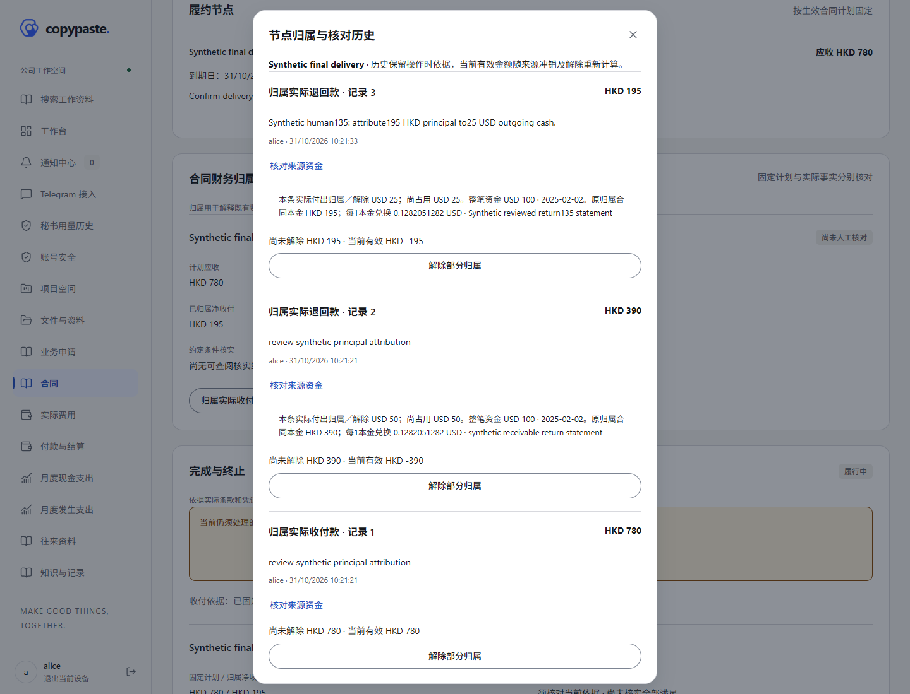

[实际Web录制 / Actual Web recording](media/videos/receivable-foreign-returns-web.mp4) · [三截图GIF导览 / Screenshot-tour GIF](media/gifs/receivable-foreign-returns-web.gif)

## 增量134 · 原发布记录

已接通登记时原子回转及登记后分次追加，Web、微信、抖音和Android共享功能源码。输入原付款本金，页面分别核对费用原币和实收现金份额；固定原分配、人工声明、近期MFA、准确尾差、项目份额及全额冲销保持可追溯。

示例：原200 EUR费用由780 HKD核销，实际退回100 USD。先回转560 HKD／143.59 EUR／71.79 USD，最后220 HKD／56.41 EUR／28.21 USD；费用、原本金、现金三个余额独立。

使用：从原付款登记真实异币退款时选择原分配，或在退款详情“关联退款分配”；输入**原付款本金**，核对费用与现金预览，完成本人核实后提交，再查阅持久历史。本轮关键检查为原生HTTP／PG5组64条、Web436项、共享移动521项、类型检查及Web／两小程序构建。Android沿用133开发APK，本轮没有新包或移动浏览器完整旅程；现有开发库仍100，运行新后端前应用101。

首个冻结标签和下载仍为`v0.1.0-rc.1`；134是后续main源码。全部23个工作包（14 P0／9 P1）、五项移出、八项draft Skill保持；应收合同异币向外退回、公司汇兑制度、完整旅程和正式集成继续开放。

## Increment134 · Previously published

All four client sources now support atomic attribution at cash recording and later partial attribution. Enter original-payment principal; inspect expense-currency and actual-cash previews, acknowledge the facts and complete recent MFA. Exact source allocations, rounding tails, project cash shares, immutable history and full reversal stay separate from original expense/bank facts.

Example:200 EUR settled by780 HKD receives100 USD. Attribute560 HKD /143.59 EUR /71.79 USD, then220 HKD /56.41 EUR /28.21 USD. Each monetary balance keeps its own units. Use the original payment refund form or the refund detail’s “关联退款分配”, review the principal and expense/cash preview, then inspect the committed journal.

Focused checks: five native HTTP/PG suites,64 passing records;436 Web and521 shared-mobile cases, type checking and Web/WeChat/Douyin local builds. No fresh Android package or mobile browser journey; the retained development APK is increment133. The persistent development database remains schema100; apply101 before running this backend. The frozen candidate tag/artifacts remain `v0.1.0-rc.1`;134 is subsequent main source. All23 packages (14 P0/9 P1), five exclusions and eight draft Skills remain. Receivable foreign outgoing returns, company FX policy and full/external acceptance remain open.

[实现与使用 / Usage](development/134-foreign-expense-refunds.md) · [实际检查与延期 / Checks](quality/134-foreign-expense-refunds-verification.md) · [本轮与全部23项 / Remaining](delivery/05-functional-closure-134.md)

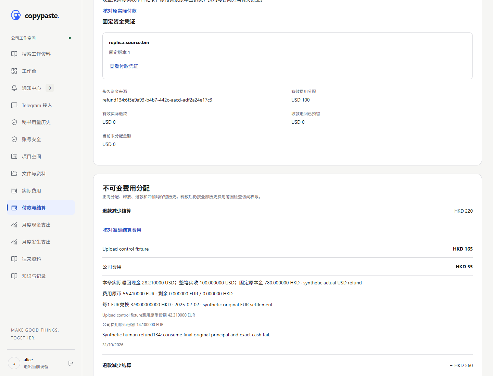

[实际Web录制 / Actual Web recording](media/videos/foreign-expense-refunds-web.mp4) · [三截图GIF导览 / Screenshot-tour GIF](media/gifs/foreign-expense-refunds-web.gif)

## 增量133 · 已发布冻结基线 / Published frozen baseline

本轮实际检查：五组选定原生HTTP／PostgreSQL套件74条通过记录，Web428项、共享移动513项；构建、原生缓存和仅巡检脚本修正的准确输入分别记录，不代表完整生产验收。

增量133补齐四端合同财务闭环：生效合同→真实费用／收付款归属→按原本金归属异币退款→部分解除→固定凭证人工核对→来源变化后重新核对。共享移动端新增完整合同财务中心，Web同步展示整笔实收与合同本金。

使用：Web进入合同详情的“合同财务归属”；微信、抖音和Android选择“合同财务归属与核对”。先固定实际正向收付款，再选择其退款；输入合同币种本金并明确核对币种。需要纠正时追加部分解除；核对节点时选固定版本凭证并确认条件及差额。实际银行现金与费用不因归属而改变。

示例：付款780 HKD、实际退款100 USD、固定退回本金780 HKD；四条195 HKD本金归属合计780 HKD。每条明确展示整笔100 USD实收，不把两个币种相加；原付款和退款两重余额、并发、幂等、当前权限及最近MFA继续生效。退款全额冲销保留旧归属／核对，当前有效退款本金归零。

正常结构升级99→100，历史账本与旧核对不改写。跨币费用退款归属、应收合同的异币向外退回、公司汇兑制度及完整业务验收继续开放。仍23个工作包（14 P0／9 P1）、五项移出、八项draft Skill。

Increment133 completes the four-client contract finance path: effective contract → actual expense/cash attribution → foreign-refund principal attribution → partial release → evidence-bound human reconciliation → renewed review after source changes. Shared mobile now has the full contract finance center; Web distinguishes whole received cash from contract principal.

Usage: on Web open the contract’s “合同财务归属”; on WeChat, Douyin or Android choose “合同财务归属与核对”. Pin the original actual cash first, select its exact refund, enter contract-currency principal and explicitly review the units. Append a partial release to correct attribution. Reconcile with fixed file versions and explicit condition/difference checks. Attribution does not transfer bank cash or create expense.

Example:780 HKD paid,100 USD actually refunded,780 HKD reviewed principal. Four195 HKD attributions exhaust780 HKD; each separately labels the entire100 USD cash fact. Refund/original caps, concurrency, idempotency, current authority and recent MFA remain mandatory. Full cash reversal preserves old records while removing current effective refund principal.

Normal schema99→100 preserves prior journals/reviews. Foreign expense-refund attribution, foreign outgoing returns on receivable contracts, adopted company FX policy and complete acceptance remain open. All23 packages (14 P0/9 P1), five exclusions and eight draft Skills remain explicit.

[实现与使用 / Implementation](development/133-contract-finance-closure.md) · [实际检查 / Checks](quality/133-contract-finance-verification.md) · [本轮及全部23项 / All remaining work](delivery/05-functional-closure-133.md)

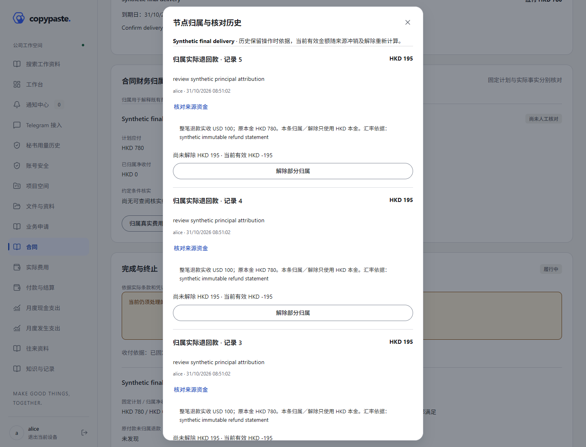

[Web实际录制 / Web recording](media/videos/contract-refunds-web.mp4) · [Web三截图导览 / Web screenshot tour](media/gifs/contract-refunds-web.gif) · [移动概览 / Mobile overview](media/screenshots/contract-refunds-mobile-summary.png)

## 增量132 · 已发布记录

当前本地检查：十组HTTP／PG69条通过记录，Web419项、共享移动504项及核心182条测试记录通过；构建、原生缓存与真实云／平台／生产验收边界分别记录。

增量132补齐已知历史原件和已提交上传草稿的保留与清理：准确来源盘点 → 固定清单 → 至少24小时观察 → 最近MFA人工批准 → 永久使用屏障 → 独立双云执行 → 不可变逐次回执。历史原件两边全部确认不存在后才释放逻辑容量，失败或未知结果保留并重新核对；停止不恢复已删除原件。

使用：文件详情打开“盘点历史与草稿原件”，核对保留制度、当前版本／引用／法务保留及阻断原因，选择一项、填写原因建立观察清单；到期后核对摘要并批准，在清单查阅逐云回执、显式重试或停止剩余。Web、微信、抖音、Android使用同一业务流程。默认不开启云清理；API只有位置元数据，专用Worker使用独立清理身份。OSS要求准确非null原生版本，R2要求部署者明确保证独占不可变目录，不把If-Match当作已证明的原子删除。

正常结构升级98→99；当前仍23个活跃工作包（14 P0／9 P1）、5项移出、八项draft Skill。已完成但未正式提交的草稿、秘书恢复来源、未知孤儿／派生对象、失效原批准的重新授权及真实云验收继续开放。

[实现与使用 / Implementation](development/132-known-object-retirement.md) · [实际核验 / Checks](quality/132-known-object-retirement-verification.md) · [本轮及全部23项 / Remaining work](delivery/05-functional-closure-132.md)

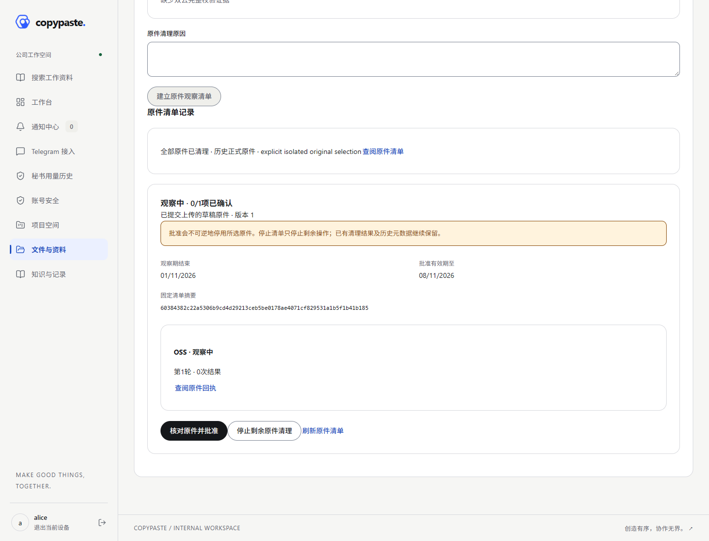

[Web实际录制 / Web recording](media/videos/object-retirement-web.mp4) · [共享H5录制 / Shared H5 recording](media/videos/object-retirement-mobile.mp4) · [三截图导览 / Screenshot tour](media/gifs/object-retirement-mobile.gif)

## Increment131 · Previously published / 原发布记录

增量131接通主机资源的告警处理流程：超阈值、磁盘只读、采集断流 → 当时有权负责人站内通知 → 本人工作台待办 → 真实恢复。重复采样不刷屏；标记已读只记录阅读，不消除故障。恢复产生新的未读投递；停用、归档、转交或撤权重新计算责任，旧排队事件不改收件人。

使用：先在服务详情明确发布资源监控配置；在首页“我负责的主机资源待办”或通知中心“主机资源”分类打开服务；在“资源状态记录”查阅当时负责人、配置、状态及原始签名。历史正常记录不表示当前正常，创建通知事件也不表示实际投递完成。

部署沿用原生API、PostgreSQL和既有通知Worker，正常结构升级97→98。即时业务命令投影状态，Worker每10秒检查最多100个来源并继续分页；首次采样有明确宽限期。工作台直接读取当前配置和原始观测，Worker未完成投递也不会隐藏已经到期的待办。

当前23个活跃工作包（14 P0／9 P1）、5项移出、八项draft Skill。资源站内告警代码已完成；真实目标监控安装和独立外部告警送达仍属GAP-23。真实云、模型、TG、平台、正式Android及生产验收继续按编号处理。

[实现与使用 / Implementation](development/131-resource-notifications.md) · [实际检查 / Checks](quality/131-resource-notifications-verification.md) · [本轮和全部23项 / All remaining work](delivery/05-functional-closure-131.md)

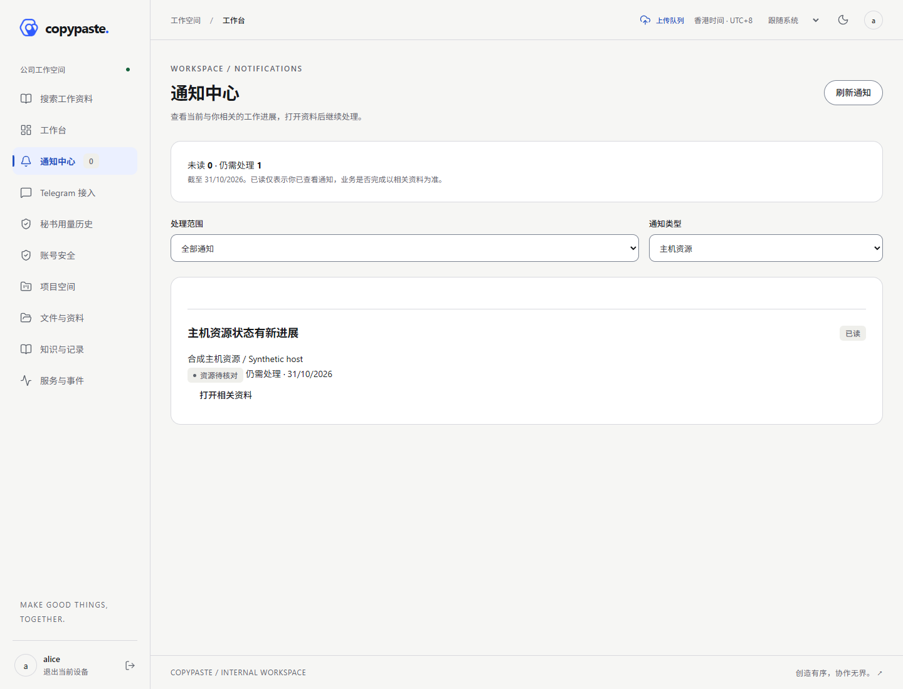

[Web实际录屏 / Web recording](media/videos/resource-notifications-web.mp4) · [共享移动录屏 / Shared H5 recording](media/videos/resource-notifications-mobile.mp4) · [三截图导览 / Screenshot tour](media/gifs/resource-notifications-mobile.gif)

当前核验：8组选定HTTP／PostgreSQL套件76条、核心94条、Web411项和共享移动496项全部通过；四端构建及当前开发APK19项检查通过。原生Android28项／JVM28项为准确UP-TO-DATE结果；完整业务与生产验收继续按编号处理。

## 增量130 · 已发布记录

增量130补齐主机资源功能：CPU、内存、全部已配置磁盘与只读状态，经原生Prometheus桥接→独立签名接收→持久记录→四端实时展示。服务详情可人工发布完整监控配置、核对阈值、停用及查阅配置／观测历史；旧观测过期、采集断流、停用或归档均显示待确认，并隐藏当前数值。

使用：进入“服务与事件”→服务详情→“主机资源监控”。有管理权限者选择“配置资源监控”，核对公钥、全部挂载点、警告／严重阈值和过期时间，完成最近MFA后明确发布。配置变化建立新修订，等待该修订的新观测；原签名及历史保留。原生部署在私有目录配置node_exporter、Prometheus和既有status-bridge，参考配置只含占位值。桥接器不接受任意PromQL或目标URL。

本轮正常结构升级96→97。当前资源健康与服务可用性分别评估；页面告警不是已送达的外部通知。真实目标服务器、Prometheus／node_exporter安装及独立告警送达仍属GAP-23。完整源码、运行逻辑、检查边界及全部23项余项见下方链接。当前仍23个工作包（14 P0／9 P1）、5项移出、八项draft Skill。

本轮验证：三组选定HTTP／PostgreSQL套件31条通过记录、Web408项、共享移动493项、四端构建和当前Android开发APK19项内容检查通过。Web／共享H5均实际走通配置停用、状态变化、历史与签名核对；原生测试的真实执行／缓存边界逐项记录，旧全量回归不冒充重新执行。

[实现与使用 / Implementation](development/130-host-resources.md) · [实际验证 / Checks](quality/130-host-resources-verification.md) · [本轮与全部23项 / All remaining work](delivery/05-functional-closure-130.md)

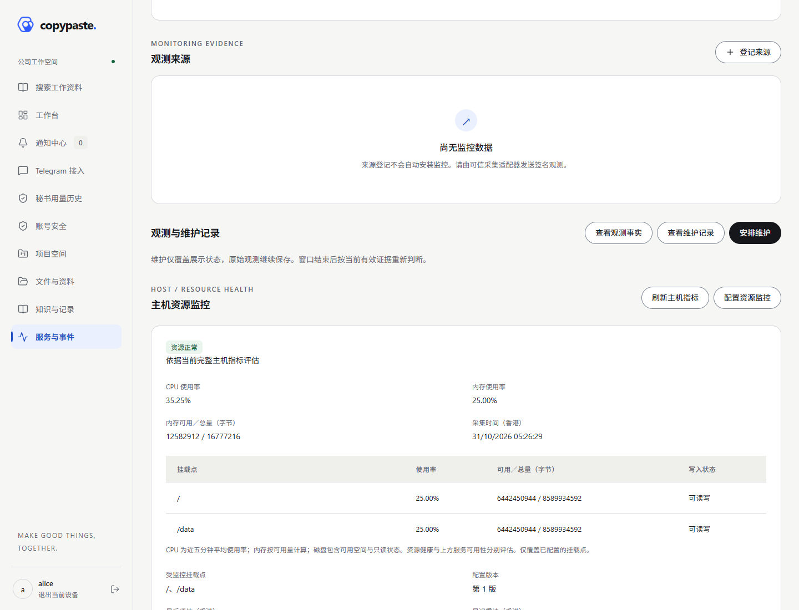

[Web录制 / Web recording](media/videos/host-resources-web.mp4) · [共享移动录制 / Shared H5 recording](media/videos/host-resources-mobile.mp4) · [截图导览 / Screenshot tour](media/gifs/host-resources-mobile.gif)

## Increment129 · Previously published / 原发布记录

增量129直接补齐文件办公流程：Web／Android新建真实Word、Excel、PPT，并修改当前正式版本的受支持文字／单元格；微信／抖音查阅准确版本。生成独立候选 → 本人核对名称、内容、警告与SHA → 加入原上传队列 → 完整摘要／扫描／提升 → 人工提交新正式版本，旧原件和历史保留。生成本身不发布，也不改变OA或财务事实。

使用：目录内选择“新建 Office 文件”，或文件详情选择“编辑 Office 内容”。Word填写段落和可选表格；Excel从表格粘贴，默认文字，明确选择数字／布尔／安全公式；PPT用单独一行 `---` 分页。核对候选后确认加入队列，再在上传页面处理扫描和正式提交。Android候选保存到本人私有临时来源，继续使用原生上传队列；普通大文件保持SAF分片路径。

原件编辑限8 MiB、候选12 MiB，有界XML／内容与安全公式子集；未改压缩部件保留，保护、宏、嵌入对象、外链内容和不支持结构明确拒绝。Excel修改清除公式结果缓存，需原编辑器重算。当前不提供完整Office版式或所见即所得，复杂文档与真实样本继续属于GAP-04。数据库保持96项迁移，无新增外部编辑器服务或Worker。

源码验证分别记录六组选定HTTP／PG套件46条通过记录、Web396项、共享移动481项、独立OOXML库读取六份真实生成文件、四端构建与当前Android开发包。Web实际编辑／生成三种格式，共享H5实际只读查阅；合成页面录制与接口全流程提交分别说明。旧121全量后端／runtime和旧128证据保留原来源，正式签名、平台、云、模型、TG与生产验收继续开放。

当前23项工作包（14 P0／9 P1）、5项移出、八项draft Skill。已完成的子功能从余项中扣除，整包未完成不会冒充验收通过。

Increment129 implements real DOCX/XLSX/PPTX creation and bounded exact-original content editing on Web/Android, with exact-version reading on WeChat/Douyin. Generate a separate candidate, review its name/text/warnings/hash, explicitly join the existing upload queue, then complete full hashing, scanning, promotion and a human formal commit. Rendering never publishes a version or changes OA/finance facts; old originals and history remain intact.

Usage: choose “新建 Office 文件” in a folder or “编辑 Office 内容” in file details. Word accepts paragraphs and an optional table; Excel accepts pasted TSV, defaulting to literal text with explicit typed cells/safe formulas; PPT separates slides with a standalone `---` line. Review and confirm the candidate, then use the upload page for scan and formal submission. Android stores the small candidate in an owner-bound private temporary source; ordinary large files retain native SAF multipart transfer.

Editing accepts8 MiB originals and12 MiB candidates, bounded ZIP/XML/content and a safe formula subset. Unchanged compressed parts remain intact; unsupported active content/embedded objects/macros/protection are rejected. Excel caches are cleared and require full recalculation. Full layout editing, general Office compatibility and real business samples remain open under GAP-04. Schema stays96; authoring needs no external editor server, Python runtime or new worker.

Source checks separately record six selected HTTP/PG suites (46 pass records),396 Web tests,481 shared-mobile tests, six real output files independently opened by three OOXML libraries, four-client builds and a current Android development APK. Actual Web edit/render and shared-H5 readonly evidence remain separate from the complete HTTP commit workflow. Retained121 full backend/runtime and128 evidence keep their original sources. Formal signing, platform, cloud, model, TG and production acceptance remain open.

All 23 work packages (14 P0/9 P1), five exclusions and eight draft Skills remain explicit. Implemented subfeatures are deducted from remaining descriptions; partial checks do not close unfinished packages.

[实现与使用 / Implementation](<development/129-office-authoring.md>) · [实际验证 / Checks](<quality/129-office-authoring-verification.md>) · [本轮及全部23项 / All remaining work](<delivery/05-functional-closure-129.md>)

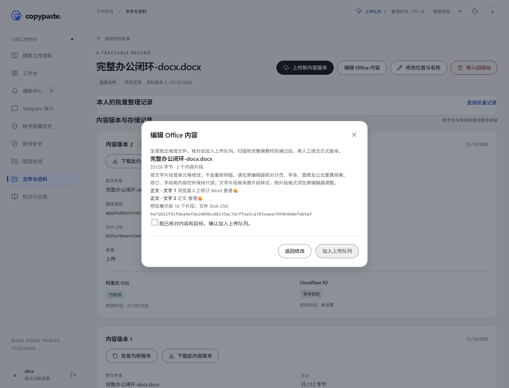

[Web实际录屏 / Web recording](media/videos/office-authoring-web.mp4) · [共享移动录屏 / Shared mobile recording](media/videos/office-authoring-mobile.mp4) · [三截图导览 / Screenshot tour](media/gifs/office-authoring-mobile.gif)

## Increment128 · Previously published / 原发布记录

增量128接通 PDF、扫描件与PNG／JPEG正文：原件扫描和准确副本校验 → 独立原生Worker逐页提取／OCR → 当前版本搜索 → 固定版本预览／比较 → 秘书资料读取。四端显示完整页数和OCR核对原件说明，不自动形成财务事实，不改变原件。

使用：Web／Android上传原件，在搜索中查找正文词句并点击“查阅此版本正文”；在文件详情选择两个正式版本进行比较；秘书会话明确选择准确版本后复用同一派生正文。微信／抖音保留查询与审批职责。当前提取限8 MiB、PDF20页、正文2 MiB；120GB原件上传目标保持独立。

部署：在只读原生工具目录配置固定Poppler／Tesseract、三语言模型及SHA清单，以绝对路径设置 `CP_DOCUMENT_TEXT_PROFILE`，再运行既有 `worker-file-text`。未配置原生引擎时，PDF／图片明确待处理，普通文本／Office继续可用。应用不下载工具、不继承云／模型凭据到原生子进程。

本轮源码检查：六组选定HTTP／PostgreSQL套件43条通过记录，原生解析／完整性检查零跳过，Web390项、共享移动476项，以及类型和Web／微信／抖音／Android JS构建。真实Web／共享H5验证PDF与图片预览、准确版本比较及秘书资料读取；6张PNG、2条实际视口MP4、2个明确标注三截图导览GIF。正常结构升级95→96保持旧文件、OA、财务及提取证据。旧121完整回归／runtime／开发APK与127原证据保留来源；它们不标为当前128产物。实际执行记录见下方链接。

当前仍23项（14 P0／9 P1），5项移出，八项Skill为draft。Office创建编辑／版式、更多真实PDF／OCR样本、真实云／模型／TG、平台及生产验收继续开放。

[实现与使用](development/128-document-text-ocr.md) · [实际验证](quality/128-document-text-verification.md) · [本轮与全部23项余项](delivery/05-functional-closure-128.md)

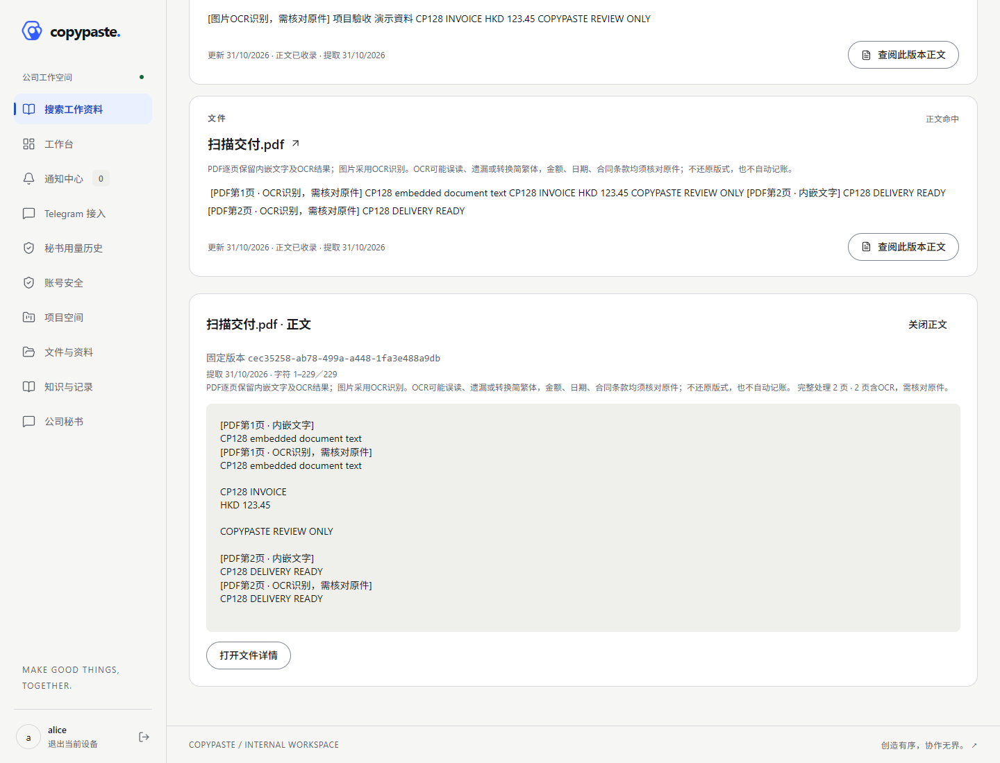

[Web实际录屏](media/videos/document-text-web.mp4) · [共享移动实际录屏](media/videos/document-text-mobile.mp4) · [移动三截图导览GIF](media/gifs/document-text-mobile.gif)

Increment128 connects PDF, scanned documents and PNG/JPEG OCR to the shared four-client file workflow: verified original → independent native text worker → current-head search → exact-version preview/comparison → secretary source reads. Every PDF page retains embedded text and separately labelled OCR, including mixed text/image pages. Complete page evidence and verification limits stay visible; OCR does not create financial facts or rewrite originals.

Usage: upload through Web/Android, search a phrase inside the file and open its fixed-version text; explicitly select two formal versions in file details for comparison, or select the exact version as a secretary conversation source. WeChat/Douyin retain lookup and approval responsibilities. Current extraction accepts8 MiB originals,20 PDF pages and2 MiB derived text; the120GB original upload target remains separate.

Setup: install native Poppler/Tesseract and the three fixed language models in a read-only tool tree, generate a SHA-pinned local profile, set the absolute `CP_DOCUMENT_TEXT_PROFILE`, then run the existing `worker-file-text`. Without a configured native engine, PDF/images remain explicitly pending while plain text/Office continue. The application does not download tools or pass cloud/model credentials to child processes.

Current checks cover six selected HTTP/PostgreSQL suites (43 pass records), actual native parser/integrity cases with zero skips,390 Web tests,476 shared-mobile tests, workspace types and Web/WeChat/Douyin/Android JS builds. Actual Web/shared H5 exercise PDF/image preview, exact comparison and secretary source reads, with6 PNGs,2 real viewport MP4s and2 explicit three-screenshot-tour GIFs. Normal schema95→96 preserves old files/OA/finance/derivations. The old121 full regression/runtime/development APK and127 evidence retain their original sources; no old artifact is labelled128. Consult the executed records below for exact boundaries.

All23 packages (14 P0/9 P1), five exclusions and eight draft Skills remain explicit. Office authoring/layout, wider real PDF/OCR samples, real cloud/model/TG, platform and production acceptance remain open.

[Implementation and usage](development/128-document-text-ocr.md) · [Executed checks](quality/128-document-text-verification.md) · [This increment and all23 remaining packages](delivery/05-functional-closure-128.md)

[Actual Web recording](media/videos/document-text-web.mp4) · [Shared mobile recording](media/videos/document-text-mobile.mp4) · [Three-screenshot tour GIF](media/gifs/document-text-mobile.gif)

## Increment127 · 原发布记录

当前功能增量127 / Current functional increment127：[固定清单文件批量整理](development/127-file-batch-plans.md) · [实际检查](quality/127-file-batch-verification.md) · [本轮与全部23项余项](delivery/05-functional-closure-127.md)。

增量126：[费用付款核销设计与操作](development/126-cost-payment-settlement.md) · [源绑定验证](quality/126-cost-payment-verification.md)。支持供应方部分付款、人工异币及准确批准员工垫付；Web和共享移动四端源码同步，schema94不变。23 active／5 excluded。

增量125接通“批准合同／采购／报销 → 核对实际发生 → 费用确认与准确来源关联 → 实际报表”。员工在业务详情填写实际金额、日期、固定供应方、凭证和项目／公司分摊，明确核对并验证本人后，一次提交；失败完整回滚。批准金额不会自动生成费用，付款另行登记。

Web、微信、抖音与Android共享业务页面已接入。来源版本、批准修订和摘要固定，费用范围、分类、币种由服务核对；重复提交复用原结果，旧依据、额度争用、撤权和近期MFA不足被拒绝。移动文字草稿按本人授权与准确来源隔离，凭证、本人验证及核对选项不从草稿恢复。

使用：批准业务详情 → “登记实际费用并关联” → 录入实际事实及分摊 → 选择正式凭证 → 明确核对／验证本人 → 确认 → 费用详情／操作历史／报表。本轮更新实际应用代码，继续schema94。

[设计和使用](development/125-business-cost-recording.md) · [实际检查](quality/125-business-cost-verification.md) · [全部23项待完成](delivery/03-goal-gap-assessment.md)

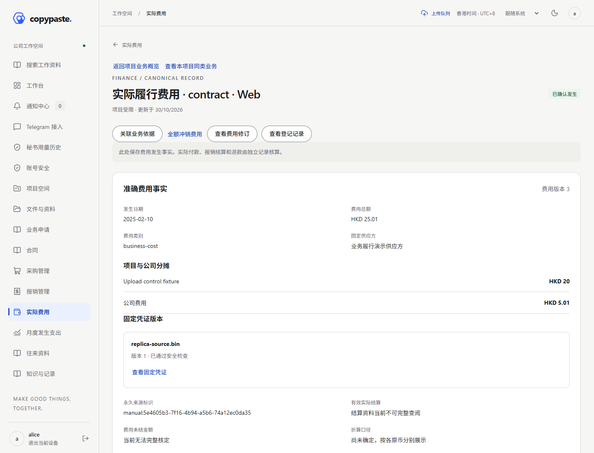

[Web实际录屏](media/videos/business-cost-web.mp4) · [移动页面实际录屏](media/videos/business-cost-mobile.mp4) · [移动截图导览GIF](media/gifs/business-cost-mobile.gif)

Web345项、共享移动436项及七个选定原生HTTP／PG套件、当前客户端类型和编译检查见本轮记录。Web／Taro H5分别实际执行三类来源费用并核对报表75.03＝项目60.00＋公司15.03。MP4录制首个来源在本人验证完成后的操作；GIF为三张真实截图导览。完整业务、正式平台／云／模型／生产验收仍开放，当前23 active（14 P0／9 P1）、5 excluded，详见[当前范围](delivery/04-current-scope-and-acceptance.md)。

Increment125 connects approved contracts, purchases and claims to explicitly reviewed actual expenses, exact source associations and actual reports. A human supplies the actual amount/date, a fixed supplier revision, formal evidence and project/company shares, then acknowledges the facts with recent MFA. One transaction creates, confirms and links the cost; any failure rolls everything back. Approval does not automatically create incurred expense or bank cash.

Web and shared WeChat/Douyin/Android pages pin the source version, approved revision/hash and currency. The server derives scope/classification, checks current authority and the ordinary source ceiling, and preserves idempotency, journals, audit and Outbox facts. Mobile drafts restore permitted text only, isolated by actor authority and exact source basis; evidence, MFA and acknowledgements are not restored.

Usage: approved business details → record actual expense → enter actual facts/shares → choose formal evidence → explicitly review and verify yourself → confirm → inspect ordinary expense history and reports. This changes application code at unchanged schema94.

[Design and usage](development/125-business-cost-recording.md) · [Executed checks](quality/125-business-cost-verification.md) · [All23 remaining packages](delivery/03-goal-gap-assessment.md)

Current checks cover345 Web and436 portable mobile tests, seven selected native HTTP/PostgreSQL suites, workspace types and current Web/WeChat/Douyin/Android JS compilation. Real Web/H5 flows record all three source kinds and verify75.03 actual expense equals60.00 project plus15.03 company shares. MP4 records the first source after MFA; GIF is a labelled three-screenshot tour. Current Android JS is not a signed APK; prior121 full/runtime/APK evidence retains its original scope. All23 packages and five exclusions remain explicit under the [current scope](delivery/04-current-scope-and-acceptance.md).

## 已发布历史 / Published history

增量124：项目内六类业务的固定范围新建、查询与返回，以及共享移动订阅管理和账期操作，详见[设计](development/124-project-business-journeys.md)与[核验](quality/124-project-business-verification.md)。

增量123已接通复杂 Word 的正文链路：表格、引用页眉页脚、脚注尾注、批注、文本框、文字修订和字段缓存进入固定版本的预览、检索、比较与秘书资料读取。插入／删除／移动保留标记，字段不执行、不自动接受修订；新 `docx-v2` 与旧 `text-v1` 结果分别保存。

使用：Web／Android 上传 DOCX → 原件扫描及副本验证 → 独立正文 Worker 提取 → 搜索正文中的条款／批注 → 查阅该版本正文；在文件详情人工选择两个正式版本进行比较，也可在秘书会话中明确选择此版本作为资料。微信与抖音共用查询／比较页面。提取源文件上限8 MiB，提取文本上限2 MiB；上传容量上限和原件能力不因此改变。

本轮更新实际应用源码和正常结构升级0094，保持旧业务及旧提取证据。Web333项、移动端429项、格式解析70项与选定HTTP／PG47项已通过；完整执行边界及页面检查见下方验证记录。保留121完整回归、runtime测试与Android开发APK的原来源，不将旧APK标为123。仍23项待完成（14 P0／9 P1），5项移出；PDF／OCR、Office创建编辑和真实业务样本验收继续开放。

[设计与使用](development/123-docx-text-extraction.md) · [本轮实际检查](quality/123-docx-text-verification.md) · [全部待完成项](delivery/03-goal-gap-assessment.md)

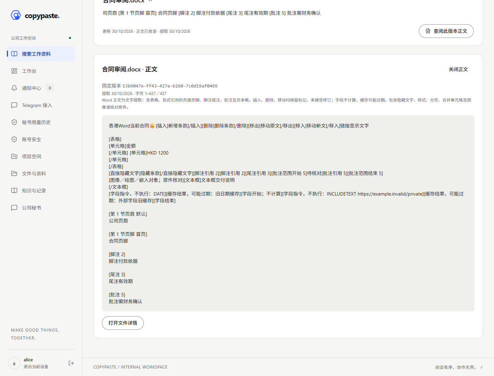

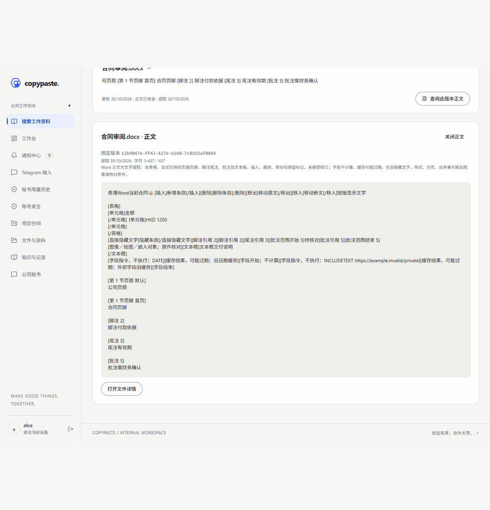

[Web 实际录屏](media/videos/docx-text-web.mp4) · [共享移动页面录屏](media/videos/docx-text-mobile.mp4)

## 已发布历史 / Published history

增量122接通服务事件与文件存储待办：从首页进入原业务详情，解决事件后退出待办；重试已有失败副本后继续显示待验证，完整校验成功再消除。微信、抖音和Android共用的文件页面新增重试、原因确认和准确回执核对。

使用：首页 → 我负责的未结事件／我创建的文件存储待办 → 核对当前资料 → 在详情明确处理 → 返回首页刷新。仅统计本人负责的事件或本人创建、当前有权查阅的文件；受影响服务必须全部可读，目录状态和当前正式版本也重新核对。

本轮采用明确范围的源码验证：Web330项、共享移动端427项，以及选定后端集成、四端类型检查、小程序编译和实际Web／Taro H5流程。增量121完整回归、runtime56项和Android开发APK保留原提交绑定；旧APK不标为122。本轮无结构升级，继续使用schema93。真实云／模型／平台／生产验收继续独立开放。

仍23项待完成（14 P0／9 P1）、5项移出、八项draft Skill。排除范围继续按[当前范围](delivery/04-current-scope-and-acceptance.md)执行，仅移出AI费用控制；秘书、TG、授权、隔离、审计和技术资源限制保留。

[设计与使用](development/122-operations-workbench.md) · [实际检查记录](quality/122-operations-workbench-verification.md) · [全部待完成项](delivery/03-goal-gap-assessment.md)

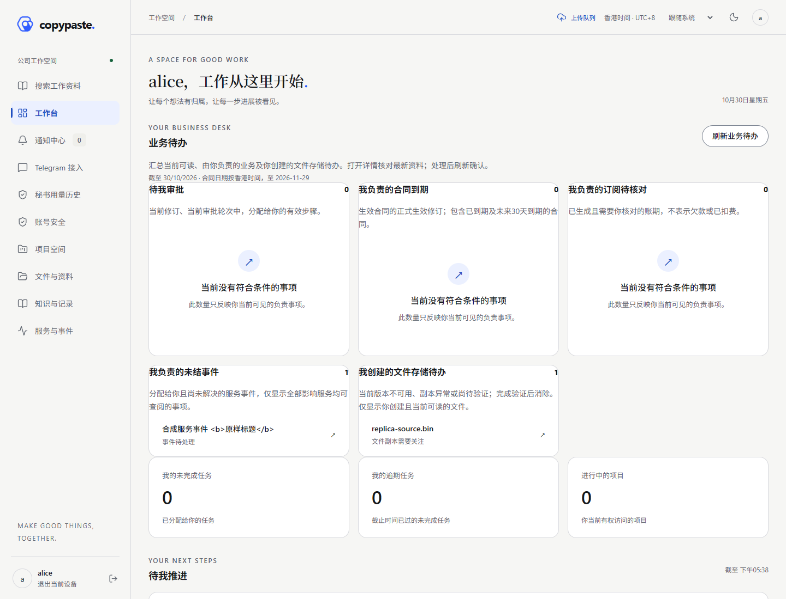

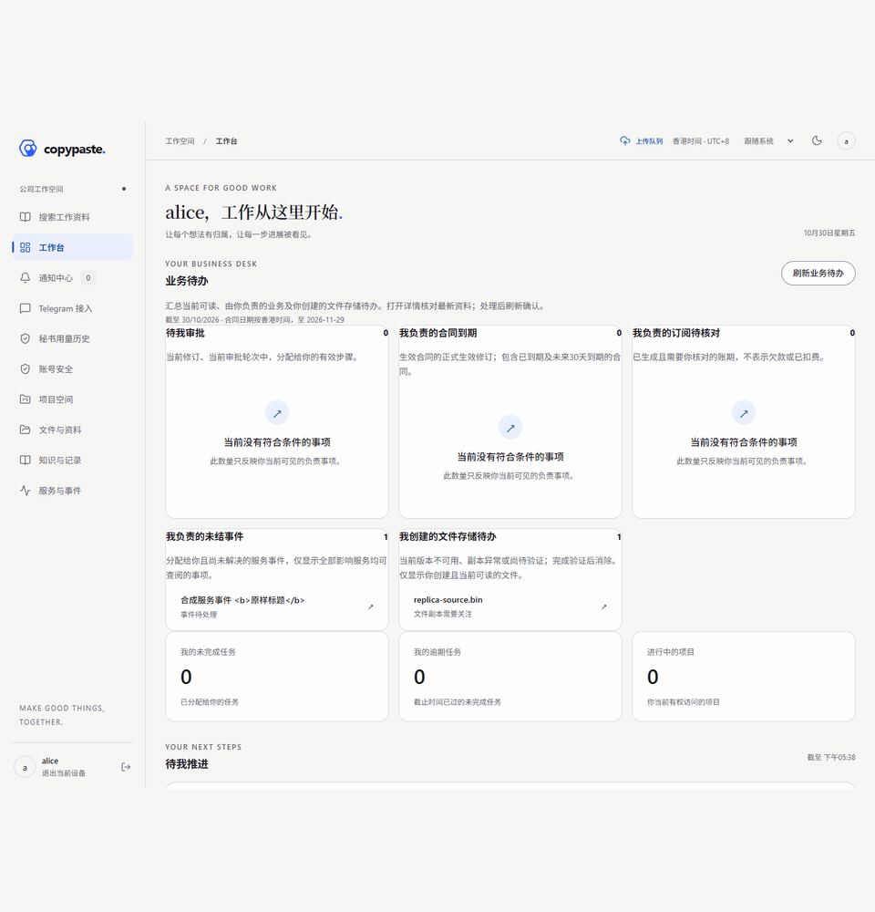

[Web实际视口录像](media/videos/operations-workbench-web.mp4) · [移动端录像](media/videos/operations-workbench-mobile.mp4)

Increment122 connects assigned incidents and creator-owned file storage work to the business desk. Resolve an incident in its existing editor; retry an existing failed copy in file details. Queued copies remain pending until complete verification succeeds. The shared WeChat, Douyin and Android file page now includes the missing retry form and exact receipt checks.

Usage: home → assigned incidents or files you created → re-read the current details → explicitly resolve or request copying → return home and refresh. Every affected service must be readable. File permissions, the complete active directory chain and the exact current content version are rechecked; another reader does not inherit creator work.

Verification is explicitly scoped:330 Web tests,427 portable mobile tests, selected backend integration suites, four-client shared type checks, mini-program builds and actual Web/Taro H5 journeys. Increment121 full regression,56 runtime tests and the development Android APK retain their original source binding. The old APK is not relabelled122. Schema93 is unchanged. Real cloud/model/platform/production acceptance remains separate.

All23 packages (14 P0/9 P1), five exclusions and eight draft Skills remain. Follow the [current scope](delivery/04-current-scope-and-acceptance.md): only AI fee controls are excluded; secretary/TG authorization, isolation, audit and technical resource limits remain required.

[Design and usage](development/122-operations-workbench.md) · [Executed checks](quality/122-operations-workbench-verification.md) · [All remaining work](delivery/03-goal-gap-assessment.md)

[Actual Web viewport recording](media/videos/operations-workbench-web.mp4) · [Mobile recording](media/videos/operations-workbench-mobile.mp4)

## 已发布历史 / Published history

增量121已接通异币退款的草稿、人工登记、原付款本金扣减、实际币种现金汇总和全额冲销。原付780 HKD、实收100 USD时，现金记录100 USD，原款扣减780 HKD；金额、人工汇率、凭证版本与操作历史分别固定。四端入口使用相同协议。

Increment121 adds actual foreign-currency refund drafts, explicit human confirmation, original-principal limits, received-currency cash reporting and full reversal across all four clients. For 780 HKD originally paid and 100 USD actually refunded, cash records 100 USD while the source principal decreases by 780 HKD. Exact amounts, reviewed rate, evidence versions and history remain pinned.

使用：打开实际付款 → 起草收到退款 → 选择实际实收币种，填写原本金／实际汇率／凭证 → 保存草稿 → 重新核对原付款当前余额并人工确认登记。当前仅使用未分配、未预留原本金；费用／合同异币归属继续待完成，界面与服务端均拒绝越过该边界。冲销保留原实收凭证并恢复原本金；不自动处理汇兑损益或手续费。

Usage: open the original outgoing payment, draft a received refund, enter actual currency and original principal/rate/evidence, then save. Re-read current source availability and explicitly confirm with MFA. Only unallocated, unreserved principal is supported. Foreign expense/contract attribution remains open and is rejected by this protocol. Reversal preserves original evidence and restores principal; no automatic exchange gain/loss or fee posting occurs.

本轮包含完整后端／客户端回归、92→93正常结构升级、实际Web／Taro H5操作和截图／MP4／GIF。Android为开发包检查，JVM缓存状态单独披露；没有真机、模拟器或实网性能测试。327份旧媒体及原证据保留。仍23项待完成（14 P0／9 P1）、5项移出，八项Skill仍draft。仅AI费用控制移出，秘书、TG、授权、隔离、审计与技术资源限制保留。

Checks bind current backend/client sources, a populated 92→93 normal schema upgrade and actual Web/Taro H5 journeys with screenshots, MP4 recordings and GIF tours. Android is a development artifact inspection with JVM cache status disclosed; no physical device, emulator or network benchmark is used. All 327 older media and prior proof bytes are retained. All 23 open packages (14 P0/9 P1), five exclusions and eight draft Skills remain. Only AI fee controls are excluded; secretary/TG authorization, isolation, audit and technical resource limits remain required.

本轮检查 / Checks: Go 244个顶层用例、1535条通过结果；Web 317；共享移动端 414；runtime 56；JVM 26（缓存复用 / cached）。正式Linux／云／模型／平台／生产验收仍独立开放。

[设计与使用 / Design and usage](development/121-actual-foreign-refunds.md) · [验证 / Verification](quality/121-refund-verification.md) · [全部未完成项 / Remaining](delivery/03-goal-gap-assessment.md)

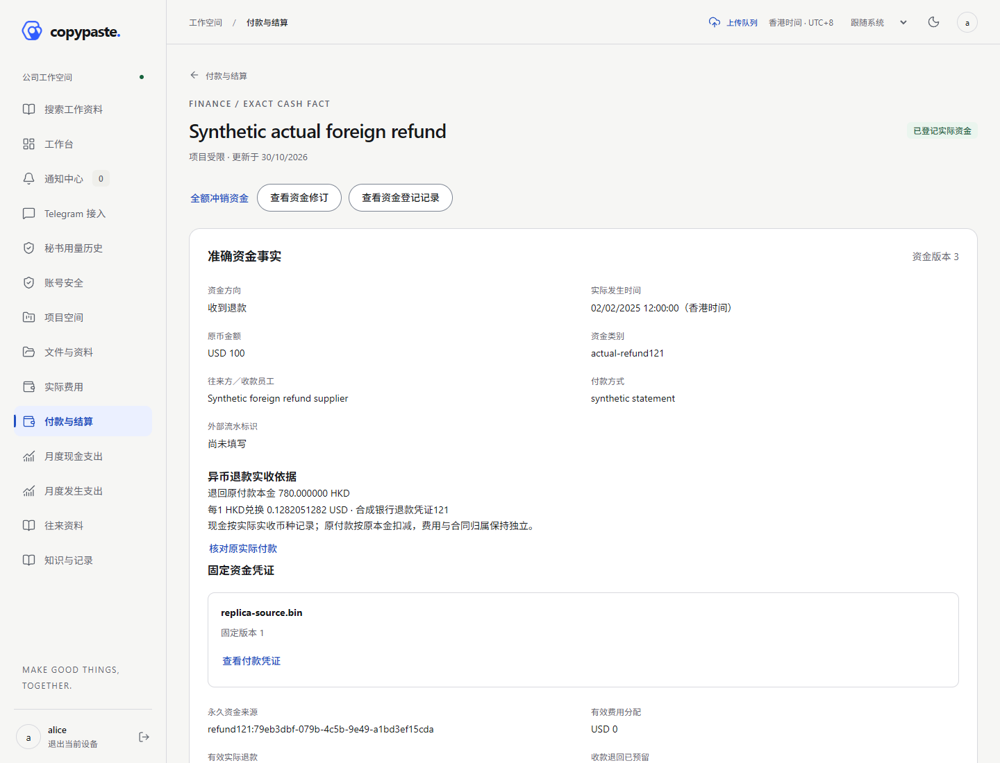

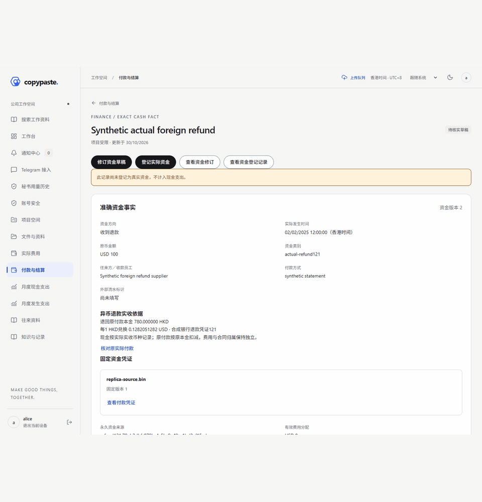

[Web MP4](media/videos/refund-fx-web.mp4) · [移动端 / Mobile MP4](media/videos/refund-fx-mobile.mp4)

增量120已将 XLSX／PPTX 接入四端的固定版本正文预览、当前版本检索、全文比较和秘书资料预览。Excel保留单元格坐标、隐藏标识、公式文字和可能过期的文件缓存；PPT包含幻灯片文字和讲者备注。公式不计算，排版／图像查原件。原件8MiB、派生正文2MiB有界，不改120GB普通文件上传设计上限。

Increment120 adds exact-version XLSX/PPTX text previews, current-head search, complete text comparisons and selected secretary context across all four clients. XLSX retains cell coordinates, hidden-content labels, inert formulas and potentially stale cached values; PPTX includes slide text and speaker notes. Original files remain intact. Text extraction is bounded to8MiB originals/2MiB output; the ordinary120GB upload design is separate.

使用：正常上传并扫描通过 → 等待正文提取 → 搜索工作资料／查阅此版本正文；文件详情明确选择两个版本后比较；秘书资料明确选择准确版本后预览加入。微信、抖音和Android共用Taro页面；不同提取方式分别固定原件／正文摘要，历史提取终态保留。

Usage: upload and pass scanning, wait for indexing, then search and open the exact-version text. Choose two formal versions in file details to compare; select an exact version in a secretary conversation to preview and bind it. WeChat, Douyin and Android share Taro pages. Every derivative retains its original and text digests; prior terminal evidence remains immutable.

本轮重新核对完整后端、客户端和实际Web／H5页面，执行91→92正常结构升级并保留原记录。Android仅开发包／内容检查，JVM缓存状态如实记录；受控对象与资料读取不代替真实云或Codex／Skill验收。旧316份已发布媒体及原证据保留。23项待完成（14 P0／9 P1）、5项移出和八项draft Skill不变；仅AI费用控制移出，秘书、TG、授权、审计、隔离和技术限制保留。

Fresh checks cover current backend/client sources and real Web/Taro H5 pages, plus a populated91→92 normal schema upgrade. Android proof is a development artifact inspection, with JVM cache status disclosed. Controlled objects and source retrieval do not establish live cloud/model/Skill acceptance. All316 prior media retain their published bytes. Increment119 release archives retain their historical source/schema91 binding; deployment of this source requires a new schema92 package. All23 packages (14 P0/9 P1), five exclusions and eight draft Skills remain open. Only AI fee controls are excluded.

本轮验证 / Checks: Go 242个顶层用例、1526条结果；Web 313；共享移动端 / shared mobile 409；运行器 / runtime 56；JVM 26（Gradle缓存复用 / cached results）。Android使用披露的单worker Metro调用，保留完整原生构建／包内检查。 / Android uses a disclosed single-worker Metro invocation with native build and artifact checks intact.

[设计与使用 / Design and usage](development/120-office-text-extraction.md) · [本轮验证 / Verification](quality/120-office-text-verification.md) · [全部未完成项 / Remaining](delivery/03-goal-gap-assessment.md)

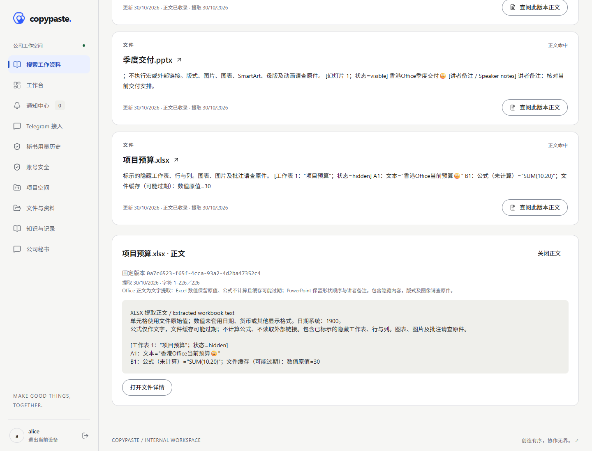

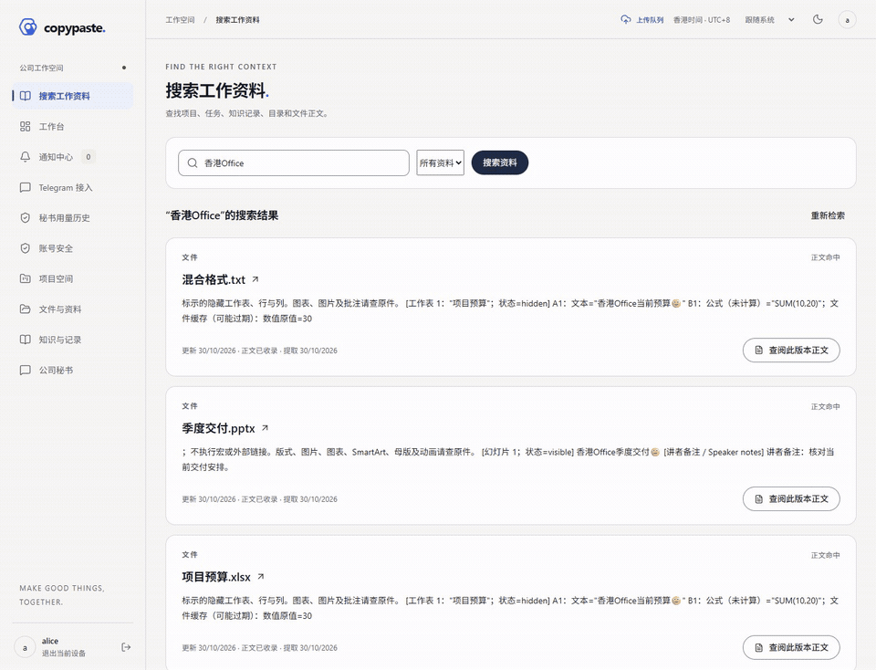

[Web MP4](media/videos/office-text-web.mp4) · [移动端演示 / Mobile demo](media/videos/office-text-mobile.mp4)

增量119新增原生服务器发布工程：准确清单与完整性校验、三个Linux程序／Web／独立运行器完整打包、版本化私有配置、维护入口、受管服务停止／结构升级／切换／就绪检查、同结构应用回退及中断处置，并提供手动原生CI工作流。

Increment119 adds native server release engineering: exact inventories and integrity checks, three Linux executables plus Web/runtime packaging, versioned private configuration, maintenance gating, managed service stop/upgrade/switch/readiness, schema-compatible application rollback and interrupted-operation recovery, with a manual native CI workflow.

使用顺序：构建新包 → 从可信回执核对完整摘要 → 离线inspect → 准备服务器身份／HTTPS／独立配置 → stage → status → 以准确当前版本activate；中断后按操作编号明确recover。正式CI要求干净提交，本地带本轮改动的检查包不冒充正式CI产物。

Usage: build a new package, verify its complete digest from a trusted receipt, inspect offline, prepare server identities/HTTPS/private configuration, then stage, status and activate against the exact expected current release. Recover interruptions by exact operation ID. Formal CI requires a clean commit; the local changed-tree inspection package is explicitly identified.

业务源码保持已发布118，复用其完整回归和316份媒体的原证据；本轮不重录页面。新增发布工具测试与实际包检查另行记录。Windows使用明确的指针／进程测试替身，没有执行Linux链接、systemd、HTTPS或生产PG；真实Runner、正式发布产物及服务器验收仍GAP-24／25／26。23项待完成（14 P0／9 P1）、5项移出和八项draft Skill不变；仅AI费用控制移出。

Application sources remain exactly at published118, retaining its original full regression and316 media. New release-tool tests and actual archive checks have separate records. Windows uses explicit pointer/process test doubles; Linux symlinks, systemd, HTTPS and production PG were not executed. Real Runner, formal artifacts and server acceptance stay open under GAP-24/25/26. All23 active packages (14 P0/9 P1), five exclusions and eight draft Skills remain; only AI fee controls are excluded.

[发布设计 / Design](development/119-native-production-release.md) · [操作手册 / Runbook](operations/03-native-release-runbook.md) · [验证 / Verification](quality/119-native-release-verification.md) · [全部未完成项 / Remaining](delivery/03-goal-gap-assessment.md)

增量118已接通四端付款手续费依据：从实际资金列表选择已登记手续费付款和整条费用原分配，核对完整双币依据、准确版本与摘要，明确确认及MFA后保存。误关联通过独立撤销记录纠正；关联、撤销均不新增费用或现金，不改变原报表金额。

Increment 118 connects actual payment fee evidence across four clients. Select recorded fee cash and its original incurred-cost allocation, review both currency axes and exact source versions/hashes, then confirm explicitly with MFA. A separate immutable revocation corrects a mistaken association. Neither action creates expenses/cash or changes original report amounts.

使用：先确认真实手续费费用、登记实际资金并核销 → 原付款详情 → 查阅手续费依据 → 关联手续费依据 → 选择实际资金（或同笔付款）及原分配 → 核对凭证、填写依据、明确确认和MFA → 查看历史；错误关联可明确撤销。原付款、手续费资金及费用须同管理项目、同分类。过期资料先刷新，结果未知先核对历史。

Usage: confirm the actual fee cost, record cash and allocate it first. Open the original payment, expand fee evidence, select actual fee cash (or the same payment) and its root allocation, review the source receipts, enter a reason and confirm with MFA. Correct mistakes through explicit revocation. All three facts must share management project and classification. Refresh changed sources; inspect history before retrying an uncertain result.

当前仍23项工作包（14 P0／9 P1）、5项移出、8项draft Skill。GAP-03／18增加本轮手续费依据整理；公司财务口径、汇兑差额、异币实收退款和完整四端旅程继续开放。仅AI费用控制移出；秘书、TG、授权、审计、隔离及技术资源限制保留。

All 23 packages (14 P0/9 P1), five exclusions and eight draft Skills remain. This adds fee evidence within GAP-03/18; company accounting policy, exchange differences, other-currency refunds and complete client journeys stay open. Only AI fee controls are excluded; secretary, TG, authorization, audit, isolation and technical limits remain required.

本轮当前源码：后端240顶层／1492条结果，Web311、共享移动407、运行器56；八项客户端命令、两小程序各20页，Web／H5各14组实际页面与API检查。新增6 PNG、2静音MP4和2截图导览GIF，保留306份旧媒体。Android开发包18＋3项静态检查，26条JVM来自Gradle缓存；正常90→91升级保留18类原记录，开发服务已按准确源码重载，独立测试PG关闭。两个Linux目标仅交叉构建；没有设备、模拟器、真实云／模型／平台发布或生产验收声明。

Current source: 240 backend top-level tests/1492 result records, Web 311, shared mobile 407, runtime 56; eight client commands, 20 routes per miniapp, and 14 actual UI/API groups per Web/H5. New media: six PNGs, two silent MP4s and two screenshot-tour GIFs; 306 older media remain exact. The development APK passes 18+3 static checks; 26 JVM results are from actual Gradle cache. Normal90→91 upgrade preserves18 original fact groups; attested development services reload and the owned test PG closes. Two Linux artifacts only cross-build. No device, emulator, live cloud/model, platform publication or production acceptance is claimed.

[方案与使用 / Design](development/118-payment-fee-evidence.md) · [核验 / Verification](quality/118-payment-fee-verification.md) · [截图／录屏／GIF / Media](media/README.md) · [全部未完成项 / Remaining](delivery/03-goal-gap-assessment.md)

增量117已接通完整合同正文起草与人工采用：员工选择准确合同原修订及新文件位置，秘书通过现有扫描和提交流程生成完整文本／Markdown文件。任务页面显示全文、准确版本与SHA-256，员工核对后明确采用，系统保存一条正常合同新修订，只替换正文附件，保留原商业条件。

Increment 117 connects complete contract-body drafting to separate human adoption. A human selects an exact contract revision and new-file destination; ordinary staging, scanning and commit tools create the complete text/Markdown file. The task shows its full text, precise version and SHA-256. Explicit human review saves a normal contract revision that changes only its draft-body attachment and preserves commercial facts.

使用：本人私有秘书会话 → 新建或更新文件 → 选择准确新文件目录和名称 → 选择合同正文依据并加入请求 → 发送 → 任务进度阅读全文 → 勾选本人核对、填写依据 → 采用完整合同正文。会话、合同、目录须同项目同分类，正文最多48KiB。取消、撤权、原合同变化或文件哈希不符会阻止采用；结果未知先重新读取。

Usage: open a private secretary conversation, choose the file task and exact new-file destination, bind the original contract, and send. Read the complete body in task progress, explicitly acknowledge review, enter a reason and adopt. Conversation, contract and directory must share project and classification; the complete file is limited to 48 KiB. Cancellation, revoked authority, changed facts or mismatched file hashes block adoption. Re-read an uncertain result before retrying.

仍有23项工作包（14 P0／9 P1）、5项移出、8项draft Skill。GAP-04／12／18仅增加本轮完整文本合同附件流程；更多OA正文与Office／PDF／OCR、真实Codex／Skill质量、云和正式平台／生产验收继续开放。秘书没有合同采用、送审、签署或生效工具。仅AI费用控制移出，授权、审计、隔离及技术资源限制保留。

All 23 packages (14 P0/9 P1), five exclusions and eight draft Skills remain. This closes a bounded text-contract attachment path within GAP-04/12/18; wider OA/Office/PDF/OCR documents, real Codex/Skill quality, cloud and formal platform/production acceptance stay open. The model has no adoption, approval, signing or activation tool. Only AI fee controls are excluded; authorization, audit, isolation and technical limits remain.

当前源码：后端239顶层／1485条结果，Web303、共享移动399、运行器56；八项客户端命令、微信／抖音各20页。Web与Taro H5各25组真实页面／API检查。新6 PNG、2静音MP4、2截图导览GIF，296份旧媒体保持原字节。当前开发APK通过18＋3静态检查，26条JVM来自Gradle缓存；未运行设备或模拟器。另验证已发布116的实际合同旅程正常89→90升级，18张原事实表不变；原生开发服务按准确源码重载，最终耐久测试PG关闭。两个Linux目标仅交叉构建。 两次早期Web尝试的临时录屏帧被覆盖，未保留且不计最终证据；原记录和归档缺失说明保留，最终本轮素材完整。

Current source: 239 backend top-level tests/1485 result records, Web 303, shared mobile 399, runtime 56; eight client commands and 20 routes per miniapp. Web and Taro H5 each pass 25 actual UI/API groups. New media: six PNGs, two silent MP4s and two screenshot-tour GIFs; 296 older media remain byte-exact. The current development APK passes 18+3 static checks; 26 JVM results are from the actual Gradle cache. No device or emulator runs. A published116 contract journey verifies the normal89→90 upgrade with 18 original fact tables unchanged. Attested development services reload and the final durable test PG closes; two Linux targets only cross-build. Temporary recording frames from two earlier Web attempts were overwritten and are unavailable, with no final-evidence credit. Their original records and retention-failure disclosure remain; the final current media are complete.

[方案与使用 / Design](development/117-contract-body-drafting.md) · [核验 / Verification](quality/117-contract-body-verification.md) · [截图／录屏／GIF / Media](media/README.md) · [全部未完成项 / Remaining](delivery/03-goal-gap-assessment.md)

增量116已接通四端实际付款双币核销：人工固定费用原币金额、实际汇率方向及凭证来源，以付款币核对现金，以费用原币核对费用和员工垫付。部分释放、退款及全额冲销保留两套金额和对齐项目份额，重新加锁核对当前余额，最后一笔处理准确尾差。原始费用／现金事实、历史报价及完成导出保持不变。

Increment 116 connects actual cross-currency payments to incurred costs across Web, WeChat, Douyin and Android. A human fixes the cost amount, actual payment-units-per-cost-unit rate and evidence source. Cash balances use payment units; costs and employee claims use cost units. Partial releases, refunds and full reversals preserve both axes and aligned project shares, recheck locked current balances, and consume the exact final remainder. Original expense/cash facts, quotation history and completed exports stay fixed.

使用：付款与结算 → 已登记原付款 → 分配费用结算 → 选择准确费用（员工收款先选择批准垫付行）→ 输入付款币本金、费用原币金额、实际汇率及凭证来源 → 核对双币并完成MFA → 确认。释放或退款引用原正向分配，核对当前双币余额和显示的回转金额；未知结果先刷新流水。

Usage: open a recorded outgoing payment, choose 分配费用结算 and an actual confirmed cost (for an employee, first select the approved advance line). Enter payment principal, cost units, actual rate and evidence source, acknowledge both axes and confirm with recent MFA. For releases/refunds, select the original positive allocation and review the current dual balances and inverse amount. Refresh the ledger before retrying an uncertain result.

仍23项工作包（14 P0／9 P1）、5项移出、8项draft Skill。公司财务制度采纳、手续费／汇兑差额、与原付款异币的实收退款及完整GAP-03／18旅程继续开放。实际结算汇率不会自动选用报告估值汇率。仅AI费用控制移出；秘书、TG、授权、审计、隔离及技术限制保留。

All 23 packages (14 P0/9 P1), five exclusions and eight draft Skills remain. Company accounting policy adoption, fees/exchange differences, refunds received in another currency and full GAP-03/18 journeys remain open. Actual settlements never automatically select a reporting FX book. Only AI fee controls are excluded; secretary, TG, authorization, audit, isolation and technical limits remain required.

当前源码：后端238顶层／1477条结果，Web294、共享移动390、运行时55；八项客户端命令、双小程序各20页。Web和Taro H5各6组真实页面／API检查；6 PNG、2静音MP4、2截图导览GIF，286份旧媒体保留原字节。当前开发APK通过18＋3静态检查，26条JVM来自Gradle缓存。另以已发布115的真实现金用例验证schema88→89正常升级，14张原事实表内容不变；开发服务已按准确源码重载，独立耐久PG关闭。两个Linux目标仅交叉构建，不代表真实云／模型／TG、正式平台或生产验收。

Current source: 238 backend top-level tests/1477 result records; Web 294, shared mobile 390, runtime 55. Eight client commands pass and both miniapps retain 20 routes. Web and Taro H5 each pass 6 actual UI/API groups. New media: 6 PNGs, 2 silent MP4s and 2 screenshot-tour GIFs; 286 older media retain their bytes. A current development APK passes 18+3 static checks; 26 JVM results are from Gradle cache. A separate published 115 cash journey verifies the normal 88→89 upgrade with 14 original fact tables unchanged. Development services reload to exact current sources and the owned durable test PG closes. Two Linux targets only cross-build; live cloud/model/TG, formal platform and production acceptance remain open.

[方案与使用 / Design](development/116-cross-currency-settlement.md) · [验证 / Verification](quality/116-cross-currency-settlement-verification.md) · [截图／录屏／GIF / Media](media/README.md) · [全部未完成项 / Remaining](delivery/03-goal-gap-assessment.md)

增量115已接通四端受控人工跨范围文件整理：员工从实际目录选择跨项目／分类目标，先分析完整清单及普通／AI读取策略变化，再以准确计划摘要、原因、明确声明和近期MFA确认执行。目录树逐项重检，正式内容历史保留；正式业务引用、保留锁、在途任务、分类降级或陈旧依据阻止执行。最终决定及审计不可改写，重复提交返回同一回执。

Increment 115 adds human reviewed file and folder-tree transfers across Web, WeChat, Douyin and Android. Select an actual cross-project/classification destination, analyze the complete fixed inventory and changed ordinary/AI read-policy combinations, then confirm the exact plan with a reason, acknowledgement and recent MFA. Execution rechecks every item and preserves immutable content history. Business references, retention holds, in-flight work, classification downgrades and stale facts block execution. Final decisions and audit evidence remain immutable; idempotent retries return one receipt.

使用：文件与资料 → 实际文件或非根目录 →“拟定跨范围移动”→ 选择实际目标 →“分析跨范围移动”→ 核对全部清单及读取权限变化 → 明确声明、原因及MFA → 确认执行。移动端从回执“打开移动后的资料”；未知结果先刷新本人计划历史，不重复创建。

Usage: open a file or non-root folder in Files, choose 拟定跨范围移动, select an actual destination and analyze. Review the full inventory and read-policy changes, provide a reason and acknowledgement, then confirm with current MFA. On mobile, open the new location from the receipt. Refresh owner history before retrying an uncertain result.

仍有23项工作包（14 P0／9 P1）和5项移出。正式业务引用的跨范围协同、大树／批量策略及完整四端旅程继续GAP-18；AI跨范围工具、预授权及TG披露继续GAP-11。本功能不授予AI新工具。仅排除AI费用控制，秘书、8项Skill、TG、隔离、授权、审计和技术限制保留。

All 23 packages (14 P0/9 P1) and 5 exclusions remain. Transfers involving formal business references, larger/bulk policies and complete four-client journeys remain GAP-18. AI scope-changing tools, preauthorization and TG disclosure remain GAP-11. Only AI fee controls are excluded; secretary, eight Skills, TG, isolation, authorization, audit and technical limits remain required.

当前源码：后端236顶层／1449条结果，Web281、共享移动375、运行时55；八项客户端命令通过，双小程序各20页。Web／Taro H5各6组实际页面与API检查；6 PNG、2静音MP4、2截图轮播GIF，276份旧媒体原样保留。Android开发APK通过18＋3静态检查，26条JVM来自Gradle缓存。原生开发schema87→88，旧AI费用／用量资料保留；独立全耐久测试PG关闭且无临时库，两个Linux交叉构建通过。不声明真机、模拟器、真实云／模型／TG或生产验收。

Current source: 236 backend top-level tests / 1449 records; Web 281, shared mobile 375, runtime 55. Eight client commands pass; both miniapps retain 20 routes. Web/Taro H5 each pass 6 actual UI/API groups. New media: 6 PNGs, 2 silent MP4s and 2 screenshot-tour GIFs; 276 older media retain their bytes. A development APK passes 18 + 3 static checks; 26 JVM results came from Gradle cache. Native development schema upgrades87→88 while legacy AI fee/usage records stay fixed. The full-durability test PG closes without temporary databases; 2 Linux targets cross-build. No device, emulator, live cloud/model/TG or production acceptance is claimed.

[设计与使用 / Design](development/115-file-scope-transfers.md) · [验证 / Verification](quality/115-file-scope-transfers-verification.md) · [截图／录屏／GIF / Media](media/README.md) · [全部未完成项 / Remaining work](delivery/03-goal-gap-assessment.md)

增量114已接通四端业务工作台：本人当前有效审批、本人负责的生效合同到期及已生成订阅账期待核对。三个分组共享原生PG事务快照，先授权计数再展示前5条，点击进入原业务详情。合同使用正式生效修订及香港日期；账期待核对不表示欠款或已扣费。刷新失败隐藏旧汇总，撤权后重新读取清除旧数量与标题。

Increment 114 adds a business workbench across Web and the shared WeChat, Douyin and Android home pages: current assigned approvals, owned effective-contract expiry and generated subscription periods requiring review. One native PG snapshot counts authorized matches before selecting five-item samples. Fixed links open ordinary business details. Contracts use the active revision and Hong Kong dates; period review does not imply debt or an actual charge. Failed refreshes hide old results; refreshed authority removes revoked counts and titles.

使用：登录 → 首页业务待办 → 核对数量与日期 → 点击具体请求、合同或账期 → 在原详情核对当前依据再处理。Web使用“刷新业务待办”，移动端使用“刷新工作台”；超过5条提示到对应业务列表继续查阅。

Usage: sign in, review Business work on Home, open an exact request, contract or billing period, then inspect current facts before acting. Refresh the business desk on Web or the home page on mobile. Samples above five items disclose that additional matches exist; the business lists retain their own filters.

仍有23项工作包（14 P0／9 P1）与5项移出；服务／文件异常等更多聚合、实际存储故障、跨渠道回执、公司规则选用与完整业务旅程继续开放。仅移出AI费用控制；秘书、八项Skill、TG、隔离、授权、审计及技术限制保留。

All 23 packages (14 P0/9 P1) and 5 exclusions remain. Wider service/file aggregation, actual storage failures, cross-channel receipts, company policy adoption and complete business journeys stay open. Only AI fee controls are excluded; secretary, eight Skills, TG, isolation, authorization, audit and technical limits remain required.

当前源码核验：后端235个顶层测试／1435条结果，Web257、共享移动351、运行时55；八项客户端命令重新执行，微信／抖音各20页。Web与Taro H5各6组实际页面／API检查；新增6 PNG、2静音MP4、2截图轮播GIF，266份旧媒体保持原字节。Android开发APK通过18＋3项静态检查，26条JVM来自Gradle缓存。schema保持87，无迁移新增或重跑；独立全耐久原生PG及2个Linux交叉构建已核对。不声明真机、模拟器、真实云／模型／TG或生产验收；旧增量记录保留原日期与范围。

Current-source checks: 235 backend top-level tests / 1435 records; Web 257, shared mobile 351, runtime 55. All eight client commands execute; WeChat/Douyin retain 20 pages each. Web and Taro H5 each pass 6 actual page/API groups. New media: 6 PNGs, 2 silent MP4 recordings and 2 screenshot-tour GIFs; 266 prior media keep exact bytes. A development APK passes 18 + 3 static checks; 26 JVM results came from Gradle cache. Schema stays 87 with no new or replayed migration. Full-durability native test PG and 2 Linux cross-builds are checked. No device, emulator, live cloud/model/TG or production acceptance is claimed. Older records retain their original dates and scope.

[设计与使用 / Design](development/114-business-workbench.md) · [验证 / Verification](quality/114-business-workbench-verification.md) · [截图／录屏／GIF / Media](media/README.md) · [全部未完成项 / Remaining work](delivery/03-goal-gap-assessment.md)

增量113已实现四端文件版本正文比较：人工明确选定两个正式版本，完整正文行差异、前后文与全文分页、末尾换行核对、原件／正文摘要分离及固定比较依据。选择不自动读取；文件／权限／扫描依据变化后拒绝旧页并隐藏旧结果。支持文本、Markdown、CSV、JSON及DOCX主文档正文；更多格式、PDF／OCR、排版与复杂DOCX仍在GAP-04，完整四端业务旅程仍在GAP-18。23项（14 P0／9 P1）及5项移出保持不变；仅移出AI费用控制，秘书、八项Skill、TG、隔离、授权、审计及技术限制继续保留。

Increment 113 adds file version text comparison across Web and the shared WeChat, Douyin and Android pages: explicit exact-version selection, complete derived-text line diffs, context or all-text paging, final-newline checks, separate original/text hashes and pinned comparison identity. Selection alone does not read a diff. Changed file, authority or scan evidence rejects old pages and hides stale results. Text, Markdown, CSV, JSON and DOCX main-body text are supported; wider formats, PDF/OCR, layout and complex DOCX remain GAP-04, with full business journeys under GAP-18. All 23 packages (14 P0/9 P1) and 5 exclusions remain. Only AI fee controls are excluded; secretary, eight Skills, TG, isolation, authorization, audit and technical limits remain required.

操作：文件详情 → 比较两个内容版本 → 选择基础／目标准确版本 → 明确比较 → 选择差异前后文或全部正文并重新比较 → 按页核对。提取正文相同不表示原件相同；遇到依据变化，刷新文件并核对现行资料后重新比较。

Usage: open file details, select exact base/target versions, explicitly compare, choose changes/context or all text, and review the pinned pages. Equal derived text does not imply equal original bytes. Refresh current file metadata and review the selection after a changed-basis conflict.

当前源码核验：后端234个顶层测试／1424条结果，Web238、共享移动332、运行时55；八项客户端命令实际执行，双小程序各20页。Web与Taro H5各6组实际页面／API检查；新增7 PNG、2静音MP4、2 GIF，255份旧媒体保留原字节。Android开发APK通过18＋4项静态检查，26条JVM来自Gradle缓存；schema保持87，无新增或重跑迁移；独立全耐久原生PG及2个Linux交叉构建已核对。不声明真机、模拟器、真实云／模型／TG或生产验收。下方旧增量统计保留原日期与适用范围。

Current-source checks: 234 backend top-level tests / 1424 records, Web 238, shared mobile 332 and runtime 55; all eight client commands execute and both miniapps retain 20 pages. Web and Taro H5 each pass 6 actual page/API groups. New media: 7 PNGs, 2 silent MP4s and 2 GIFs; 255 previous media retain original bytes. A development APK passes 18 + 4 static checks; 26 JVM results came from Gradle cache. Schema remains 87 with no new or replayed migration. Full-durability native temporary PG and 2 Linux cross-builds are checked. No device, emulator, live cloud/model/TG or production acceptance is claimed. Older increment statistics below retain their original dates and scope.

[设计与使用 / Design and usage](development/113-file-version-comparison.md) · [验证与来源 / Verification](quality/113-file-version-comparison-verification.md) · [截图／录屏／GIF / Media](media/README.md) · [全部未完成项 / Remaining work](delivery/03-goal-gap-assessment.md)

增量112已实现四端秘书准确草稿恢复：员工选定已结束请求中的准确草稿，核对差异和摘要后明确创建新任务；固定原目标、基础版本和来源，重新上传、校验与扫描，再通过原有授权计划正式提交。支持文件更新与新文件创建；原任务与回执保持历史事实。依赖变化、扫描隔离、会话撤销、取消及冲突会阻断执行。GAP-04／12中的该子流程已实现，更多格式、全文差异、完整OA附件和真实模型／Skill验收仍开放；23项（14 P0／9 P1）及5项移出不变。仅移出AI费用控制，秘书、八项Skill、TG、隔离、授权、审计和技术限制保留。

Increment 112 adds exact saved-draft recovery across Web and the shared WeChat, Douyin and Android secretary pages. A human selects an ended request’s exact draft, reviews its diff and digest, and explicitly creates a new run. Original target, base and provenance are fixed; execution uploads, verifies and scans fresh bytes before the existing authorized formal commit. Updates and new-file drafts are supported. Dependency changes, quarantine, revoked sessions, cancellation and conflicts stop execution. This completes a subfeature of GAP-04/12; wider formats, full-text diffs, complete OA attachments and real model/Skill acceptance remain open. All 23 packages (14 P0/9 P1) and 5 exclusions remain. Only AI fee controls are excluded; secretary, eight Skills, TG, isolation, authorization, audit and technical limits remain required.

操作：本人私密秘书会话 → 选择文件任务 → 选择原请求与准确草稿 → 核对差异／摘要并勾选声明 → 加入请求 → 明确发送 → 核对新任务来源及真实执行状态。接单不等于上传、扫描或正式提交；来源或基础版本变化时，须人工核对现行内容后发起新编辑。

Usage: open your own private secretary conversation, choose the file task, select the original request and exact draft, review and confirm the diff/digest, add the recovery and explicitly send. Inspect new-run provenance and actual execution state. Admission does not mean upload, scanning or formal commit. Changed sources or bases require human review and a new edit request.

本轮源码核验：后端231个顶层测试／1410条结果，Web219、共享移动313、运行时55；八项客户端命令全部执行，双小程序各20页。Web与Taro H5各5组真实页面／API检查；新增7 PNG、2静音MP4、2 GIF，244份旧媒体保留原字节。Android开发APK通过18＋4项静态检查，26条JVM来自Gradle缓存；普通schema86→87升级、全耐久原生临时PG及2个Linux交叉构建已核对。无真机、模拟器、真实云／模型／TG或生产验收声明。下方旧增量的统计保留原执行日期与适用范围。

Current-source checks: 231 backend top-level tests / 1410 records, Web 219, shared mobile 313 and runtime 55; all eight client commands execute and each miniapp retains 20 pages. Web and Taro H5 each pass 5 actual page/API groups. New media: 7 PNGs, 2 silent MP4s and 2 GIFs; 244 previous media retain original bytes. A development APK passes 18 + 4 static checks; 26 JVM results came from Gradle cache. A normal schema 86 to 87 upgrade, fully durable temporary native PG and 2 Linux cross-builds are verified. No device, emulator, live cloud/model/TG or production acceptance is claimed. Older increment statistics below retain their original dates and scope.

[设计与使用 / Design and usage](development/112-secretary-file-recovery.md) · [验证与来源 / Verification](quality/112-secretary-file-recovery-verification.md) · [截图／录屏／GIF / Media](media/README.md) · [全部未完成项 / Remaining work](delivery/03-goal-gap-assessment.md)

增量111已实现四端合同到期提醒策略：独立读／管理授权、近期MFA、准确版本发布、不可变历史和真实Worker调度。组织策略（包括停用）覆盖部署规则；新策略不补发早于发布业务日的历史阈值，已有通知事实保留。规则修改后须重新确认。GAP-08仍待更多聚合、实际复制故障、跨渠道送达及公司规则选用；全部23项（14 P0／9 P1）与5项移出不变。AI仅移出费用控制，秘书、八项Skill、TG、隔离、授权、审计和技术限制保留。

Increment 111 adds contract expiry reminder policies across Web and the shared WeChat, Douyin and Android pages: separate read/manage authority, recent MFA, fixed-version publication, immutable history and real worker scheduling. An organization policy, including disable, overrides deployment fallback. New rules do not backfill thresholds before their publication business date; existing notification facts remain. Editing a rule requires confirmation again. GAP-08 still includes wider aggregation, real storage failures, cross-channel delivery and actual company rule adoption. All 23 packages (14 P0/9 P1) and 5 exclusions remain. Only AI fee control is excluded; secretary, eight Skills, TG, isolation, authorization, audit and technical limits remain required.

当前源码核验：后端230个顶层测试／1396条结果，Web205、共享移动299、运行时55；最终八项客户端命令全部重新执行，微信／抖音各20页。Web与Taro H5各5组真实页面／API检查；新增7 PNG、2静音MP4、2 GIF，原233份媒体保留准确字节。Android开发APK通过18＋4项静态检查，26条JVM来自Gradle缓存。另有本地schema85→86升级、全耐久原生临时PG及2个Linux交叉构建；不声明真机、真实云／模型／TG或生产验收。

Current-source verification: 230 backend top-level tests / 1396 records, 205 Web, 299 shared mobile and 55 runtime tests. All eight final client commands reran; each miniapp retains 20 pages. Web and Taro H5 each pass 5 actual page/API groups. New media: 7 PNGs, 2 silent MP4s and 2 GIFs; 233 previous media retain exact bytes. The development APK passes 18 + 4 static checks; 26 JVM results came from Gradle cache. A local schema 85 to 86 upgrade, a fully durable temporary native PG cluster and 2 Linux cross-builds also pass. No device, live cloud/model/TG or production acceptance is claimed.

[策略设计与使用 / Policy design and usage](development/111-contract-reminder-policies.md) · [验证 / Verification](quality/111-contract-reminder-policies-verification.md)

增量110已接通四端站内通知失败的人工重试：独立组织授权、近期MFA、固定原事件、明确确认、不可变父子任务和可追踪结果。原失败不重置，实际Worker重查当前接收人，等待中详情自动刷新。更多工作台聚合、提醒策略、实际复制故障及跨渠道送达仍属GAP-08；完整23项（14 P0／9 P1）和5项移出保持不变。AI仅移出费用控制，秘书、八项Skill、TG、授权、审计、隔离和技术限制继续保留。

Increment 110 adds controlled human retries for failed in-app notifications across Web and the shared WeChat, Douyin and Android pages. Separate organization authority, recent MFA, a fixed original event, explicit confirmation and immutable parent/child receipts preserve the failure history. The real worker checks current recipients; pending details refresh automatically. Dashboard aggregation, reminder configuration, actual replication failures and cross-channel delivery remain open under GAP-08. All 23 packages (14 P0/9 P1) and 5 exclusions remain. Only AI cost control is excluded; secretary, eight Skills, TG, authorization, audit, isolation and technical limits remain required.

当前源码检查：后端229个顶层测试／1383条结果，Web195、共享移动289、运行时55；八项客户端命令全部重新执行通过，微信／抖音各20页。Android开发APK通过18＋4项静态检查，26条JVM结果来自Gradle缓存。Web与Taro H5各5组实际浏览器／API／租约Worker操作通过；新增7 PNG、2段静音MP4、2个GIF，原222份媒体字节保留。另有2个Linux交叉构建及本地普通schema84→85升级；不声明真机、真实云／模型／TG或生产验收。

Current-source checks: 229 backend top-level tests / 1383 records, 195 Web, 289 shared mobile and 55 runtime tests. All eight client commands reran and passed; both miniapps retain 20 pages. A development APK passes 18 + 4 static checks; its 26 JVM records came from Gradle cache. Web and Taro H5 each pass 5 actual browser/API/leased-worker check groups. New media: 7 PNGs, 2 silent MP4s and 2 GIFs; all 222 historical media retain exact bytes. Two Linux cross-builds and a local schema84-to85 upgrade also pass. No device, live cloud/model/TG or production acceptance is claimed.

[设计与使用 / Design and usage](development/110-notification-retry.md) · [验证与来源 / Verification](quality/110-notification-retry-verification.md) · [全部待办 / All remaining work](delivery/03-goal-gap-assessment.md)

增量109已接通四端组织级审计查询与固定CSV导出：准确筛选、签名游标、元数据详情、本人导出历史、近期MFA和下载摘要校验。原业务正文权限继续生效；导出最多10,000条／8 MiB、有效24小时。抖音端可查询和生成，CSV暂由同账号Web下载。GAP-07的模型／Skill、TG运行及存储管理仍开放；全部23项（14 P0／9 P1）和5项移出不变。AI仅移出费用控制，秘书、八项Skill、TG、授权、审计、执行隔离和技术限制保留。

Increment 109 adds organization audit metadata queries and sealed CSV exports across Web and the shared WeChat, Douyin and Android pages: exact filters, signed cursors, event details, owner history, recent MFA and verified file bytes. Business-content permissions remain enforced. Exports allow up to 10,000 rows / 8 MiB for 24 hours. Douyin supports query/create; use the same account on Web to download its CSV. Model/Skill, TG operations and storage administration remain open under GAP-07. All 23 packages (14 P0/9 P1) and 5 exclusions remain. Only AI cost control is excluded; secretary, eight Skills, TG, authorization, audit, isolation and technical limits are retained.

当前源码核验：后端228个顶层测试／1368条结果，Web185、共享移动281、运行时55，微信／抖音各20页，Android开发APK及18＋4项静态检查、2个Linux交叉构建。Web与Taro H5各5组实际浏览器／API操作通过；新增7 PNG／2静音MP4／2 GIF，原211份媒体字节保留。26条JVM结果来自Gradle缓存。Web布局修正后3项相关命令重跑，5项未受影响命令保留本轮原始执行；不声明真机、真实云／模型或生产验收。

Current checks: 228 backend top-level tests / 1368 records, 185 Web, 281 shared mobile and 55 runtime tests; 20 pages per miniapp, a development APK with 18 + 4 static checks and 2 Linux cross-builds. Both real Web/Taro H5 journeys pass 5 check groups. New media: 7 PNGs, 2 silent MP4s and 2 GIFs; all 211 historical media retain exact bytes. The 26 JVM records came from Gradle cache. After the Web layout correction, 3 affected commands reran; 5 unaffected commands retain their original same-increment execution. No device, live cloud/model or production acceptance is claimed.

[设计与操作 / Design and use](development/109-audit-console.md) · [验证与来源 / Verification](quality/109-audit-console-verification.md) · [全部待办 / All remaining work](delivery/03-goal-gap-assessment.md)

增量108已实现合并库安全补丁、维护版URI同步适配及Babel／esbuild／XML／send／UUID升级，完整npm审计从63项降至0项。自维护补丁公开源码、MIT许可证、原版SHA256和实际复现；不以改名代替修复。正式发布依赖与产物安全验收仍开放，当前23个工作包（14 P0／9 P1）及5项移出不变。AI仅移出费用控制，秘书、八项Skill、TG、权限、审计、执行隔离和技术限制保留。

Increment 108 implements a disclosed MIT merge patch, a maintained URI parser bridge and patched Babel, esbuild, XML, send and UUID versions. The full npm audit changes from 63 findings to 0, with all dependency scopes included. The local fork retains its upstream checksum, license and original reproduction; renaming alone is not a fix. Formal production dependencies and artifacts still require acceptance. All 23 work packages (14 P0/9 P1) remain active, with 5 exclusions. Only AI cost control is excluded; the secretary, eight Skills, TG, authorization, audit, isolation and technical limits remain required.

[开发 / Design](development/108-dependency-integrity.md) · [验证 / Verification](quality/108-dependency-integrity-verification.md)

本轮新执行通过：标准npm ci、56项依赖检查＋2项原生JS检查、8项客户端命令（Web172／移动273／运行时55，微信／抖音各20页）、Android开发包及18项APK检查、H5服务5项及原生Edge3项。原生bundle已确认包含URI适配与维护版解析器；26条JVM结果来自Gradle缓存。31组源码核对通过。211份旧媒体、未改后端224／1355及2个Linux交叉构建保留原执行范围。

Fresh checks pass: standard npm ci, 56 dependency checks plus 2 native JS checks, 8 client commands (172 Web, 273 mobile and 55 runtime tests; 20 pages per miniapp), a development APK with 18 checks, and 5 H5 server plus 3 native Edge checks. The actual Metro bundle includes the URI bridge and maintained parser. The 26 JVM results came from Gradle cache; all 31 source checks pass. The 211 historical media files, unchanged backend results (224 top-level tests / 1355 records) and 2 Linux cross-builds retain their original scope.

以下为历史增量记录 / Earlier increment records:

增量105：新增仓库内的 Linux 原生 Codex 执行控制器，覆盖单任务 systemd 隔离、实际内核状态取证签名、私有模型／公司工具网关、取消与 cgroup 清理，以及独立运行时发布目录。模型密钥与证明私钥留在 root 控制器中。真实服务器隔离、Codex／模型互通和八项 Skill 正式评测仍待完成；23个工作包（14 P0／9 P1）保持开放，5项移出不变。

[开发与部署](development/105-native-agent-runtime.md) · [当前验证](quality/105-native-agent-runtime-verification.md)

增量104 / Increment104：已知未完成上传分片的目录盘点、固定清单、观察期、明确MFA批准、独立Worker执行和不可变逐次回执，支持四端、撤销及明确重试。[开发与使用](development/104-multipart-cleanup.md) · [当前验证](quality/104-multipart-cleanup-verification.md) · [截图／MP4／GIF](media/README.md)。正式历史版本、完成草稿及未知孤儿清理继续开放；当前23项（14 P0／9 P1）待完成、5项移出。

Adds controlled abandoned multipart cleanup across four clients, with fixed human-reviewed scope and immutable receipts. Live cloud and complete lifecycle acceptance remain open.

此前增量103 / Previous increment103：修复Taro模板下载、版本查询和Metro图像解析的实际调用链。完整依赖审计从80项降至70项，高风险13→6；剩余70项仍逐项开放。标准npm ci、31项依赖检查、2项原生JS检查及四端本地构建通过。界面源码未改，原107 PNG／41 MP4／41 GIF按原采集来源保留。

Previous increment103 replaces legacy Taro template/update consumers and preserves Metro’s callable API over a maintained image parser. The full audit changes from80 to70 package findings, high13→6; every remaining finding stays open. Standard npm ci,31 dependency checks,2 native JS checks and four-client local builds pass. Original UI media retain their historical capture scope;23 work packages remain active.

[开发说明](development/103-dependency-consumer-remediation.md) · [验证与剩余事项](quality/103-dependency-remediation-verification.md)

此前增量102：基础币种、人工汇率版本与三类财务报表折算，见[开发与使用](development/102-finance-fx-valuation.md)、[验证与媒体来源](quality/102-finance-fx-verification.md)。公司实际口径需由有权限员工明确发布；跨币种核销和摊销仍开放。四端和AI秘书目标继续保留，23项完整工作包待完成、5项移出。

Current increment102 adds explicit manually reviewed FX books and separate incurred/cash/forecast valuation. See the linked design and verification record for usage, exact calculation, evidence and remaining boundaries.

此前实现101 / Previous implementation101：[OA正文起草与采用](development/101-oa-prose-drafting.md) · [验证记录](quality/101-oa-prose-verification.md) · [剩余23项](delivery/03-goal-gap-assessment.md)。合同／采购／报销选定字段、来源复核、员工原文对照采用及真实业务修订已接入；完整正文附件和更多申请、正式Skill／模型验收仍开放。

此前实现100：[秘书执行无需AI费用额度](development/100-secretary-execution-without-cost-quota.md) · [验证与交付范围](quality/100-secretary-execution-verification.md)。当前仍23项未完成、5项移出；真实模型接入未以本地合成检查替代。

最新修订99：[当前范围与验收](delivery/04-current-scope-and-acceptance.md) · [23项剩余工作](delivery/03-goal-gap-assessment.md) · [验证记录](quality/99-scope-revision-verification.md)。23 active（14 P0／9 P1），5 excluded；只取消AI费用控制，保留秘书、隔离及授权。No device/network-performance/migration/DR/AI-cost gates.

此前增量98：[依赖维护与四端兼容](development/98-dependency-maintenance.md) · [新执行、复用与开放风险](quality/98-dependency-maintenance-verification.md)。Full current audit91→80, high20→13; security acceptance remains open.

此前增量97：[小程序身份绑定、登录与解绑失效](development/97-mini-program-identity.md) · [准确验证与实际媒体](quality/97-mini-program-identity-verification.md)。Employee-confirmed WeChat/Douyin identities, MFA and session revocation.

此前增量96：[原生文件迁移与操作约束](development/96-native-file-import.md) · [准确验证范围](quality/96-native-file-import-verification.md)。Native import operator, reviewed manifests, resume and dual-provider verification.

此前功能：[增量95：任务讨论、固定附件与明确提及](development/95-task-discussion-and-mentions.md) · [实际验证与媒体来源](quality/95-task-discussion-verification.md)。Previous: task discussion, immutable edits and exact mention notification links; four clients remain in scope.

此前功能：[增量94：移动文件与目录整理](development/94-mobile-file-workspace.md) · [真实流程与来源](quality/evidence/mobile-files/verification.md)。Current: shared Taro folder/file operations, exact history and explicit conflict handling; all four clients remain in scope.

此前功能：[增量93：秘书正文检索与固定DOCX资料](development/93-secretary-indexed-search.md) · [独立索引运维](operations/file-text-search.md) · [准确验证](quality/evidence/agent-indexed-search/verification.md)。Earlier: secretary body discovery and fixed-version indexed DOCX reads; all four clients and28 acceptance gaps remain in scope.

**仓库使用入口 / Repository guides：[中文完整方案与使用](README.zh-CN.md) · [Complete English guide](README.en.md) · [实际截图、MP4与GIF / Actual media](media/README.md) · [更新记录 / Changelog](CHANGELOG.md) · [贡献与同步 / Maintenance](contributing.md)。**

**当前细化基线：v1.0-draft，2026-10-24；视觉设计基线：v1.0.0-draft。** 全部后续文档保存在 `docs/`，全部开发实现位于 `app/`。身份/权限、项目协作、知识修订、文件元数据和部分 Web 页面已进入本地实现与验证；完整平台仍在建设，尚未生产部署或完成首发验收。真实进度见[代码实施台账](delivery/02-implementation-ledger.md)。

依赖维护基线：[增量98 · 当前修复与剩余项](development/98-dependency-maintenance.md) · [准确验证](quality/98-dependency-maintenance-verification.md)。当前完整扫描91→80项，high20→13；原[增量90](development/90-dependency-hardening.md)的101→86扫描保留历史口径。完整四端Goal仍开放。

确认输入：3名香港员工/3人同时在线；现有境内服务器；2TB原件/最大单文件120GB；Go+PostgreSQL、React/Vite、Taro微信/抖音/Android、Codex秘书与TG；OSS+R2；应用机仅临时数据。四端同批首发，120GB由Web/Android上传，小程序查阅/申请/审批。不做考勤/人事。

依赖维护文档：[依赖修复、兼容边界与剩余项](development/90-dependency-hardening.md)。既有[移动财务完整操作](development/89-mobile-financial-operations.md)与[财务报表导出](development/88-financial-report-filters-and-exports.md)保留。

## 1. 阅读路径

负责人先读产品需求、OA/费用、决策登记和工作包；开发读工程/数据/接口及负责模块；前端和设计读页面矩阵及风格设计体系；AI开发先读权限与工具；测试/运维读追踪、配置及部署恢复。用户已确认要求优先；细化设计优先于原v0.2举例。

## 2. 治理、范围与配置

| 文档 | 内容 |
| --- | --- |
| [基线与执行规则](governance/01-baseline-and-rules.md) | 确认/设计/假设/待决策、范围、不变量、变更与术语 |
| [决策与待确认登记](governance/02-decisions-and-open-questions.md) | Q-01—18、责任角色、可继续工作与放行点 |
| [配置目录](governance/03-configuration-catalog.md) | 候选默认值、边界、生效、缺失行为 |

## 3. 需求与业务规范

| 文档 | 内容 |
| --- | --- |
| [产品需求与用户旅程](requirements/01-product-and-journeys.md) | 目标、信息架构、十条旅程、首发组织 |
| [身份、权限、分类与审计](requirements/02-identity-and-permissions.md) | 登录/MFA/绑定/撤权、ACL、渠道、引用下载 |
| [项目与知识](requirements/03-projects-and-knowledge.md) | 任务/依赖/里程碑/预算/风险/变更/交付/归档、博客/SOP |
| [审批与OA](requirements/04-workflows-and-oa.md) | 修订/快照/状态、合同、采购、报销与异常 |
| [费用与订阅](requirements/05-finance-and-subscriptions.md) | 一次费用多处关联、分摊/付款/冲销、账期/变价/取消/月报 |
| [文件与搜索](requirements/06-files-and-search.md) | 目录/版本/120GB/扫描/检索/双云/保留 |
| [秘书与渠道](requirements/07-secretary-and-channels.md) | 会话、八个Skill、预授权、固定计划、TG、预算 |
| [状态、通知与非功能](requirements/08-status-notifications-and-nfr.md) | 观测/事件/维护、通知、性能/恢复/安全/环境 |

## 4. 开发契约

| 文档/产物 | 内容 |
| --- | --- |
| [系统与工程](development/01-system-and-engineering.md) | 模块/依赖/未来目录、原生部署、事务/迁移/编码/构建 |
| [数据字典](development/02-data-dictionary.md) | 全域逻辑实体、字段、唯一/FK/校验/索引/删除 |
| [存储协议](development/03-storage-protocol.md) | 直传/源冻结/校验/正式提交/复制/恢复/清理 |
| [API目录与契约](development/04-api-contract.md) | 路径、输入、状态、幂等、错误、SSE、演进 |
| [OpenAPI](development/openapi.json) | 核心高风险机器契约；覆盖边界见x-contract-scope |
| [OpenAPI生成入口](development/build_openapi.py) | 兼容入口调用app/scripts；同源生成文档、后端嵌入契约与前端类型 |
| [事件、任务与并发](development/05-events-jobs-and-concurrency.md) | outbox、租约/fencing、锁、重试、业务去重 |
| [页面与客户端](development/06-clients-and-pages.md) | 19组页面、四端能力、表单/错误/弱网/Android原生 |
| [工具与Skill契约](development/07-agent-tools-and-skills.md) | Runtime、工具参数/权限/证据、manifest、发布/回滚 |
| [本地开发与验证](development/08-local-development.md) | 原生启动、凭证隔离、测试、浏览器关闭与当前边界 |
| [文件元数据与名称空间](development/09-file-metadata-and-namespace.md) | Unicode比较、跨类型名称互斥、移动/回收站/副本证据及实施边界 |
| [对象存储适配器](development/10-object-storage-adapters.md) | OSS/R2分片、签名范围、固定源读取、流式摘要与验证边界 |
| [上传会话与固定源](development/11-upload-control-and-freezing.md) | 容量预约、短期许可、云端对账、后台封存与竞态恢复 |
| [上传执行器与身份](development/12-upload-worker-and-cloud-identities.md) | 原生常驻进程、心跳/重试、失败事务、用途凭证与部署模板 |
| [完整性与扫描](development/13-upload-integrity-and-scanning.md) | 恢复检查点、权威摘要、ClamAV边界、不可变扫描证据与重扫 |
| [正式候选与提交](development/14-file-promotion-and-commit.md) | 可恢复复制、目标完整回读、基础版/名称冲突、正式版本及副本排队 |
| [扫描例外制度](development/15-scan-waivers-and-review.md) | 默认拒绝、明确制度、独立MFA审核、固定证据与waived状态 |
| [双云副本执行与恢复](development/16-cross-cloud-replication.md) | 分片/摘要恢复、纪元与租约、失败修复、独立云用途和验证边界 |
| [下载授权与流式读取](development/17-download-authorization-and-streaming.md) | 固定版本/副本、短签与鉴权代理、设备续期、范围/资源约束、Web保存及审计 |
| [上传队列与审核客户端](development/18-upload-queue-and-review-clients.md) | 全局传输/对账/正式提交、固定报告审核、制度修订与当前会话MFA |
| [文件历史内容恢复](development/19-history-restoration.md) | 固定来源/基础版、独立候选与显式提交、容量预留、恢复执行器和Web任务 |
| [保留、引用与清理评估](development/20-retention-and-reference-protection.md) | 独立保留角色、不可变锁/释放、业务版本引用及固定评估；物理清理待接入 |
| [OA 修订与审批协议](development/21-oa-approval-and-business-revisions.md) | 制度发布、业务修订与审批总协议；具体实施见合同与申请章节 |
| [往来资料与固定依据](development/22-business-parties.md) | 共用客户/供应方、不可变联系资料修订、权限、归档与 Web 管理 |
| [合同草稿与固定依据](development/23-contract-drafts-and-fixed-evidence.md) | 不完整草稿、不可变修订、准确往来方/正文版本、补充协议及 Web 管理 |
| [申请快照与顺序审批](development/24-request-snapshots-and-sequential-approvals.md) | 准确送审预览、人工顺序决定、重提/拒绝/撤回及 Web 工作台 |
| [合同签署与生效](development/25-contract-signature-and-activation.md) | 固定签署件、本人 MFA 登记、准确批准日期与独立生效事件 |
| [合同收付款计划](development/26-contract-payment-schedules.md) | 计划随业务修订审批、生效生成固定节点、旧版摘要兼容 |
| [秘书技能包与Codex适配](development/27-agent-skill-packages-and-runtime-adapter.md) | 八项草稿来源、发布摘要、实际凭证核验、事件/中断及验证边界 |
| [秘书会话与成员](development/28-agent-conversations-and-membership.md) | 个人/项目范围、不可变成员快照、上下文安全版本与撤权/并发 |
| [秘书资料与共同阅读范围](development/29-agent-context-and-source-projection.md) | AI 许可、全部成员交集、固定知识/文件版本、字符片段与来源摘要 |
| [分类与渠道策略发布](development/30-classification-policy-publication.md) | 不可变规则、准确前序、人工MFA、历史与组织授权同步 |
| [Taro移动客户端底座](development/31-mobile-client-foundation.md) | 内存会话/草稿、页面取消、固定正文与审批版本、两端编译与Android兼容边界 |
| [服务状态与签名观测](development/32-service-status-and-signed-observations.md) | 来源修订、精确字节签名、持久投影、新鲜度、维护覆盖与全部影响范围事件 |
| [采购报销与审批依据](development/33-purchase-and-claim-approval-drafts.md) | 不完整草稿、准确金额/垫付口径、固定供应商/凭证、商业修订和顺序审批 |
| [采购订单、验收与来源退货](development/34-purchase-orders-acceptance-and-returns.md) | 批准额度内多订单、分批验收/拒收、固定来源退货、取消余量及不可变履行记录 |
| [唯一实际费用与发生支出报表](development/35-canonical-actual-costs-and-incurred-reports.md) | 永久来源、准确分摊/确认/冲销、共同业务关联、原币月报与权限钻取 |
| [实际资金、退款与员工结算](development/36-payments-refunds-and-settlement.md) | 不可变付款分配、实时余额/并发、来源退款/冲销、员工垫付和原币现金月报 |
| [订阅、账期与预测](development/37-subscriptions-billing-and-forecast.md) | 日历原点、不可变价格/预测、停订、实际扣款对账及覆盖；本地验证，外部与多端待验收 |
| [合同节点财务归属](development/38-contract-financial-reconciliation.md) | 既有费用/资金归属、退款/解除、余额预留、固定核对及历史；本地验证，多端待验收 |
| [合同完成与终止](development/39-contract-completion-and-termination.md) | 法律阶段、固定未结事项与财务依据；完整后端／Web本地验证，多端与外部待验收 |
| [采购差异重审与执行基线](development/40-purchase-variance-approval-and-execution-baselines.md) | 完整差异、独立审批、人工启用与历史订单；后端／Web本地验证，移动共用快照编译，外部与全端待验收 |
| [采购完成与结算核对](development/41-purchase-completion-and-settlement-review.md) | 已有本地PG／完整后端及Web验证：完整交付、差异／未使用金额、实际结算、明确人工声明与不可变完成；完整四端及真实业务另验 |
| [项目交付与人工验收](development/42-project-deliverables-and-acceptance.md) | 固定文件修订、退回重提、独立人工验收及不可变历史；验证状态见协议 |
| [项目变更与预算修订协议](development/43-project-changes-and-budget-revisions.md) | 固定基线、原币预算修订、独立审批及明确实施；本地Web/API与移动审批快照、接口／事务及分端验收范围 |
| [项目结项核查与归档协议](development/44-project-closeout-and-archive.md) | 十三类业务／财务核查、准确依据、人工复盘、近期身份验证、不可变归档及受控重开；验证状态见协议 |
| [移动端项目协作与固定交付修订](development/45-mobile-project-collaboration.md) | 项目资料、任务讨论、固定版本提交、独立验收、内存草稿及并发恢复；本轮验证与原生端边界 |
| [移动端固定内容读取](development/46-mobile-fixed-content-reading.md) | 固定版本授权、1 MiB 有界 JSON 段、摘要校验、取消、暂存清理和原生查看器边界 |
| [移动业务草稿与送审](development/47-mobile-business-drafts-and-submission.md) | 合同、采购、报销完整输入、固定依据、共享内存草稿、明确送审、撤回重提与历史 |
| [秘书项目计划与准确批准](development/48-secretary-project-plans.md) | 固定意图、近期MFA、批准／撤销、原子项目创建、MCP真实回执、Web与Taro操作 |
| [秘书计划查询与明确引用](development/49-secretary-plan-discovery.md) | 有界计划查询、固定意图读取、新任务上下文、Web／Taro引用及历史查看 |
| [秘书常规项目／任务更新](development/50-secretary-routine-updates.md) | 明确 L1 范围、原业务校验、固定来源与真实提交回执 |
| [秘书指定文件版本正文读取](development/51-secretary-file-text.md) | 专用读取身份、完整字节校验、两阶段授权、Web／Taro准确版本及MCP回执 |
| [秘书准确文件更新](development/52-secretary-file-updates.md) | 固定范围、真实差异、隔离草稿、扫描、正式新版本与两端操作回执 |
| [站内通知与投递记录](development/53-in-app-notifications.md) | 实际业务事件、当前收件范围、未读／待处理、可靠投递、两端入口与异常核对 |
| [账号安全与密码恢复](development/54-account-security-and-recovery.md) | 本人设备会话、单设备撤销、修改密码、管理员单用恢复凭证及两端入口 |
| [秘书目录整理与准确计划](development/55-secretary-directory-organization.md) | 目录盘点、逐项计划、本人MFA批准、原子目录／文件变更与Web／Taro回执 |
| [秘书文本文件创建](development/56-secretary-file-creation.md) | 准确目录／名称授权、文本草稿、实际扫描与正式首版本、Web／Taro入口 |
| [秘书准确业务申请](development/57-secretary-oa-requests.md) | 原始登录会话绑定、合同／采购／报销申请起草／修订、真实预览送审及Web／Taro回执 |
| [秘书知识草稿与内部发布](development/58-secretary-knowledge-writes.md) | 有限正文生成、准确原文修订、完整内容核对后内部发布，来源分类与项目约束及Web／Taro回执 |
| [秘书里程碑与项目阶段](development/59-secretary-project-stages.md) | 准确里程碑资料／状态、项目阶段、原登录绑定及Web／Taro业务回执 |
| [TG请求调度与秘书会话](development/61-telegram-agent-dispatch.md) | 独立渠道上下文、实际运行队列、读取工具约束、Web／Taro结果与取消；真实模型／群外发仍待验收 |
| [Telegram本人绑定与群入口](development/60-telegram-binding-and-ingress.md) | 私聊证明与门户确认、准确群／话题、消息去重入库、本人请求和配置历史；执行已由增量61延伸，外发待接通 |

八项秘书技能的说明源保存在以下目录；输入输出Schema与清单位于app/skills/。当前技能均为草稿，尚未发布，不代表真实模型、工具网关或业务执行链已接通。

| 技能说明 | 用途 |
| --- | --- |
| [共用执行边界](skills/execution-boundaries.md) | 身份、工具范围、可信来源与实际执行凭证 |
| [新建项目](skills/project-create/SKILL.md) | 依据明确范围生成项目创建操作 |
| [更新项目](skills/project-update/SKILL.md) | 固定对象与版本，更新项目或任务信息 |
| [更新文件](skills/file-update/SKILL.md) | 生成差异与草稿，经业务流程提交版本 |
| [整理资料](skills/information-organize/SKILL.md) | 有界整理范围及固定批量计划 |
| [OA协助](skills/oa-assist/SKILL.md) | 合同、采购、报销的草稿与送审协助 |
| [订阅核对](skills/subscription-review/SKILL.md) | 按账期及财务口径读取和核对 |
| [项目简报](skills/project-briefing/SKILL.md) | 基于实际可读来源形成项目摘要 |
| [事件摘要](skills/incident-summary/SKILL.md) | 基于服务观测与事件形成摘要 |

## 5. 官网风格与产品设计

| 文档/产物 | 内容 |
| --- | --- |
| [设计体系总入口](design/README.md) | 设计结论、证据/扩展等级、约束与阅读路径 |
| [风格设计总规范](design/00-style-design-specification.md) | 官网风格映射、色系/字体/布局、组件与业务界面、四端适配、交付约束及待定设计决策 |
| [官网风格实证](design/01-website-style-audit.md) | 当前色值/字体/Logo、取证截图和继承边界 |
| [视觉基础与令牌](design/02-visual-foundations.md) | 明暗色板、排版、密度、尺寸、无障碍与图表 |
| [组件与交互](design/03-components-and-patterns.md) | 表单/表格、审批、120GB与副本、秘书计划、状态 |
| [页面与四端](design/04-page-and-cross-platform-design.md) | 19组页面配方、响应式、微信/抖音/Android |
| [实现与设计验收](design/05-implementation-and-design-qa.md) | 令牌适配、交付规则、VD-01—14、工作包/门禁 |
| [本轮设计验证](design/06-design-verification.md) | 实际静态/浏览器检查和未验证边界 |
| [设计交接与组件契约](design/07-design-handoff-and-component-contracts.md) | CP-01—28组件、状态与权限分支、命名/交接模板 |
| [关键页面布局与任务流](design/08-page-layouts-and-flows.md) | 19组页面的重点布局、业务路径与异常示例 |
| [品牌应用与文案规范](design/09-brand-application-and-content-style.md) | 色彩使用顺序、模块风格、构图配方、术语和跨端输出 |
| [订阅与财务页面设计](design/10-subscriptions-and-financial-views.md) | 订阅维护、账期对账、三种月报、覆盖提示与提醒 |
| [合同节点与财务归属](design/11-contract-financial-reconciliation.md) | 固定计划与实际金额、来源选择、退款/解除、人工核对与历史 |
| [合同完成与终止设计](design/12-contract-completion-and-termination.md) | 法律阶段、未结事项、人工核实、固定结束凭证、冲突和历史变化 |
| [采购差异与执行基线设计](design/13-purchase-variance-and-execution-baselines.md) | 原批准与拟执行内容对照、独立重审、明确启用、历史订单与冲突 |
| [采购完成与结算核对设计](design/14-purchase-completion-and-settlement-review.md) | 完整固定集合、无应付人工核实、不可变历史、后续变化及受限状态 |
| [项目交付与人工验收设计](design/15-project-deliverables-and-acceptance.md) | 项目页签、准确修订、人工声明、历史与版本冲突保留 |
| [项目变更与预算修订设计](design/16-project-changes-and-budget-revisions.md) | 固定项目基线、完整提案与预算口径、独立审批、人工实施及历史；页面待验收 |
| [项目结项与归档复盘设计](design/17-project-closeout-and-archive.md) | 官网风格下的完整清单、权限未知、复盘表单、字段定位、冲突保留和历史；跨端边界独立说明 |
| [移动端项目协作与验收设计](design/18-mobile-project-collaboration.md) | 单列项目资料、准确文件版本、明确核实声明、评论与历史、权限和冲突状态 |
| [固定版本阅读页设计](design/19-mobile-fixed-content-reading.md) | 官网双主题、版本事实、文本／图片、文档降级、读取／取消／清除及实机边界 |
| [移动业务草稿与送审设计](design/20-mobile-business-drafts-and-submission.md) | 合同／采购／报销长表单、稳定明细、固定依据、完整送审预览、错误定位及历史 |
| [可交互风格样板](design/styleguide.html) | 本地查看明/暗主题与组件；演示数据，不连接业务 |
| [令牌JSON](design/tokens.json) / [CSS](design/tokens.css) | 两个主题各39个语义值及字体/尺寸等；JSON为源 |

## 6. 质量、运维与实施

| 文档 | 内容 |
| --- | --- |
| [测试策略与场景](quality/01-test-strategy-and-cases.md) | 权限/业务/并发/大文件/AI/TG/多端/恢复用例 |
| [追踪、验收与门禁](quality/02-traceability-and-release.md) | U/AC→需求→工作包→TC、G0—G5 |
| [原需求/开发文档验证快照](quality/03-document-verification.md) | 设计文档新增前的检查；新设计验证见上节 |
| [部署与日常运维](operations/01-deployment-and-operations.md) | 原生服务、最小身份、配置、发布/回滚、告警/处置 |
| [备份、迁移与恢复](operations/02-backup-migration-and-recovery.md) | 一致快照、2TB迁移、重建/epoch、演练/清理 |
| [工作包与完成标准](delivery/01-work-packages-and-gates.md) | WP-01—14、依赖、Ready/Done、估算边界 |
| [代码实施与验证台账](delivery/02-implementation-ledger.md) | 实际实现、测试证据、未完成范围；全量目标不缩减 |
| [当前Goal差异评估](delivery/03-goal-gap-assessment.md) | GAP-01—28、当前代码与验证基线、缺失交付物、外部依赖及推进顺序 |
| [记录模板](templates/01-record-templates.md) | 需求变更、ADR、开发评审、缺陷/测试、发布/恢复 |

## 7. 原立项论证与来源

| 文档 | 用途 |
| --- | --- |
| [00 可行性评估](00-feasibility-assessment.md) | 总体结论与前提 |
| [01 原需求范围](01-requirements-and-scope.md) | U-01—20、原R编号与假设 |
| [02 原架构方案](02-architecture-and-data.md) | 架构选型论证 |
| [03 原秘书/TG方案](03-ai-secretary-and-telegram.md) | Codex路线与依据 |
| [04 原存储恢复方案](04-storage-backup-and-recovery.md) | 提供商能力与传输模型 |
| [05 工作量与预算](05-delivery-plan-and-budget.md) | 186–276人日规划区间与费用模型；非报价 |
| [06 原决策与验收](06-decisions-risks-and-acceptance.md) | ADR-01—14、AC-01—30 |
| [07 官方核实记录](07-research-sources.md) | 2026-10-22来源；上线前重核易变条件 |

## 8. 当前状态

| 最近增量 | 已实现内容 |
| --- | --- |
| [原生Prometheus／Blackbox桥接](development/81-native-prometheus-status-bridge.md) | 原采样时刻、受限读取、持久序号及签名正文、准确回执、既有Web／Taro故障／恢复与历史验证 |
| [移动知识与项目博客完整工作流](development/83-mobile-knowledge-workflows.md) | 四类知识、准确附件、正文／评论修订、发布／恢复、权限与回执约束 |
| [移动项目变更与预算修订](development/80-mobile-project-changes-and-budgets.md) | 完整项目／币种基线、固定提案、原申请修订及独立审批、本人MFA明确实施、实际项目／预算证明及不可变历史 |
| [移动项目结项与固定归档](development/79-mobile-project-closeout-and-archive.md) | 十三类完整核查、阶段操作、固定复盘、两项声明与本人MFA、冲突保留、实际项目／历史证明及受控重开 |
| [移动任务、子任务与前置依赖](development/78-mobile-task-editing-and-dependencies.md) | 手工新建／编辑、实际候选、空值解除和依赖回读；124项移动测试、9组真实流程、6项布局，新增2张截图及任务MP4／GIF |
| [仓库整理、双语指南与实际演示](development/77-repository-publication-and-bilingual-readmes.md) | 双语完整README、15张初始截图、3段MP4／3个GIF、来源绑定与提交检查、后续同步推送约束；不改变生产放行状态 |
| [TG群通知、回执与对账](development/64-telegram-delivery.md) | 原群阶段登录链接、持久准备、共享限流、未知投递人工对账及 Web／Taro 本人查询 |
| [Android原生宿主与业务接入](development/65-android-native-foundation.md) | Taro／RN宿主、原生请求与私有阅读；实际调试APK、11项Android测试及14项包检查通过 |
| [Android原生分片上传与恢复](development/66-android-resumable-uploads.md) | SAF原件授权、流式分片、前台通知／暂停、本人恢复队列、准确候选提交；25项Android测试及17项包检查通过 |
| [项目模板管理与固定修订初始化](development/67-project-template-management.md) | 中性结构草稿、准确发布／停用／新修订、只增历史、项目选择和同事务初始化；实际API浏览器链验证 |
| [项目任务看板与基础时间线](development/68-project-task-board-and-timeline.md) | 三视图、实际筛选／分页、准确日期／未排期、可读前置及原状态约束；68项Web测试、4条实际浏览器链和6项布局检查通过 |
| [项目业务概览与财务关联](development/69-project-business-overview.md) | 16类当前可读记录、完整计数／最近预览、本项目精确费用分摊与独立预算、稳定入口及读取失败保护；实际API／浏览器验证 |
| [移动项目概览与业务查阅](development/70-mobile-project-overview-and-business-reading.md) | 同一16类聚合、费用／付款／订阅／变更原记录、预算分页准确定位；89项移动测试、6条实际浏览器链、18项布局及新Android开发APK通过 |
| [秘书订阅逐笔审阅](development/71-secretary-subscription-detail-review.md) | 真实订阅分页、完整日期窗口、费用／资金原记录和共同权限快照；14项新业务集成场景、36项运行时测试及 Web／Taro 实际读取验证 |
| [秘书创建里程碑与任务关联](development/72-secretary-milestone-creation-and-task-association.md) | 完整创建授权、新里程碑真实回执、任务关联／显式解除；10项新集成场景、37项运行时、77项Web、89项移动及新Android开发APK验证 |
| [秘书交付资料与关联](development/73-secretary-deliverable-updates.md) | 完整交付资料、同项目里程碑关联／解除、原业务真实回执及人工修订保留；Web／Taro入口和Android开发APK |
| [秘书创建交付草稿](development/74-secretary-deliverable-creation.md) | 完整创建授权、真实新ID／版本、原人工提交验收；同步修正里程碑标题Unicode空白，Web／Taro和新Android开发APK |
| [移动项目立项与成员管理](development/75-mobile-project-setup-and-members.md) | 新建立项、准确模板、资料编辑、角色／移除及负责人移交；99项移动测试、7条真实流程和新Android开发APK |
| [移动里程碑、风险与问题](development/76-mobile-project-milestones-risks-and-issues.md) | 三类事项新建／编辑、明确状态、风险转实际问题及冲突恢复；114项移动测试、8条真实流程及新Android开发APK |

增量83历史功能见[移动知识与项目博客](development/83-mobile-knowledge-workflows.md)：完整手工编辑／发布／恢复、准确附件和评论历史，修复隐藏评论附件保留。新155顶层／986结果后端、Web81、运行时39、移动178项、两小程序编译、12组实际流程、9项布局、新Android开发APK及17项包检查通过；25项JVM结果按Gradle缓存准确记录。[25项来源核验](quality/evidence/mobile-knowledge/final-source-check.json)通过，新增3张截图、2.8秒MP4及17帧GIF。详见[准确验证](quality/evidence/mobile-knowledge/verification.md)及[28项差异](delivery/03-goal-gap-assessment.md)。

[增量84：秘书风险与问题](development/84-secretary-project-concerns.md)提供四个完整工具、准确字段／版本、原状态机、风险转问题和真实回执；156顶层／1,001结果、Web88、运行时43、移动183、两小程序编译、新Android包与17项检查，以及两端实际流程通过。25项JVM结果按Gradle缓存记录，真实平台／云／模型验收另行完成。见[验证](quality/evidence/project-concerns/verification.md)。

增量85：[任务／子任务完整创建方案](development/85-secretary-task-creation.md) · [源码绑定验证](quality/evidence/task-creation/verification.md)。

增量91：[秘书任务前置依赖 / Secretary task prerequisites](development/91-secretary-task-dependencies.md) · [准确验证 / Verification](quality/evidence/task-dependencies/verification.md)。Web／Taro完整六字段授权、两任务版本、原关系与真实回执；Skill1.7.0保持draft，完整四端目标继续推进。
