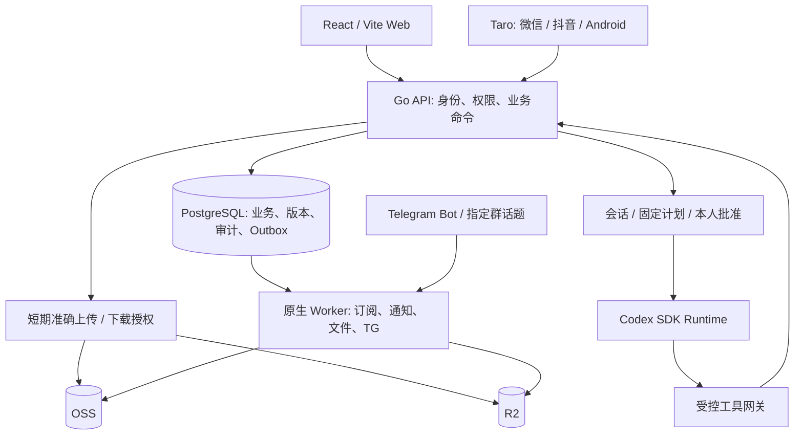
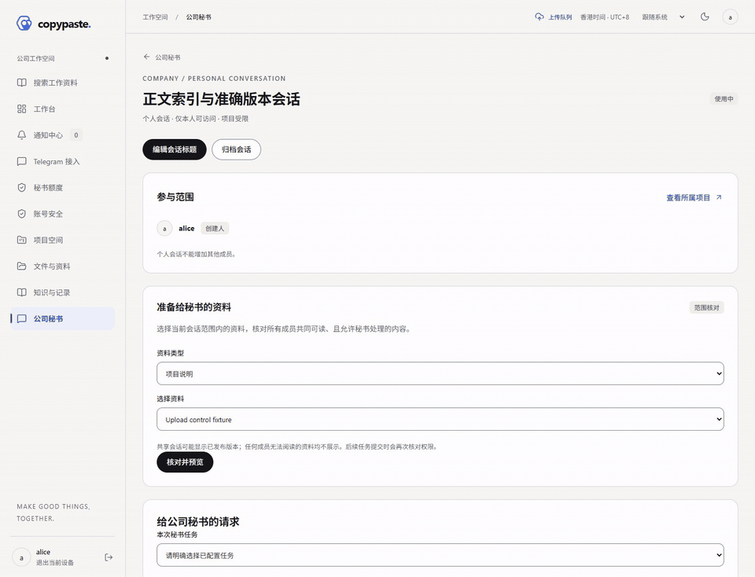
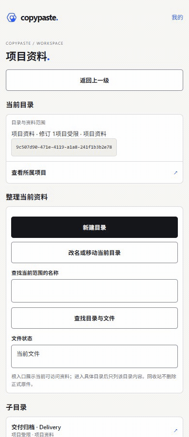
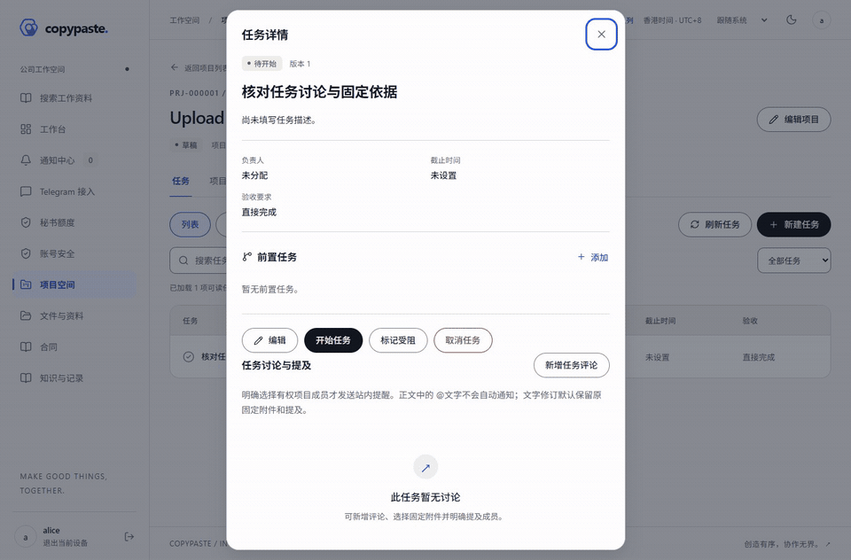

# CopyPaste Case Manager · 中文方案与使用指南

最新实现100：秘书无需配置AI费用额度即可接单和执行，技术用量按实际运行追加记录。旧费用策略／核对接口停写，原账本只读。并发、上下文／输出、工具次数、超时、权限与隔离约束保留。真实Codex、TG及云服务尚待配置和验收；当前仍23项待完成、5项移出。

[实现与使用](development/100-secretary-execution-without-cost-quota.md) · [验证范围与证据](quality/100-secretary-execution-verification.md) · [Web录屏](media/videos/secretary-cost-free-web.mp4) · [Taro H5录屏](media/videos/secretary-cost-free-mobile.mp4)

[English](README.en.md) · [仓库首页](../README.md) · [文档索引](README.md) · [截图、录屏与 GIF](media/README.md) · [更新记录](CHANGELOG.md)

这是 CopyPaste 的内部管理平台，把项目、OA、文件、知识、费用订阅、公司秘书和服务状态连接到同一套业务权限与审计体系。本仓库包含可运行实现、详细协议和来源绑定的验证证据；当前为开发预览，四端生产交付仍按 [23项待完成／5项移出](delivery/03-goal-gap-assessment.md)推进。

## 当前范围与剩余工作（修订99）

用户已确认移出真机验证、网络性能、历史数据迁移与容灾、AI费用控制。**当前23项待完成（14 P0／9 P1），5项移出；新增完成0项。** 保留Web、微信、抖音、Android，秘书、8项Skill、TG、执行隔离／权限／审计，公司财务、项目预算、持久PG及OSS＋R2双端存储。

120 GB设计上限与分片／续传／校验能力保留，以功能样本与协议边界核对；实网120GB和2 TB历史导入不再是当前验收前置。数据库建表／正常结构升级、普通文件回收站／版本恢复仍保留。增量100已解除接单与执行对月度Token策略／费用预留的依赖，旧费用账本只读；GAP-09继续处理真实Codex接入与验收。

[当前范围与边界](delivery/04-current-scope-and-acceptance.md) · [23项具体剩余工作](delivery/03-goal-gap-assessment.md) · [范围修订验证](quality/99-scope-revision-verification.md)。历史段落中被取消的门槛以本修订为准。

## 依赖维护与四端兼容（增量98）

移除当前原生构建未使用的 `@tarojs/rn-runner`；Doctor glob10固定10.5.0，旧原生代码生成器实际加载micromatch4.0.8。保留Taro4.3.1、React18.2.0、原生React Native0.73.11及完整四端入口和原打包边界。新增真实CLI字面参数及代码变换排除规则检查，14项依赖／2项原生JS检查通过。

当前完整审计按相同公告时点对比91→80项，high20→13；仍有13 high／60 moderate／7 low，生产安全门槛开放。原90审计86项是历史记录，不将公告变化计作修复。新执行类型、Web135／移动248／运行时51项及四端受影响构建；后端、Linux和97 PNG／35 MP4／35 GIF沿用不变源码与原始字节，明确列为复用。

[安装、真实调用、未关闭风险与维护规则](development/98-dependency-maintenance.md) · [本轮准确验证](quality/98-dependency-maintenance-verification.md)。无业务界面、迁移或API改动；8项Skill仍draft，真实平台／设备／云／模型／TG和完整四端验收保持开放。

## 小程序身份绑定与登录（增量97）

员工首次在公司微信／抖音小程序使用内部账号登录，进入“我的工作空间 → 我的小程序绑定”，输入当前密码；已设置验证器时先完成最近10分钟内的两步验证。客户端取得实际平台单次凭证，员工在两分钟内明确确认后才创建绑定。以后可选择微信／抖音身份登录同一员工账号，继续适用的MFA与业务权限检查。

Web、Android及两个小程序可分页查看本人绑定和历史、确认解绑。解绑立即使该绑定产生的访问、刷新及待完成MFA挑战失效；密码登录的独立会话保留。响应丢失时通过原幂等意图或刷新列表核对，不反复创建绑定。无自动注册、匿名员工、昵称／手机号／UnionID合并。

运维仅向API私有环境提供 `CP_WECHAT_APP_ID`、`CP_WECHAT_APP_SECRET`、`CP_DOUYIN_APP_ID`、`CP_DOUYIN_APP_SECRET` 与专用32字节Base64 `CP_MINIAPP_IDENTITY_KEY`；默认关闭，部分配置会拒绝启动。Secret不进入客户端或Git。[完整配置、接口、失败恢复和边界](development/97-mini-program-identity.md) · [实际验证及媒体来源](quality/97-mini-program-identity-verification.md)。H5演示与受控HTTP协议检查不等于真实平台或真机验收。

[本轮页面截图、MP4与GIF](media/README.md)展示本人绑定管理与丢失响应核对；仅含隔离合成数据。

本轮新执行客户端检查：Web 135项、移动端248项、秘书运行时51项测试全部通过；微信、抖音各20页构建通过。新增7张真实页面截图、2段MP4和2个GIF；媒体使用隔离合成资料，不代替平台／设备验收。

本轮最终原生回归通过189个后端顶层测试、1,183条结果（10批）；Web135／移动248／运行时51项测试通过，双小程序各20页构建通过。78项迁移保留原77项，契约298路径／369操作／647模型。Android开发包通过18项检查及26项新执行JVM测试。

## 1. 目标与范围

| 已确认条件 | 方案约束 |
| --- | --- |
| 首期 3 名员工、3 人同时在线；人员在香港 | 身份独立、业务留痕，按香港时间展示；不因人数少省略权限与恢复机制 |
| 已有境内服务器，规格与实际接入信息后续提供 | 先以模块化单体 API 和独立后台进程降低运维成本；实际跨境网络需要验证 |
| 原件约 2 TB，最大单文件 120 GB | Web／Android 直传对象存储、断点续传；小程序负责查询、审批与有界内容读取 |
| Web、微信小程序、抖音小程序、Android 必须首发 | 共享业务事实，各端分别验收；H5 演示和编译成功不能替代平台或设备测试 |
| OA 包含合同、采购、报销、月度开支与订阅 | 发生费用、现金支付和未来预测分别核对；不做考勤、人事或工资系统 |
| OSS + Cloudflare R2；应用机仅留临时数据 | 正式原件走双云、临时工作目录受限；生产 PostgreSQL 必须独立持久化并有备份 |
| Codex 公司秘书与股东 TG 群 | 使用业务工具和准确授权，不赋予模型服务器任意目录、数据库或云密钥的直接控制权 |

基础设计适合当前小团队，但不是“一个服务器目录加机器人”的存储方案。数据库保存业务、授权、索引与历史；对象存储保存正式字节；Worker 承担可恢复的后台工作。容量、云流量、跨境链路、扫描和备份费用需要以实际供应商配置与流量测算，仓库不承诺固定月费。

## 2. 架构与数据流



| 目录 | 责任与边界 |
| --- | --- |
| [app/backend](../app/backend) | Go API、领域命令、69 个当前迁移、数据库约束、任务与独立 Worker；PostgreSQL 为业务事实来源 |
| [app/web](../app/web) | React + Vite 管理入口、业务列表／表单／历史、固定依据查看、审批和运行回执 |
| [app/mobile](../app/mobile) | Taro 公共业务页面与 Android 原生宿主；原生私有文件、身份请求及大文件服务 |
| [app/agent-runtime](../app/agent-runtime) | Codex SDK 适配、受控上下文、运行取消与工具回执；真实模型仍需接入验收 |
| [app/packages](../app/packages) | OpenAPI 类型、共享设计资源；以明确契约连接各端 |
| [app/skills](../app/skills) | 八项带版本、输入输出 Schema 和工具清单的草稿包 |
| [app/deploy/native](../app/deploy/native) | 原生 Worker 的 systemd 服务模板；不代表已配置生产 API／TLS／运行时隔离 |
| [docs](.) | 需求、协议、设计、部署、追踪、证据和媒体；历史增量保留执行范围 |

API 不把迁移凭据传给日常服务，后台进程按用途取得数据库／对象存储权限。事务内写业务结果、审计与待投递事件，再由租约 Worker 处理外部副作用；网络超时或未知结果必须先核对，不能重复创建费用、业务或外发消息。

## 3. 能力与当前交付边界

| 模块 | 已有实现 | 尚需独立完成或验收 |
| --- | --- | --- |
| 身份与权限 | 独立用户、角色／动作、项目成员、分类与 ACL、MFA、会话撤销、密码恢复、审计 | 实际组织配置、安全评估与生产身份运维 |
| 项目管理 | 模板修订、立项、成员、任务／依赖、看板／时间线、里程碑、风险／问题、交付、完整变更／预算、结项与归档 | 跨OA／财务完整业务旅程及四端覆盖核验 |
| OA | 往来方、合同修订、采购与报销草稿、固定送审、顺序审批、执行、签署及履约历史 | 各端剩余编辑／附件入口和实际公司审批政策 |
| 财务与订阅 | 唯一实际费用、分摊、付款分配、退款／冲销、现金／发生报表、账期与预测 | 真实对账样本、更多移动操作及业务验收 |
| 文件与知识 | 目录／ACL／固定版本、分片协议、校验扫描、正式版本、复制恢复、知识草稿／发布／历史 | 真实 OSS/R2 身份与策略、120 GB、2 TB 迁移、恢复演练、更多格式 |
| 公司秘书 | 会话、准确计划和批准、受控项目／文件／目录／OA／知识／订阅／状态工具、实际回执 | 真实 Codex 调用、生产隔离与签发服务、八项 Skill 发布和质量评测 |
| TG | 本人绑定、指定群话题入站、持久调度、受限读取、投递准备／回执／未知结果核对 | 真实 Bot／群、境内链路、模型和允许披露内容的正式验收 |
| 状态与通知 | 服务／事件、签名观测、新鲜度、维护、站内通知、可靠投递记录 | 真实主机／备份观测、外部通道和规模测试 |

完整未完成项以编号差异表为准。仓库发布、演示齐全或 APK 生成均不表示完整系统已经生产可用。

## 4. 员工与管理员的使用逻辑

### 身份与开工

管理员先配置实际用户、业务角色、分类策略与项目范围。员工使用自己的身份登录，并在要求的动作中完成 MFA。系统管理员身份不自动具有合同、付款或秘书会话的全部读取权；加入项目也不会自动获得所有业务动作。

在工作台查看本人可见项目、待处理业务与通知。打开通知后仍按当前权限读取原记录，“已读”只改变通知，不会完成审批。账号安全页可撤销自己的设备会话；密码恢复通过单用凭证进行，不设置公开通用密码。

### 项目从立项到归档

1. 从项目入口创建项目；选择模板时固定其已发布修订，核对名称、范围、负责人、时间和成员。后续模板修改不会静默改写已有项目。
2. 维护实际成员角色；转交负责人使用独立操作。任务录入负责人、验收标准、日期及依赖，在列表、看板或时间线跟踪同一条业务记录。
3. 建立里程碑、风险和问题。里程碑达成需要实际关联完成证据；风险实际发生会创建真实关联问题，此后沿问题处理，解决／关闭必须写明结果。
4. 交付提交固定文件版本，交给有权且独立的人员验收；退回后提交新的修订，旧记录保留。
5. 范围或预算变化先生成固定变更依据，经独立审批后明确实施。审批通过不会自行修改原基线。
6. 结项先检查十三类业务与财务项，记录复盘，满足身份验证后归档；归档与受控重开保留历史。

项目概览聚合十六类业务，并保留原币精确金额、原记录与当前读取权限。概览中的数据量与筛选范围必须如实显示，不能把部分分页当作全量。

移动任务入口为“项目 → 任务 → 新建任务”。填写名称、说明／验收标准、实际成员负责人、优先级、审核要求和香港时间排期；父任务与里程碑从当前项目分页选择，核对后明确保存。任务详情可编辑资料、创建子任务或单独添加／移除前置依赖；清空已有日期或关联是明确解除。开始／完成使用原状态操作，前置未完成、循环或只读项目由原业务拒绝。保存冲突、回执不完整或响应丢失时保留输入，先读取实际任务与关系列表，再决定后续操作，不连续重复创建。查看[移动任务协议](development/78-mobile-task-editing-and-dependencies.md)与[实际演示](media/README.md#4-移动任务子任务与前置依赖--mobile-task-subtask-and-prerequisite)。

移动结项入口为“项目 → 项目结项与归档”。先读取十三类完整核查清单并沿原记录处置阻塞，明确进入结项阶段，再填写成果、经验、后续跟进和归档原因，按需选0—20个正式文件版本。业务与财务两项核实分开确认，完成本人两步验证后明确归档；成功还需核对实际项目和本次历史。并发或未知结果时保留文字并阻止重放，“保留文字和选定版本，重新核查”会重新读取权限和依据并重置声明／MFA。历史按十份分页，受限不显示数量；受控重开保留旧复盘并标记依据已变化。详见[结项协议](development/79-mobile-project-closeout-and-archive.md)与[实际演示](media/README.md)。

移动变更入口为“项目 → 项目变更 → 新建完整变更提案”，预算页也可提出调整。明确输入已配置币种，读取并采用当前项目与本币种完整预算基线；填写完整范围、日期、两项影响说明和固定正式文件。预算明确选择保持（null）、完整替换（明细数组）或清空（空数组）。保存提案后准备原申请草稿，核对原顺序后明确送审，由指定人员独立批准。修改提案须在原申请显式更新修订。批准本身不改项目或预算；实施还须重新核对批准申请与当前基线、分别核实范围日期及预算、填写原因并完成本人MFA。结果必须经实际项目、实施事实和当前／前序预算核对。变更历史按十份、预算按二十份分页，币种与状态独立筛选。详见[完整变更与预算协议](development/80-mobile-project-changes-and-budgets.md)及[实际演示](media/README.md)。

### 项目预算与实际支出对比

Web和移动均从“项目 → 预算 → 预算与实际支出对比”进入；输入已配置的三位币种代码，读取当前已实施预算。核对项目版本、预算修订和读取时间，再逐条比较同类别、包含起止日的原币预算与实际项目分摊。预算最多100条完整展示；一笔跨项目费用只计本项目份额，不因其他关联重复计入。已确认费用计正数，冲销按自己的发生日期扣减；草稿不计发生额。

在预算明细或“预算外”打开来源，可切换已发生／未确认并分页，点击后访问原费用。未完整草稿可以没有日期或类别，不伪造默认值。示例：预算1300、预算内净发生1385、差额-85；预算外净额-945，全期间净发生440。页面始终只涵盖当前获授权的记录，不作为全部项目余额、可用资金或结项通过依据。没有预算与明确批准清空的零预算分开显示；预算或项目依据变化后须重新查询。多币种分别查询，不默认折算。见[计算、权限及接口细则](development/87-project-budget-comparison.md)、[实际截图／短录屏](media/README.md)及[来源验证](quality/evidence/budget-comparison/verification.md)。

### 合同、采购与报销

先登记往来方、正文、金额与固定文件依据，保存为可修改的业务草稿；预览准确版本后明确送审。审批读取提交时固定的依据，按配置顺序处理，申请人与审批人不能绕过独立性规则。

合同审批之后仍要走实际签署、启用、付款计划、履约与完成／终止核对。采购审批后按原订单执行部分验收、拒收、退货和差异处理；差异必须经准确批准再实施。报销获批不会自动转账，实际费用与付款仍分别登记核对。修改已送审的依据需要修订、撤回或重提，不能直接覆盖历史。

### 每月费用与订阅

一次实际费用只有一个权威记录，可以关联多个项目并保留分摊份额。付款有独立现金事实、分配与退款／冲销记录。报表分别查看：

| 口径 | 解释 | 避免的误用 |
| --- | --- | --- |
| 发生费用 | 实际确认的成本及项目份额 | 不把审批额度、合同总额再次当成已发生费用 |
| 现金支出 | 实际付款／退款等资金事实 | 不把未支付费用或预测当作现金 |
| 未来预测 | 按订阅原始日历、价格修订和有效期间推算 | 不与实际账期重复累加，不用当前价格改写历史 |

金额保留原币与十进制文本，不凭空换算成 HKD。订阅支持账期、价格变化、取消和实际核对；秘书审阅可以引用逐笔依据，但不能自动产生付款或冒充财务确认。

### 财务筛选、原始明细与限时导出

从 Web 的三类财务报表入口，或移动工作台“财务核对 → 财务报表”进入。明确期间（结束日不含）、项目／公司分摊、原币、类别、供应方、经办／负责人及关键词后查询。发生、现金与订阅预测分别核算，草稿不计入；缺期间、缺价格与未配置汇率明确列示。类别、供应方与经办／负责人候选只来自可读业务事实，原始明细支持前后分页和规范记录跳转。

有独立 `report.export` 权限的人填写用途并排队；`202` 只表示已受理，后台实际执行时才固定快照。个人任务支持状态、取消与到期查询；最多50,000条／16 MiB，24小时后停止下载并由 worker 清理派生内容。权限变化后重新生成。Web保存校验后的CSV，Android用本机应用打开；微信支持文件分享时交付临时CSV，抖音及不支持的微信客户端引导Web下载。金额列按文本导入电子表格，不自行折算原币。

单独运行原生后台命令 `python app/scripts/run_backend.py worker-report-export`。Linux 服务模板为 `app/deploy/native/copypaste-report-export-worker.service`，只需运行环境和数据库配置。没有 worker 时任务保持排队。原文件继续使用OSS／R2；CSV下载时重建，服务器不保留持久CSV文件。详见[完整设计与使用](development/88-financial-report-filters-and-exports.md)和[实际截图／录屏](media/README.md)。

### 移动费用、收付款、退款与员工结算

从工作台“实际费用／收付款”进入，可起草和修订原币草稿，选择固定往来方、正式文件版本及项目／公司分摊。费用使用真实发生日；资金使用香港本地时间，准确转换UTC。草稿允许暂缺资料，确认／登记前必须核实原额、凭证和实际事实，并完成明确人工声明及本人新鲜MFA。登记资金只记录已有事实，不发起银行转账。

确认费用可关联同范围同币的批准采购、批准报销或生效应付合同。已登记支出可分配到准确费用并部分释放；员工款项必须来自批准报销的原申请员工、准确垫付行、供应方及批准修订。收到退款从原付款起草，固定原币和对象，可在登记时选择原分配并在之后补关联。真实退款与费用冲销分别核算。

全额冲销需填写真实生效日／香港时间，形成独立反向事实并保留原记录。仍有结算的费用先按实际情况解除／更正资金关联；员工资金冲销也反向更正原结算。原记录可分页查看固定修订和不可变操作历史。并发、撤权或响应丢失时保留文字并阻止再提交，先刷新核对真实结果；不得换新请求号重发。财务文字草稿只存在有界内存，不缓存凭证选择、MFA或人工声明。

详见[字段、操作、权限与回执](development/89-mobile-financial-operations.md)、[实际验证](quality/evidence/mobile-finance-operations/verification.md)及[截图／MP4／GIF](media/README.md)。微信／抖音／Android分别验收；不新增汇率、跨币或摊销制度。

### 文件、项目博客与知识

选择准确目录与项目后上传。客户端从 API 获取短期、限定对象的分片授权，直接向选定对象存储传输；恢复时先核对云端已有分片。上传完成只代表候选字节已到达，后续仍需冻结来源、完整摘要、扫描和正式版本提交，再复制到另一云并核验。

下载与引用始终绑定当前权限和固定版本。撤权、失效或来源不明确时拒绝读取；本地临时副本不取代云端正式版本。知识／项目博客使用草稿、发布修订、评论和准确附件；恢复历史生成可追踪的新修订，不抹掉审计。

移动端现已支持项目日志、会议纪要、SOP 和内部文章的手工新建、编辑、显式发布／归档／退回草稿、历史恢复和修订讨论。知识附件可明确选择跟随当前版或固定版本；评论文字修改默认保留服务器原附件。正文变化或结果不明时保留输入并停止重提。完整操作、限制和接口见[移动知识方案](development/83-mobile-knowledge-workflows.md)。

### 存量原件迁移与核验

迁移操作人使用[原生迁移工具](development/96-native-file-import.md)完成“只读盘点 → 逐项归属／目录／项目／分类映射 → 固定计划 → 近期MFA批准 → 原上传／扫描／提交 → 双端逐项核验”。工具读取明确的源目录，以普通员工权限和短时分片签名上传；不需要数据库或云密钥，单文件采用有界流式读取。使用原计划重新运行会对账已有上传；来源新内容必须提供准确逻辑文件和当前基础版本。输出留在忽略目录／仓库外，源原件保留。

`file-import` 提供 `inventory/template/plan/run/report/retry` 六个命令，完整参数、登录与清理、JSONL格式、错误处置见上述操作指南。只有完整清单、当前映射及OSS／R2已验证内容证据全部匹配，报告才将观察计为双端已验证；报告不替代原ACL等价、同时刻快照、真实2TB／120GB或恢复切换验收。[本轮验证范围](quality/96-native-file-import-verification.md)将新检查和原95页面媒体复用分列。

### 公司秘书与 TG

员工在有权的会话内提出目标，秘书读取当前允许的内容，生成有界计划。涉及项目创建、文件变更、目录整理、OA 送审或知识发布时，核对准确对象、版本、差异、范围及本人确认，再调用原业务命令。界面通过真实业务回执显示成功；普通聊天中的“同意”不代替协议要求的本人批准或近期 MFA。

八项草稿 Skill 为：`project-create`、`project-update`、`file-update`、`information-organize`、`oa-assist`、`subscription-review`、`project-briefing`、`incident-summary`。当前不应直接把 manifest 从 draft 改成 published 来宣布上线。TG 还要求本人绑定、准确群／话题和渠道约束，不能因用户在群内就获得所有公司资料；当前 TG 运行工具保持受限读取，真实外发另验。

移动员工可从工作台「Telegram 接入」进入本人绑定：选择准确 Bot → 近期 MFA → 私聊证明 → 回原登录核对数字身份 → 明确确认。可以取消未完成流程或撤销绑定。私聊能力只保存在当前页面；显式复制后的系统剪贴板寿命另由操作系统管理。

管理员同页配置准确群／话题、公司或当前可见项目范围、完整允许任务、默认任务与阶段链接通知；新入口先暂停，编辑位置不可换。保存后核对完整回执和不可变历史，冲突或回执不明时保留输入并停止重提。详见[移动 TG 方案与使用约束](development/82-mobile-telegram-access.md)。

秘书现可完整创建／修改项目风险和问题，明确设置或清空截止时刻／概率、按原状态机处理事项；风险发生会原子创建关联问题，必须同时具有两项业务权限并确认影响。创建绑定父项目版本，修改绑定事项自身版本；预览不执行，准确发送才固定本次授权，真实回执才证明完成。操作、状态与迁移见[秘书风险与问题](development/84-secretary-project-concerns.md)。

### 服务 status

服务列表展示实际观测时间、有效性、维护及事件状态。没有新鲜观测时应显示未知或过期；维护不删除故障历史。真实服务器探针和备份失败事件必须接入实际来源后再形成生产状态承诺。

操作员先在 Web 发布准确来源修订及 Ed25519 公钥，再由独立监控机部署 Prometheus／Blackbox 与[原生状态桥接](development/81-native-prometheus-status-bridge.md)。填写私密[配置](../app/deploy/native/status-bridge.example.json)中的获准端点／IP、完整标签、来源修订，保护私钥与持久 journal；先执行 `status-bridge --config <私密配置> --once` 核对安全结果码，再安装受控原生服务。应先升级本平台 API：桥接要求绑定来源／修订／序号／原始字节摘要的新回执，会拒绝旧版本不完整回执。

桥接通过六次有界查询读取原始抓取时刻，先落盘准确签名正文，再投递；结果不确定时用相同字节重试。重复采样不延长新鲜度或增加失败／恢复计数；采集失败不伪造健康／故障，旧证据到期转未知。既有 Web／Taro 页面显示阈值故障、恢复和不可变签名事实。随仓库录制使用受控 Prometheus 协议端与真实原生桥接／API；真实监控安装、主机指标与独立站外告警仍分别验收。

准确创建任务／子任务：在项目会话中选择“创建任务或子任务”，完整核对九项资料与原因；人工验收要求必须明确选择。父任务／里程碑候选可分页，移动端返回选择后保留输入。预览不执行，发送后等待真实提交回执，后续依赖与人工验收走任务页面。见[本轮完整方案](development/85-secretary-task-creation.md)、[真实演示](media/README.md)和[验证](quality/evidence/task-creation/verification.md)。

秘书Token额度：Web侧栏“秘书额度”／移动“我的工作空间 → 秘书额度与用量”。管理员完成两步验证后，完整发布四类月额度；每次接单先预留配置的输入＋输出上限。可查本人或授权范围账本，凭据核对已终止且用量未知的运行。首次生产无默认额度；不换算货币。见[详细规则与升级顺序](development/86-secretary-token-budgets.md)。

## 5. 原生本地开发

以下脚本面向当前 Windows 原生开发环境。不要启动 Docker、WSL、虚拟机或 Android 模拟器。应用开发的 PostgreSQL 本地持久化仅是开发工具，与“生产应用机只留临时文件”的约束不同。

| 工具 | 当前仓库约束／已验证环境 |
| --- | --- |
| Git + SSH | 可访问本仓库；推送使用自己的已授权身份 |
| Node.js / npm | `>=22.14.0 <23`；验证基线 22.14.0 / 10.9.2，依赖使用 lockfile |
| Python | Python 3.11+；脚本使用 UTF-8；媒体附加需要 Pillow 与 FFmpeg |
| Go | go.mod 声明 1.27.0、toolchain 1.27.3；仓库 bootstrap 使用固定校验摘要 |
| PostgreSQL | 已验证原生 18.6；将完整发行包解压到 `app/.tools/pgsql/`，需含 `bin/initdb.exe`、`pg_ctl.exe`、`psql.exe` |
| 浏览器检查 | 原生 Edge／Chromium + Playwright；关闭自己创建的上下文和页面 |
| Android（可选开发） | 原生 JDK 17、Android SDK platform 34／build-tools 34.0.0；当前宿主目标 SDK 34，生产兼容性仍需处理 |

从仓库根目录执行：

```powershell
$env:PYTHONUTF8='1'
python app/scripts/bootstrap_go.py
npm ci --prefix app
python app/scripts/dev_database.py start
python app/scripts/run_backend.py migrate
python app/scripts/seed_development.py
```

`dev_database.py` 创建或复用自己管理的原生集群，默认尝试 55432 并把实际端口写入忽略目录的环境文件；不要假定端口必定为默认值。Go、PostgreSQL、缓存、临时数据库和生成凭据都不进入 Git。初始化账号仅用于空的本地开发库，随机身份信息保存在 `app/.local/development-accounts.json`；首次 MFA 配置与恢复信息也属于私有数据。

分别在两个终端启动：

```powershell
$env:PYTHONUTF8='1'
python app/scripts/run_backend.py api
```

```powershell
npm run dev --prefix app
```

当前助手配置使用 API `127.0.0.1:18080`、Web `http://localhost:5178`，Vite 代理 `/v1` 和健康检查。开发环境生成文件是实际依据。[.env.example](../app/.env.example) 是人工配置模板，其中 8080／5173 等值是示例，不能覆盖已生成的环境。云存储、扫描、模型与 TG 默认关闭，缺少扫描配置不等于文件干净。

正常停止前台终端进程；仅在不再需要自己管理的数据库时运行：

```powershell
python app/scripts/dev_database.py status
python app/scripts/dev_database.py stop
```

不要按端口批量终止其他用户服务、删除未知数据库或因等待超时重启正在工作且归属明确的进程。详细环境逻辑见[本地开发协议](development/08-local-development.md)。

## 6. 构建四端与运行测试

在 `app/` 执行：

```powershell
$env:PYTHONUTF8='1'
npm run contract
npm run typecheck
npm run build:web
npm run build:runtime
npm run test --workspace @copypaste/web
npm run test --workspace @copypaste/agent-runtime
npm run check:skills --workspace @copypaste/agent-runtime
npm run test --workspace @copypaste/mobile
```

两小程序的本地构建示例：

```powershell
$env:CP_MOBILE_BUILD_PROFILE='local'
$env:CP_MOBILE_API_ORIGIN='http://127.0.0.1:18080'
npm run build:weapp
npm run build:tt
```

输出分别为 `app/mobile/dist/weapp` 和 `app/mobile/dist/tt`。这是本地编译配置；实际小程序必须配置平台账号、合法 HTTPS 域名和可达 API，手机上的 `127.0.0.1` 不会指向开发电脑。H5 仅用于共享界面检查，不作为第五个首发客户端替代 Android。

Android 原生构建仍在 `app/`：

```powershell
python scripts/setup_android_native.py
python scripts/build_android.py --google-mirror --evidence-group my-change
python scripts/inspect_android_apk.py --evidence-group my-change
```

镜像选项为明确选择的依赖下载方式；已有工具可按脚本支持使用离线准备。生成的是开发 APK，保存在忽略的 `.local` 下；签名密钥、正式 APK 与私人 SDK 配置不上传。四端需实际设备／平台分别验收，当前宿主原生依赖和目标 SDK 的生产要求仍未放行。

完整后端与移动检查可分别运行：

```powershell
python scripts/verify_backend_batches.py --evidence-group my-change
python scripts/verify_mobile.py my-change
```

后端检查需要已准备的原生 PostgreSQL 测试环境；原生批次会产生并清理隔离测试库。按改动选择相关检查，不用未改动源码重复执行昂贵构建来冒充新证据。修改 OpenAPI 时同步生成契约，修改设计 token 时执行 `npm run tokens`。增量90的实际执行、原证据复用、原生缓存范围及保留失败限制见[验证记录](quality/evidence/dependency-hardening/verification.md)。

## 7. 生产部署与存储计划

生产环境尚未部署。拿到服务器资料后先确认 CPU／内存、系统、出口、香港访问链路、备份位置、域名与 HTTPS。使用原生服务管理 API、Worker 和受限运行时；PostgreSQL 独立持久化，迁移使用独立身份。Linux 构建示例在 `app/backend/` 使用 `go build -o ../.local/bin/platform ./cmd/platform`，先创建输出目录；这只是构建，不是部署。

配置按进程分开：API 仅上传签名／核查和必要下载权限；上传、校验、扫描、正式提交、复制及恢复 Worker 分别使用源读／目标写的窄权限；秘书运行时不持有业务数据库与对象存储主密钥。生产还需要真正的原生执行隔离、资源／网络／目录限制与可信证明签发，不能以 SDK 参数代替这些控制。

文件计划为“一个明确主源 + 另云独立副本 + 完整摘要与版本证据”，不是客户端每次重复上传两份。2 TB 迁移先生成清单、分类与权限映射，分批导入、去重核验、回滚与抽样人工复核。120 GB 需要真实网络下的中断、凭据到期、设备重启、撤权、内存／磁盘占用和双云摘要测试。扫描器超出限制时不能把跳过扫描视作通过。

双云原件副本不替代 PostgreSQL 备份、PITR、密钥恢复、版本／保留策略或删除防护。分别演练元数据恢复、原件恢复、权限恢复与全链路切换，按实际需求确认 RPO／RTO。[部署运维](operations/01-deployment-and-operations.md)、[备份迁移恢复](operations/02-backup-migration-and-recovery.md)和[配置目录](governance/03-configuration-catalog.md)是详细约束。

## 秘书调整任务前置依赖（增量91）

在项目秘书会话选择“更新项目 → 选择准确业务更新 → 调整任务前置依赖”，先选后续任务，再选同项目另一项前置任务。界面显示两个任务版本及当前关系，员工明确新增或解除并填写原因，核对预览后确认发送。选择和预览不写业务；排队受理也不代表已经提交。以“本次更新已提交”、实际关系状态和业务操作回执核对成功。

一次只能调整这一条关系。两个任务版本、当前关系或任何共享受众的AI权限变化后，旧决定停止；重新读取并发送新决定，不自动改版本。自依赖、跨项目、循环依赖、重复新增和不存在的解除拒绝；完成／取消任务须先重开，进行中任务不能新增未完成前置。增加前置不代替完成前置，解除依赖不代替任务验收。准确重试复用同一运行和业务操作，不重复增加版本。

`project-update` 源码包1.7.0含17项允许工具、15项准确写工具；八项Skill继续保持draft。新增迁移74，原73项迁移字节保留。服务端复用原Dependency命令，真实关系、后续版本、幂等、审计、outbox和运行证据同事务提交。Web与Taro共享完整六字段授权及回执核对；更多工具、真实模型／TG、真实云／设备和完整四端首发继续按28项差异推进。

[完整方案与异常处理](development/91-secretary-task-dependencies.md) · [实际验证](quality/evidence/task-dependencies/verification.md) · [Web MP4](media/videos/secretary-task-dependencies-web.mp4) · [移动MP4](media/videos/secretary-task-dependencies-mobile.mp4)

## 搜索工作资料与版本正文（增量92）

从主导航／移动工作台进入“搜索工作资料”，输入1—200字符的名称或正文词句，并选择全部、项目、任务、知识记录、文件或目录。字面查询支持中文、英文与emoji，百分号和下划线不作为通配符。结果标明名称／正文／标签命中，文件显示提取状态和时间。

文件正文只命中当前正式版本；点击“查阅此版本正文”后固定该版本，按每次4000个Unicode字符前后浏览，并可进入原文件详情。已发布知识对普通读者使用发布修订，作者／编辑者使用当前修订。权限、目录回收、版本隔离在每次读取时重新核对。

独立原生worker使用准确副本证据读取并校验完整摘要，支持≤1MiB的UTF-8文本／Markdown／CSV／JSON及≤8MiB的DOCX主正文／表格，输出≤2MiB。不支持PDF、OCR、Excel、页眉／页脚等时明确显示状态；不将120GB文件前缀当完整索引。数据库保存派生文本和证据，OSS／R2继续保存正式原件，应用机不持久保存提取副本。

[完整方案与边界](development/92-file-text-search.md) · [独立只读凭据／部署／排查](operations/file-text-search.md) · [截图与演示](media/README.md) · [准确验证](quality/evidence/file-search/verification.md)

## 秘书查找正文与固定DOCX资料（增量93）

1. 打开有权进入的公司／项目会话，在“核对并选择上下文资料”中选准确文件正文，明确文件及正式版本；历史选择不会自动跟随最新版。
2. 预览已完成提取的DOCX主文档文字，核对原件版本／SHA-256、提取器、索引时间、正文SHA-256及字符数；续读按Unicode位置，证据变化须重新选择。
3. 点击加入本次请求，可同时附上同一文件的两个准确版本。选择和预览不会自动发送，也不产生修改授权。选择已配置的任务、填写请求后才明确发送；生产任务配置仍需实际安装和评测。
4. 模型侧原 `search_resources` 在同会话共同权限范围查标题及正文，文件正文仅匹配当前正式版本；`read_resource` 则可以读取明确历史版本。检索片段不是全文已读或写入许可。
5. 待提取、失败、超限和不支持格式返回真实状态；回收／隔离／撤权阻止缓存正文披露，旧回复会按依赖检查隐藏。UTF-8原件仍走独立只读身份及原摘要核验；DOCX走不可变索引正文。

格式边界：原UTF-8／Markdown／CSV／JSON原件1MiB内；DOCX原件8MiB内、派生正文2MiB内、每次最多10000个Unicode字符。未实现PDF、OCR、其他Office正文或DOCX写入。DOCX的版式、图片和嵌入内容须核对原件；索引时间不代表本次重新访问真实云。



[Web录屏](media/videos/agent-indexed-search-web.mp4) · [移动H5录屏](media/videos/agent-indexed-search-mobile.mp4) · [移动GIF](media/gifs/agent-indexed-search-mobile.gif) · [完整协议](development/93-secretary-indexed-search.md) · [独立凭据与索引运维](operations/file-text-search.md)

演示使用真实本机API与隔离合成资料，展示预览、续读和两个版本附件；未发送模型请求。正文检索／回执完成由原生受控MCP检查证明，真实模型与TG另验。短片保留自动化的较快原时序，可调慢播放器。

## 移动文件与目录整理（增量94）

从“文件与资料”或项目入口进入真实目录，可新建子目录、改名、选择同项目／同分类目标移动、将文件移入回收站或恢复至原目录。名称、准确对象和源修订、位置、原因与影响核对后明确确认；不永久删除原件。文件详情分页展示全部正式版本、摘要与扫描／副本状态，选择准确历史版本阅读。

文字草稿只在内存中按身份／授权／对象／修订绑定；目标选择与确认不恢复。重名、并发修订、响应丢失或回执不完整时保留输入并停止重复提交，先刷新实际记录核对结果。Android沿用原生上传；小程序承担查阅与审批。跨项目／分类迁移和保留清理执行器仍未由本轮覆盖。



[目录MP4](media/videos/mobile-files-directory.mp4) · [文件回收恢复MP4](media/videos/mobile-files-lifecycle.mp4) · [文件GIF](media/gifs/mobile-files-lifecycle.gif) · [完整流程与接口](development/94-mobile-file-workspace.md) · [准确验证](quality/evidence/mobile-files/verification.md)

## 任务讨论、附件与提及（增量95）

1. 在项目中打开任务，选择“新增任务评论”，填写正文。文字里的 `@姓名` 只是正文；通知对象必须从当前有权成员列表明确选择，最多20人，不包括自己。
2. 如需依据，选择准确正式文件及版本，最多20份。附件固定为该版本；文件后续更新不会替换原依据，查阅仍重新核对权限。
3. 点击“核对任务评论”，核对任务、原修订、全文、附件与成员后勾选确认。客户端读取已提交记录及历史，完整一致才提示成功。
4. 作者可以修改自己的准确修订。默认保留全部原附件／提及；只有明确勾选完整替换才使用本次选择，空列表表示清空。原关联部分不可核对时拒绝替换，防止静默删除。
5. 被提及者从通知中心打开准确任务及当前评论；即使该讨论不在最新20条，仍会准确读取并自动滚动定位。文本修订不重复提醒；移除后再加入会生成新的提醒，原提醒不复活。已读不会完成任务。
6. 冲突或不确定响应保留会话内文字并停止重复提交。先重新读取列表核对；重新打开只恢复文字，重新选择关联、核对并确认同一意图时复用原幂等键对账，不自动重发或另建评论。撤权后当前页面与会话按原规则失效。



[Web MP4](media/videos/task-mentions-web-collaboration.mp4) · [移动 MP4](media/videos/task-mentions-mobile-collaboration.mp4) · [移动 GIF](media/gifs/task-mentions-mobile-collaboration.gif) · [使用、接口与约束](development/95-task-discussion-and-mentions.md) · [准确验证](quality/95-task-discussion-verification.md)

本轮通知是各员工自己的站内通知，不会向TG、邮件或手机推送额外发送消息。共享Taro继续20页，四端完整首发与外部验收保持原要求。

## 8. 当前证据与放行条件

当前功能基线为增量100，范围沿用[修订99](delivery/04-current-scope-and-acceptance.md)。下表区分新执行、缓存和原证据复用，详见[准确验证](quality/100-secretary-execution-verification.md)。

| 层面 | 当前结果 | 适用边界 |
| --- | --- | --- |
| 依赖 | 原98完整扫描80项：0 critical／13 high／60 moderate／7 low | 原锁摘要相同，复用原审计；安全处置仍待完成 |
| Go／PG |189顶层／1181结果，完整首轮10批及2个失败清理用例串行复跑；79份结构迁移 | 当前源码通过；失败原记录保留，临时库清理后为0 |
| Web／运行时／Taro |135／51／248项；类型／构建；微信／抖音各20页 | 当前输入新执行，不包含平台／真机或网络性能验收 |
| Android | 新Metro产物／新开发APK，18包检查＋3项载荷核验；JVM26缓存 | 26项不是本次新执行；正式签名／发布准备仍待完成 |
| 媒体 | 新增2 PNG／2 MP4／2 GIF；原97 PNG／35 MP4／35 GIF保持原字节 | 当前共99 PNG／37 MP4／37 GIF；移动为共享Taro H5 |
| 实际接入 | 云／模型／TG／生产环境尚未完整验收，8项Skill仍draft |23项完整工作包仍开放，5项移出不算完成 |

秘书已无需AI费用策略／预留即可接单和执行。执行隔离、身份／权限、审计和技术资源约束仍保留；具体剩余项见[当前清单](delivery/03-goal-gap-assessment.md)。

## 9. 文档与同步维护

新增或修改功能时，代码放在 `app/`，文档／媒体／更新说明放在 `docs/`。按 [贡献与同步约定](contributing.md)同时维护中文、英文指南、受影响协议、差异编号、验证证据和实际演示；完成后将对应变更一并提交并推送到 `git@github.com:copypasteltd/case-manager.git`。不强制推送，不提交凭据、原始录屏帧、工具链、数据库和本机缓存。

需求与模块协议通过[文档索引](README.md)阅读；查看[实施台账](delivery/02-implementation-ledger.md)确认真实进度，通过[媒体目录](media/README.md)查看操作，通过[更新记录](CHANGELOG.md)了解本次发布范围。
