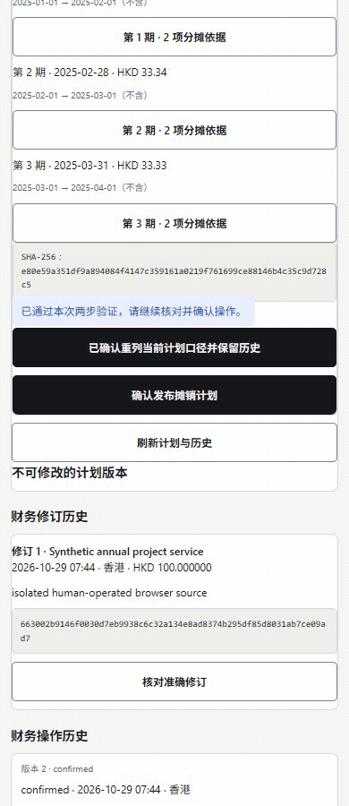
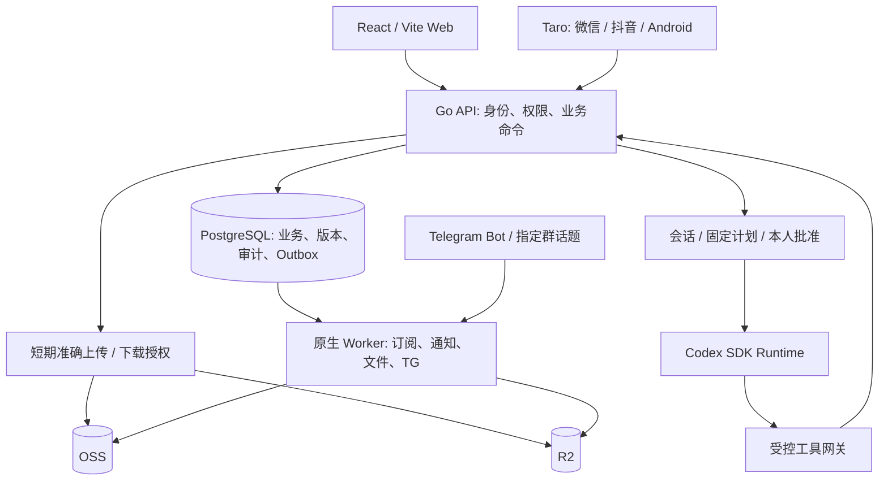

# CopyPaste Case Manager · 中文方案与使用指南

## 增量139 · 组织TG投递运维 / Organization TG delivery operations

Telegram 接入→组织TG投递运维→按状态／群入口查询→查看固定通知及状态历史。经授权的人工经办人可核对原群、话题与消息编号，确认已发送、确认未发送后允许重试，或放弃重发。重试另需明确接受重复风险；当前绑定、群入口版本、24小时有效期及五次发送上限仍由服务器和独立发送进程核对。

查阅与处理权限分开；请求正文、秘书回复、凭据和自由文本处理备注不进入组织运维查询。四端源码和本地构建已更新；近期MFA、版本冲突、幂等、永久历史及审计回滚保留。本轮主线结构105；开发库仍100，正常升级101–105后使用。rc.2／APK137仍是业务136／结构103，不包含138／139，两个冻结标签不移动。

Open **Telegram → Organization delivery operations**, filter by state or channel, inspect routing metadata and the immutable notification journal, then explicitly reconcile an unknown outcome. Separate read/reconcile authority, a recent human MFA session and original-group review are required for changes. Retrying additionally requires duplicate-risk acknowledgement, current recipient scope, the24-hour window and the existing five-attempt cap. A human confirmation remains distinct from provider confirmation; this console never discloses request/model prose or makes a Bot API call itself.

This is main/schema105 source with fresh focused HTTP/PG, client type/build checks and actual authenticated Web interaction. Full regression, complete mobile journeys and a new Android artifact are deferred. Frozen rc.2/APK137 remain business136/schema103. Real Bot/model/cloud/Linux/platform/production acceptance and all23 work packages remain open; eight Skills remain draft and the five exclusions remain excluded.

[使用与接口 / Usage and API](development/139-telegram-delivery-operations.md) · [关键检查与延期 / Checks and deferrals](quality/139-telegram-operations-verification.md) · [本轮及全部23项 / All remaining work](delivery/05-functional-closure-139.md) · [实际页面](media/screenshots/telegram-operations-web-receipt.png) · [MP4](media/videos/telegram-operations-web.mp4) · [截图导览 GIF](media/gifs/telegram-operations-web.gif)

## 增量138 · 未提交的已完成上传 / Completed uncommitted uploads

进入具体资料目录→展开“已完成上传草稿”→核对新文件／替换上传及全部已知完成对象→填写原因建立固定清单→经过保留期与至少24小时观察→近期MFA人工批准→独立worker执行、查看逐项回执。停止不恢复上传；失败可重试，授权失效后可明确续作，已经确认的对象保留。凭据和存储位置不交给客户端。

本轮main源码／结构104；现有`v0.1.0-rc.1`与`v0.1.0-rc.2`标签和下载保持不变。rc.2及最新开发APK137固定业务136／结构103，**不包含138**；个人开发库仍100，运行新后端前正常升级101–104。当前只做关键验证：原生HTTP／PG5组30条记录、Web选定32项、共享移动23项、Android上传共享规则13项、类型和Web／微信／抖音构建，以及实际Web建单与读回。完整回归、新移动旅程及Android包延期；保留136完整Web452／共享移动537项和121后端／运行器历史出处。

Open a specific folder, expand **Completed upload drafts**, select an eligible new-file or replacement upload and create a fixed plan covering its original and every known completed promotion candidate. Retention and at least24 hours of observation precede explicit human approval with recent MFA. An independent worker records exact per-object outcomes. Cancellation preserves permanent upload fences; stopped remaining items can be explicitly reauthorized without repeating confirmed results.

This is main/schema104 source. Both frozen downloads remain immutable; rc.2/APK137 contain business136/schema103 and do not include this feature. Apply normal upgrades before using the new backend. Selected current checks and actual Web readback are distinguished from retained full tests and Android artifacts. Real cloud/model/Skills/TG/Linux/platform/production acceptance stays open:23 packages,14 P0/9 P1, five exclusions and eight draft Skills.

[使用与接口 / Usage and API](development/138-completed-upload-retirement.md) · [关键检查及延期 / Checks and deferrals](quality/138-completed-upload-retirement-verification.md) · [本轮及全部23项 / All remaining work](delivery/05-functional-closure-138.md) · [既有冻结下载 / Frozen downloads](releases/v0.1.0-rc.2/README.md)

[实际页面](media/screenshots/completed-upload-retirement-web-plan.png) · [静音操作录屏 / Actual silent recording](media/videos/completed-upload-retirement-web.mp4) · [三张实际截图导览 / Screenshot-tour GIF](media/gifs/completed-upload-retirement-web.gif)

## 冻结交付137 · v0.1.0-rc.2

已将增量134–136纳入新的冻结候选：Linux服务器／Web／秘书运行器、微信／抖音小程序和Android开发包统一到业务源码 `40cd118`、结构103。源码包包含该提交全部应用源码、测试、依赖锁与开发文档；正式媒体目录另包提供，历史验证大文件保留在完整Git标签中。首版 `v0.1.0-rc.1` 的标签与下载保持不变。

[下载、SHA-256与使用步骤](releases/v0.1.0-rc.2/README.md) · [本轮交付及全部23项余项](delivery/05-functional-closure-137.md) · [实际构建与延期验证](quality/137-frozen-candidate-verification.md)

本轮重新构建实际产物并检查源码／包内容，复用136的业务检查和真实页面媒体，完整回归及新增页面录制延期。APK为开发签名、移动产物使用本地API；接入服务器须配置真实HTTPS API／平台身份后重建。开发库仍100，运行此后端前正常升级101–103；真实云／模型／TG／Linux／平台／生产接入继续开放。23工作包（14 P0／9 P1）、五项移出及八项draft Skill不变。

**首个冻结候选：[v0.1.0-rc.1](releases/v0.1.0-rc.1/README.md)。** 源码标签、下载摘要、部署步骤与延期验证统一记录。 服务器、两小程序及Android开发包已封存：[下载与SHA-256清单](https://github.com/copypasteltd/case-manager/tree/8ddb3f7a98a24910af49ede2a6c8b8c744d50973/docs/releases/v0.1.0-rc.1)。

## 增量136 · 原件清理重新授权

四端已接通原批准会话失效后的明确恢复：所有剩余任务停止后，有权限的员工核对固定摘要、剩余原件、不可逆影响和操作依据，完成近期MFA，重新授权并排队剩余项。初次批准与观察期、已确认结果和永久停用屏障保留；新的授权历史只追加。后续再次退出／撤权仍会安全停止。

使用：文件详情 → 原件保留与清理 → 查阅原件清单 → **重新授权剩余原件** → **确认重新授权并继续**，再查阅重新授权记录／逐次回执并刷新读回。已停止或全部完成的计划不能续作；来源、制度、文件修订或保护变化会拒绝本次操作。

关键验证见下方记录：Web452项、共享移动537项及类型／Web／两小程序构建；原生HTTP／PG7组42条覆盖重新授权及既有原件清理，并有真实Web提交／读回。整套回归、新移动浏览器旅程及Android包本轮延期；开发库仍100，新后端需正常升级101–103。冻结`v0.1.0-rc.1`保持原下载，不包含136。仍23个工作包（14 P0／9 P1）、五项移出、八项draft Skill，实际云／模型／TG／Linux／平台／生产接入继续开放。

[实现与使用 / Usage](development/136-retirement-reauthorization.md) · [关键检查 / Checks](quality/136-retirement-reauthorization-verification.md) · [本轮及全部23项 / All remaining](delivery/05-functional-closure-136.md)


[实际Web录制 / Actual Web recording](media/videos/retirement-reauthorization-web.mp4) · [三截图GIF导览 / Screenshot-tour GIF](media/gifs/retirement-reauthorization-web.gif)

## 增量135 · 原发布记录

四端源码已接通合同本金与实际付出分离的归属、现金预留、部分解除尾差、固定人工核对及全额资金冲销。合同详情选择“归属实际退回款”，固定原收入归属与实际向外付款，输入合同本金、本次付出、汇率及凭证来源，明确核对并完成近期MFA，再查阅持久历史。

示例：780 HKD收入，100 USD实际付出；归属390 HKD／50 USD，再归属195 HKD／25 USD，合同净收195 HKD、实际资金占用75 USD、可用25 USD。解除只改变归属，实际资金独立保留；原390 HKD分三次各130 HKD解除，准确释放16.67、16.67、16.66 USD。

本轮精简检查：原生HTTP／PG4组52条，Web444项、共享移动529项，类型及Web／微信／抖音构建、实际Web提交与读回。没有新Android包／移动浏览器完整旅程或完整回归；开发库仍100，运行新后端前正常应用101、102。首个冻结标签和下载仍为`v0.1.0-rc.1`，不包含135。23个工作包（14 P0／9 P1）、五项移出、八项draft Skill继续保留；公司财务制度／汇差、完整旅程和正式集成仍待完成。

[实现与使用 / Usage](development/135-receivable-foreign-returns.md) · [关键检查 / Checks](quality/135-receivable-foreign-returns-verification.md) · [本轮及全部23项 / Remaining](delivery/05-functional-closure-135.md)


[实际Web录制 / Actual Web recording](media/videos/receivable-foreign-returns-web.mp4) · [三截图GIF导览 / Screenshot-tour GIF](media/gifs/receivable-foreign-returns-web.gif)

## 增量134 · 原发布记录

已接通登记时原子回转及登记后分次追加，Web、微信、抖音和Android共享功能源码。输入原付款本金，页面分别核对费用原币和实收现金份额；固定原分配、人工声明、近期MFA、准确尾差、项目份额及全额冲销保持可追溯。

示例：原200 EUR费用由780 HKD核销，实际退回100 USD。先回转560 HKD／143.59 EUR／71.79 USD，最后220 HKD／56.41 EUR／28.21 USD；费用、原本金、现金三个余额独立。

使用：从原付款登记真实异币退款时选择原分配，或在退款详情“关联退款分配”；输入**原付款本金**，核对费用与现金预览，完成本人核实后提交，再查阅持久历史。本轮关键检查为原生HTTP／PG5组64条、Web436项、共享移动521项、类型检查及Web／两小程序构建。Android沿用133开发APK，本轮没有新包或移动浏览器完整旅程；现有开发库仍100，运行新后端前应用101。

首个冻结标签和下载仍为`v0.1.0-rc.1`；134是后续main源码。全部23个工作包（14 P0／9 P1）、五项移出、八项draft Skill保持；应收合同异币向外退回、公司汇兑制度、完整旅程和正式集成继续开放。

[实现与使用 / Usage](development/134-foreign-expense-refunds.md) · [实际检查与延期 / Checks](quality/134-foreign-expense-refunds-verification.md) · [本轮与全部23项 / Remaining](delivery/05-functional-closure-134.md)


[实际Web录制 / Actual Web recording](media/videos/foreign-expense-refunds-web.mp4) · [三截图GIF导览 / Screenshot-tour GIF](media/gifs/foreign-expense-refunds-web.gif)

## 增量133 · 已发布冻结基线 / Published frozen baseline

本轮实际检查：五组选定原生HTTP／PostgreSQL套件74条通过记录，Web428项、共享移动513项；构建、原生缓存和仅巡检脚本修正的准确输入分别记录，不代表完整生产验收。

增量133补齐四端合同财务闭环：生效合同→真实费用／收付款归属→按原本金归属异币退款→部分解除→固定凭证人工核对→来源变化后重新核对。共享移动端新增完整合同财务中心，Web同步展示整笔实收与合同本金。

使用：Web进入合同详情的“合同财务归属”；微信、抖音和Android选择“合同财务归属与核对”。先固定实际正向收付款，再选择其退款；输入合同币种本金并明确核对币种。需要纠正时追加部分解除；核对节点时选固定版本凭证并确认条件及差额。实际银行现金与费用不因归属而改变。

示例：付款780 HKD、实际退款100 USD、固定退回本金780 HKD；四条195 HKD本金归属合计780 HKD。每条明确展示整笔100 USD实收，不把两个币种相加；原付款和退款两重余额、并发、幂等、当前权限及最近MFA继续生效。退款全额冲销保留旧归属／核对，当前有效退款本金归零。

正常结构升级99→100，历史账本与旧核对不改写。跨币费用退款归属、应收合同的异币向外退回、公司汇兑制度及完整业务验收继续开放。仍23个工作包（14 P0／9 P1）、五项移出、八项draft Skill。

[实现与使用 / Implementation](development/133-contract-finance-closure.md) · [实际检查 / Checks](quality/133-contract-finance-verification.md) · [本轮及全部23项 / All remaining work](delivery/05-functional-closure-133.md)


[Web实际录制 / Web recording](media/videos/contract-refunds-web.mp4) · [Web三截图导览 / Web screenshot tour](media/gifs/contract-refunds-web.gif) · [移动概览 / Mobile overview](media/screenshots/contract-refunds-mobile-summary.png)

## 增量132 · 已发布记录

当前本地检查：十组HTTP／PG69条通过记录，Web419项、共享移动504项及核心182条测试记录通过；构建、原生缓存与真实云／平台／生产验收边界分别记录。

增量132补齐已知历史原件和已提交上传草稿的保留与清理：准确来源盘点 → 固定清单 → 至少24小时观察 → 最近MFA人工批准 → 永久使用屏障 → 独立双云执行 → 不可变逐次回执。历史原件两边全部确认不存在后才释放逻辑容量，失败或未知结果保留并重新核对；停止不恢复已删除原件。

使用：文件详情打开“盘点历史与草稿原件”，核对保留制度、当前版本／引用／法务保留及阻断原因，选择一项、填写原因建立观察清单；到期后核对摘要并批准，在清单查阅逐云回执、显式重试或停止剩余。Web、微信、抖音、Android使用同一业务流程。默认不开启云清理；API只有位置元数据，专用Worker使用独立清理身份。OSS要求准确非null原生版本，R2要求部署者明确保证独占不可变目录，不把If-Match当作已证明的原子删除。

正常结构升级98→99；当前仍23个活跃工作包（14 P0／9 P1）、5项移出、八项draft Skill。已完成但未正式提交的草稿、秘书恢复来源、未知孤儿／派生对象、失效原批准的重新授权及真实云验收继续开放。

[实现与使用 / Implementation](development/132-known-object-retirement.md) · [实际核验 / Checks](quality/132-known-object-retirement-verification.md) · [本轮及全部23项 / Remaining work](delivery/05-functional-closure-132.md)


[Web实际录制 / Web recording](media/videos/object-retirement-web.mp4) · [共享H5录制 / Shared H5 recording](media/videos/object-retirement-mobile.mp4) · [三截图导览 / Screenshot tour](media/gifs/object-retirement-mobile.gif)

## Increment131 · Previously published / 原发布记录

增量131接通主机资源的告警处理流程：超阈值、磁盘只读、采集断流 → 当时有权负责人站内通知 → 本人工作台待办 → 真实恢复。重复采样不刷屏；标记已读只记录阅读，不消除故障。恢复产生新的未读投递；停用、归档、转交或撤权重新计算责任，旧排队事件不改收件人。

使用：先在服务详情明确发布资源监控配置；在首页“我负责的主机资源待办”或通知中心“主机资源”分类打开服务；在“资源状态记录”查阅当时负责人、配置、状态及原始签名。历史正常记录不表示当前正常，创建通知事件也不表示实际投递完成。

部署沿用原生API、PostgreSQL和既有通知Worker，正常结构升级97→98。即时业务命令投影状态，Worker每10秒检查最多100个来源并继续分页；首次采样有明确宽限期。工作台直接读取当前配置和原始观测，Worker未完成投递也不会隐藏已经到期的待办。

当前23个活跃工作包（14 P0／9 P1）、5项移出、八项draft Skill。资源站内告警代码已完成；真实目标监控安装和独立外部告警送达仍属GAP-23。真实云、模型、TG、平台、正式Android及生产验收继续按编号处理。

[实现与使用 / Implementation](development/131-resource-notifications.md) · [实际检查 / Checks](quality/131-resource-notifications-verification.md) · [本轮和全部23项 / All remaining work](delivery/05-functional-closure-131.md)


[Web实际录屏 / Web recording](media/videos/resource-notifications-web.mp4) · [共享移动录屏 / Shared H5 recording](media/videos/resource-notifications-mobile.mp4) · [三截图导览 / Screenshot tour](media/gifs/resource-notifications-mobile.gif)

当前核验：8组选定HTTP／PostgreSQL套件76条、核心94条、Web411项和共享移动496项全部通过；四端构建及当前开发APK19项检查通过。原生Android28项／JVM28项为准确UP-TO-DATE结果；完整业务与生产验收继续按编号处理。

## 增量130 · 已发布记录

增量130补齐主机资源功能：CPU、内存、全部已配置磁盘与只读状态，经原生Prometheus桥接→独立签名接收→持久记录→四端实时展示。服务详情可人工发布完整监控配置、核对阈值、停用及查阅配置／观测历史；旧观测过期、采集断流、停用或归档均显示待确认，并隐藏当前数值。

使用：进入“服务与事件”→服务详情→“主机资源监控”。有管理权限者选择“配置资源监控”，核对公钥、全部挂载点、警告／严重阈值和过期时间，完成最近MFA后明确发布。配置变化建立新修订，等待该修订的新观测；原签名及历史保留。原生部署在私有目录配置node_exporter、Prometheus和既有status-bridge，参考配置只含占位值。桥接器不接受任意PromQL或目标URL。

本轮正常结构升级96→97。当前资源健康与服务可用性分别评估；页面告警不是已送达的外部通知。真实目标服务器、Prometheus／node_exporter安装及独立告警送达仍属GAP-23。完整源码、运行逻辑、检查边界及全部23项余项见下方链接。当前仍23个工作包（14 P0／9 P1）、5项移出、八项draft Skill。

本轮验证：三组选定HTTP／PostgreSQL套件31条通过记录、Web408项、共享移动493项、四端构建和当前Android开发APK19项内容检查通过。Web／共享H5均实际走通配置停用、状态变化、历史与签名核对；原生测试的真实执行／缓存边界逐项记录，旧全量回归不冒充重新执行。

[实现与使用 / Implementation](development/130-host-resources.md) · [实际验证 / Checks](quality/130-host-resources-verification.md) · [本轮与全部23项 / All remaining work](delivery/05-functional-closure-130.md)


[Web录制 / Web recording](media/videos/host-resources-web.mp4) · [共享移动录制 / Shared H5 recording](media/videos/host-resources-mobile.mp4) · [截图导览 / Screenshot tour](media/gifs/host-resources-mobile.gif)

## Increment129 · Previously published / 原发布记录

增量129直接补齐文件办公流程：Web／Android新建真实Word、Excel、PPT，并修改当前正式版本的受支持文字／单元格；微信／抖音查阅准确版本。生成独立候选 → 本人核对名称、内容、警告与SHA → 加入原上传队列 → 完整摘要／扫描／提升 → 人工提交新正式版本，旧原件和历史保留。生成本身不发布，也不改变OA或财务事实。

使用：目录内选择“新建 Office 文件”，或文件详情选择“编辑 Office 内容”。Word填写段落和可选表格；Excel从表格粘贴，默认文字，明确选择数字／布尔／安全公式；PPT用单独一行 `---` 分页。核对候选后确认加入队列，再在上传页面处理扫描和正式提交。Android候选保存到本人私有临时来源，继续使用原生上传队列；普通大文件保持SAF分片路径。

原件编辑限8 MiB、候选12 MiB，有界XML／内容与安全公式子集；未改压缩部件保留，保护、宏、嵌入对象、外链内容和不支持结构明确拒绝。Excel修改清除公式结果缓存，需原编辑器重算。当前不提供完整Office版式或所见即所得，复杂文档与真实样本继续属于GAP-04。数据库保持96项迁移，无新增外部编辑器服务或Worker。

源码验证分别记录六组选定HTTP／PG套件46条通过记录、Web396项、共享移动481项、独立OOXML库读取六份真实生成文件、四端构建与当前Android开发包。Web实际编辑／生成三种格式，共享H5实际只读查阅；合成页面录制与接口全流程提交分别说明。旧121全量后端／runtime和旧128证据保留原来源，正式签名、平台、云、模型、TG与生产验收继续开放。

当前23项工作包（14 P0／9 P1）、5项移出、八项draft Skill。已完成的子功能从余项中扣除，整包未完成不会冒充验收通过。

[实现与使用 / Implementation](<development/129-office-authoring.md>) · [实际验证 / Checks](<quality/129-office-authoring-verification.md>) · [本轮及全部23项 / All remaining work](<delivery/05-functional-closure-129.md>)


[Web实际录屏 / Web recording](media/videos/office-authoring-web.mp4) · [共享移动录屏 / Shared mobile recording](media/videos/office-authoring-mobile.mp4) · [三截图导览 / Screenshot tour](media/gifs/office-authoring-mobile.gif)

## Increment128 · Previously published / 原发布记录


增量128接通 PDF、扫描件与PNG／JPEG正文：原件扫描和准确副本校验 → 独立原生Worker逐页提取／OCR → 当前版本搜索 → 固定版本预览／比较 → 秘书资料读取。四端显示完整页数和OCR核对原件说明，不自动形成财务事实，不改变原件。

使用：Web／Android上传原件，在搜索中查找正文词句并点击“查阅此版本正文”；在文件详情选择两个正式版本进行比较；秘书会话明确选择准确版本后复用同一派生正文。微信／抖音保留查询与审批职责。当前提取限8 MiB、PDF20页、正文2 MiB；120GB原件上传目标保持独立。

部署：在只读原生工具目录配置固定Poppler／Tesseract、三语言模型及SHA清单，以绝对路径设置 `CP_DOCUMENT_TEXT_PROFILE`，再运行既有 `worker-file-text`。未配置原生引擎时，PDF／图片明确待处理，普通文本／Office继续可用。应用不下载工具、不继承云／模型凭据到原生子进程。

本轮源码检查：六组选定HTTP／PostgreSQL套件43条通过记录，原生解析／完整性检查零跳过，Web390项、共享移动476项，以及类型和Web／微信／抖音／Android JS构建。真实Web／共享H5验证PDF与图片预览、准确版本比较及秘书资料读取；6张PNG、2条实际视口MP4、2个明确标注三截图导览GIF。正常结构升级95→96保持旧文件、OA、财务及提取证据。旧121完整回归／runtime／开发APK与127原证据保留来源；它们不标为当前128产物。实际执行记录见下方链接。

当前仍23项（14 P0／9 P1），5项移出，八项Skill为draft。Office创建编辑／版式、更多真实PDF／OCR样本、真实云／模型／TG、平台及生产验收继续开放。

[实现与使用](development/128-document-text-ocr.md) · [实际验证](quality/128-document-text-verification.md) · [本轮与全部23项余项](delivery/05-functional-closure-128.md)


[Web实际录屏](media/videos/document-text-web.mp4) · [共享移动实际录屏](media/videos/document-text-mobile.mp4) · [移动三截图导览GIF](media/gifs/document-text-mobile.gif)

## Increment127 · 原发布记录

增量127完成四端文件批量整理：多选1至50个文件 → 固定清单 → 本人核对与近期MFA → 一次移动／回收／恢复 → 持久逐项回执。任一子操作失败，整批文件和成功证据回滚。原正式内容头与历史版本保留。

使用：文件中心选择文件或“选择已加载文件”，选择批量操作并填写原因。移动另选同项目、同分类的实际目录；分析后核对完整来源／目标／路径／阻塞／有效期，再明确确认。任一相关文件（含回收站）可打开本人的批量记录。名单不从草稿恢复，切换范围后重新选择；结果不明时先核对记录。

正常结构升级94→95新增不可改写的固定计划与完成证据。沿用单文件授权和事务命令，不新增管理员权限。真实Web／共享Taro H5走实际HTTP／PG；微信、抖音与Android保持完整目标，正式平台、云、模型和生产验收继续开放。当前23项（14 P0／9 P1），5项移出。

当前源码检查：五个选定HTTP／PostgreSQL套件51条通过记录、Web379项及共享移动465项测试通过；全项目类型、Web／微信／抖音／Android JS构建通过。实际Web／共享H5各完成三项操作及历史回执查询。6张PNG、2条本人验证后的执行MP4及2个明确标注的三截图导览GIF已更新。旧121完整回归／runtime／开发APK与旧126证据保留原来源，不标为当前127产物；完整23项工作包及正式平台／云／模型／生产验收仍开放。

[设计与使用](development/127-file-batch-plans.md) · [实际验证](quality/127-file-batch-verification.md) · [本轮及全部23项余项](delivery/05-functional-closure-127.md)


[Web实际录屏](media/videos/file-batch-web.mp4) · [共享移动实际录屏](media/videos/file-batch-mobile.mp4) · [移动三场景截图导览GIF](media/gifs/file-batch-mobile.gif)

## Increment126 · Previously published / 原发布记录

增量126接通“已确认费用 → 核对实际付款 → 一次登记与核销 → 资金详情／费用余额”。支持供应方部分核销、人工异币和准确批准员工垫付报销。付款总额与本次核销额独立填写，多余款保留未分配；原费用金额保持。一个PG事务组合普通资金创建、登记和分配，最后失败完整撤销业务写入。

使用：费用详情 → “登记付款并核销费用” → 填实际时间／总额／币种／核销额 → 选择同一供应方或已关联批准垫付明细 → 固定付款凭证 → 明确核对并验证本人 → 确认 → 核对资金分配历史与费用待结余额。异币另填费用原币额、实际汇率与来源。页面不预填实际金额、不发起银行转账、不自动完成业务。

Web及共享微信／抖音／Android页面已接入准确费用头、完整组合回执与现有幂等流程。移动只恢复按本人权限和准确费用隔离的白名单文字，付款凭证、收款引用、报销选择、MFA与人工确认重新核对。schema94保持；完整公司制度、正式平台／云／模型／生产验收继续开放。

[设计和使用](development/126-cost-payment-settlement.md) · [实际检查](quality/126-cost-payment-verification.md) · [本轮与全部23项余项](delivery/05-functional-closure-126.md)


[Web实际录屏](media/videos/cost-payment-web.mp4) · [移动实际录屏](media/videos/cost-payment-mobile.mp4) · [移动截图导览GIF](media/gifs/cost-payment-mobile.gif)

当前检查：九个选定HTTP／PG套件140条通过记录，Web352项、共享移动438项、类型检查和Web／双小程序／Android JS构建通过。实际Web／H5各完成三类付款：供应方HKD60核销40、异币USD13核销6.50对应HKD50、员工HKD30核销25，原费用合计仍HKD300。MP4录首个本人验证后场景；GIF明确为三张真实截图导览。旧121完整回归／runtime／开发APK及125原证据保留，不标为当前产物。当前23 active（14 P0／9 P1）、5 excluded，见[范围](delivery/04-current-scope-and-acceptance.md)。

## 已发布历史 / Published history

增量125接通“批准合同／采购／报销 → 核对实际发生 → 费用确认与准确来源关联 → 实际报表”。员工在业务详情填写实际金额、日期、固定供应方、凭证和项目／公司分摊，明确核对并验证本人后，一次提交；失败完整回滚。批准金额不会自动生成费用，付款另行登记。

Web、微信、抖音与Android共享业务页面已接入。来源版本、批准修订和摘要固定，费用范围、分类、币种由服务核对；重复提交复用原结果，旧依据、额度争用、撤权和近期MFA不足被拒绝。移动文字草稿按本人授权与准确来源隔离，凭证、本人验证及核对选项不从草稿恢复。

使用：批准业务详情 → “登记实际费用并关联” → 录入实际事实及分摊 → 选择正式凭证 → 明确核对／验证本人 → 确认 → 费用详情／操作历史／报表。本轮更新实际应用代码，继续schema94。

[设计和使用](development/125-business-cost-recording.md) · [实际检查](quality/125-business-cost-verification.md) · [全部23项待完成](delivery/03-goal-gap-assessment.md)


[Web实际录屏](media/videos/business-cost-web.mp4) · [移动页面实际录屏](media/videos/business-cost-mobile.mp4) · [移动截图导览GIF](media/gifs/business-cost-mobile.gif)

Web345项、共享移动436项及七个选定原生HTTP／PG套件、当前客户端类型和编译检查见本轮记录。Web／Taro H5分别实际执行三类来源费用并核对报表75.03＝项目60.00＋公司15.03。MP4录制首个来源在本人验证完成后的操作；GIF为三张真实截图导览。完整业务、正式平台／云／模型／生产验收仍开放，当前23 active（14 P0／9 P1）、5 excluded，详见[当前范围](delivery/04-current-scope-and-acceptance.md)。

## 已发布历史 / Published history

增量124：项目内六类业务的固定范围新建、查询与返回，以及共享移动订阅管理和账期操作，详见[设计](development/124-project-business-journeys.md)与[核验](quality/124-project-business-verification.md)。

增量123已接通复杂 Word 的正文链路：表格、引用页眉页脚、脚注尾注、批注、文本框、文字修订和字段缓存进入固定版本的预览、检索、比较与秘书资料读取。插入／删除／移动保留标记，字段不执行、不自动接受修订；新 `docx-v2` 与旧 `text-v1` 结果分别保存。

使用：Web／Android 上传 DOCX → 原件扫描及副本验证 → 独立正文 Worker 提取 → 搜索正文中的条款／批注 → 查阅该版本正文；在文件详情人工选择两个正式版本进行比较，也可在秘书会话中明确选择此版本作为资料。微信与抖音共用查询／比较页面。提取源文件上限8 MiB，提取文本上限2 MiB；上传容量上限和原件能力不因此改变。

本轮更新实际应用源码和正常结构升级0094，保持旧业务及旧提取证据。Web333项、移动端429项、格式解析70项与选定HTTP／PG47项已通过；完整执行边界及页面检查见下方验证记录。保留121完整回归、runtime测试与Android开发APK的原来源，不将旧APK标为123。仍23项待完成（14 P0／9 P1），5项移出；PDF／OCR、Office创建编辑和真实业务样本验收继续开放。

[设计与使用](development/123-docx-text-extraction.md) · [本轮实际检查](quality/123-docx-text-verification.md) · [全部待完成项](delivery/03-goal-gap-assessment.md)


[Web 实际录屏](media/videos/docx-text-web.mp4) · [共享移动页面录屏](media/videos/docx-text-mobile.mp4)

## 已发布历史 / Published history

增量122接通服务事件与文件存储待办：从首页进入原业务详情，解决事件后退出待办；重试已有失败副本后继续显示待验证，完整校验成功再消除。微信、抖音和Android共用的文件页面新增重试、原因确认和准确回执核对。

使用：首页 → 我负责的未结事件／我创建的文件存储待办 → 核对当前资料 → 在详情明确处理 → 返回首页刷新。仅统计本人负责的事件或本人创建、当前有权查阅的文件；受影响服务必须全部可读，目录状态和当前正式版本也重新核对。

本轮采用明确范围的源码验证：Web330项、共享移动端427项，以及选定后端集成、四端类型检查、小程序编译和实际Web／Taro H5流程。增量121完整回归、runtime56项和Android开发APK保留原提交绑定；旧APK不标为122。本轮无结构升级，继续使用schema93。真实云／模型／平台／生产验收继续独立开放。

仍23项待完成（14 P0／9 P1）、5项移出、八项draft Skill。排除范围继续按[当前范围](delivery/04-current-scope-and-acceptance.md)执行，仅移出AI费用控制；秘书、TG、授权、隔离、审计和技术资源限制保留。

[设计与使用](development/122-operations-workbench.md) · [实际检查记录](quality/122-operations-workbench-verification.md) · [全部待完成项](delivery/03-goal-gap-assessment.md)


[Web实际视口录像](media/videos/operations-workbench-web.mp4) · [移动端录像](media/videos/operations-workbench-mobile.mp4)

## 已发布历史 / Published history

增量121已接通异币退款的草稿、人工登记、原付款本金扣减、实际币种现金汇总和全额冲销。原付780 HKD、实收100 USD时，现金记录100 USD，原款扣减780 HKD；金额、人工汇率、凭证版本与操作历史分别固定。四端入口使用相同协议。

Increment121 adds actual foreign-currency refund drafts, explicit human confirmation, original-principal limits, received-currency cash reporting and full reversal across all four clients. For 780 HKD originally paid and 100 USD actually refunded, cash records 100 USD while the source principal decreases by 780 HKD. Exact amounts, reviewed rate, evidence versions and history remain pinned.

使用：打开实际付款 → 起草收到退款 → 选择实际实收币种，填写原本金／实际汇率／凭证 → 保存草稿 → 重新核对原付款当前余额并人工确认登记。当前仅使用未分配、未预留原本金；费用／合同异币归属继续待完成，界面与服务端均拒绝越过该边界。冲销保留原实收凭证并恢复原本金；不自动处理汇兑损益或手续费。

Usage: open the original outgoing payment, draft a received refund, enter actual currency and original principal/rate/evidence, then save. Re-read current source availability and explicitly confirm with MFA. Only unallocated, unreserved principal is supported. Foreign expense/contract attribution remains open and is rejected by this protocol. Reversal preserves original evidence and restores principal; no automatic exchange gain/loss or fee posting occurs.

本轮包含完整后端／客户端回归、92→93正常结构升级、实际Web／Taro H5操作和截图／MP4／GIF。Android为开发包检查，JVM缓存状态单独披露；没有真机、模拟器或实网性能测试。327份旧媒体及原证据保留。仍23项待完成（14 P0／9 P1）、5项移出，八项Skill仍draft。仅AI费用控制移出，秘书、TG、授权、隔离、审计与技术资源限制保留。

Checks bind current backend/client sources, a populated 92→93 normal schema upgrade and actual Web/Taro H5 journeys with screenshots, MP4 recordings and GIF tours. Android is a development artifact inspection with JVM cache status disclosed; no physical device, emulator or network benchmark is used. All 327 older media and prior proof bytes are retained. All 23 open packages (14 P0/9 P1), five exclusions and eight draft Skills remain. Only AI fee controls are excluded; secretary/TG authorization, isolation, audit and technical resource limits remain required.

本轮检查 / Checks: Go 244个顶层用例、1535条通过结果；Web 317；共享移动端 414；runtime 56；JVM 26（缓存复用 / cached）。正式Linux／云／模型／平台／生产验收仍独立开放。

[设计与使用 / Design and usage](development/121-actual-foreign-refunds.md) · [验证 / Verification](quality/121-refund-verification.md) · [全部未完成项 / Remaining](delivery/03-goal-gap-assessment.md)


[Web MP4](media/videos/refund-fx-web.mp4) · [移动端 / Mobile MP4](media/videos/refund-fx-mobile.mp4)

增量120已将 XLSX／PPTX 接入四端的固定版本正文预览、当前版本检索、全文比较和秘书资料预览。Excel保留单元格坐标、隐藏标识、公式文字和可能过期的文件缓存；PPT包含幻灯片文字和讲者备注。公式不计算，排版／图像查原件。原件8MiB、派生正文2MiB有界，不改120GB普通文件上传设计上限。

Increment120 adds exact-version XLSX/PPTX text previews, current-head search, complete text comparisons and selected secretary context across all four clients. XLSX retains cell coordinates, hidden-content labels, inert formulas and potentially stale cached values; PPTX includes slide text and speaker notes. Original files remain intact. Text extraction is bounded to8MiB originals/2MiB output; the ordinary120GB upload design is separate.

使用：正常上传并扫描通过 → 等待正文提取 → 搜索工作资料／查阅此版本正文；文件详情明确选择两个版本后比较；秘书资料明确选择准确版本后预览加入。微信、抖音和Android共用Taro页面；不同提取方式分别固定原件／正文摘要，历史提取终态保留。

Usage: upload and pass scanning, wait for indexing, then search and open the exact-version text. Choose two formal versions in file details to compare; select an exact version in a secretary conversation to preview and bind it. WeChat, Douyin and Android share Taro pages. Every derivative retains its original and text digests; prior terminal evidence remains immutable.

本轮重新核对完整后端、客户端和实际Web／H5页面，执行91→92正常结构升级并保留原记录。Android仅开发包／内容检查，JVM缓存状态如实记录；受控对象与资料读取不代替真实云或Codex／Skill验收。旧316份已发布媒体及原证据保留。23项待完成（14 P0／9 P1）、5项移出和八项draft Skill不变；仅AI费用控制移出，秘书、TG、授权、审计、隔离和技术限制保留。

Fresh checks cover current backend/client sources and real Web/Taro H5 pages, plus a populated91→92 normal schema upgrade. Android proof is a development artifact inspection, with JVM cache status disclosed. Controlled objects and source retrieval do not establish live cloud/model/Skill acceptance. All316 prior media retain their published bytes. Increment119 release archives retain their historical source/schema91 binding; deployment of this source requires a new schema92 package. All23 packages (14 P0/9 P1), five exclusions and eight draft Skills remain open. Only AI fee controls are excluded.

本轮验证 / Checks: Go 242个顶层用例、1526条结果；Web 313；共享移动端 / shared mobile 409；运行器 / runtime 56；JVM 26（Gradle缓存复用 / cached results）。Android使用披露的单worker Metro调用，保留完整原生构建／包内检查。 / Android uses a disclosed single-worker Metro invocation with native build and artifact checks intact.

[设计与使用 / Design and usage](development/120-office-text-extraction.md) · [本轮验证 / Verification](quality/120-office-text-verification.md) · [全部未完成项 / Remaining](delivery/03-goal-gap-assessment.md)


[Web MP4](media/videos/office-text-web.mp4) · [移动端演示 / Mobile demo](media/videos/office-text-mobile.mp4)

增量119新增原生服务器发布工程：准确清单与完整性校验、三个Linux程序／Web／独立运行器完整打包、版本化私有配置、维护入口、受管服务停止／结构升级／切换／就绪检查、同结构应用回退及中断处置，并提供手动原生CI工作流。

使用顺序：构建新包 → 从可信回执核对完整摘要 → 离线inspect → 准备服务器身份／HTTPS／独立配置 → stage → status → 以准确当前版本activate；中断后按操作编号明确recover。正式CI要求干净提交，本地带本轮改动的检查包不冒充正式CI产物。

业务源码保持已发布118，复用其完整回归和316份媒体的原证据；本轮不重录页面。新增发布工具测试与实际包检查另行记录。Windows使用明确的指针／进程测试替身，没有执行Linux链接、systemd、HTTPS或生产PG；真实Runner、正式发布产物及服务器验收仍GAP-24／25／26。23项待完成（14 P0／9 P1）、5项移出和八项draft Skill不变；仅AI费用控制移出。

[发布设计](development/119-native-production-release.md) · [完整操作手册](operations/03-native-release-runbook.md) · [验证](quality/119-native-release-verification.md) · [全部未完成项](delivery/03-goal-gap-assessment.md)

增量118已接通四端付款手续费依据：从实际资金列表选择已登记手续费付款和整条费用原分配，核对完整双币依据、准确版本与摘要，明确确认及MFA后保存。误关联通过独立撤销记录纠正；关联、撤销均不新增费用或现金，不改变原报表金额。

使用：先确认真实手续费费用、登记实际资金并核销 → 原付款详情 → 查阅手续费依据 → 关联手续费依据 → 选择实际资金（或同笔付款）及原分配 → 核对凭证、填写依据、明确确认和MFA → 查看历史；错误关联可明确撤销。原付款、手续费资金及费用须同管理项目、同分类。过期资料先刷新，结果未知先核对历史。

当前仍23项工作包（14 P0／9 P1）、5项移出、8项draft Skill。GAP-03／18增加本轮手续费依据整理；公司财务口径、汇兑差额、异币实收退款和完整四端旅程继续开放。仅AI费用控制移出；秘书、TG、授权、审计、隔离及技术资源限制保留。

本轮当前源码：后端240顶层／1492条结果，Web311、共享移动407、运行器56；八项客户端命令、两小程序各20页，Web／H5各14组实际页面与API检查。新增6 PNG、2静音MP4和2截图导览GIF，保留306份旧媒体。Android开发包18＋3项静态检查，26条JVM来自Gradle缓存；正常90→91升级保留18类原记录，开发服务已按准确源码重载，独立测试PG关闭。两个Linux目标仅交叉构建；没有设备、模拟器、真实云／模型／平台发布或生产验收声明。

[方案与使用 / Design](development/118-payment-fee-evidence.md) · [核验 / Verification](quality/118-payment-fee-verification.md) · [截图／录屏／GIF / Media](media/README.md) · [全部未完成项 / Remaining](delivery/03-goal-gap-assessment.md)

增量117已接通完整合同正文起草与人工采用：员工选择准确合同原修订及新文件位置，秘书通过现有扫描和提交流程生成完整文本／Markdown文件。任务页面显示全文、准确版本与SHA-256，员工核对后明确采用，系统保存一条正常合同新修订，只替换正文附件，保留原商业条件。

使用：本人私有秘书会话 → 新建或更新文件 → 选择准确新文件目录和名称 → 选择合同正文依据并加入请求 → 发送 → 任务进度阅读全文 → 勾选本人核对、填写依据 → 采用完整合同正文。会话、合同、目录须同项目同分类，正文最多48KiB。取消、撤权、原合同变化或文件哈希不符会阻止采用；结果未知先重新读取。

仍有23项工作包（14 P0／9 P1）、5项移出、8项draft Skill。GAP-04／12／18仅增加本轮完整文本合同附件流程；更多OA正文与Office／PDF／OCR、真实Codex／Skill质量、云和正式平台／生产验收继续开放。秘书没有合同采用、送审、签署或生效工具。仅AI费用控制移出，授权、审计、隔离及技术资源限制保留。

当前源码：后端239顶层／1485条结果，Web303、共享移动399、运行器56；八项客户端命令、微信／抖音各20页。Web与Taro H5各25组真实页面／API检查。新6 PNG、2静音MP4、2截图导览GIF，296份旧媒体保持原字节。当前开发APK通过18＋3静态检查，26条JVM来自Gradle缓存；未运行设备或模拟器。另验证已发布116的实际合同旅程正常89→90升级，18张原事实表不变；原生开发服务按准确源码重载，最终耐久测试PG关闭。两个Linux目标仅交叉构建。 两次早期Web尝试的临时录屏帧被覆盖，未保留且不计最终证据；原记录和归档缺失说明保留，最终本轮素材完整。

[方案与使用 / Design](development/117-contract-body-drafting.md) · [核验 / Verification](quality/117-contract-body-verification.md) · [截图／录屏／GIF / Media](media/README.md) · [全部未完成项 / Remaining](delivery/03-goal-gap-assessment.md)

增量116已接通四端实际付款双币核销：人工固定费用原币金额、实际汇率方向及凭证来源，以付款币核对现金，以费用原币核对费用和员工垫付。部分释放、退款及全额冲销保留两套金额和对齐项目份额，重新加锁核对当前余额，最后一笔处理准确尾差。原始费用／现金事实、历史报价及完成导出保持不变。

使用：付款与结算 → 已登记原付款 → 分配费用结算 → 选择准确费用（员工收款先选择批准垫付行）→ 输入付款币本金、费用原币金额、实际汇率及凭证来源 → 核对双币并完成MFA → 确认。释放或退款引用原正向分配，核对当前双币余额和显示的回转金额；未知结果先刷新流水。

仍23项工作包（14 P0／9 P1）、5项移出、8项draft Skill。公司财务制度采纳、手续费／汇兑差额、与原付款异币的实收退款及完整GAP-03／18旅程继续开放。实际结算汇率不会自动选用报告估值汇率。仅AI费用控制移出；秘书、TG、授权、审计、隔离及技术限制保留。

当前源码：后端238顶层／1477条结果，Web294、共享移动390、运行时55；八项客户端命令、双小程序各20页。Web和Taro H5各6组真实页面／API检查；6 PNG、2静音MP4、2截图导览GIF，286份旧媒体保留原字节。当前开发APK通过18＋3静态检查，26条JVM来自Gradle缓存。另以已发布115的真实现金用例验证schema88→89正常升级，14张原事实表内容不变；开发服务已按准确源码重载，独立耐久PG关闭。两个Linux目标仅交叉构建，不代表真实云／模型／TG、正式平台或生产验收。

[方案与使用 / Design](development/116-cross-currency-settlement.md) · [验证 / Verification](quality/116-cross-currency-settlement-verification.md) · [截图／录屏／GIF / Media](media/README.md) · [全部未完成项 / Remaining](delivery/03-goal-gap-assessment.md)

增量115已接通四端受控人工跨范围文件整理：员工从实际目录选择跨项目／分类目标，先分析完整清单及普通／AI读取策略变化，再以准确计划摘要、原因、明确声明和近期MFA确认执行。目录树逐项重检，正式内容历史保留；正式业务引用、保留锁、在途任务、分类降级或陈旧依据阻止执行。最终决定及审计不可改写，重复提交返回同一回执。

使用：文件与资料 → 实际文件或非根目录 →“拟定跨范围移动”→ 选择实际目标 →“分析跨范围移动”→ 核对全部清单及读取权限变化 → 明确声明、原因及MFA → 确认执行。移动端从回执“打开移动后的资料”；未知结果先刷新本人计划历史，不重复创建。

仍有23项工作包（14 P0／9 P1）和5项移出。正式业务引用的跨范围协同、大树／批量策略及完整四端旅程继续GAP-18；AI跨范围工具、预授权及TG披露继续GAP-11。本功能不授予AI新工具。仅排除AI费用控制，秘书、8项Skill、TG、隔离、授权、审计和技术限制保留。

当前源码：后端236顶层／1449条结果，Web281、共享移动375、运行时55；八项客户端命令通过，双小程序各20页。Web／Taro H5各6组实际页面与API检查；6 PNG、2静音MP4、2截图轮播GIF，276份旧媒体原样保留。Android开发APK通过18＋3静态检查，26条JVM来自Gradle缓存。原生开发schema87→88，旧AI费用／用量资料保留；独立全耐久测试PG关闭且无临时库，两个Linux交叉构建通过。不声明真机、模拟器、真实云／模型／TG或生产验收。

[设计与使用 / Design](development/115-file-scope-transfers.md) · [验证 / Verification](quality/115-file-scope-transfers-verification.md) · [截图／录屏／GIF / Media](media/README.md) · [全部未完成项 / Remaining work](delivery/03-goal-gap-assessment.md)

增量114已接通四端业务工作台：本人当前有效审批、本人负责的生效合同到期及已生成订阅账期待核对。三个分组共享原生PG事务快照，先授权计数再展示前5条，点击进入原业务详情。合同使用正式生效修订及香港日期；账期待核对不表示欠款或已扣费。刷新失败隐藏旧汇总，撤权后重新读取清除旧数量与标题。

使用：登录 → 首页业务待办 → 核对数量与日期 → 点击具体请求、合同或账期 → 在原详情核对当前依据再处理。Web使用“刷新业务待办”，移动端使用“刷新工作台”；超过5条提示到对应业务列表继续查阅。

仍有23项工作包（14 P0／9 P1）与5项移出；服务／文件异常等更多聚合、实际存储故障、跨渠道回执、公司规则选用与完整业务旅程继续开放。仅移出AI费用控制；秘书、八项Skill、TG、隔离、授权、审计及技术限制保留。

当前源码核验：后端235个顶层测试／1435条结果，Web257、共享移动351、运行时55；八项客户端命令重新执行，微信／抖音各20页。Web与Taro H5各6组实际页面／API检查；新增6 PNG、2静音MP4、2截图轮播GIF，266份旧媒体保持原字节。Android开发APK通过18＋3项静态检查，26条JVM来自Gradle缓存。schema保持87，无迁移新增或重跑；独立全耐久原生PG及2个Linux交叉构建已核对。不声明真机、模拟器、真实云／模型／TG或生产验收；旧增量记录保留原日期与范围。

[设计与使用 / Design](development/114-business-workbench.md) · [验证 / Verification](quality/114-business-workbench-verification.md) · [截图／录屏／GIF / Media](media/README.md) · [全部未完成项 / Remaining work](delivery/03-goal-gap-assessment.md)

增量113已实现四端文件版本正文比较：人工明确选定两个正式版本，完整正文行差异、前后文与全文分页、末尾换行核对、原件／正文摘要分离及固定比较依据。选择不自动读取；文件／权限／扫描依据变化后拒绝旧页并隐藏旧结果。支持文本、Markdown、CSV、JSON及DOCX主文档正文；更多格式、PDF／OCR、排版与复杂DOCX仍在GAP-04，完整四端业务旅程仍在GAP-18。23项（14 P0／9 P1）及5项移出保持不变；仅移出AI费用控制，秘书、八项Skill、TG、隔离、授权、审计及技术限制继续保留。

操作：文件详情 → 比较两个内容版本 → 选择基础／目标准确版本 → 明确比较 → 选择差异前后文或全部正文并重新比较 → 按页核对。提取正文相同不表示原件相同；遇到依据变化，刷新文件并核对现行资料后重新比较。

当前源码核验：后端234个顶层测试／1424条结果，Web238、共享移动332、运行时55；八项客户端命令实际执行，双小程序各20页。Web与Taro H5各6组实际页面／API检查；新增7 PNG、2静音MP4、2 GIF，255份旧媒体保留原字节。Android开发APK通过18＋4项静态检查，26条JVM来自Gradle缓存；schema保持87，无新增或重跑迁移；独立全耐久原生PG及2个Linux交叉构建已核对。不声明真机、模拟器、真实云／模型／TG或生产验收。下方旧增量统计保留原日期与适用范围。

[设计与使用 / Design and usage](development/113-file-version-comparison.md) · [验证与来源 / Verification](quality/113-file-version-comparison-verification.md) · [截图／录屏／GIF / Media](media/README.md) · [全部未完成项 / Remaining work](delivery/03-goal-gap-assessment.md)

增量112已实现四端秘书准确草稿恢复：员工选定已结束请求中的准确草稿，核对差异和摘要后明确创建新任务；固定原目标、基础版本和来源，重新上传、校验与扫描，再通过原有授权计划正式提交。支持文件更新与新文件创建；原任务与回执保持历史事实。依赖变化、扫描隔离、会话撤销、取消及冲突会阻断执行。GAP-04／12中的该子流程已实现，更多格式、全文差异、完整OA附件和真实模型／Skill验收仍开放；23项（14 P0／9 P1）及5项移出不变。仅移出AI费用控制，秘书、八项Skill、TG、隔离、授权、审计和技术限制保留。

操作：本人私密秘书会话 → 选择文件任务 → 选择原请求与准确草稿 → 核对差异／摘要并勾选声明 → 加入请求 → 明确发送 → 核对新任务来源及真实执行状态。接单不等于上传、扫描或正式提交；来源或基础版本变化时，须人工核对现行内容后发起新编辑。

本轮源码核验：后端231个顶层测试／1410条结果，Web219、共享移动313、运行时55；八项客户端命令全部执行，双小程序各20页。Web与Taro H5各5组真实页面／API检查；新增7 PNG、2静音MP4、2 GIF，244份旧媒体保留原字节。Android开发APK通过18＋4项静态检查，26条JVM来自Gradle缓存；普通schema86→87升级、全耐久原生临时PG及2个Linux交叉构建已核对。无真机、模拟器、真实云／模型／TG或生产验收声明。下方旧增量的统计保留原执行日期与适用范围。

[设计与使用 / Design and usage](development/112-secretary-file-recovery.md) · [验证与来源 / Verification](quality/112-secretary-file-recovery-verification.md) · [截图／录屏／GIF / Media](media/README.md) · [全部未完成项 / Remaining work](delivery/03-goal-gap-assessment.md)

增量111已实现四端合同到期提醒策略：独立读／管理授权、近期MFA、准确版本发布、不可变历史和真实Worker调度。组织策略（包括停用）覆盖部署规则；新策略不补发早于发布业务日的历史阈值，已有通知事实保留。规则修改后须重新确认。GAP-08仍待更多聚合、实际复制故障、跨渠道送达及公司规则选用；全部23项（14 P0／9 P1）与5项移出不变。AI仅移出费用控制，秘书、八项Skill、TG、隔离、授权、审计和技术限制保留。

操作：管理员明确授予组织级策略角色 → 通知中心查看当前规则 → 填写开关、时区、提前量及原因 → 重新勾选核对声明并完成MFA → 明确发布 → 核对持久版本与历史。未发布组织可能仍使用运维显式配置的旧部署规则，页面会提示这一边界。

当前源码核验：后端230个顶层测试／1396条结果，Web205、共享移动299、运行时55；最终八项客户端命令全部重新执行，微信／抖音各20页。Web与Taro H5各5组真实页面／API检查；新增7 PNG、2静音MP4、2 GIF，原233份媒体保留准确字节。Android开发APK通过18＋4项静态检查，26条JVM来自Gradle缓存。另有本地schema85→86升级、全耐久原生临时PG及2个Linux交叉构建；不声明真机、真实云／模型／TG或生产验收。

[策略设计与使用 / Policy design and usage](development/111-contract-reminder-policies.md) · [验证 / Verification](quality/111-contract-reminder-policies-verification.md)

增量110已接通四端站内通知失败的人工重试：独立组织授权、近期MFA、固定原事件、明确确认、不可变父子任务和可追踪结果。原失败不重置，实际Worker重查当前接收人，等待中详情自动刷新。更多工作台聚合、提醒策略、实际复制故障及跨渠道送达仍属GAP-08；完整23项（14 P0／9 P1）和5项移出保持不变。AI仅移出费用控制，秘书、八项Skill、TG、授权、审计、隔离和技术限制继续保留。

当前源码检查：后端229个顶层测试／1383条结果，Web195、共享移动289、运行时55；八项客户端命令全部重新执行通过，微信／抖音各20页。Android开发APK通过18＋4项静态检查，26条JVM结果来自Gradle缓存。Web与Taro H5各5组实际浏览器／API／租约Worker操作通过；新增7 PNG、2段静音MP4、2个GIF，原222份媒体字节保留。另有2个Linux交叉构建及本地普通schema84→85升级；不声明真机、真实云／模型／TG或生产验收。

[设计与使用 / Design and usage](development/110-notification-retry.md) · [验证与来源 / Verification](quality/110-notification-retry-verification.md) · [全部待办 / All remaining work](delivery/03-goal-gap-assessment.md)

增量109已接通四端组织级审计查询与固定CSV导出：准确筛选、签名游标、元数据详情、本人导出历史、近期MFA和下载摘要校验。原业务正文权限继续生效；导出最多10,000条／8 MiB、有效24小时。抖音端可查询和生成，CSV暂由同账号Web下载。GAP-07的模型／Skill、TG运行及存储管理仍开放；全部23项（14 P0／9 P1）和5项移出不变。AI仅移出费用控制，秘书、八项Skill、TG、授权、审计、执行隔离和技术限制保留。

当前源码核验：后端228个顶层测试／1368条结果，Web185、共享移动281、运行时55，微信／抖音各20页，Android开发APK及18＋4项静态检查、2个Linux交叉构建。Web与Taro H5各5组实际浏览器／API操作通过；新增7 PNG／2静音MP4／2 GIF，原211份媒体字节保留。26条JVM结果来自Gradle缓存。Web布局修正后3项相关命令重跑，5项未受影响命令保留本轮原始执行；不声明真机、真实云／模型或生产验收。

[设计与操作 / Design and use](development/109-audit-console.md) · [验证与来源 / Verification](quality/109-audit-console-verification.md) · [全部待办 / All remaining work](delivery/03-goal-gap-assessment.md)

[逐项验收范围](quality/04-current-acceptance-applicability.md)已覆盖原30项AC／72项TC；当前保留、部分保留及移出边界逐项可查，不把分类计为业务验收通过。

增量108已实现合并库安全补丁、维护版URI同步适配及Babel／esbuild／XML／send／UUID升级，完整npm审计从63项降至0项。自维护补丁公开源码、MIT许可证、原版SHA256和实际复现；不以改名代替修复。正式发布依赖与产物安全验收仍开放，当前23个工作包（14 P0／9 P1）及5项移出不变。AI仅移出费用控制，秘书、八项Skill、TG、权限、审计、执行隔离和技术限制保留。

[实现与命令](development/108-dependency-integrity.md) · [执行与来源](quality/108-dependency-integrity-verification.md) · [全部待办](delivery/03-goal-gap-assessment.md)

本轮新执行通过：标准npm ci、56项依赖检查＋2项原生JS检查、8项客户端命令（Web172／移动273／运行时55，微信／抖音各20页）、Android开发包及18项APK检查、H5服务5项及原生Edge3项。原生bundle已确认包含URI适配与维护版解析器；26条JVM结果来自Gradle缓存。31组源码核对通过。211份旧媒体、未改后端224／1355及2个Linux交叉构建保留原执行范围。

增量106：已接通四端人工费用摊销。明确选择月份均分或按日分配、服务期间和依据，预览逐月项目／公司份额，经最近MFA及口径确认后发布不可变版本；支持停用、完整历史、独立报表、固定导出和冲销沿用原月份汇率。修订或停用重列当前计划视图，原费用／现金事实和已完成导出保留。实际公司制度、跨币种核销、手续费／汇差和完整旅程仍开放；23个工作包（14 P0／9 P1）、5项排除不变。

当前源码：后端224个顶层／1355条结果，Web172、共享移动273、运行时55；微信／抖音各20页、Android开发APK及18+4项静态检查、两个Linux交叉编译。26条JVM按实际缓存结果记录。修复移动编译目标对BigInt运算的转换问题后，8项客户端命令重新执行，并新增旧目标编译回归。新增8 PNG／2静音MP4／2 GIF；原199份媒体字节保留。

[完整操作与接口](development/106-cost-amortization.md) · [当前验证](quality/106-cost-amortization-verification.md) · [Web录屏](media/videos/cost-amortization-web.mp4) · [Taro录屏](media/videos/cost-amortization-mobile.mp4)



增量105：新增仓库内的 Linux 原生 Codex 执行控制器，覆盖单任务 systemd 隔离、实际内核状态取证签名、私有模型／公司工具网关、取消与 cgroup 清理，以及独立运行时发布目录。模型密钥与证明私钥留在 root 控制器中。真实服务器隔离、Codex／模型互通和八项 Skill 正式评测仍待完成；23个工作包（14 P0／9 P1）保持开放，5项移出不变。

本轮完整后端219个顶层测试／1338条结果、运行时55项、打包4项边界检查及两个打包入口通过；两项Linux amd64交叉编译通过且未执行。Web159、移动261、四端构建及199份媒体沿用104原始范围，已核对输入与字节，不声明本轮重新录制或设备／云／模型／生产验收。

[完整安装和运行逻辑](development/105-native-agent-runtime.md) · [当前验证](quality/105-native-agent-runtime-verification.md) · [完整待办](delivery/03-goal-gap-assessment.md)

增量104历史检查：Web159、移动261、运行时52；原采集和构建范围保留，当前运行时见上方105记录。

增量104：补齐未完成上传分片的“目录盘点 → 固定清单 → 观察期 → 人工MFA批准 → 独立Worker执行 → 逐次回执”流程；四端共用同一业务约束。支持撤销剩余工作、明确重试与审计失败后的状态核对。正式历史版本、完成草稿和未知孤儿对象的清理仍待实现，23个工作包（14 P0／9 P1）保持开放。

在具体文件目录进入“盘点与清理”，选择1至50项可处理上传并填写原因。观察期结束后核对固定摘要，完成近期MFA再确认批准。刷新查看每项回执；批准与排队不算清理完成。部署需单独配置清理Worker身份，API只加载位置元数据。

[实现与使用 / Design and usage](development/104-multipart-cleanup.md) · [验证 / Verification](quality/104-multipart-cleanup-verification.md) · [Web MP4](media/videos/multipart-cleanup-web.mp4) · [Taro MP4](media/videos/multipart-cleanup-mobile.mp4) · [GIF](media/gifs/multipart-cleanup-web.gif)

此前增量103 / Previous increment103：修复Taro模板下载、版本查询和Metro图像解析的实际调用链。完整依赖审计从80项降至70项，高风险13→6；剩余70项仍逐项开放。标准npm ci、31项依赖检查、2项原生JS检查及四端本地构建通过。界面源码未改，原107 PNG／41 MP4／41 GIF按原采集来源保留。

[开发说明](development/103-dependency-consumer-remediation.md) · [验证与剩余事项](quality/103-dependency-remediation-verification.md)

此前增量102：财务报表支持明确选择基础币种及人工汇率版本。具备组织范围“财务汇率管理人”权限的员工，经MFA登录，在报表页填写六列Tab分隔报价、发布依据并确认口径；员工选择准确版本后核对发生、现金、预测的原币及折算依据，再排队生成固定版本CSV。缺失报价、价格或预测期间覆盖时，完整合计留空，不补1或0。

本轮新增迁移81、版本发布／历史分页API、精确舍入、原日期冲销、逐条来源及导出追溯；Web151、移动255、运行时52项测试已通过。后端、四端构建、实际浏览器操作、JVM缓存范围及媒体来源以[验证记录](quality/102-finance-fx-verification.md)为准。跨币种核销、手续费／汇差、摊销和完整财务旅程继续开放，当前仍有23个完整工作包、5项移出。

[完整方案与操作](development/102-finance-fx-valuation.md) · [Web录屏](media/videos/finance-fx-web.mp4) · [共享Taro录屏](media/videos/finance-fx-mobile.mp4) · [GIF](media/gifs/finance-fx-web.gif) · [全部待完成项](delivery/03-goal-gap-assessment.md)

此前增量101：秘书可起草合同续约／终止条款和备注、采购／报销用途与备注。员工选择准确业务修订与字段，核对原文和建议后采用为正常业务新修订，再另行准备申请和送审。来源、业务版本、会话范围或当前权限不符时拒绝采用；失败与取消任务不可采用。八项Skill仍为draft，真实Codex／云／TG及23个完整工作包仍待完成，5项移出。

[方案、字段矩阵与操作](development/101-oa-prose-drafting.md) · [本轮验证与准确边界](quality/101-oa-prose-verification.md) · [Web录屏](media/videos/secretary-oa-prose-web.mp4) · [共享Taro录屏](media/videos/secretary-oa-prose-mobile.mp4) · [GIF](media/gifs/secretary-oa-prose-web.gif)

增量101当时的客户端检查为Web142／移动255／运行时52项；该增量四端构建、后端及浏览器的结果、Android JVM缓存范围与全部来源摘要以对应验证记录为准。下文旧增量的数字保留原执行时点。

此前实现100：秘书无需配置AI费用额度即可接单和执行，技术用量按实际运行追加记录。旧费用策略／核对接口停写，原账本只读。并发、上下文／输出、工具次数、超时、权限与隔离约束保留。真实Codex、TG及云服务尚待配置和验收；当前仍23项待完成、5项移出。

[实现与使用](development/100-secretary-execution-without-cost-quota.md) · [验证范围与证据](quality/100-secretary-execution-verification.md) · [Web录屏](media/videos/secretary-cost-free-web.mp4) · [Taro H5录屏](media/videos/secretary-cost-free-mobile.mp4)

[English](README.en.md) · [仓库首页](../README.md) · [文档索引](README.md) · [截图、录屏与 GIF](media/README.md) · [更新记录](CHANGELOG.md)

这是 CopyPaste 的内部管理平台，把项目、OA、文件、知识、费用订阅、公司秘书和服务状态连接到同一套业务权限与审计体系。本仓库包含可运行实现、详细协议和来源绑定的验证证据；当前为开发预览，四端生产交付仍按 [23项待完成／5项移出](delivery/03-goal-gap-assessment.md)推进。

## 当前范围与剩余工作（修订99）

用户已确认移出真机验证、网络性能、历史数据迁移与容灾、AI费用控制。**当前23项待完成（14 P0／9 P1），5项移出；新增完成0项。** 保留Web、微信、抖音、Android，秘书、8项Skill、TG、执行隔离／权限／审计，公司财务、项目预算、持久PG及OSS＋R2双端存储。

120 GB设计上限与分片／续传／校验能力保留，以功能样本与协议边界核对；实网120GB和2 TB历史导入不再是当前验收前置。数据库建表／正常结构升级、普通文件回收站／版本恢复仍保留。增量100已解除接单与执行对月度Token策略／费用预留的依赖，旧费用账本只读；GAP-09继续处理真实Codex接入与验收。

[当前范围与边界](delivery/04-current-scope-and-acceptance.md) · [23项具体剩余工作](delivery/03-goal-gap-assessment.md) · [范围修订验证](quality/99-scope-revision-verification.md)。历史段落中被取消的门槛以本修订为准。

## 依赖维护与四端兼容（增量98）

移除当前原生构建未使用的 `@tarojs/rn-runner`；Doctor glob10固定10.5.0，旧原生代码生成器实际加载micromatch4.0.8。保留Taro4.3.1、React18.2.0、原生React Native0.73.11及完整四端入口和原打包边界。新增真实CLI字面参数及代码变换排除规则检查，14项依赖／2项原生JS检查通过。

当前完整审计按相同公告时点对比91→80项，high20→13；仍有13 high／60 moderate／7 low，生产安全门槛开放。原90审计86项是历史记录，不将公告变化计作修复。新执行类型、Web135／移动248／运行时51项及四端受影响构建；后端、Linux和97 PNG／35 MP4／35 GIF沿用不变源码与原始字节，明确列为复用。

[安装、真实调用、未关闭风险与维护规则](development/98-dependency-maintenance.md) · [本轮准确验证](quality/98-dependency-maintenance-verification.md)。无业务界面、迁移或API改动；8项Skill仍draft，真实平台／设备／云／模型／TG和完整四端验收保持开放。

## 小程序身份绑定与登录（增量97）

员工首次在公司微信／抖音小程序使用内部账号登录，进入“我的工作空间 → 我的小程序绑定”，输入当前密码；已设置验证器时先完成最近10分钟内的两步验证。客户端取得实际平台单次凭证，员工在两分钟内明确确认后才创建绑定。以后可选择微信／抖音身份登录同一员工账号，继续适用的MFA与业务权限检查。

Web、Android及两个小程序可分页查看本人绑定和历史、确认解绑。解绑立即使该绑定产生的访问、刷新及待完成MFA挑战失效；密码登录的独立会话保留。响应丢失时通过原幂等意图或刷新列表核对，不反复创建绑定。无自动注册、匿名员工、昵称／手机号／UnionID合并。

运维仅向API私有环境提供 `CP_WECHAT_APP_ID`、`CP_WECHAT_APP_SECRET`、`CP_DOUYIN_APP_ID`、`CP_DOUYIN_APP_SECRET` 与专用32字节Base64 `CP_MINIAPP_IDENTITY_KEY`；默认关闭，部分配置会拒绝启动。Secret不进入客户端或Git。[完整配置、接口、失败恢复和边界](development/97-mini-program-identity.md) · [实际验证及媒体来源](quality/97-mini-program-identity-verification.md)。H5演示与受控HTTP协议检查不等于真实平台或真机验收。

[本轮页面截图、MP4与GIF](media/README.md)展示本人绑定管理与丢失响应核对；仅含隔离合成数据。

本轮新执行客户端检查：Web 135项、移动端248项、秘书运行时51项测试全部通过；微信、抖音各20页构建通过。新增7张真实页面截图、2段MP4和2个GIF；媒体使用隔离合成资料，不代替平台／设备验收。

本轮最终原生回归通过189个后端顶层测试、1,183条结果（10批）；Web135／移动248／运行时51项测试通过，双小程序各20页构建通过。78项迁移保留原77项，契约298路径／369操作／647模型。Android开发包通过18项检查及26项新执行JVM测试。

## 1. 目标与范围

| 已确认条件 | 方案约束 |
| --- | --- |
| 首期 3 名员工、3 人同时在线；人员在香港 | 身份独立、业务留痕，按香港时间展示；不因人数少省略权限与恢复机制 |
| 已有境内服务器，规格与实际接入信息后续提供 | 先以模块化单体 API 和独立后台进程降低运维成本；实际跨境网络需要验证 |
| 原件约 2 TB，最大单文件 120 GB | Web／Android 直传对象存储、断点续传；小程序负责查询、审批与有界内容读取 |
| Web、微信小程序、抖音小程序、Android 必须首发 | 共享业务事实，各端分别验收；H5 演示和编译成功不能替代平台或设备测试 |
| OA 包含合同、采购、报销、月度开支与订阅 | 发生费用、现金支付和未来预测分别核对；不做考勤、人事或工资系统 |
| OSS + Cloudflare R2；应用机仅留临时数据 | 正式原件走双云、临时工作目录受限；生产 PostgreSQL 必须独立持久化并有备份 |
| Codex 公司秘书与股东 TG 群 | 使用业务工具和准确授权，不赋予模型服务器任意目录、数据库或云密钥的直接控制权 |

基础设计适合当前小团队，但不是“一个服务器目录加机器人”的存储方案。数据库保存业务、授权、索引与历史；对象存储保存正式字节；Worker 承担可恢复的后台工作。容量、云流量、跨境链路、扫描和备份费用需要以实际供应商配置与流量测算，仓库不承诺固定月费。

## 2. 架构与数据流



| 目录 | 责任与边界 |
| --- | --- |
| [app/backend](../app/backend) | Go API、领域命令、69 个当前迁移、数据库约束、任务与独立 Worker；PostgreSQL 为业务事实来源 |
| [app/web](../app/web) | React + Vite 管理入口、业务列表／表单／历史、固定依据查看、审批和运行回执 |
| [app/mobile](../app/mobile) | Taro 公共业务页面与 Android 原生宿主；原生私有文件、身份请求及大文件服务 |
| [app/agent-runtime](../app/agent-runtime) | Codex SDK 适配、受控上下文、运行取消与工具回执；真实模型仍需接入验收 |
| [app/packages](../app/packages) | OpenAPI 类型、共享设计资源；以明确契约连接各端 |
| [app/skills](../app/skills) | 八项带版本、输入输出 Schema 和工具清单的草稿包 |
| [app/deploy/native](../app/deploy/native) | 原生 Worker 的 systemd 服务模板；不代表已配置生产 API／TLS／运行时隔离 |
| [docs](.) | 需求、协议、设计、部署、追踪、证据和媒体；历史增量保留执行范围 |

API 不把迁移凭据传给日常服务，后台进程按用途取得数据库／对象存储权限。事务内写业务结果、审计与待投递事件，再由租约 Worker 处理外部副作用；网络超时或未知结果必须先核对，不能重复创建费用、业务或外发消息。

## 3. 能力与当前交付边界

| 模块 | 已有实现 | 尚需独立完成或验收 |
| --- | --- | --- |
| 身份与权限 | 独立用户、角色／动作、项目成员、分类与 ACL、MFA、会话撤销、密码恢复、审计 | 实际组织配置、安全评估与生产身份运维 |
| 项目管理 | 模板修订、立项、成员、任务／依赖、看板／时间线、里程碑、风险／问题、交付、完整变更／预算、结项与归档 | 跨OA／财务完整业务旅程及四端覆盖核验 |
| OA | 往来方、合同修订、采购与报销草稿、固定送审、顺序审批、执行、签署及履约历史 | 各端剩余编辑／附件入口和实际公司审批政策 |
| 财务与订阅 | 唯一实际费用、分摊、付款分配、退款／冲销、现金／发生报表、账期与预测 | 真实对账样本、更多移动操作及业务验收 |
| 文件与知识 | 目录／ACL／固定版本、分片协议、校验扫描、正式版本、复制恢复、知识草稿／发布／历史 | 真实 OSS/R2 身份与策略、120 GB、2 TB 迁移、恢复演练、更多格式 |
| 公司秘书 | 会话、准确计划和批准、受控项目／文件／目录／OA／知识／订阅／状态工具、实际回执 | 真实 Codex 调用、生产隔离与签发服务、八项 Skill 发布和质量评测 |
| TG | 本人绑定、指定群话题入站、持久调度、受限读取、投递准备／回执／未知结果核对 | 真实 Bot／群、境内链路、模型和允许披露内容的正式验收 |
| 状态与通知 | 服务／事件、签名观测、新鲜度、维护、站内通知、可靠投递记录 | 真实主机／备份观测、外部通道和规模测试 |

完整未完成项以编号差异表为准。仓库发布、演示齐全或 APK 生成均不表示完整系统已经生产可用。

## 4. 员工与管理员的使用逻辑

### 身份与开工

管理员先配置实际用户、业务角色、分类策略与项目范围。员工使用自己的身份登录，并在要求的动作中完成 MFA。系统管理员身份不自动具有合同、付款或秘书会话的全部读取权；加入项目也不会自动获得所有业务动作。

在工作台查看本人可见项目、待处理业务与通知。打开通知后仍按当前权限读取原记录，“已读”只改变通知，不会完成审批。账号安全页可撤销自己的设备会话；密码恢复通过单用凭证进行，不设置公开通用密码。

### 项目从立项到归档

1. 从项目入口创建项目；选择模板时固定其已发布修订，核对名称、范围、负责人、时间和成员。后续模板修改不会静默改写已有项目。
2. 维护实际成员角色；转交负责人使用独立操作。任务录入负责人、验收标准、日期及依赖，在列表、看板或时间线跟踪同一条业务记录。
3. 建立里程碑、风险和问题。里程碑达成需要实际关联完成证据；风险实际发生会创建真实关联问题，此后沿问题处理，解决／关闭必须写明结果。
4. 交付提交固定文件版本，交给有权且独立的人员验收；退回后提交新的修订，旧记录保留。
5. 范围或预算变化先生成固定变更依据，经独立审批后明确实施。审批通过不会自行修改原基线。
6. 结项先检查十三类业务与财务项，记录复盘，满足身份验证后归档；归档与受控重开保留历史。

项目概览聚合十六类业务，并保留原币精确金额、原记录与当前读取权限。概览中的数据量与筛选范围必须如实显示，不能把部分分页当作全量。

移动任务入口为“项目 → 任务 → 新建任务”。填写名称、说明／验收标准、实际成员负责人、优先级、审核要求和香港时间排期；父任务与里程碑从当前项目分页选择，核对后明确保存。任务详情可编辑资料、创建子任务或单独添加／移除前置依赖；清空已有日期或关联是明确解除。开始／完成使用原状态操作，前置未完成、循环或只读项目由原业务拒绝。保存冲突、回执不完整或响应丢失时保留输入，先读取实际任务与关系列表，再决定后续操作，不连续重复创建。查看[移动任务协议](development/78-mobile-task-editing-and-dependencies.md)与[实际演示](media/README.md#4-移动任务子任务与前置依赖--mobile-task-subtask-and-prerequisite)。

移动结项入口为“项目 → 项目结项与归档”。先读取十三类完整核查清单并沿原记录处置阻塞，明确进入结项阶段，再填写成果、经验、后续跟进和归档原因，按需选0—20个正式文件版本。业务与财务两项核实分开确认，完成本人两步验证后明确归档；成功还需核对实际项目和本次历史。并发或未知结果时保留文字并阻止重放，“保留文字和选定版本，重新核查”会重新读取权限和依据并重置声明／MFA。历史按十份分页，受限不显示数量；受控重开保留旧复盘并标记依据已变化。详见[结项协议](development/79-mobile-project-closeout-and-archive.md)与[实际演示](media/README.md)。

移动变更入口为“项目 → 项目变更 → 新建完整变更提案”，预算页也可提出调整。明确输入已配置币种，读取并采用当前项目与本币种完整预算基线；填写完整范围、日期、两项影响说明和固定正式文件。预算明确选择保持（null）、完整替换（明细数组）或清空（空数组）。保存提案后准备原申请草稿，核对原顺序后明确送审，由指定人员独立批准。修改提案须在原申请显式更新修订。批准本身不改项目或预算；实施还须重新核对批准申请与当前基线、分别核实范围日期及预算、填写原因并完成本人MFA。结果必须经实际项目、实施事实和当前／前序预算核对。变更历史按十份、预算按二十份分页，币种与状态独立筛选。详见[完整变更与预算协议](development/80-mobile-project-changes-and-budgets.md)及[实际演示](media/README.md)。

### 项目预算与实际支出对比

Web和移动均从“项目 → 预算 → 预算与实际支出对比”进入；输入已配置的三位币种代码，读取当前已实施预算。核对项目版本、预算修订和读取时间，再逐条比较同类别、包含起止日的原币预算与实际项目分摊。预算最多100条完整展示；一笔跨项目费用只计本项目份额，不因其他关联重复计入。已确认费用计正数，冲销按自己的发生日期扣减；草稿不计发生额。

在预算明细或“预算外”打开来源，可切换已发生／未确认并分页，点击后访问原费用。未完整草稿可以没有日期或类别，不伪造默认值。示例：预算1300、预算内净发生1385、差额-85；预算外净额-945，全期间净发生440。页面始终只涵盖当前获授权的记录，不作为全部项目余额、可用资金或结项通过依据。没有预算与明确批准清空的零预算分开显示；预算或项目依据变化后须重新查询。多币种分别查询，不默认折算。见[计算、权限及接口细则](development/87-project-budget-comparison.md)、[实际截图／短录屏](media/README.md)及[来源验证](quality/evidence/budget-comparison/verification.md)。

### 合同、采购与报销

先登记往来方、正文、金额与固定文件依据，保存为可修改的业务草稿；预览准确版本后明确送审。审批读取提交时固定的依据，按配置顺序处理，申请人与审批人不能绕过独立性规则。

合同审批之后仍要走实际签署、启用、付款计划、履约与完成／终止核对。采购审批后按原订单执行部分验收、拒收、退货和差异处理；差异必须经准确批准再实施。报销获批不会自动转账，实际费用与付款仍分别登记核对。修改已送审的依据需要修订、撤回或重提，不能直接覆盖历史。

### 每月费用与订阅

一次实际费用只有一个权威记录，可以关联多个项目并保留分摊份额。付款有独立现金事实、分配与退款／冲销记录。报表分别查看：

| 口径 | 解释 | 避免的误用 |
| --- | --- | --- |
| 发生费用 | 实际确认的成本及项目份额 | 不把审批额度、合同总额再次当成已发生费用 |
| 现金支出 | 实际付款／退款等资金事实 | 不把未支付费用或预测当作现金 |
| 未来预测 | 按订阅原始日历、价格修订和有效期间推算 | 不与实际账期重复累加，不用当前价格改写历史 |

金额保留原币与十进制文本，不凭空换算成 HKD。订阅支持账期、价格变化、取消和实际核对；秘书审阅可以引用逐笔依据，但不能自动产生付款或冒充财务确认。

### 财务筛选、原始明细与限时导出

从 Web 的三类财务报表入口，或移动工作台“财务核对 → 财务报表”进入。明确期间（结束日不含）、项目／公司分摊、原币、类别、供应方、经办／负责人及关键词后查询。发生、现金与订阅预测分别核算，草稿不计入；缺期间、缺价格与未配置汇率明确列示。类别、供应方与经办／负责人候选只来自可读业务事实，原始明细支持前后分页和规范记录跳转。

有独立 `report.export` 权限的人填写用途并排队；`202` 只表示已受理，后台实际执行时才固定快照。个人任务支持状态、取消与到期查询；最多50,000条／16 MiB，24小时后停止下载并由 worker 清理派生内容。权限变化后重新生成。Web保存校验后的CSV，Android用本机应用打开；微信支持文件分享时交付临时CSV，抖音及不支持的微信客户端引导Web下载。金额列按文本导入电子表格，不自行折算原币。

单独运行原生后台命令 `python app/scripts/run_backend.py worker-report-export`。Linux 服务模板为 `app/deploy/native/copypaste-report-export-worker.service`，只需运行环境和数据库配置。没有 worker 时任务保持排队。原文件继续使用OSS／R2；CSV下载时重建，服务器不保留持久CSV文件。详见[完整设计与使用](development/88-financial-report-filters-and-exports.md)和[实际截图／录屏](media/README.md)。

### 移动费用、收付款、退款与员工结算

从工作台“实际费用／收付款”进入，可起草和修订原币草稿，选择固定往来方、正式文件版本及项目／公司分摊。费用使用真实发生日；资金使用香港本地时间，准确转换UTC。草稿允许暂缺资料，确认／登记前必须核实原额、凭证和实际事实，并完成明确人工声明及本人新鲜MFA。登记资金只记录已有事实，不发起银行转账。

确认费用可关联同范围同币的批准采购、批准报销或生效应付合同。已登记支出可分配到准确费用并部分释放；员工款项必须来自批准报销的原申请员工、准确垫付行、供应方及批准修订。收到退款从原付款起草，固定原币和对象，可在登记时选择原分配并在之后补关联。真实退款与费用冲销分别核算。

全额冲销需填写真实生效日／香港时间，形成独立反向事实并保留原记录。仍有结算的费用先按实际情况解除／更正资金关联；员工资金冲销也反向更正原结算。原记录可分页查看固定修订和不可变操作历史。并发、撤权或响应丢失时保留文字并阻止再提交，先刷新核对真实结果；不得换新请求号重发。财务文字草稿只存在有界内存，不缓存凭证选择、MFA或人工声明。

详见[字段、操作、权限与回执](development/89-mobile-financial-operations.md)、[实际验证](quality/evidence/mobile-finance-operations/verification.md)及[截图／MP4／GIF](media/README.md)。微信／抖音／Android分别验收；不新增汇率、跨币或摊销制度。

### 文件、项目博客与知识

选择准确目录与项目后上传。客户端从 API 获取短期、限定对象的分片授权，直接向选定对象存储传输；恢复时先核对云端已有分片。上传完成只代表候选字节已到达，后续仍需冻结来源、完整摘要、扫描和正式版本提交，再复制到另一云并核验。

下载与引用始终绑定当前权限和固定版本。撤权、失效或来源不明确时拒绝读取；本地临时副本不取代云端正式版本。知识／项目博客使用草稿、发布修订、评论和准确附件；恢复历史生成可追踪的新修订，不抹掉审计。

移动端现已支持项目日志、会议纪要、SOP 和内部文章的手工新建、编辑、显式发布／归档／退回草稿、历史恢复和修订讨论。知识附件可明确选择跟随当前版或固定版本；评论文字修改默认保留服务器原附件。正文变化或结果不明时保留输入并停止重提。完整操作、限制和接口见[移动知识方案](development/83-mobile-knowledge-workflows.md)。

### 存量原件迁移与核验

迁移操作人使用[原生迁移工具](development/96-native-file-import.md)完成“只读盘点 → 逐项归属／目录／项目／分类映射 → 固定计划 → 近期MFA批准 → 原上传／扫描／提交 → 双端逐项核验”。工具读取明确的源目录，以普通员工权限和短时分片签名上传；不需要数据库或云密钥，单文件采用有界流式读取。使用原计划重新运行会对账已有上传；来源新内容必须提供准确逻辑文件和当前基础版本。输出留在忽略目录／仓库外，源原件保留。

`file-import` 提供 `inventory/template/plan/run/report/retry` 六个命令，完整参数、登录与清理、JSONL格式、错误处置见上述操作指南。只有完整清单、当前映射及OSS／R2已验证内容证据全部匹配，报告才将观察计为双端已验证；报告不替代原ACL等价、同时刻快照、真实2TB／120GB或恢复切换验收。[本轮验证范围](quality/96-native-file-import-verification.md)将新检查和原95页面媒体复用分列。

### 公司秘书与 TG

员工在有权的会话内提出目标，秘书读取当前允许的内容，生成有界计划。涉及项目创建、文件变更、目录整理、OA 送审或知识发布时，核对准确对象、版本、差异、范围及本人确认，再调用原业务命令。界面通过真实业务回执显示成功；普通聊天中的“同意”不代替协议要求的本人批准或近期 MFA。

八项草稿 Skill 为：`project-create`、`project-update`、`file-update`、`information-organize`、`oa-assist`、`subscription-review`、`project-briefing`、`incident-summary`。当前不应直接把 manifest 从 draft 改成 published 来宣布上线。TG 还要求本人绑定、准确群／话题和渠道约束，不能因用户在群内就获得所有公司资料；当前 TG 运行工具保持受限读取，真实外发另验。

移动员工可从工作台「Telegram 接入」进入本人绑定：选择准确 Bot → 近期 MFA → 私聊证明 → 回原登录核对数字身份 → 明确确认。可以取消未完成流程或撤销绑定。私聊能力只保存在当前页面；显式复制后的系统剪贴板寿命另由操作系统管理。

管理员同页配置准确群／话题、公司或当前可见项目范围、完整允许任务、默认任务与阶段链接通知；新入口先暂停，编辑位置不可换。保存后核对完整回执和不可变历史，冲突或回执不明时保留输入并停止重提。详见[移动 TG 方案与使用约束](development/82-mobile-telegram-access.md)。

秘书现可完整创建／修改项目风险和问题，明确设置或清空截止时刻／概率、按原状态机处理事项；风险发生会原子创建关联问题，必须同时具有两项业务权限并确认影响。创建绑定父项目版本，修改绑定事项自身版本；预览不执行，准确发送才固定本次授权，真实回执才证明完成。操作、状态与迁移见[秘书风险与问题](development/84-secretary-project-concerns.md)。

### 服务 status

服务列表展示实际观测时间、有效性、维护及事件状态。没有新鲜观测时应显示未知或过期；维护不删除故障历史。真实服务器探针和备份失败事件必须接入实际来源后再形成生产状态承诺。

操作员先在 Web 发布准确来源修订及 Ed25519 公钥，再由独立监控机部署 Prometheus／Blackbox 与[原生状态桥接](development/81-native-prometheus-status-bridge.md)。填写私密[配置](../app/deploy/native/status-bridge.example.json)中的获准端点／IP、完整标签、来源修订，保护私钥与持久 journal；先执行 `status-bridge --config <私密配置> --once` 核对安全结果码，再安装受控原生服务。应先升级本平台 API：桥接要求绑定来源／修订／序号／原始字节摘要的新回执，会拒绝旧版本不完整回执。

桥接通过六次有界查询读取原始抓取时刻，先落盘准确签名正文，再投递；结果不确定时用相同字节重试。重复采样不延长新鲜度或增加失败／恢复计数；采集失败不伪造健康／故障，旧证据到期转未知。既有 Web／Taro 页面显示阈值故障、恢复和不可变签名事实。随仓库录制使用受控 Prometheus 协议端与真实原生桥接／API；真实监控安装、主机指标与独立站外告警仍分别验收。

准确创建任务／子任务：在项目会话中选择“创建任务或子任务”，完整核对九项资料与原因；人工验收要求必须明确选择。父任务／里程碑候选可分页，移动端返回选择后保留输入。预览不执行，发送后等待真实提交回执，后续依赖与人工验收走任务页面。见[本轮完整方案](development/85-secretary-task-creation.md)、[真实演示](media/README.md)和[验证](quality/evidence/task-creation/verification.md)。

秘书Token额度：Web侧栏“秘书额度”／移动“我的工作空间 → 秘书额度与用量”。管理员完成两步验证后，完整发布四类月额度；每次接单先预留配置的输入＋输出上限。可查本人或授权范围账本，凭据核对已终止且用量未知的运行。首次生产无默认额度；不换算货币。见[详细规则与升级顺序](development/86-secretary-token-budgets.md)。

## 5. 原生本地开发

以下脚本面向当前 Windows 原生开发环境。不要启动 Docker、WSL、虚拟机或 Android 模拟器。应用开发的 PostgreSQL 本地持久化仅是开发工具，与“生产应用机只留临时文件”的约束不同。

| 工具 | 当前仓库约束／已验证环境 |
| --- | --- |
| Git + SSH | 可访问本仓库；推送使用自己的已授权身份 |
| Node.js / npm | `>=22.15.0 <23`；验证基线 22.23.4 / 10.9.9，依赖使用 lockfile |
| Python | Python 3.11+；脚本使用 UTF-8；媒体附加需要 Pillow 与 FFmpeg |
| Go | go.mod 声明 1.27.0、toolchain 1.27.3；仓库 bootstrap 使用固定校验摘要 |
| PostgreSQL | 已验证原生 18.6；将完整发行包解压到 `app/.tools/pgsql/`，需含 `bin/initdb.exe`、`pg_ctl.exe`、`psql.exe` |
| 浏览器检查 | 原生 Edge／Chromium + Playwright；关闭自己创建的上下文和页面 |
| Android（可选开发） | 原生 JDK 17、Android SDK platform 34／build-tools 34.0.0；当前宿主目标 SDK 34，生产兼容性仍需处理 |

从仓库根目录执行：

```powershell
$env:PYTHONUTF8='1'
python app/scripts/bootstrap_go.py
npm ci --prefix app
python app/scripts/dev_database.py start
python app/scripts/run_backend.py migrate
python app/scripts/seed_development.py
```

`dev_database.py` 创建或复用自己管理的原生集群，默认尝试 55432 并把实际端口写入忽略目录的环境文件；不要假定端口必定为默认值。Go、PostgreSQL、缓存、临时数据库和生成凭据都不进入 Git。初始化账号仅用于空的本地开发库，随机身份信息保存在 `app/.local/development-accounts.json`；首次 MFA 配置与恢复信息也属于私有数据。

分别在两个终端启动：

```powershell
$env:PYTHONUTF8='1'
python app/scripts/run_backend.py api
```

```powershell
npm run dev --prefix app
```

当前助手配置使用 API `127.0.0.1:18080`、Web `http://localhost:5178`，Vite 代理 `/v1` 和健康检查。开发环境生成文件是实际依据。[.env.example](../app/.env.example) 是人工配置模板，其中 8080／5173 等值是示例，不能覆盖已生成的环境。云存储、扫描、模型与 TG 默认关闭，缺少扫描配置不等于文件干净。

正常停止前台终端进程；仅在不再需要自己管理的数据库时运行：

```powershell
python app/scripts/dev_database.py status
python app/scripts/dev_database.py stop
```

不要按端口批量终止其他用户服务、删除未知数据库或因等待超时重启正在工作且归属明确的进程。详细环境逻辑见[本地开发协议](development/08-local-development.md)。

## 6. 构建四端与运行测试

在 `app/` 执行：

```powershell
$env:PYTHONUTF8='1'
npm run contract
npm run typecheck
npm run build:web
npm run build:runtime
npm run test --workspace @copypaste/web
npm run test --workspace @copypaste/agent-runtime
npm run check:skills --workspace @copypaste/agent-runtime
npm run test --workspace @copypaste/mobile
```

两小程序的本地构建示例：

```powershell
$env:CP_MOBILE_BUILD_PROFILE='local'
$env:CP_MOBILE_API_ORIGIN='http://127.0.0.1:18080'
npm run build:weapp
npm run build:tt
```

输出分别为 `app/mobile/dist/weapp` 和 `app/mobile/dist/tt`。这是本地编译配置；实际小程序必须配置平台账号、合法 HTTPS 域名和可达 API，手机上的 `127.0.0.1` 不会指向开发电脑。H5 仅用于共享界面检查，不作为第五个首发客户端替代 Android。

Android 原生构建仍在 `app/`：

```powershell
python scripts/setup_android_native.py
python scripts/build_android.py --google-mirror --evidence-group my-change
python scripts/inspect_android_apk.py --evidence-group my-change
```

镜像选项为明确选择的依赖下载方式；已有工具可按脚本支持使用离线准备。生成的是开发 APK，保存在忽略的 `.local` 下；签名密钥、正式 APK 与私人 SDK 配置不上传。四端需实际设备／平台分别验收，当前宿主原生依赖和目标 SDK 的生产要求仍未放行。

完整后端与移动检查可分别运行：

```powershell
python scripts/verify_backend_batches.py --evidence-group my-change
python scripts/verify_mobile.py my-change
```

后端检查需要已准备的原生 PostgreSQL 测试环境；原生批次会产生并清理隔离测试库。按改动选择相关检查，不用未改动源码重复执行昂贵构建来冒充新证据。修改 OpenAPI 时同步生成契约，修改设计 token 时执行 `npm run tokens`。增量90的实际执行、原证据复用、原生缓存范围及保留失败限制见[验证记录](quality/evidence/dependency-hardening/verification.md)。

## 7. 生产部署与存储计划

生产环境尚未部署。拿到服务器资料后先确认 CPU／内存、系统、出口、香港访问链路、备份位置、域名与 HTTPS。使用原生服务管理 API、Worker 和受限运行时；PostgreSQL 独立持久化，迁移使用独立身份。Linux 构建示例在 `app/backend/` 使用 `go build -o ../.local/bin/platform ./cmd/platform`，先创建输出目录；这只是构建，不是部署。

配置按进程分开：API 仅上传签名／核查和必要下载权限；上传、校验、扫描、正式提交、复制及恢复 Worker 分别使用源读／目标写的窄权限；秘书运行时不持有业务数据库与对象存储主密钥。生产还需要真正的原生执行隔离、资源／网络／目录限制与可信证明签发，不能以 SDK 参数代替这些控制。

文件计划为“一个明确主源 + 另云独立副本 + 完整摘要与版本证据”，不是客户端每次重复上传两份。2 TB 迁移先生成清单、分类与权限映射，分批导入、去重核验、回滚与抽样人工复核。120 GB 需要真实网络下的中断、凭据到期、设备重启、撤权、内存／磁盘占用和双云摘要测试。扫描器超出限制时不能把跳过扫描视作通过。

双云原件副本不替代 PostgreSQL 备份、PITR、密钥恢复、版本／保留策略或删除防护。分别演练元数据恢复、原件恢复、权限恢复与全链路切换，按实际需求确认 RPO／RTO。[部署运维](operations/01-deployment-and-operations.md)、[备份迁移恢复](operations/02-backup-migration-and-recovery.md)和[配置目录](governance/03-configuration-catalog.md)是详细约束。

## 秘书调整任务前置依赖（增量91）

在项目秘书会话选择“更新项目 → 选择准确业务更新 → 调整任务前置依赖”，先选后续任务，再选同项目另一项前置任务。界面显示两个任务版本及当前关系，员工明确新增或解除并填写原因，核对预览后确认发送。选择和预览不写业务；排队受理也不代表已经提交。以“本次更新已提交”、实际关系状态和业务操作回执核对成功。

一次只能调整这一条关系。两个任务版本、当前关系或任何共享受众的AI权限变化后，旧决定停止；重新读取并发送新决定，不自动改版本。自依赖、跨项目、循环依赖、重复新增和不存在的解除拒绝；完成／取消任务须先重开，进行中任务不能新增未完成前置。增加前置不代替完成前置，解除依赖不代替任务验收。准确重试复用同一运行和业务操作，不重复增加版本。

`project-update` 源码包1.7.0含17项允许工具、15项准确写工具；八项Skill继续保持draft。新增迁移74，原73项迁移字节保留。服务端复用原Dependency命令，真实关系、后续版本、幂等、审计、outbox和运行证据同事务提交。Web与Taro共享完整六字段授权及回执核对；更多工具、真实模型／TG、真实云／设备和完整四端首发继续按28项差异推进。

[完整方案与异常处理](development/91-secretary-task-dependencies.md) · [实际验证](quality/evidence/task-dependencies/verification.md) · [Web MP4](media/videos/secretary-task-dependencies-web.mp4) · [移动MP4](media/videos/secretary-task-dependencies-mobile.mp4)

## 搜索工作资料与版本正文（增量92）

从主导航／移动工作台进入“搜索工作资料”，输入1—200字符的名称或正文词句，并选择全部、项目、任务、知识记录、文件或目录。字面查询支持中文、英文与emoji，百分号和下划线不作为通配符。结果标明名称／正文／标签命中，文件显示提取状态和时间。

文件正文只命中当前正式版本；点击“查阅此版本正文”后固定该版本，按每次4000个Unicode字符前后浏览，并可进入原文件详情。已发布知识对普通读者使用发布修订，作者／编辑者使用当前修订。权限、目录回收、版本隔离在每次读取时重新核对。

独立原生worker使用准确副本证据读取并校验完整摘要，支持≤1MiB的UTF-8文本／Markdown／CSV／JSON及≤8MiB的DOCX主正文／表格，输出≤2MiB。不支持PDF、OCR、Excel、页眉／页脚等时明确显示状态；不将120GB文件前缀当完整索引。数据库保存派生文本和证据，OSS／R2继续保存正式原件，应用机不持久保存提取副本。

[完整方案与边界](development/92-file-text-search.md) · [独立只读凭据／部署／排查](operations/file-text-search.md) · [截图与演示](media/README.md) · [准确验证](quality/evidence/file-search/verification.md)

## 秘书查找正文与固定DOCX资料（增量93）

1. 打开有权进入的公司／项目会话，在“核对并选择上下文资料”中选准确文件正文，明确文件及正式版本；历史选择不会自动跟随最新版。
2. 预览已完成提取的DOCX主文档文字，核对原件版本／SHA-256、提取器、索引时间、正文SHA-256及字符数；续读按Unicode位置，证据变化须重新选择。
3. 点击加入本次请求，可同时附上同一文件的两个准确版本。选择和预览不会自动发送，也不产生修改授权。选择已配置的任务、填写请求后才明确发送；生产任务配置仍需实际安装和评测。
4. 模型侧原 `search_resources` 在同会话共同权限范围查标题及正文，文件正文仅匹配当前正式版本；`read_resource` 则可以读取明确历史版本。检索片段不是全文已读或写入许可。
5. 待提取、失败、超限和不支持格式返回真实状态；回收／隔离／撤权阻止缓存正文披露，旧回复会按依赖检查隐藏。UTF-8原件仍走独立只读身份及原摘要核验；DOCX走不可变索引正文。

格式边界：原UTF-8／Markdown／CSV／JSON原件1MiB内；DOCX原件8MiB内、派生正文2MiB内、每次最多10000个Unicode字符。未实现PDF、OCR、其他Office正文或DOCX写入。DOCX的版式、图片和嵌入内容须核对原件；索引时间不代表本次重新访问真实云。


[Web录屏](media/videos/agent-indexed-search-web.mp4) · [移动H5录屏](media/videos/agent-indexed-search-mobile.mp4) · [移动GIF](media/gifs/agent-indexed-search-mobile.gif) · [完整协议](development/93-secretary-indexed-search.md) · [独立凭据与索引运维](operations/file-text-search.md)

演示使用真实本机API与隔离合成资料，展示预览、续读和两个版本附件；未发送模型请求。正文检索／回执完成由原生受控MCP检查证明，真实模型与TG另验。短片保留自动化的较快原时序，可调慢播放器。

## 移动文件与目录整理（增量94）

从“文件与资料”或项目入口进入真实目录，可新建子目录、改名、选择同项目／同分类目标移动、将文件移入回收站或恢复至原目录。名称、准确对象和源修订、位置、原因与影响核对后明确确认；不永久删除原件。文件详情分页展示全部正式版本、摘要与扫描／副本状态，选择准确历史版本阅读。

文字草稿只在内存中按身份／授权／对象／修订绑定；目标选择与确认不恢复。重名、并发修订、响应丢失或回执不完整时保留输入并停止重复提交，先刷新实际记录核对结果。Android沿用原生上传；小程序承担查阅与审批。跨项目／分类迁移和保留清理执行器仍未由本轮覆盖。


[目录MP4](media/videos/mobile-files-directory.mp4) · [文件回收恢复MP4](media/videos/mobile-files-lifecycle.mp4) · [文件GIF](media/gifs/mobile-files-lifecycle.gif) · [完整流程与接口](development/94-mobile-file-workspace.md) · [准确验证](quality/evidence/mobile-files/verification.md)

## 任务讨论、附件与提及（增量95）

1. 在项目中打开任务，选择“新增任务评论”，填写正文。文字里的 `@姓名` 只是正文；通知对象必须从当前有权成员列表明确选择，最多20人，不包括自己。
2. 如需依据，选择准确正式文件及版本，最多20份。附件固定为该版本；文件后续更新不会替换原依据，查阅仍重新核对权限。
3. 点击“核对任务评论”，核对任务、原修订、全文、附件与成员后勾选确认。客户端读取已提交记录及历史，完整一致才提示成功。
4. 作者可以修改自己的准确修订。默认保留全部原附件／提及；只有明确勾选完整替换才使用本次选择，空列表表示清空。原关联部分不可核对时拒绝替换，防止静默删除。
5. 被提及者从通知中心打开准确任务及当前评论；即使该讨论不在最新20条，仍会准确读取并自动滚动定位。文本修订不重复提醒；移除后再加入会生成新的提醒，原提醒不复活。已读不会完成任务。
6. 冲突或不确定响应保留会话内文字并停止重复提交。先重新读取列表核对；重新打开只恢复文字，重新选择关联、核对并确认同一意图时复用原幂等键对账，不自动重发或另建评论。撤权后当前页面与会话按原规则失效。


[Web MP4](media/videos/task-mentions-web-collaboration.mp4) · [移动 MP4](media/videos/task-mentions-mobile-collaboration.mp4) · [移动 GIF](media/gifs/task-mentions-mobile-collaboration.gif) · [使用、接口与约束](development/95-task-discussion-and-mentions.md) · [准确验证](quality/95-task-discussion-verification.md)

本轮通知是各员工自己的站内通知，不会向TG、邮件或手机推送额外发送消息。共享Taro继续20页，四端完整首发与外部验收保持原要求。

## 8. 当前证据与放行条件

当前功能基线为增量100，范围沿用[修订99](delivery/04-current-scope-and-acceptance.md)。下表区分新执行、缓存和原证据复用，详见[准确验证](quality/100-secretary-execution-verification.md)。

| 层面 | 当前结果 | 适用边界 |
| --- | --- | --- |
| 依赖 | 原98完整扫描80项：0 critical／13 high／60 moderate／7 low | 原锁摘要相同，复用原审计；安全处置仍待完成 |
| Go／PG |189顶层／1181结果，完整首轮10批及2个失败清理用例串行复跑；79份结构迁移 | 当前源码通过；失败原记录保留，临时库清理后为0 |
| Web／运行时／Taro |135／51／248项；类型／构建；微信／抖音各20页 | 当前输入新执行，不包含平台／真机或网络性能验收 |
| Android | 新Metro产物／新开发APK，18包检查＋3项载荷核验；JVM26缓存 | 26项不是本次新执行；正式签名／发布准备仍待完成 |
| 媒体 | 新增2 PNG／2 MP4／2 GIF；原97 PNG／35 MP4／35 GIF保持原字节 | 当前共99 PNG／37 MP4／37 GIF；移动为共享Taro H5 |
| 实际接入 | 云／模型／TG／生产环境尚未完整验收，8项Skill仍draft |23项完整工作包仍开放，5项移出不算完成 |

秘书已无需AI费用策略／预留即可接单和执行。执行隔离、身份／权限、审计和技术资源约束仍保留；具体剩余项见[当前清单](delivery/03-goal-gap-assessment.md)。

## 9. 文档与同步维护

新增或修改功能时，代码放在 `app/`，文档／媒体／更新说明放在 `docs/`。按 [贡献与同步约定](contributing.md)同时维护中文、英文指南、受影响协议、差异编号、验证证据和实际演示；完成后将对应变更一并提交并推送到 `git@github.com:copypasteltd/case-manager.git`。不强制推送，不提交凭据、原始录屏帧、工具链、数据库和本机缓存。

需求与模块协议通过[文档索引](README.md)阅读；查看[实施台账](delivery/02-implementation-ledger.md)确认真实进度，通过[媒体目录](media/README.md)查看操作，通过[更新记录](CHANGELOG.md)了解本次发布范围。
