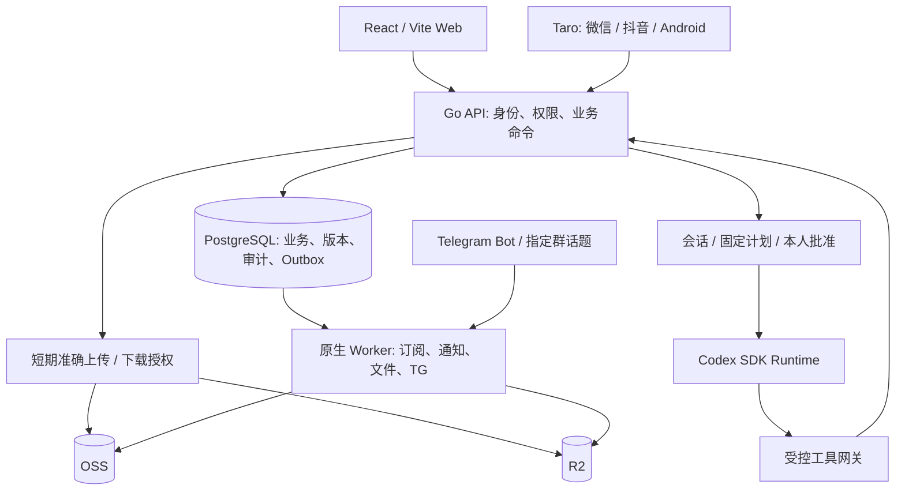

# CopyPaste Case Manager · 中文方案与使用指南

[English](README.en.md) · [仓库首页](../README.md) · [文档索引](README.md) · [截图、录屏与 GIF](media/README.md) · [更新记录](CHANGELOG.md)

这是 CopyPaste 的内部管理平台，把项目、OA、文件、知识、费用订阅、公司秘书和服务状态连接到同一套业务权限与审计体系。本仓库包含可运行实现、详细协议和来源绑定的验证证据；当前为开发预览，四端生产交付仍按 [28 项编号差异](delivery/03-goal-gap-assessment.md)推进。

## 1. 目标与范围

| 已确认条件 | 方案约束 |
| --- | --- |
| 首期 3 名员工、3 人同时在线；人员在香港 | 身份独立、业务留痕，按香港时间展示；不因人数少省略权限与恢复机制 |
| 已有境内服务器，规格与实际接入信息后续提供 | 先以模块化单体 API 和独立后台进程降低运维成本；实际跨境网络需要验证 |
| 原件约 2 TB，最大单文件 120 GB | Web／Android 直传对象存储、断点续传；小程序负责查询、审批与有界内容读取 |
| Web、微信小程序、抖音小程序、Android 必须首发 | 共享业务事实，各端分别验收；H5 演示和编译成功不能替代平台或设备测试 |
| OA 包含合同、采购、报销、月度开支与订阅 | 发生费用、现金支付和未来预测分别核对；不做考勤、人事或工资系统 |
| OSS + Cloudflare R2；应用机仅留临时数据 | 正式原件走双云、临时工作目录受限；生产 PostgreSQL 必须独立持久化并有备份 |
| Codex 公司秘书与股东 TG 群 | 使用业务工具和准确授权，不赋予模型服务器任意目录、数据库或云密钥的直接控制权 |

基础设计适合当前小团队，但不是“一个服务器目录加机器人”的存储方案。数据库保存业务、授权、索引与历史；对象存储保存正式字节；Worker 承担可恢复的后台工作。容量、云流量、跨境链路、扫描和备份费用需要以实际供应商配置与流量测算，仓库不承诺固定月费。

## 2. 架构与数据流



| 目录 | 责任与边界 |
| --- | --- |
| [app/backend](../app/backend) | Go API、领域命令、69 个当前迁移、数据库约束、任务与独立 Worker；PostgreSQL 为业务事实来源 |
| [app/web](../app/web) | React + Vite 管理入口、业务列表／表单／历史、固定依据查看、审批和运行回执 |
| [app/mobile](../app/mobile) | Taro 公共业务页面与 Android 原生宿主；原生私有文件、身份请求及大文件服务 |
| [app/agent-runtime](../app/agent-runtime) | Codex SDK 适配、受控上下文、运行取消与工具回执；真实模型仍需接入验收 |
| [app/packages](../app/packages) | OpenAPI 类型、共享设计资源；以明确契约连接各端 |
| [app/skills](../app/skills) | 八项带版本、输入输出 Schema 和工具清单的草稿包 |
| [app/deploy/native](../app/deploy/native) | 原生 Worker 的 systemd 服务模板；不代表已配置生产 API／TLS／运行时隔离 |
| [docs](.) | 需求、协议、设计、部署、追踪、证据和媒体；历史增量保留执行范围 |

API 不把迁移凭据传给日常服务，后台进程按用途取得数据库／对象存储权限。事务内写业务结果、审计与待投递事件，再由租约 Worker 处理外部副作用；网络超时或未知结果必须先核对，不能重复创建费用、业务或外发消息。

## 3. 能力与当前交付边界

| 模块 | 已有实现 | 尚需独立完成或验收 |
| --- | --- | --- |
| 身份与权限 | 独立用户、角色／动作、项目成员、分类与 ACL、MFA、会话撤销、密码恢复、审计 | 实际组织配置、安全评估与生产身份运维 |
| 项目管理 | 模板修订、立项、成员、任务／依赖、看板／时间线、里程碑、风险／问题、交付、变更、预算、结项与归档 | 移动端变更实施、预算等后续操作，四端完整矩阵 |
| OA | 往来方、合同修订、采购与报销草稿、固定送审、顺序审批、执行、签署及履约历史 | 各端剩余编辑／附件入口和实际公司审批政策 |
| 财务与订阅 | 唯一实际费用、分摊、付款分配、退款／冲销、现金／发生报表、账期与预测 | 真实对账样本、更多移动操作及业务验收 |
| 文件与知识 | 目录／ACL／固定版本、分片协议、校验扫描、正式版本、复制恢复、知识草稿／发布／历史 | 真实 OSS/R2 身份与策略、120 GB、2 TB 迁移、恢复演练、更多格式 |
| 公司秘书 | 会话、准确计划和批准、受控项目／文件／目录／OA／知识／订阅／状态工具、实际回执 | 真实 Codex 调用、生产隔离与签发服务、八项 Skill 发布和质量评测 |
| TG | 本人绑定、指定群话题入站、持久调度、受限读取、投递准备／回执／未知结果核对 | 真实 Bot／群、境内链路、模型和允许披露内容的正式验收 |
| 状态与通知 | 服务／事件、签名观测、新鲜度、维护、站内通知、可靠投递记录 | 真实主机／备份观测、外部通道和规模测试 |

完整未完成项以编号差异表为准。仓库发布、演示齐全或 APK 生成均不表示完整系统已经生产可用。

## 4. 员工与管理员的使用逻辑

### 身份与开工

管理员先配置实际用户、业务角色、分类策略与项目范围。员工使用自己的身份登录，并在要求的动作中完成 MFA。系统管理员身份不自动具有合同、付款或秘书会话的全部读取权；加入项目也不会自动获得所有业务动作。

在工作台查看本人可见项目、待处理业务与通知。打开通知后仍按当前权限读取原记录，“已读”只改变通知，不会完成审批。账号安全页可撤销自己的设备会话；密码恢复通过单用凭证进行，不设置公开通用密码。

### 项目从立项到归档

1. 从项目入口创建项目；选择模板时固定其已发布修订，核对名称、范围、负责人、时间和成员。后续模板修改不会静默改写已有项目。
2. 维护实际成员角色；转交负责人使用独立操作。任务录入负责人、验收标准、日期及依赖，在列表、看板或时间线跟踪同一条业务记录。
3. 建立里程碑、风险和问题。里程碑达成需要实际关联完成证据；风险实际发生会创建真实关联问题，此后沿问题处理，解决／关闭必须写明结果。
4. 交付提交固定文件版本，交给有权且独立的人员验收；退回后提交新的修订，旧记录保留。
5. 范围或预算变化先生成固定变更依据，经独立审批后明确实施。审批通过不会自行修改原基线。
6. 结项先检查十三类业务与财务项，记录复盘，满足身份验证后归档；归档与受控重开保留历史。

项目概览聚合十六类业务，并保留原币精确金额、原记录与当前读取权限。概览中的数据量与筛选范围必须如实显示，不能把部分分页当作全量。

移动任务入口为“项目 → 任务 → 新建任务”。填写名称、说明／验收标准、实际成员负责人、优先级、审核要求和香港时间排期；父任务与里程碑从当前项目分页选择，核对后明确保存。任务详情可编辑资料、创建子任务或单独添加／移除前置依赖；清空已有日期或关联是明确解除。开始／完成使用原状态操作，前置未完成、循环或只读项目由原业务拒绝。保存冲突、回执不完整或响应丢失时保留输入，先读取实际任务与关系列表，再决定后续操作，不连续重复创建。查看[移动任务协议](development/78-mobile-task-editing-and-dependencies.md)与[实际演示](media/README.md#4-移动任务子任务与前置依赖--mobile-task-subtask-and-prerequisite)。

移动结项入口为“项目 → 项目结项与归档”。先读取十三类完整核查清单并沿原记录处置阻塞，明确进入结项阶段，再填写成果、经验、后续跟进和归档原因，按需选0—20个正式文件版本。业务与财务两项核实分开确认，完成本人两步验证后明确归档；成功还需核对实际项目和本次历史。并发或未知结果时保留文字并阻止重放，“保留文字和选定版本，重新核查”会重新读取权限和依据并重置声明／MFA。历史按十份分页，受限不显示数量；受控重开保留旧复盘并标记依据已变化。详见[结项协议](development/79-mobile-project-closeout-and-archive.md)与[实际演示](media/README.md)。

### 合同、采购与报销

先登记往来方、正文、金额与固定文件依据，保存为可修改的业务草稿；预览准确版本后明确送审。审批读取提交时固定的依据，按配置顺序处理，申请人与审批人不能绕过独立性规则。

合同审批之后仍要走实际签署、启用、付款计划、履约与完成／终止核对。采购审批后按原订单执行部分验收、拒收、退货和差异处理；差异必须经准确批准再实施。报销获批不会自动转账，实际费用与付款仍分别登记核对。修改已送审的依据需要修订、撤回或重提，不能直接覆盖历史。

### 每月费用与订阅

一次实际费用只有一个权威记录，可以关联多个项目并保留分摊份额。付款有独立现金事实、分配与退款／冲销记录。报表分别查看：

| 口径 | 解释 | 避免的误用 |
| --- | --- | --- |
| 发生费用 | 实际确认的成本及项目份额 | 不把审批额度、合同总额再次当成已发生费用 |
| 现金支出 | 实际付款／退款等资金事实 | 不把未支付费用或预测当作现金 |
| 未来预测 | 按订阅原始日历、价格修订和有效期间推算 | 不与实际账期重复累加，不用当前价格改写历史 |

金额保留原币与十进制文本，不凭空换算成 HKD。订阅支持账期、价格变化、取消和实际核对；秘书审阅可以引用逐笔依据，但不能自动产生付款或冒充财务确认。

### 文件、项目博客与知识

选择准确目录与项目后上传。客户端从 API 获取短期、限定对象的分片授权，直接向选定对象存储传输；恢复时先核对云端已有分片。上传完成只代表候选字节已到达，后续仍需冻结来源、完整摘要、扫描和正式版本提交，再复制到另一云并核验。

下载与引用始终绑定当前权限和固定版本。撤权、失效或来源不明确时拒绝读取；本地临时副本不取代云端正式版本。知识／项目博客使用草稿、发布修订、评论和准确附件；恢复历史生成可追踪的新修订，不抹掉审计。

### 公司秘书与 TG

员工在有权的会话内提出目标，秘书读取当前允许的内容，生成有界计划。涉及项目创建、文件变更、目录整理、OA 送审或知识发布时，核对准确对象、版本、差异、范围及本人确认，再调用原业务命令。界面通过真实业务回执显示成功；普通聊天中的“同意”不代替协议要求的本人批准或近期 MFA。

八项草稿 Skill 为：`project-create`、`project-update`、`file-update`、`information-organize`、`oa-assist`、`subscription-review`、`project-briefing`、`incident-summary`。当前不应直接把 manifest 从 draft 改成 published 来宣布上线。TG 还要求本人绑定、准确群／话题和渠道约束，不能因用户在群内就获得所有公司资料；当前 TG 运行工具保持受限读取，真实外发另验。

### 服务 status

服务列表展示实际观测时间、有效性、维护及事件状态。没有新鲜观测时应显示未知或过期；维护不删除故障历史。真实服务器探针和备份失败事件必须接入实际来源后再形成生产状态承诺。

## 5. 原生本地开发

以下脚本面向当前 Windows 原生开发环境。不要启动 Docker、WSL、虚拟机或 Android 模拟器。应用开发的 PostgreSQL 本地持久化仅是开发工具，与“生产应用机只留临时文件”的约束不同。

| 工具 | 当前仓库约束／已验证环境 |
| --- | --- |
| Git + SSH | 可访问本仓库；推送使用自己的已授权身份 |
| Node.js / npm | `>=22.14.0 <23`；验证基线 22.14.0 / 10.9.2，依赖使用 lockfile |
| Python | Python 3.11+；脚本使用 UTF-8；媒体附加需要 Pillow 与 FFmpeg |
| Go | go.mod 声明 1.27.0、toolchain 1.27.3；仓库 bootstrap 使用固定校验摘要 |
| PostgreSQL | 已验证原生 18.6；将完整发行包解压到 `app/.tools/pgsql/`，需含 `bin/initdb.exe`、`pg_ctl.exe`、`psql.exe` |
| 浏览器检查 | 原生 Edge／Chromium + Playwright；关闭自己创建的上下文和页面 |
| Android（可选开发） | 原生 JDK 17、Android SDK platform 34／build-tools 34.0.0；当前宿主目标 SDK 34，生产兼容性仍需处理 |

从仓库根目录执行：

```powershell
$env:PYTHONUTF8='1'
python app/scripts/bootstrap_go.py
npm ci --prefix app
python app/scripts/dev_database.py start
python app/scripts/run_backend.py migrate
python app/scripts/seed_development.py
```

`dev_database.py` 创建或复用自己管理的原生集群，默认尝试 55432 并把实际端口写入忽略目录的环境文件；不要假定端口必定为默认值。Go、PostgreSQL、缓存、临时数据库和生成凭据都不进入 Git。初始化账号仅用于空的本地开发库，随机身份信息保存在 `app/.local/development-accounts.json`；首次 MFA 配置与恢复信息也属于私有数据。

分别在两个终端启动：

```powershell
$env:PYTHONUTF8='1'
python app/scripts/run_backend.py api
```

```powershell
npm run dev --prefix app
```

当前助手配置使用 API `127.0.0.1:18080`、Web `http://localhost:5178`，Vite 代理 `/v1` 和健康检查。开发环境生成文件是实际依据。[.env.example](../app/.env.example) 是人工配置模板，其中 8080／5173 等值是示例，不能覆盖已生成的环境。云存储、扫描、模型与 TG 默认关闭，缺少扫描配置不等于文件干净。

正常停止前台终端进程；仅在不再需要自己管理的数据库时运行：

```powershell
python app/scripts/dev_database.py status
python app/scripts/dev_database.py stop
```

不要按端口批量终止其他用户服务、删除未知数据库或因等待超时重启正在工作且归属明确的进程。详细环境逻辑见[本地开发协议](development/08-local-development.md)。

## 6. 构建四端与运行测试

在 `app/` 执行：

```powershell
$env:PYTHONUTF8='1'
npm run contract
npm run typecheck
npm run build:web
npm run build:runtime
npm run test --workspace @copypaste/web
npm run test --workspace @copypaste/agent-runtime
npm run check:skills --workspace @copypaste/agent-runtime
npm run test --workspace @copypaste/mobile
```

两小程序的本地构建示例：

```powershell
$env:CP_MOBILE_BUILD_PROFILE='local'
$env:CP_MOBILE_API_ORIGIN='http://127.0.0.1:18080'
npm run build:weapp
npm run build:tt
```

输出分别为 `app/mobile/dist/weapp` 和 `app/mobile/dist/tt`。这是本地编译配置；实际小程序必须配置平台账号、合法 HTTPS 域名和可达 API，手机上的 `127.0.0.1` 不会指向开发电脑。H5 仅用于共享界面检查，不作为第五个首发客户端替代 Android。

Android 原生构建仍在 `app/`：

```powershell
python scripts/setup_android_native.py
python scripts/build_android.py --google-mirror --evidence-group my-change
python scripts/inspect_android_apk.py --evidence-group my-change
```

镜像选项为明确选择的依赖下载方式；已有工具可按脚本支持使用离线准备。生成的是开发 APK，保存在忽略的 `.local` 下；签名密钥、正式 APK 与私人 SDK 配置不上传。四端需实际设备／平台分别验收，当前宿主原生依赖和目标 SDK 的生产要求仍未放行。

完整后端与移动检查可分别运行：

```powershell
python scripts/verify_backend_batches.py --evidence-group my-change
python scripts/verify_mobile.py my-change
```

后端检查需要已准备的原生 PostgreSQL 测试环境；原生批次会产生并清理隔离测试库。按改动选择相关检查，不用未改动源码重复执行昂贵构建来冒充新证据。修改 OpenAPI 时同步生成契约，修改设计 token 时执行 `npm run tokens`。本次增量79的具体执行、复用和失败尝试见[验证记录](quality/evidence/mobile-closeout/verification.md)。

## 7. 生产部署与存储计划

生产环境尚未部署。拿到服务器资料后先确认 CPU／内存、系统、出口、香港访问链路、备份位置、域名与 HTTPS。使用原生服务管理 API、Worker 和受限运行时；PostgreSQL 独立持久化，迁移使用独立身份。Linux 构建示例在 `app/backend/` 使用 `go build -o ../.local/bin/platform ./cmd/platform`，先创建输出目录；这只是构建，不是部署。

配置按进程分开：API 仅上传签名／核查和必要下载权限；上传、校验、扫描、正式提交、复制及恢复 Worker 分别使用源读／目标写的窄权限；秘书运行时不持有业务数据库与对象存储主密钥。生产还需要真正的原生执行隔离、资源／网络／目录限制与可信证明签发，不能以 SDK 参数代替这些控制。

文件计划为“一个明确主源 + 另云独立副本 + 完整摘要与版本证据”，不是客户端每次重复上传两份。2 TB 迁移先生成清单、分类与权限映射，分批导入、去重核验、回滚与抽样人工复核。120 GB 需要真实网络下的中断、凭据到期、设备重启、撤权、内存／磁盘占用和双云摘要测试。扫描器超出限制时不能把跳过扫描视作通过。

双云原件副本不替代 PostgreSQL 备份、PITR、密钥恢复、版本／保留策略或删除防护。分别演练元数据恢复、原件恢复、权限恢复与全链路切换，按实际需求确认 RPO／RTO。[部署运维](operations/01-deployment-and-operations.md)、[备份迁移恢复](operations/02-backup-migration-and-recovery.md)和[配置目录](governance/03-configuration-catalog.md)是详细约束。

## 8. 当前证据与放行条件

| 层面 | 当前功能基线 | 范围说明 |
| --- | --- | --- |
| Go / PostgreSQL | 146 顶层测试、919 条结果／832 末级场景、8 批通过 | 未变更的完整 Go／SQL／契约摘要复用增量74；不是本次全量重跑 |
| 运行时 / Web | 39 / 81 项通过及构建 | 未变更来源复用；真实模型关闭 |
| Taro | 137 项通过；微信／抖音各 16 页编译 | 增量79新执行，9组实际结项／归档流程及9项布局；H5不代表真机 |
| Android | 增量79新APK 42,842,779字节、17项检查；25项原生结果 | UP-TO-DATE保留结果，本轮未新执行；实体设备、签名与发布另验 |
| 仓库媒体 | 共20张PNG、5段MP4、5个GIF；本次新增3张结项／复盘图及1对录屏／GIF | 隔离合成数据、实际浏览器与API；旧图保留历史提交来源，无真实云／模型／TG外发 |

锁文件的既有审计记录包含 **114 项依赖问题，其中 11 项 critical、32 项 high**，生产安全放行未通过。本次移动功能未升级依赖，历史审计不能视为当前线上安全证明，详见[保留审计](quality/evidence/android-native/dependency-audit.json)。

继续推进顺序：补业务与各端缺口 → 实际模型／隔离／Skill 和云存储联调 → 真实 TG 与平台／Android 设备 → 120 GB／2 TB、容量／安全 → 备份恢复和生产切换。外部账号与服务器信息未提供的项单列等待输入，其他实现继续推进。所有完成结论须能追到准确源码、命令、回执和未完成项。

## 9. 文档与同步维护

新增或修改功能时，代码放在 `app/`，文档／媒体／更新说明放在 `docs/`。按 [贡献与同步约定](contributing.md)同时维护中文、英文指南、受影响协议、差异编号、验证证据和实际演示；完成后将对应变更一并提交并推送到 `git@github.com:copypasteltd/case-manager.git`。不强制推送，不提交凭据、原始录屏帧、工具链、数据库和本机缓存。

需求与模块协议通过[文档索引](README.md)阅读；查看[实施台账](delivery/02-implementation-ledger.md)确认真实进度，通过[媒体目录](media/README.md)查看操作，通过[更新记录](CHANGELOG.md)了解本次发布范围。
