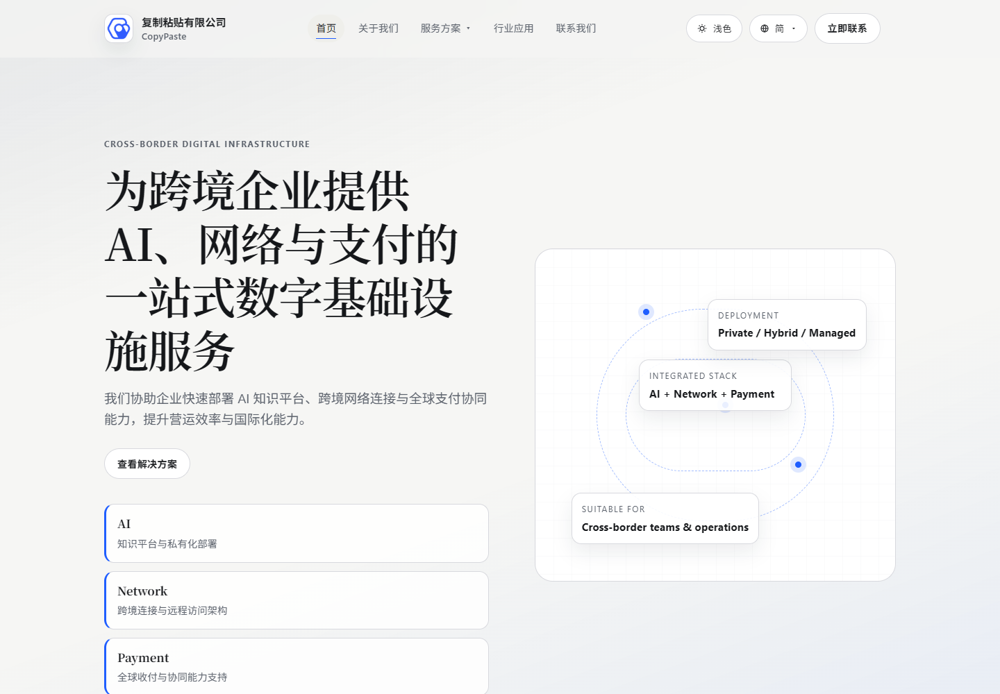
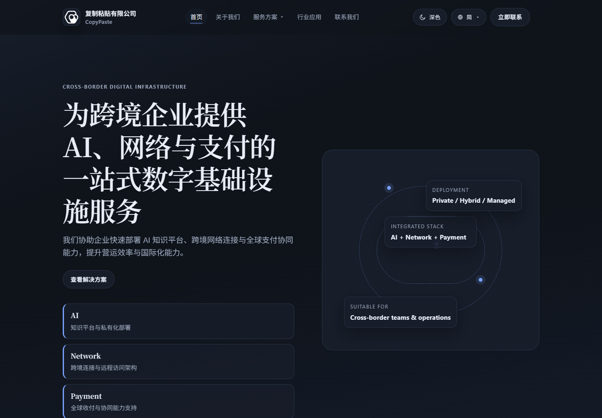
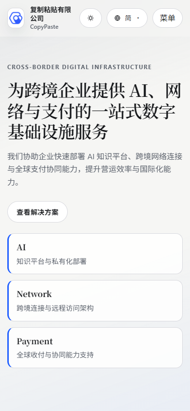

# 官网风格实证与继承依据

版本：v1.0.0-draft；取证日期：2026-10-23（本地，UTC+8）。范围为官网首页、首页共享 CSS/JS 以及实际 Logo，不宣称完成官网全部页面审计。

## 1. 来源与证据

| 来源 | 本次用途 |
| --- | --- |
| [CopyPaste 官网](https://copypaste.hk/) | 品牌布局、标题与标识、明暗主题和移动表现 |
| [官网样式表](https://copypaste.hk/styles.css) | 原始色值、字体栈、尺寸、动效和断点 |
| [官网脚本](https://copypaste.hk/app.js) | 核对主题/Logo 的实际切换来源 |
| [本地取证 JSON](evidence/website-reference.json) | HTTP 状态、时间、计算样式、字体和资源哈希 |
| [原生取证脚本](capture_official.cjs) | 复核方法；使用独立无头浏览器，finally 关闭上下文和浏览器 |

本次通用网页文本提取器无法读取首页，改用原生 HTTPS 和 Edge 实际加载成功，三次首页响应均为 200。桌面明/暗视口为 1440×1000，移动为 390×844；该快照的根文档宽度未超出视口。它不能证明所有设备和所有网站页面均无溢出。

样式表 SHA-256：8b7a00e48e7d53637e68f5bd8be970f286a881d53e9c86970fffb01888003e0e。资源变化后应重新取证并比较差异，不能继续把旧快照写成当前官网事实。

最新来源复核于2026-10-24 21:31（UTC+8，UTC记录为2026-10-24T13:31:40.757379+00:00）执行：通过原生HTTPS读取首页、共享CSS、脚本及当前使用的浅/深PNG标识，共5项资源均返回200且SHA-256与原始快照一致；两张本地PNG也分别与线上及原始取证一致，详见[来源复核记录](evidence/website-source-refresh.json)。复核命令为 `python -X utf8 app/scripts/check_website_design_sources.py`，保留原始取证并且不自动替换品牌资产。来源复核未启动浏览器，不覆盖原浏览器取证时间，也不表示全站或所有交互均已重新检查。

## 2. 原始配色（O）

| 官网变量 | 浅色 | 深色 | 官网含义/注意 |
| --- | --- | --- | --- |
| color-primary | #0E1726 | #D8DEEA | 品牌基础色；变量名不代表按钮填充 |
| color-secondary | #202D45 | #B5C1D8 | 次级品牌色 |
| color-accent | #1F5EFF | #79A2FF | 蓝色链接、重点和装饰强调 |
| color-bg | #F6F6F4 | #0F131A | 页面画布 |
| color-bg-soft | #EFEFEB | #141A24 | 柔和背景 |
| color-surface | #FFFFFF | #171D29 | 面板表面 |
| color-text | #15171A | #E8EDF8 | 正文、主按钮填充 |
| color-text-muted | #5D636D | #A0ACC2 | 次级文本 |
| color-border | #D8D9DE | #2A3344 | 轻描边 |
| color-shadow | 0 12px 28px rgba(12,21,35,.08) | 0 14px 34px rgba(0,0,0,.32) | 面板阴影 |

官网主按钮实际采用 color-text 背景与 color-bg 文字：浅色是墨底白字，深色反转为浅底深字。官网不是所有主要按钮都填品牌蓝。内部平台必须保持此关系。

## 3. 字体与实际渲染（O）

| 层级 | 官网 CSS 声明 | 实际取证限制 |
| --- | --- | --- |
| 正文 | Manrope / Avenir Next / Segoe UI / Noto Sans SC / PingFang SC / sans-serif；行高1.65 | 本次机器中文主要回退 Noto Sans SC，拉丁内容使用 Segoe UI |
| h1—h4 | Fraunces / Iowan Old Style / Noto Serif SC / Songti SC / serif；600；行高1.2；字距-.02em | 本次中文标题实际为 Noto Serif SC SemiBold |

获取的 CSS 未包含字体文件加载声明，本次 document.fonts 集合为空，平台字体报告为系统字体。不能把「声明 Fraunces/Manrope」写成「访客已下载并使用这两种字体」。后台先提供稳定回退；如需各端严格统一字体，须另做字体授权、子集、包体和加载 PoC。

## 4. 结构、形态与动效（O）

| 项目 | 实际表现 | 对后台的启示 |
| --- | --- | --- |
| 布局 | 最大1140px内容区、宽留白、左右分栏；移动单栏 | 继承秩序与呼吸感，数据工作区扩展至1600px |
| 顶栏 | 82px、吸顶、半透明与16px模糊；滚动后描边更明显 | 后台改64px稳定实色，避免表格穿透干扰 |
| 标题 | 衬线大标题；桌面 Hero 可到64px | 只在工作台欢迎标题等少量位置使用衬线 |
| 面板 | 1px描边、16px圆角、20px内边距、约18px间隔 | 默认扁平描边；浮层才用明显阴影 |
| 重点块 | 14px圆角、左侧3px蓝色线 | 派生为选中项、秘书来源与摘要标记 |
| 品牌图形 | 26px圆角区域、26px网格、细线轨道和节点 | 可用于登录背景局部，工作区不持续旋转 |
| 按钮 | 胶囊、至少44px高、横向18px内距 | 主操作保留胶囊；表格工具/输入控件采用10px圆角 |
| Logo框 | 42×42px、12px圆角 | 保留方形比例，不裁切或重绘 |
| 断点 | 1180 / 900 / 640px | 作为后台响应式起点，需按任务密度实测 |
| 动效 | hover约180—200ms、卡片上移3px；reveal约450ms；轨道11/14s | 后台收敛为120/180/240ms，不延迟显示业务内容 |

## 5. Logo 来源（O）与使用限制（D）

首页 img 实际加载 [浅色 PNG](https://copypaste.hk/assets/logo/CopyPaste_Light.png) / [深色 PNG](https://copypaste.hk/assets/logo/CopyPaste_Dark.png)，两张原图均为1080×1080。本地复制为 [official-logo-light.png](assets/official-logo-light.png) 与 [official-logo-dark.png](assets/official-logo-dark.png)。按主题成对使用，保持1:1、contain、不拉伸。

更新复核必须包含这两张PNG本身：官网可能保持同一路径而替换图片内容，不能仅由HTML/CSS哈希未变推断Logo未变。原始与当前哈希、本地资源匹配结果一并保存在来源记录；发现变化先评估再更新设计资产，复核脚本不会自动覆盖本地Logo。

官网路径下也存在 SVG，已留存作来源参考，但与当前 PNG 的图形配色不同。SVG 不能仅因是矢量就自动替代当前 Logo；须经品牌核对后才可切换。图标优先 SVG 的工程规则不适用于替换这份现有品牌标识。

本文建议的留白、后台字号和小尺寸用法属于 D，并非公司既有完整 VI。后台名称暂用「CopyPaste 内部平台」，不根据网页显示自行变更公司法律名称。

## 6. 取证截图

浅色桌面：

深色桌面：

移动端：

## 7. 继承与扩展清单

必须继承：双主题基础色、墨色主按钮与主题反转、少量蓝色、无衬线正文/衬线品牌标题、细描边面板、方形 Logo 和克制的品牌线条。

为产品扩展：状态色、输入边框、焦点、选中文字色、图表序列、表格密度、侧栏导航、各类业务组件和移动交互。所有扩展均在 [视觉基础](02-visual-foundations.md) 与 tokens.json 中列明；禁止把新扩展反向声称为官网已有规范。
