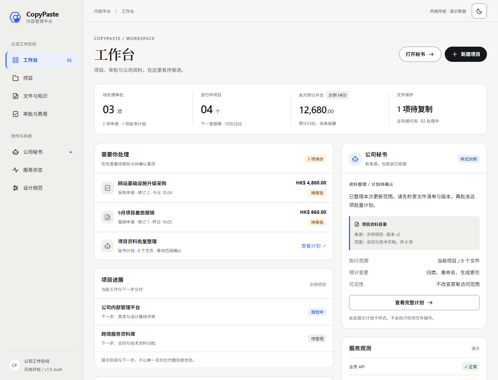
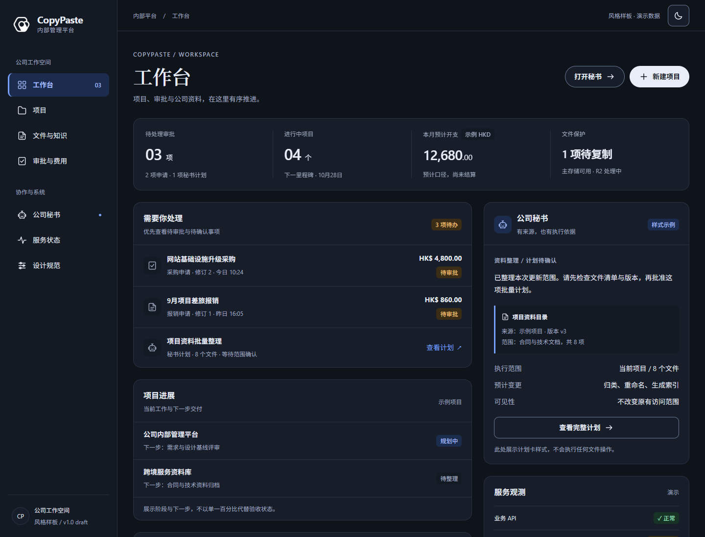
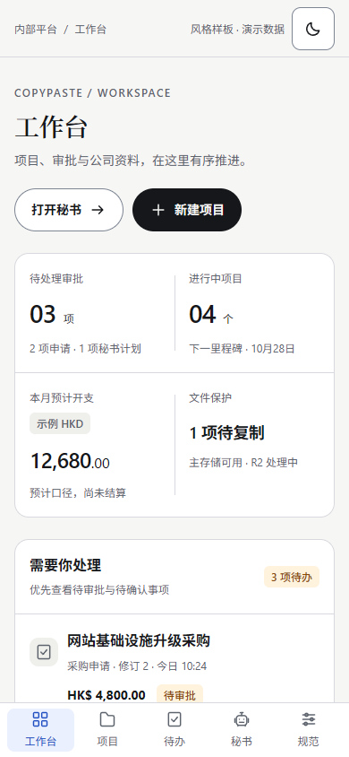

# 本轮设计验证记录

首次记录：2026-10-23；更新：2026-10-24；设计版本：v1.0.0-draft。初始范围为设计文档、令牌和本地风格样板；后续章节分别记录业务页面和设计复核，各有固定来源和边界。风格总规范与样板完善见第16节，最新官网风格文档交付复核见第23节。

## 1. 官网来源验证

原生Edge分别加载1440px浅色、1440px深色、390px移动首页；响应200。已保存计算样式、字体回退、Logo资源、哈希与截图，详见 [官网取证](evidence/website-reference.json) 和 [风格审计](01-website-style-audit.md)。此记录对应当次首页及共享资源，不能推导全部官网页面已检查。

2026-10-23 04:51（UTC+8；启动时间见JSON）采集了上述三组页面及7项资源。共享CSS的SHA-256为8b7a00e48e7d53637e68f5bd8be970f286a881d53e9c86970fffb01888003e0e，与视觉基线一致。后续原生HTTPS复核首页、CSS、脚本与两张PNG，5项均返回200且字节哈希未变；本地两张PNG与原取证及线上一致。最新执行时间和详细结果见[官网来源复核](evidence/website-source-refresh.json)及第7节。此步骤只核对资源，不新增官网浏览器取证。

## 2. 静态与浏览器验证

实际结果保存在以下机器记录，文字结论只覆盖其列出的检查：

| 记录 | 范围 |
| --- | --- |
| [静态检查](evidence/design-static-review.json) | 全docs Markdown编码/本地链接/总索引；CSS可重建、主题键一致 |
| [对比度报告](evidence/contrast-report.json) | 指定实色文字、状态、控件边和焦点组合，按未舍入比值判定 |
| [样板浏览器检查](evidence/styleguide-review.json) | 7组视口/主题、根/元素溢出、图片、操作名称、主题、减少动态效果、局部交互 |

浅蓝选中底与原始浅色品牌蓝约4.494:1的已知不合格正文组合保留为excluded_pair，实际用fg.selected替代；不把已知失败藏进「全部配色合格」的表述。

| 已执行检查 | 实际结果 |
| --- | --- |
| Markdown/导航/本地链接 | 全docs扫描数量以最新静态记录为准；UTF-8/末尾换行/无替换字符；目标存在、总索引完整 |
| 令牌/生成结果 | 两主题各39个同名语义值；CSS与JSON重建结果一致 |
| 指定对比度 | 64组必要组合通过；实值判定，已知不合格原始组合单独排除并说明替代 |
| 原生浏览器样板 | 7组：1440浅/深、1024浅、768浅、390浅/深、320浅；无检测到的根/元素横溢、缺失图片或无名称操作控件 |
| 主题/减少动态效果 | 7组均检查实际画布/主按钮颜色及禁用过渡 |
| 排版/关键金额 | 7组均检查无衬线工作内容、衬线品牌标题、按钮字体与关键金额≥14px；移动任务标题≥16px。另记录两个代表节点实际使用的系统字体 |
| 移动核心示例命中区 | 390浅/深、320浅中的主题按钮、底部导航、页首操作与表单检查按钮高度≥48 CSS px |
| 局部交互 | 普通样例按钮不写业务、错误汇总焦点、跳转错误字段、修正后清错、本地提交反馈、导航当前项、键盘焦点可见 |
| 来源固定 | 样板HTML/CSS/JS、令牌源/生成CSS、两个PNG及检查脚本共8项来源保存SHA-256；检查期间未变 |

最新样板检查执行于2026-10-24T04:47:18.071Z（UTC+8为2026-10-24 12:47），共38项断言通过，错误列表为空；本地样板没有页面运行时异常。8项来源摘要为66af81286658c7755dc6611f8c537576e7c222ab698fdb56bbb5c9dd4a448eef，检查期间未变。此前桌面金额已由12px修正为14px；本机代表节点的实际字体为系统字体，不据此承诺其他设备会使用同一字体。本轮另记录8种语义色实际色值和5类排版的计算字号/行高，并人工复核浅色、深色和移动色板/排版局部截图；浏览器及上下文均已关闭。

## 3. 可查看截图

样板浅色桌面：

样板深色桌面：

样板移动端：

色板与排版局部：[浅色桌面](evidence/styleguide-light-foundations.png)、[深色桌面](evidence/styleguide-dark-foundations.png)、[移动色板](evidence/styleguide-mobile-foundations.png)、[移动排版](evidence/styleguide-mobile-typography.png)。移动色板截取色值网格，移动排版截取文字面板；局部截图不代表整页所有内容同时位于首屏。

截图为合成数据的风格参考，金额、审批、项目、上传与监控均未接真实业务。部分设计规定（例如系统主题记忆、原生上传）未在此静态样板实现，不能根据截图认定其已交付。

## 4. 验证限制

本次不包含完整WCAG审计、真实读屏、实际浏览器200%缩放验收、第三方控件、原生/小程序真机、19组业务页面、接口/权限、120GB实传、双云、TG或模型调用。对比度检查只针对报告内指定组合，不包含所有图表邻接/透明叠加/图片。VD-01—14仍为后续产品验收计划。

## 5. 环境与清理

使用Windows原生Python、Node与Edge，浏览器使用本任务独立临时上下文；两个浏览器脚本均在finally中关闭本任务页面/上下文和浏览器，关闭结果见相应JSON。未连接或关闭用户原有浏览器标签页，未启动Docker/WSL/虚拟机/模拟器，未部署资源或对外发送消息。

维护方式：修改令牌后重新生成CSS并核算，修改样板后重新浏览器审阅；只重跑受影响检查。实际产品新增页面后另记产品证据，不覆盖本次样板验证边界。

## 6. 设计交接补充

已补充[组件交接与状态契约](07-design-handoff-and-component-contracts.md)：CP-01—28组件目录、命名、变体、权限分支、长数据样本和逐页交接模板。已补充[关键页面布局与任务流](08-page-layouts-and-flows.md)：各业务模块的内容分区、流程、异常与四端检查要求。

两份文件已纳入设计目录、文档总索引和本轮静态链接检查。它们是设计约束与开发输入，不属于业务页面实现或四端验收通过证据。

## 7. 品牌应用与当前来源复核

已补充[品牌应用与文案规范](09-brand-application-and-content-style.md)，统一色彩优先级、各业务模块的品牌应用、四类页面构图、操作与结果文案、跨端和未来打印输出的设计边界。所有派生规则仍标记为D，不冒充官网已有VI。

原生Python来源复核已扩展到首页、CSS、脚本与两张当前PNG共5项，实际状态、原/当前SHA-256与本地PNG匹配结果保存至[官网来源复核](evidence/website-source-refresh.json)。5项均未变化，两个本地标识一致。来源复核本身未调用浏览器；样板浏览器检查另按第2节的时间和范围记录。文档及索引另执行静态验证，不将文档通过推导为业务页面通过。

2026-10-24 04:39（UTC+8）再次执行上述5项原生HTTPS复核，结果仍一致；本次未启动浏览器。已增加[订阅与财务页面设计](10-subscriptions-and-financial-views.md)，细化列表/详情/编辑、停订及供应方核实、账期对账、三种月报、覆盖与提醒的布局和语义。这是设计约束补充，尚不能作为新增订阅业务页面的浏览器验收记录。

## 8. 移动产品的后续验证

Taro 公共页面已从本目录同一令牌源生成两主题各39个语义值与字体栈，并复用官网标识。后续[移动实施记录](../development/31-mobile-client-foundation.md)和[实际 API/UI 证据](../quality/evidence/mobile-browser/result.json)单独记录产品检查，不覆盖前述风格样板的执行范围。2026-10-23T11:38:05.474Z 的检查覆盖8条链及320/390/768宽度的双主题，244个移动/API/检查来源期间未变；深色任务和浅色已批申请代表截图已人工复核，品牌单行、输入字体、深色文本框及可用按钮误套禁用透明度的问题已修正。浏览器、夹具数据库及所属服务均已清理。

此记录不包含微信/抖音真机、Android、读屏或其余业务页面，不将共享 H5 页面通过推定为原生平台通过。

## 9. 服务状态与事件产品检查

服务目录/来源/维护及事件时间线已使用同一暖白、墨色、品牌蓝、双主题语义状态和表单规范落地，具体实现见[状态实施协议](../development/32-service-status-and-signed-observations.md)。状态保留文字与证据时刻；过期响应显示“待重新确认”，维护另保留底层观测状态；配置与处置均使用实际MFA和版本冲突分支。

[实际浏览器记录](../quality/evidence/service-status/result.json)于2026-10-23T13:08:51.000Z通过8条真实Web/API检查链，269个来源摘要 `feec1ebe62b457a3cc5cebf755225c5e5e2393c97a670a113c96bbe5da200caf`，期间未变。服务/事件详情均检查浅深主题及320/390/768/1024/1440宽度，增加了桌面/移动导航切换稳定性检查；无横向溢出、脚本或服务端错误，代表截图已人工复核。原始签名、维护、全部影响范围、冲突输入保留及复盘通过真实隔离接口验证，未伪造成功响应。

代表产物：[桌面服务详情](../quality/evidence/service-status/service-light-1440.png)、[移动深色服务详情](../quality/evidence/service-status/service-dark-390.png)、[桌面事件与时间线](../quality/evidence/service-status/incident-light-1440.png)。这些均为明确的虚构样本；不含真实采集平台、独立生产告警、通知投递、移动原生客户端或完整19组页面验收。检查完成后临时角色已撤销、全部所属浏览器和标签页关闭，原生测试库清理退出码0，临时Vite停止。

## 10. 采购、报销与共用审批产品检查

采购与报销复用同一暖白/深色画布、墨色主操作、品牌蓝链接及语义状态，实际字段与流程见[实施约束](../development/33-purchase-and-claim-approval-drafts.md)。业务详情显示准确金额、含税/舍入口径、员工垫付与公司已付、固定报价/凭证；批准后的提示按业务类型显示。窄屏明细纵向排列，长资料换行，冲突保留人工输入。

[实际浏览器记录](../quality/evidence/spend-documents/result.json)于2026-10-23T14:36:06.525Z通过8条真实Web/API检查链，283个来源摘要 `1fa49b0701f3a1d93d628b2ba65cd13c48f5b7ef18d5b0c73bf0ba509864c019`，期间未变。详情明确等待业务标题与明细加载后，再检查浅深主题及320/390/768/1024/1440宽度；无检测到的横向溢出、过小操作控件、脚本或服务端错误。首次截图复核发现加载画面后，已加强等待断言并重跑，以下产物来自最终通过记录。

代表产物：[已批采购桌面](../quality/evidence/spend-documents/purchase-approved-light-1440.png)、[采购深色窄屏](../quality/evidence/spend-documents/purchase-dark-390.png)、[报销桌面](../quality/evidence/spend-documents/claim-light-1440.png)、[撤回报销深色窄屏](../quality/evidence/spend-documents/claim-returned-dark-390.png)。已人工复核实际业务内容、状态、金额与固定文件入口。数据均为明确虚构样本，不属于财务凭证、云传输、平台真机或完整19组页面验收。全部所属浏览器/标签页关闭、临时角色撤销，原生测试库清理退出码0，所属Vite停止。

## 11. 采购履行与嵌套弹窗产品检查

订单、验收、拒收、来源退货与取消流程沿用官网暖白/深色画布、墨色主操作、蓝色链接/焦点及既有数量/金额表达。准确口径与行为见[采购履行协议](../development/34-purchase-orders-acceptance-and-returns.md)。

[真实浏览器记录](../quality/evidence/purchase-fulfillment/result.json)于 2026-10-23T15:59:08.703Z 通过7条操作链，290个来源摘要 `e39bffbe55242fd50ccf2267500006788482ba675607984e98c23b908fc53fd0`，期间未变。详情与订单实际加载后检查双主题五宽度，未检出横向溢出、过小根页面操作、脚本或服务端错误。首次视觉复核发现子弹窗关闭后背景跳转链接出现，已修正焦点恢复至仍打开的父模态，并在最终实际操作链增加断言后重跑；单条汇总卡也改为填满可用宽度。

已人工复核最终[桌面概览](../quality/evidence/purchase-fulfillment/purchase-fulfillment-light-1440.png)、[深色窄屏概览](../quality/evidence/purchase-fulfillment/purchase-fulfillment-dark-390.png)、[来源退货事实](../quality/evidence/purchase-fulfillment/order-source-return-dark-390.png)及[原验收可退量](../quality/evidence/purchase-fulfillment/order-accepted-source-dark-390.png)。后两张为实际窄视口中的滚动弹窗截图，不以背景整页截图代替验收事实。

全部数据为虚构样本，正式依据为受控15字节文件。浏览器和标签页全部关闭、临时角色撤销、原生测试库正常清理退出、所属Vite停止。本轮不含真实云、银行、平台真机、读屏或完整19组页面验收。

## 12. 实际费用与原币月报产品检查

费用详情、分摊、固定凭证、准确业务关联、历史与冲销沿用官网暖白/墨色/蓝色链接与深色语义；月报使用原币数字层级、固定期间、项目/公司范围及明细入口。冲销保留类型标签与金额方向；未确认、无权限、冲突和未配置汇率分别说明。实施约束见[实际费用协议](../development/35-canonical-actual-costs-and-incurred-reports.md)。

[最终真实浏览器记录](../quality/evidence/actual-costs/result.json)于2026-10-23T17:49:22.803Z通过8条操作链，304个来源摘要 `3a353ef69f7b7e5a07009ed0a1982d18b30f6d8db2969bc148c58b79e662b4c1`，期间未变。三组实际加载页面均检查light/dark及320、390、768、1024、1440宽度，未检出横向溢出、过小的页面控件、脚本或服务端错误。模态恢复焦点、只读限制、冲突输入保留和明确人工确认在真实操作链中核对；布局自动检查不替代截图复核。

已人工复核最终[深色费用详情](../quality/evidence/actual-costs/actual-cost-detail-dark-390.png)、[深色月报](../quality/evidence/actual-costs/actual-cost-report-dark-390.png)、[窄屏冲销弹窗](../quality/evidence/actual-costs/cost-reversal-dark-390.png)及[桌面钻取](../quality/evidence/actual-costs/actual-cost-drilldown-light-1440.png)。报表筛选和金额卡片保留24px内边距，表单复用既有无边框分组，关联链接具备44px点击高度。原币金额在项目/公司范围下按分摊解释，不把整笔明细金额误标成范围小计。

全部数据为虚构样本，依据为受控15字节正式文件；所有自有浏览器/标签已关闭、临时授权撤销、原生测试库清理退出码0、所属Vite停止。真实云、付款、平台真机、读屏及全平台19组页面仍需各自验收。

## 13. 实际资金与员工结算产品检查

资金台账、付款/退款/分配/释放/冲销、固定凭证与历史、现金月报、费用与员工结算沿用同一暖白/深色画布、墨色主按钮、品牌蓝链接和焦点，以及准确原币层级。来源选择器固定可读费用、批准报销明细和凭证；过期输入保留，受限结算显示未知。准确行为见[资金及结算协议](../development/36-payments-refunds-and-settlement.md)。

[最终真实浏览器记录](../quality/evidence/payments-settlement/result.json)于2026-10-23T19:27:14.400Z通过8条操作链，322个来源摘要 `befefa62ac15784f24b16e4e083fe51f699be1e6982d749ad33f9fc97f1b55d6`，期间未变。付款详情、现金报表及钻取、员工报销结算分别核对双主题与320/390/768/1024/1440宽度，未检出横向溢出、页面操作命中区不足或脚本/服务端错误；模态恢复焦点、第二会话冲突、只读限制、人工MFA确认及固定证据均经实际操作核对。

已人工复核最终[深色付款详情](../quality/evidence/payments-settlement/payment-detail-dark-390.png)、[深色现金月报](../quality/evidence/payments-settlement/cash-report-dark-390.png)、[桌面员工部分结算](../quality/evidence/payments-settlement/employee-settlement-light-1440.png)和[窄屏退款冲销](../quality/evidence/payments-settlement/payment-reversal-dark-390.png)。首次视觉复核发现实际资金时间只有日期，已补齐香港时分秒并在最终真实操作链增加断言；员工报销面包屑也已修正。报表保持日期期间、原币净额/退款/冲销/未分配分别表达，员工批准200/已付100/待收100为实际隔离账本投影。

全部资料为明确虚构样本，资金凭证为受控15字节正式文件；没有真实银行支付、云对象传输、平台真机或完整财务/四端验收。浏览器上下文及标签页全部关闭、临时角色撤销，原生测试库清理退出码0、所属Vite停止。未运行Docker、WSL、虚拟机或模拟器。

## 14. 订阅、账期与月度预测产品检查

订阅列表/详情/资料编辑、固定日历与价格、账期及实际费用核对、配置/操作历史、提醒排队和独立预测钻取沿用同一官网令牌与交互规范，页面约束见[财务页面设计](10-subscriptions-and-financial-views.md)，准确业务语义见[订阅实施协议](../development/37-subscriptions-billing-and-forecast.md)。未知与零、原预测与真实费用、内部停订与供应方核实、提醒排队与送达分别表达。

[最终真实浏览器记录](../quality/evidence/subscriptions/result.json)于2026-10-23T21:09:23.757Z通过7条Web/API操作链，346个来源摘要 `8d9e31176389ab81007d33e59f340d916f7ded0326650303702c94a783744ebe`，受测期间未变。覆盖准确供应方/负责人/原始月末日历和价格创建及人工启用、三期预测不生成费用、两笔40+80真实费用与预计100独立、固定凭证/超扣确认/发票待补、历史费用ACL、另一会话冲销费用而账期头版本不变时旧集合提交被拒及输入保留、原币预测与同口径钻取、未来调价及内部取消/供应方实际核实。

订阅详情、账期详情、月度预测与钻取均在实际内容加载后检查浅深主题及320/390/768/1024/1440宽度，未检出根页面溢出、过小页面控件或脚本/服务端错误。首次脚本误用费用关联前旧版本冲销，接口正确拒绝，已保留[非验收诊断](../quality/evidence/subscriptions/browser-first-attempt.json)；修正后通过，再经截图复核缩短预测面包屑、修正统计标题窄屏换行和账期操作区间距，最终源码重新运行通过。

已人工复核最终[深色订阅详情](../quality/evidence/subscriptions/subscription-detail-dark-390.png)、[浅色桌面账期](../quality/evidence/subscriptions/billing-period-detail-light-1440.png)、[深色预测页](../quality/evidence/subscriptions/subscription-forecast-dark-390.png)及[冲销后旧表单拒绝](../quality/evidence/subscriptions/billing-stale-review-dark-390.png)。全部数据为明确虚构样本，固定文件为受控15字节正式版本；没有执行真实银行、云或通知发送。全部所属浏览器/标签已关闭，临时角色撤销，原生测试库正常清理退出码0，所属Vite停止。

本记录不覆盖移动订阅、Android宿主、平台真机、读屏、全部业务动作的逐端验收或完整四端系统。提醒真实排队的数据库测试和开发运行时另记录；Web空提醒列表不冒充实际投递验证。

## 15. 合同节点财务归属产品检查

合同详情的固定计划、真实费用、净收付、未归属退款、差额与条件分别表达；归属、退款、部分解除、固定凭证、核对及历史使用同一官网暖白/蓝灰黑画布、黑白主按钮和蓝色链接/焦点。具体状态、来源选择和交互见[合同节点设计](11-contract-financial-reconciliation.md)，业务以[财务协议](../development/38-contract-financial-reconciliation.md)为准。

[最终真实浏览器记录](../quality/evidence/contract-finance/result.json)于2026-10-23T22:21:16.756Z通过6条Web/API链，355个来源摘要`5e425f21d3818bd806b8e1ac0269a58f9b558d9fcbcbcbc29198f9d9ab01e6d5`，期间未变。覆盖已批准计划60与真实费用30/付款50分开显示、实际未归属退款使旧核对失效、退款归属净额40与部分解除后45、条件与金额核对分开、外部来源冲销后的旧表单409及输入保留、应收100/退回25的付款预留与现金更正、只读用户未知/无操作/无历史指纹。

财务概览、核对表单、归属历史、应收退回、关联付款余额、只读详情六组内容均在真实加载后检查浅深主题及320/390/768/1024/1440宽度，未检出根页面溢出、过小可见操作或脚本/服务端错误。核对复选控件由18px补齐为24px，整行标签至少44px；历史状态由内部代码改为中文业务名称。关闭嵌套选择器/解除弹窗后的焦点、准确凭证和冲突表单由实际操作核对，最终源码已重跑通过。

已人工复核最终[浅色桌面合同概览](../quality/evidence/contract-finance/contract-finance-summary-light-1440.png)、[深色窄屏核对表单](../quality/evidence/contract-finance/contract-finance-review-dark-390.png)、[当时固定依据历史](../quality/evidence/contract-finance/contract-finance-history-light-1440.png)、[应收退回占用付款余额](../quality/evidence/contract-finance/contract-return-payment-balance-dark-390.png)及[旧依据冲突后保留输入](../quality/evidence/contract-finance/contract-stale-review-dark-390.png)。核对表单和历史独立滚动，金额保留币种；已冲销来源当前有效金额与当时记录分开，不能用旧快照表示当前仍有效。

全部业务为明确虚构样本，正式依据为受控15字节文件。所属浏览器上下文/标签已关闭，临时角色撤销，原生测试库清理退出码0、所属Vite停止；[原有开发Web/API与清理检查](../quality/evidence/contract-finance/development-web-and-cleanup.json)通过。合同法律完成/终止、真实银行、云/模型/TG、平台真机、读屏和完整四端仍分别验收；未调用Docker、WSL、虚拟机或模拟器。

## 16. 风格总规范与样板完善

2026-10-24补充[风格设计总规范](00-style-design-specification.md)，集中说明官网继承关系、明暗色系、字体/数字、布局尺度、各业务页面、组件状态、四端及交接验收。它与既有详细规范使用同一令牌和业务语义，已纳入[设计入口](README.md)及[文档总索引](../README.md)。

官网来源于2026-10-24 06:45（UTC+8）通过原生HTTPS重新核对：首页、CSS、脚本、浅/深PNG共5项均为200且哈希未变，两个本地标识一致，详见[来源复核记录](evidence/website-source-refresh.json)。本次没有重新采集官网浏览器截图。

样板扩展到8种常用语义色，实际HEX值由当前主题CSS令牌读取，切换主题时同步更新；字体展示品牌标题、业务标题、桌面正文、移动阅读、金额及辅助信息。桌面40/52和28/40在窄屏分别按28/40和24/34展示。没有改动品牌令牌数值。

更新后的原生Edge检查与来源摘要见第2节：7组视口/主题、38项既有断言通过，8项样板来源期间未变；新增色板和字号/行高作为测量记录保存，未将这些测量包装成额外功能断言。浅/深桌面、移动色板和移动排版已人工查看，移动局部截图按色值网格和文字面板分别取景。所有所属浏览器上下文与浏览器已关闭，未启动本地虚拟化。

本次全docs编码、索引、本地链接、令牌可重建和64组指定对比度检查的最终数量以[静态记录](evidence/design-static-review.json)为准。此处只记录文档与样板的验证，不代表新增业务、平台真机或生产验收。

## 17. 合同完成与终止产品检查

[页面设计](12-contract-completion-and-termination.md)将法律阶段放在合同财务之后，继续使用暖白／蓝灰黑面板、墨色主动作、品牌蓝链接和语义警示；未结清单、固定计划、当前实际财务和登记时依据分别表达。完成、终止不自动推断银行结算或删除旧事项，核实／处置复选项初始均不勾选。

[最终真实Web/API证据](../quality/evidence/contract-closure/result.json)于2026-10-23T23:10:27.135Z通过6条链，362个来源摘要`d5d8b363714ed2aeb532dccabe438fcfb8c741eed91a6719620f91a547a21bd1`，受测期间未变。包括完整完成、保留未结事项的终止、后续付款改变当前依据但保留法律阶段、外部退款使旧表单409并保留输入、生效补充协议阻断和只读未知。两类表单与五组详情核对双主题五档宽度，冲突另核对390px深色；未检出横向溢出、所检查控件命中区不足、脚本或服务端错误。

已人工复核[深色终止表单](../quality/evidence/contract-closure/contract-termination-form-dark-390.png)、[桌面完成表单](../quality/evidence/contract-closure/contract-completion-form-light-1440.png)、[深色冲突保留](../quality/evidence/contract-closure/contract-closure-stale-basis-dark-390.png)、[深色完成详情](../quality/evidence/contract-closure/contract-completed-dark-390.png)、[后续财务与历史](../quality/evidence/contract-closure/contract-closed-basis-changed-light-1440.png)和[深色只读未知](../quality/evidence/contract-closure/contract-closure-read-only-dark-390.png)。对话框保持独立滚动，长文本和原币金额可读，固定凭证与当前文件分开。

全部业务为虚构样本及受控15字节正式文件。自有浏览器上下文／标签均已关闭，临时授权已撤销，隔离数据库清理退出码0，所属Vite已停止。读屏、真实云／银行／模型／TG、平台真机和完整移动合同页面继续各自验收，未调用本地虚拟化。

## 18. 当前官网风格文档复核

2026-10-24 07:40（UTC+8）通过原生HTTPS重新读取官网首页、共享CSS、脚本及当前浅／深PNG共5项资源，均返回200，SHA-256与原始取证一致，本地双主题Logo也一致，结果见[来源复核](evidence/website-source-refresh.json)。原始官网计算样式与截图继续使用既有取证，没有将资源复核写成新的官网浏览器检查。

[风格设计总规范](00-style-design-specification.md)补齐浅深两套状态前景／背景、按钮／链接／导航／输入／引用／图表的配色决定，并明确官网淡渐变、半透明顶栏及轨道装饰在内部工作区的取舍。全部数值沿用既有JSON令牌，未新增页面专用色。总规范与官网实证、视觉基础、组件、页面、四端、品牌文案及交接验收共同作为完整设计文档体系，索引见[设计入口](README.md)。

本轮重新计算交互样板的8项源码／资产哈希，全部与2026-10-23T22:52:11.378Z的[浏览器验证记录](evidence/styleguide-review.json)一致；该记录覆盖7组视口／主题和38项断言，零失败、零脚本错误，所属浏览器及上下文均已关闭。本轮只复核该证据与当前源码的对应关系，未重新启动浏览器，也未将其记为新一轮浏览器操作验收。

全docs编码、索引、本地链接、CSS可重建、两个主题的39项同名语义令牌及64组指定对比度均重新检查，结果见[最终静态记录](evidence/design-static-review.json)。指定组合通过不代表任意颜色组合、全部业务页面或平台真机已通过无障碍验收。

## 19. 采购差异与执行基线产品检查

[页面设计](13-purchase-variance-and-execution-baselines.md)沿用暖白／蓝灰黑面板、墨色主动作、品牌蓝来源链接及既有状态令牌。原商业批准、送审时完整执行依据、拟执行内容、明确启用事实和旧订单价格分别展示；独立差异详情保持“采购管理”导航归属。审批获准不会自动显示为已启用。

[最终真实Web/API证据](../quality/evidence/purchase-variance/result.json)于2026-10-24T00:51:52.423Z通过4条操作链，395项来源摘要`70d1d16506c000e74b746dad802431ac95a6f54ec89c150e93bba2998858971d`，受测期间未变。完整起草／准确独立审批、批准未启用、真实人工MFA明确启用、新旧订单价格和原商业批准保留、外部新订单使旧表单冲突、原因保留／禁止重复旧提交、只读详情与管理入口隔离均核对。

申请快照、批准未启用、启用表单、启用后订单、冲突保留和只读详情共6组内容，分别检查浅／深主题及320、390、768、1024、1440px，共60组主题／宽度配置。最终检查覆盖页面横向边界、所检查操作的命中区、对话框内焦点和采购导航归属。复选控件达到24px下限，整行交互沿用移动44px规范；冲突后焦点移到错误说明，避免禁用提交按钮使焦点离开弹窗。脚本、服务端及清理错误列表均为空。

本次人工复核[桌面申请前后对照](../quality/evidence/purchase-variance/variance-request-snapshot-light-1440.png)、[深色390px启用表单](../quality/evidence/purchase-variance/variance-activation-form-dark-390.png)、[桌面启用后新旧订单](../quality/evidence/purchase-variance/variance-enabled-orders-light-1440.png)及[深色390px只读详情](../quality/evidence/purchase-variance/variance-read-only-dark-390.png)。原批准HKD20、拟执行／当前基线HKD36、原订单HKD8及新订单HKD24各有明确名称，金额与来源未合并；长内容允许纵向滚动。冲突焦点和原因保留由实际DOM断言验证，未把表单顶部截图作为错误说明已在截图内可见的证据。

[交付前来源复算](../quality/evidence/purchase-variance/final-source-check.json)确认当前395项浏览器来源与成功记录相同，文档和嵌入契约一致。[开发Web/API及清理记录](../quality/evidence/purchase-variance/development-web-and-cleanup.json)确认原5178页面／就绪代理200、临时测试库为0、夹具不存在；全部所属浏览器上下文／标签关闭、临时授权撤销、夹具和测试库正常清理、所属Vite停止。业务均为虚构样本及受控15字节文件，平台真机、读屏、真实云／订单和Android完整采购继续单独验收，未调用本地虚拟化。

## 20. 采购完成与结算核对产品检查

[页面设计](14-purchase-completion-and-settlement-review.md)继承官网暖白／蓝灰黑画布、细描边面板、墨色主操作及品牌蓝链接，不另设采购完成主色。原批准、完整订单／净验收、实际费用、付款／退款、差异和人工声明分别展示；完成阶段使用中性文字，后续依据变化同时展示警示和当下集合。

[实际Web/API记录](../quality/evidence/purchase-completion/result.json)于2026-10-24T02:23:24.336Z通过7条操作链：已确认未结费用阻断；数量全部交付但执行额度HKD30、旧订单及费用HKD20时须填写剩余HKD10处置；真实付款分配后人工完成；完成后的准确来源退货及历史保留；明确无应付人工核实且不生成费用／付款；采购版本未变但外部财务变化导致旧表单拒绝并保留输入；受限读者看到未知且不能读取历史完成资料。403项来源摘要`c2222a52101bc63b3caad39dcd92cbfae4bf4dee9410eab4413ea260be536963`，受测期间未变。

未结核对、人工登记表单、固定完成记录、后续依据变化、冲突保留和受限未知共6组内容，均检查双主题和320／390／768／1024／1440px，共60组配置，保存12张截图。所检查控件的尺寸、页面横向边界、对话框焦点、初始为空的核实方式、三项初始未选声明、准确凭证选择及提交状态通过。外部费用变化后焦点定位错误说明，旧提交禁用，说明／方式／凭证与声明保留；这部分由实际DOM断言验证，不能用仅显示顶部的截图宣称错误说明已经在截图内可见。

人工复核[浅色桌面固定完成记录](../quality/evidence/purchase-completion/purchase-completed-fixed-light-1440.png)、[深色390px核对表单](../quality/evidence/purchase-completion/purchase-completion-attestation-dark-390.png)、[浅色桌面历史与当下依据](../quality/evidence/purchase-completion/purchase-completed-basis-changed-light-1440.png)和[深色390px受限状态](../quality/evidence/purchase-completion/purchase-completion-restricted-dark-390.png)。当前执行额度HKD30与旧订单／实际费用HKD20分别显示，未用HKD10保留明确人工处置；当时净验收10与后续退货后9分别留存，原币金额和实际已结金额各有标签。长内容按纵向阅读，未发现裁切或文字叠压。

脚本、服务端及清理错误列表均为空。所属浏览器上下文／标签已全部关闭，临时授权撤销，原生夹具退出0、测试数据库清理及所属Vite停止均成功。[最终来源复算](../quality/evidence/purchase-completion/final-source-check.json)确认403项浏览器来源与成功记录一致，文档及嵌入契约同源；[开发Web及清理记录](../quality/evidence/purchase-completion/development-web-and-cleanup.json)确认原5178页面／就绪代理200、夹具不存在、临时测试库为0。全部业务是虚构样本及受控15字节文件；该证据不替代真实采购／银行／云、读屏、完整移动业务和平台真机验收，未使用Docker、WSL、虚拟机或模拟器。

## 21. 项目交付修订与人工验收产品检查

[交付页面设计](15-project-deliverables-and-acceptance.md)沿用官网暖白／蓝灰黑、墨色主操作、细描边和品牌蓝来源链接。交付页签明确区分当前准则、每次固定修订和对应决定；历史版本与当前文件指针分别表达，不把待验收的新修订显示成旧修订的通过状态。

[最终实际Web/API记录](../quality/evidence/project-deliverables/result.json)于2026-10-24T03:45:32.405Z通过6条操作链。410项来源摘要`e13ef9278e1e4f61acabf8741fb4253646950c48e377619a1b2b0f9d04ccd3a0`，受测期间未变。覆盖真实新建并选取旧正式文件、提交人不可自验、独立退回／改准则重提／人工声明后验收、原修订与旧验收保留、另一会话真实提交使旧表单409且保留文件／说明／依据，以及只读成员没有写入口。实际API断言核对文件版本ID、内容指纹、准则、修订序号和对应决定，未以截图代替数据事实。

新建、提交、人工验收、固定历史、冲突保留和只读详情共6组内容，检查双主题及320／390／768／1024／1440px共60组配置，保存12张代表截图。检查覆盖页面横向边界、可见交互尺寸、对话框边界／焦点、初始为空的验收决定与两项初始未选的人工声明。首轮发现固定文件来源链接高度20px，已复用共享文字操作样式修正后，补充163字连续英文／中文名称及弹窗内部横向边界检查，标题和文件摘要换行后，以最终源码重新完成全部浏览器流程。错误焦点及禁用旧提交通过真实DOM断言验证。

人工复核[浅色桌面新建](../quality/evidence/project-deliverables/deliverable-create-light-1440.png)、[浅色桌面验收](../quality/evidence/project-deliverables/deliverable-acceptance-light-1440.png)、[深色390px版本冲突](../quality/evidence/project-deliverables/deliverable-conflict-preserved-dark-390.png)与[深色390px只读详情](../quality/evidence/project-deliverables/deliverable-readonly-dark-390.png)。固定准则、版本／指纹、文件、已退回／已验收／待验收历史均有明确名称，长内容纵向滚动，未发现文字叠压或横向裁切。验收表单截图主要显示顶部固定依据，人工声明及提交区域的完整操作由浏览器断言覆盖，不声称截图展示了全部表单。

脚本、服务端及清理错误列表均为空；全部所属浏览器上下文／标签关闭，原生夹具退出0、测试库清理及所属Vite停止成功。[最终来源复算](../quality/evidence/project-deliverables/final-source-check.json)与[开发Web及清理](../quality/evidence/project-deliverables/development-web-and-cleanup.json)于完整回归后通过，确认304项后端与410项浏览器来源匹配、契约同源、原5178页面／就绪代理200、夹具不存在及临时测试库为0。数据均为虚构样本及受控15／17字节文件，不替代真实云／120GB、读屏、平台真机与完整移动业务验收；未调用本地虚拟化。

## 22. 当前风格设计与来源复核

2026-10-24 12:06（UTC+8）使用[原生来源检查脚本](../../app/scripts/check_website_design_sources.py)读取官网首页、CSS、脚本及两张当前PNG。5项响应均为200且与原始取证的SHA-256一致，两张本地PNG一致；[来源记录](evidence/website-source-refresh.json)未改写原始官网截图或取证时间。脚本只读取公开资源，不启动浏览器或自动替换Logo。

[风格样板浏览器记录](evidence/styleguide-review.json)于2026-10-24T04:06:07.062Z重新生成：7组视口／主题、38项断言，零失败、零脚本错误，8项来源期间未变。此次样板实际重新运行，区别于第18节仅复核旧来源的检查；所属上下文及浏览器均已关闭。最新浅色／深色桌面和移动基础样式截图另作人工复核。

新增[项目变更与预算修订设计](16-project-changes-and-budget-revisions.md)，明确固定基线、原值与提案、预算净变化和审批增加合计、真实费用、独立审批与明确实施的区分，沿用既有双主题令牌。该文档仍为设计约束；本轮样板检查不包含该业务模块的接口或真实页面，更不覆盖微信／抖音／Android真机。全docs索引、链接、令牌重建和64组对比度结果以[静态记录](evidence/design-static-review.json)为准。

## 23. 官网风格体系本次交付复核

本次按官网风格设计文档的需求完善[总规范](00-style-design-specification.md)：补充约束的执行方式、VC-01—09官网到令牌／组件／页面的映射，以及语言、字体、工具、Logo／App图标和原生体验的未决事项与执行基准。设计入口、总文档索引和来源说明同步核对，未修改配色数值或声称所有产品页面已经实现。

2026-10-24T08:01:17.380172+00:00通过Windows原生HTTPS重新读取官网5项公开资源，均返回200，字节哈希与原取证一致；本地双主题PNG与线上及原取证一致。[来源记录](evidence/website-source-refresh.json)保留最新结果，原始官网截图及其时间未改写。本次未改变样板及其令牌，样板浏览器检查仍采用下述实际执行时间。

[样板浏览器检查](evidence/styleguide-review.json)于2026-10-24T04:47:18.071Z实际重新执行：7组视口／主题配置、38项断言，失败和脚本错误均为空，8项来源在运行中未变。运行结束后再次逐项复算来源文件，与记录一致，整体摘要为 `66af81286658c7755dc6611f8c537576e7c222ab698fdb56bbb5c9dd4a448eef`。人工查看了本次生成的[浅色桌面](evidence/styleguide-light.png)、[深色桌面](evidence/styleguide-dark.png)和[移动样板](evidence/styleguide-mobile.png)，确认画布、按钮、选中态、文字层级和页面重排与规范相符。

文档链接／索引、CSS由JSON重建、双主题同名语义值及64组已声明实色组合的对比度均通过[静态检查](evidence/design-static-review.json)。这些结论覆盖文档和合成数据样板；不替代全页面读屏检查、真实业务验收或微信／抖音／Android真机验证。

本次未启动Docker、WSL、虚拟机或模拟器。浏览器记录确认全部所属上下文及浏览器已关闭，未保留本次检查的无用标签页。

## 24. 项目变更与预算修订的实际Web检查

[页面规范](16-project-changes-and-budget-revisions.md)已用于实际Web实现：继续使用暖白／蓝灰黑、中性面板、黑白主操作及品牌蓝来源；原项目与完整提案、原预算与建议明细分组显示，批准状态与实施事实分开。双栏对照中的预算采用带字段标签的明细组，避免并排窄表依赖横滚。

[最终实际Web/API记录](../quality/evidence/project-changes/result.json)于2026-10-24T05:14:56.002Z通过5条操作链：实际Web新建并固定旧正式文件；准备申请、独立送审与另一用户批准后项目／预算仍不变；明确核实后人工实施；实际修订及旧／新文件历史不变，净变化0仍显示审批增加40；另一请求改变项目版本后旧表单真实409，保留输入和核实项、禁止重试且不改变当前预算。数据均为虚构项目和受控15／17字节文件。

420项来源摘要为 `5fdd1590b333bb8235d645607da8d9043fe574a472f1fa735648302c03d8c6a2`，受测期间未变。创建表单、批准申请、实施表单、实施详情、当前预算及相抵金额提案共6组内容，检查双主题与320／390／768／1024／1440px共60组配置，保存12张代表截图。检查覆盖页面及模态内部溢出、可见控件尺寸、模态焦点、初始未选的两项核实及冲突保留。另实际添加／移除预算行，确认保留其余值、焦点移到相邻行，最后一行移除后返回添加入口。

首轮检查发现实施复选框为18px，已改为24px、标签至少44px高后重新执行。预算行使用稳定标识；新行聚焦类别，移除不借用另一行DOM。最终脚本、服务端和清理错误列表为空，全部所属浏览器上下文／标签关闭，夹具退出0、隔离数据库清理及所属Vite停止成功。

对最终[桌面创建](../quality/evidence/project-changes/change-create-dialog-light-1440.png)、[桌面实施](../quality/evidence/project-changes/change-implementation-dialog-light-1440.png)、[深色390px实施详情](../quality/evidence/project-changes/change-implemented-detail-dark-390.png)和[深色390px相抵金额](../quality/evidence/project-changes/change-net-zero-increase-dark-390.png)作视觉复核，[观察及截图哈希](../quality/evidence/project-changes/visual-review.json)单独保存。表单截图主要展示顶部固定依据，底部声明与实际提交由浏览器操作断言覆盖，不把截图当成完整业务事实证明。

[开发API检查](../quality/evidence/project-changes/development-runtime.json)确认45项迁移、15项探测及最小权限；[Web测试／构建](../quality/evidence/project-changes/web-build.json)和[移动基础编译](../quality/evidence/project-changes/mobile-build.json)分别通过26项与14项测试，以及类型／Web构建／微信与抖音编译。移动此次只增加完整固定审批快照展示；完整变更编辑、预算管理、实施、Android原生宿主、真实云／120GB、辅助技术和生产环境仍须各自验收。

最终[0045完整后端回归](../quality/evidence/project-changes/backend-0045-result.json)通过574条结果、519个叶场景，无失败或跳过。[来源复算](../quality/evidence/project-changes/final-source-check.json)确认后端、浏览器、Web构建和移动构建均匹配成功记录；[开发Web及清理](../quality/evidence/project-changes/development-web-and-cleanup.json)确认原5178页面／就绪代理200，夹具不存在，临时库0。字段级错误跳转、读屏及完整离线场景没有被本次检查替代，仍按设计要求推进。

## 25. 项目结项、人工复盘与归档的实际 Web 检查

[结项页面规范](17-project-closeout-and-archive.md)已用于实际产品：十三类核查、明确权限受限、人工复盘、两项人员核实、准确依据及不可变历史。页面沿用暖白／深色面板、黑白主操作、蓝色链接与焦点。预算类别与条目采用中性色“参考版本”，其版本来自真实预算 revision；系统“未发现阻塞”与人员实际核实分开表达。

[最终浏览器记录](../quality/evidence/project-closeout/result.json)于 2026-10-24T07:42:16.064Z 通过 6 条实际 Web/API 链、6 组状态的双主题五档宽度，共 60 组配置并保存 12 张截图。真实字段错误后保留输入，错误链接聚焦准确文本域；真实 409 禁止使用旧依据，明确重新读取后清空核实项，再由人员提交。记录同时覆盖受限历史隐藏、真实归档和重开后旧复盘保留。

复核[桌面复盘](../quality/evidence/project-closeout/archive-review-dialog-light-1440.png)、[深色窄屏冲突](../quality/evidence/project-closeout/archive-stale-review-dark-390.png)、[桌面未结义务](../quality/evidence/project-closeout/closeout-existing-obligations-light-1440.png)及[深色窄屏归档历史](../quality/evidence/project-closeout/archive-complete-history-dark-390.png)，[观察与哈希](../quality/evidence/project-closeout/visual-review.json)单独保存。截图可见区域的排版、换行和状态语义符合规范；弹窗底部字段与提交依靠操作记录支持，不把截图当完整业务证明。

[0046 后端回归](../quality/evidence/project-closeout/backend-0046-result.json)通过 594 条结果、538 个叶场景，95 个顶层测试全部执行，无失败或跳过。[开发 API](../quality/evidence/project-closeout/development-runtime.json)确认 46 项迁移、11 项探测及默认未绑定角色。[Web 构建](../quality/evidence/project-closeout/web-build.json)与[移动基础编译](../quality/evidence/project-closeout/mobile-build.json)分别通过 26／14 项测试，及类型／Web／微信与抖音编译；完整移动结项和 Android 宿主仍未完成。

[来源复算](../quality/evidence/project-closeout/final-source-check.json)确认 318 项后端、429 项浏览器、90 项 Web 与 37 项移动来源匹配成功记录；[清理与原开发入口](../quality/evidence/project-closeout/development-web-and-cleanup.json)确认上下文／标签全部关闭、临时服务停止、测试库 0，5178 页面／就绪代理为 200。全部为原生 Windows 与虚构业务，未使用 Docker、WSL、虚拟机或模拟器。本轮浏览器归档为零附件；固定附件主要由后端验证，完整嵌套选择、辅助技术、真实设备、120 GB 双云及生产环境继续按各自质量门推进。

## 26. 移动项目、讨论与固定交付的实际检查

[移动设计](18-mobile-project-collaboration.md)与[移动实现](../development/45-mobile-project-collaboration.md)沿用官网暖白／蓝灰黑、黑白主动作和少量品牌蓝。最终[真实API／H5记录](../quality/evidence/mobile-projects/result.json)于2026-10-24T10:11:44.114Z通过15条链：保留既有8条基础流程，新增项目资料与讨论、明确交付创建、历史版本选择、MFA退回／准则修改重提、独立验收与真实409、角色变更后旧会话401及实际重新登录只读、在途201响应跨页核对仍仅创建一条资料。

366项来源摘要`19eb239d029654bfd46b9be6c301767dcfa5ca49ad92ee9439f86ed797835dd6`，执行期间未变。10组内容在浅／深主题与320／390／768 CSS px共60组配置通过布局检查，保存22张图。实际复核[浅色编辑](../quality/evidence/mobile-projects/deliverable-editor-light-390.png)、[深色任务](../quality/evidence/mobile-projects/task-discussion-dark-390.png)、[深色验收资料](../quality/evidence/mobile-projects/deliverable-review-dark-390.png)及[浅色固定历史](../quality/evidence/mobile-projects/deliverable-history-light-390.png)，[观察与哈希](../quality/evidence/mobile-projects/visual-review.json)分别记录。历史顶部增加“当前交付阶段：”，旧修订保持“当时已退回”。极长英文标题末尾装饰点独立换行列为未关闭P3，未作正式发布豁免。

截图只覆盖当时可见区域，评论、声明、MFA及下部提交另由实际操作断言覆盖；不能称为完整辅助技术或文件内容阅读验收。[本轮编译归档](../quality/evidence/mobile-projects/mobile-build.json)通过20项测试、类型、微信和抖音编译，45项来源固定。[最终复算](../quality/evidence/mobile-projects/final-source-check.json)确认来源／4张图匹配、0046后端和Web未变、上下文／标签全部关闭、夹具退出0、临时服务停止、测试库0及原5178两项探测200。全程为Windows原生工具与虚构业务，没有Docker、WSL、虚拟机、模拟器或生产部署；两小程序真机、Android宿主／120GB与完整移动业务继续推进。

## 27. 固定版本内容阅读

官网五项资源已于2026-10-24重新复核，实际记录见[来源复核](evidence/website-source-refresh.json)，颜色／Logo未改变。[新增页面约束](19-mobile-fixed-content-reading.md)继续使用39个配对语义令牌，暖灰白／蓝灰黑画布、黑白主按钮、蓝色来源及现有字体／触控尺度，不新造文件模块主题。

[最终10条实际UI／API链](../quality/evidence/mobile-content/result.json)及30组布局覆盖固定历史、文本原文、真实图片、文档降级和错误／取消／清除／撤权；[四张最终PNG](../quality/evidence/mobile-content/visual-review.json)实际查看并记录摘要。没有以H5的文档摘要通过冒充PDF原生渲染。截图仅证明实际可见区域；一个P3预算边界大小舍入问题仍开放，不是正式发布豁免。

[33项逻辑测试与两端编译](../quality/evidence/mobile-content/mobile-build.json)、[26项Web回归](../quality/evidence/mobile-content/web-build.json)、[后端结果](../quality/evidence/mobile-content/backend-result.json)及[来源／清理复算](../quality/evidence/mobile-content/final-source-check.json)各自记录范围。原生真机、Android、实际云、120GB与完整跨端发布门不由本地结果替代。

## 28. 移动业务草稿与明确送审

[新增设计约束](20-mobile-business-drafts-and-submission.md)及[实际开发协议](../development/47-mobile-business-drafts-and-submission.md)继续继承官网39个双主题令牌和原标识，合同／采购／报销不另起品牌主题。长表单按业务分段、稳定行逐项编辑、真实候选查找与固定版本、原币精度、顶部可定位错误摘要及完整送审预览均按同一组件体系实现。

[最终OA实际操作](../quality/evidence/mobile-oa/result.json)于2026-10-24T13:08:48.448Z通过8条链，380项来源固定；三种表单、送审、当前报销和历史6组内容在双主题／320、375、390、768及844横屏共60项配置通过。实际查看[三类表单及送审／历史等8张图](../quality/evidence/mobile-oa/visual-review.json)，记录各自PNG摘要和可见区域。新业务状态已显示“尚未送审”；送审框初始未勾选；历史明确区分当时原用途和当前修改用途。截图不代表整个长表单、原生键盘或辅助技术已验收。

[15条既有项目／移动回归](../quality/evidence/mobile-oa/projects-regression/result.json)也通过独立运行，额外60项布局保留于其记录，原历史文件按字节恢复。两组浏览器均关闭所属上下文／标签、释放夹具及临时服务。继承的长英文标题装饰点及阅读大小舍入两项P3仍开放，不作正式发布豁免；两小程序真机、Android及完整首发继续按质量门验收。

## 29. 官网风格总规范复核与交付规则补齐

2026-10-24再次依据当前官网复核[风格设计总规范](00-style-design-specification.md)，补齐组合状态视觉优先级、五类标准页面骨架、主题与业务素材交付、逐页风格确认卡。本轮补充为产品扩展 D，未更改39个双主题语义令牌、原官网标识或业务权限／状态定义。文档目录已同步更新；设计稿、风格样板与实际产品继续分别记录验证范围。

[官网来源复核](evidence/website-source-refresh.json)于2026-10-24T13:31:40.757379+00:00通过原生Python HTTPS执行，首页、共享CSS、脚本及两张当前PNG共5项均为200且摘要与原始取证一致；两张本地Logo也分别匹配原始及当前来源。此步骤未打开浏览器，未更新官网原始浏览器截图或宣称全站复查。

[风格样板浏览器复核](evidence/styleguide-review.json)于2026-10-24T13:34:40.519Z执行，共7组配置、38项检查且无失败：1440浅／深、1024浅、768浅、390浅／深和320浅。检查包含根布局与内容溢出、素材、双主题实际样式、工作文字字体层级、减少动态效果、移动核心触控高度，以及本地样例操作、字段错误定位、当前导航和键盘焦点。8项样板／令牌／Logo／脚本来源在执行前后保持一致，组合摘要为 `66af81286658c7755dc6611f8c537576e7c222ab698fdb56bbb5c9dd4a448eef`。所属上下文和浏览器均已关闭，不留本次不再使用的标签页。

实际查看本轮生成的[浅色桌面](evidence/styleguide-light.png)、[深色桌面](evidence/styleguide-dark.png)和[浅色移动](evidence/styleguide-mobile.png)可见区域：当前Logo配对正确，中性画布和面板有层次，主按钮随主题反转，蓝色用于导航／来源，移动主体单列、汇总两列并保留底部导航。样板内容均为合成示例，不证明业务后台或原生端已通过验收。

执行 `python -X utf8 docs/design/verify_design.py` 复核本轮文档链接、令牌生成一致性及64组已声明实色配对，结果见[静态检查](evidence/design-static-review.json)与[对比度报告](evidence/contrast-report.json)。该检查不能替代全部页面、组合状态、第三方控件、屏幕阅读器及各原生平台的独立验收。现有未关闭问题继续保持原状态，不因新增设计规则自动结案。
