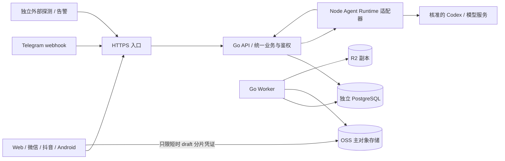

# 系统设计与工程开发约束

版本：v1.0-draft；日期：2026-10-23；关联 ADR-01/02/07/13。本文为工程约束，开发已在app/开始，逐模块完成情况以[实施台账](../delivery/02-implementation-ledger.md)为准。

## 1. 部署与依赖



Go API 与 Worker 由同一代码库不同运行模式发布；Node Runtime 仅接受内网经认证任务。静态 Web 用原生 Web 服务器/CDN 受控服务，不使用 Vite dev server 托管生产。PG 独立持久化；应用节点可重建，运行时缓存非权威。

原生服务部署按 Linux systemd 为候选，实际 OS 由 Q-01 冻结；不能默认服务器已具备此能力。开发使用 Windows 原生 Go/Node/PG 客户端、平台工具和 Android 真机；不启动 Docker、WSL、虚拟机或设备模拟器。

## 2. 建议仓库结构

```text
docs/                         所有说明、规范、报告和设计
app/backend/cmd/platform/         api / worker / migrate 子命令
app/backend/internal/identity/    认证、会话、组织
app/backend/internal/authz/       授权决策，不依赖 HTTP 框架
app/backend/internal/project/     项目、任务、交付、风险、变更
app/backend/internal/file/        目录、版本、上传、回收
app/backend/internal/knowledge/   正文版本、引用、检索
app/backend/internal/workflow/    流程、申请修订、审批
app/backend/internal/finance/     费用、订阅、结算、报表
app/backend/internal/status/      状态、事件、维护
app/backend/internal/agent/       业务会话、任务、计划与工具网关
app/backend/internal/platform/    DB、存储适配、jobs、audit、配置
app/backend/migrations/           真实可执行迁移，文档描述在 docs
app/web/                          React + Vite + TypeScript
app/mobile/                       Taro + TypeScript + 平台适配
app/agent-runtime/                Node/TypeScript + Codex adapter
app/skills/                       版本化可执行 Skill 包，说明放 docs
app/packages/                     同源接口类型与设计令牌
app/scripts/                      原生开发/构建/验证脚本
```

单公司保留 org_id 作为隔离边界，不对外宣称已支持商用多租户。代码模块通过应用服务接口协作，跨模块正式写入由明确的用例编排，不在控制器和 Skill 中散写 SQL。跨模块只读聚合允许专用 query service，仍统一 ACL。

## 3. 后端分层与事务

入口（HTTP/工具/定时）→ 认证上下文 → 参数/授权校验 → 应用用例 → 领域约束 → 仓储/适配器。控制器只做输入输出映射；领域不依赖具体云 SDK 或 Codex 事件。金额、状态转移、依赖环、审批资格、幂等属于后端确定性校验。

事务只包含短时间 DB 操作，禁止持 DB 事务等模型、上传或跨云复制。必要流程分“预留/准备外部对象 → 再校验 → DB 提交 → outbox”。外部操作失败采用补偿/重试，不能假称 SQL 回滚撤销已发 TG 或云对象。

修改聚合根时使用 expected_version（DB `UPDATE ... WHERE version=?` 或行锁）；0 行返回冲突。多资源余额/依赖变化使用稳定锁顺序或串行化并有限重试；不能先无锁查余额再直接写。

## 4. 开发标准

- Go：固定模块和工具链版本、gofmt、静态检查、显式错误包装/分类、请求 context 贯穿 DB/外部调用；超时和取消可传递。
- TypeScript：strict，锁文件提交，UI 不以 `any` 隐藏业务状态；生成客户端只能从已审阅契约产生，不直接暴露 DB 模型。
- SQL：参数化查询、明确列、索引与分页；软删除/组织条件不能由调用者临时拼接；迁移幂等/兼容策略要明确。
- 日志：结构化，request_id/run_id/job_id 贯穿；错误分类不回传数据库语句、云密钥、内部堆栈或签名 URL。
- 配置：集中目录，启动校验；开发/测试/生产隔离；不自动给缺失生产配置使用危险开发默认。
- 存储：OSS native adapter 与 R2 S3 adapter 分别做能力检测，不用“通用 S3”掩盖差异；上传/复制协议见专文。
- 解析器：独立受限原生进程/服务账号，配额、超时、网络限制；无隔离证明不运行不可信主动内容。

错误按可重试与终态分类；429/超时/暂时网络可限次退避，403/参数/版本冲突不能盲重试。后台任务重启先对账真实结果。

## 5. 数据库迁移与兼容

迁移编号单调，不修改已用于共享环境的脚本。采用 expand → backfill → 验证 →切换读写→ 下一版本收缩；旧 App/小程序可能仍在线，不能发布新后端即删除旧字段。破坏性迁移需要备份、锁时长评估、回滚/前向修复与批准记录。

大表回填分批/断点/限速，DDL 不隐式长锁生产。迁移身份与运行身份分开；运行账号无任意 DDL 和审计删改权限。存量 unique/FK 约束上线前检查冲突数据，不能只在空库通过。

## 6. 分支、评审与构建

每个工作包关联需求编号和验收；小范围分支、可审阅提交。评审关注授权、状态、不变量、重试、费用和迁移。固定测试通过后不无意义重复全套；新增风险或变更才扩大验证。

构建产物：Go 二进制、Web 静态包、微信/抖音包、签名 APK、Runtime/Skill 包、迁移与版本清单；manifest 记录源码提交、依赖版本、契约版本、schema 版本、校验摘要。构建使用原生执行环境，不引入本地容器流程。

完整 CI 后续选型；至少有原生 lint/typecheck、领域/接口/权限集成、OpenAPI 校验和秘密扫描。测试覆盖具体风险，不为文档或纯格式变更新增镜像实现的测试。
