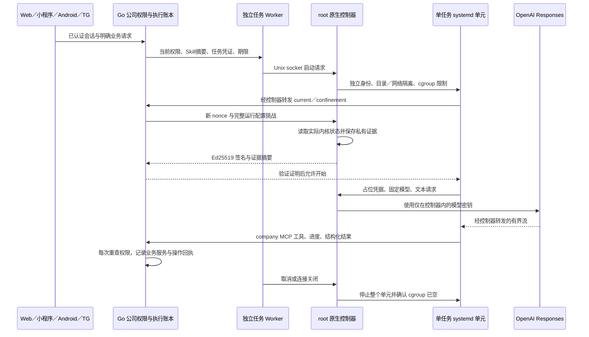

# 增量105：Codex 原生执行控制器 / Native execution controller

更新：2026-10-29。推进 GAP-09、GAP-10，仍有23个开放工作包（14 P0／9 P1），5项移出。实现位于 `app/backend/internal/nativeruntime/`、`app/backend/cmd/agent-native/`，部署模板位于 `app/deploy/native/`。验证边界见[本轮记录](../quality/105-native-agent-runtime-verification.md)。

## 1. 本轮行为与边界

原先已经有 Go 公司权限控制、任务凭证、执行队列、Codex SDK 适配器和签名证明核验，但缺少仓库内可部署的隔离启动器与证明签发端。本轮补入 Linux 原生控制器：它创建独立 systemd 单元，读取实际进程／挂载／cgroup 状态，再签发与当前任务绑定的短期证明。没有隔离证明时，适配器仍拒绝创建 Codex 客户端。

本机是 Windows。已运行的可移植逻辑、HTTP、签名和打包检查，以及 Linux 交叉编译，不能证明目标 Linux 内核已经应用这些限制。本轮未启用 Docker、WSL、虚拟机、模拟器，未调用真实模型、TG 或云存储。真实服务器启动、实际越界攻击、完整模型与八项 Skill 评测继续开放。

仅 AI **费用**控制不在范围；身份、授权、隔离、审计、超时、进程／内存／输出长度等技术限制继续保留。公司财务、OSS＋R2 复制、正常版本恢复及生产 PostgreSQL 仍在范围。遵循[修订99](../delivery/04-current-scope-and-acceptance.md)。

## 2. 完整调用路径



Worker 有公司数据库／业务工具所需权限，执行单元只接收当前任务凭证与已授权上下文。模型密钥和证明私钥不进入 Worker 环境、单元输入、命令行、提示词或公开事件。公司文件的正式更新仍走 Go 业务服务和 OSS／R2；单元中的 home、tmp 和工作目录是临时文件系统。

控制器是宿主机上受信的 root 组件，需要读取其他 UID 的 `/proc`、联系 PID1 并管理自己的目录；它不提供任意命令、任意单元、任意签名或任意上游 URL 的接口。当前边界不抵御已取得宿主 root 或 systemd 控制权的攻击者。

## 3. 组件、协议和失败语义

| 编号 | 组件 | 具体职责 |
|---|---|---|
| N-01 | `agent-native serve` | root 所有的严格 JSON 策略、二进制／发布目录摘要、唯一实例锁、Unix socket 身份验证及运行登记。 |
| N-02 | `launch`／启动包装器 | 接受已有 `--node`、`--entry` 和 JSON stdin 协议；固定 socket 与已批准路径，不构造 shell 命令。连接关闭即取消。 |
| N-03 | `child` | 单元内启动私有 loopback MCP／模型转发器，再启动 Node；不读取宿主配置文件或密钥。 |
| N-04 | `probe`／证明包装器 | 接收 Go 生成的新挑战，取得签名 JSON；只输出证明，不暴露签名能力或私钥。 |
| N-05 | `check`／`release-digest`／`public-key` | Linux 部署预检、专用发布目录摘要、公钥导出；预检不声称完成运行隔离验收。 |
| N-06 | 发布打包脚本 | 编译 JS，收集真实依赖闭包、八个 Skill 与对应指令，拒绝覆盖和源码外输入；清单保存在发布目录旁。 |

控制协议是4字节大端长度＋单条 JSON，最大1 MiB；配置最大64 KiB，未知字段和多条顶层 JSON 被拒绝。实际 socket 用 `SO_PEERCRED` 检查 Worker UID；客户端检查对端 UID 为 root。每个任务只能启动自己的确定单元名；节点、入口、发布目录、模型、SDK 版本、Skill／配置摘要和期限必须匹配批准策略。

证明绑定随机 nonce、run、当前授权戳、SDK `0.164.0`、模型、工作目录、配置摘要及准确工具集合，最长30秒且不超过任务期限。签名载荷新增可选 `evidence_sha256`，指向 root 私有内核观察记录；旧外部签发器的无该字段证明仍可按原规则验证，不能以布尔值代替签名。

取消时同时关闭上游请求、停止 PID1 管理的整个 control-group，并检查实际 cgroup 已空。仅 `systemd-run` 客户端退出不算清理成功。结果不确定则返回 `NATIVE_STOP_UNCONFIRMED`、保留登记并拒绝新任务；重启时仅核对本组件登记的准确单元。启动恢复会删除超过7天且已确认终止的私有登记，不提供历史业务迁移或灾备功能。

## 4. 实际限制

| 范围 | 示例策略／硬限制 | 核验方式 |
|---|---|---|
| 身份与目录 | 每任务 DynamicUser；专用 RootDirectory；能力集为空、NoNewPrivileges；发布目录和所选 OS 库只读 | 读 PID1 属性、实际 UID／capabilities／root inode／挂载信息。 |
| 执行与系统调用 | 三个固定二进制及动态库目录可执行；临时目录 noexec；seccomp、禁止新 namespace 和关键特权系统调用 | 实际 Seccomp／NoNewPrivs、已展开的禁止调用集合、ExecPaths。不会假设 systemd 原样返回组名。 |
| 网络 | 每任务独立网络 namespace；只有私有127.0.0.1监听；通过该任务 Unix socket 联系控制器 | 实际网络 namespace 不同；每个网关连接再查 UID／PID／cgroup。 |
| 单任务资源 | 示例1 GiB 内存、0 swap、100%单核 CPU、64任务、最长600秒；工作64 MiB、tmp16 MiB | 读实际 cgroup 文件、tmpfs 选项和上限；策略值必须在代码允许区间。 |
| 控制器资源 | 最多3任务；每任务16连接／8请求／2模型流；16次证明；控制 socket 最多16连接 | 独立限流与拒绝；示例宿主服务另设512 MiB／128任务。 |
| 输入与输出 | 请求≤1 MiB、模型流≤8 MiB、公司返回≤1 MiB，已有输出长度上限 | 读取、转发及取消时实际执行；这些不是费用配额。 |

独立网络 namespace 内的18081／18082与宿主地址空间不同：宿主 Worker 只监听18081，公司请求由 root 控制器转发到该地址；18082由每个执行单元自己的转发器监听。模型网关只允许 `https://api.openai.com/v1/responses`，不读取宿主代理环境，不跟随重定向，供应商错误正文被替换为通用错误。

当前只接纳 HTTP JSON 文本／推理／本地函数调用，拒绝云端搜索、远程 MCP、代码执行等提供商托管工具，以及图片／文件 URL、旧会话／旧 response 续接和 background。`store=false` 与技术 `max_output_tokens` 由控制器固定。原生网关配置显式关闭请求压缩及两项 Responses WebSocket 特性；压缩请求与 WebSocket 不在本轮协议内。配置键核对了[固定CLI版本的官方Schema](https://github.com/openai/codex/blob/rust-v0.164.0/codex-rs/core/config.schema.json)，完整真实请求兼容仍属 GAP-09，不能用受控 HTTP 测试替代。

## 5. 构建和专用发布目录

在已有依赖且使用仓库规定 Node 的原生开发环境执行：

```powershell
python app/scripts/test_native_runtime_release.py
python app/scripts/build_native_runtime_release.py --output app/.local/native-agent/runtime-release
$env:GOOS='linux'
$env:GOARCH='amd64'
$env:CGO_ENABLED='0'
app/.tools/go/bin/go.exe -C app/backend build -o ../.local/agent-native-linux-amd64 ./cmd/agent-native
```

Linux 原生构建可使用 `go -C app/backend build -o ../.local/agent-native ./cmd/agent-native`。交叉编译产物不在 Windows 上执行。输出目录必须是新的独立位置；重复构建使用新目录，脚本不会覆盖现有发布包。编译依赖来自已安装且锁定的包，不执行 npm 安装或下载。

发布目录保持 `app/agent-runtime/dist`、`app/node_modules`、`app/skills`、`docs/skills` 结构。只收集运行依赖，去掉测试、缓存、平台原生二进制与私有环境；Codex CLI、Node、控制器在 Linux 上单独安装并批准摘要。SDK必须显式传入固定的 `codexPathOverride`，不能回退查找发布包内的可选平台二进制。清单记录每个文件与依赖版本，不提交依赖目录或编译产物。

## 6. 目标 Linux 配置顺序

以下是目标服务器的操作约定，本轮未执行服务器安装或启用服务。需要 systemd≥255、cgroup v2 的 cpu／memory／pids 控制器、seccomp、独立网络／挂载 namespace、Node22和准确版本的 Codex CLI `0.164.0`。库路径须依据实际发行版选择；缺失／不支持的限制直接拒绝，不自动降级。

现有 Agent Worker 按任务串行领取与执行；模板中的 `max_concurrency=3` 是控制器的安全上限，不代表已实现三路并行模型执行。多 Worker 的独立网关端口和目标服务器调度配置仍须在实际接入时确定。

1. 创建独立系统用户 `copypaste-agent`，把实际 `id -u`／`id -g` 写入策略；1001只是模板占位。安装三个二进制到模板中的准确路径；Node如来自软链接，选择其实际规范文件路径并同步所有配置。发布目录及祖先目录必须 root 所有，组／其他用户不可写。
2. 将发布目录部署到 `/opt/copypaste/runtime-release`，保持 root 所有、目录0755、文件0644。`/var/lib/copypaste/agent-work` 作为宿主只读的存在路径创建，0755；执行时同路径由私有 tmpfs 覆盖。不要把整个 checkout、主目录或 `/etc` 绑定进单元。
3. 创建 root 私有 `/etc/copypaste/private`。用受控凭据渠道写入 `model.key`，文件0600；不要把密钥放进命令行、Git或公开终端记录。执行 `agent-native keygen --output /etc/copypaste/private/proof.key` 只创建新私钥，不覆盖既有文件。
4. 将[策略模板](../../app/deploy/native/agent-native.example.json)安装为 root 私有 `/etc/copypaste/agent-native.json`，权限0600。用 `sha256sum` 填写三个二进制摘要；用 `agent-native release-digest --release /opt/copypaste/runtime-release` 核对打包清单与目标字节。全零摘要和示例 profile 不能直接上线。
5. 在目标发布目录运行 `node app/agent-runtime/dist/describe-profile.js`，stdin 提供选定 `skill_id`、实际 `profile_id`、`model`、`working_directory`、`mcp_endpoint` 和 `api_base_url`。不需要模型密钥；记录配置摘要、Skill摘要和 `native.expected_tools`。root 批准策略与数据库运行配置必须使用相同值；正式 profile 安装／发布流程仍属 GAP-09／13，本轮没有自动安装命令，不得手改 draft 状态绕过评测。TG使用返回的独立 TG 配置与准确工具子集。检查工具共享同一清单，但草稿仍返回 `ready_for_controlled_installation=false`。
6. 运行 `agent-native public-key --config /etc/copypaste/agent-native.json`，只把公钥填入[Worker 环境模板](../../app/deploy/native/agent-worker.env.example)。设置专用 Worker PostgreSQL URL（production 要求 `sslmode=verify-full`），不得配置 migration 凭据。所需文件阅读／草稿写入身份按原有最小权限存储配置独立提供；不要复用管理员云密钥。
7. 安装两个固定[启动](../../app/deploy/native/agent-native-launch.sh)／[取证](../../app/deploy/native/agent-native-probe.sh)包装器及[控制器](../../app/deploy/native/copypaste-agent-native.service)／[Worker](../../app/deploy/native/copypaste-agent-worker.service)服务。包装器命名为配置中的无扩展名路径，root所有且不可由 Worker 写入。修改部署路径后必须同步策略、包装器、环境及 profile，重新生成摘要。
8. 先运行 `agent-native check --config /etc/copypaste/agent-native.json`；再在服务器变更流程中加载服务并进行受控任务验收。模板没有自动安装／自动启用脚本。本地 Windows 服务未切换为此控制器。

## 7. 必须保留的真实验收

| 编号 | 验收 | 完成判定 |
|---|---|---|
| A-01 | 真实单元与主机能力 | 保存目标 systemd／kernel／架构版本及完整预检；实际执行时取得真实 UID、namespace、cgroup、挂载、capabilities 与 seccomp 证据。 |
| A-02 | 目录与网络越界 | 实际尝试读取 Worker／模型私钥、数据库环境和业务文件宿主路径，写只读发布目录、连接非批准网络；均不得绕过。 |
| A-03 | 生命周期 | 正常结束、断线、用户取消、租约失效、资源超限、控制器重启；实际确认整个任务 cgroup 清空，未知状态持续拒绝。 |
| A-04 | 真模型与工具 | 固定 CLI／SDK 实际 Responses 请求和 MCP 初始化兼容；真实任务全链路、取消、结构化结果及 Go 回执一致。 |
| A-05 | Skill 发布 | 八项真实评测、负面用例、发布及回滚；本轮未修改 Manifest 状态。 |

这些属于服务器／模型功能验收，不新增真机、网络性能、历史迁移、容灾或 AI 费用控制门槛。生产 HTTPS／PG、真实云身份、TG授权及其余工作包仍按[完整清单](../delivery/03-goal-gap-assessment.md)推进。

## 8. 依据与 English guide

SDK行为以仓库锁定的 `@openai/codex-sdk@0.164.0` 类型与实现为准；服务端 TypeScript 接入方式参考[官方 SDK 文档](https://learn.chatgpt.com/docs/codex-sdk)。没有迁移到新的 Agents API 或云执行产品。

原生限制、临时文件系统和资源语义参考 systemd 官方的[执行环境](https://www.freedesktop.org/software/systemd/man/latest/systemd.exec.html)、[资源控制](https://www.freedesktop.org/software/systemd/man/latest/systemd.resource-control.html)及[systemd-run](https://www.freedesktop.org/software/systemd/man/latest/systemd-run.html)。展开后的调用集合与 namespace 输出格式核对了[v255执行状态实现](https://github.com/systemd/systemd/blob/v255/src/core/execute.c)和[属性格式实现](https://github.com/systemd/systemd/blob/v255/src/shared/bus-print-properties.c)。不同目标发行版仍需实际验收。

Increment105 adds a repository-owned Linux root broker, a per-run systemd boundary, a private model/company relay, actual kernel-observation signing, cancellation with cgroup teardown, and a minimal JS/Skill release builder. The company Go services remain the authorization and mutation authority. Provider and proof keys remain in root-owned private files; children receive only a task credential and the literal broker placeholder.

Build the dedicated release with `python app/scripts/build_native_runtime_release.py --output <new-directory>`, then install it on a native Linux system with systemd255+, unified cgroup v2 and the required kernel features. Install and pin Node22, Codex CLI0.164.0 and `agent-native` separately. Review the example JSON, replace every identity/hash/model/profile placeholder, generate a new private signing key, export only its public key, inspect the exact SDK configuration using `describe-profile.js`, and configure the separate worker environment. Formal profile installation/release remains GAP-09/13; draft states must pass evaluation before publication. The two service templates and fixed wrappers are not automatically activated. The existing worker executes serially; the broker's concurrency limit does not establish parallel worker scheduling.

The gateway currently accepts text HTTP Responses and local function/custom tools only. It rejects provider-hosted tools, remote file/image inputs, previous server conversations, background work, redirects and compressed requests. Its upstream model key never enters the child. This is a technical boundary rather than an AI fee/quota system. Windows checks cover portable algorithms, loopback protocols and packaging; Linux cross-compilation is not kernel execution. Actual server isolation, genuine CLI/model interoperability and all eight Skill release evaluations remain open under GAP-09/10/13. Existing199 UI media retain their increment104 provenance; no new UI demonstration or production readiness is claimed.
