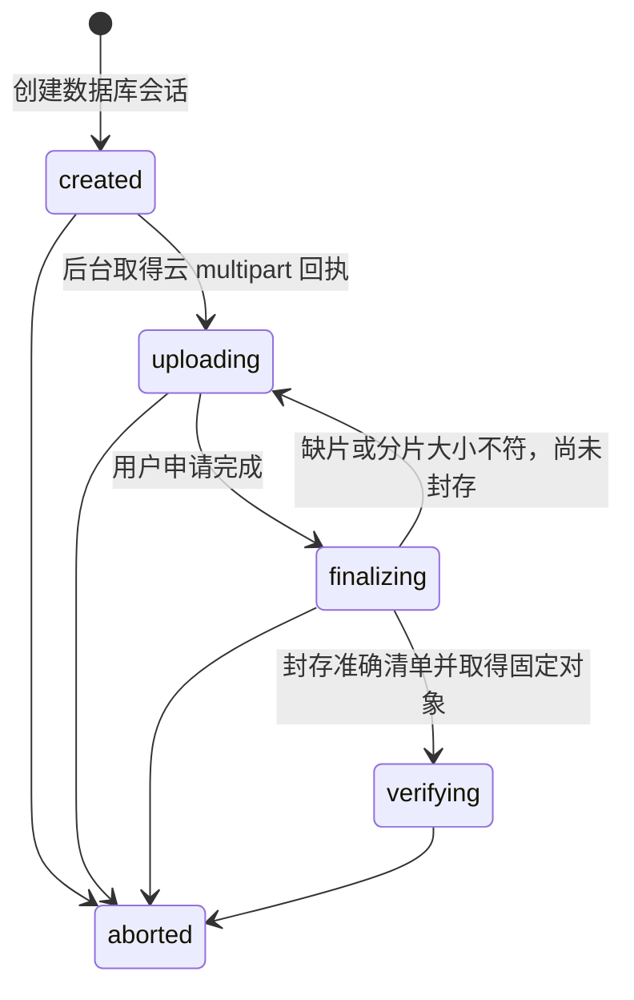

# 上传会话、签名授权与固定源封存

日期：2026-10-23。关联[存储协议](03-storage-protocol.md)、[任务协议](05-events-jobs-and-concurrency.md)、[适配器](10-object-storage-adapters.md)和[实施台账](../delivery/02-implementation-ledger.md)。源码位于 app/backend/internal/files/uploads.go、upload_jobs.go 与 internal/httpapi/uploads.go；迁移0016。

## 1. 实施范围

已提供上传会话创建/查询、分片短期签名、客户端回报、云端对账、完成申请和终止接口，以及可被任务执行器调用的初始化与封存 handler。所有正式控制命令使用既有鉴权、幂等、审计与 Outbox 事务；云请求在事务外执行。

默认 API 尚未配置云端身份，创建接口返回 STORAGE_NOT_CONFIGURED；不能把路由存在视为线上可上传。已有[用途配置和常驻控制执行器](12-upload-worker-and-cloud-identities.md)；已有[完整性检查点和扫描/重扫执行链](13-upload-integrity-and-scanning.md)；[扫描例外](15-scan-waivers-and-review.md)和[正式候选/提交](14-file-promotion-and-commit.md)已有独立执行链。[双云复制](16-cross-cloud-replication.md)和[下载](17-download-authorization-and-streaming.md)已有隔离实现；[Web 上传队列](18-upload-queue-and-review-clients.md)已有实现；回收执行器与移动端页面仍待完成。本节描述到固定源封存，后续阶段按对应协议实施和验收。

## 2. 生命周期与职责

刚进入 verifying 时，SHA-256 和 result_version_id 仍为空；后续摘要/扫描可在该阶段推进，但没有创建 file_versions，也没有改变 files.current_version_id。后续 ready/committed 及副本 verified 各需独立证据，禁止由上传进度推断。

会话版本只随生命周期变化推进。签名许可、分片回报和对账不推进该版本，允许多个分片共用相同 expected_version；finalize、缺片退回、终止及后台推进会使旧版本失效。缺片退回附 INCOMPLETE_PARTS，客户端刷新后以新版本补传并重新申请完成。

## 3. 固定输入与容量

创建固定 owner、目录、可选 file/base-version 对、原始名称、媒体类型、源文件指纹、大小、分片布局、分类、渠道、提供商、桶和 storage_epoch。数据库触发器禁止更换这些输入；已封存清单与固定来源也不可改写。

大小为十进制字符串，范围1—120,000,000,000字节，默认32MiB分片，最大文件3577片。媒体类型不带参数；名称沿用共享 Unicode 比较和路径字符限制。source_fingerprint 是用户重新选择来源时的匹配信息，不能替代服务器完整 SHA-256。

storage_quotas 必须由受控配置流程明确设置，应用身份只能读取。没有把用户现有2TB资料量擅自当作最终容量上限。准入统计所有保留的正式历史版本字节及未过期、未结束会话的预约字节；组织容量锁串行化不同项目的并发预约。副本、孤儿 multipart 与暂存候选的实际云费用需另做存储账单监控，不能用逻辑配额冒充物理用量。

新文件创建时检查已有名称；上传期间不占正式文件名称，最终提交仍须同事务核对共享名称空间。更新文件必须指向当前目录和基础版本；不会因为上传完成就绕过后续提交时的基础版检查。

## 4. 权限、渠道与签名

会话只由本人查询和控制；还需具备当前目标目录读取及 file.upload 或目标文件 file.update 权限。创建、签名、回报、对账、完成和终止按当前权限处理，不能依赖创建时授权。项目归档/结项锁与文件目录移动使用相同范围锁；主端纪元变化阻止旧会话继续操作。

公开上传限定 Web/Android，微信和抖音小程序负责资料查询与审批。秘书的文件写入后续通过受控工具工作流接入，当前没有为 AI 会话签发客户端上传 URL。后台推进读取保存的发起渠道重新检查分类渠道规则，不将 Android 任务换成 Web 权限执行。

每次最多签20片，默认有效5分钟，且不超过会话到期时间。签名授权命令持久化的仅为 session/version/part numbers；URL及签名头不进入幂等结果、审计或事件。相同幂等键重放会复用许可记录、重新核验当前权限/阶段并生成新的短期 URL，因此签名接口的临时 URL 不保证逐字节相同。已经终止或进入完成阶段时，即使重放旧许可也不返回新签名。

终止/完成不能物理撤回已发出的短期 URL。固定源依靠唯一 draft Key、完成 multipart 后旧上传ID失效及仅服务端可封存，后续还须隔离正式候选写身份。不得向客户端开放完成 multipart、任意对象写入或删除。

## 5. 分片提示与云端对账

ack-parts 只保存客户端提示，cloud_confirmed 默认为 false，不能增加 confirmed_parts。resume 要求匹配原 source_fingerprint，在事务外分页 ListParts，逐项核对片号、大小、ETag、重复片与分页推进，再在重新鉴权和核对版本后替换云端确认记录。

confirmed_parts 表示最近一次云端对账事实。分片可能仍在重传；finalize 必须重新取得完整云清单，不把旧确认、客户端缓存或 ETag 当作内容摘要。客户端选择不同来源直接拒绝，不能复用旧会话把两份文件混合成一份。

## 6. 初始化与旧 Worker

每次任务租约尝试先持久化独立 upload_attempts，使用不可预测的新 UUID draft Key，随后在事务外调用云端初始化。结果只有当前 owner/fencing token 能写入会话及完成任务；成功回执、会话推进、审计、Outbox 与任务完成同事务。

网络结果不确定时保留 starting/uncertain 记录。新租约使用新 Key，不复用旧 Worker 仍可能写入的可变目标。终止发生在 RPC 期间时，回执记录为 superseded，会话保持 aborted；未取得租约的旧结果不能重新激活会话。已有不确定/孤儿对象仍需后续回收任务按记录与受控前缀清理，本阶段没有宣称自动回收完成。

## 7. 完成请求超时

后台先按固定布局核对完整云端分片，再持久化不可变清单和 complete_requested_at，才调用 Complete。清单未封存且缺片时退回 uploading；封存后不能换清单重试。

每次执行先 Head 唯一 draft Key。若先前 Complete 已成功但响应丢失，使用该固定对象回执继续；对象不存在时，才依据相同封存清单请求完成。NoSuchUpload 但完成结果仍不明确时按未知结果重试对账，不能直接认定源丢失或声称成功。

Head 的准确大小、ETag和可用原生版本被保存为固定来源，随后进入 verifying。这里的 ETag 是读取条件，不能当 SHA-256；可用性和扫描结果要由后续完整读取验证。

任务去重包含会话生命周期版本，旧 finalize 任务不能处理重新完成的新阶段。后台保存回执前再次核对当前租约、会话版本、权限、渠道、项目可写性和存储纪元。自动执行的审计保留发起人为 actor，以 worker 渠道和 job_id 标识执行者，不伪装成人工账号。

## 8. 接口及验证

| 接口 | 结果 |
| --- | --- |
| POST /v1/uploads | 201 created，会话及上传初始化事件原子创建 |
| GET /v1/uploads/{id} | 本人可见状态、布局、指纹和云确认片号；不披露桶/Key/云上传ID |
| POST /sign-parts | 临时分片 URL，持久化许可不含 URL |
| POST /ack-parts | 保存客户端提示，不能提升云确认进度 |
| POST /resume | 云端清单对账结果，源指纹不符时拒绝 |
| POST /finalize | 202 finalizing；尚未验证内容或正式提交 |
| POST /abort | 终止控制状态并发出回收请求事件；不等同云对象已删除 |

原生隔离测试使用受控提供商元数据，不连真实云；120GB只验证布局与字符串数值。覆盖配置/配额、并发预约、渠道与所有权、签名秘密不落库、分片提示与对账、完成超时对账、旧 Worker 接管、RPC期间终止、纪元变化和审计失败回滚；新增缺片退回与重新完成场景。实际执行结果与源码摘要见[后端验证记录](../quality/evidence/backend/result.json)。

后续执行器已有心跳、租约、受控失败、双云恢复检查点与下载隔离实现；过期回收、保留制度、带宽/公平调度的真实长任务、提供商身份与CORS、真实双云及120GB仍需独立完成与验收，不以控制会话测试替代。
