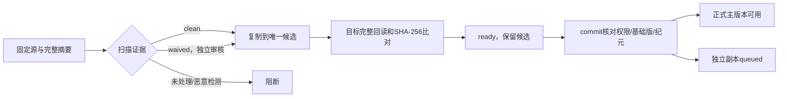

# 正式候选、完整回读与文件版本提交

日期：2026-10-23。迁移0019；主要源码为 app/backend/internal/files/upload_promotion.go、upload_commit.go、internal/objectstore/copy.go。前置：[固定源](11-upload-control-and-freezing.md)、[摘要与扫描](13-upload-integrity-and-scanning.md)；无法扫描的受控例外见[扫描豁免](15-scan-waivers-and-review.md)。

## 1. 两个不同的完成点

ready 表示已生成仅服务器可写的唯一正式候选对象，目标完整回读摘要与上传固定源权威摘要一致，并已取得扫描或受控例外证据。此时还没有 file_versions，也没有改 files.current_version_id。

committed 表示用户确认具体 ready 会话版本、摘要及基础版后，在一个PG事务中建立正式文件版本、切换当前版本、保存审计/Outbox/幂等结果及副本排队记录。主端具有回读证据；副端仍为 queued，不能显示“双云已备份”。

## 2. 任务、身份与对象命名

scan.passed / scan.waived 事件由独立 Outbox 消费者生成 upload.promote.v1，去重包含会话生命周期版本。≤100,000,000字节进入 storage.promote.small，其余进入 storage.promote.large；CLI 为 worker-promote-small / worker-promote-large。候选时限分别30分钟/12小时，沿用2分钟租约、30秒心跳及有界退避。

进程使用两个显式用途身份：CP_{OSS或R2}_PROMOTE_SOURCE_* 读固定draft来源；PROMOTE_TARGET_* 用于受控正式候选的multipart、Head、ListParts及完整回读。不得传入客户端签名身份、迁移凭据、MFA或模型密钥。开发启动脚本按角色过滤变量；生产另设独立账号和环境文件。模板见 [copypaste-promote@.service](../../app/deploy/native/copypaste-promote@.service)，尚未安装运行。

对象Key使用服务端生成的file_id/version_id：org/{org}/files/{file}/versions/{version}/original；名称与目录不拼进Key。新文件的ID在候选日志中预留，尚不创建文件实体；替换文件固定原file_id，分配新版本ID。候选通过commit成为同一个不可变版本对象，不需要再做一次120GB重命名/复制。

## 3. 传输日志与恢复

object_transfers 保存组织、上传会话、任务、预留文件/版本ID、来源摘要、唯一目标Key、云上传ID、完成清单、固定目标回执和执行凭证。输入、已确认上传ID、封存清单和固定回执一旦设置不能改写。object_transfer_parts 保存逐片云确认；object_transfer_hashes 保存目标回读检查点。

每次云初始化前先提交starting日志。未取得上传ID且结果不确定的日志不被新租约直接复用：标为uncertain，另分配新的唯一Key；旧结果只能留下可追踪孤儿，不能覆盖新候选。

若已保存准确云上传ID，新租约可以继续同一multipart：先按ListParts核对固定布局，再补缺片。所有执行者只复制同一个固定来源的相同字节范围；每片控制记录须核对当前租约和领域状态。已完成的上传ID不会被再次Begin，同一Key不建立第二个可写multipart。旧执行者无法提交数据库状态；已在云端途中的同源请求仍依赖提供商multipart语义及身份范围，真实并发网络演练单独验收。

完成清单先持久化再Complete；每轮先Head唯一目标。完成已成功但响应丢失时从对象事实继续，不重复创建或覆盖。NoSuchUpload等不明确结果进入有界重试对账。目标回执与先前固定回执不同则拒绝。

## 4. 内容与扫描证据

源Range、长度、ETag、可用原生版本和写入消费字节逐片核对。传输使用流，摘要缓冲256KiB；应用不把120GB整对象读入JS/Go内存或长期临时盘。实际SDK内存与带宽须在真实负载记录RSS验证。

复制目标须完整读取得到SHA-256，并与原权威SHA-256和大小一致才ready。Content-Length、ETag和把原摘要抄进元数据都不足以证明正确复制。目标摘要使用32MiB恢复检查点；持久化前再查权限、纪元和租约。

clean必须来自对应固定源的完整扫描报告；waived必须有同源、同摘要、同分类/大小、已独立审批且在会话有效期内的例外证据。复制或提交不会把waived改成clean。

## 5. commit契约

POST /v1/uploads/{id}/commit 使用幂等键，输入expected_version、sha256，以及替换文件时固定的base_version_id。sha256表示客户端对已展示权威摘要的确认，不能由其决定服务器权威摘要。

事务顺序：组织/身份核对→当前目标ACL→项目或公司名称空间锁→上传会话锁→基础版及候选证据→正式记录和事件。重新核对分类、项目可写性、来源渠道、会话期限和storage_epoch。

必须明确配置两个启用的storage_targets：主目标桶与会话固定桶一致，另一提供商为副目标。不猜测R2桶名；缺失时503 STORAGE_TARGETS_NOT_CONFIGURED，保留ready。该配置表目前仅受控运维身份可写，生产配置管理及真实云权限另行完成。

同事务完成：

- 创建含真实创建人的名称空间记录；替换文件核对当前版本仍等于固定基础版。
- 插入不可变file_version：固定对象、权威摘要、原始名称、作者/执行人、扫描报告及可选豁免。
- 更新files.current_version_id及文件版本号；上传进入committed并记录准确结果版本。
- 主副本保存真实回读摘要/时间，副目标保存queued；不同提供商分别呈现。
- 保存upload.committed、file.version.committed、审计和幂等结果；不在事务内发云RPC。

API返回file、file_version、committed；操作标识通过X-Operation-ID响应头获得。旧草案FileCommitResult中重复的operation_id字段已移除，同源契约及类型同步生成。

## 6. 失败及保留

| 情况 | 结果 |
| --- | --- |
| 目标字节损坏，大小相同 | CONTENT_DIGEST_MISMATCH；不进入ready |
| 文件/目录同名 | 409；事务回滚，保留ready候选 |
| 同基础版的另一候选已提交 | BASE_VERSION_CONFLICT；不覆盖新版本 |
| commit后响应丢失 | 同键同请求重放同一版本；重放前重新鉴权 |
| 复制中终止/撤权/纪元变化 | 无权保存新进度或ready；旧任务不激活上传 |
| 审计/事件/幂等写入失败 | 正式文件、版本、副本排队和上传状态整体回滚 |

孤儿与候选不会因普通业务删除立即从两云purge；清理仍须引用、法务保留与恢复集检查。自动回收、冲突后的改名/重基计划、历史版本复制恢复等后续用例尚未完成。

## 7. 验证边界

原生PG与按需生成字节的提供商夹具覆盖目标回读、缺片续传、完成结果未知、损坏拒绝、缺少双云目标、基础版、名称冲突、审计原子性、幂等重放和复制中终止。夹具是隔离测试，不是OSS/R2联网、120GB传输、真实进程崩溃或生产IAM证据。

[双云副本执行器](16-cross-cloud-replication.md)与[下载授权/受控流](17-download-authorization-and-streaming.md)已有隔离实现与验证；[Web 上传及审核页面](18-upload-queue-and-review-clients.md)已有隔离实现；真实云、移动端页面、带宽/长任务演练、自动清理与首迁验收仍待完成。完整进度见[实施台账](../delivery/02-implementation-ledger.md)。
