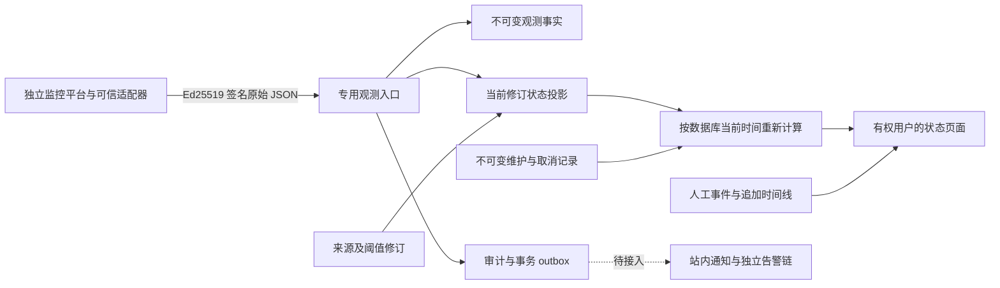

# 服务状态、签名观测与事件协议

日期：2026-10-23。对应 OPS-01—04、WP-10，以及[状态与非功能需求](../requirements/08-status-notifications-and-nfr.md)。本文记录当前 Go/PostgreSQL 实现及客户端必须遵守的边界；不是已安装监控平台、已接通通知或已完成生产可用性验收的声明。

## 1. 实现范围与依赖

平台管理服务目录、观测来源修订、签名事实、状态投影、维护窗口和人工事件。采集平台应继续使用独立部署的成熟工具。初版中的 `uptime_kuma/prometheus/adapter` 仅是来源类型标识。增量81已补[独立原生 Prometheus／Blackbox 状态桥接](81-native-prometheus-status-bridge.md)，并为签名回执增加来源、修订、序号与原始字节摘要绑定；选择来源类型仍不会自动开始探测。Uptime Kuma 专用适配尚未实现。



业务实现位于 `app/backend/internal/servicestatus/`，HTTP 入口位于 `app/backend/internal/httpapi/service_status.go`，迁移为 `0033_service_status.sql`。数据库迁移和组织初始化只创建未绑定的 `status_reader/status_operator` 角色；不会自动给员工、系统管理员、秘书或 TG 群授予业务阅读权。

Web 已提供服务目录、来源发布/历史、维护安排/取消、观测原始签名验证、人工事件及追加复盘页面；实际浏览器结果单独记录。本段为初版范围。后续已补Taro状态／事件、站内通知、秘书／TG摘要及增量81原生Prometheus桥接；各阶段以[当前差异表](../delivery/03-goal-gap-assessment.md)及其准确证据为准。当前仍需真实监控／可信目标部署、主机指标、跨主机独立告警与四端真机验收。首发四端和完整平台目标保持不变。

## 2. 服务身份、范围与权限

服务保存名称、负责人、主机展示名称、端点展示名称、说明、可选项目、分类、不可变创建人、生命周期和配置版本。`host_label/endpoint_label` 仅作文字展示，后端不会据此发起 HTTP、DNS、SSH 或本机命令。实际探测配置必须在可信监控边界内管理，并另行落实 SSRF 防护与目标许可。

| 动作 | 最低要求 | 交互约束 |
| --- | --- | --- |
| 列表、详情、修订、观测、维护历史 | 当前 `service.read` 与分类/渠道/资源范围 | ACL 先过滤再分页 |
| 创建、编辑、来源发布、维护创建或取消 | 当前 `service.read/service.manage`、有效负责人 | 真实人工会话及最近 10 分钟 MFA |
| 事件阅读与时间线 | 对全部影响服务均有当前阅读权 | 不返回部分影响范围的摘要 |
| 事件创建与追加更新 | 对全部影响服务均有当前阅读权及 `incident.update` | 真实人工会话及最近 10 分钟 MFA |
| 观测接收 | 当前启用来源修订的有效 Ed25519 签名 | 专用机器入口；拒绝员工 Cookie、Authorization 和浏览器 Origin |

服务分类不得低于关联项目；身份范围、项目、分类与创建人不能通过普通编辑改变。负责人必须是有效组织成员，关联项目时还必须是该项目成员。创建 confidential 服务需要独立明确的资源授权流程，当前普通创建入口拒绝该情况，不能静默降级分类。已结束项目不接受新的服务配置写入；监控事实的接收另由服务生命周期和来源启用状态判断。

`can_manage/can_update_incident` 是当前业务能力提示，不表示 MFA 仍然新鲜。客户端应允许用户先进行二次验证，再明确提交原操作；不得在 MFA 完成后自动执行先前未确认的变更。后端在实际写入时重新验证会话、权限和版本。

所有人工写入复用统一事务：组织授权锁、用户状态与授权版本、业务准入、幂等记录、按顺序取得业务锁、版本检查、业务记录、审计与 outbox、结果。失败全部回滚。配置使用 `expected_version`；遥测更新不增加服务配置版本，避免每次探测都使编辑表单冲突。

## 3. 来源修订与阈值

每个服务最多 20 个来源。新增来源与后续发布都保存完整不可变修订，含来源名称、类型、外部参考、公钥、启用状态、阈值、前序修订、发布人和原因。只存公钥，不接收或生成采集私钥。

| 字段 | 当前允许值/含义 |
| --- | --- |
| `failure_count` | 连续失败 1—10 次；默认设计为 3 |
| `recovery_count` | 连续快速成功 1—10 次；默认设计为 2 |
| `interval_seconds` | 15—60 秒；默认设计为 60 |
| `stale_after_seconds` | 至少 3 倍探测间隔，最多 180 秒 |
| `latency_limit_ms` | 1—120000 毫秒；必须按实际服务确定 |
| `public_key` | 标准 Base64 编码、解码后恰为 32 字节的 Ed25519 公钥 |

发布要求准确的服务配置版本、来源版本和基础修订 ID；新增来源的来源版本为 0、基础修订为 null。每次发布均建立独立的 unknown 初始投影，旧修订的正常结果不能沿用到新配置。禁用后立即显示 unknown；轮换或禁用后，旧修订签名和旧请求重放均不再获准。

修订历史按不可变序号倒序分页；游标绑定本人、授权、服务、来源与筛选。当前修订标记由读取时的真实当前指针计算，历史公钥仍保留用于验证历史事实。数据库约束要求来源头指向最新完整连续修订，应用不能修改或删除既有修订。

## 4. 签名观测线协议

入口：`POST /v1/status-sources/{source}/observations`，`Content-Type: application/json`，原始正文最多 4096 字节；必须恰有一个 `X-CP-Status-Signature` 头，其值是 64 字节签名的标准 Base64 编码。此入口不使用员工幂等键、CSRF 或登录 Cookie。

正文必须准确包含以下五个字段，未知字段、重复键、缺失字段、额外 JSON 值和不允许的 null 均拒绝：

```json
{
  "source_revision_id": "00000000-0000-4000-8000-000000000001",
  "sequence": "1",
  "observed_at": "2026-10-23T12:00:00Z",
  "healthy": true,
  "latency_ms": 85
}
```

这是格式示例，示例 ID 不是可用来源。`sequence` 为无前导零的正十进制字符串，范围 1—9007199254740991；按来源修订单调增长。`observed_at` 为 RFC3339 时刻，不得比数据库当前时间超前超过 15 秒。成功探测必须有 0—3600000 毫秒的时延；失败探测可以为 null。

签名消息按以下字节顺序拼接：UTF-8 `CP-STATUS-V1\n`、路径来源 UUID 的小写规范形式、一个换行、原始正文的全部字节。必须先确定最终 JSON 字节，再签名，并原样发送；服务端不对正文重新序列化后验签。来源 ID 同样在签名内，不能把一个来源的消息搬到另一个来源。

事务先检查服务、来源启用与当前修订，再用当前公钥验签，然后处理 `(source_revision_id, sequence)` 唯一性：

| 输入 | 结果 |
| --- | --- |
| 同一修订/序号、完全相同字节 | 返回原观测回执并标记 `replayed=true`，不重复审计或创建 outbox |
| 同一修订/序号、不同字节 | 409 冲突，即使两份 JSON 语义相同 |
| 签名伪造、修订过期、来源禁用或服务归档 | 拒绝接收；不会用历史成功回执绕过当前准入 |
| 有效但迟到/过期的样本 | 保留事实，`applied=false` 并记录原因，不覆盖当前投影 |
| 有效且可应用的新样本 | 追加事实并原子更新投影、审计与 outbox |

事实保存观测和接收时间、序号、修订、原始字节、签名及 SHA-256。机器审计使用 monitor 渠道，发起人和执行人为空，不假冒任一员工。outbox 聚合标识使用来源修订 ID 与该修订内序号，避免公钥轮换后序号重新开始引发聚合冲突。回执仅说明这份事实是否接收/应用，不将历史回执当作当前服务健康状态。

## 5. 投影、新鲜度与维护覆盖

状态值为 `operational/degraded/down/maintenance/unknown`。初始或没有可靠连续证据时为 unknown。默认连续 3 次失败确认 down，连续 2 次快速成功完成初次确认或故障恢复；高时延可进入 degraded，但不能单次慢成功把已确认 down 直接改成健康。

迟到序号、倒退观测时间与已过新鲜度窗口的样本不得替换新证据。序号出现缺口、采集断流或可靠连续性丢失时，先重置连续计数和可信状态，再按新样本积累证据。来源禁用、阈值无效、投影缺失、没有样本、时钟异常、观测时间过期或接收时间过期，都显示 unknown 并给出原因。

读取在数据库当前时间重新评估；即使不再收到任何新样本，旧绿色也会在新鲜度到期后失效。不能依靠“下一次写入”才更新断流状态。缺少某个来源的投影时仍保留该来源，并计入未知来源数量，不能用 inner join 将它悄悄从汇总中删掉。

服务响应提供 `evaluated_at/recheck_at`：最迟重读时刻取 10 秒后、有效来源观测/接收的新鲜度边界、未取消维护的下一开始/结束边界中最早的未来时刻。这是客户端展示到期边界，不保证在此之前不会出现故障、撤权或配置变更。Web 使用单调时钟，并从这段寿命中扣除整次请求耗时；到期即显示“待重新确认”，不会因慢响应或修改设备时钟获得一段新的绿色寿命。后台每 5 秒重读，返回页面时按当前状态核对；请求悬挂也不延长现有结果。

多来源原始汇总优先级为 down、unknown、degraded、operational；没有来源为 unknown。维护是展示覆盖层，另有 `observed_state` 保存未覆盖的真实汇总。维护窗口结束或取消后立刻重算底层状态，不能复用维护开始前的正常值。

维护窗口不可变，最长 31 天，开始时刻不得回溯超过 5 分钟，结束必须晚于开始且尚未结束。重叠窗口在服务行锁下拒绝。取消写入独立不可变记录及原因，不删除窗口；已结束窗口不能再取消。创建与取消都检查服务配置版本并增加它。幂等重放返回当前服务视图，不能重新显示已取消的维护。

## 6. 人工事件与时间线

事件建立时固定标题、等级、描述、负责人和 1—20 项不重复影响服务。负责人必须对每个涉及项目均为有效成员。全部影响范围须在同一请求中通过当前阅读和处置授权；一项不可读即不披露该事件。列表先按全部影响范围过滤，再分页，详情和时间线使用相同规则。

事件支持 `open/investigating/monitoring/resolved`。更新保存当前状态、时间线说明、恢复说明、复盘及原因，同时追加不可变时间线并推进头版本。解决必须提供恢复说明及首次解决时刻。已解决事件保持 resolved；后续复盘继续追加记录，不能重写首次解决时刻或偷偷重开。需要重新处置的新故障应建立新事件。

组织内 `dedup_key` 与建立内容摘要共同去重。同键同内容可以返回原事件，即使使用新幂等键；同键不同内容返回冲突。返回前仍检查原事件完整影响范围，不因为碰到去重键而泄露不可读事件。当前未实现监控告警自动聚合到事件，人工可使用明确的去重键。

数据库延迟约束验证：影响行与声明数组完全一致；时间线序号连续；头版本等于完整时间线长度；头状态/恢复/复盘等于最新记录。应用不能单独增加头版本、追加未声明服务或修改历史。时间线按不可变序号倒序读取，避免使用事务开始时间推断实际发布先后。

## 7. API 与错误处理

| 方法与路径（均在 /v1 下） | 用途 |
| --- | --- |
| GET/POST /services | 有权列表、建立服务 |
| GET/PATCH /services/{id} | 当前状态与配置、版本化配置变更 |
| POST /services/{id}/sources | 建立首份来源修订 |
| GET/POST /services/{id}/sources/{source}/revisions | 修订历史、发布新修订 |
| GET /services/{id}/observations | 按接收时间读取不可变事实 |
| GET /services/{id}/observations/{observation}/evidence | 原始正文/签名/准确历史公钥的验证材料 |
| GET/POST /services/{id}/maintenance-windows | 维护历史、建立窗口 |
| POST /services/{id}/maintenance-windows/{window}/cancel | 追加取消记录 |
| POST /status-sources/{source}/observations | 专用签名机器入口 |
| GET/POST /incidents | 事件列表、建立事件及去重 |
| GET/PATCH /incidents/{id} | 事件详情、追加更新 |
| GET /incidents/{id}/timeline | 不可变时间线 |

具体 DTO、字段限制及响应以同源 [OpenAPI](openapi.json) 为准，构建入口为 `app/scripts/build_openapi.py`。客户端保留 409 冲突前的全部输入，重新读取后让用户核对；412 授权变化须重新取得当前授权；MFA 过期需要明确二次验证。超时或连接中断不等于写入失败，使用同一幂等键确认原请求，不能换键自动重做。观测入口使用前述精确序号和字节协议重试。

观测验证材料只对当前有权读者开放；历史验签成功只证明该条签名事实，不代表现在健康。默认列表不包含对象存储坐标、监控私钥、URL 签名或员工凭据。采集配置里的敏感目标和监控认证应由独立部署配置管理，不写入展示名称。

## 8. 界面与风格约束

遵守[官网风格体系](../design/README.md)与[品牌应用和文案](../design/09-brand-application-and-content-style.md)。服务列表、事件列表、详情和编辑使用既有暖白/深色背景、墨色主按钮、品牌蓝链接与焦点，以及同一表格、表单、对话框和间距规范。

| 状态 | 必须可读的文字 | 展示规则 |
| --- | --- | --- |
| operational | 运行正常 | 仅当前有效证据支持时使用成功语义 |
| degraded | 性能下降 | 警示语义，同时显示时延和证据时间 |
| down | 服务异常 | 危险语义；保留失败与恢复时间线 |
| maintenance | 维护中 | 信息语义，显示窗口与未覆盖的观测状态 |
| unknown | 状态未知 | 中性/警示语义，明确尚无样本、断流或禁用原因 |

每个状态必须同时有文字，不能只用色点。页面同时显示 `observed_at/received_at/evaluated_at` 的意义及香港时区完整时刻；“更新于某日”不足以判断 180 秒新鲜度。刷新失败时保留可核对的最后证据和明显错误提示，不能把缓存绿色继续称为实时状态；客户端应及时重读，服务端始终按实际时刻评估。

无服务、无来源、无观测和无权限是不同分支。创建页面不得填入演示正常值；尚未配置采集时明确显示“尚无监控数据”。维护结束、来源更新和页面恢复焦点后要重新获取状态。来源公钥是公开验证资料，私钥永远不进入浏览器表单。配置发布与事件处置必须显示准确目标、基础版本、变更原因和人工确认按钮。

## 9. 验证与放行条件

实现包含独立投影单元场景与隔离原生 PostgreSQL/真实 HTTP/MFA/签名集成场景。当前验证范围包括无默认授权、来源修订、签名与跨来源伪造、精确重试、序号冲突、迟到/缺口、持久投影、缺失投影不误绿、维护历史、全部事件影响范围、解决后复盘、数据库篡改阻断、公钥轮换、真实时间新鲜度到期、MFA、并发和撤权。结果与受测来源以[后端证据](../quality/evidence/backend/result.json)及[实施台账](../delivery/02-implementation-ledger.md)中的最新明确记录为准。

2026-10-23T12:56:59.160375+00:00 的完整后端回归通过 317 条结果、278 个叶场景（55 单元/223 数据库），来源摘要 `6e96358cf9e4c73c3253367f284115dc59c540c67973bfb18d6715adeb170322`，测试期间来源未变。本模块包含 5 个投影单元场景和 12 个数据库叶场景，额外核对了维护/观测的客户端重读边界。Web 新鲜度的 4 项单元场景纳入前端共 26 项通过结果；类型与生产构建通过。真实浏览器流程使用隔离原生数据库及受控签名样本，不连接真实监控产品。

[真实 Web/API 检查记录](../quality/evidence/service-status/result.json)于2026-10-23T13:08:51.000Z通过8条检查链，269个来源摘要 `feec1ebe62b457a3cc5cebf755225c5e5e2393c97a670a113c96bbe5da200caf`，运行期间未变。检查包含真实MFA登录/配置、服务无数据分支、管理员/只读隔离、实际Ed25519发送与浏览器原始字节验签、维护取消、悬挂刷新不延长绿色、全部事件影响范围、第二设备冲突保留、解决后追加复盘及来源停用/历史。服务与事件详情均核对双主题320/390/768/1024/1440宽度，代表截图已人工复核。临时角色撤销，全部所属浏览器/标签页关闭，测试数据库清理退出码0，临时Vite停止。开发库迁移0033及API重新加载通过readiness和新入口未登录拒绝检查，没有为开发员工自动绑定状态角色。

以下仍是独立放行条件：真实监控产品适配、独立采集和告警链部署、当前用户站内通知、四端实际操作、香港网络访问体验、主机故障时的站外告警、新鲜度与维护结束展示、全链路权限和生产密钥轮换演练。不能以单元通过、可手工发送签名 JSON 或选中来源类型，替代这些验收。

## 10. Taro 服务与事件实现

`app/mobile/src/pages/status/index.tsx` 为第十个公共页面。工作台按 `service.read` 显示服务与事件入口；路由只接受 services、service、incidents、incident、new-incident，详情要求合法 UUID。服务目录使用真实分页、名称查找、项目及登记阶段筛选；事件列表只提供服务器实际支持的阶段筛选，不伪造全文搜索。页面显示前重新读取本人权限，隐藏时结束当前请求与表单生命周期。

`live.ts` 每5秒重读已加载服务页，以每次请求发出前的单调时刻计算有效期。服务器 `recheck_at - evaluated_at` 最多保留10秒，网络耗时也占用这段时间；独立250毫秒检查使请求悬挂时旧状态仍会到期。时钟缺失、异常、倒退均停止宣称当前状态，不使用设备日历时钟兜底。HTTP 401/403/404 清除此前服务事实；其他连接失败保留标明已过期的历史依据。角色撤销会递增成员授权版本，使旧会话及刷新失效；公共页面订阅会话清理，立即结束读取并返回登录页。重新登录后，失去服务权限的详情读取返回404，不泄露该对象是否存在。

观测、来源修订、维护原记录及取消记录均读取真实分页历史。`platform/status-proof.ts` 使用可移植UTF-8/Base64、SHA-256和严格Ed25519校验，绑定原始字节、所选来源／修订、公钥、序号、时间及事实摘要；小程序代码不要求浏览器 `crypto.subtle` 或 `TextEncoder`。验签通过仅证明该历史记录与所登记公钥一致，不证明服务现在正常或来源独立可信。

事件登记要求明确选择1—20项当前有权处理的服务及负责人、严重程度、首次时间线和操作依据，并实际完成近期MFA。事件更新固定原影响范围与准确版本；解决时必须填写实际恢复说明，首次恢复时间由后端保留。已解决事件可追加复盘，不能重新打开。时间线按真实游标读取，当前阶段与当时阶段分别显示。

事件文字共用既有15分钟、32项、合计10万字符的内存草稿预算。服务选择、MFA及人工核实不恢复；重新进入先核对当前权限。网络结果未知时保留原去重及幂等意图，不自动重送或另建事件。409/412保留文字并阻止提交；用户先明确读取最新事件比较，再选择保留自己的文字、采用最新版本、重新完成MFA后提交。服务器不会自动合并两人的进展。

实现与检查入口为 `pages/status/`、`platform/status*.ts`、`platform/incident-input.ts` 和 `app/scripts/check_mobile_status.mjs`。本地真实API／Taro H5记录见[移动状态证据](../quality/evidence/mobile-status/result.json)，共享业务控件的回归另行归档。微信／抖音编译与原生时钟、真机、Android宿主分别验收；缺乏可用单调时钟的运行时只提供最后取得的服务依据。真实监控采集、通知投递及生产部署继续按原范围实施。
