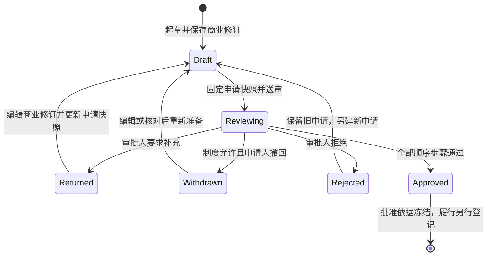

# 采购、报销业务修订与审批依据

日期：2026-10-23。对应 WP-06—08，以及[OA 流程需求](../requirements/04-workflows-and-oa.md)、[费用与订阅需求](../requirements/05-finance-and-subscriptions.md)和[审批总协议](21-oa-approval-and-business-revisions.md)。本文规定当前采购、报销草稿及送审链的实现约束；采购履行、费用入账、付款和订阅继续按原需求开发。

## 1. 当前实现边界

采购与报销共享不可变业务修订机制，各自保留独立业务类型、权限、编号、字段验证与审批制度。员工可以保存不完整草稿、补全商业资料、固定供应商和附件版本，再通过既有申请模块预览、送审、人工顺序审批、退回补充、重提和撤回。

| 范围 | 当前实现 | 后续必须完成的部分 |
| --- | --- | --- |
| 采购 | 候选供应商、报价版本、数量单价、税费折扣、交付期望、预算文字依据、准确金额及采购审批 | 选定供应商、分次订单、收货/验收、履行差异、关闭、真实费用和付款关联 |
| 报销 | 逐行供应商、费用日期/类别、实际含税费用、员工垫付/公司已付、固定凭证、缺失/疑似重复说明及报销审批 | 费用唯一来源、对账、部分付款/退款、核销、结算及财务流水 |
| Web | 列表、起草/编辑、详情、历史、未送审归档，以及共用申请工作台 | 履行和财务页面继续随对应模块实现 |
| Taro | 审批详情按采购/报销类型展示固定快照，复用人工审批表单 | 完整采购/报销目录、编辑、附件操作、真机和 Android 宿主 |

批准后采购/报销仍处于 `requested` 业务阶段，不产生订单、收货、真实费用、银行付款或员工到账事实。预算依据目前是文字，尚不是可执行预算占用。`company_paid` 是提交人声明的资金来源，不是系统已经核验的付款流水。所有首发平台和完整财务目标保持原定范围。

## 2. 领域对象与数据约束

实现位于 `app/backend/internal/spend/`，HTTP 入口为 `app/backend/internal/httpapi/spend.go`，迁移为 `0034_spend_documents.sql`。使用共享物理表减少同构重复；业务类型始终为 `purchase/claim`，不能混用权限、制度或列表游标。

| 对象 | 职责与不变量 |
| --- | --- |
| `spend_documents` | 固定组织、类型、业务编号、项目、分类、不可变创建人；保存当前/批准修订、当前申请、生命周期、审批状态和 CAS 版本 |
| `spend_revisions` | 完整 JSON 内容、修订序号/准确前序、schema 版本、内容摘要、金额、员工垫付合计、作者与原因；禁止修改/删除 |
| `spend_lines` | 修订内有序明细、稳定行 UUID、准确原始行和独立计算金额；与 JSON 行逐项一致，禁止修改/删除 |
| `spend_revision_suppliers` | 当前修订涉及的全部供应商及准确往来资料修订；集合必须与内容相等 |
| `spend_revision_files` | 全部报价/费用凭证的准确文件版本；集合必须与内容相等，登记引用保护 |
| `requests/request_revisions` | 独立申请及每次固定送审快照；业务修订与申请修订分别编号 |

业务编号使用数据库序列生成 `CP-P-…` 和 `CP-E-…`；编号可能有间断，不能当作连续财务凭证号码。组织内编号唯一，普通编辑不能改变业务类型、项目、分类、创建人或编号。业务头每次成功变更推进版本；业务正文改变才追加商业修订。头必须指向最新完整连续修订，修订前序必须与上一修订一致。

应用身份仅获不可变表的 `SELECT/INSERT`；应用不能通过更新行绕过修订协议。延迟约束在事务提交前核对 JSON、明细、派生金额、引用集合、当前头及申请关系。修改文件引用类型清单时须保留全部已有类型，包括 `contract_signature`，避免破坏合同签署和保留保护。

## 3. 草稿完整性与输入规则

起草至少需要标题、分类和明确操作原因；项目可选。业务未明确的数据以 null 或空字段保留，金额不填虚构零值。输入的可空明细/候选/凭证数组统一规范为 `[]`，响应数组始终存在。行 UUID 由客户端生成并在编辑中保留，排序变化不改变行身份。

| 字段/集合 | 当前限制 |
| --- | --- |
| 标题、类别、用途、备注 | 分别最多 200、50、4000、20000 字；标题不能空白 |
| 预算文字依据 | 最多 500 字，仅采购使用 |
| 明细 | 最多 100 行；描述最多 1000 字，单位/类别最多 50 字 |
| 候选供应商、报价版本 | 每份采购各最多 20 项；不能重复同一准确引用 |
| 费用凭证 | 每行最多 20 个不同文件版本，每份业务合计最多 200 个不同文件版本 |
| 缺失/重复凭证说明 | 每项最多 2000 字 |
| 负责人、币种、日期 | 有效组织成员、受支持币种目录、严格日历日期；期间与逐行日期范围须一致 |

采购使用候选供应商、报价、预期交付日期和预算说明；明细使用描述、数量、单位、单价、税额与折扣。报销使用费用期间及逐行费用日期、类别、供应商、实际含税费用、资金来源和凭证。采购不能混入报销日期/垫付字段，报销不能混入采购报价/预算/交付字段。

送审时另外要求：负责人有效、类别/用途/币种/含税方式/舍入方式明确、至少一条完整明细、能够得到确定总额。采购须有候选供应商和交付日期，每行数量、单位与单价完整。报销须有完整期间，每行日期、类别、供应商、实际费用、资金来源，以及至少一份凭证或明确无凭证说明。疑似重复行须有人工核对说明。

不完整草稿可以建立申请草稿供核对；预览与正式送审执行完整验证，不能通过“已建立申请”绕过必填、引用或制度要求。正式送审仍须命中一份准确制度修订和全部有效审批人。

## 4. 金额、税费与舍入

所有数量和金额均以十进制字符串传输。Go 使用定点/大整数计算，PostgreSQL 使用 `numeric` 独立复算；禁止 `float/Number` 运算后把结果写回财务字段。数量、单价最多 6 位小数，数量须大于零；单价允许零，不允许负数。行金额、税额、折扣、实际费用和合计须满足币种精度与 `numeric(20,6)` 范围。

单价可具有小于货币最小单位的精度；先对准确的 `quantity × unit_price` 计算，再按明确币种精度只舍入一次。舍入方式必须明确选择 `half_up` 或 `half_even`；不根据用户地区猜测。

| 口径 | 行金额计算 |
| --- | --- |
| 采购未税单价 `net_plus_tax` | 舍入后的数量乘单价 + 明确税额 − 明确折扣 |
| 采购含税单价 `gross_includes_tax` | 舍入后的数量乘单价 − 明确折扣；税额仅作其中税额说明 |
| 报销 | 明确填写的实际折后含税费用；其中税额仅说明，不再加税或减折扣 |

税额、折扣未填写时代表不另加/不另减，按零参与计算；该语义须在表单中说明。含税行的税额不能超过最终行金额，折扣不能造成负数。报销若同时提供数量和单价，两者须成对填写，并在舍入方式明确后与实际费用一致。总额仅在全部行金额明确时产生，否则为 null。

例如 HKD、未税计价、`half_up`：数量 `3` × 单价 `0.335` = `1.005`，先舍入为 `1.01`，加税 `0.02`、减折扣 `0.01`，行金额 `1.02`。同一乘积选择 `half_even` 时先得到 `1.00`。含税金额不能再次加税。

报销的 `employee_reimbursement_amount` 只汇总明确标为 `employee_advance` 的实际费用；公司已付行计入费用总额，但不再次计入员工垫付合计。任何行资金来源未知时不生成貌似确定的员工合计。举例：员工垫付 `12.34`、公司已付 `20.00`，费用总额 `32.34`，员工垫付合计 `12.34`。这两个数均不表示已记账、已付款或已核销。

## 5. 固定依据、权限与重复提示

供应商引用固定 `party_id + revision_id`，不在审批期间跟随最新名称或联系信息。报价及凭证固定 `file_version_id`，通过统一文件服务取得当前可读的准确版本证据与下载许可；业务响应不包含对象存储 Key、云凭证或预签名 URL。

首次选择新供应商及送审时要求资料有效；编辑既有草稿可以保留原有已归档资料引用，但正式送审须重新通过准入。供应方和文件的项目范围须适配本业务，分类不能高于本业务。新增商业修订及审批快照均单独登记版本引用保护，后续解除权限不删除历史引用。

| 权限/范围 | 约束 |
| --- | --- |
| `purchase.*` 与 `claim.*` | 分开授予，不因合同或管理员身份自动获得 |
| `purchase_manager/claim_submitter` | 预置但不自动绑定；读取、创建、编辑、归档仍经过具体资源范围 |
| `purchase_reader/claim_reader` | 只读业务；不能修改历史、起草或代替审批人 |
| 申请操作 | 另外检查 `request.*` 及相应业务权限 |
| 审批职责 | 指定审批人仍须有当前业务、供应方和全部固定文件的阅读权；职责本身不授予阅读权 |
| 业务历史 | 同时要求当前业务阅读与更新权限；不能以旧游标或历史角色绕过 |

所有列表先做当前 ACL 过滤再分页；游标绑定组织、用户、授权版本、渠道、运行、业务类型、筛选和具体历史对象。查看历史保留准确内容，但供应商展示信息和文件入口按当前权限重新投影；不可读的依据只保留中性提示，不能泄露其名称、路径或链接。项目关闭/归档/取消后不再接受新的商业写入。

重复检测用于提示人工核对：匹配其他当前可读报销中的可读凭证 SHA-256，或同一当前可读供应商、费用日期、币种和实际金额。仅返回每行布尔提示，不返回其他报销 ID、名称或数量。隐藏业务或隐藏凭证不能成为泄露线索；撤权后重新读取会重新计算提示。

提示不属于不可变商业正文或内容摘要，也不等同费用唯一键。它只检查其他当前业务修订，不承诺覆盖同一单内重复、历史所有修订、不可读业务或外部费用。后续[实际费用模块](35-canonical-actual-costs-and-incurred-reports.md)已提供永久来源唯一键及共同业务关联，疑似重复提示仍独立；本模块不据提示自动拒绝一笔真实费用，也不据无提示认定费用唯一。

## 6. 业务与申请状态

| 审批状态 | 业务生命周期 | 可改变的内容 |
| --- | --- | --- |
| `not_submitted` | `draft` | 可编辑；无关联申请的草稿可归档 |
| `in_review` | `requested` | 商业正文冻结；仅当前顺序步骤处理或制度允许的撤回 |
| `returned/withdrawn` | `draft` | 可追加商业修订；须明确更新申请快照后再送审 |
| `rejected` | `draft` | 原申请终态不可改写；可据原商业修订另建新申请，之后按新申请草稿继续修订 |
| `approved` | `requested` | 批准商业修订等于当前修订；普通编辑被数据库和服务共同拒绝 |

每次送审形成独立审批实例，旧步骤及决定永久保留。业务修改不会自动覆盖申请草稿；客户端须同时核对准确业务修订、申请版本和基础申请修订。预览确认固定 schema 版本、业务内容摘要、金额、供应商/附件版本与制度修订。提交事务重新检查全部条件，预览成功不保证稍后的提交仍可通过。

申请快照使用类型化 union：合同保留原字段/摘要兼容规则，采购/报销保存自身内容、业务编号、计算总额、员工垫付合计、有序行金额及固定依据。波动重复提示在快照中归零，不能让别人的新报销改变已固定摘要。空明细快照仍显式保存 `line_values: []`，未知金额保存 null。

## 7. API 与事务协议

以下路径均在 `/v1` 下；`{collection}` 为 `purchases` 或 `claims`。精确 DTO 由同源 [OpenAPI](openapi.json) 的 `SpendCreate/SpendPatch/Spend/SpendRevision` 等 Schema 定义，客户端类型自动生成。订单与验收现由[采购履行协议](34-purchase-orders-acceptance-and-returns.md)提供实际接口；财务、通用差异等尚未实现的契约路线仍是规划，不能当作已可调用。

| 方法与路径 | 行为 |
| --- | --- |
| GET/POST /{collection} | 当前有权列表、创建业务草稿 |
| GET/PATCH /{collection}/{id} | 当前业务、追加完整商业修订 |
| POST /{collection}/{id}/archive | 归档从未关联申请的草稿，保留正文与引用 |
| GET /{collection}/{id}/revisions | 当前有权历史分页 |
| GET /{collection}/{id}/revisions/{revision} | 准确历史正文与当前可读依据 |
| POST /requests | 按明确 kind 和 business_id 建立申请草稿 |
| 既有申请预览、修订、提交、决定及撤回入口 | 复用顺序审批协议，不建立平行审批引擎 |

PATCH 接收完整内容、`expected_version`、`base_revision_id` 和原因；输入省略不表示保留旧字段。创建/更新/归档使用统一幂等键。请求身份和当前准入在重放前重新验证；幂等重放不能恢复已撤销的附件入口或旧编辑能力。

同一事务执行授权锁、当前身份/项目准入、固定业务锁、CAS、完整内容与引用验证、追加修订/派生行/引用、更新头、审计、outbox 和结果记录。项目锁在业务锁之前；等待业务锁后重新读取头，不能使用加锁前的旧内容。审计失败时全部回滚，相同幂等键可安全重试。

409 冲突保留当前表单输入，禁用继续覆盖，明确提示关闭并核对最新资料；不能自动刷新覆盖员工输入。网络中断不等于写入失败，须用原幂等操作确认结果。归档只影响列表和写入准入，详情/准确历史仍按权限读取；不会删除文件证据。

## 8. 官网风格在本模块的落地

遵守[视觉令牌](../design/02-visual-foundations.md)、[组件契约](../design/07-design-handoff-and-component-contracts.md)及[品牌与文案](../design/09-brand-application-and-content-style.md)。不另增采购/报销专属品牌色；页面使用既有暖白/深色画布、墨色主操作、品牌蓝链接/焦点、语义状态、表格和表单间距。

列表优先显示业务编号、标题、类型、准确金额、审批状态和更新时间。详情按业务事实、金额口径、逐行资料、固定依据、审批/历史排列；顶部操作由实际能力返回控制。未知金额显示“尚未确定”，零值使用明确币种金额；审批通过显示“已批准”，不使用“已付款/已完成采购”。

数量、单价、金额使用文本十进制输入与清晰单位；不得用 JavaScript 即时浮点合计伪装后端结果。表单说明税额/折扣省略语义，保存后显示后端准确计算。明细在窄屏纵向排列，长供应商名称、摘要和 UUID 换行，不能依靠整页横向滚动。错误既有文字也有语义样式，不仅改变颜色。

供应商、报价、凭证使用共用选择器，固定所选版本并允许明确移除。范围变化清空不再适配的引用；选择项目后不能被后续分类回调悄悄还原。重复提示保持中性人工核对文案，不将它称为已经证明的重复报销。

移动审批快照区分采购/报销，不再套用合同字段；显示固定业务编号、含税方式、舍入规则、费用总额、员工垫付合计、有序明细和依据。现有移动公共页面不等于微信/抖音真机或 Android 实际审批已验收。

## 9. 验证、证据与继续开发

新增验证包括准确数量单价舍入与币种精度、税额/折扣及员工垫付口径单元场景，以及 15 个隔离原生 PostgreSQL/真实 HTTP 叶场景：不完整/幂等草稿、完整修订及引用、非法输入、并发编辑、两类准确审批、退回重提撤回、重复说明、当前撤权、不可变表、审计回滚、归档、拒绝后新申请、游标/历史权限、提示隔离和数据库独立复算。合同签署回归另外核对既有引用类型兼容性。

[真实 Web/API 记录](../quality/evidence/spend-documents/result.json)于 2026-10-23T14:36:06.525Z 通过 8 条检查链，283 个来源摘要为 `1fa49b0701f3a1d93d628b2ba65cd13c48f5b7ef18d5b0c73bf0ba509864c019`，期间未变。检查覆盖实际选择器录入、准确金额、冲突输入保留、独立审批、退回修改重提撤回、重复提示/送审阻断、草稿归档和当前撤权。业务详情加载完成后再检查双主题及 320/390/768/1024/1440 宽度；代表截图已人工复核。全部所属浏览器/标签页关闭、临时权限撤销、原生测试库清理退出码 0、临时 Vite 停止。附件为受控 15 字节样本，不是实际云、票据或 120GB 传输证据。

[完整后端记录](../quality/evidence/backend/result.json)于 2026-10-23T14:48:15.705409+00:00 通过 337 条结果、297 个叶场景（59 单元/238 数据库），无跳过，来源摘要为 `4dba7453eeef1de43d70f5a7328e9746fa03819ac779f7ba8f839171db05f459`，期间未变。并行编译阶段曾有三处测试库清理超时；后续单独完整重跑通过，已核对并清理该次运行遗留的准确临时数据库。没有调高超时、放宽业务断言或修改既有迁移来取得通过结果。

[移动编译记录](../quality/evidence/mobile-foundation/result.json)于 2026-10-23T14:54:10.878778+00:00 通过 14 项测试、类型检查和微信/抖音编译，37 个来源摘要为 `356258f75b776fe4479b56de814d8f3c55534552087b15bc922409bf17dbbd3e`，期间未变。两种产物各有 31/28 个文件；它们只证明编译及列明测试，不替代新增采购/报销移动页面的真实操作或真机验收。

最终 Web 的 26 项单元测试及含 TypeScript 检查的生产构建通过。新增页面继续使用既有令牌与官网标识，没有新增外部字体或生成品牌图像。

后续验证以对应证据及[实施台账](../delivery/02-implementation-ledger.md)为准。来源摘要、测试期间未变、执行时间与清理结果应一并保存；不得把父测试重复计为额外场景，也不得将历史模块证据误称为新增代码已经通过。

移动公共客户端后续已补充采购／报销完整起草、固定供应商与附件选择、申请准备／更新／预览送审／撤回及历史，协议见[移动业务草稿与明确送审](47-mobile-business-drafts-and-submission.md)，交互见[移动业务设计](../design/20-mobile-business-drafts-and-submission.md)。该次实际验证独立记录，不扩大本节原有Web或编译证据的范围，普通本机附件上传和平台真机继续验收。

采购订单、分次验收、准确来源退货及批准范围约束已后续接入，见[采购履行协议](34-purchase-orders-acceptance-and-returns.md)。唯一实际费用与发生支出已后续接入，见[费用实施协议](35-canonical-actual-costs-and-incurred-reports.md)。继续补充差异制度与完成条件、付款/退款/核销和订阅账期；项目预算/结项、秘书工具和全平台页面随真实领域接口接入。真实供应商/票据、既定审批人/阈值、财务口径、平台主体、云和真机证据另行验证，不使用测试制度或虚构业务数据代替上线配置。
