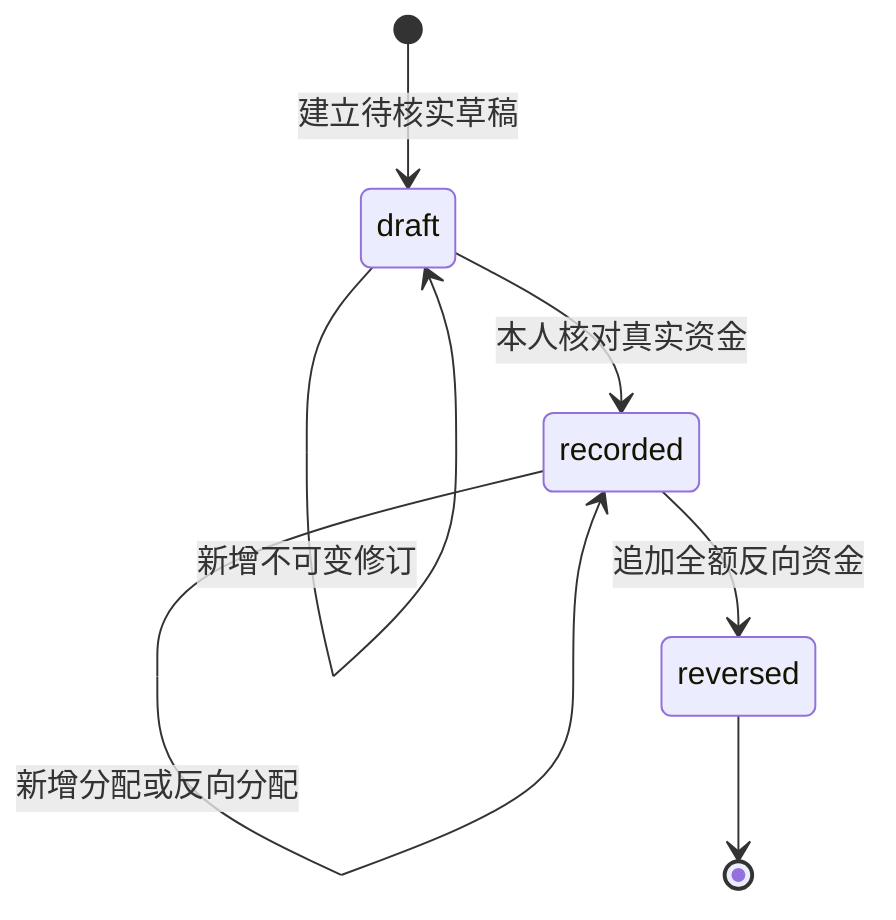

# 实际资金、退款、费用分配与员工结算

日期：2026-10-24。实施范围：迁移0037、Go财务服务、Web资金台账/分配/退款/历史、费用与报销结算投影、现金月报。依据[费用与订阅需求](../requirements/05-finance-and-subscriptions.md)、[实际费用](35-canonical-actual-costs-and-incurred-reports.md)和[审批协议](24-request-snapshots-and-sequential-approvals.md)。

## 1. 三类金额分别使用

| 事实 | 来源 | 时间 | 用途 |
| --- | --- | --- | --- |
| 批准额度 | 准确批准业务修订 | 批准时间 | 采购/报销/合同执行依据 |
| 实际费用 | 唯一费用及其冲销 | occurred_on | 发生支出报表 |
| 实际资金 | 资金记录及其冲销 | paid_at，按香港时间生成paid_on | 现金支出报表 |

实际付款独立登记，允许先登记未分配资金，再核对准确费用。关联采购、报销或合同不会自动付款。费用发生报表与现金报表不可相加作为新的“总支出”。本模块记录真实业务事实，不调用银行发起支付。

公司直接支付供应方的资金使用往来方；公司偿还员工垫付使用员工收款对象。员工自行垫付的原始消费不是公司银行现金支出，公司真实报销付款才进入资金台账。内部转账及实际收入可登记，但不进入本次支出现金报表。

## 2. 身份、来源与状态

`payment_records` 保存固定组织、永久来源标识、所属项目、创建人、分类、记录类型及当前版本。组织内source_key永久唯一，幂等缓存过期不释放。人工源可使用 `manual:UUID`，可靠银行导入应使用可重复识别同一流水的稳定来源。仅相似标题不构成去重依据。

人工命名空间禁止 `reversal:`。全额冲销固定来源 `reversal:{original_id}`，原记录与反向记录一对一。

`record_kind=payment` 为原资金；`record_kind=reversal` 为独立反向记录，直接为recorded且不可二次冲销。登记后不修改原金额、收款对象、方向或时间；更正通过全额冲销及必要的新记录。

退款是 `direction=refund` 的独立原资金，引用准确outgoing原付款；退款不等于冲销原付款。草稿创建后refund_of_id固定，不能借修订更换锁定来源。

## 3. 准确内容与证据

草稿允许方向、实际时间、币种、金额、往来方/员工未知，类别/方式/备注可空；标题、固定范围、来源及原因有效。凭证显式为数组，未知不写为零或当前日期。

正式登记要求：

- outgoing/incoming/refund/transfer之一，已实际发生且不晚于数据库当前时间。
- 已配置币种、符合其精度的正原币金额；金额使用十进制字符串及numeric(20,6)。
- 类别、付款方式标签、至少一个当前可用并通过扫描或正式例外的固定文件版本。
- outgoing为往来方或员工；incoming为往来方；transfer不填往来方/员工；refund固定原付款相同的对象、币种、范围、分类，时间不早于原付款。

往来方固定party_id与revision_id；资金凭证固定file_version_id。文件引用注册为 `owner_type=payment_revision` 并参与保留保护。历史版本继续保留原引用，当前失去资料读取权时隐藏其标题/内容。

paid_at输入必须包含时区，服务归一为UTC微秒；paid_on在数据库固定为Asia/Hong_Kong自然日。Web时间控件明确标注香港时间，避免浏览器所在时区改变业务日期。冲销单独提供effective_at，不能早于原资金或晚于当前时间。

方式只填“银行转账”等业务标签，不保存完整卡号、账户密码或支付密钥。外部流水标识最多200字符、方式100、类别50、备注20000；每个修订最多20个凭证。统一基础币种及跨币分配仍待Q-07决策，当前只做同币种结算，不编造汇率。

## 4. 不可变分配账

`payment_allocations` 保存正金额和独立effect符号；`payment_allocation_shares` 保存该笔分配的准确项目/公司金额。金额不得写成负数，统计时使用effect。

| kind | effect | 来源及作用 |
| --- | --- | --- |
| allocation | +1 | 已登记outgoing分配至已确认、未冲销的原费用 |
| release | -1 | 同一原付款释放准确正向分配；现金不变 |
| refund | -1 | 真实退款减少其原付款的准确正向分配 |
| reversal | 原明细effect的相反数 | 资金全额冲销时逐条复制原明细与项目份额 |

根正向分配的root_id=id。release/refund引用原正向source_allocation_id；reversal引用被冲销资金中的每一条准确明细，包括此前release/refund。所有反向记录保留原因、操作者与原始依据，不能删除原明细。

根余额为所有同root_id明细的 `sum(effect × amount)`，严格在零与根分配金额之间；各项目余额也不能为负或超过该根原始项目金额。每条分配的项目/公司份额之和必须等于其金额。

费用有效结算为所有引用该费用的签名明细合计。即使原资金state已为reversed，也不能忽略原正向明细后再减反向明细；原始事实与补偿共同求和才正确。

## 5. 当前余额及精确分摊

同时约束以下余额：

1. 原付款有效退款总额不能超过原付款金额。
2. 原付款家族有效分配不能超过“原付款减有效退款”。家族包含原付款、其冲销、相关退款及退款冲销。
3. 费用有效结算不能超过准确费用金额，且仅未冲销的已确认原费用允许非零结算。
4. 项目/公司累计结算不能超过费用对应原分摊金额。
5. 员工报销明细累计结算不能超过该准确批准垫付明细金额。

部分分配以费用当前剩余项目余额为权重，使用整数最小货币单位和最大余数分配；同余按既有稳定明细顺序处理。release/refund以根分配当前剩余项目余额分配。全额冲销直接复制每条原项目份额，不重新舍入。Go金额和SQL约束分别校验精度；不用JavaScript浮点算账。

例如费用项目0.01、公司0.02，连续三次支付0.01仍精确得到项目0.01/公司0.02，不因每笔重复舍入挤占同一份额。

## 6. 退款与冲销

退款登记固定expected_source_version，并在锁内重读原付款与当前余额。该版本指原付款头版本；其他退款改变其派生余额时，仍必须实时查询账本，不把头版本当成完整余额快照。

原付款已全部分配时，退款会减少净付款额度，必须在同一次record命令提供refund_allocations，引用相应原分配并释放足够金额。资金头转移、反向明细、项目份额、事件及幂等凭证原子提交。失败不保留半笔退款。

原付款有足够未分配余额时，可先登记尚未分配的退款，再通过refund-allocations补充准确来源。一次record最多100条不同原分配；重复来源拒绝。后补分配不能超过该退款自身尚未分配金额或原分配剩余余额。

原付款存在未冲销实际退款时不能全额冲销，须先冲销退款。冲销退款会恢复原费用结算；如果后来其他付款已占用费用余额，冲销退款拒绝，须先纠正后续分配，不能自动制造超付。

存在有效结算的费用不能直接冲销。可依据实际情况释放错误归属、登记真实退款或冲销错误付款，再冲销费用；这些行为的现金含义必须保持区别。

## 7. 员工垫付结算

员工付款分配必须同时固定：准确claim_id、已批准claim_revision_id、claim_line_id；该报销申请员工等于实际收款employee_id，明细funding=employee_advance，币种和供应方与费用一致，费用已关联该准确批准报销修订。

company_paid明细不产生新的员工应付。无员工应付额时派生结算为settled，不新增虚假付款。结算状态由当前有效账本推导，不开放PATCH“已付款”。

`GET /claims/{id}/settlement` 返回批准垫付额、已结算、未结金额、状态及visibility。未批准时金额/状态为null；缺少资金读取权或任一相关资金不可读时，已结/未结/状态为null、visibility=restricted，不能显示零。批准垫付额来自可读业务快照，可继续展示。

Web通过批准报销选择实际收款员工，再选择准确垫付明细和已关联费用；普通用户不填写员工UUID，也不需要被授予全体成员管理权限。

## 8. 权限、人工身份与并发

以下角色在迁移及新组织初始化创建，均不自动绑定员工：

| 角色 | 权限 |
| --- | --- |
| payment_recorder | payment.read、payment.record |
| payment_reverser | payment.read、payment.reverse；角色要求MFA |
| payment_reader | payment.read |
| cash_reporter | payment.read、report.read |

付款权限不隐含cost.read、claim.read、party.read或file.read。系统管理员不自动获得资金权限。分配至费用还需当前完整读取该费用；员工结算还需准确报销读取权。

付款读取检查全部历史分配费用的当前可读性，任一不可读则整笔不可读。即使释放全部分配，也不能扩大历史资金、修订、事件或明细的可见范围。

所有写入要求有效人工会话，Agent运行或其他非人工渠道拒绝。草稿保存无需近期MFA；正式登记、分配、释放、退款分配和冲销要求数据库当前最近10分钟MFA，在幂等命中前核对。SQL事件触发器独立检查实际会话归属、撤销/过期、用户授权版本和准确MFA时间。

命令依次锁定排序后的全部相关项目、批准报销头、费用头、资金头（含退款原付款）。费用冲销使用相同费用锁；不同付款不能同时占用同一费用余额。资金头锁和准确版本/修订/摘要阻止同一付款并发覆盖。数据库分配触发器额外锁定来源，延迟约束于提交时核验账本、余额和连续事件。

项目closing/archived/cancelled拒绝相关写入。分类不得低于关联项目及费用。审计/事务事件、业务账本与幂等凭证原子提交；审计失败全部回滚。幂等重放仍检查当前权限并重新投影敏感引用。回执保留原操作时的头版本、状态与金额快照；后续分配或冲销不能混入旧回执。头版本已变化时旧回执的写能力全部关闭，当前余额另取详情。

## 9. 机器契约与已实现接口

以[OpenAPI](openapi.json)及生成TypeScript为准，请求和响应均使用封闭Schema。金额字符串；数组明确提供；登记请求的expected_source_version普通资金为null，refund_allocations普通资金为[]。

| 方法 | 路径（统一/v1前缀） | 行为 |
| --- | --- | --- |
| GET/POST | /payments | 授权分页台账、建立草稿 |
| GET/PATCH | /payments/{id} | 当前事实、准确基础上新增草稿修订 |
| POST | /payments/{id}/record | 人工登记实际资金，可原子附带退款分配 |
| POST | /payments/{id}/allocations | 固定准确费用与可选报销垫付明细 |
| GET | /payments/{id}/allocations | 分页不可变明细、份额及根剩余余额 |
| POST | /payments/{id}/allocations/{allocation}/release | 追加原分配的反向归属 |
| POST | /payments/{id}/refund-allocations | 后补退款准确来源 |
| POST | /payments/{id}/reverse | 追加全额反向资金和全部分配明细 |
| GET | /payments/{id}/revisions | 分页修订历史 |
| GET | /payments/{id}/revisions/{revision} | 准确历史内容与独立资料投影 |
| GET | /payments/{id}/events | 分页连续登记事件 |
| GET | /claims/{id}/settlement | 准确批准垫付的派生结算 |
| GET | /reports/cash | 原币现金支出汇总 |

分页游标绑定身份、授权、渠道/运行身份、对象及筛选，不能跨对象或改筛选复用。台账state=cash仅包含已实际发生的outgoing/refund及其冲销，便于现金报表钻取；普通台账仍可查收入和内部转账。

## 10. 现金报表口径

报表在单个repeatable-read只读事务内检查当前授权版本、汇总和草稿数量。按香港paid_on及 `[from,to)` 半开期间，显式范围1至366天；省略两者取香港当前月。各币种分别列示，无统一折算时base_currency=null、fx_coverage=unconfigured。

全部资金范围：原outgoing加金额、原refund减金额、reversal按被冲销方向反向计入其生效月份。reversed原记录仍保留原月份；未分配真实资金也必须计入现金。

项目/公司范围：仅汇总该资金的持久化项目份额乘effect。分配归属使用查询时的有效账本，现金发生时间仍为各资金原时间；后来纠正分配可能重述过去月份的项目归属。此视图不是“当时所知”的历史冻结报表。

未分配金额不自动归入公司费用。全部范围单独展示未分配净额；项目/公司范围明确提示切换全部范围核对。列表钻取展示完整原币资金事实，不能把整笔金额当成所选项目小计。

每个币种返回outgoing_amount、refund_amount、带符号correction_amount、net_amount、unallocated_amount及记录数量。汇总使用不限制整数位数的numeric，保留六位小数；多笔合计允许超过单笔numeric(20,6)的上限。草稿未计入；未填日期或方向的草稿不属于具体现金月份，须到台账核对。

## 11. Web交互与视觉约束

资金列表、详情、固定凭证、历史、事件、分配与现金月报沿用[品牌设计体系](../design/README.md)的双主题令牌、暖白/深色画布、墨色主操作、蓝色链接与焦点。报表卡使用既有金额层级和内边距，分配保留类型及正负方向，不靠颜色单独表达。

只读用户依据服务端能力隐藏操作；后端仍独立拒绝越权。409/412保留输入并禁用当前提交，关闭后重新核对来源。MFA由实际会话校验；模态中的引用选择保留焦点返回。退款只从原付款起草，以固定币种、收款对象、范围和来源。

## 12. 验证与后续

定向验证已通过24个原生PostgreSQL付款场景和3个精确分摊单元场景；包括并发费用/付款/退款余额、SQL完整事件下超额及精度拒绝、历史ACL、实际DB MFA、审计回滚、跨月退款/冲销、准确员工结算、后续超付防护、旧操作回执金额快照、受限结算未知与超单笔上限汇总。既有18个费用场景亦通过。完整后端分批回归已通过405条结果、361个叶场景（62单元/299数据库），84个自动发现顶层测试全覆盖、11个串行批次来源一致，无失败/跳过；见[0037完整后端历史记录](../quality/evidence/payments-settlement/backend-0037-result.json)。真实浏览器链和开发运行时以各自独立证据及实施台账为准，不由后端通过推定。

Web新增资金台账与操作、现金月报、报销结算及费用结算展示。生产构建、既有26项Web测试及移动类型检查通过。[最终Web/API证据](../quality/evidence/payments-settlement/result.json)通过8条真实操作链，四类页面双主题五宽度、固定凭证/人工MFA/冲突/退款/冲销/员工部分结算及现金钻取均核对；来源期间一致，代表截图已人工复核，自有浏览器/临时角色/测试库和Vite均清理。具体时间、来源摘要与[设计复核](../design/06-design-verification.md)分别保留。

继续开发：订阅账期与预测、合同收付款节点和资金对账、完整筛选/导出/预算、统一汇率和跨币分配、会计与税务所需口径、Taro全业务及Android真实宿主。真实银行/云/平台/真机未因本地账本实现自动验收；本模块不代表完整财务、会计总账或四端首发已完成。

## 13. 开发运行与迁移约束

在app/执行 `python scripts/run_backend.py migrate` 应用0037后重载本任务API；运行 `python scripts/verify_payment_development.py` 核对完整迁移名称/摘要、受限应用角色和15项资金接口的未认证拒绝，以及存活/就绪两项健康接口。脚本只读本任务loopback开发库，不输出凭证，不绑定角色，不产生实际资金。

0037与此前迁移共同进入启动/就绪的精确清单。新数据库配旧二进制、遗漏0037或摘要漂移都应拒绝就绪；不得跳过清单校验强行运行。Web须使用同一OpenAPI生成类型，不能保留旧资金DTO后仅更新界面标签。

已有资金、分配、事件和凭证保留保护均是历史事实，故障修复应采用向前修复及准确补偿；不通过删除0037表或清空迁移记录降级。生产变更仍依赖完整恢复集、已验证的备份恢复、部署门禁及独立外部验收，不由本机开发迁移替代。

首次完整测试运行的失败、中断及临时数据库清理记录保留于实施台账。最终回归必须固定后端来源；本机完整数据库套件与浏览器夹具分开运行，完成后核对来源摘要和清理结果，不能将单项定向通过当作完整套件通过。

长套件可在app/运行 `python scripts/verify_backend_batches.py --batch-size 8`，它通过Go自动发现全体顶层测试，以精确名称分批执行，核对每批及最终完整清单并保存后端摘要。已核实原进程停止后，可用同命令加 `--resume` 继续未完成批次；活跃进程不得重复启动。来源或发现清单变化时拒绝复用。只有全部批次通过，才更新完整后端result.json；不将分批运行表述为同一个Go测试进程通过。

本次[开发运行时记录](../quality/evidence/payments-settlement/development-runtime.json)已通过37项迁移摘要及17项健康/鉴权探测，四项资金角色保持未绑定；[Web及清理记录](../quality/evidence/payments-settlement/development-web-and-cleanup.json)确认开发页与API代理就绪、临时测试库及浏览器夹具已清理。此状态只描述本次本机检查，运行时间和权限明细以证据为准。
