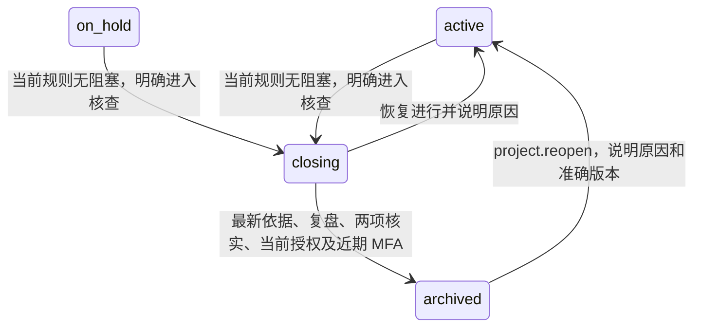

# 项目结项核查、人工复盘与归档协议

日期：2026-10-24。状态：后端与 Web 已实现并通过本地验证；完整移动流程和生产验收仍未完成。验证范围见第 6 节与交付台账。关联 PM-03/05/08、WP-04、TC-PM-07；承接[项目需求](../requirements/03-projects-and-knowledge.md)、[变更与预算](43-project-changes-and-budget-revisions.md)、[合同完成与终止](39-contract-completion-and-termination.md)、[采购完成核对](41-purchase-completion-and-settlement-review.md)、[实际费用](35-canonical-actual-costs-and-incurred-reports.md)、[资金结算](36-payments-refunds-and-settlement.md)及[订阅账期](37-subscriptions-billing-and-forecast.md)。产品代码和新增开发脚本位于 app/，文档和证据位于 docs/。全部使用 Windows 原生工具，不调用本地 Docker、WSL、虚拟机或模拟器。

## 1. 业务边界与状态

结项是项目管理动作，必须分别核对业务完成、合同履约、费用结算和订阅处置。审批通过、采购已完成、合同已终止、上传成功、供应方取消登记均不能替代其他事实。归档不产生费用或资金，不改变已有审批，不终止合同、不取消订阅、不删除文件。



进入 closing 前提供完整核查入口；closing 中普通项目业务保持只读。需要解决事项时恢复进行，处理后重新核查。旧的 `transition(action=archive)` 明确返回 `PROJECT_ARCHIVE_REVIEW_REQUIRED`，不能绕过人工复盘。取消项目仍沿用原生命周期，本协议不把取消视为已经结清所有财务事项。

Q-18 的单项结项例外尚未确定，因此本地实现没有豁免或“忽略全部”能力。不得用复盘文本替代未结事项的真实处置。来源缺失、旧资料缺乏完整协议依据、权限不足以及超过完整核查上限都不能被视为零阻塞。

## 2. 十三类核查

| 类别 | 阻塞条件或用途 | 数据口径 |
|---|---|---|
| 任务 | 未完成且未取消 | 真实任务状态，包含受阻与待验收 |
| 里程碑 | 未达成且未取消；missed 仍需处置 | 不把到期或错过当作完成 |
| 交付 | 未验收，或仍为缺乏完整协议的旧资料 | 固定当前交付修订和对应人工决定 |
| 风险 | 未关闭且未转为问题 | 已实现风险的关联问题仍另行核查 |
| 问题 | 未关闭 | resolved 仍须明确关闭 |
| 项目变更 | 未实施、拒绝或撤回，或旧资料依据不完整 | 获批准但未实施仍阻塞；固定完整提案与项目／预算基线 |
| 预算版本 | 提供核查参考，不单独构成承诺或阻塞 | 含草稿、启用与已替代历史；清单 version 使用该预算的真实 revision，不能固定为 1；不据预算推导费用或付款 |
| 合同 | 非完成／终止阶段、审批未结、无有效履约依据，或当前履约／结算／补充协议未闭环 | 重用合同当前核查函数；终止仍可能有财务事项 |
| 采购 | 未完成／取消、审批待办，或当前履约／变更／费用／退款核查不通过 | 完成重用采购核对规则；取消只免除“必须有已验收交付”，不免除其他财务核查 |
| 报销 | 未处置申请；获批后相应币种及批准修订的已确认费用合计不等于获批金额，或员工垫付未结清 | 拒绝／撤回不自动冲销费用；已有费用仍独立核对 |
| 实际费用 | 草稿；普通费用当前净资金分配不等于其有效应结金额 | 共享费用核对完整费用，含当前项目分摊及相关业务来源；冲销后仍有分配也阻塞 |
| 资金与退款 | 草稿；已登记退款尚未明确分配或归属合同 | 包含有关联的原付款、退款和冲销家族；普通资金余额不自动等同费用欠款，人员仍须在资金页面核实用途 |
| 订阅与账期 | 未取消／归档、取消未生效、无供应方已取消状态及检查时间／凭据、仍有预测账期或当前实际核对失效 | 系统内取消控制与供应方实际停费分开，暂停不等于取消 |

每条清单列出源对象、准确版本、标题、状态与是否构成阻塞，点击原对象继续核对。该清单不是会计报表或自动审计意见；金额、分摊、供应方与附件的详细核对继续使用对应业务页面。人工确认要覆盖系统外尚未录入的义务和真实交付情况，不得因清单暂为空而自动归档。

## 3. 接口及提交数据

| 方法与路径 | 结果 | 约束 |
|---|---|---|
| `GET /v1/projects/{id}/closeout` | 项目当前信息、as_of、十三类清单、完整可见性、可用动作及可选准确指纹 | 在单个 Repeatable Read 只读快照内计算 |
| `GET /v1/projects/{id}/archives?limit=&cursor=` | 归档历史、复盘、当时清单、固定附件和当前依据状态 | 按 created_at／id 倒序；权限核查在分页前完成；游标绑定人员、授权版本及项目 |
| `POST /v1/projects/{id}/archive` | 原子提交后的项目与归档收据，201 | 当前 closing 项目；严格版本、指纹、人工复盘、两项核实、真实交互会话及近期 MFA |

提交须包含：`expected_version`、`expected_fingerprint`、`summary`、`lessons_learned`、`follow_up`、`business_verified=true`、`financial_verified=true`、`file_version_ids` 和 `reason`。三段复盘分别为 1—20000 字，归档原因为 1—200 字；无遗留跟进也须明确填写。附件可选 0—20 个不同的正式版本，提交时验证范围、分类、可用性、扫描依据及当前文件权限，固定版本并登记保留引用。

两项核实初始必须未选。MFA 验证成功只更新身份状态，不自动提交归档。AI Run、TG 渠道或借用他人验证时间不能执行该敏感动作。

若项目版本或核查依据变化，返回 409，不自动改用最新依据。前端保留复盘、原因和附件；人员明确重新读取后，两项核实重新清空，须再次核对和提交。网络异常保留窗口与同一请求内容；重试相同内容使用相同幂等键。后台仍以准确版本和独立事实约束拒绝重复归档。

OpenAPI、嵌入后端的同一契约与生成客户端类型必须同步更新。完整字段定义以[接口契约](openapi.json)为准，禁止另写与后端不同的成功响应。

## 4. 快照、权限与历史

`project_closeout_snapshot` 固定 schema_version=1、完整项目头及按类别／ID 排序的完整来源事实。数据库保存原始 JSONB 快照，客户端只收到授权后的清单字段，不返回嵌套原始合同、供应方、资金、费用或文件载荷。JSONB 中的数值在 PostgreSQL 内保持精度；不由浏览器浮点运算重建核查事实。

指纹为 PostgreSQL 对规范 JSONB 文本生成的 MD5，只作为完整事实变化的并发标识，不是密码学签名、内容完整性证明或不可抵赖凭证。单次顶层核查超过 5000 条时明确拒绝完整核查与归档，不截断后声称通过；采购等嵌套依据沿用各业务函数的完整来源。单个项目超过 500 份归档历史时需专项整理，不返回未经完整授权核查的局部分页。

每类须具备类别查阅权限及所有相关对象的当前权限。费用检查全部当前分摊项目，资金与合同／采购重用既有的共享来源权限函数；变更还要求预算查阅权限。预算按实际项目资源检查权限。任一对象不能完整查阅时，该整类标记 restricted，`count`／`open_count` 为 null、items 为空，不显示零，不提供完整依据指纹，也不能归档。

新角色 `project_closeout_reader` 和 `project_archiver` 默认不绑定任何人；后者要求 MFA，只有额外的项目归档权限，不授予财务、合同或订阅写入权限。查阅角色的类别动作仍受作用域、分类、对象 ACL 和共享来源约束。系统管理员不因此获得业务内容权限。

历史按当前权限重查，不能依赖第一次提交时的角色。先验证当前完整来源权限，再核对历史来源的分类、资源和当时费用分摊项目；受限历史不暴露条目、数量、游标或复盘内容。新归档附件的实际读取继续走文件授权。幂等结果重放前及返回旧结果时同样检查当前权限。记录保留操作者 ID，界面中的姓名来自当前用户资料，不冒称不可变的历史姓名。

归档记录、原始依据和附件集合不可改写。受控重开后旧记录仍在；再次归档生成新记录。只有项目仍处于该次归档版本且来源完全一致时，历史标记 current；重开、后续版本或来源变化均标记 changed，旧的复盘和事实不被覆盖。

## 5. 事务和数据库约束

归档命令在既有 Commands 授权与幂等事务中执行：核对组织／用户／会话，按 UUID 升序锁组织内项目头，再按顺序锁相关费用头和资金头，重新读取完整来源、核对版本／指纹／阻塞，验证选取的正式文件，写入归档记录及文件引用，更新项目版本与阶段，最后提交审计、outbox 和幂等收据。

首期 3 人场景采用保守的组织内项目锁，避免先锁目标项目、再锁较小 UUID 的共享项目所产生的反序竞争。它会短暂串行化不同项目的写入；增长后需要按完整关联范围优化，并保留范围变化复查和相同锁顺序。不得在这些锁内调用 OSS、R2、模型、TG 或下载大文件。

迁移 0046 独立保护：真实未撤销交互会话与近期 MFA、当前项目和全部类别权限、准确来源快照与指纹、无阻塞、归档记录和阶段一致、固定附件数量、提交末尾事实一致、归档和文件集合不可更新／删除、归档后不可追加附件、正式文件保留引用。应用身份只有新增和查阅归档历史的权限，没有修改／删除历史的权限。SQL 约束是服务端事务的补充，不能把数据库超级用户隔离或任意外部事实核验当作已实现能力。

审计失败、文件核验失败、源版本变化、并发重复或提交末尾事实变化均须使整个事务失败，不能留下半份复盘或已经归档但没有审计的项目。任何归档失败都不应自动改变资金、费用、合同、审批和订阅。

## 6. 本地验证与后续质量门

[0046 完整后端回归](../quality/evidence/project-closeout/backend-0046-result.json)于 2026-10-24T07:41:19.114145+00:00 通过 594 条结果、538 个叶场景（73 单元／465 HTTP 与原生 PG），95 个自动发现的顶层测试在 12 批全部执行，无失败或跳过。[原样批次归档](../quality/evidence/project-closeout/backend-0046-batch-progress.json)与结果同源。318 项后端来源摘要 `cc7e52695116afeed50f90ae392ca90a33c3be2b2ccea9901964ccfa2ae2910d`，各批期间未变；没有混用修改前的通过批次。

其中结项专项为 19 个叶场景，覆盖默认未绑定角色、权限不足不披露、旧接口／SQL 旁路、里程碑、未处置合同／采购／报销、旧交付依据、真实 MFA、SQL 有效控制与伪造拒绝、审计回滚、并发唯一、幂等与撤权重放、重开历史、共享费用、真实资金分配与未归属退款、固定附件和供应方取消。另在实际变更／预算用例内，将结项清单与预算接口返回的当前及已替代修订逐一核对，不假定草稿不占用修订号；报销、合同与采购的现有真实财务链同时核对对应结项阻塞。

[实际 Web/API 检查](../quality/evidence/project-closeout/result.json)于 2026-10-24T07:42:16.064Z 通过 6 条操作链：已有义务阻塞、任务处置及进入结项、真实字段错误与焦点定位、409 保留输入与明确重新核查、实际归档／受限历史、受控重开后历史保留。6 组页面状态均检查双主题及 320／390／768／1024／1440 px，共 60 组配置，保存 12 张截图；[逐图复核记录](../quality/evidence/project-closeout/visual-review.json)覆盖其中 4 张，保留观察与截图哈希。预算参考类别与条目均采用中性徽标，普通无阻塞提示不冒称人员已核实。

[开发运行时](../quality/evidence/project-closeout/development-runtime.json)确认 46 项迁移与源码一致、11 项健康／未认证拒绝探测通过、应用身份最小权限及归档触发器有效；两项专用角色仍未绑定，归档角色要求 MFA。API 已重载。[Web 测试与构建](../quality/evidence/project-closeout/web-build.json)通过 26 项测试、类型和 Vite 构建；[移动基础记录](../quality/evidence/project-closeout/mobile-build.json)通过 14 项测试、类型及微信／抖音编译。移动此轮仅同步共享契约，不表示已有完整移动结项页面。

[最终来源复算](../quality/evidence/project-closeout/final-source-check.json)确认 318 项后端、429 项浏览器、90 项 Web 构建及 37 项移动来源均匹配成功记录，文档与嵌入契约相同，归档结果／进度原样一致。[开发 Web 及清理](../quality/evidence/project-closeout/development-web-and-cleanup.json)确认原 5178 页面与就绪代理均为 200，临时夹具不存在，测试库为 0；所属浏览器上下文／标签及临时 Vite 均已关闭。

全部业务为虚构样本，正式文件使用受控小文件；浏览器本轮归档为零附件，固定附件与保留引用主要由后端场景验证。截图只覆盖可见区域，弹窗下部字段与实际提交由操作断言支持。本地结果不证明 120 GB 上传、2 TB 迁移、真实双云、生产性能、完整会计规则或完整 TC-PM-01／04 从立项到财务结项链通过。微信／抖音与 Android 的完整结项表单、原生身份验证、嵌套附件选择、辅助技术、真机及发布仍须分别实现和验收。

## 7. 错误处理与开发约束

| 返回 | 含义 | 调用端处理 |
|---|---|---|
| 422 `PROJECT_ARCHIVE_REVIEW_REQUIRED` | 使用旧状态转换直接归档 | 打开独立结项与复盘流程，不改写为普通阶段切换 |
| 422 `CLOSE_BLOCKED` | 当前真实业务或财务事项仍阻塞 | 展示已授权类别并回来源处置；不得增加忽略标记 |
| 422 `PROJECT_CLOSEOUT_LIMIT`／`PROJECT_ARCHIVE_HISTORY_LIMIT` | 无法在既定完整核查上限内完成 | 明确专项整理，不能截取一页作为完整通过 |
| 409 `VERSION_CONFLICT`／`PROJECT_CLOSEOUT_BASIS_CHANGED` | 项目版本或关联事实变化 | 保留输入，禁用旧依据提交，明确重新读取并重新核实 |
| 409 `INVALID_TRANSITION` | 当前项目阶段不适用 | 核对实际状态，不能自动恢复或覆盖新阶段 |
| 403 `PROJECT_CLOSEOUT_RESTRICTED` | 当前人员无法完整查阅来源 | 安排当前获授权人员核查；不返回原始依据或隐藏事项的数量 |
| 403 `REAUTHENTICATION_REQUIRED` | 真实当前会话没有近期 MFA | 完成真实验证后由人员再次明确提交，禁止客户端补填验证时间 |
| 412 `AUTHORIZATION_CHANGED` | 会话或当前授权变化 | 保留本地输入，重新获取当前身份与权限，再读取依据 |
| 404 `RESOURCE_NOT_FOUND` | 不存在或无权访问项目 | 停止展示旧项目内容，不借错误区分实际存在性 |

字段格式问题沿用标准错误 envelope 及 `details.field`；调用端按字段定位，不解析中文错误文案。错误及追查记录可以保留 request_id，禁止记录完整签名 URL、访问令牌、MFA 密钥或复盘／合同全文。业务失败不能产生成功审计、归档收据或成功提示。

后端实现位于 [closeout_models.go](../../app/backend/internal/project/closeout_models.go)、[closeout_reads.go](../../app/backend/internal/project/closeout_reads.go)、[closeout_mutations.go](../../app/backend/internal/project/closeout_mutations.go)和[HTTP 路由](../../app/backend/internal/httpapi/project_closeout.go)，数据库约束位于[迁移 0046](../../app/backend/migrations/0046_project_closeout_and_archive.sql)。来源字段、阻塞口径与 SQL 约束发生变化时必须同时更新契约、针对性测试、设计状态和需求追踪，不允许只改变前端文案来放宽后端判定。

测试中的普通只读项目可使用真实取消阶段；必须验证归档语义的文件、跨云副本和历史恢复夹具，应通过 [archiveProjectFixture](../../app/backend/internal/httpapi/project_archive_fixture_test.go) 的明确临时项目授权、真实 MFA、核查、复盘和归档建立，不得为旧测试删除数据库保护。临时成员及角色仅限当前虚构项目并在用后撤除。真实 closing／archived 阶段的财务拒绝仍由结项业务测试覆盖。

## 8. 原生本地复核入口

使用已配置的本机开发环境，从仓库根目录运行；凭据仅由忽略目录中的配置注入，不在命令、文档或证据内公开。结项专项与完整回归的入口如下：

```powershell
python app/scripts/test_backend.py -run '^TestProjectCloseoutAndArchive$' -timeout=5m
python app/scripts/verify_backend_batches.py --batch-size 8
python app/scripts/verify_web.py project-closeout
python app/scripts/verify_mobile.py
python app/scripts/run_spend_browser.py --project-closeout
```

完整回归自动发现全部顶层用例，分批执行并绑定后端来源摘要。已有批次记录时默认拒绝覆盖；`--resume` 只允许来源和发现列表完全一致，不能把改动前的通过批次拼到改动后的结果。专项成功不能替代完整回归，超时或中断不能计为通过。文件、备份、历史恢复与页面夹具使用同一本机测试集群，按顺序运行，避免并行运行器争用临时夹具或清理彼此的数据库。

后续运行时与最终来源检查分别使用 [verify_project_closeout_development.py](../../app/scripts/verify_project_closeout_development.py) 和 [verify_project_closeout_sources.py](../../app/scripts/verify_project_closeout_sources.py)。前者只读检查本机已应用迁移、应用身份最小权限、专用角色、触发器和未认证接口；后者复算最终后端／浏览器／Web／移动来源、契约、归档证据和截图哈希，并检查原开发 Web 入口及临时资源清理。最终检查依赖对应成功报告和实际视觉复核，不能在缺少证据时生成假通过。

迁移必须先在隔离测试数据库验证，再应用到拥有的开发数据库；已应用迁移不可原地改写。不得为执行这些检查调度 Docker、WSL、虚拟机或模拟器。浏览器运行器仅关闭此次创建的上下文与标签，并停止此次临时服务；既有用户标签和开发服务不按进程名批量关闭。
