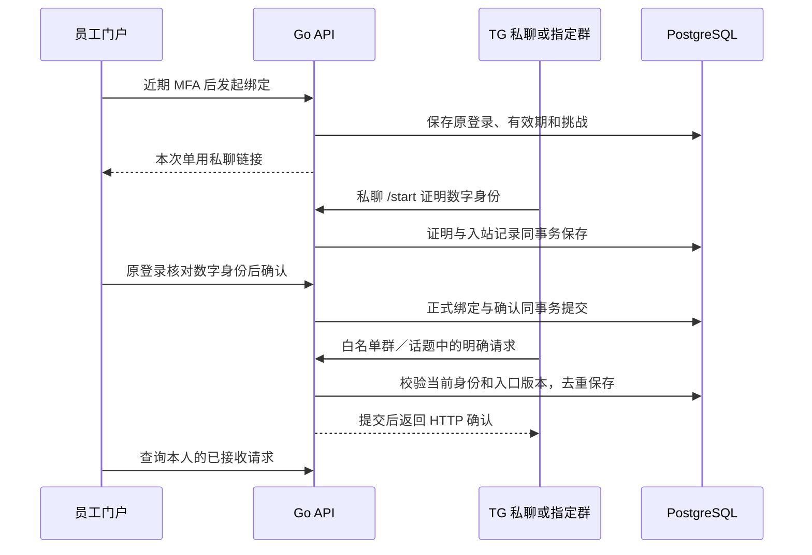

# Telegram 本人绑定与群入口接收

日期：2026-10-25。增量60，对应 AI-16—18、GAP-07／15。代码在 `app/backend/internal/telegram/`、`app/backend/internal/httpapi/telegram.go`、`app/web/src/Telegram.tsx`；数据库迁移为 `0059_telegram_ingress.sql`。

本增量实现可验证的身份、配置和入站链路：门户发起本人绑定，TG 私聊证明数字身份，返回原登录明确确认；管理员配置准确群号／话题和允许任务；Webhook 将符合条件的请求去重入库。Web 员工能查本人绑定、待完成流程和本人已接收请求，管理员能调整入口并查历史。

`execution_available`、`delivery_available` 当前固定为 `false`。请求保存为 `awaiting_executor`，页面显示“已接收，秘书会话待开放”。当前没有调用真实 Telegram、创建秘书运行、发送群消息或授予业务读写权限。真实群会话、业务执行和结果投递仍属于后续验收。

本页保留增量60交付时的边界与证据；当前任务调度、独立会话及只读执行接线已由[增量61](61-telegram-agent-dispatch.md)继续实现，外发与真实模型仍待验收。

## 1. 数据流与边界



API 是唯一入站入口，数据保存在现有 PostgreSQL。服务器无需为 Telegram 下载媒体、保存群原始数据或建立新的文件副本。本轮只处理文本；群附件、编辑消息、频道消息和其他未实现类型不进入秘书业务。

## 2. 进程配置

`CP_TELEGRAM_INGRESS` 缺失、空值或 `disabled` 时关闭接收。启用格式是 JSON 数组，每项包含以下字段；配置示例仅示意格式，不可直接投入使用。

```json
[
  {
    "bot_id": "123456789",
    "organization_id": "00000000-0000-4000-8000-000000000001",
    "username": "ExampleCompanyBot",
    "webhook_secret": "REPLACE_WITH_AN_INDEPENDENT_RANDOM_SECRET_32_TO_256_CHARS"
  }
]
```

| 字段／限制 | 实现约束 |
| --- | --- |
| Bot 身份 | 正数规范十进制字符串，不超过 `2^52-1`；组织为小写 UUID；用户名5—32位，以 `bot` 结尾 |
| Webhook secret | 32—256位，字母、数字、下划线或连字符；各 Bot 不得重复 |
| 配置规模 | JSON 不超过8192字节，最多8个 Bot；未知字段、重复身份／用户名／secret、尾随 JSON 均启动失败 |
| 模型与外发密钥 | 本配置没有 Bot API token，不提供模型执行或 Bot 外发授权 |
| 默认环境 | 本地开发保持关闭，真实 Bot 与群资料由后续部署配置 |

对外路径是 `POST /v1/integrations/telegram/{bot_id}/webhook`。生产接入前仍需配置公网 HTTPS、反向代理、限流与秘密注入，并由受控运维流程设置实际 Webhook、检查投递状态。订阅更新须覆盖所需的消息和成员变化；Bot 的可见范围及平台对成员事件的限制须在真实群验证。代码未执行这些外部操作。

## 3. 本人绑定协议

1. 员工在交互登录内完成近期两步验证，明确选择 Bot，填写原因发起流程。挑战绑定组织、用户、原登录及用户授权版本，有效期10分钟；同 Bot 旧待办流程被取消。
2. 响应一次性展示私聊链接。43位 token 由挑战标识和截断 HMAC 组成，绑定挑战上下文；不写入数据库回执、审计、幂等响应或状态查询。页面刷新后不重新展示，需取消并重建流程。
3. 所选 Bot 的真实私聊 `/start` 命令才可证明身份。发送人必须是具体用户，私聊 chat ID 必须与数字 user ID 一致。用户名、昵称、转发内容、群命令及匿名群身份都不能替代数字身份。
4. 私聊只保存证明。员工回到发起流程的原交互登录，核对准确数字身份，再经近期 MFA 确认，才产生正式绑定。其他登录、过期／撤销／旧授权版本的登录不能确认。
5. `(bot_id, telegram_user_id)` 有永久归属记录；撤销后也不能重新分配给其他组织或用户。本人可取消流程或撤销绑定，更新须带准确版本和原因，未执行请求随绑定撤销而撤回。

正式绑定的数据库延迟约束要求同事务中存在实际门户确认；证明保存、去重记录和应答由同一事务控制。测试注入入库故障后，私聊证明完整回滚，Webhook 不返回成功，重试后才成功。

## 4. 群／话题与请求准入

| 检查 | 规则 |
| --- | --- |
| 配置权限 | 仅 `policy.manage` 用户可查／改入口和历史；写配置需交互登录、近期 MFA、准确版本和原因 |
| 准确位置 | Bot、负数群 ID 与数字 topic ID 固定；topic `0` 表示无话题，其他话题不会被同时放行；更换位置须另建入口 |
| 首次状态 | 创建时暂停；管理员核对群、话题、项目范围后明确启用 |
| 允许任务 | 当前仅 `project-briefing`、`incident-summary`；项目范围须复核当前项目读取权限，暂停既有入口不要求恢复已失去的项目读取权限 |
| 明确触发 | 合法实体中的 Bot 提及、`/ask`／`/brief` 命令或回复本 Bot；带用户名的命令只接受本 Bot；普通文本提到名字不触发 |
| 发送人 | 当前有效正式绑定及当前有效员工，拒绝匿名 `sender_chat`、机器人和不规范身份 |
| 范围时间 | 按TG秒级时间比较消息和当前入口修订，不接受更早的秒级时间，亦不得超前服务器超过1分钟；后续执行仍须重查准确入口版本 |
| 正文 | 最多4000个 Unicode 字符；只有通过准入的本人请求保留文本，忽略消息不保留正文 |
| 后续授权 | 接收不等于获准读业务数据；未来执行仍须复查当前身份、绑定、入口版本、项目权限和允许 Skill |

TG 实体偏移以 UTF-16 计数，解析支持表情前缀，拒绝越界及切断代理对的实体。群成员变化、Bot 成员变化、新成员／离开成员及群迁移更新会暂停该已知群的活动入口，撤回待执行请求并保存实际历史；不会自动把旧群白名单迁移到新群号。当前没有根据群事件自动授予权限，也没有宣称能证明所有群成员身份。

## 5. Webhook 协议与幂等

- 先以常量时间比较 `X-Telegram-Bot-Api-Secret-Token`，要求准确 Bot 及单个 Header；拒绝 URL token。错误身份不读取业务正文。
- 仅 JSON，不接受压缩编码；正文上限64 KiB。拒绝无效 UTF-8、多份 JSON、重复键、超深嵌套、多个互斥 Update 类型及非准确整数 `update_id`。
- 以 `(bot_id, update_id)` 加事务锁，规范 JSON 后保存 SHA-256。相同更新只产生一个收据；同 ID 不同内容返回409；支持更新乱序到达，不使用简单的“最大 ID”丢弃策略。
- 合法且已处理或忽略的更新在数据库提交后返回 `{"ok":true}`。数据库错误返回500；错误输入返回对应4xx。这里的 HTTP 确认仅表示接收完成。
- 未触发、未知范围／身份、未支持类型等只记录去重摘要、状态和原因，不保存完整 Telegram update 或秘密。

## 6. 数据表与不可变约束

| 表 | 用途与不变量 |
| --- | --- |
| `telegram_binding_challenges` | 挑战、原登录与授权版本、到期、证明／确认／取消；固定身份字段及单向变化 |
| `telegram_identity_owners` | 不可变数字身份归属；应用仅可查询、新增 |
| `telegram_bindings` | 正式绑定，引用实际挑战与归属；仅从有效转撤销；同用户／Bot和同数字身份只可有一份有效绑定 |
| `telegram_channels` | 准确 Bot／群／话题、允许 Skill、项目范围、状态和版本；位置不可改、版本递增 |
| `telegram_channel_revisions` | 门户或成员／迁移事件的实际 `to_jsonb(channel)` 快照；追加写入，不得伪造历史 |
| `telegram_inbox` | 唯一更新收据、内容摘要、准入绑定和用户授权版本、准确入口版本、有限正文；身份与正文不可改，仅允许待执行转撤回 |

应用账号不能删除以上表的数据，也不能修改归属或历史。迁移增加8个触发器，约束正式绑定的实际登录／确认、实际入口快照和请求的有效身份／范围。门户写操作复用现有 CSRF、幂等、业务操作回执与审计机制；Webhook 使用独立 secret 协议。

## 7. 接口与前端

| 方法与路径 | 用途 |
| --- | --- |
| `GET /me/telegram` | 本人状态、可用 Bot、有效绑定与待完成挑战；没有链接 token |
| `POST /me/telegram/challenges` | 发起本人挑战，成功响应单次附带私聊链接 |
| `POST /me/telegram/challenges/{id}/confirm` | 原登录确认准确身份与版本 |
| `POST /me/telegram/challenges/{id}/cancel` | 本人取消准确流程 |
| `POST /me/telegram/bindings/{id}/revoke` | 本人撤销准确绑定 |
| `GET /me/telegram/requests` | 仅本人请求，游标分页 |
| `GET, POST /telegram/channels` | 管理员查列表、创建暂停入口 |
| `PATCH /telegram/channels/{id}` | 带版本调整范围／允许任务／接收状态 |
| `GET /telegram/channels/{id}/history` | 管理员查准确版本历史，按时间／ID分页 |
| `POST /integrations/telegram/{bot_id}/webhook` | 外部入站，仅此路径使用 Webhook secret |

路径均加 `/v1` 前缀。OpenAPI 两份副本和生成的 TypeScript 类型保持同步。Web `/telegram` 提供绑定、取消／撤销、本人请求、群入口配置和历史；项目选项支持搜索、分页及保留已选 ID。私聊链接只在内存显示，浏览器证据截图对其遮罩。本增量没有新增移动页面；移动端合同类型、测试和两小程序编译仅作为回归。

## 8. 验证与余项

自动化覆盖输入协议、配置、身份与确认、近期 MFA、原登录撤销、归属不可转移、并发去重、错误范围不留正文、旧消息不进入新入口、成员变化暂停、数据库不可变约束和事务失败回滚。Web 浏览器使用实际原生 API、隔离 PostgreSQL、两个独立门户身份；所有所属页面、上下文及临时服务结束后关闭。运行证据见[增量验证记录](../quality/evidence/telegram-ingress/verification.md)。

| 后续工作 | 验收要求 |
| --- | --- |
| TG 请求转秘书会话 | 绑定具体渠道上下文，执行前复查当前绑定／授权／入口版本和允许任务；重复更新不新建重复运行，撤回不可再执行 |
| 群披露与链接 | 请求人权限与群共同披露范围取交集；无法证明成员身份的严格受限资料仅给需登录门户链接；发出前再次核对 |
| Bot 外发与对账 | 独立 token／受控网络、持久 outbox、合并阶段消息、限流、重试、去重与 `delivery_unknown`；不能宣称超时后恰好一次 |
| 运维与真实联调 | 实际 Bot／群／话题资料、HTTPS Webhook、平台可见性与成员事件验证、监控及恢复演练 |
| 多端与正式首发 | TG 管理移动端入口按矩阵补齐，微信／抖音／Android真机验证；完整平台其他差异继续见差异表 |

## 9. 协议依据

Telegram 官方 [setWebhook](https://core.telegram.org/bots/api#setwebhook) 定义 secret Header 与更新订阅；[Update](https://core.telegram.org/bots/api#update) 定义更新标识及互斥字段；[MessageEntity](https://core.telegram.org/bots/api#messageentity) 定义 UTF-16 实体偏移。以上为协议依据；真实平台投递、成员覆盖与群披露仍需部署后验证。
