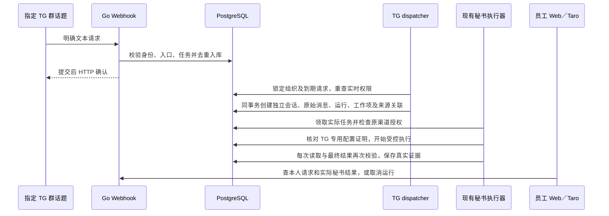

# Telegram 请求调度与独立秘书会话

日期：2026-10-25。增量61，推进 GAP-07／11／15，关联 AI-01／04／16／17。基于[本人绑定与入站](60-telegram-binding-and-ingress.md)，本轮将已接收的项目简报请求接入真实秘书会话、运行和持久任务队列。代码位于 `app/`；迁移为 `0060_telegram_agent_dispatch.sql`。

本轮实现了渠道调度、受控执行器接线、门户查阅和取消。项目简报的 TG 执行配置必须单独核验；当前开发环境没有启用真实 Bot 或正式模型，八个 Skill 来源包仍为 draft，运行配置为零。不能把受控依赖下通过的运行链路视为真实 Codex 或 TG 群服务已经上线。Bot 外发、群披露、登录链接和不确定送达对账仍开放。

## 1. 功能与验收边界

| 编号 | 本轮行为 | 约束与关联 |
| --- | --- | --- |
| TGD-01 | 入站固定请求任务种类 | `/brief`、`/incident` 明确选择任务；`/ask`、提及或回复按明确默认任务或唯一允许任务处理。多任务且无默认时不猜测，AI-17 |
| TGD-02 | 独立 dispatcher 消费持久请求 | `platform worker-telegram`；只持有组织／Bot 身份和应用数据库权限，不需要 Webhook secret 或 Bot API token |
| TGD-03 | 真实会话／消息／运行／队列原子提交 | 任一步失败整体回滚，不留下虚假会话、重复任务或无来源运行，GAP-15 |
| TGD-04 | 按请求员工和权限版本隔离上下文 | 不同员工、入口版本、绑定、员工授权版本或组织授权版本使用不同 TG 上下文，AI-04 |
| TGD-05 | TG 项目简报仅开放三个读取工具 | SDK 配置、MCP 列表、工具观察和 Go 实际执行均限读；普通 Web 业务写入沿用原协议，GAP-11 |
| TGD-06 | Web 显示真实请求／任务状态和跳转 | 可查来源请求、实际结果和任务进展；本人可以取消；显示尚未向群投递 |
| TGD-07 | Web／Taro 区分 TG 会话 | 可查本人结果与当前仍可读的来源；不提供向 TG 上下文发送门户任务或修改成员的入口 |
| TGD-08 | 不支持或暂不可运行的请求明确待处理 | 服务事件摘要工具尚未接通，保留 `awaiting_executor` 和原因；不会创建注定无法运行的秘书任务 |

本轮没有增加公开路由。OpenAPI 扩展入口默认任务、请求选定任务和真实运行引用，以及 `Conversation.type=telegram`；创建会话输入仍只允许原有个人／项目类型。固定合同及生成类型在 `docs/development/openapi.json`、后端嵌入合同和 `app/packages/contracts/src/api.d.ts` 同步。

## 2. 处理链路



图中的 TG 返回仅指 Webhook HTTP 确认；不存在本轮 Bot 向群发送受理或结果消息的步骤。模型从服务端重建的授权上下文开始，不恢复上次原生模型线程。

## 3. 任务选择与迁移

入口的 `allowed_skill_ids` 继续限定任务范围。新增可空 `default_skill_id`，必须属于允许集合。显式命令选择的任务不在允许集合时，不回退至其他任务；允许多任务且未配置默认时，通用触发不选择数组中的第一项。`skill_selection_required` 只记录输入处理结果，不暴露业务内容。

请求的 `requested_skill_id` 在首次入站时固定，后续不可变。旧版本仅保存文本、尚未固定任务种类的待处理记录，在迁移中撤回并保留原因；不会用后来修改的默认任务解释旧请求。历史文本和身份事实仍保留。

`/incident` 可以被准确识别和接收，但当前 dispatcher 返回 `TELEGRAM_SKILL_UNAVAILABLE`，保留请求等待后续能力，不进入运行队列。启用故障摘要前须实现其 `read_service_summary` 等完整工具链并通过渠道权限验收。

## 4. 数据与事务约束

新增两个仅追加事实表：

| 表 | 身份与不变量 |
| --- | --- |
| `telegram_conversation_scopes` | 固定组织、会话、入口及版本、正式绑定、请求员工及其授权版本、组织授权版本；组合唯一，不可 UPDATE／DELETE |
| `telegram_run_links` | 固定唯一入站请求到唯一实际运行及 TG 会话；请求正文、作者、读者、任务与真实运行必须一致，不可 UPDATE／DELETE |

TG 会话只有原请求员工一个明确读者，不把群成员默认加入公司会话。项目范围来自管理员配置，不来自模型或消息任意参数。管理员拥有入口配置权也不自动拥有员工会话读取权。

组织行锁、请求行锁和现有运行名额检查共同控制并发。会话创建、上下文快照、员工消息、queued 运行、现有工作队列、运行工作映射、TG 来源关联及请求 `dispatched` 状态在一个事务内提交。数据库触发器在提交时检查会话／运行的真实来源，阻止普通渠道运行进入 TG 上下文。

当前沿用每组织最多20个活动运行、每员工最多3个、同一会话最多1个活动运行。临时无法受理时回滚本次部分写入，在原请求上记录原因并将下一次调度推迟30秒；调度时间不可倒退。请求首次接收后30分钟内可调度，超时撤回。运行自身另受配置时限与执行租约限制。

## 5. 请求状态与失效

| 状态／原因 | 用户看到的事实 | 下一步 |
| --- | --- | --- |
| `awaiting_executor / executor_not_connected` | 请求已保存，尚未创建任务 | 等待 dispatcher 读取 |
| `awaiting_executor / RUNTIME_UNAVAILABLE` | 没有该任务已核验的 TG 执行配置 | 等待受控安装；30秒后重查 |
| `awaiting_executor / TELEGRAM_SKILL_UNAVAILABLE` | 该 TG 任务工具未接通 | 保留请求至有效期结束，不产生虚假运行 |
| `awaiting_executor / RUN_CAPACITY_EXCEEDED` | 组织／员工任务名额暂不可用 | 后续重试 |
| `awaiting_executor / CONVERSATION_RUN_ACTIVE` | 同一上下文上一任务尚未结束 | 后续重试 |
| `dispatched` | 已有真实 `conversation_id`、`run_id`、`run_state` | 读取实际运行结果；此状态不代表已完成或已投递 |
| `withdrawn` | 请求过期、入口／身份／范围变化或其他不可执行原因 | 停止后续执行，保留来源与已完成事实 |

入口变更、群成员变化与绑定撤销会撤回待处理请求和已派发的活动任务请求。每次领取、原生配置核验、工具调用、观察记录和结果提交，仍重查绑定、准确入口版本、员工／组织授权版本、项目成员、分类渠道与 AI 权限、会话安全版本、配置状态、取消和租约。

运行被撤权后，执行器沿用现有停止结算，不能将迟到结果写成成功。已经结束的事实不因后来撤权改写；门户是否可显示正文和引用仍按当前业务读取权限检查。

## 6. TG 专用运行配置

同一受控 Skill 发布记录新增可空 `telegram_configuration_sha256`。它只适用于 `project-briefing`，与普通 `configuration_sha256` 分别核验；安装后两者均不可改写，只能退休该发布再安装新记录。仅有 Web 配置的运行记录不具备 TG 调度资格。

`app/agent-runtime/src/describe-profile.ts` 现在输出普通配置和 `telegram_native` 的检查结果，以及可供受控安装的 TG 配置哈希。它不发布 Skill、不修改数据库、不启动模型。TG 配置与实际 SDK 启动共用 `nativeConfiguration`，因此核验的是后来实际使用的配置。

TG SDK `enabled_tools`、原生证明 `expected_tools`、MCP `tools/list` 和 Go 授权共同限定：

1. `read_resource`：按当前共同权限读取准确资源和修订。
2. `search_resources`：按当前会话与渠道权限有界搜索。
3. `inspect_operation`：核对真实运行／操作证据。

不对 TG 暴露 `draft_post`／`publish_post` 或其他写入工具。Go 执行器仍独立拒绝越界工具；运行时伪报写入观察也会被拒绝。最终引用及完成状态必须有服务端工具账本支持。网络、shell、其他原生工具及恢复任意本地线程的原有限制继续适用。

## 7. 进程与部署

新命令为 `platform worker-telegram`，使用现有原生 PostgreSQL 和工作队列；没有新增数据库、消息中间件或虚拟化依赖。

```json
[
  {
    "bot_id": "123456789",
    "organization_id": "00000000-0000-4000-8000-000000000001"
  }
]
```

上例是 `CP_TELEGRAM_DISPATCH_BOTS` 的结构示意。缺失、空值或 `disabled` 关闭配置；worker 在未明确配置时拒绝启动。最多8个不同 Bot、8192字节，拒绝未知字段、重复身份、非规范数字／UUID、尾随 JSON。调度进程不接收 Webhook secret；示例中不能加入 Bot token 或模型密钥。

API 的 `CP_TELEGRAM_INGRESS` 与 dispatcher 的身份配置必须对应同一实际组织／Bot。部署时先迁移，再分别准备 API、dispatcher 和现有 agent executor 的受控环境。提供 `app/deploy/native/copypaste-telegram-worker.service`，读取独立 `/etc/copypaste/telegram-dispatch-worker.env`；本轮仅提供配置文件，没有在任何生产服务器启用。

本地 `run_backend.py worker-telegram` 只从私有配置筛选 `CP_ENV`、应用数据库地址及 dispatcher 身份配置，排除 Webhook、迁移、MFA、对象存储和模型凭据。开发环境继续关闭 TG，保留已有本地 API、通知 worker 及 Web 入口；调度 worker 尚未常驻。

## 8. 验证与未完成事项

原生集成测试覆盖并发领取、事务故障回滚、配置缺失、仅 Web 配置拒绝 TG、未知工具任务等待、同会话串行、独立员工上下文、门户任务注入拒绝、只读 MCP／原生证明、配置退休、执行中群范围变化、绑定撤销、不可变来源及真实结果。模型与原生环境证明使用明确的受控测试依赖，业务权限、数据库、HTTP／MCP 和工具账本真实执行。

Web 验证真实请求跳转、管理员与员工会话隔离、默认任务保存、重复 Webhook 唯一运行、本人取消、成员变化撤回和历史事实保留。Taro 验证以 Android 渠道登录后实际读取 TG 会话／结果及任务链接，不等同于微信、抖音或 Android 真机验收。所有测试拥有的浏览器、上下文、临时服务和隔离库均须关闭清理。

开发环境的未登录POST冒烟检查使用空请求体，并在证据记录这一范围；携带实际业务内容的请求由HTTP／MCP集成和Web流程验证。本地Windows短连接曾出现间歇连接重置，授权探测通过不代表该传输行为或生产网络已完成验收。

最终结果见[验证记录](../quality/evidence/telegram-dispatch/verification.md)。完整 Goal 继续开放，尤其包括真实 Codex 隔离环境与发布、故障／订阅工具、TG 披露及外发投递、正式四端、120 GB 文件／2 TB 存量及 OSS／R2 双云和生产恢复验收。
