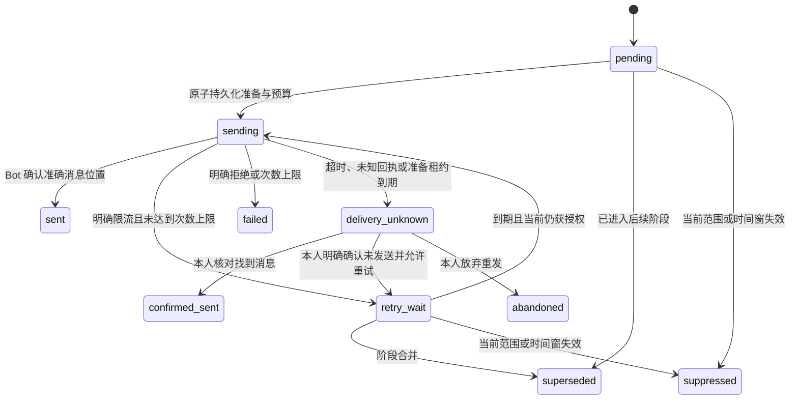

# TG 群阶段通知、投递回执与人工对账

本增量推进 GAP-15，将已有的 TG 入站、身份绑定、秘书队列与门户结果接成通知闭环。新建 `worker-telegram-delivery`，群内只回复通用阶段和需要登录的请求链接；Web、Taro 提供本人请求及回执查询、近期两步验证后的未知投递对账。仍不代表真实 Bot、真实模型、境内服务器出站网络或四端正式首发已经验收。

## 1. 员工与管理员流程

1. 管理员在 Web 的 Telegram 接入页选择准确群号、话题和任务，勾选“允许向此群与话题发送受理、进度和结果登录链接”，经近期两步验证保存。新建入口继续先暂停，通知开关默认关闭。
2. 运维给独立发送进程配置对应 Bot 身份、Bot API Token 和固定 HTTPS 门户域名。接收进程与入站调度进程不使用发送 Token。
3. 员工先完成本人绑定，再在白名单群／话题发送明确请求。发送进程按当前阶段准备通知，并只回复原请求消息。
4. 群通知链接为 `https://<portal-origin>/telegram?request=<UUID>`，不含登录凭证、授权票据、请求正文、项目名或业务结果。尚未登录时先登录，随后继续打开该请求。
5. 请求本人在 Web 查看“群通知投递记录”；Taro 在“我的工作空间 → 查看本人TG请求与投递回执”进入。实际任务结果仍由秘书会话的当前权限控制。
6. 投递结果未知时，先核对原群与话题，再选择找到对应消息、确认未发送后允许重试，或放弃重发。近期两步验证、当前版本、原因均为必需。

群成员目录未可靠核实时采用 `portal_only`。本增量没有开放群内业务正文广播、群内业务批准、自动改群号、财务 TG 执行或逐 token 外发。

## 2. 披露与权限约束

| 编号 | 必须保持的约束 |
| --- | --- |
| TG-OUT-01 | 每个入口的通知单独明确启用，默认关闭；配置修改需要 `policy.manage` 与近期两步验证 |
| TG-OUT-02 | 准备发送时核对当前组织、用户认证版本、有效绑定、群入口版本／状态、Bot 归属及固定话题；已有任务还核对原 TG 会话授权版本 |
| TG-OUT-03 | 只发送受理、进度、结果三种通用阶段与登录链接；链接本身不授予访问权限 |
| TG-OUT-04 | 不重定向到新群、不降级回复到群根、不允许原消息丢失后改为独立广播；链接预览关闭 |
| TG-OUT-05 | 本人请求、回执与对账接口要求当前交互登录；他人／跨组织请求返回不可见。手工重发还须范围仍有效 |
| TG-OUT-06 | 人工认定“已发送”独立记为 `confirmed_sent`，不冒充 Bot API 的 `sent`；原未知事实保留 |
| TG-OUT-07 | 撤销绑定、群暂停、范围或认证版本改变阻止后续准备；已开始的外部网络请求无法原子撤回，仍应记录其实际回执 |

保存群配置沿用现有入口版本语义：旧版本等待请求被撤回，旧 TG 会话按当前范围限制访问。已确认的历史回执不会随配置变更删除。

## 3. 数据、去重与阶段合并

迁移 [0063](../../app/backend/migrations/0063_telegram_delivery.sql) 新增：

| 数据 | 作用 |
| --- | --- |
| `telegram_channels.delivery_enabled` | 群／话题通知开关，默认 `false`，随配置版本进入既有历史 |
| `telegram_deliveries` | 阶段投递状态、尝试数、版本、时间、当前准备摘要及消息编号 |
| `telegram_delivery_events` | 每个投递版本的不可改写事件，保留准备、结果、重试与人工对账事实 |
| `telegram_delivery_budgets` | 多进程共享 Bot 发送间隔、供应商冷却与最近进程活动时间 |

`(inbox_id,phase)` 唯一；已有 run 时再以 `(run_id,channel_id,phase)` 唯一，避免同一任务阶段重复建单。状态头版本与事件复合外键延迟到提交核对；新增和变更须留下完全匹配的不可改写事件。状态、身份、阶段来源及每次尝试递增由数据库触发器约束，应用角色不能删除投递或修改事件。

当前阶段：未分配任务／queued 对应 accepted，running／awaiting_approval／committing 对应 progress，终态对应 result。尚未发送的旧阶段改为 superseded，再准备当前阶段；不会为已经结束的任务补发三条历史通知。已发送、已失败或未知的历史记录保留。新通知仅从接收后 24 小时内的当前授权请求生成，过期待发记录停止发送。单轮至多清理 100 项历史待发记录；选择实际发送候选时再次独立筛选当前范围、阶段与时间窗，超过清理批次的旧记录也不能进入网络发送。



每条阶段通知最多准备 5 次。人工重试同样消耗次数，不会绕过上限或 Bot 预算。人工重试若对应阶段已经过期，由后续准备检查合并或停止，不补发过时状态。

## 4. 网络投递与恢复语义

准备事务先提交 `sending`、准确请求摘要、30 秒租约和 Bot 预算，再调用外部网络；网络期间不持有公司业务事务锁。即使外部调用超时，状态提交使用单独的短超时完成；无法确认提交时，后续进程把过期 sending 记为 `delivery_unknown`。旧进程只能按准备版本提交一次，迟到结果无法覆盖已经恢复或人工对账后的状态。

发送目标固定为 `https://api.telegram.org/bot<TOKEN>/sendMessage`，禁止跟随重定向，8 秒网络超时，回执最多 64 KiB。错误正文和带 Token 的 URL 不进入业务回执或应用日志。请求使用准确 `chat_id`、必要的 `message_thread_id`、`reply_parameters.message_id`，并设置 `allow_sending_without_reply=false`、关闭链接预览。

| 供应商结果 | 处理 |
| --- | --- |
| 明确成功，且消息编号、群、话题、回复对象匹配 | `sent`，保留供应商消息编号 |
| 429 与有效 `retry_after` | 持久化整个 Bot 的冷却；未达上限时重试，达上限时单条失败但仍保留全局冷却 |
| 明确 400／401／403／404 拒绝 | `failed`，不推测已经送达 |
| `migrate_to_chat_id` | 保留失败事实、暂停原入口并记录迁移原因；不自动改目标 |
| 网络错误、5xx、重定向、过大／不完整／不一致回执 | `delivery_unknown`，停止自动重试 |

Bot 全局最小准备间隔为 3.2 秒，由数据库行锁跨进程串行维护，配置没有付费广播旁路。Telegram 文档列出同群与全局限制，并要求按 `retry_after` 等待；本实现采用更保守的低量发送预算。[发送与回复参数](https://core.telegram.org/bots/api#sendmessage)、[响应参数](https://core.telegram.org/bots/api#responseparameters)、[官方限流说明](https://core.telegram.org/bots/faq#my-bot-is-hitting-limits-how-do-i-avoid-this)。

`delivery_available=true` 只表示该组织有启用的群入口，且发送进程在最近 90 秒内更新过活动时间；不代表 Telegram 可达或某条消息送达。实际结果查看逐条回执。系统不宣称外部消息恰好投递一次。

## 5. API 与客户端

沿用统一响应、当前交互登录、命令幂等、原因、审计与 outbox 约束。新增：

| 方法与路径（均在 `/v1` 下） | 用途 |
| --- | --- |
| `GET /me/telegram/requests/{id}` | 本人准确请求，支持链接进入，不依赖列表第一页 |
| `GET /me/telegram/requests/{id}/deliveries` | 最多三个阶段及有限事件历史 |
| `POST /me/telegram/requests/{id}/deliveries/{delivery_id}/reconcile` | 本人近期两步验证后的未知投递对账 |

对账字段为 `expected_version`、`action`、`message_id`、`reason`。action 仅 `confirm_sent`／`retry_confirmed_not_sent`／`abandon`；仅 confirm_sent 接受且必须提供正整数消息编号。原因最长 200 字；消息编号不得超出 JavaScript 安全整数。版本冲突需重新读取；重复提交相同幂等键不产生第二条事件。

Web 登录成功保留当前受保护路由；退出登录继续返回首页。没有接受外部重定向 URL。Taro 新增第 14 个公开页面 `pages/telegram/index`，使用既有内存会话、页面生命周期、MFA 和不确定命令处理；隐藏页面会清除对账表单，迟到请求不能回填已离开的页面。Android 共享该业务组件，原生运行验收另列。

## 6. 部署与配置

独立配置 `CP_TELEGRAM_DELIVERY_BOTS`，空值／`disabled` 默认关闭；显式配置须为 1—8 个唯一 Bot 的严格 JSON 数组，每项仅：

```text
bot_id             所选 Bot 的准确数字 ID
organization_id    所选组织的 UUID
token              该 Bot 的 API Token，前缀必须匹配 bot_id
portal_origin      HTTPS 门户 origin，不含路径、尾斜杠、查询、片段或用户名密码
```

不要把真实 Token 写入代码、共享示例文件、数据库、模型环境或日志。本地入口脚本主动从其他命令环境剔除该项；发送进程只继承必需的 CP_ENV、CP_DATABASE_URL 和此项。生产模板为[独立 systemd 服务](../../app/deploy/native/copypaste-telegram-delivery-worker.service)，读取 `/etc/copypaste/telegram-delivery-worker.env`；模板仅交付，未在服务器执行。

启动前须应用全部 63 项迁移，核对准确门户 HTTPS、群／话题、绑定、入口开关和出站连通性。没有显式 Bot 配置时实际原生命令立即拒绝启动，不自动发现、注册、入群或发送。停机只停止发送进程；未知的在途尝试待恢复后对账，不通过清空数据解决。

## 7. 验证与剩余范围

测试覆盖默认关闭、模板披露、原群／话题／原消息、持久准备、回执栅栏、共享限流、5 次上限、供应商冷却、MFA／本人／版本检查、阶段合并、真实租约到期、在途配置改变、多进程竞争、群迁移和绑定撤销。Bot API 以受控 HTTP transport 验证；真实队列、数据库、交互认证、审计与秘书取消生命周期使用原生服务。

源码冻结后的完整结果、构建、浏览器操作及清理证据统一见[验证记录](../quality/evidence/telegram-delivery/verification.md)。此前验证中的失败不作为通过证据；全量验证绑定同一份后端源码。

尚需：提供生产服务器／云账号后完成 HTTPS 与出站联调，真实 Bot／股东群按固定名单验收，真实模型与 Skill 发布，权限撤销及超时场景的现场核对，以及微信／抖音／Android 真机与正式发布。不能把本地模拟回执、源码编译或 H5 操作视为这些环节已完成。
