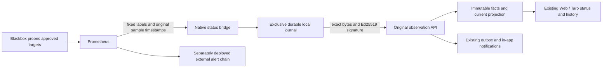

# 原生 Prometheus 状态桥接 / Native Prometheus status bridge

本增量推进 GAP-23，将成熟 Prometheus／Blackbox 采集结果送入既有签名观测、权限、投影、历史与通知流程。独立原生二进制运行在受信监控主机，不取得业务数据库、员工会话、云存储主密钥或服务器 shell 权限。真实 Prometheus／Blackbox、主机指标、独立外部告警和目标服务器部署仍分别验收。

This increment implements a native bridge from an explicitly configured Prometheus/Blackbox source to the original signed-observation API. Collection, platform aggregation and independent alert delivery remain separate services. A probe's availability does not establish host CPU, memory or disk health.

## 1. 完整数据路径 / Data path



桥接不从门户中的 host_label／endpoint_label 发起请求，不开放任意 PromQL、探测地址、命令或自助 URL 输入。Prometheus／Blackbox 的真实目标及探测策略由监控运维独立许可；平台业务服务中发布其来源、公钥、准确来源修订、阈值和外部参考。两边必须由负责人核对，不能凭来源类型自动建立探测。

The bridge queries existing metrics; it does not implement a probe platform. Operators must authorize actual Blackbox targets and reconcile the platform source's external reference with the complete monitor labels and configuration.

## 2. 采样真实性 / Sample fidelity

- 每个目标固定 job、instance 及完整额外标签集；仅构造 up、probe_success、probe_duration_seconds 的精确等值选择器，不接受调用者拼接的表达式。
- 同一轮采用一个毫秒精度求值时间，分别查询三个数值及其 timestamp(selector)，共六个有界 instant-vector 请求。必须各返回唯一浮点样本、准确标签、同一个原始采样时间，不接受多个序列、直方图、警告、歧义 JSON、缺失字段、非有限值或超限正文。
- 使用 timestamp() 的值作为 observed_at，不能拿 HTTP 到达时间或表达式求值时间代替真实采集时间。原始时间不得未来，年龄必须小于明确配置的 45—180 秒限制，并与 15—60 秒轮询周期协调。
- up 必须为 1。采集端不可达、up=0、无序列、过期或不一致数据时不伪造 healthy=false；没有新事实时，原后端按来源阈值转为 unknown。
- probe_success 必须恰为 0 或 1；probe_duration_seconds 必须为有限的 0—3600 秒，向上取整转换为毫秒。正常与真实失败探测均保留原时间和耗时，不由桥接改写阈值或推断整个服务正常。
- 同一原始采样只投递一次；同时间不同内容被标记为 SAMPLE_REWRITTEN，不新增序号。较早采样不覆盖后续事实。连续失败／恢复只由原后端对实际新样本计算。

All six results must identify the same original scrape. Reusing a lookback value never refreshes its age or increments a failure/recovery streak. A failed collector and a failed target probe produce different outcomes.

Prometheus 官方 [HTTP API](https://prometheus.io/docs/prometheus/latest/querying/api/)定义 instant-vector 与查询时间格式，[timestamp()](https://prometheus.io/docs/prometheus/latest/querying/functions/#timestamp)提供原样本时刻；采集指标来自官方 [Blackbox exporter](https://github.com/prometheus/blackbox_exporter)。协议核对日期为 2026-10-26；实际安装版本及配置仍需部署方冻结。

## 3. 网络与身份 / Network and identity

| 约束 / Control | 实现 / Behavior |
| --- | --- |
| 明确端点 / Explicit endpoints | 配置平台与 Prometheus 的固定 HTTPS origin／可选干净路径前缀；不允许 URL 用户信息、query、fragment 或转义／跳转路径 |
| IP 许可 / Pinned addresses | 每端最多16个明确 IP；每次建立连接时解析并核对全部 DNS 地址，再将已核对 IP 直接传给 dial，避免二次解析 |
| 内网与明文 / Private networking | 私网／loopback 和 HTTP 各须独立明确开启；默认关闭。云元数据、链路本地、未指定、多播地址始终拒绝 |
| HTTP 行为 / HTTP behavior | 不继承环境代理、不跟随重定向、不关闭 TLS 验证；Prometheus 正文≤64KiB，回执≤16KiB |
| 查询凭证 / Query credential | 可选只读 Prometheus bearer 文件，仅发往已核对的 Prometheus；不转发到平台或日志 |
| 观测身份 / Observation identity | 每来源 Ed25519 私钥文件，仅签固定观测；平台接口不使用员工 Cookie、Authorization 或 Origin |
| 配置范围 / Configuration scope | 1—100目标、1—8并发、每目标总时限1—10秒；每轮总时限为轮询周期，轮转顺序避免固定尾部永远得不到机会 |

配置路径均为绝对路径；密钥是标准 Base64 的32字节 seed。已有私密文件不得是符号链接或非普通文件；Unix拒绝组／其他人可读的私钥、令牌和状态文件，状态目录要求私有且预先创建。Windows部署还必须配置专用账号及目录 ACL；Go 文件 mode 不等同于 Windows ACL。

Both endpoints have independent clients and allowlists. The binary does not have a database connection. The receiver still rechecks the actual enabled source revision and signature on every original write and replay.

## 4. 持久序号与不确定结果 / Durable sequences and uncertain outcomes

1. 每个 source_id／source_revision_id 使用一个独占 OS 文件锁与私有 journal；相同修订不能由两个进程并发持有。
2. 绑定摘要涵盖端点许可、准确目标／标签、公钥和时限。已有修订改变绑定时拒绝自动继承序号；由运维先核对并发布新修订。
3. 新采样生成下一个单调序号、最终正文和签名，追加带长度及 SHA-256 的完整 checkpoint，完成同步后才发 HTTP。不能先发送再补记本地序号。
4. 回执必须明确包含观测ID、来源ID、修订、序号、正文摘要、applied、ignored_reason 和 replayed；缺失、null、错配或相互矛盾均不清除 pending。新回执字段同时适用于第一次接收和原字节重放。
5. 未知结果／网络错误／408／429／5xx 留下同一份 pending，下轮仅重放原字节及签名，不先采新数据。已提交但丢失响应时，原接口返回同一事实，不增加审计／outbox／失败次数。
6. 其他4xx为终止错误，不自动换序号、换修订、降级身份或重放。进程退出2，systemd模板禁止对该退出码自动重启，等待运维核对。
7. 完整确认后再同步 ack checkpoint。恢复仅丢弃未完成追加尾部；已完成记录的摘要、签名、绑定、序号或转换错误必须失败，不能重置为1。
8. journal达1MiB后保存当前完整 checkpoint，使用同步的私有临时文件及原生替换压缩；独占锁独立于被替换文件。Unix同步目录，Windows使用写透替换。Windows／Linux真实掉电及目标文件系统仍需部署验收。

The original API is the durable business authority. An ignored stale/late sample can be acknowledged as a retained historical fact without claiming current health. Losing the journal never authorizes overwriting a conflicting sequence; the receiver's original uniqueness constraint remains active.

## 5. 原生构建与配置 / Native build and setup

模板仅含 .invalid 域名、文档保留 IP 和占位来源 ID，必须全部替换；不是可直接启用的生产配置。

```powershell
$env:PYTHONUTF8='1'
# From app/backend with a prepared native Go toolchain:
go build -o ../.local/bin/status-bridge.exe ./cmd/status-bridge
# Create a new seed file; stdout contains only the public key:
../.local/bin/status-bridge.exe --generate-key C:/private/status-keys/service.seed
# After publishing the source and filling the private configuration:
../.local/bin/status-bridge.exe --config C:/private/status-bridge.json --once
../.local/bin/status-bridge.exe --config C:/private/status-bridge.json
```

| 产物 / Artifact | 用途 / Purpose |
| --- | --- |
| [配置模板](../../app/deploy/native/status-bridge.example.json) | 明确端点、IP、标签、来源修订和私密路径；不提交真实配置 |
| [原生 service 模板](../../app/deploy/native/copypaste-status-bridge.service) | 专用监控身份、状态目录、资源限制和受控重启；尚未安装 |
| [桥接实现](../../app/backend/internal/statusbridge/) | 配置、受限网络、实际采样、持久 journal 及有界投递 |
| [CLI](../../app/backend/cmd/status-bridge/main.go) | 公钥生成、一次运行、长期轮询和安全结构化日志 |
| [真实 API 集成场景](../../app/backend/internal/httpapi/status_bridge_integration_test.go) | 独立原生数据库、原来源发布、签名入库、状态投影及失效 |

Windows按专用服务账号安装受控的原生进程管理；Linux编译对应二进制后，由运维在独立监控机安装service。此开发仓库不自动访问或安装任何远程服务器。退出0表示本次无需重试，75表示一次运行有待重试／无有效采样，2表示配置、状态或明确接收拒绝。结构化日志只输出安全码、来源ID及原回执信息，不输出 URL、查询、私钥、令牌或错误正文。

## 6. 验证与剩余范围 / Verification and remaining scope

验证须分别记录真实组件执行与受控协议端。单元测试覆盖网络许可、重复／坏数据、回执与 journal；数据库集成必须实际走原签名入口，并核对投影、去重、历史与来源轮换。新桥接不替代四端设备验收、真实 Prometheus 安装、主机 CPU／内存／磁盘指标、主应用之外的告警送达、香港链路、容量与生产恢复。

Release remains gated by the [stable goal gap register](../delivery/03-goal-gap-assessment.md). Existing manual service/incident operations, shared authorization and the complete four-client scope remain in force.

本次准确执行、缓存／复用范围、失败历史及完整复现见[增量81验证](../quality/evidence/status-bridge/verification.md)。

See the linked verification record for fresh execution, retained/cached scope, failures, exact source bindings and reproduction.
