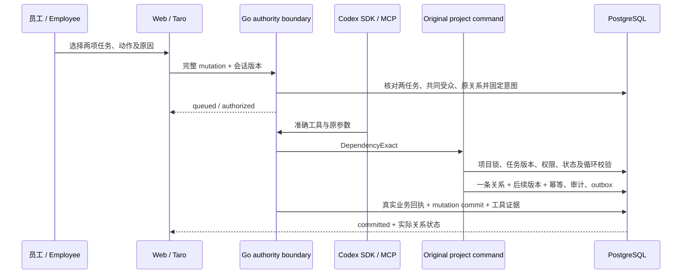

# 秘书任务前置依赖 / Secretary task prerequisites

增量91为 Web 和 Taro 秘书入口增加“调整任务前置依赖”。员工选择后续任务、前置任务、动作和原因，预览后发送；运行时只能执行这一个明确决定。新增依赖后，原任务开始规则仍要求先完成前置任务。父子任务归属通过原任务资料管理，和前置依赖分别设置。

Increment91 adds an exact prerequisite change to both secretary interfaces. Select the successor, predecessor, add/remove action and reason, review the request, then send it. The runtime may change only that relationship. The original task command still prevents starting work before unfinished prerequisites. Parent/subtask membership is a separate relationship.

## 1. 员工操作 / Employee workflow

1. 进入对应项目的秘书会话，选择“更新项目”。公司私密会话和 TG 不能借此修改项目依赖。
2. 打开“选择准确业务更新”，选择“调整任务前置依赖”，再选择本次更新的后续任务。
3. 从同项目实际可见任务中选择另一项前置任务。列表可分页，选定后重新读取准确对象和版本；界面显示当前是否存在依赖。
4. 明确选择“新增依赖”或“解除依赖”，填写原因。未选择动作、重复新增、不存在的解除、不可写任务或不允许的进行中依赖会被拒绝。
5. 点击“将这项明确更新加入请求”。这一步仅固定预览；尚未发送运行，也未写入业务。
6. 填写消息并确认发送。服务端固定两个任务版本、当前关系、原因、原登录和会话受众，排队受理不表示已经修改成功。
7. 以“本次更新已提交”、实际操作回执和关系结果核对成功。发生冲突时重新读取并发送新决定，不能自行刷新基础版本继续执行旧决定。

Open the project's secretary conversation, choose **Update project → Adjust task prerequisite**, then select the successor and a different visible task in the same project. Choose **Add** or **Remove**, enter the reason and review the exact request. Adding it to the message performs no write. Send once; a queued authorization is distinct from a committed relationship. Verify the business operation and factual result. After a conflict, read the new state and make a new decision.

## 2. 完整授权协议 / Complete authorization

沿用 `POST /v1/conversations/{id}/runs` 的 `mutation`，新增工具枚举 `update_task_dependency`；没有新增绕过原业务的公开写接口。`arguments` 必须正好包含以下六项，不能省略、置空或添加其他资料。

| 字段 / Field | 准确含义 / Exact meaning | 约束 / Constraint |
| --- | --- | --- |
| `id` | 后续任务 / Successor task | 实际小写 UUID，同当前项目会话 |
| `expected_version` | 后续任务版本 / Successor version | 正整数，准备及执行时匹配 |
| `predecessor_id` | 前置任务 / Predecessor task | 同项目实际小写 UUID，与后续任务不同 |
| `expected_predecessor_version` | 前置任务版本 / Predecessor version | 正整数，准备、执行及重放时核对 |
| `action` | 关系动作 / Relationship action | 只能明确 `add` 或 `remove` |
| `reason` | 员工原因 / Human reason | 非空、最多200个字符，不由模型改写 |

普通消息、引用、历史运行、项目名称和模型建议都不构成写授权。一次运行只处理一个准确关系，不支持数组、批量、跨项目或推断依赖。不接受任务正文、状态、父任务、负责人、人工验收设置或结果 ID。

The existing run endpoint carries the six exact fields above. Ordinary chat, citations and previous runs grant no write authority. Arrays, batch changes, cross-project links, inferred dependencies, task metadata/state and model-supplied results are outside this command. The actual model call must match the canonical human arguments, including reason, exactly.

## 3. 实现与事务 / Implementation and transaction

`project.Service.Dependency` 保留原手工接口契约。`DependencyExact` 增加前置版本和必须真正改变关系的约束，两者使用同一个内部业务实现。原项目锁串行化依赖与任务写入；继续使用原 `task.update`、前置 `task.read`、项目可写、完成／取消任务只读、进行中依赖及递归循环检查。只增加后续任务版本一次，前置任务版本和任务资料保持实际原值。

准备意图时，对后续任务和前置任务分别复核当前全体会话成员的 AI 阅读权限；固定前置标题、状态、版本、内容摘要及原关系用于展示和执行。执行及重放继续复核原登录、当前受众、任务内容版本和关系。历史意图在合法后续修改后仍可按当前阅读权限查询；这不意味着旧意图可以继续执行。

`0074_agent_task_dependencies.sql` 为新增迁移，原73项迁移保持原字节。扩展四项工具／范围约束，新增意图与提交触发器；原会话、幂等操作和延期证据守卫继续生效。提交触发器核对数据库中实际任务、前置版本、关系、时间精度及未授权资料不变，拒绝伪造回执。关系、版本、业务操作、审计、outbox 和运行证据同事务提交；证据失败全部回滚。

The manual dependency endpoint retains its original contract. The delegated command shares its original implementation, project lock, permissions, state and cycle checks, while requiring the exact predecessor version and a real change. Both tasks remain subject to the entire live AI audience. Migration74 adds constraints and factual receipt guards without modifying the previous73 migrations. A failed receipt rolls back the edge, task version and business evidence together.

## 4. 回执与恢复 / Receipt and recovery

实际结果在原任务字段外增加 `predecessor_id`、`predecessor_version`、`dependency_action`、`dependency_present`。后续任务结果版本须为基础版本加一，前置版本须为员工固定的版本；`dependency_present` 取自同事务内实际数据库关系，不能根据请求字符串推定。前端同时核对两个版本、原关系和任务资料；日期按完整微秒时刻比较。

同一调用或换工具调用 ID 的准确重放，都复用 `agent-mutation:{run_id}` 原业务操作，不能重复增加版本或更改第二条依赖。发送响应丢失可按原客户端消息和幂等键恢复同一运行。执行前取消不写业务；提交后取消不能宣称撤销已提交历史。版本、关系或权限变化后不自动重基。

| 情况 / Condition | 行为 / Behavior |
| --- | --- |
| 自依赖、跨项目、不完整字段 | 拒绝准备，保留准确可见范围 |
| 任一基础版本变化 | 停止旧决定，要求员工重新读取 |
| 重复新增或不存在的解除 | 拒绝无实际变化的操作 |
| 循环依赖 | 原业务返回 `DEPENDENCY_CYCLE` |
| 进行中任务新增未完成前置 | 原业务返回 `DEPENDENCY_BLOCKED` |
| 完成／取消任务、只读项目 | 原只读规则拒绝 |
| 当前员工或任何共享受众失去权限 | 阻止后续调用及结果披露 |
| 原登录撤销、运行取消 | 阻止未提交写入 |
| 工具证据或数据库回执失败 | 回滚同事务，不留下部分关系 |

The receipt identifies the actual successor, predecessor, original predecessor version, action and persisted edge state. Exact retries reuse one operation and one successor version increment. Cancellation does not undo committed history. Changed versions, edges, audience or login require a new human decision; the runtime never silently rebases.

## 5. 技能与运行配置 / Skill and configuration

`project-update` 源码包为 `1.7.0`，17项允许工具包含15项准确写工具及 `read_resource`、`inspect_operation`。MCP目录、运行时工具边界、原生能力证明和两端共享契约同步更新；其他技能没有获得本工具。八项 manifest 全部保持 `draft`。真实部署时须用实际运行时安装、固定包摘要和配置版本，并完成模型及隔离验收；本地受控证明不能替代。

升级先备份并应用新增迁移，再以准确源码更新 API 和相关原生 worker。开发环境保持云存储、模型和 TG 关闭；迁移不用 API 身份。不要手工改已应用迁移或直接把 manifest 改成发布状态。回退应用代码之前核对已固定的运行配置，保留业务关系和不可变历史。

界面输入纠正后清除过期校验提示；共享移动SelectField按实际选项文字稳定range引用，避免会话轮询重建数组、重置员工正在操作的滚轮。实际浏览器在目标可见行等待跨轮询后再确认，并核对最终业务值。Corrected inputs clear stale feedback; stable selector labels preserve an open wheel across live polling.

## 6. 验证与范围 / Verification and limits

本轮完整证据见[验证记录](../quality/evidence/task-dependencies/verification.md)、[当前基线](../quality/current-functional-baseline.json)与[实际媒体](../media/README.md)。全量后端、Web／运行时、移动、双小程序、Android开发包和Linux编译分别记录；失败及被替代通过尝试保留原状态与准确来源，Gradle缓存单独说明。

录屏真实操作登录后的 Web／Taro H5 页面。发送演示会准确入队，再在执行前取消；已提交的新增／解除视图来自真实原业务命令及受控 MCP 集成夹具。录制不运行真实模型，不把合成数据、共享界面、开发APK或Linux编译称为真机／云／模型／生产验收。

该增量推进 GAP-11／12／13，保留全部28项编号。更多秘书业务工具、真实模型与 TG、OSS／R2、120GB实测、2TB迁移、微信／抖音及Android真实设备、依赖安全、生产部署与恢复继续按原完整四端目标推进。

See the linked evidence for fresh checks, preserved attempts, cached native test scope and actual media. UI sends are queued and explicitly cancelled; committed views come from real original-command executions through the controlled MCP fixture. Real models, devices, cloud services, TG delivery, capacity and production recovery remain separate acceptance requirements. This increment advances the existing full four-client goal without closing it.
