# 实际页面与操作演示 / Actual pages and interactions

增量120实际Web／Taro H5合成演示：XLSX隐藏工作表与公式缓存、PPTX讲者备注、准确版本比较。录制在登录后开始，不包含密码／MFA或真实业务记录。

| 页面 | Web | Taro H5 |
| --- | --- | --- |
| Excel正文 | [截图](screenshots/office-text-web-xlsx.png) | [截图](screenshots/office-text-mobile-xlsx.png) |
| PowerPoint正文 | [截图](screenshots/office-text-web-pptx.png) | [截图](screenshots/office-text-mobile-pptx.png) |
| 版本比较 | [截图](screenshots/office-text-web-comparison.png)、[深色](screenshots/office-text-web-dark.png) | [截图](screenshots/office-text-mobile-comparison.png) |
| 录屏 | [MP4](videos/office-text-web.mp4) · [GIF](gifs/office-text-web.gif) | [MP4](videos/office-text-mobile.mp4) · [GIF](gifs/office-text-mobile.gif) |

新素材对应最终源码；初轮素材单独归档，旧316份已发布媒体字节保留。[验证](../quality/120-office-text-verification.md)。

增量119 / Increment119只更新服务器发布工程，业务页面源码保持118。本轮没有打开浏览器或重新捕获截图／录屏／GIF；原316份媒体保持发布字节、日期和原验证范围，不作为Linux部署或CI运行证据。见[本轮验证](../quality/119-native-release-verification.md)。

增量118 / Increment118：实际认证后的隔离合成手续费页面；6 PNG、2静音MP4、2截图导览GIF。MP4记录已关联依据的真实页面滚动；GIF按三张实际截图展示核对、关联及撤销，每张2秒。密码、MFA输入及私有能力不入素材。旧素材保留原日期与原检查范围。

| 端 | 完整依据核对 | 已关联 | 已撤销 | 实际录屏 | 截图导览 |
|---|---|---|---|---|---|
| Web | [PNG](screenshots/payment-fee-web-review.png) | [PNG](screenshots/payment-fee-web-linked.png) | [PNG](screenshots/payment-fee-web-revoked.png) | [MP4](videos/payment-fee-web.mp4) | [GIF](gifs/payment-fee-web.gif) |
| 共享移动 | [PNG](screenshots/payment-fee-mobile-review.png) | [PNG](screenshots/payment-fee-mobile-linked.png) | [PNG](screenshots/payment-fee-mobile-revoked.png) | [MP4](videos/payment-fee-mobile.mp4) | [GIF](gifs/payment-fee-mobile.gif) |

[来源与编码](../quality/evidence/payment-fee/media.json) · [实际核验](../quality/118-payment-fee-verification.md)。

增量117 / Increment117：真实认证后的隔离合成合同正文页面。6 PNG、2静音MP4、2截图导览GIF。录屏包含完整正文阅读、显式勾选与真实采用回执；认证信息不入素材。GIF每张2秒，属于截图导览。

| 端 | 原资料绑定 | 全文核对 | 已采用 | 录屏 | GIF导览 |
|---|---|---|---|---|---|
| Web | [PNG](screenshots/contract-body-web-scope.png) | [PNG](screenshots/contract-body-web-review.png) | [PNG](screenshots/contract-body-web-adopted.png) | [MP4](videos/contract-body-web.mp4) | [GIF](gifs/contract-body-web.gif) |
| 共享移动 | [PNG](screenshots/contract-body-mobile-scope.png) | [PNG](screenshots/contract-body-mobile-review.png) | [PNG](screenshots/contract-body-mobile-adopted.png) | [MP4](videos/contract-body-mobile.mp4) | [GIF](gifs/contract-body-mobile.gif) |

[媒体来源](../quality/evidence/contract-body/media.json) · [核验](../quality/117-contract-body-verification.md)。旧媒体保留实际捕获日期与原范围。

增量116 / Increment116：真实认证后的隔离合成双币核销页面。6 PNG、2静音MP4、2截图导览GIF。录屏展示已核对汇率和金额的实际表单，不录制密码／MFA；实际写入和释放由页面检查及流水截图覆盖。GIF为每张2秒的截图导览。

| 端 | 实际汇率 | 窄屏 | 双币流水 | 录屏 | GIF导览 |
|---|---|---|---|---|---|
| Web | [PNG](screenshots/payment-fx-web-quote.png) | [PNG](screenshots/payment-fx-web-narrow.png) | [PNG](screenshots/payment-fx-web-ledger.png) | [MP4](videos/payment-fx-web.mp4) | [GIF](gifs/payment-fx-web.gif) |
| 共享移动 | [PNG](screenshots/payment-fx-mobile-quote.png) | [PNG](screenshots/payment-fx-mobile-narrow.png) | [PNG](screenshots/payment-fx-mobile-ledger.png) | [MP4](videos/payment-fx-mobile.mp4) | [GIF](gifs/payment-fx-mobile.gif) |

[媒体来源](../quality/evidence/payment-fx/media.json) · [验证](../quality/116-cross-currency-settlement-verification.md)。旧媒体保留执行日期及原范围。

增量115 / Increment 115：受控人工跨范围文件整理。真实认证后的隔离合成页面，6 PNG、2静音MP4、2截图导览GIF。视频录制固定计划的实际阅读与刷新；确认／MFA输入阶段不录制，实际执行由页面检查和执行后截图覆盖。GIF按每张2秒展示计划、窄屏与最终回执，属于截图导览。

| 端 | 固定计划 | 窄屏 | 执行回执 | 录屏 | GIF导览 |
|---|---|---|---|---|---|
| Web | [PNG](screenshots/scope-transfer-web-plan.png) | [PNG](screenshots/scope-transfer-web-narrow.png) | [PNG](screenshots/scope-transfer-web-receipt.png) | [静音MP4](videos/scope-transfer-web.mp4) | [GIF](gifs/scope-transfer-web.gif) |
| 共享移动 | [PNG](screenshots/scope-transfer-mobile-plan.png) | [PNG](screenshots/scope-transfer-mobile-narrow.png) | [PNG](screenshots/scope-transfer-mobile-receipt.png) | [静音MP4](videos/scope-transfer-mobile.mp4) | [GIF](gifs/scope-transfer-mobile.gif) |

[帧、时长与来源](../quality/evidence/scope-transfer/media.json) · [验证](../quality/115-file-scope-transfers-verification.md)。旧媒体保留原字节和执行范围；不声明真实云／模型／TG或生产验收。

增量114 / Increment 114：业务工作台来自认证后的隔离合成Web／Taro H5页面；新增6 PNG、2静音MP4和2截图轮播GIF，266份旧媒体保留原字节。MP4保留认证后首页概览与实际刷新录制；GIF按每张2秒轮播真实的汇总、窄屏与其他员工截图。GIF是截图导览，实际业务交互由页面检查覆盖；全部素材不含登录、密码或MFA输入。

| 端 | 汇总 | 窄屏 | 其他员工 | 录屏 | GIF截图导览 |
|---|---|---|---|---|---|
| Web | [PNG](screenshots/workbench-web-summary.png) | [PNG](screenshots/workbench-web-narrow.png) | [PNG](screenshots/workbench-web-other-member.png) | [静音MP4](videos/workbench-web.mp4) | [GIF](gifs/workbench-web.gif) |
| 共享移动 | [PNG](screenshots/workbench-mobile-summary.png) | [PNG](screenshots/workbench-mobile-narrow.png) | [PNG](screenshots/workbench-mobile-other-member.png) | [静音MP4](videos/workbench-mobile.mp4) | [GIF](gifs/workbench-mobile.gif) |

[实际帧、时长和编码来源](../quality/evidence/workbench/media.json) · [验证](../quality/114-business-workbench-verification.md)。媒体展示本地受控业务，不声明真机、真实云／模型／TG或生产验收。

增量113 / Increment113：实际认证后的合成Web／Taro H5文件版本正文比较；新增7 PNG、2静音MP4及2 GIF，255份旧媒体保持原字节。录制在登录与MFA完成后开始；全文分页实际还原准确正文，脚本文字按普通文本显示。

| 客户端 | 截图 | 录屏 | GIF |
|---|---|---|---|
| Web | [前后文](screenshots/file-comparison-web-context.png)、[全文](screenshots/file-comparison-web-full.png)、[依据变化](screenshots/file-comparison-web-stale.png)、[深色](screenshots/file-comparison-web-dark.png) | [静音MP4](videos/file-comparison-web.mp4) | [GIF](gifs/file-comparison-web.gif) |
| 共享移动 | [前后文](screenshots/file-comparison-mobile-context.png)、[全文](screenshots/file-comparison-mobile-full.png)、[依据变化](screenshots/file-comparison-mobile-stale.png) | [静音MP4](videos/file-comparison-mobile.mp4) | [GIF](gifs/file-comparison-mobile.gif) |

[真实帧与编码来源](../quality/evidence/file-comparison/media.json) · [本轮核验](../quality/113-file-version-comparison-verification.md)。不录制凭据或真实业务数据；不声明真机、真实云、模型或生产验收。

增量112 / Increment112：实际认证后的合成Web／Taro H5准确草稿恢复，新增7 PNG、2静音MP4及2 GIF；244份旧媒体保持原字节。录制从认证后开始，无密码、MFA输入或真实业务记录。新任务接单演示不代表真实模型执行完成。

| 客户端 | 核对差异 | 已选内容 | 接单来源 | 录屏 | GIF |
|---|---|---|---|---|---|
| Web | [PNG](screenshots/file-recovery-web-review.png) | [PNG](screenshots/file-recovery-web-selected.png) | [PNG](screenshots/file-recovery-web-accepted.png)、[深色](screenshots/file-recovery-web-dark.png) | [静音MP4](videos/file-recovery-web.mp4) | [GIF](gifs/file-recovery-web.gif) |
| 共享移动 | [PNG](screenshots/file-recovery-mobile-review.png) | [PNG](screenshots/file-recovery-mobile-selected.png) | [PNG](screenshots/file-recovery-mobile-accepted.png) | [静音MP4](videos/file-recovery-mobile.mp4) | [GIF](gifs/file-recovery-mobile.gif) |

[准确帧与编码来源](../quality/evidence/file-recovery/media.json) · [本轮核验](../quality/112-secretary-file-recovery-verification.md)。

增量111媒体来自真实认证后的合成Web／Taro H5页面；新增7张PNG、2段静音MP4和2个GIF，原233份媒体准确保留。

| 端 | GIF | 录屏 | 截图 |
|---|---|---|---|
| Web | [策略发布](gifs/contract-reminders-web.gif) | [静音MP4](videos/contract-reminders-web.mp4) | [核对](screenshots/contract-reminders-web-review.png)、[已发布](screenshots/contract-reminders-web-published.png)、[历史](screenshots/contract-reminders-web-history.png)、[深色](screenshots/contract-reminders-web-dark.png) |
| 共享移动 | [策略发布](gifs/contract-reminders-mobile.gif) | [静音MP4](videos/contract-reminders-mobile.mp4) | [核对](screenshots/contract-reminders-mobile-review.png)、[已发布](screenshots/contract-reminders-mobile-published.png)、[历史](screenshots/contract-reminders-mobile-history.png) |

真实像素、逐帧来源与实际GIF倍率见[媒体记录](../quality/evidence/contract-reminders/media.json)。不录制登录、密码、MFA秘密或真实业务资料；无真机、模拟器或生产接入声明。

增量110 / Increment110：7 PNG、2静音MP4、2 GIF来自认证后的隔离合成业务和实际浏览器操作；不录制密码或MFA输入。原222份媒体保留原始字节与来源。

| 客户端 / Client | 原失败 / Failure | 实际结果 / Result | 历史 / History | 录屏 / Recording | GIF |
|---|---|---|---|---|---|
| Web | [PNG](screenshots/notification-retry-web-failure.png) | [PNG](screenshots/notification-retry-web-result.png) | [PNG](screenshots/notification-retry-web-history.png) | [MP4](videos/notification-retry-web.mp4) | [GIF](gifs/notification-retry-web.gif) |
| Taro H5 | [PNG](screenshots/notification-retry-mobile-failure.png) | [PNG](screenshots/notification-retry-mobile-result.png) | [PNG](screenshots/notification-retry-mobile-history.png) | [MP4](videos/notification-retry-mobile.mp4) | [GIF](gifs/notification-retry-mobile.gif) |

[验证与来源 / Verification](../quality/110-notification-retry-verification.md)。

增量109 / Increment109：实际Web／Taro H5审计筛选、详情、固定导出历史和文件摘要核对，新增7 PNG、2段静音MP4、2个GIF。仅隔离合成数据；录制从认证后开始，不含密码或MFA输入。原211份媒体按原来源保留，不声明真机或生产验收。

| 客户端 / Client | 详情 / Details | 固定导出 / Export | 录屏 / Recording | GIF |
|---|---|---|---|---|
| Web | [PNG](screenshots/audit-console-web-detail.png) | [PNG](screenshots/audit-console-web-export.png) | [MP4](videos/audit-console-web.mp4) | [GIF](gifs/audit-console-web.gif) |
| Taro H5 | [PNG](screenshots/audit-console-mobile-detail.png) | [PNG](screenshots/audit-console-mobile-export.png) | [MP4](videos/audit-console-mobile.mp4) | [GIF](gifs/audit-console-mobile.gif) |

[验证与来源 / Provenance](../quality/109-audit-console-verification.md)。

增量108 / Increment108：本轮依赖执行修复不改变业务页面。原121 PNG／45 MP4／45 GIF共211份保留原始字节与采集范围，见[来源清单](../quality/evidence/dependency-integrity/reused-evidence.json)。本地H5服务与原生Edge检查另行记录，不作为新业务录屏；当前AI范围仅移出费用控制。

增量105 / Increment105：执行控制器没有界面变更；原113 PNG／43 MP4／43 GIF共199份按104及更早采集来源保留，已核对发布Git对象和SHA256。未重新录制，也未以旧API夹具证明当前Linux／模型执行。见[保留清单](../quality/evidence/native-agent-runtime/reused-evidence.json)和[本轮验证](../quality/105-native-agent-runtime-verification.md)。

增量104 / Increment104：新增真实Web与Taro H5操作的合成分片盘点、固定清单观察期及历史Worker回执展示。录制从认证后的目录页开始，无密码、MFA输入、真实业务或云凭据。旧189份媒体按原采集来源保留。后台与云回执采用隔离原生PG和受控云夹具，不声明真实云删除或真机验收。

| 客户端 | 盘点 | 观察期 | 回执 | 录屏 | GIF |
|---|---|---|---|---|---|
| Web | [PNG](screenshots/multipart-cleanup-web-inventory.png) | [PNG](screenshots/multipart-cleanup-web-observation.png) | [PNG](screenshots/multipart-cleanup-web-receipts.png) | [MP4](videos/multipart-cleanup-web.mp4) | [GIF](gifs/multipart-cleanup-web.gif) |
| Taro H5 | [PNG](screenshots/multipart-cleanup-mobile-inventory.png) | [PNG](screenshots/multipart-cleanup-mobile-observation.png) | [PNG](screenshots/multipart-cleanup-mobile-receipts.png) | [MP4](videos/multipart-cleanup-mobile.mp4) | [GIF](gifs/multipart-cleanup-mobile.gif) |

增量103 / Increment103：本轮为构建依赖调用链修复，界面源码未改，未新增截图／录屏／GIF。107 PNG、41 MP4、41 GIF逐项保持原发布字节与原采集来源，见[复用清单](../quality/evidence/dependency-remediation/reused-evidence.json)；原102演示继续见下文。 / No new capture; all189 published media are retained byte-for-byte with their original provenance.

增量102的实际合成财务操作：选择缺汇率版本 → 查看不完整合计与USD缺口 → 选择完整版本 → 员工发布新版本 → 排队导出固定版本CSV。录制从登录后的财务页开始；共4张新截图、2段无声MP4、2个GIF。Web与共享Taro H5均连接真实原生API；不声明真机、云端或正式公司报价验收。

| 客户端 | 缺口截图 | 新版本截图 | 录屏 | GIF |
|---|---|---|---|---|
| Web | [缺少报价](screenshots/finance-fx-web-before.png) | [基础币种205](screenshots/finance-fx-web-after.png) | [MP4](videos/finance-fx-web.mp4) | [GIF](gifs/finance-fx-web.gif) |
| Taro H5 | [缺少报价](screenshots/finance-fx-mobile-before.png) | [基础币种205](screenshots/finance-fx-mobile-after.png) | [MP4](videos/finance-fx-mobile.mp4) | [GIF](gifs/finance-fx-mobile.gif) |

Both recordings show actual authenticated synthetic business operations with real native API and export responses. [Verification and provenance](../quality/102-finance-fx-verification.md). All181 previously published canonical media remain byte-identical.

增量101新增实际Web与Taro H5正文核对／采用演示，各2张PNG、1段原速MP4和1段GIF。每端在原生PostgreSQL与真实API上采用合同和采购正文，并发送一条报销起草请求；仅模型推理和执行隔离证明使用受控合成夹具。原99 PNG／37 MP4／37 GIF保持原字节。没有真机、真实模型或生产验收声明。

| 页面 / Client | 核对原文 / Review | 采用结果 / Adopted | 原速录屏 / Recording | GIF |
| --- | --- | --- | --- | --- |
| Web | [PNG](screenshots/secretary-oa-prose-web-before.png) | [PNG](screenshots/secretary-oa-prose-web-after.png) | [MP4](videos/secretary-oa-prose-web.mp4) | [GIF](gifs/secretary-oa-prose-web.gif) |
| Shared Taro H5 | [PNG](screenshots/secretary-oa-prose-mobile-before.png) | [PNG](screenshots/secretary-oa-prose-mobile-after.png) | [MP4](videos/secretary-oa-prose-mobile.mp4) | [GIF](gifs/secretary-oa-prose-mobile.gif) |

[实现与使用](../development/101-oa-prose-drafting.md) · [来源与验证](../quality/101-oa-prose-verification.md)

增量100新增实际Web与Taro H5只读历史页，各1张截图、1段原速MP4及1段GIF。合成数据、真实浏览器像素；无供应商／云／真机验收声明。原97 PNG／35 MP4／35 GIF保留原字节。

| 页面 | 截图 | 录屏 | GIF |
| --- | --- | --- | --- |
| Web只读账本 | [PNG](screenshots/secretary-cost-free-web.png) | [MP4](videos/secretary-cost-free-web.mp4) | [GIF](gifs/secretary-cost-free-web.gif) |
| Taro H5只读账本 | [PNG](screenshots/secretary-cost-free-mobile.png) | [MP4](videos/secretary-cost-free-mobile.mp4) | [GIF](gifs/secretary-cost-free-mobile.gif) |

## 修订99 · 范围调整 / Scope revision

本轮只调整规划与验收门槛，无界面或新浏览器采集；97PNG／35MP4／35GIF仍保持原字节与来源。真机、性能、迁移／容灾和AI费用专项已移出当前范围，历史媒体不改称新验收。参见[当前范围](../delivery/04-current-scope-and-acceptance.md)和[验证记录](../quality/99-scope-revision-verification.md)。

## 增量98 · 媒体复用说明 / Retained media

本次仅调整依赖与验证流程，界面源码未改；97 PNG／35 MP4／35 GIF全部保留原发布字节。没有启动浏览器或重新采集，不将下方原97及更早媒体标为98或真机演示。新客户端／Android构建与历史媒体分别验证，见[准确范围](../quality/98-dependency-maintenance-verification.md)及[逐文件摘要](../quality/evidence/dependency-maintenance/reused-evidence.json)。

Increment98 retains the original UI media byte-for-byte. No new browser capture is claimed. Fresh dependency/client/Android checks and historical media have separate provenance.

## 增量97 · 本人小程序绑定 / Own mini-program bindings

新画面来自最终源码的真实本地API、隔离原生数据库和合成记录：查看两平台绑定、取消、确认解绑以及已提交但响应丢失后的核对。所有自建浏览器上下文、临时API、页面服务和隔离数据库均在检查后释放。H5不伪造平台登录；不将媒体称为微信／抖音真机或真实平台身份交换证据。[完整验证与来源](../quality/97-mini-program-identity-verification.md)。

Fresh final-source Web and Taro H5 captures use the real local API and isolated synthetic data. They show binding review, cancellation, revocation and lost-response recovery, with empty credential inputs. Every owned browser context, fixture and review server is closed. These are not real WeChat/Douyin platform or device acceptance.

| 页面 / Client | 截图 / Screenshots | 录屏 / Recording | GIF |
| --- | --- | --- | --- |
| React Web | [浅色](screenshots/miniapp-identity-web-bindings-light.png) · [深色](screenshots/miniapp-identity-web-bindings-dark.png) · [解绑后](screenshots/miniapp-identity-web-bindings-revoked.png) · [窄屏](screenshots/miniapp-identity-web-bindings-narrow.png) | [MP4](videos/miniapp-identity-web-collaboration.mp4) | [GIF](gifs/miniapp-identity-web-collaboration.gif) |
| Taro H5 | [浅色](screenshots/miniapp-identity-mobile-bindings-light.png) · [深色](screenshots/miniapp-identity-mobile-bindings-dark.png) · [解绑后](screenshots/miniapp-identity-mobile-bindings-revoked.png) | [MP4](videos/miniapp-identity-mobile-collaboration.mp4) | [GIF](gifs/miniapp-identity-mobile-collaboration.gif) |

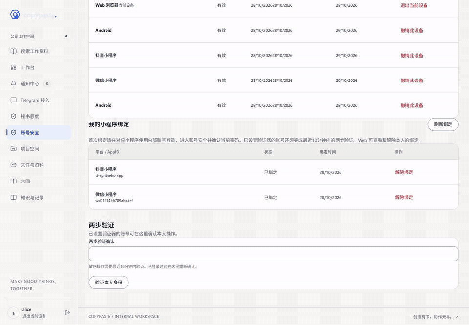

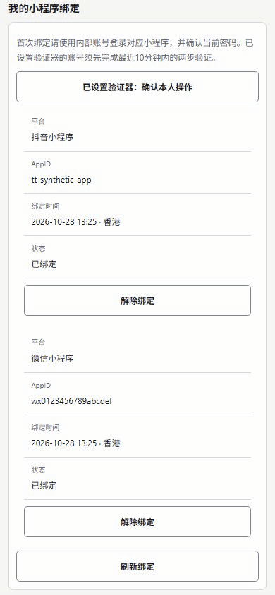

[中文使用指南](../README.zh-CN.md) · [English guide](../README.en.md) · [仓库首页 / Home](../../README.md)

本目录包含 **90张PNG、33段MP4、33个GIF**。增量95新增Web／Taro任务讨论8张实际截图和两套MP4／GIF；原94及更早媒体保留原字节。全部使用隔离合成数据，不含真实业务或凭据；移动录屏为Taro H5。

This catalog contains **90 PNGs,33 MP4s and33 GIFs**. Increment95 adds eight actual Web/Taro discussion screenshots and two MP4/GIF pairs. Earlier media retains its original bytes. Recordings use authenticated synthetic data; mobile clips show Taro H5 rather than a device.

增量96仅改变原生迁移工具和后端，没有页面改动；以下原95及更早的PNG／MP4／GIF保持原始字节和来源范围。CLI的实际本地交互证据见[迁移验证](../quality/96-native-file-import-verification.md)。

Increment96 changes the native import tool and backend. The page screenshots, MP4s and GIFs below retain their original bytes and capture scope. Fresh CLI interaction evidence is listed in the [import verification](../quality/96-native-file-import-verification.md).

## 最近页面更新：任务讨论与明确提及 / Task discussion and explicit mentions


[Web MP4](videos/task-mentions-web-collaboration.mp4) · [移动 MP4 / Mobile MP4](videos/task-mentions-mobile-collaboration.mp4) · [移动 GIF / Mobile GIF](gifs/task-mentions-mobile-collaboration.gif)

| 实际页面 / Actual page | Web | Taro H5 |
| --- | --- | --- |
| 核对正文、固定附件与明确成员 / Review | [截图 / PNG](screenshots/task-mentions-web-preview.png) | [截图 / PNG](screenshots/task-mentions-mobile-preview.png) |
| 已提交讨论与固定依据 / Committed discussion | [截图 / PNG](screenshots/task-mentions-web-discussion.png) | [截图 / PNG](screenshots/task-mentions-mobile-discussion.png) |
| 被提及者自己的站内通知 / Recipient inbox | [截图 / PNG](screenshots/task-mentions-web-notification.png) | [截图 / PNG](screenshots/task-mentions-mobile-notification.png) |
| 超过首20条后的准确评论定位 / Exact discussion beyond first20 | [截图 / PNG](screenshots/task-mentions-web-exact-discussion.png) | [截图 / PNG](screenshots/task-mentions-mobile-exact-discussion.png) |

本轮使用真实本机API、隔离原生PostgreSQL及两名合成员工；录制发生在登录／MFA之后，不录制凭据或能力链接。MP4为无声H.264，Web1364×900／5.8秒（28捕获帧），移动390×900／5.9秒（27捕获帧）；GIF均1.0×，按原始捕获时序编码。共享移动界面由H5审查，不是Android或小程序真机。PNG另覆盖通知和准确定位，视频仅演示评论创建及真实结果，不声称录到全部故障和通知场景。

Actual authenticated synthetic Web and Taro H5 pixels use the native API and isolated PostgreSQL. Silent MP4s retain capture timing (Web5.8s, mobile5.9s); both GIFs use1.0× speed. Login/MFA precede recording. Clips show comment creation and the committed result; separate PNGs show the inbox and exact navigation. No device, cloud, real model or Telegram network acceptance is implied. All eight PNGs and first/middle/last GIF samples were viewed; exact target text enters the viewport through application navigation, without checker scrolling.

[使用与约束 / Workflow](../development/95-task-discussion-and-mentions.md) · [准确验证 / Verification](../quality/95-task-discussion-verification.md) · [媒体摘要 / Digests and timing](../quality/evidence/task-mentions/media.json) · [像素复核 / Visual review](../quality/evidence/task-mentions/visual-review.json)

## 此前：移动文件与目录整理 / Mobile files and folders


[目录MP4](videos/mobile-files-directory.mp4) · [文件回收恢复MP4 / File lifecycle MP4](videos/mobile-files-lifecycle.mp4) · [文件GIF / File GIF](gifs/mobile-files-lifecycle.gif)

[目录创建核对 / Create review](screenshots/mobile-files-create.png) · [目录整理结果 / Folder result](screenshots/mobile-files-directory.png) · [文件移动核对 / Move review](screenshots/mobile-files-move.png) · [恢复与版本 / Restored history](screenshots/mobile-files-restored.png)

两段录制使用真实本机API、隔离PostgreSQL及受控对象字节；认证后才开始，保留原操作时间，无音频。GIF按清单保持原速或为长片加速。9项实际流程、8项H5布局与两项明确标记的响应故障详见[验证](../quality/evidence/mobile-files/verification.md)；历史版本样本是实际两版，23项目录分页另验，不声称20版以上实测。移动截图390×900可全尺寸打开；H5不代替真机。

Two actual authenticated Taro H5 clips use native API/PostgreSQL and controlled synthetic bytes, with original timings and no audio. GIF timing/speed is recorded in the manifest. [Verification](../quality/evidence/mobile-files/verification.md) distinguishes nine flows, eight layouts, two labelled response faults, two actual content versions and23-folder pagination. No real-device or large-transfer claim. Full-size390×900 PNGs are linked above.

## 此前：秘书正文与固定资料 / Secretary body and fixed context

| 页面 / View | Web | 移动H5 / Mobile H5 |
| --- | --- | --- |
| 正文及派生证据 / Text and derivation | [PNG](screenshots/agent-indexed-search-web-preview.png) | [PNG](screenshots/agent-indexed-search-mobile-preview.png) |
| 两个准确版本附件 / Two exact attached versions | [PNG](screenshots/agent-indexed-search-web-sources.png) | [PNG](screenshots/agent-indexed-search-mobile-sources.png) |
| 实际操作 / Actual interaction | [MP4](videos/agent-indexed-search-web.mp4) · [GIF](gifs/agent-indexed-search-web.gif) | [MP4](videos/agent-indexed-search-mobile.mp4) · [GIF](gifs/agent-indexed-search-mobile.gif) |

选择文件／准确版本 → DOCX正文及两类摘要 → Unicode续读 → 明确旧版本 → 两个版本加入本次请求。Web原录制14帧约3.0秒、移动28帧约6.0秒；MP4分别3.2秒／6.2秒，GIF保留原时序，建议放慢查看。截图包含实际长正文和移动滚动位置，不是概念效果图。没有自动发送模型请求。

Actual authenticated previews, continuation and attachments use the native API and synthetic records. Both clients have eight UI/API checks; the native controlled MCP fixture separately verifies body search, durable read receipts and result withdrawal. These clips do not demonstrate live model output, real cloud or devices. Long Web PNGs and the scrolled390x900 mobile preview can be opened at full size. See [protocol](../development/93-secretary-indexed-search.md) and [exact verification](../quality/evidence/agent-indexed-search/verification.md).

## 新增：统一搜索与固定版本正文 / Unified search and version text

| 页面 / View | Web | 移动H5 / Mobile H5 |
| --- | --- | --- |
| 正文命中 / Body match | [截图](screenshots/file-search-web-results.png) | [截图](screenshots/file-search-mobile-results.png) |
| 固定版本正文 / Exact-version text | [截图](screenshots/file-search-web-preview.png) | [截图](screenshots/file-search-mobile-preview.png) |
| 实际操作 / Interaction | [MP4](videos/file-search-web.mp4) · [GIF](gifs/file-search-web.gif) | [MP4](videos/file-search-mobile.mp4) · [GIF](gifs/file-search-mobile.gif) |

实际流程：正文词句 → 准确版本预览 → 字符分段 → 历史词句不命中当前版 → DOCX正文命中 → 不支持格式的名称检索 → 字面百分号／下划线检索。录制仅包含认证后的页面像素；可使用播放器慢速查看。见[方案](../development/92-file-text-search.md)及[来源验证](../quality/evidence/file-search/verification.md)。

The actual authenticated sequence covers body matching, pinned-version preview/chunks, historical exclusion, DOCX extraction, unsupported-format name search and literal pattern characters. Clips preserve actual timing; use playback controls for slower review. No credentials, real business data, devices or external integrations were recorded.

## 1. Web 项目创建与任务闭环 / Project and task workflow

实际操作：创建项目 → 创建带负责人及日期的任务 → 开始 → 完成 → 打开看板。录制在登录与 MFA 完成后才开始，不录制身份输入。操作由自动化执行，MP4 可使用播放器慢速查看。

Actual actions: create a project, create an assigned/dated task, start and complete it, then open the board. Recording starts after authentication/MFA. Automation performs the actions quickly; use a slower playback rate to inspect individual steps.

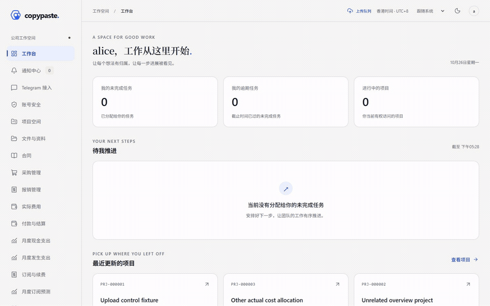

[完整 MP4 / Full MP4](videos/web-project-flow.mp4) · 1440 × 900 · 4.2 s · 无声 / silent · GIF 1×

## 2. 业务页面浏览 / Operations tour

依次查看十六类项目概览、合同、实际费用、文件、知识、秘书权限边界和服务状态。文件与服务使用明确标记的元数据／观测夹具；费用的大额与小数用于精度验证。当前身份没有秘书读取动作，页面正确拒绝进入会话；录制不临时扩权。

The tour visits the sixteen-domain project overview, contract, actual costs, files, knowledge, secretary access boundary and service status. File metadata/service observations are controlled fixtures, and unusual monetary values exercise precision. This identity lacks secretary-read permission, so the screen correctly denies access; the recording does not add privileges.

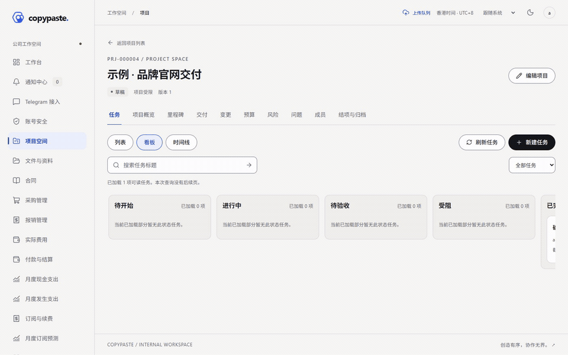

[完整 MP4 / Full MP4](videos/web-operations-tour.mp4) · 1440 × 900 · 16.6 s · 无声 / silent · GIF 约 / approximately 1.09×

## 3. 移动风险转问题与处理 / Mobile risk-to-issue workflow

实际操作：从同一个新项目进入风险 → 新建风险及应对措施 → 明确发生 → 沿真实关联问题链接 → 调查 → 填写解决结果 → 解决并关闭。后台确认实际风险、问题及最终状态。

Actual actions: open risks for the newly created project, create a risk and mitigation, explicitly realize it, follow the actual linked issue, investigate, record the resolution, resolve and close. The backend verifies the real records and final state.

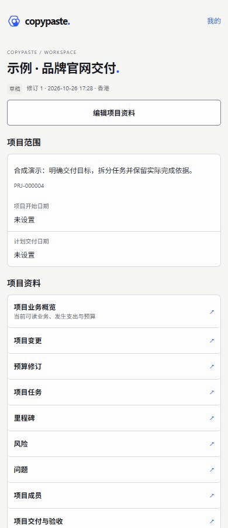

[完整 MP4 / Full MP4](videos/mobile-risk-issue.mp4) · 390 × 900 · 6.9 s · 无声 / silent · GIF 1× · H5

## 4. 移动任务、子任务与前置依赖 / Mobile task, subtask and prerequisite

实际操作：保存带负责人及六位微秒香港排期的任务 → 创建子任务 → 选择当前项目里程碑 → 添加前置任务 → 通过原接口读取实际关系与任务版本。录制由自动化操作，开始于表单保存区域，部分确认过程很快，可慢速查看 MP4；不包含登录或 MFA 输入。

Actual actions: save an assigned task with a six-digit Hong Kong schedule, create a child, select a real project milestone, add a prerequisite and read back the actual edge/task revision. Automated actions are fast; capture begins in the form save area, so use slower MP4 playback for the confirmations. Authentication/MFA inputs are excluded.

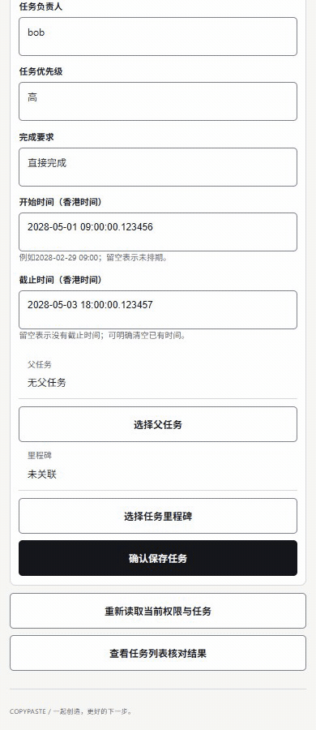

[完整 MP4 / Full MP4](videos/mobile-task-workflow.mp4) · 390 × 900 · 6.7 s · 无声 / silent · GIF 1× · H5

增量78历史画面（提交7a31bc84c4470862659d22733b1434d318b9a8df）的完整596项来源清单、9组实际流程、6项布局及5个上下文清理见[任务历史浏览器结果](../quality/evidence/mobile-tasks-browser/result.json)。旧三组录屏及14张初始截图属于提交 `9e87869397112e0807dd28abdbc691c7b5abb15b` 的历史采集；后续检查从该提交读取711项已提交来源，并保留另1项被忽略编译缓存的准确摘要记录，不将旧图标为最新功能重录。

The increment78 capture, retained at commit 7a31bc84c4470862659d22733b1434d318b9a8df, binds 596 complete source entries, nine actual flows, six layouts and cleanup of five contexts in the [historical task browser result](../quality/evidence/mobile-tasks-browser/result.json). The three earlier recordings and 14 initial screenshots belong to historical commit `9e87869397112e0807dd28abdbc691c7b5abb15b`; verification reads 711 original committed sources and retains the recorded digest of one ignored generated cache instead of presenting old captures as newly recorded features.

## 5. 移动结项与固定复盘 / Mobile closeout and immutable retrospective

实际操作：提交已经人工填写、分别确认并完成本次 MFA 的复盘 → 原事务归档 → 读取实际项目及历史 → 展开当时完整复盘 → 明确重开项目 → 原复盘仍保留且标记依据变化。录制在验证码输入已清除后开始；三项复盘文字和十三类清单的可见区域另有截图，声明／MFA位于表单更下方。自动操作较快，可慢速查看MP4。操作为隔离合成数据的真实 API／Taro H5，不是模型执行或真机证明。

Actual actions: submit a completed retrospective after separate attestations and current MFA, commit the original archive transaction, reconcile actual project/history reads, expand the fixed review, explicitly reopen and verify the preserved review is marked changed. Recording starts after MFA input is cleared. Separate screenshots cover the visible checklist and three-note form regions; attestations/MFA are farther down the form. Automated actions are fast; use slower MP4 playback. These are actual API/Taro H5 actions with synthetic data, without model or physical-device execution.

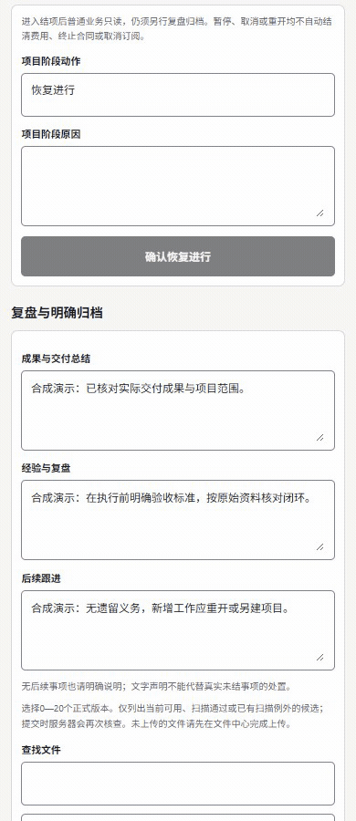

[完整 MP4 / Full MP4](videos/mobile-project-closeout-workflow.mp4) · 390 × 900 · 3.6 s · 无声 / silent · GIF 1× · H5

增量79历史采集属于提交 `8f77924a06cfd3141c9d1b9cd1c574bfa2191d89`，完整源码前后摘要、真实并发／断网／历史分页／限制角色与所属浏览器清理见[页面结果](../quality/evidence/mobile-closeout-browser/result.json)及[源码清单](../quality/evidence/mobile-closeout-browser/source-manifest.json)。编码逐帧核对真实 JPEG 清单，[公开原始帧清单](../quality/evidence/mobile-closeout/recording-frames.json)仅保留时间与摘要，原JPEG留在忽略目录；见[媒体摘要](../quality/evidence/mobile-closeout/media.json)及[实际视觉检查](../quality/evidence/mobile-closeout/visual-review.json)。

The increment79 capture belongs to historical commit `8f77924a06cfd3141c9d1b9cd1c574bfa2191d89`. Source stability, real concurrency, lost responses, pagination, restricted roles and owned-resource cleanup are recorded in the [browser result](../quality/evidence/mobile-closeout-browser/result.json) and [source manifest](../quality/evidence/mobile-closeout-browser/source-manifest.json). [Media evidence](../quality/evidence/mobile-closeout/media.json) binds every actual JPEG frame to the outputs; [visual review](../quality/evidence/mobile-closeout/visual-review.json) records inspected samples.

## 6. 移动完整变更提案 / Mobile complete change proposal

实际录制：选择明确币种 → 读取并采用完整项目／预算基线 → 填写范围、日期和100.01预算替换行 → 选定正式文件版本 → 保存并读回固定草稿。录像仅覆盖初次提案，不把随后审批或实施剪入同一过程。另两张截图来自后续120.01修订获批及独立实施清空预算后的真实页面；完整十组流程另含保持预算、原申请修订、独立审批、本人MFA实施、409、403、限制角色及历史分页。

Actual capture: choose the currency, read and accept the full project/budget basis, enter scope/dates and a 100.01 replacement line, select a formal file version, then save and reconcile the immutable draft. The recording covers initial drafting. Separate screenshots show the later 120.01 approved revision and the zero-line budget after a separately approved/implemented clearing proposal. Ten verified flows also cover keep mode, original request revision, independent approval, MFA implementation, conflicts, access loss, restricted roles and history pagination.

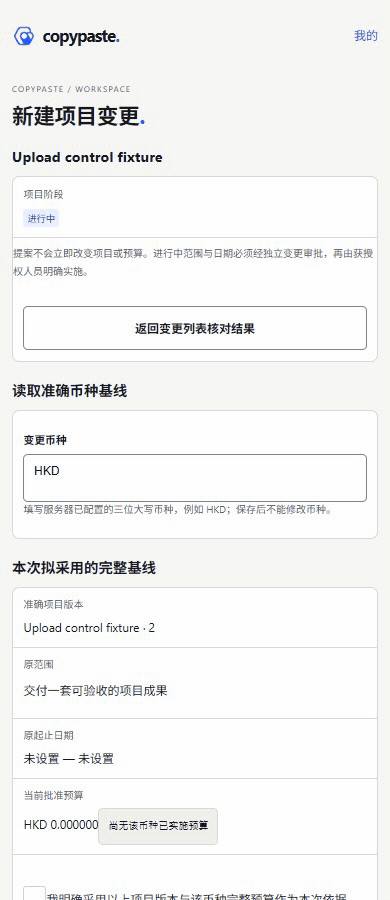

[完整 MP4 / Full MP4](videos/mobile-project-change-workflow.mp4) · 390 × 900 · 7.3 s · 无声 / silent · GIF 1× · H5

35个真实JPEG源帧、7178毫秒时间记录及其摘要绑定编码结果，GIF含44帧。采集器允许公开合成业务ID／摘要，拒绝登录密码、验证码和令牌；未通过遮盖重绘业务界面。3张PNG及GIF首／中／末帧已实际查看，表单截图仅覆盖当时可见区域。完整依据见[浏览器结果](../quality/evidence/mobile-changes-browser/result.json)、[源码清单](../quality/evidence/mobile-changes-browser/source-manifest.json)、[逐帧清单](../quality/evidence/mobile-changes/recording-frames.json)、[采集证明](../quality/evidence/mobile-changes/recording-provenance.json)、[编码记录](../quality/evidence/mobile-changes/media.json)及[视觉检查](../quality/evidence/mobile-changes/visual-review.json)。

The output binds 35 actual JPEGs and their original 7178 ms timestamps/hashes; the GIF has 44 frames. Public synthetic business IDs/hashes remain visible. Capture rejects credential inputs and does not redraw the UI. All three PNGs and first/middle/last GIF samples were inspected; form images cover their actual visible regions. [Verification](../quality/evidence/mobile-changes/verification.md) distinguishes these H5/API checks from device and external acceptance.

## 7. 原生监控与状态切换 / Native monitor and status transitions

独立Windows桥接程序实际读取受控Prometheus协议端，经过持久journal／签名投递，让同一Web服务连续三次失败后显示异常、连续两次成功后恢复，并在页面验证原始签名。录制只包含Web服务页、观测历史和签名核对；原生CLI在后台执行，无登录／MFA输入。真实Prometheus／Blackbox尚未安装，协议端不代表实际探测目标验收。

The actual native Windows bridge reads a controlled Prometheus protocol endpoint, journals/signs the observations and drives the original API. The Web page shows three-failure outage, two-success recovery and original-signature verification. The CLI runs in the background; no authentication entry is recorded. Actual Prometheus/Blackbox/targets remain deployment gates.

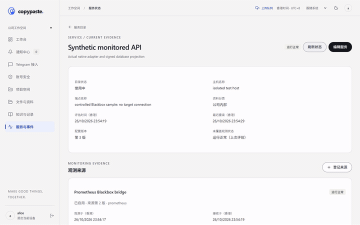

[完整MP4 / Full MP4](videos/native-service-health-workflow.mp4) · 1440 × 900 · 6.0 s · 无声 / silent · GIF720px、6fps、36帧、1×

28个实际JPEG及5781ms原始记录绑定[编码结果](../quality/evidence/status-bridge/media.json)和[公开帧清单](../quality/evidence/status-bridge/recording-frames.json)。[页面结果](../quality/evidence/status-bridge-browser/result.json)绑定787份完整来源、六组实际流程、12次CLI、九项布局与两上下文清理。三张完整视口图及GIF0/12/24/35帧已[实际查看](../quality/evidence/status-bridge/visual-review.json)；MP4适合核对较小签名文字，移动图仅显示当时可见的服务状态／资料，来源及历史位于下方。

The [verification record](../quality/evidence/status-bridge/verification.md) separates fresh execution, native cached tests, exact runtime reuse and failed checker attempts. Original JPEGs remain ignored. Earlier change media is historical at commit `ee04df957ea4b590db8bad1510e308f393e876aa`; its bytes and source proof remain unchanged.

## 8. 移动 TG 身份与准确入口 / Mobile TG identity and exact channels

员工本人数字身份的挑战、确认与撤销经过真实本地 API 验证。演示仅录制管理员完整历史的滚动、返回列表及重新打开，刻意在私聊能力和 MFA 输入不存在时采集。历史分页由真实 API 准备合成修订，再通过实际页面读取；未连接 Telegram 网络。

Own-identity challenge/confirmation/revocation are checked against the real local API. This clip captures administrator history scrolling, returning to the list and reopening it after all capability/MFA inputs are absent. Synthetic revisions are prepared through the actual API and read by the real mobile page; Telegram's network is never contacted.

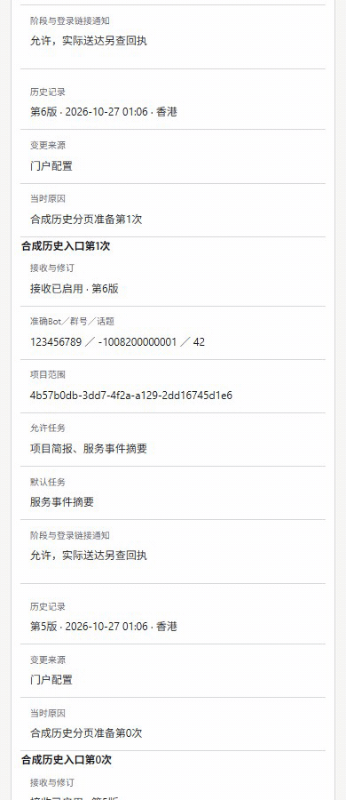

[完整 MP4 / Full MP4](videos/mobile-telegram-access.mp4) · 390 × 900 · 无声 / silent · Taro H5 · [方案 / Protocol](../development/82-mobile-telegram-access.md) · [验证 / Evidence](../quality/evidence/mobile-telegram/verification.md)

[本人绑定 / Own binding](screenshots/mobile-telegram-own-binding.png) · [准确群配置 / Exact channel](screenshots/mobile-telegram-channel-config.png) · [完整历史 / Complete history](screenshots/mobile-telegram-channel-history.png)

增量81状态桥接画面属于提交 `9c710a0f4c785a02539441ec1611bc6678f0050d`；本轮移动源码变化后，以该提交和原来源清单解释旧录制，不将旧画面宣称为新源码采集。The increment81 status capture is historical at that commit and its original manifest; this mobile change does not relabel it as a fresh capture.

## 9. 移动知识编辑、发布与讨论 / Mobile knowledge, publication and discussion

真实操作覆盖项目日志、会议纪要、SOP、内部文章，公司／项目范围、Markdown、跟随／固定附件、正文修订、明确发布、历史恢复、评论和异常停止。画面来自共享 Taro H5 和原生 Go／PostgreSQL 隔离夹具，不代表手机真机录制。

Actual shared Taro H5 interactions use the native isolated Go/PostgreSQL fixture. The workflow covers four knowledge types, explicit attachment modes, immutable body/comment revisions, publication/restoration and conflict handling. No real-device capture or external cloud/model operation is claimed.

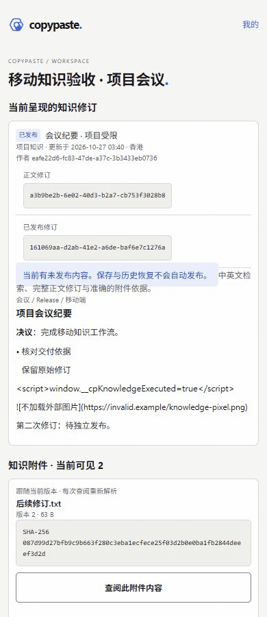

[完整 MP4 / Full MP4](videos/mobile-knowledge-access.mp4) · 390 × 900 · 无声 / silent · [方案与操作 / Workflow](../development/83-mobile-knowledge-workflows.md) · [准确验证 / Evidence](../quality/evidence/mobile-knowledge/verification.md)

| 截图 / Screenshot | 内容 / Contents |
| --- | --- |
| [编辑 / Editor](screenshots/mobile-knowledge-editor.png) | 类型、分类、摘要、标签、正文和准确引用 / Type, classification, summary, tags, body and references |
| [发布 / Published](screenshots/mobile-knowledge-published.png) | 实际当前／已发布修订及正文 / Actual current/published revisions and body |
| [评论 / Discussion](screenshots/mobile-knowledge-comments.png) | 正文上下文、固定版本附件、不可变评论历史 / Body context, fixed pins and immutable comment history |

## 10. 秘书风险与问题 / Secretary risks and issues

创建或修改完整资料，明确风险发生会新增关联问题，然后预览固定字段及版本。实际发送／重试／取消另有API断言；画面中的已提交历史来自同一隔离原业务夹具。Create/update complete metadata, explicitly confirm a linked issue, then preview the fixed fields/version. Separate actual API checks verify send/retry/cancel; committed history comes from the same isolated original business fixture.

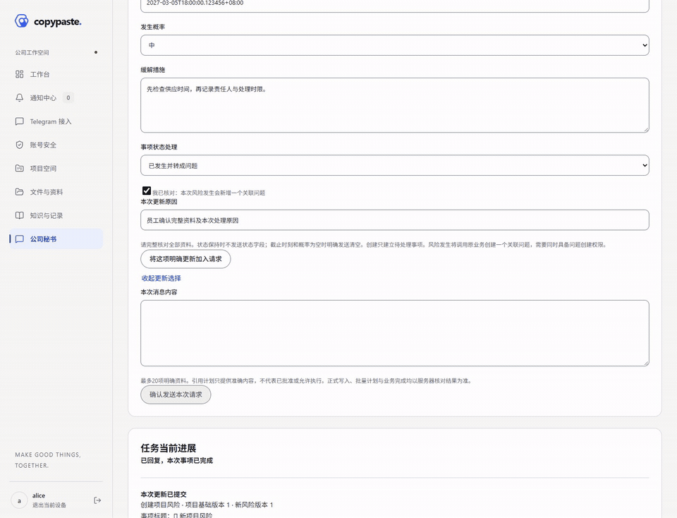

[Web MP4](videos/secretary-concerns-web.mp4) · [Mobile MP4](videos/secretary-concerns-mobile.mp4) · [Mobile GIF](gifs/secretary-concerns-mobile.gif) · [方案 / Workflow](../development/84-secretary-project-concerns.md) · [验证 / Evidence](../quality/evidence/project-concerns/verification.md)

| 页面 / Page | 实际截图 / Actual capture |
| --- | --- |
| Web准确预览 / Exact preview | [Web preview](screenshots/secretary-concerns-web-preview.png) |
| Web真实回执 / Actual receipt | [Web receipt](screenshots/secretary-concerns-web-receipt.png) |
| Taro准确预览 / Exact preview | [Mobile preview](screenshots/secretary-concerns-mobile-preview.png) |
| Taro真实回执 / Actual receipt | [Mobile receipt](screenshots/secretary-concerns-mobile-receipt.png) |

## 11. 秘书创建任务与子任务 / Secretary task and subtask creation

完整核对九项资料、明确人工验收与关联，然后加入准确授权预览；画面中的历史提交来自原业务隔离夹具。真实发送、重试与取消另有API断言。Review nine complete fields, explicit human acceptance and links, then preview exact authority. Committed history comes from the original isolated business fixture; actual sends/retries/cancellation have separate API assertions.

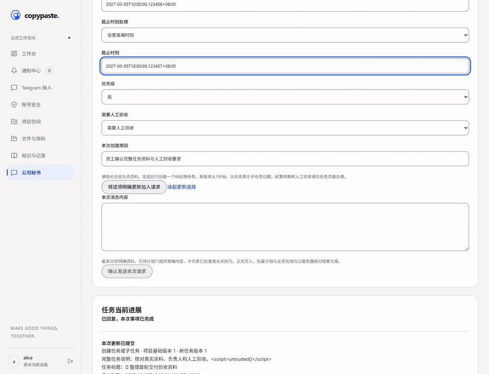

[Web MP4](videos/secretary-task-creation-web.mp4) · [Mobile MP4](videos/secretary-task-creation-mobile.mp4) · [Mobile GIF](gifs/secretary-task-creation-mobile.gif) · [完整流程 / Workflow](../development/85-secretary-task-creation.md) · [验证 / Evidence](../quality/evidence/task-creation/verification.md)

| 页面 / Page | 实际截图 / Actual capture |
| --- | --- |
| Web完整授权 / Complete authorization | [Web preview](screenshots/secretary-task-creation-web-preview.png) |
| Web新任务回执 / New task receipt | [Web receipt](screenshots/secretary-task-creation-web-receipt.png) |
| Taro完整授权 / Complete authorization | [Mobile preview](screenshots/secretary-task-creation-mobile-preview.png) |
| Taro新任务回执 / New task receipt | [Mobile receipt](screenshots/secretary-task-creation-mobile-receipt.png) |

两端各9张真实帧，Web1846ms／移动1838ms；两段MP4均2.0s、GIF均12帧／2000ms、1×、无声。截图保留实际视口裁切，移动回执下部需滚动查看；完整字段另见预览。Each clip uses nine actual frames,1846ms Web/1838ms mobile; both MP4s are2.0s and both GIFs are12 frames/2000ms at1×, silent. PNGs retain real viewport crops; the mobile receipt continues below the viewport. The preview shows complete authorization.

## 12. 页面截图 / Screenshots

| 页面 / Page | 图片 / Image | 范围 / Scope |
| --- | --- | --- |
| 原生桥接正常 / Bridge operational | [native-status-bridge-operational.png](screenshots/native-status-bridge-operational.png) | 实际CLI及API形成的正常状态 / Healthy projection produced by the actual CLI/API |
| 原生桥接故障 / Bridge outage | [native-status-bridge-down.png](screenshots/native-status-bridge-down.png) | 三次实际失败、当前来源状态 / Three actual failures and current source |
| 移动状态 / Mobile status | [native-status-bridge-mobile.png](screenshots/native-status-bridge-mobile.png) | 只读Taro H5员工查看同一故障；可见视口 / Reader sees the same outage in the captured H5 viewport |
| 工作台 / Dashboard | [web-dashboard.png](screenshots/web-dashboard.png) | 当前身份、可见项目 / Current identity and visible projects |
| 项目资料 / Project | [web-project.png](screenshots/web-project.png) | 实际新项目、尚无任务时 / Newly created project before task creation |
| 任务 / Task | [web-task.png](screenshots/web-task.png) | 实际完成任务及操作原因 / Actual completed task and reason |
| 看板 / Board | [web-project-board.png](screenshots/web-project-board.png) | 六状态横向看板，按实际窗口裁取 / Horizontal board in the actual viewport |
| 项目概览 / Overview | [web-overview.png](screenshots/web-overview.png) | 合成的完整业务聚合 / Synthetic business aggregation |
| 合同 / Contract | [web-contract.png](screenshots/web-contract.png) | 原合同与固定依据 / Original contract and fixed evidence |
| 实际费用 / Actual costs | [web-finance.png](screenshots/web-finance.png) | 原币精度与原记录 / Original-currency precision and records |
| 文件 / Files | [web-files.png](screenshots/web-files.png) | 元数据、目录；非云传输证明 / Metadata and folders, not transfer proof |
| 知识 / Knowledge | [web-knowledge.png](screenshots/web-knowledge.png) | 已发布与草稿入口 / Published/draft entry points |
| 秘书权限 / Secretary access | [web-secretary.png](screenshots/web-secretary.png) | 当前账号正确拒绝 / Correct current-identity denial |
| 服务 / Services | [web-status.png](screenshots/web-status.png) | 服务与无观测提示 / Services and missing-observation state |
| 移动项目 / Mobile project | [mobile-project.png](screenshots/mobile-project.png) | Taro共享界面 / Shared Taro UI |
| 移动风险 / Mobile risk | [mobile-risk.png](screenshots/mobile-risk.png) | 实际创建风险 / Actual created risk |
| 移动问题 / Mobile issue | [mobile-issue.png](screenshots/mobile-issue.png) | 真实问题已关闭 / Actual closed issue |
| 秘书准确计划 / Secretary exact plan | [web-secretary-plan.png](screenshots/web-secretary-plan.png) | 历史受控流程的顶部裁剪，非本次模型运行 / Top crop of an earlier controlled flow, not a new model run |
| 移动任务表单 / Mobile task form | [mobile-task-form.png](screenshots/mobile-task-form.png) | 分配、香港排期、关联与保存区域 / Assignment, Hong Kong schedule, association and save region |
| 移动任务关系 / Mobile task relations | [mobile-task-dependencies.png](screenshots/mobile-task-dependencies.png) | 子任务、当前可读前置和里程碑链接的可见区域 / Visible subtask, readable prerequisite and milestone links |
| 移动结项清单 / Mobile closeout checklist | [mobile-project-closeout.png](screenshots/mobile-project-closeout.png) | 实际未完成任务及十三类完整核查 / Actual unfinished task and complete thirteen-category check |
| 移动复盘表单 / Mobile retrospective form | [mobile-project-archive-form.png](screenshots/mobile-project-archive-form.png) | 成果、经验与跟进，验证码输入已清除 / Outcomes, lessons and follow-up after MFA input is cleared |
| 移动固定历史 / Mobile immutable history | [mobile-project-archive-history.png](screenshots/mobile-project-archive-history.png) | 实际归档后复盘与原清单 / Retrospective and fixed checklist after an actual commit |
| 移动变更表单 / Mobile change editor | [mobile-change-editor.png](screenshots/mobile-change-editor.png) | 修订后完整范围与日期，可见区域 / Revised full scope and dates in the actual viewport |
| 移动已批提案 / Mobile approved proposal | [mobile-change-approved.png](screenshots/mobile-change-approved.png) | 固定修订、原申请入口，批准仍需明确实施 / Fixed revision and original request; implementation remains separate |
| 移动预算修订 / Mobile budget revisions | [mobile-change-budget-history.png](screenshots/mobile-change-budget-history.png) | 明确币种／状态筛选和已实施清空后的当前预算 / Currency/state filter and current zero-line budget after implementation |

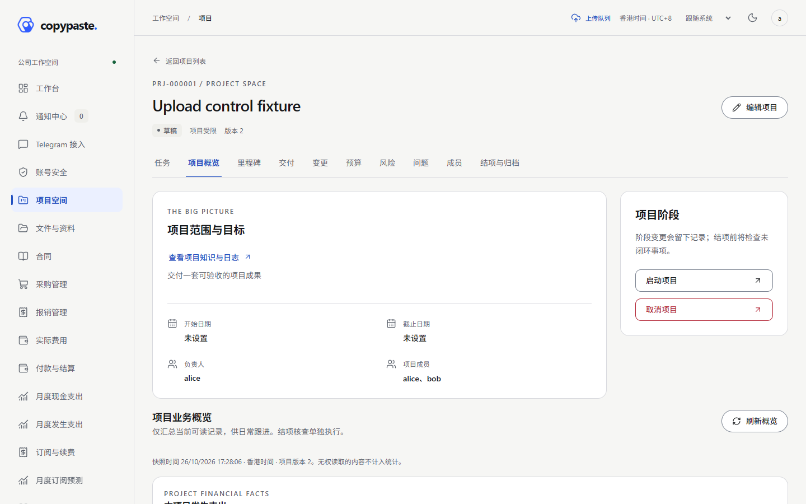

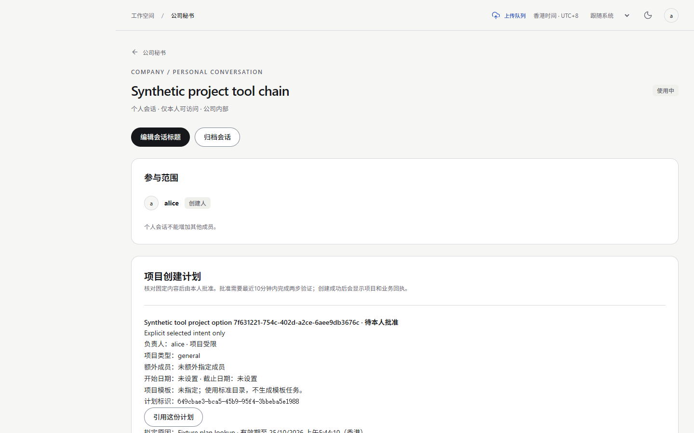

历史计划图的原图为[既有实际秘书流程证据](../quality/evidence/secretary-discovery-web/plan-reference.png)，只裁取顶部 1440 × 900，未生成或改写界面。来源摘要与裁剪坐标见[来源记录](../quality/evidence/repository-showcase/historical-media.json)。

The plan image is a 1440 × 900 top crop of the [earlier actual secretary-flow evidence](../quality/evidence/secretary-discovery-web/plan-reference.png). No UI was synthesized or rewritten. [Provenance](../quality/evidence/repository-showcase/historical-media.json) records source hashes and crop coordinates.

## 13. 来源、编码与复现 / Provenance, encoding and reproduction

| 记录 / Record | 内容 / Contents |
| --- | --- |
| [知识来源清单](../quality/evidence/mobile-knowledge-browser/source-manifest.json)／[实际结果](../quality/evidence/mobile-knowledge-browser/result.json) | 805份完整来源，12组实际流程、9项布局、所属浏览器与原生夹具清理 /805 complete sources,12 actual flows,9 layouts and owned-resource cleanup |
| [知识媒体](../quality/evidence/mobile-knowledge/media.json)／[原始帧清单](../quality/evidence/mobile-knowledge/recording-frames.json)／[视觉抽样](../quality/evidence/mobile-knowledge/visual-review.json) |13张实际JPEG源帧／2656ms，2.8秒MP4及17帧GIF；实际截图、来源和输出摘要 /13 real source frames,2.8-second MP4,17-frame GIF and inspected actual outputs |
| [本轮来源沿革](../quality/evidence/mobile-knowledge/source-normalization.json)／[首轮5份媒体](../quality/evidence/mobile-knowledge/attempts/before-lf-restoration/artifact-map.json) | 恢复四份Go文件原LF并修正检查器等待；原完整来源及5份旧媒体可准确重构、当前页面重新采集 / Four original Go LF conventions and one checker wait corrected; complete prior source reconstruction and five retained exact media, with fresh current capture |
| [旧TG来源复算](../quality/evidence/mobile-knowledge/historical-telegram-capture.json) | 按ec8c0fc的793份原Git blob还原旧采集；不将旧画面冒充当前源码 /793 historical Git blobs; no current-source claim for old media |
| [result.json](../quality/evidence/repository-showcase/result.json) | 完整源码前后摘要、两个阶段、原生夹具与临时服务清理 / Source stability, phases and native fixture/server cleanup |
| [web.json](../quality/evidence/repository-showcase/web.json)、[mobile.json](../quality/evidence/repository-showcase/mobile.json) | 实际 HTTP 方法／路径／状态、截图摘要、浏览器关闭 / Actual HTTP method/path/status, image digests and browser closure |
| [media.json](../quality/evidence/repository-showcase/media.json) | 逐帧清单摘要、输出摘要／体积、编码器版本、ffprobe结果 / Frame-manifest digests, output hashes/sizes, encoder version and probes |
| [source-manifest.json](../quality/evidence/repository-showcase/source-manifest.json) | 完整来源文件与摘要 / Complete capture source manifest |
| [visual-review.json](../quality/evidence/repository-showcase/visual-review.json) | 初始画面的实际查看、抽样范围与限制 / Initial image inspection, sampling scope and limits |
| [任务来源清单](../quality/evidence/mobile-tasks-browser/source-manifest.json)／[页面结果](../quality/evidence/mobile-tasks-browser/result.json) | 新任务采集的完整源码及真实流程／清理 / Complete new task sources, actual flows and cleanup |
| [任务媒体](../quality/evidence/mobile-tasks/media.json)／[视觉查看](../quality/evidence/mobile-tasks/visual-review.json) | 32个真实源帧、输出摘要、ffprobe及GIF首中尾抽样 / 32 actual source frames, output digests, probe and first/middle/last GIF samples |
| [当前功能来源](../quality/current-functional-baseline.json)／[最终复算](../quality/evidence/status-bridge/final-source-check.json) | 当前增量与历史媒体提交的明确区分 / Current functional increment and explicit historical-media commit |
| [历史来源补充](../quality/evidence/mobile-tasks/historical-capture-sources.json) | 原712项字节流完整重建通过：711项Git源码及1项忽略编译缓存；仅发布摘要，不提交缓存字节 / Exact original 712-entry reconstruction: 711 Git blobs plus one ignored generated cache; digests published, cache bytes excluded |

在已有原生开发工具、依赖、测试数据库和 Edge 的环境，从 `app/` 执行。以下初始三段采集的精确复现以提交 `9e87869397112e0807dd28abdbc691c7b5abb15b` 为准；当前源码下运行会产生新的采集，必须新建相应证据，不能覆盖历史来源说明：

With native tools, dependencies, test database access and Edge prepared, run from `app/`. Exact reproduction of the original three captures uses commit `9e87869397112e0807dd28abdbc691c7b5abb15b`. Running against later source creates a new capture requiring new evidence, not replacement of the historical provenance:

```powershell
$env:PYTHONUTF8='1'
python scripts/run_repository_showcase.py
python scripts/encode_repository_showcase.py
python scripts/verify_repository_publication_development.py
python scripts/verify_repository_publication.py
```

任务、结项、变更复现须分别检出增量78、79、80的历史提交；以下为80的历史变更命令，81状态历史复现见后续步骤，历史83知识命令与当前84命令见本节末尾。所有采集共用端口与原生夹具，须先后运行：

Check out increments78/79/80 for historical task/closeout/change captures. The following change commands belong to80; current81 status reproduction follows. All captures share a port/fixture and must run sequentially:

```powershell
$env:PYTHONUTF8='1'
python scripts/run_mobile_changes_browser.py
python scripts/freeze_mobile_changes_evidence.py --capture-only
python scripts/encode_mobile_changes_media.py
python scripts/verify_mobile_changes_development.py
```

历史81在原生工具、测试库、Edge及桥接二进制准备后，从`app/`顺序运行；先归档此前证据，再重新生成独立来源和实际视觉查看。完整构建／复核命令见[验证记录](../quality/evidence/status-bridge/verification.md)。

For81, prepare the native toolchain/test database/Edge/bridge binary, archive previous evidence, then run sequentially from `app/`. A rebuild needs new source bindings and actual visual review.

```powershell
$env:PYTHONUTF8='1'
python scripts/run_status_bridge_browser.py
python scripts/freeze_status_bridge_evidence.py --capture-only
python scripts/encode_status_bridge_media.py
```

采集会创建自己的隔离数据库，顺序使用本机 5189 端口，并在 finally 中关闭自己的浏览器、服务与夹具。若已有同名私有夹具，脚本会拒绝接管。原始 JPEG 帧与登录资料留在忽略的 `app/.local/`，编码器只接受摘要核对通过的真实帧，输出无声 H.264 MP4 与调色板 GIF。MP4 保留实际时间间隔，以 10 fps 编码；GIF 6 fps，初始桌面宽960、移动宽390；81桥接GIF宽720，长片段适度加速。没有插帧生成或重新绘制页面。

Capture owns an isolated database and uses local port 5189 sequentially. Its cleanup closes owned browsers, servers and fixtures; it refuses an existing private fixture. Raw JPEG frames and login material remain under ignored `app/.local/`. The encoder verifies frame hashes before producing silent H.264 MP4 and palette GIF output. MP4 preserves recorded intervals at 10 fps; GIF uses 6 fps, initial desktop width960/mobile width390; bridge81 width720, with modest acceleration for the long clip. No generated UI or synthesized in-between frames are used.

手动视觉检查是另一个步骤，脚本重建后须实际查看新图再更新记录；不能仅沿用上次“看过”的结论。完整凭据检查基于采集前置条件、数据隔离、提交扫描和实际画面检查；并不宣称对所有像素完成自动 OCR 审计。后续受影响的功能截图、录屏、GIF 与中英文说明应同步更新，见[维护约定](../contributing.md)。

Manual visual inspection is a separate step: inspect rebuilt media before updating its review record. Credential exclusion relies on capture preconditions, isolation, commit scanning and actual visual inspection; this is not a claim of exhaustive pixel OCR. Update affected media and both language guides together with future changes; see [maintenance rules](../contributing.md).

### 历史83复现 / Historical increment83 reproduction

从`app/`顺序执行，先保留此前完成或失败的证据。需原生测试数据库、Node工具链和Edge；每次重新采集均要重新核对来源并实际查看新输出。Both capture and encoding require native tooling; archive existing evidence before a new run and inspect the resulting media again.

```powershell
$env:PYTHONUTF8='1'
python scripts/run_mobile_knowledge_browser.py
python scripts/freeze_mobile_knowledge_evidence.py --capture-only
python scripts/encode_mobile_knowledge_media.py
```

本轮输出为3张实际页面截图、2.8秒无声MP4和17帧GIF；源为13张JPEG／2656ms。来源为805份当前源码及采集帮助程序；实际检查12组流程及9项布局，两个上下文、临时服务与隔离夹具都已关闭。旧媒体保留原提交来源。Current output: three actual screenshots, a2.8-second silent MP4 and17-frame GIF from13 real JPEGs/2656ms. Twelve flows and nine layouts bind805 complete sources; both contexts, the temporary server and isolated fixture closed. Earlier media retains its historical source attribution.

### 历史84复现 / Historical increment84 reproduction

检出对应增量84提交，按双语指南准备原生依赖与隔离数据库；先归档已有证据记录，然后顺序运行，保留失败记录。Check out increment84 and prepare native dependencies/an isolated database. Archive existing evidence first; run captures sequentially and retain failures.

```powershell
$env:PYTHONUTF8='1'
python app/scripts/run_project_concerns_browser.py
python app/scripts/run_project_concerns_browser.py --mobile
python app/scripts/encode_project_concerns_media.py
```

采集只记录认证后的会话，不录制登录、MFA或私有能力。实际Taro滚轮与候选列表均由可见控件操作，不注入组件状态。结束即关闭所有自建上下文、浏览器、临时Web/H5服务和夹具数据库，保留日常API／Worker／PostgreSQL。Captures exclude login/MFA/private capabilities, operate the visible controls and close every owned browser/context/server/fixture afterward.


### 当前85复现 / Current increment85 reproduction

先归档已有证据，准备原生依赖与隔离数据库，按顺序执行。先前失败／重录素材保留在本轮attempts，不能当作当前成功证据。Archive existing evidence, prepare native dependencies/an isolated database, then run sequentially. Superseded attempt media is retained and is not current passing evidence.

```powershell
$env:PYTHONUTF8='1'
python app/scripts/run_task_creation_browser.py
python app/scripts/run_task_creation_browser.py --mobile
python app/scripts/encode_task_creation_media.py
python app/scripts/record_task_creation_history.py
python app/scripts/verify_task_creation_sources.py
```

当前采集明确排除忽略的tsbuildinfo编译缓存。历史84的完整启动来源及642项移动来源可从24ad850重建；旧Web620项中619份Git文件可重建，但原缓存未提交／冻结，完整旧Web采集清单不能重建，不以当前缓存伪造补齐，见[历史核对](../quality/evidence/task-creation/historical-84.json)。Current captures exclude ignored compiler caches. Increment84 complete startup/mobile sources reconstruct from24ad850;619 of620 Web entries reconstruct, while its unfrozen ignored cache remains unavailable. The historical full Web capture digest is retained without a fabricated reconstruction.


## 14. 秘书Token额度与凭据核对 / Secretary token budgets

真实Web／Taro页面：完成MFA登录 → 查询组织账本 → 发布完整四维策略修订 → 凭据核对未知终态用量 → 查验实际核对回执和汇总 → 切换本人／组织／项目范围。14项原生业务场景先运行，浏览器连接同一个隔离API；不调用真实模型或供应商。

Actual authenticated Web/Taro pages query organization accounts, publish a complete policy, reconcile an unknown terminal run with a synthetic reference, inspect its durable counts and switch report scopes. Native business scenarios run first against the same disposable API. No real provider is invoked. Recordings show authenticated account queries after reconciliation; policy/MFA input is outside the recording.

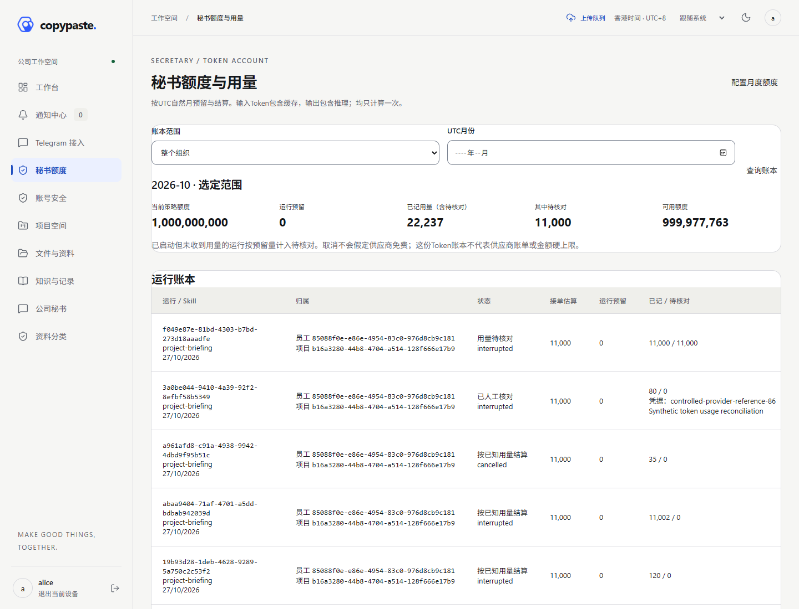
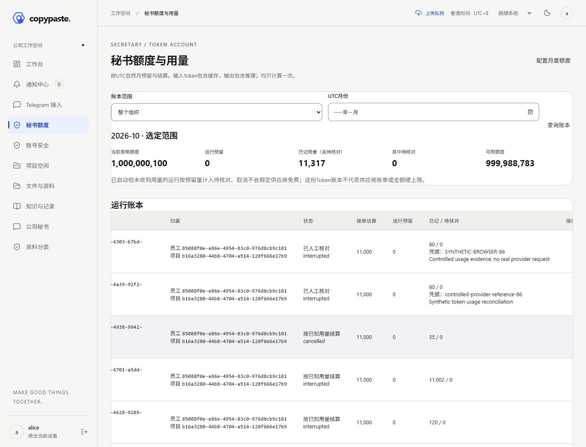
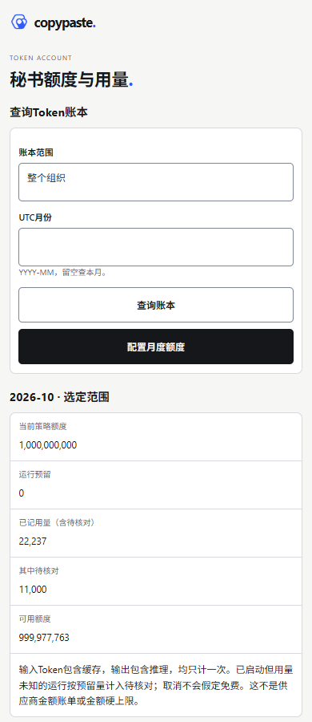
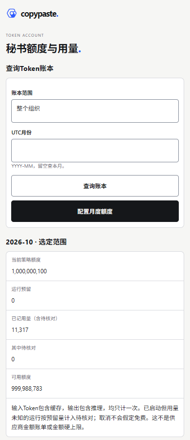

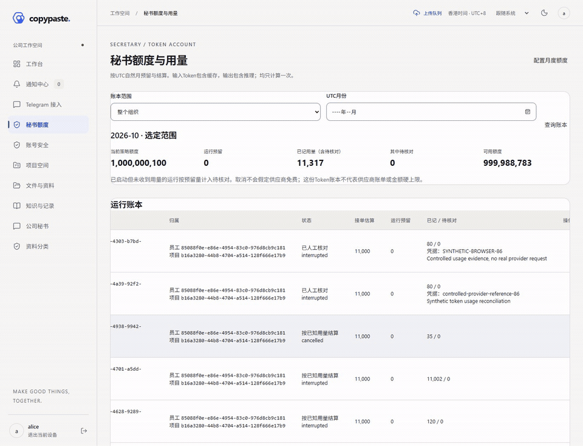
[Web MP4](videos/secretary-token-budgets-web.mp4)

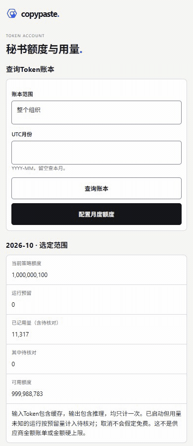
[Taro MP4](videos/secretary-token-budgets-mobile.mp4)

复现顺序 / Reproduction: `python app/scripts/run_token_budget_browser.py` → `python app/scripts/run_token_budget_browser.py --mobile` → `python app/scripts/encode_token_budget_media.py`。两个浏览器检查须串行；各自关闭全部上下文、测试API、隔离数据库及临时5189服务。素材来自实际捕获帧，无密码／MFA／令牌；Taro H5不代表小程序或Android真机验收。首次Web检查过早读到旧状态的尝试保留，不复用为当前通过证据。

完整来源、帧时间、失败修复、历史证据和本增量实际构建范围见[验证记录](../quality/evidence/token-budgets/verification.md)；操作和金额边界见[方案](../development/86-secretary-token-budgets.md)。

## 15. 项目预算与实际支出 / Project budget versus actual expenditure

在项目预算页明确选择币种，查看当前已实施计划、逐项期间、实际项目份额、冲销、未确认草稿和预算外发生；按明细／状态分页打开规范费用。页面明确只代表当前授权记录。人工算例与原生API回归一致，真实数据不进入演示。

Select a configured currency from the project's budget page, inspect the current implemented plan and canonical shares/reversals, then filter and page original incurred/draft sources. The comparison always covers authorized records only. Both clients use the real native API with isolated synthetic fixtures.

| Actual view / 实际页面 | Screenshot |
| --- | --- |
| Web完整预算对比 / complete comparison | [PNG](screenshots/project-budget-comparison-web-summary.png) |
| Web费用来源 / canonical sources | [PNG](screenshots/project-budget-comparison-web-sources.png) |
| Taro预算逐项对比 / line comparison | [PNG](screenshots/project-budget-comparison-mobile-summary.png) |
| Taro原费用分页 / paged expense sources | [PNG](screenshots/project-budget-comparison-mobile-sources.png) |

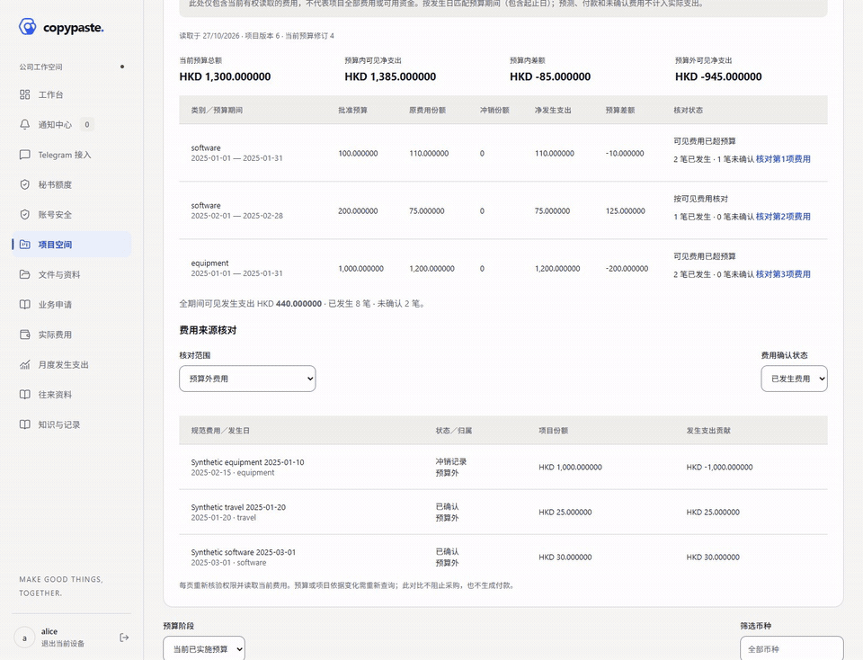

[Web实际短录屏 / Actual short MP4](videos/project-budget-comparison-web.mp4)

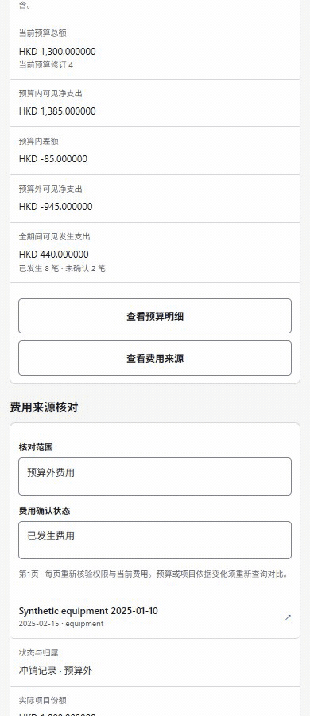

[Taro实际短录屏 / Actual short MP4](videos/project-budget-comparison-mobile.mp4)

实际捕获为Web9帧／1841毫秒、Taro37帧／7533毫秒；GIF经编码后分别12帧、46帧，补帧与编码时序以媒体清单为准。它们是预算来源交互的短片段，完整六组实际流程及三个尺寸由各端检查结果另行证明。最终四张PNG及两份GIF已人工目视核对；移动为Taro H5，尚非小程序或Android设备验收。

The short clips record actual source interactions after login. Capture-frame timing differs from encoded playback frames; manifests retain both scopes. Six checked flows and three layouts per client are broader than the bounded recordings. All four final screenshots and both animations received manual pixel review. Taro H5 is not a device acceptance result.

复现顺序 / Reproduction: `python app/scripts/run_budget_comparison_browser.py` → `python app/scripts/run_budget_comparison_browser.py --mobile` → `python app/scripts/encode_budget_comparison_media.py`。两端串行，归属明确的浏览器、临时API／隔离数据库、5189服务和私有夹具在检查结束后释放。保留选择器就绪与缓存页面展开状态的失败捕获及完整来源，旧通过结果不重绑改动后的检查器。完整[计算与操作](../development/87-project-budget-comparison.md)、[验证与来源](../quality/evidence/budget-comparison/verification.md)和[媒体清单](../quality/evidence/budget-comparison/media.json)可逐项核对。

## 16. 财务筛选、规范来源与异步导出 / Financial filters, canonical sources and asynchronous exports

实际操作：报表与原币 → 项目、类别、供应方、经办筛选 → 来源分页 → 填用途排队 → 等待worker → 实际CSV校验下载 → 现金／预测查询。每端完整5组检查及3种尺寸另见证据；录屏是其中的连续短片段，身份输入完成后才开始。

Actual actions apply business filters, page canonical sources, enqueue an export, wait for the real native worker, verify and retrieve the CSV, then inspect cash and forecast facts. Media contains isolated synthetic records and actual post-login viewport pixels.

| Client | Summary | Canonical sources | Owner-only exports |
| --- | --- | --- | --- |
| Web | [PNG](screenshots/financial-reports-web-summary.png) | [PNG](screenshots/financial-reports-web-sources.png) | [PNG](screenshots/financial-reports-web-exports.png) |
| Taro H5 | [PNG](screenshots/financial-reports-mobile-summary.png) | [PNG](screenshots/financial-reports-mobile-sources.png) | [PNG](screenshots/financial-reports-mobile-exports.png) |

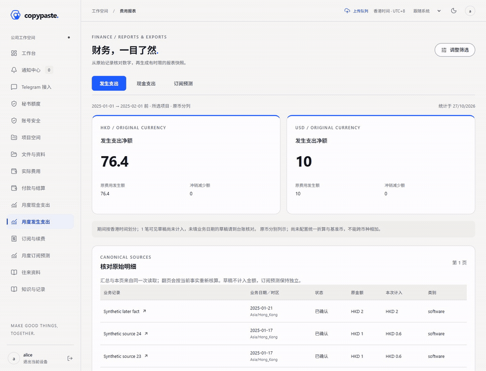

[Web MP4](videos/financial-reports-web.mp4) · 1440×1100 · 36原始采样帧／7311毫秒 · GIF1×。

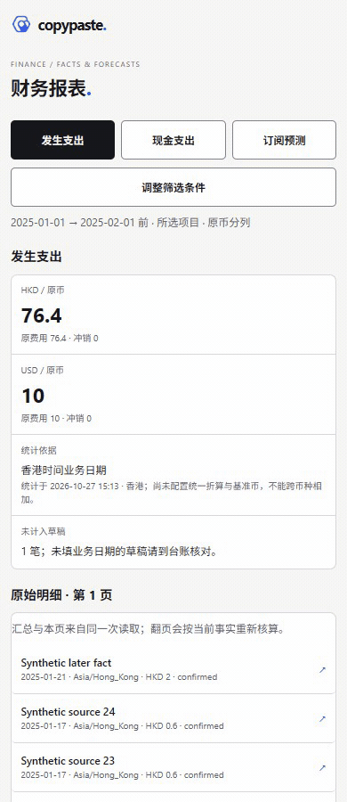

[Taro MP4](videos/financial-reports-mobile.mp4) · 390×900 · 35原始采样帧／7104毫秒 · GIF1×。

原始采样与编码补帧分别记录；操作由自动化较快执行，MP4可用播放器慢速查看。最终6图及两GIF的首／中／末帧已人工目视检查。实际27行CSV摘要与长度在两端download-proof中核对，CSV及原始JPEG不入Git。H5和开发APK不代替平台或Android实体设备验收。

复现 / Reproduction: `python app/scripts/run_financial_reports_browser.py` → `python app/scripts/run_financial_reports_browser.py --mobile` → `python app/scripts/encode_financial_reports_media.py`。归档已有证据后两端串行执行；完成即释放自建浏览器、临时API／库、5189服务和私有fixture。保留失败及被替代通过捕获的完整来源，不将旧通过重绑新源码。详见[设计与操作](../development/88-financial-report-filters-and-exports.md)、[当前验证](../quality/evidence/finance-reports/verification.md)及[准确媒体清单](../quality/evidence/finance-reports/media.json)。

## 17. 移动费用、资金、退款与员工结算 / Mobile expenses, cash, refunds and employee settlement

实际操作录屏从已登录列表开始：起草费用／资金、选择项目与原币、真实日期／香港时间、固定往来方／正式文件、项目60／公司40分摊、保存草稿。MFA及审批操作不录制；完整9组确认、冲突、响应丢失、分配、退款、员工结算及反向更正另有真实UI与API证据。

Actual silent recordings show authenticated expense/cash draft entry and fixed evidence selection. Four screenshots show the resulting canonical financial records. Full MFA and settlement/reversal checks are documented separately; synthetic H5 pixels do not establish device acceptance.

| Actual result | Screenshot |
| --- | --- |
| 费用确认与批准依据 / Confirmed expense and approved source | [PNG](screenshots/mobile-finance-cost-confirmed.png) |
| 付款分配与释放 / Payment allocation and release | [PNG](screenshots/mobile-finance-payment-allocations.png) |
| 收到退款与后补关联 / Refund and later mapping | [PNG](screenshots/mobile-finance-refund.png) |
| 准确员工报销结算 / Exact employee settlement | [PNG](screenshots/mobile-finance-employee-settlement.png) |

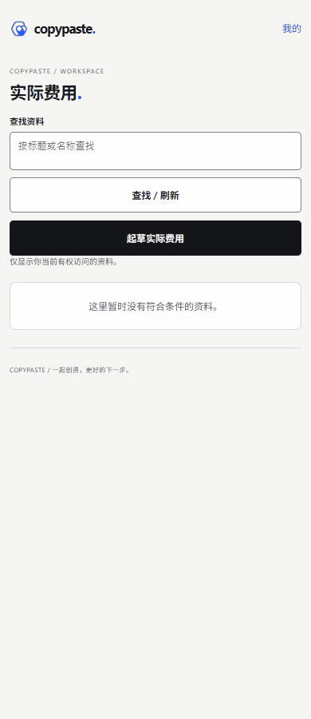

[MP4](videos/mobile-finance-cost-draft.mp4) · 390×900 · 27原始采样帧／5514毫秒 · GIF 1.000×。

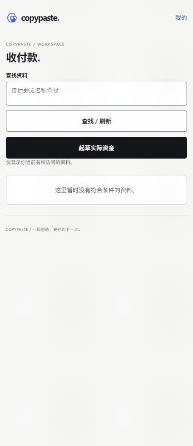

[MP4](videos/mobile-finance-payment-draft.mp4) · 390×900 · 35原始采样帧／7122毫秒 · GIF 1.000×。

MP4按真实时间编码；GIF倍率与源帧摘要见[media.json](../quality/evidence/mobile-finance-operations/media.json)。4张截图及两GIF首／中／末帧经实际像素检查。原JPEG和私有fixture不提交，所有自建浏览器／临时API／隔离库／5189服务已释放。

复现 / Reproduction: 先归档已有证据，再运行`python app/scripts/run_mobile_finance_browser.py --mobile`及`python app/scripts/encode_mobile_finance_media.py`。失败捕获和被替代构建按准确源码保留，不重绑为当前通过。见[设计与使用](../development/89-mobile-financial-operations.md)、[验证](../quality/evidence/mobile-finance-operations/verification.md)及[像素检查](../quality/evidence/mobile-finance-operations/visual-review.json)。

## 18. 依赖修复后页面兼容 / Pages after dependency hardening

新锁下实际完成9组费用、资金、退款、员工结算与冲销流程及3种宽度核对。录屏为共享Taro H5，使用真实原生API及隔离合成库；完整四端真机／平台验收另行开展。登录后才录制，无音频；MFA限流等待不包含在草稿短片中。

Nine actual financial journeys and three layouts run against the changed dependency tree and a native isolated API. Recordings show authenticated shared Taro H5 pages with synthetic data, not device acceptance. Draft clips exclude identity entry and the MFA rate-limit wait.

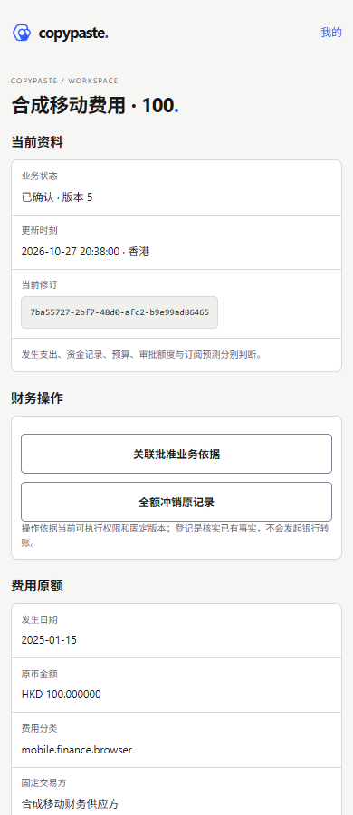

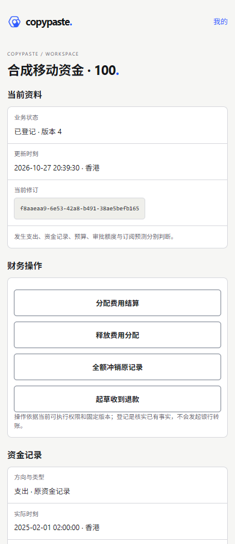

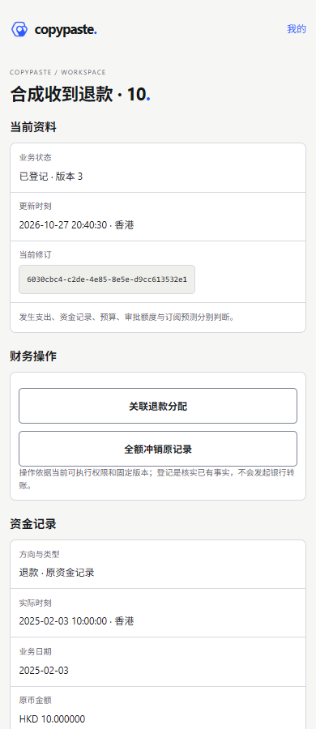

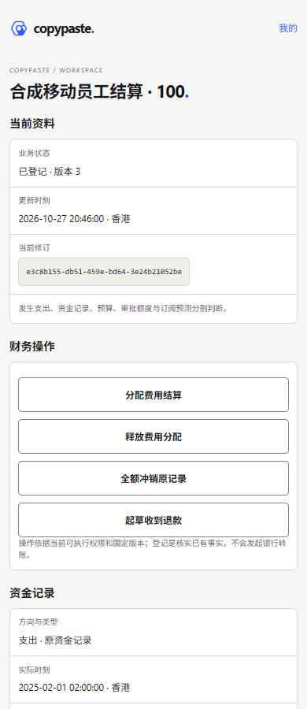


[MP4](videos/dependency-hardening-cost-draft.mp4) · 390×900 · 28原始采样帧／5701毫秒 · GIF 1.000×。

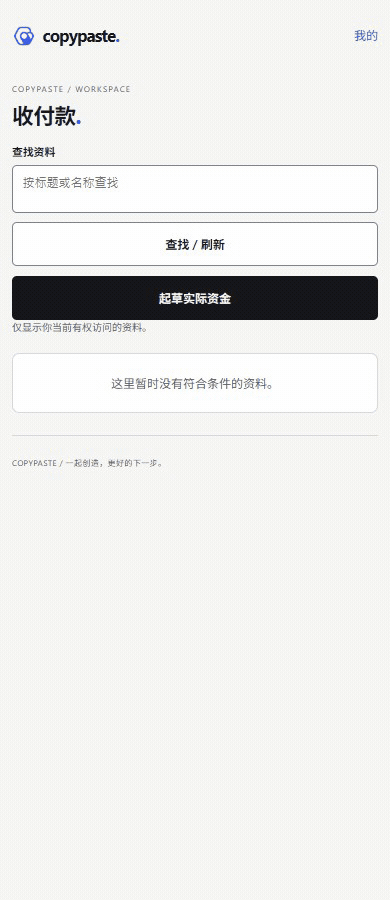

[MP4](videos/dependency-hardening-payment-draft.mp4) · 390×900 · 35原始采样帧／7114毫秒 · GIF 1.000×。

MP4按原始时间编码，GIF时间来自实际采样，文件摘要和ffprobe结果见[媒体记录](../quality/evidence/dependency-hardening/media.json)。四图及两GIF首／中／末帧均已检查；原JPEG及私有fixture不提交。浏览器、上下文、临时API、隔离库及5189服务已释放，用户原有无关进程未动。

复现 / Reproduction: 先保留现有证据，再运行`python app/scripts/run_dependency_hardening_browser.py --mobile`和`python app/scripts/encode_dependency_hardening_media.py`。现有限流会使完整页面检查等待实际15分钟窗口；不调整应用限流。见[设计与复现](../development/90-dependency-hardening.md)、[准确验证](../quality/evidence/dependency-hardening/verification.md)和[像素检查](../quality/evidence/dependency-hardening/visual-review.json)。

## 秘书前置依赖 / Secretary prerequisites · Increment91

登录后的实际Web／Taro H5：同项目两任务选择 → 两版本和当前关系 → 缺项及无变化拦截 → 明确新增预览 → 准确发送／相同键重放 → 执行前取消 → 查看实际已提交新增和解除回执。两个已提交视图由隔离原生PostgreSQL、原Dependency命令及受控MCP夹具建立，UI取消的运行没有执行业务；录制不接真实模型。截图保留真实UUID、合成名称和业务操作回执。

Actual authenticated Web/Taro H5 screens show two task versions, explicit edge decisions, validation, preview, queued send/replay/cancel and genuine committed add/remove receipts. The UI run is cancelled before business execution; the committed fixtures use original commands through controlled MCP. There is no live model or device claim. Each client is checked at three real viewport widths.

| 客户端 / Client | 表单 / Form | 准确预览 / Preview | 新增回执 / Added | 解除回执 / Removed |
| --- | --- | --- | --- | --- |
| Web | [PNG](screenshots/secretary-task-dependencies-web-form.png) | [PNG](screenshots/secretary-task-dependencies-web-preview.png) | [PNG](screenshots/secretary-task-dependencies-web-receipt.png) | [PNG](screenshots/secretary-task-dependencies-web-removed.png) |
| Taro H5 | [PNG](screenshots/secretary-task-dependencies-mobile-form.png) | [PNG](screenshots/secretary-task-dependencies-mobile-preview.png) | [PNG](screenshots/secretary-task-dependencies-mobile-receipt.png) | [PNG](screenshots/secretary-task-dependencies-mobile-removed.png) |

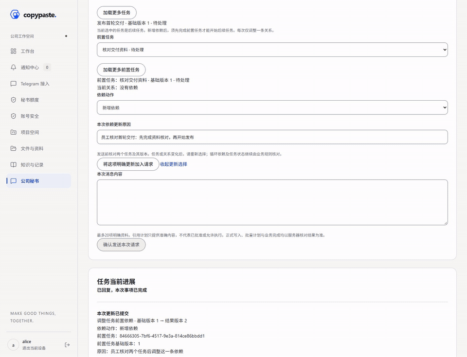

[Web MP4](videos/secretary-task-dependencies-web.mp4) · [Mobile MP4](videos/secretary-task-dependencies-mobile.mp4) · [Mobile GIF](gifs/secretary-task-dependencies-mobile.gif)

本轮MP4：Web1440 × 1100，17.406秒／84捕获帧；移动390 × 900，15.818秒／78捕获帧。GIF约1.1604×／1.0545×，两GIF均91帧；确切时序见媒体JSON。

实际连续像素以原始帧间隔生成无声H.264 MP4，GIF按来源时长有界加速，未重画业务结果。先完成登录／MFA再录制；JPEG帧保持忽略。中途路由加载画面保留，不作无缝剪辑。八张PNG和两GIF首／中／末帧按像素抽样核对；完整时间／帧摘要、编码器、ffprobe及原失败／被替代采集见[验证](../quality/evidence/task-dependencies/verification.md)和[媒体记录](../quality/evidence/task-dependencies/media.json)。

Silent H.264 MP4s preserve actual frame timing; GIF speed derives from capture duration. Login/MFA precede recording, raw JPEGs stay ignored, and real route-loading transitions remain visible. The linked record binds durations, frame digests, encoder and probes; visual review samples all eight screenshots and each GIF's first/middle/last frames. Compilation/development APKs and H5 demonstrations do not replace mini-program or Android device, model, cloud or production acceptance.
