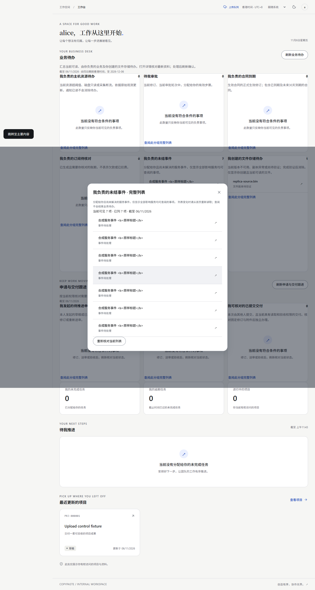
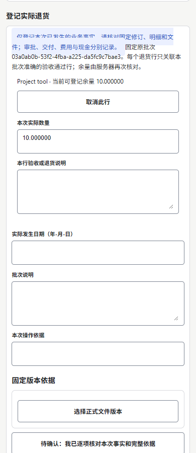

# 增量160实际页面素材 / Current actual UI media

合成本机数据，实际浏览器接通独立原生HTTP／PostgreSQL。登录完成后开始无声录制，排除凭据；本轮全部自建浏览器、临时服务与7个测试数据库集群均已关闭。MP4与interaction.gif是实际页面像素序列，保留加载／跳转；screenshot-tour.gif为截图导览，不能当成交互录像。无本轮真机／云／模型或正式生产验收。

| 编号 | 当前内容 / Content | PNG | 无声录像 / MP4 | 实际交互 / GIF | 截图导览 / Tour |
| --- | --- | --- | --- | --- | --- |
| M01 | Web采购当前订单／验收／独立结项依据 | [页面](batch-round-160-functional-wave-web-capture-2/web-current-purchase-closeout.png) | [Web录像](batch-round-160-functional-wave-web-capture-2/screen-recording.mp4) | [Web交互](batch-round-160-functional-wave-web-capture-2/interaction.gif) | [Web导览](batch-round-160-functional-wave-web-capture-2/screenshot-tour.gif) |
| M02 | Web完整7项本人负责事件，准确入口 | [完整清单](batch-round-160-functional-wave-web-capture-2/web-complete-work-inventory.png) | 同M01 | 同M01 | 同M01 |
| M03 | 共享移动履行入口 | [页面](batch-round-160-functional-wave-mobile-capture-2/mobile-fulfillment-completion.png) | [H5录像](batch-round-160-functional-wave-mobile-capture-2/screen-recording.mp4) | [H5交互](batch-round-160-functional-wave-mobile-capture-2/interaction.gif) | [H5导览](batch-round-160-functional-wave-mobile-capture-2/screenshot-tour.gif) |
| M04 | 准确执行基线／供应商／订单明细表单 | [订单表单](batch-round-160-functional-wave-mobile-capture-2/mobile-order-fixed-evidence.png) | 同M03 | 同M03 | 同M03 |
| M05 | 原始固定订单与完整验收历史 | [历史](batch-round-160-functional-wave-mobile-capture-2/mobile-immutable-receipt-history.png) | 同M03 | 同M03 | 同M03 |
| M06 | 选择原验收行后的人工退货表单 | [来源核对](batch-round-160-functional-wave-mobile-capture-2/mobile-return-source-review.png) | 同M03 | 同M03 | 同M03 |

M03包含仍在读取的提示，仅证明履行入口；M04已呈现当前执行依据。移动端只查阅及打开固定来源表单，不宣称录制中提交订单／退货或完成近期MFA。合成标题里的HTML样本文字按原文显示。

首轮Web错误空分组截图和移动选择器失败原件保留在对应initial目录；没有作为当前业务通过证明，也没有重新编码覆盖。详见 [统一验证与失败记录](../../quality/160-batch-functional-verification.md) 及 [人工视觉检查](../../quality/evidence/batch-round-160/visual-review.json)。本页6张当前PNG、2段MP4、2个实际交互GIF与2个截图导览GIF均有SHA-256；实际H5画面不代表新Android安装包或小程序发布。

English: Synthetic records, real local native HTTP/PG and authenticated Web/H5 pixels. Current evidence covers the exact seven-item work inventory and purchase execution/form navigation. MP4/interaction GIF preserve real transitions; tour GIFs are composed from actual screenshots. Human writes, model/cloud/device and production acceptance are not asserted. The initial wrong-group Web capture and failed mobile locator remain preserved separately.
