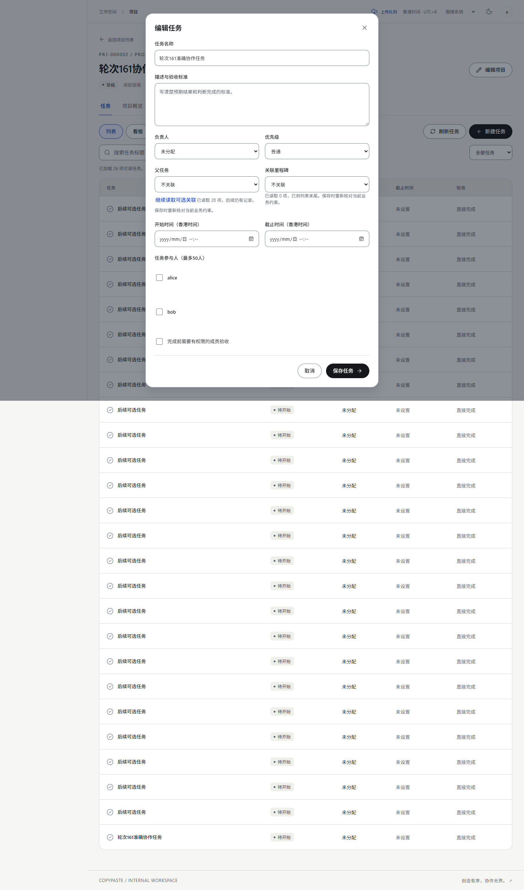
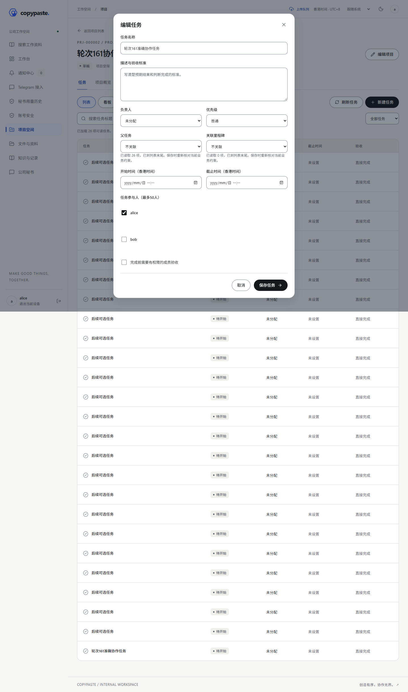
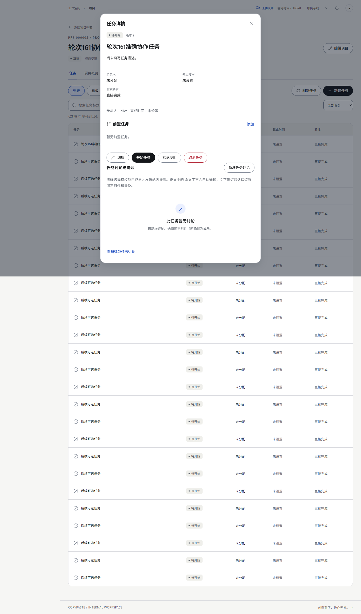
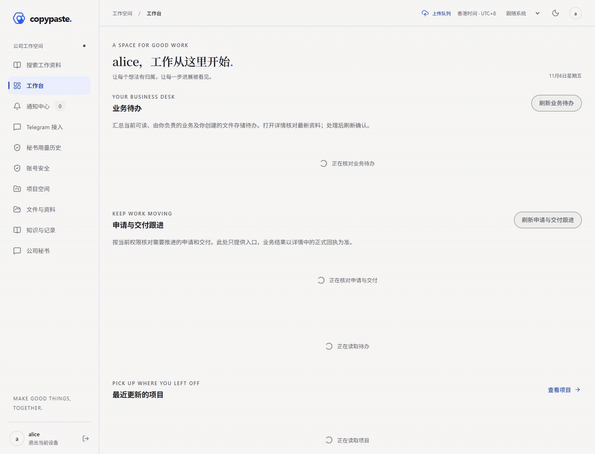
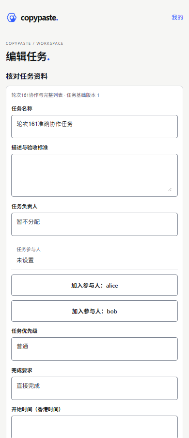
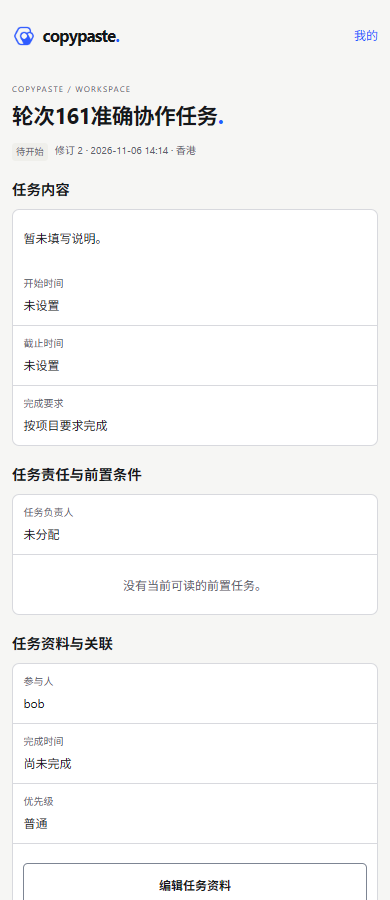
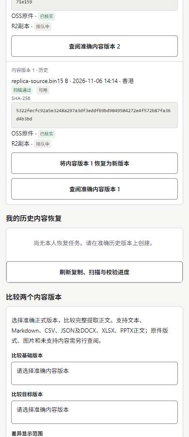
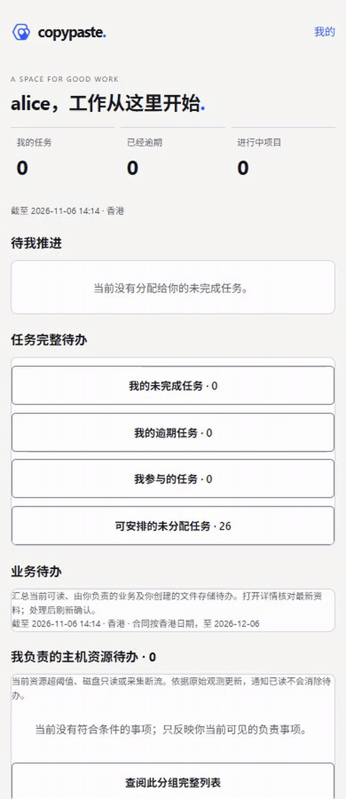

# 增量161：实际页面与交互 / Actual pages and interactions

本页主素材为本轮合成资料，实际Windows原生HTTP／PG接口与浏览器交互。先完成整批代码，再统一检查和修复。没有真实模型／云／平台调用；账号、项目和文件均为隔离合成数据。登录及MFA不录制，所有自建页面、浏览器、临时服务和集群均已关闭。

The primary set contains six screenshots, two silent actual viewport recordings, two interaction GIFs and two screenshot tours. Screenshots and timed recording frames retain byte hashes. This is local synthetic functional evidence; no formal device, platform, layout or production acceptance is asserted.

## Web：参与人及完整关联 / Participants and complete associations

[实际MP4 / Actual recording](batch-round-161-functional-wave-web-capture-5/screen-recording.mp4) · [实际交互GIF / Interaction GIF](batch-round-161-functional-wave-web-capture-5/interaction.gif) · [截图导览 / Screenshot tour](batch-round-161-functional-wave-web-capture-5/screenshot-tour.gif) · [准确结果 / Exact result](../../quality/evidence/batch-round-161-functional-wave-web-capture-5/result.json)

## 共享移动端H5：保存与恢复队列 / Shared-mobile save and recovery inventory

[实际MP4 / Actual recording](batch-round-161-functional-wave-mobile-capture-6/screen-recording.mp4) · [实际交互GIF / Interaction GIF](batch-round-161-functional-wave-mobile-capture-6/interaction.gif) · [截图导览 / Screenshot tour](batch-round-161-functional-wave-mobile-capture-6/screenshot-tour.gif) · [准确结果 / Exact result](../../quality/evidence/batch-round-161-functional-wave-mobile-capture-6/result.json)

## 证据与限制 / Evidence and limits

Web打开准确任务、选择参与人，关联从20项继续读至26项，普通版本保存后查阅回执。移动端选择参与人并保存，主动从回执进入准确任务，再查阅本人历史恢复队列。恢复队列本例为空；没有把查阅说成已复制／已提交。H5恢复区的重复加载占位已集中修复；最终mobile6明确检查只显示一个完成读取的当前队列。平台与完整布局验收继续开放。

All earlier failed fixture/capture attempts and the earlier mobile3/4/5 media remain immutable. Their checker sources are archived; the primary mobile6 recording binds the final loading-root repair, scrolls the exact target and asserts one settled owner queue. Earlier fixtures revealed token/header mismatch and a competing native initialization file; later attempts are prepared sequentially. Capture selectors were repaired without changing application code.

[验证与保留失败 / Verification](../../quality/161-batch-functional-verification.md) · [不可变尝试及修复 / Attempts and repairs](../../quality/evidence/batch-round-161/batch-repairs.json) · [视觉检查及限制 / Visual review](../../quality/evidence/batch-round-161/visual-review.json) · [23项待完成 /23 open packages](../../delivery/05-functional-closure-161.md)
