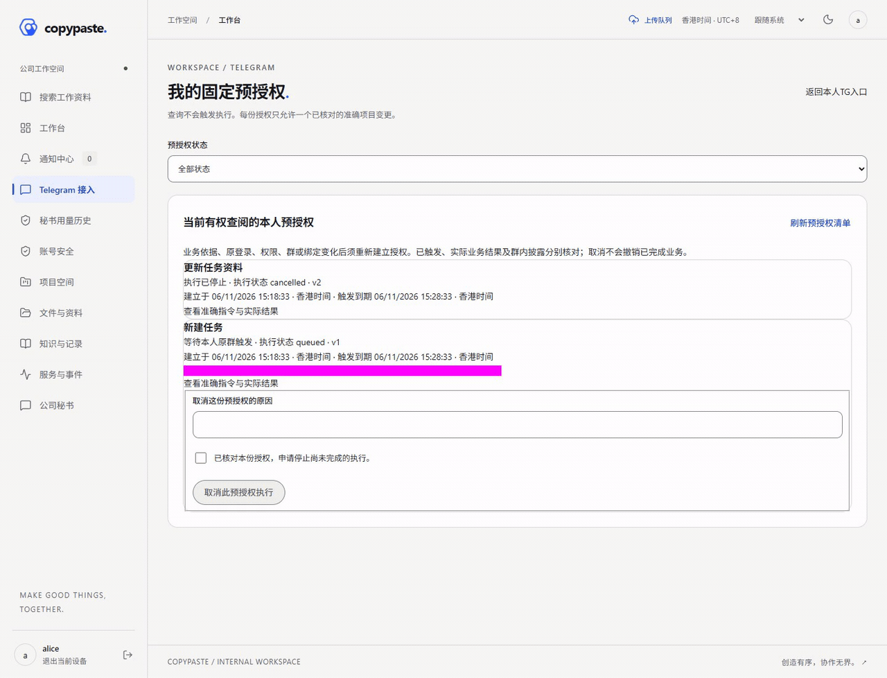

# 增量162页面与操作 / Increment162 pages and interactions

本轮主媒体展示本人固定TG预授权的实际读取、填写原因并确认取消、普通取消后的当前回执。Web与共享移动H5均使用隔离合成资料及真实原生HTTP／PostgreSQL；没有连接真实Bot、模型或云。固定原群触发文本已遮挡，密码与MFA页面未录制。

The primary captures show actual authenticated browser pixels: owner inventory → explicit reason and confirmation → ordinary cancellation → current receipts. Read and cancellation do not create an execution job. All owned browser contexts, temporary servers and isolated native database processes were closed; private fixtures were removed. H5 footage does not establish Android or miniapp platform acceptance.

| 客户端 / Client | 页面截图 / Screenshots | 连续操作 / Recording | GIF |
|---|---|---|---|
| Web · 当前 / current | [本人清单](batch-round-162-functional-wave-web-time/web-owner-grant-inventory.png) · [核对取消](batch-round-162-functional-wave-web-time/web-grant-cancel-review.png) · [实际回执](batch-round-162-functional-wave-web-time/web-grant-cancelled-receipt.png) | [实际静音MP4 · 2.4秒](batch-round-162-functional-wave-web-time/screen-recording.mp4) | [录屏转换互动GIF](batch-round-162-functional-wave-web-time/interaction.gif) · [六秒截图轮播](batch-round-162-functional-wave-web-time/screenshot-tour.gif) |
| 共享移动H5 · 当前 / shared mobile current | [本人清单](batch-round-162-functional-wave-mobile-initial/mobile-owner-grant-inventory.png) · [核对取消](batch-round-162-functional-wave-mobile-initial/mobile-grant-cancel-review.png) · [实际回执](batch-round-162-functional-wave-mobile-initial/mobile-grant-cancelled-receipt.png) | [实际静音MP4 · 2.8秒](batch-round-162-functional-wave-mobile-initial/screen-recording.mp4) | [录屏转换互动GIF](batch-round-162-functional-wave-mobile-initial/interaction.gif) · [六秒截图轮播](batch-round-162-functional-wave-mobile-initial/screenshot-tour.gif) |

主媒体共6张截图、2段实际录屏、2个录屏转换GIF与2个独立截图导览GIF。截图导览只按图轮播，连续操作见MP4或互动GIF。移动截图保存当前视口，避免Taro缓存页面进入长图。

Web首录已成功，但到期时间只显示日期。随后补充香港时分秒，保留[首录原证明](../../quality/evidence/batch-round-162-functional-wave-web-initial/result.json)、[原截图](batch-round-162-functional-wave-web-initial/web-owner-grant-inventory.png)、[原录屏](batch-round-162-functional-wave-web-initial/screen-recording.mp4)、[原互动GIF](batch-round-162-functional-wave-web-initial/interaction.gif)及[原截图导览](batch-round-162-functional-wave-web-initial/screenshot-tour.gif)。主媒体使用明确命名的web-time新录制；没有覆盖首录，也没有重跑未受影响的移动流程。

The retained first Web capture is an earlier successful local path with date-only timestamps. The current Web capture includes Hong Kong hours, minutes and seconds after a disclosed display-only repair. Unaffected mobile capture and test evidence retain their original source identities. No artifact is renamed as current production evidence.

[Web输入／关闭记录](../../quality/evidence/batch-round-162-functional-wave-web-time/result.json) · [移动输入／关闭记录](../../quality/evidence/batch-round-162-functional-wave-mobile-initial/result.json) · [六张截图与两份GIF末帧视觉复核](../../quality/evidence/batch-round-162/visual-review.json) · [整轮验证](../../quality/162-batch-functional-verification.md) · [使用流程](../../development/162-batch-functional-closure.md)

全部八个冻结版本及此前媒体保留。rc.8／APK154仍为业务153／schema113；本轮无新Android原生bundle／APK／正式签名或真实服务验收。
