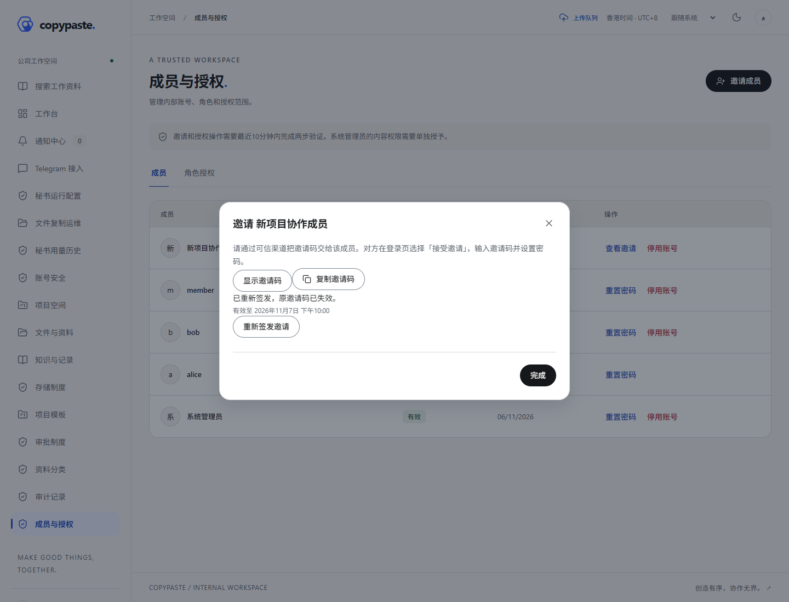
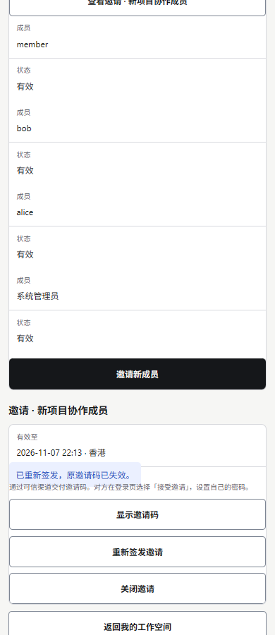

# 增量167：真实合成界面媒体 / Actual synthetic interface media

实际原生API/PostgreSQL驱动的Web与Taro H5合成流程：查看已过期邀请、人工重新签发、保留同一成员并隐藏新凭证。只在完成鉴权后开始静默录制，不显示密码、MFA秘密或激活凭证。H5使用共享移动源码，未声称微信/抖音/Android真实平台验收。四张PNG已逐张查看；MP4/GIF按同一源记录编码，未额外宣称完整回放人工验收。

| 界面 | 过期邀请 | 重发结果 | 静默录屏 | 实际录屏GIF | 截图GIF |
|---|---|---|---|---|---|
| Web | [PNG](batch-round-167-functional-wave-web-final/web-expired-invitation.png) | [PNG](batch-round-167-functional-wave-web-final/web-reissued-invitation.png) | [MP4](batch-round-167-functional-wave-web-final/screen-recording.mp4) | [GIF](batch-round-167-functional-wave-web-final/interaction.gif) | [GIF](batch-round-167-functional-wave-web-final/screenshot-tour.gif) |
| Taro H5 | [PNG](batch-round-167-functional-wave-mobile-final/mobile-expired-invitation.png) | [PNG](batch-round-167-functional-wave-mobile-final/mobile-reissued-invitation.png) | [MP4](batch-round-167-functional-wave-mobile-final/screen-recording.mp4) | [GIF](batch-round-167-functional-wave-mobile-final/interaction.gif) | [GIF](batch-round-167-functional-wave-mobile-final/screenshot-tour.gif) |

[统一验证](../../quality/167-batch-functional-verification.md) · [23编号余项](../../delivery/05-functional-closure-167.md)
