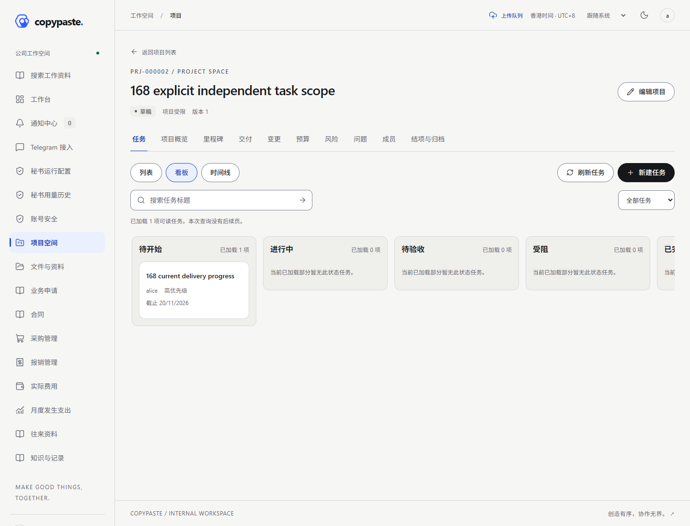

# 增量168实际页面、录屏与GIF / Actual168 media

来自隔离合成资料、正常本人登录后的实际Web／Taro H5与原生HTTP／PG。最终Web 5项、H5 6项页面检查通过；共9张PNG、2段无声实际录屏、2个录屏转换GIF和2个截图巡览GIF。登录过程不录制，私密字段检查在每帧／截图前执行。全部自建上下文、浏览器、临时服务和PG均关闭。

These are authenticated native API/database views with synthetic records. The viewport recording captures actual browser pixels; the screenshot tour is separately labelled. No model, native picker, device, cloud, platform or production acceptance is implied. The assessment deliberately retains failure1 and does not publish a Skill.

| 客户端 / Client | 页面截图 / Screenshots | 实际录屏 / Recording | 录屏转换GIF | 截图巡览GIF |
| --- | --- | --- | --- | --- |
| Web | [看板](batch-round-168-functional-wave-web3/web-task-board.png) · [时间线](batch-round-168-functional-wave-web3/web-task-timeline.png) · [合同节点关联](batch-round-168-functional-wave-web3/web-contract-task-links.png) · [评估资料](batch-round-168-functional-wave-web3/web-skill-assessment-evidence.png) | [MP4，6.2秒](batch-round-168-functional-wave-web3/screen-recording.mp4) | [实际操作GIF](batch-round-168-functional-wave-web3/interaction.gif) | [截图巡览](batch-round-168-functional-wave-web3/screenshot-tour.gif) |
| Taro H5 | [看板](batch-round-168-functional-wave-mobile3/mobile-task-board.png) · [时间线](batch-round-168-functional-wave-mobile3/mobile-task-timeline.png) · [合同关联](batch-round-168-functional-wave-mobile3/mobile-contract-task-links.png) · [评估资料](batch-round-168-functional-wave-mobile3/mobile-skill-assessment-evidence.png) · [普通上传工作区](batch-round-168-functional-wave-mobile3/mobile-ordinary-upload-workspace.png) | [MP4，7.4秒](batch-round-168-functional-wave-mobile3/screen-recording.mp4) | [实际操作GIF](batch-round-168-functional-wave-mobile3/interaction.gif) | [截图巡览](batch-round-168-functional-wave-mobile3/screenshot-tour.gif) |

微信原生文件／照片选择和抖音照片选择未在H5冒充执行；工作区只证明当前页面入口和已有服务器队列。来源大小20 MiB为本应用边界；120 GB仍由Web／Android处理。当前Android源码未重建JS／APK，APK164仍163/schema129。

[原执行与所有尝试](../../quality/evidence/batch-round-168/browser-batch-attempts.json) · [人工查阅](../../quality/evidence/batch-round-168/visual-review.json) · [统一验证](../../quality/168-batch-functional-verification.md)。每组证据目录保留源清单、实际帧清单、录屏编码摘要及独立GIF转换摘要。实际录屏GIF用本机FFmpeg从已核对MP4作8fps、最大960宽、128色转换，不增添画面。早期失败截图／部分PNG和已通过旧H5尝试分别保留，不当作当前通过素材。
